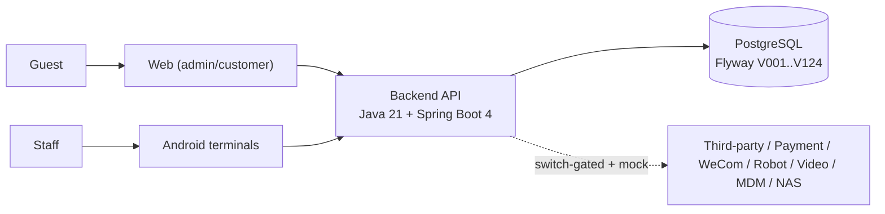

# Entertainment Complex Management System

> 文档goalP2(2026-06-20): English mirror of [`README.md`](./README.md). The Chinese `README.md` is authoritative; this file tracks it for international developers and third-party suppliers. All commands and numbers are evidence-backed (`ls` / `grep` / OpenAPI counts / Surefire reports / Playwright `--list`).

## 1. What it is

A multi-domain management platform for offline entertainment complexes, covering **ticketing, bar, supply chain, amusement, merchants, third-party integration, finance, and platform governance**: ticket sales & verification, bar SaaS/POS, inventory & stored-bottle management, amusement safety & queuing, merchant settlement, third-party reflow, AR/AP ledger, and full-chain traceability. It **starts as a single complex** with multi-tenant / multi-complex extensibility reserved (merchant/venue isolation, tenant-scope security).

## 2. Tech stack

| Layer | Technology | Evidence |
|---|---|---|
| Backend language | **Java 21** | `backend/pom.xml` |
| Backend framework | **Spring Boot 4.1.0** (Web MVC / Data JPA / Security / Validation / Actuator / AOP) | `backend/pom.xml` |
| Database | **PostgreSQL** | `backend/pom.xml`, migration dir |
| Migration | **Flyway** | `backend/src/main/resources/db/migration` |
| Build | **Maven** (Maven Wrapper preferred, system Maven 3.9+ fallback) | `backend/README.md`, `tools/run-backend-maven.mjs` |
| API docs | **springdoc-openapi 3.0.3** | `backend/pom.xml` |
| Frontend | **React 19 + Vite 8 + Ant Design 5 + TypeScript 5.7**, unit tests **Vitest 4** | `apps/web/package.json` |
| E2E | **Playwright 1.61** | `package.json`, `playwright.config.ts` |
| Terminals | **Android terminals** (Gradle/Kotlin DSL: work phone / tablet / kiosk) | `apps/android-terminal/` |

> The authoritative stack definition is `docs/00-current-effective-document-entry-v0.1.md` §2. Deprecated: TypeScript / SQLite / Prisma / Fastify backend were research prototypes only — not valid for formal dev/test/deploy/security (the `apps/api` prototype was physically removed on 2026-06-15).

## 3. Repository layout

```
complex-management/
├── backend/                # Java 21 + Spring Boot 4 backend (Maven, Flyway migrations V001..V124)
├── apps/
│   ├── web/                # React + Vite + antd admin/customer web
│   └── android-terminal/   # Android terminals (Gradle)
├── database/migrations/    # historical/reference migrations (authoritative ones live under backend/.../db/migration)
├── docs/                   # all product/dev/contract/acceptance/ops docs (entry: docs/00-...)
│   └── openapi/            # machine-readable P0 contract: openapi-p0.yaml / openapi-p0.json
├── ops/160/                # 160-host ops scripts (deploy/rollback/health/backup/NAS/restore drill)
├── tools/                  # Node verify:* / docs:* gate scripts
├── tests/e2e/              # Playwright E2E (mock & real backend)
└── package.json            # root npm workspace + all verify:* / docs:* scripts
```

## 4. Local run & verification

> Only scripts that **actually exist** in `package.json` / `apps/web/package.json` / `backend/README.md`. Node `>=22`.

### 4.1 Frontend (apps/web)
```bash
npm install                 # install root workspace deps
npm run dev:web             # start admin web (vite, :5173)
npm run typecheck           # frontend type-check (tsc -b --noEmit)
npm run build               # frontend build (typecheck then vite build)
npm run verify:unit         # frontend unit tests (vitest run)
```

### 4.2 Backend
```bash
npm run verify:backend-env  # backend env preflight (Java 21 / Maven)
npm run test:backend        # full backend tests (mvn test)
npm run dev:backend         # start backend (spring-boot:run, :8080)
```
Backend connection vars (`backend/README.md`): `COMPLEX_DATABASE_URL`, `COMPLEX_DATABASE_USERNAME`, `COMPLEX_DATABASE_PASSWORD`, `COMPLEX_API_PORT`, `COMPLEX_API_HOST`.

### 4.3 Key gates (verify:*)
```bash
npm run verify:openapi          # OpenAPI contract checks
npm run verify:p0-contract      # P0 contract closure (openapi/examples/operation matrix/client routes+coverage+fields)
npm run verify:tenant-isolation # multi-tenant isolation fail-closed gate
npm run verify:delivery-gates   # aggregate delivery gate (contract/matrix/security/production-evidence sub-gates)
npm run verify:production-blockers   # production blocker register (go-live gate)
```

### 4.4 E2E
```bash
npm run verify:ui                       # Playwright E2E (mock backend)
npm run verify:ui:real-backend:seeded   # real-backend E2E (seeded)
npm run verify:closed-loop-runtime      # closed-loop runtime acceptance (backend tests + frontend + UI)
```

## 5. Current baseline (2026-06-20, evidence-backed)

| Metric | Value | Evidence |
|---|---|---|
| Latest Flyway migration | **V124** | `ls backend/src/main/resources/db/migration` |
| OpenAPI operations | **386** | count HTTP methods in `docs/openapi/openapi-p0.yaml` |
| Backend tests | **1251** passing | `backend/target/surefire-reports/*.txt` (2026-06-20) |
| Frontend E2E | **42** (6 specs) | `npx playwright test --list` |

## 6. Architecture

See **[`docs/architecture-overview-v0.1.md`](./docs/architecture-overview-v0.1.md)** for full Mermaid diagrams (system context, backend domain modules, layering & request flow, key business flow, frontend/terminals, delivery gates). System context:



Each write action passes `@GuardedAction` (permission + terminal switch + AdmissionGuard) → Service (business + idempotency + traceability) → JDBC Repository (forced merchant_id/project_id scope) → PostgreSQL, emitting audit events; exceptions flow into the unified `risk_alerts` responsibility chain.

## 7. Audience reading paths

Single entry: **`docs/00-current-effective-document-entry-v0.1.md`**.

| Audience | Start | Key docs |
|---|---|---|
| **Product** | entry §3.1 | `product-requirements-v0.1.md`, `business-decision-log-v0.1.md`, domain `*-product-prd-v0.1.md` |
| **Dev** | entry §3.2/§3.3 | `system-development-spec.md`, `*-development-design.md`, `foundation-database-design.md`, `openapi/openapi-p0.yaml`, `v099-v124-feature-implementation-and-acceptance-spec-v0.1.md` |
| **Test** | entry §3.5 | `p0-end-to-end-acceptance-and-edge-cases-v0.1.md`, `full-admin-ui-acceptance-matrix-v0.1.md`, `p0-action-event-evidence-matrix-v0.1.md`, `tests/e2e/` |
| **Ops** | entry §3.2 ops | `server-160-runbook-v0.2.md`, `nas-backup-and-restore-runbook-v0.1.md`, `operations-reconciliation-and-exception-handling-runbook-v0.1.md` |
| **Supplier** | entry §3.6 | `third-party-supplier-integration-kit-v0.1.md`, `third-party-access-layer-spec-v0.2.md`, `integration-capability-switches-v0.1.md`, `openapi/openapi-p0.yaml` |

## 8. Boundary statement

- **Integration / business acceptance ready**: local/160 integration and business acceptance are supported via mock/adapter/UI/backend tests/E2E doubles, but `MOCK_IS_NOT_PRODUCTION_EVIDENCE`.
- **Go-live gating**: decided by `verify:production-blockers` / `verify:delivery-gates`; failing gates block release.
- **External dependencies pending**: commercial MDM (AMAPI), real third-party interface materials (Meituan/Dianping/Douyin/POS/video), real payment credentials are production prerequisites — until provided, capabilities stay switched **off + mock adapters**, no fabricated reconciliation. See `docs/external-dependency-gates-v0.1.md`, `docs/integration-capability-switches-v0.1.md`.
