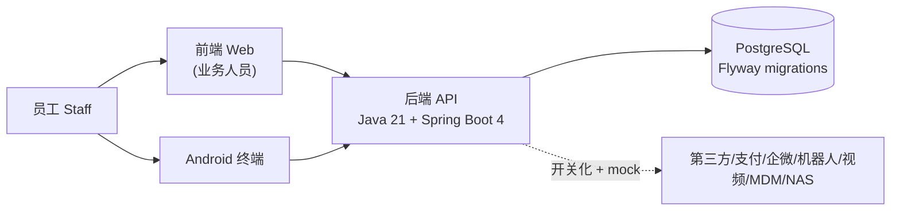

# 综合体管理系统（Entertainment Complex Management）

版本：V0.04

> 文档goal(2026-06-20)：本 README 为仓库第一入口，供产品、开发、测试、运营、第三方供应商快速理解项目并上手。所有命令与数字均经实证（`ls`/`grep`/OpenAPI 统计/Surefire 报告/Playwright `--list`），不臆造。
>
> 🌐 English: [`README.en.md`](./README.en.md) ｜ 🏗️ 架构图集：[`docs/architecture-overview-v0.1.md`](./docs/architecture-overview-v0.1.md)

## 1. 项目定位

综合体管理系统是一套面向线下娱乐综合体的多业务域管理平台：覆盖**票务、酒吧、供应链、游乐、商户、第三方接入、财务、平台治理**等业务域，统一处理售票核销、酒吧 SaaS/POS、库存与存酒、游乐安全与排队、商户结算、第三方对接、应收应付台账与全链路留痕。系统以**单综合体起步**，预留多租户/多综合体可扩展能力（商户/场地隔离、租户范围安全）。

## 2. 技术栈

| 层 | 技术 | 实证来源 |
|---|---|---|
| 后端语言/平台 | **Java 21** | `backend/pom.xml`（`<java.version>21</java.version>`） |
| 后端框架 | **Spring Boot 4.1.0**（spring-boot-starter-parent 4.1.0；Web MVC / JDBC / Security / Validation / Actuator / AOP） | `backend/pom.xml` |
| 数据库 | **PostgreSQL** | `backend/pom.xml`（starter-jdbc）、迁移目录 |
| 迁移 | **Flyway**（`spring-boot-flyway`） | `backend/pom.xml`、`backend/src/main/resources/db/migration` |
| 构建 | **Maven**（P0 唯一构建工具，优先 Maven Wrapper，回退系统 Maven 3.9+） | `backend/README.md`、`tools/run-backend-maven.mjs` |
| API 文档 | **springdoc-openapi 3.0.3** | `backend/pom.xml`（`<springdoc.version>3.0.3</springdoc.version>`） |
| 前端 | **React 19 + Vite 8 + Ant Design 5 + TypeScript 5.7**，单元测试 **Vitest 4** | `apps/web/package.json` |
| 前端 E2E | **Playwright 1.61** | 根 `package.json`、`playwright.config.ts` |
| 终端 | **Android 终端**（Gradle/Kotlin DSL，工作手机/平板/一体机 kiosk） | `apps/android-terminal/`、`apps/android-terminal/README.md` |
| 客人端 | **官方客人 App**（Android、iPhone，Capacitor 8.5.3 本地打包客人页面）＋**微信小程序**（原生 WXML/WXSS/JS），三端共用 `@complex/customer-core` | `apps/customer-app/`、`apps/customer-miniapp/`、`packages/customer-core/`、`docs/customer-app-miniapp-development-design-v0.1.md` §1.4 |

> 正式技术栈口径以 `docs/00-current-effective-document-entry-v0.1.md` §2 为准。废止路线：TypeScript / SQLite / Prisma / Fastify 后端仅为历史预研原型，不得作为正式开发、测试、部署、安全审计依据（`apps/api` 已于 2026-06-15 物理移除）。

## 3. 目录结构

```
complex-management/
├── backend/                # 正式 Java 21 + Spring Boot 4 后端（Maven 工程，含 Flyway 迁移）
│   ├── pom.xml
│   ├── README.md           # 后端本地启动说明
│   └── src/main/resources/db/migration/   # Flyway 迁移（版本以目录为准）
├── apps/
│   ├── web/                # React + Vite + antd 管理端（含 ticketing/bar/amusement 模块；客人无网页端）
│   ├── customer-app/       # 官方客人 App 客人专用构建入口（android/、ios/ 为 Capacitor 原生壳）
│   ├── customer-miniapp/   # 微信小程序（原生，miniprogram/）
│   └── android-terminal/   # Android 终端（android-app/，Gradle）
├── packages/
│   └── customer-core/      # 客人三端共用的纯 TS 客人业务模块
├── docs/                   # 全部产品/开发/契约/验收/运营文档（第一入口见 docs/00-...）
│   └── openapi/            # 机器可读 P0 契约：openapi-p0.yaml / openapi-p0.json
├── ops/
│   └── 160/                # 160 主机运维脚本（部署/回滚/健康检查/备份/NAS 挂载/恢复演练）
├── tools/                  # Node 校验/生成脚本（verify:* / docs:* 闸口实现）
├── tests/
│   └── e2e/                # Playwright 端到端用例（mock 与真实后端）
├── security-scans/         # Semgrep 等安全扫描产物
├── package.json            # 根 npm workspace + 全部 verify:* / docs:* 脚本
├── playwright.config.ts            # 默认（mock）E2E 配置
└── playwright.real-backend.config.ts   # 真实后端 E2E 配置
```

## 4. 本地启动与验证

> 仅列根 `package.json`、`apps/web/package.json`、`backend/README.md` 中**真实存在**的脚本。Node `>=22`。

### 4.1 前端（apps/web）

```bash
npm install                 # 安装根 workspace 依赖
npm run dev:web             # 启动 Web 管理端（vite，:5173）
npm run typecheck           # 前端类型检查（tsc -b --noEmit，workspace apps/web）
npm run build               # 前端构建（先 typecheck 再 vite build）
npm run verify:unit         # 前端单元测试（vitest run）
```

### 4.2 后端（backend）

```bash
npm run verify:backend-env  # 后端环境前置校验（Java 21 / Maven 可用性）
npm run test:backend        # 后端完整测试（mvn test，优先 Maven Wrapper）
npm run dev:backend         # 启动后端（spring-boot:run，默认 :8080）
# 或在 backend/ 目录直接：mvn test / mvn spring-boot:run
```

后端连接信息（见 `backend/README.md`）：`COMPLEX_DATABASE_URL`、`COMPLEX_DATABASE_USERNAME`、`COMPLEX_DATABASE_PASSWORD`、`COMPLEX_API_PORT`、`COMPLEX_API_HOST`。

### 4.3 关键验证闸口（verify:*）

```bash
npm run verify:openapi          # OpenAPI 契约校验
npm run verify:p0-contract      # P0 契约闭合（OpenAPI/示例/operation 矩阵/追溯附录/客户端路由+覆盖+字段）
npm run verify:tenant-isolation # 多租户隔离 fail-closed 闸口
npm run verify:delivery-gates   # 交付总闸口（聚合契约/矩阵/安全基线/生产就绪证据等全部子闸口）
npm run verify:production-blockers   # 生产阻断清单（生产上线把关）
```

### 4.4 端到端（E2E）

```bash
npm run verify:ui                       # Playwright E2E（mock 后端）
npm run verify:ui:real-backend:seeded   # 真实后端 E2E（带种子数据）
npm run verify:closed-loop-runtime      # 闭环运行态总验收（后端测试 + 前端 typecheck/build + 常规与真实后端 UI）
```

### 4.5 客人三端（官方客人 App 与微信小程序）

```bash
npm run dev:customer-app                                  # 客人页面开发服务（vite，:5174）
ANDROID_HOME=/home/james/android-sdk ANDROID_SDK_ROOT=/home/james/android-sdk npm run customer-android:apk   # 160 构建客人 Android 调试包
npm run verify:customer-android                           # Android 工程静态检查与发行包拒绝预演
npm run verify:customer-ios                               # iPhone 工程静态检查（构建只在 GitHub Actions ios-customer-app 工作流）
npm test --workspace apps/customer-miniapp                # 小程序 simulate 单测与结构检查（开发者工具编译与真机未验证）
```

导入微信开发者工具的步骤、各端已验证与未验证项、外部资料缺失时的表现见 `docs/customer-app-miniapp-development-design-v0.1.md` §1.4。

## 5. 当前基线（脚本自动回填，勿手改数字）

本节数字由 `node tools/refresh-entry-doc-baseline.mjs` 从权威源（OpenAPI JSON、Flyway 迁移目录、surefire 报告）自动回填；`--check` 可校验漂移。
表内“现有 surefire 报告”表示生成器保留的最近报告快照；无报告时，不代表当前工作区存在报告或本轮执行过测试。

<!-- baseline:auto-begin（tools/refresh-entry-doc-baseline.mjs 生成，手改会被覆盖） -->
| 指标 | 当前值 | 取证方式 |
|---|---|---|
| Flyway 最新迁移 | **V611**（576 个迁移） | `backend/src/main/resources/db/migration` 实时统计 |
| OpenAPI operation 数 | **1259** | `docs/openapi/openapi-p0.json` 方法统计（与 `npm run verify:operation-matrix` 同口径） |
| 后端测试 | **4641** tests（现有 surefire 报告） | `backend/target/surefire-reports` 合计；无报告时保留上次快照，不声明刚完成全量测试 |
| 前端 E2E | 以 `npx playwright test --list` 实时输出为准 | 不写死快照数 |
<!-- baseline:auto-end -->

> 历史快照（如 207/386/419/516 ops、52/179 迁移、579~1606 测试、V060/V124/V155/V182、31 E2E）见各文档变更记录，均为旧基线。各项数字以 OpenAPI 文件、Flyway 迁移目录、Surefire 报告与 `npm run verify:*` 实时输出为最终权威。

## 6. 五类读者阅读路径

统一第一入口：**`docs/00-current-effective-document-entry-v0.1.md`**（当前有效口径、废止内容、准入条件、角色最小阅读包）。在此基础上：

| 读者 | 从哪里开始 | 关键文档 |
|---|---|---|
| **产品** | 入口 §3.1 → 产品总纲 → 业务决策 | `docs/product-requirements-v0.1.md`、`docs/business-decision-log-v0.1.md`、各域 PRD（`docs/*-product-prd-v0.1.md`：票务/酒吧/游乐/供应链/财务/第三方/治理/终端） |
| **开发** | 入口 §3.2/§3.3 → 技术方案 → 域开发设计 → 契约 | `docs/system-development-spec.md`、`docs/java-backend-platform-foundation-development-design.md`、`docs/foundation-database-design.md`、`docs/*-development-design.md`、`docs/openapi/openapi-p0.yaml`、`docs/p0-openapi-operation-acceptance-matrix-v0.1.md` |
| **测试** | 入口 §3.5 → 验收矩阵 → 端到端 → 权限事件 | `docs/p0-end-to-end-acceptance-and-edge-cases-v0.1.md`、`docs/full-admin-ui-acceptance-matrix-v0.1.md`、`docs/full-admin-page-permission-field-matrix-v0.1.csv`、`docs/p0-action-event-evidence-matrix-v0.1.md`、`tests/e2e/` |
| **运营/运维** | 入口 §3.2 运维段 → Runbook → 生产就绪 | `docs/server-160-runbook-v0.2.md`、`docs/nas-backup-and-restore-runbook-v0.1.md`、`docs/production-credential-rotation-runbook-v0.1.md`、`docs/production-blocker-register-v0.1.md` |
| **第三方供应商** | 入口 §3.6 → 供应商套件 → 接入边界 | `docs/third-party-supplier-integration-kit-v0.1.md`、`docs/t3b-supplier-sdk-mock-kit-v0.1.md`、`docs/third-party-access-layer-spec-v0.2.md`、`docs/integration-capability-switches-v0.1.md`、`docs/openapi/openapi-p0.yaml` |

## 7. 文档地图入口

- 分类文档地图（按类别列出当前有效文档+用途+现行/部分过期/归档）：**`docs/documentation-map-v0.1.md`**
- 唯一正式口径与准入入口：**`docs/00-current-effective-document-entry-v0.1.md`**

## 8. 架构总览

完整架构图集（系统上下文、后端域模块地图、分层与请求流、关键业务链、前端/终端、交付闸口）见 **[`docs/architecture-overview-v0.1.md`](./docs/architecture-overview-v0.1.md)**。系统上下文概览：



受保护业务写动作的典型路径为 `@GuardedAction`（权限点 + 终端开关 + 准入闸 AdmissionGuard）→ Service（业务+幂等+留痕）→ JDBC Repository（商户/项目数据范围）→ PostgreSQL，并发布审计事件；异常进统一责任链 `risk_alerts`。登录等认证入口按自身处理逻辑执行。

## 9. 边界声明

- **可联调 / 可业务验收**：当前代码与文档支持本地/160 联调与业务验收；mock/adapter/页面/后端测试/E2E 替身可支撑验收，但 `MOCK_IS_NOT_PRODUCTION_EVIDENCE`，不替代生产证据。
- **生产上线把关**：由 `npm run verify:production-blockers` 与 `npm run verify:delivery-gates` 等闸口裁决，未通过即阻断上线。
- **外部依赖未到位**：商业 MDM（Android Enterprise/AMAPI）、第三方真实接口资料（美团/点评/抖音/POS/视频）、支付真实凭证等为生产前置，未到位前一律能力开关默认 off + mock 适配器运行，不伪造对账数据。详见 `docs/external-dependency-gates-v0.1.md`、`docs/integration-capability-switches-v0.1.md`。
