# 业务经营层关键流程图 V0.1

## 1. 文档定位

本文档用于描述业务经营层 P0 的关键流程、状态变化和跨业务依赖。

本文档只写产品流程，不写技术实现。流程图用于帮助后续页面、字段、验收和实现任务理解业务路径。

## 2. P0 流程总览

| 编号 | 流程 | 目标 |
|---|---|---|
| F1 | 票务策略到权益生成 | 明确卖什么、生成什么权益 |
| F2 | 权益现场核销 | 明确资格判断、核销结果和责任链 |
| F3 | 酒吧入场到关台 | 明确入场、开台、账单、赠饮和关台 |
| F4 | 供应链采购、库存与存酒 | 明确供应商、采购、库房、消耗和存酒 |
| F5 | 游乐开放到核销 | 明确项目开放、场次容量和核销 |
| F6 | 第三方回流到差异处理 | 明确外部结果如何进入平台 |
| F7 | 人工补录与复核 | 明确自动链路失败后的受控补救 |
| F8 | 日结、对账与结算 | 明确经营结果如何被财务确认 |
| F9 | 终端现场作业 | 明确员工上岗、设备、核销、交接 |
| F10 | 会员积分与兑换 | 明确积分如何产生、兑换扣减库存和现场领取 |

> 修订说明（2026-06-07）：新增 F10。breakdown §3「会员积分」P0 与 §9 已确认规则2（积分兑换扣减库存）已声明，但原流程图缺会员积分与兑换流程，按 bizfam-1 finding 补齐。

## 3. F1 票务策略到权益生成

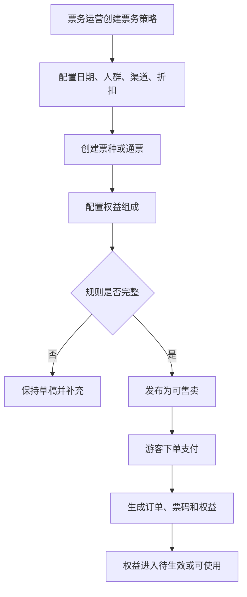

### 输出结果

- 票务策略。
- 票种/通票。
- 订单。
- 权益台账。

## 4. F2 权益现场核销

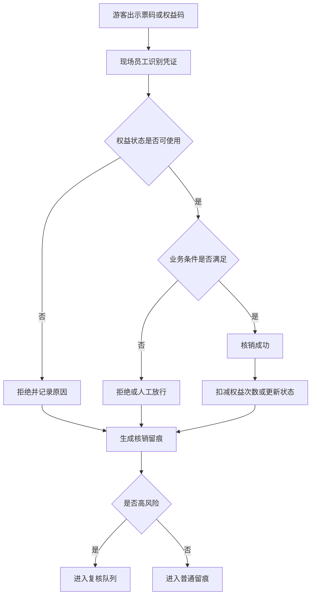

### 典型异常

- 权益已使用。
- 权益已退款。
- 权益过期。
- 不适用当前业务或点位。
- 重复核销。
- 员工人工放行。

## 5. F3 酒吧入场到关台

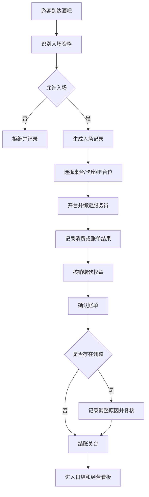

### 输出结果

- 入场记录。
- 桌台状态。
- 酒吧账单。
- 赠饮核销。
- 账单调整留痕。

## 6. F4 供应链采购、库存与存酒

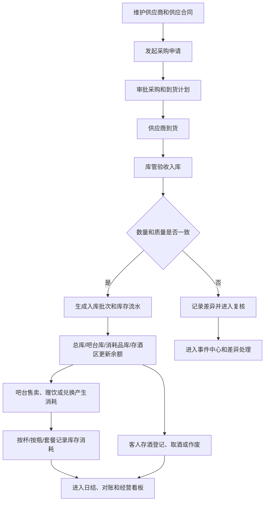

### 输出结果

- 供应商和供应合同。
- 采购周期和入库记录。
- 库存流水和库存余额。
- 吧台消耗记录。
- 客人存酒记录。
- 盘点差异、报损和复核记录。

## 7. F5 游乐开放到核销

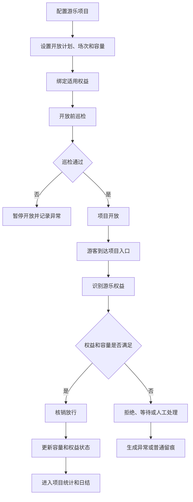

### 输出结果

- 项目开放状态。
- 场次容量。
- 游乐核销记录。
- 巡检和项目异常。

### 7A. F5A 游乐定期检修与恢复营业

> 修订说明（2026-06-07）：本小节新增。operation-traceability §2.3「游乐运营」把检修与开放/暂停/恢复并列为 P0 留痕，原流程图无检修-确认-恢复营业分支，按 bizfam-8 finding 补齐。

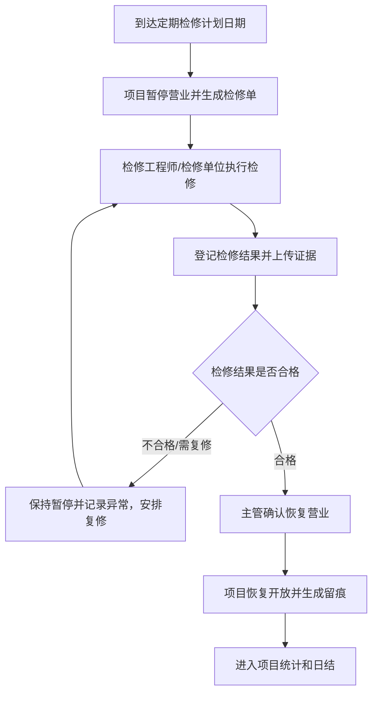

### 输出结果

- 检修单和检修结果。
- 主管确认记录。
- 恢复营业留痕。

## 8. F6 第三方回流到差异处理

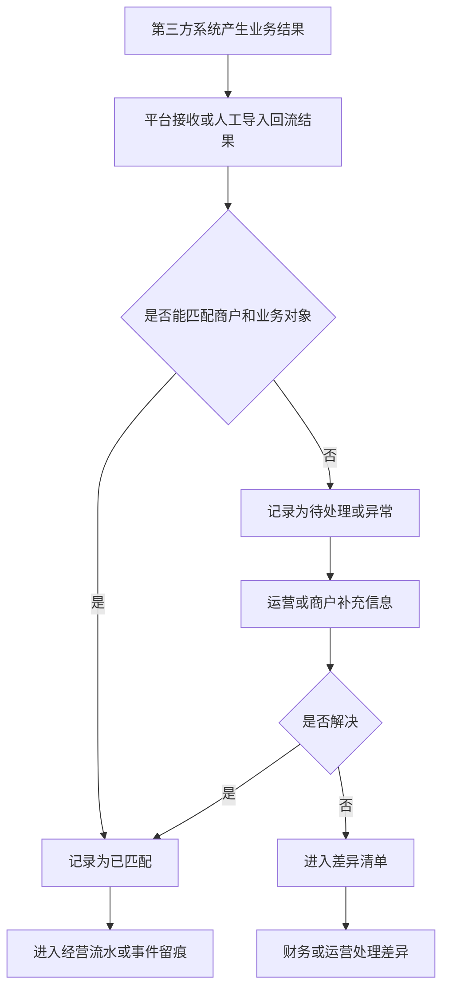

### 输出结果

- 第三方回流记录。
- 回流批次。
- 差异清单。
- 接入异常。

## 9. F7 人工补录与复核

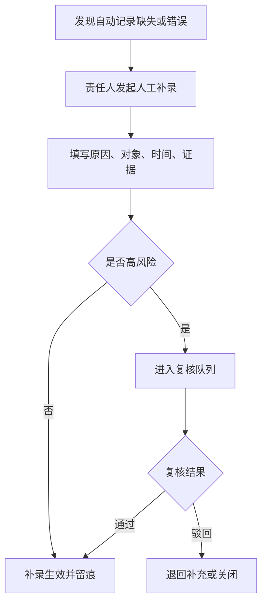

### 高风险补录

- 人工放行。
- 退款或撤销。
- 酒吧免单和账单调整。
- 高价值酒水报损、盘点差异和存酒作废。
- 游乐超容或暂停。
- 第三方差异调整。

## 10. F8 日结、对账与结算

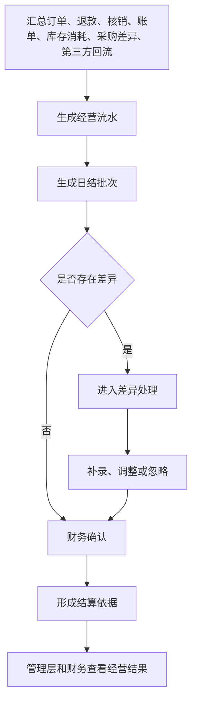

### 输出结果

- 经营流水。
- 日结批次。
- 差异记录。
- 结算依据。

## 11. F9 终端现场作业

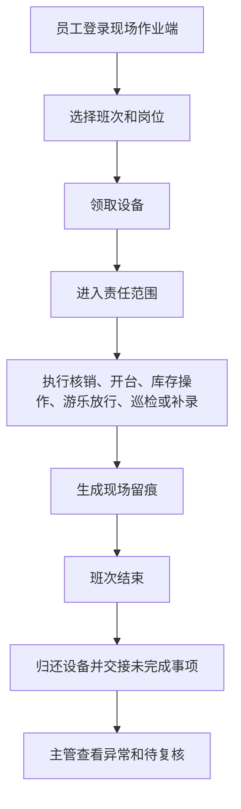

## 11A. F10 会员积分与兑换

> 修订说明（2026-06-07）：本节新增。breakdown §3 会员积分 P0、§9 已确认规则2（兑换扣减库存）与规则7（积分/等级/兑换规则后台定义）已声明，原流程图缺该流程，按 bizfam-1 finding 补齐。

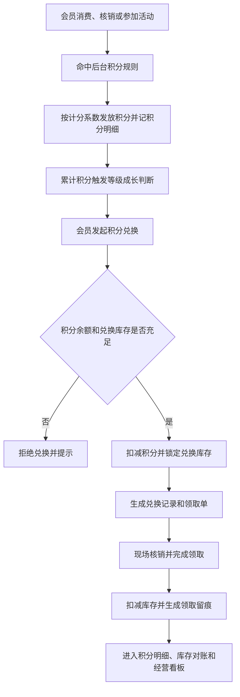

### 输出结果

- 会员积分明细和等级成长记录。
- 积分兑换记录。
- 兑换领取记录和库存扣减留痕。

## 12. 跨流程依赖

| 上游 | 下游 | 依赖关系 |
|---|---|---|
| 平台治理商户/空间/员工/设备 | 全部业务经营 | 没有基础治理，不能确定业务归属和责任链 |
| 票务权益 | 酒吧和游乐 | 赠饮和游乐使用都依赖权益 |
| 消费/核销 | 会员积分 | 消费和核销触发积分发放与等级成长（F10） |
| 会员积分兑换 | 供应链库存 | 积分兑换礼物/酒水需扣减库存（breakdown §9 规则2，F10） |
| 酒吧点酒和权益领取 | 供应链库存 | 吧台售卖、赠饮、兑换、酒类消耗和存酒会改变库存状态 |
| 供应链库存 | 财务日结 | 采购、消耗、报损和盘点差异会影响成本和经营判断 |
| 现场核销 | 财务日结 | 核销是对账和结算的重要口径 |
| 第三方回流 | 财务对账 | 外部结果必须进入统一差异处理 |
| 人工补录 | 风控和财务 | 补录会影响经营事实，必须留痕 |
| 事件中心 | 管理看板 | 异常和风险进入管理层判断 |

## 13. 流程验收标准

- 每条 P0 主流程都有起点、终点、异常分支和输出结果。
- 票务权益能连接酒吧赠饮和游乐核销。
- 第三方回流能进入差异处理和财务视图。
- 人工补录必须经过留痕或复核。
- 现场作业端所有动作能关联员工、设备、班次和点位。
- 供应链流程能覆盖酒类、消耗品、其他物品、吧台消耗和客人存酒。

## 14. 本版结论

业务经营层关键流程已经形成完整闭环：配置、售卖、核销、服务、供应链库存、回流、补录、对账、分析。后续可以按这些流程继续拆详细交互和实现任务。

## 15. 变更日志

| 日期 | 类型 | 位置 | 内容 | 原因/依据 |
|---|---|---|---|---|
| 2026-06-07 | 增 | §2 总览、§11A F10 | 新增「会员积分与兑换」流程图 | breakdown 会员积分 P0 缺流程（bizfam-1） |
| 2026-06-07 | 增 | §7A F5A | 新增「游乐定期检修与恢复营业」分支 | operation-traceability §2.3 检修 P0（bizfam-8） |
| 2026-06-07 | 改 | §12 跨流程依赖 | 补会员积分与库存兑换依赖 | 与 F10 对齐（bizfam-1） |
