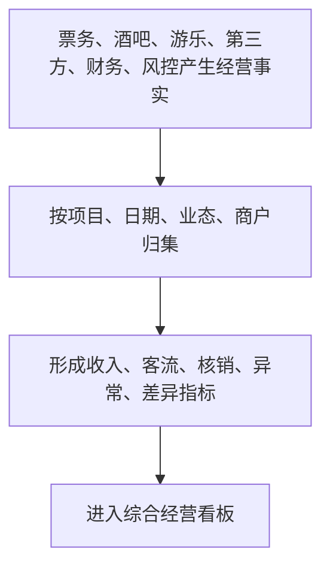
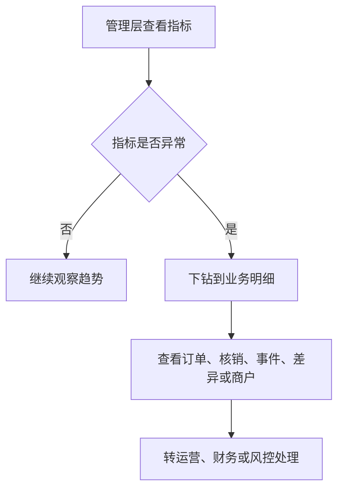
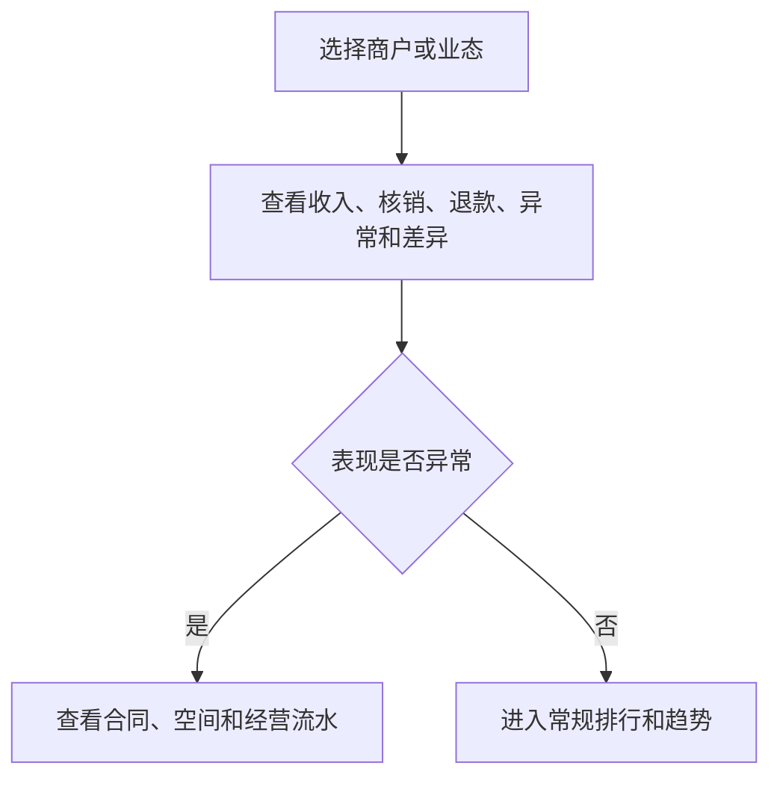
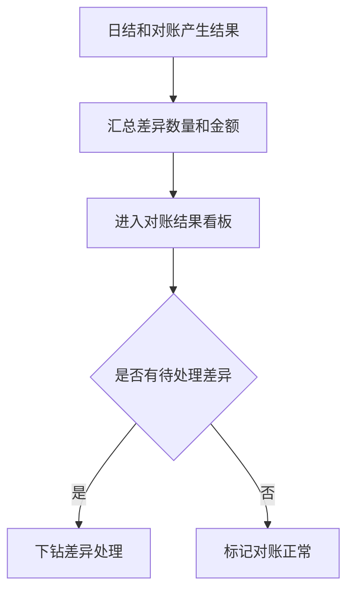

# 数据分析层关键流程图 V0.1

## 1. 文档定位

本文档描述数据分析层 P0 流程：数据来源如何进入指标、指标如何进入看板、看板如何下钻和处理。

## 2. F1 经营数据形成指标

## 3. F2 看板下钻

## 4. F3 商户表现分析

## 5. F4 对账结果分析

## 6. 流程验收标准

- 指标必须能追溯到业务来源。
- 看板发现异常必须能下钻。
- 对账差异必须能进入处理页面。
- 商户表现必须能关联合同和经营流水。

## 7. 销售服务责任链指标取数说明（依据 trace-5/tracewire-2）

> 修订说明（2026-06-07）：销售服务分析的责任链指标（销售归属率、卡座服务责任完整率、送达确认率、异常首响时长）走 F1 的"经营事实→归集→指标"通用路径，但其事实来源为责任链留痕：service_responsibility_records、bar_table_sessions、各域订单、异常事件（exception.reported/first_handled）。口径与 data-risk-ai §5.9、字段字典 §6.1 一字一致；送达确认率按订单级口径（每应送达点单只计一次）。

## 8. 本版结论

数据分析层流程已覆盖 P0 从经营事实到管理判断的路径，并明确销售服务责任链指标的事实来源与口径。

## 9. 变更日志

| 日期 | 类型 | 位置 | 内容 | 原因/依据 |
|---|---|---|---|---|
| 2026-06-07 | 增 | §7 | 新增销售服务责任链指标取数说明，明确事实来源表与订单级送达口径 | trace-5/tracewire-2/tracewire-4 |
