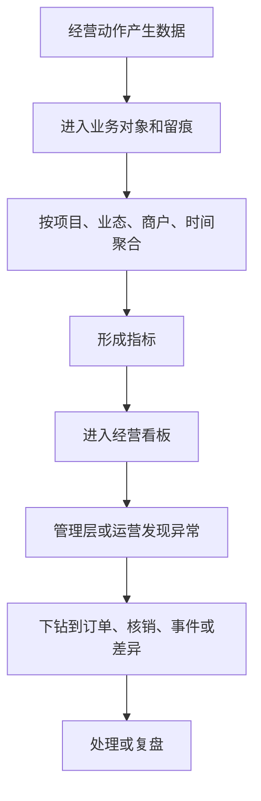

# 数据分析层产品 PRD V0.1

## 1. 文档定位

本文档按《综合体管理系统产品需求总纲 V0.1》的“数据分析层”拆解产品需求。数据分析层负责回答“经营结果和趋势怎么看”，包括经营看板、客流、核销、收入、供应链库存、异常、商户表现和对账结果。

本文档不做算法设计，不写数据处理方案，不写报表实现。P0 聚焦管理层和运营能看懂、能判断、能追问的基础经营分析。

## 2. P0 目标

P0 数据分析层目标：
- 提供综合体经营总览。
- 能按项目、业态、商户、时间、空间查看经营结果。
- 能看收入、客流、核销、退款、异常、差异等核心指标。
- 能比较票务、酒吧、游乐、第三方回流之间的经营表现。
- 能查看供应链采购、库存余额、吧台消耗、盘点差异、报损、客人存酒、物品追踪码和交接异常。
- 能查看订单来源、销售归属、卡座服务责任、异常第一处理人和异常首响时效。
- 能查看会员积分、会员等级、积分兑换和第三方售票渠道表现。
- 能从看板下钻到订单、券核销、事件、差异和商户详情。
- 餐饮/零售第三方数据按订单级和券核销级承接，并支持日、半日、小时汇总；单店小数据量场景支持实时汇总。

## 3. 角色

| 角色 | 关注重点 |
|---|---|
| 管理层 | 总收入、客流、业务趋势、风险和商户表现 |
| 平台运营 | 今日运行状态、核销、异常、第三方回流 |
| 财务 | 对账差异、退款、结算依据、收入口径 |
| 招商/商户管理 | 商户表现、业态表现、合同关联经营结果 |
| 票务运营 | 售票、权益、核销率、退款异常 |
| 酒吧运营 | 入场、开台、账单、赠饮、收入 |
| 采购/库管 | 采购周期、库存余额、吧台消耗、盘点差异、报损、客人存酒 |
| 游乐运营 | 项目开放、场次容量、核销、异常 |
| 会员运营 | 积分发放、等级成长、兑换结果、会员消费 |

## 4. P0 指标体系

| 指标组 | 指标 | 用途 |
|---|---|---|
| 收入 | 售票收入、酒吧收入、第三方回流收入、退款金额、净收入 | 看经营结果 |
| 客流 | 入场人数、酒吧入场、游乐核销人数、渠道客流 | 看人流变化 |
| 核销 | 权益发放数、核销数、核销率、拒绝数、人工放行数 | 看权益使用 |
| 酒吧 | 开台数、关台数、桌台利用、赠饮核销、账单调整 | 看酒吧经营 |
| 酒吧点酒 | 点酒订单数、最低消费达成率、扫码支付成功率、卡座消费 | 看平板点酒经营 |
| 销售服务 | 销售归属率、卡座服务责任完整率、送达确认率、服务责任变更次数、异常首响时长 | 看销售和现场服务责任链 |
| 供应链库存 | 采购申请数、到货及时率、库存余额、缺货预警、吧台消耗、盘点差异、报损金额、存酒余额、存酒到期、交接缺失、交接超时 | 看采购、库房、损耗、客人存酒和履约责任链 |
| 游乐 | 开放项目数、场次数、容量利用率、暂停次数、巡检异常 | 看项目运营 |
| 会员 | 新增会员、积分发放、积分消耗、兑换数量、会员等级分布 | 看会员运营 |
| 商户 | 商户收入、核销、退款、异常、差异 | 看商户表现 |
| 第三方 | 美团/大众点评/抖音等渠道订单、回流成功率、异常回流、差异数量、延迟数量 | 看外部接入质量 |
| 企业微信 | 每日上传状态、会话量、违规命中、投诉倾向、服务质量 | 看员工服务与沟通风险 |
| 设备管控 | 非预装软件、非白名单网站访问、设备锁定、策略违规 | 看工作手机使用风险 |
| 风险 | 待复核、异常事件、高风险命中、补录数量 | 看风险 |
| 财务 | 日结状态、对账差异、结算待确认 | 看财务确认 |

## 5. 数据来源产品口径

| 来源 | 提供内容 |
|---|---|
| 平台治理层 | 项目、空间、业态、商户、合同、员工、设备 |
| 业务经营层 | 票务、权益、订单、核销、会员积分、酒吧点酒、酒吧账单、供应链库存、采购周期、吧台消耗、客人存酒、游乐场次 |
| 第三方接入层 | 餐饮零售订单级回流、券核销级回流、日/半日/小时/实时汇总、机器人任务、视频证据、企业微信每日会话上传 |
| 设备管控层 | 工作手机应用白名单、网站白名单、设备策略违规 |
| 证据风控层 | 事件、补录、复核、风险提示 |
| 财务经营 | 流水、日结、差异、结算依据 |

## 6. 页面范围

| 页面 | P0 作用 |
|---|---|
| 综合经营看板 | 管理层第一入口，看整体经营和异常 |
| 收入分析 | 看收入、退款、净收入和渠道贡献 |
| 客流分析 | 看入场、核销和空间/业态客流 |
| 核销分析 | 看权益发放、使用、拒绝和人工放行 |
| 票务分析 | 看票种、渠道、策略和退款表现 |
| 会员积分分析 | 看积分发放、积分消耗、兑换、等级和会员消费表现 |
| 酒吧分析 | 看入场、开台、收入、赠饮、账单异常 |
| 酒吧点酒分析 | 看卡座消费、最低消费达成、平板点酒和支付成功率 |
| 销售服务分析 | 看订单来源、销售人员、卡座服务、送达确认和异常首响 |
| 供应链库存分析 | 看供应商、供应合同、采购周期、库存余额、吧台消耗、盘点差异、报损和客人存酒 |
| 企业微信质检 | 看会话上传状态、基础违规命中、投诉倾向和复核状态 |
| 工作手机管控 | 看非预装软件、非白名单网站访问和设备策略违规 |
| 游乐分析 | 看项目、场次、容量、核销、暂停和巡检 |
| 商户表现 | 看商户经营、异常和对账差异 |
| 异常风险看板 | 看风险事件、补录、复核和趋势 |
| 对账结果看板 | 看日结、差异、结算确认情况 |

> 修订说明（2026-06-07，依据 analytics-3）：本章页面均为产品口径 P0。其中**供应链库存分析、销售服务分析**按用户原始需求保留 P0，不得后置（供应链库存是用户点名 P0 域；销售服务责任链是用户明确要的 P0 分析）。开发设计文档 data-risk-ai §15 报表页面清单将部分专题分析标 P1 是"开发实现排期"口径，与本产品口径 P0 不冲突，但供应链库存分析与销售服务分析的口径以本 PRD 的 P0 为准（双向回写：已在 data-risk-ai §15 就地标注）。本章所有金额相关展示单位为分（整数，D1）。

## 7. P0 业务流程

## 8. P0 验收标准

- 综合经营看板能看收入、客流、核销、异常、待办。
- 所有指标能按项目、业态、商户、日期筛选。
- 看板指标能下钻到业务明细。
- 异常风险和对账差异不能只显示数字，必须能进入处理页面。
- 票务、酒吧、供应链、游乐四条主线都有独立分析视图。
- 会员积分、等级和兑换有独立分析视图或在客人/票务分析中可查看。
- 第三方售票渠道能区分美团、大众点评、抖音等来源。
- 餐饮/零售第三方看板能下钻到订单级和券核销级，并支持日、半日、小时汇总；单店小数据量场景可实时汇总。
- 酒吧点酒能查看最低消费达成和支付结果。
- 销售服务分析能查看订单来源、销售归属、卡座服务责任、服务送达确认和异常第一处理人。
- 供应链库存能查看采购周期、酒类/消耗品/其他物品库存、吧台消耗、盘点差异、报损、客人存酒、追踪码状态和交接异常。
- 企业微信质检能查看每日上传状态、基础违规命中和复核状态。
- 企业微信工作会话留存期限可配置（非永久），到期归档/销毁/匿名化（按 A7/合规C3、data-risk §11.5）；不脱敏原文仅限最小授权 + 审批的取证/质检场景，普通展示按权限脱敏，查看原文必须写入审计。<!-- 修订说明（2026-06-08 三轮收口）：原"永久保存"与本层 page-list/low-fi/acceptance 及 data-risk §11.5 可配置留存口径打架，就地统一；2026-06-08 复核补充不脱敏原文的最小授权边界。依据 finding residual-scan-2、A7/C3 -->

- 商户侧在授权业务范围内可查看自己的分析看板，不看平台全局和其他商户。
- 工作手机管控能查看非预装软件、非白名单网站访问和设备违规。

## 9. P1/P2

| 阶段 | 能力 |
|---|---|
| P1 | 周报/月报、同比环比、商户排行、渠道分析、会员积分活动分析、安全库存预警、库存周转、容量效率、复核趋势、企业微信服务分析 |
| P2 | 经营预测、异常自动解释、AI 分析、企业微信深度语义质检、游客画像、智能建议 |

## 10. 已确认规则和后续细化事项

已确认：

1. 餐饮/零售第三方回流同时支持订单级和券核销级。
2. 数据看板支持日、半日、小时汇总；单店小数据量场景可实时汇总。
3. 美团、大众点评、抖音团购渠道需要独立区分来源。
4. 酒吧点酒看板 P0 展示最低消费达成率。
5. 供应链库存看板 P0 先覆盖酒类、吧台消耗、客人存酒、常用消耗品、追踪码状态和交接异常。
6. 库存差异和报损按金额、数量、责任人、库房和证据状态展示。
7. 销售服务分析 P0 先覆盖订单来源、销售归属率、卡座服务责任完整率、送达确认率和异常首响时长。
8. 企业微信工作会话留存期限可配置（非永久），到期归档/销毁/匿名化（按 A7/合规C3、data-risk §11.5）；不脱敏原文仅限最小授权 + 审批的取证/质检场景，普通展示按权限脱敏。<!-- 修订说明（2026-06-08 三轮收口）：原"永久保存"为收口前固化规则，与 A7/C3 可配置留存相反，就地改正；2026-06-08 复核补充不脱敏原文的最小授权边界。依据 finding residual-scan-2、A7/C3 -->

9. 商户侧在授权业务范围内可查看自己的分析看板。
10. 管理层第一版看板按“收入、客流、核销”为第一屏，“商户表现、异常风险、结算差异”为第二屏。
11. P0 支持 CSV/Excel 日报导出，复杂报表排版进入 P1。
12. 游客/会员分析 P0 先打通游客识别和票务权益，会员分层分析进入 P1。
13. 会员积分看板 P0 归入票务分析，独立会员分析进入 P1。

后续细化：

无。后续仅根据真实经营数据和管理层偏好调整指标顺序。

## 11. 本版结论

数据分析层 P0 的核心是让经营事实变成可判断的管理视图。它不追求一开始智能化，但必须做到指标清晰、来源清楚、可下钻、能发现异常。

## 12. 变更日志

| 日期 | 类型 | 位置 | 内容 | 原因/依据 |
|---|---|---|---|---|
| 2026-06-07 | 改 | §4 | 销售服务指标组指标名统一为"卡座服务责任完整率" | tracewire-5 |
| 2026-06-07 | 增 | §6 | 补 P0/P1 对齐说明：供应链库存分析、销售服务分析按原始需求保留 P0，与 data-risk-ai §15 双向对齐；金额单位为分（D1） | analytics-3/D1 |
| 2026-06-08 三轮收口 | 改 | §8/§10 | 两处"企业微信工作会话永久保存"改为"留存期限可配置（非永久），到期归档/销毁/匿名化（按 A7/合规C3、data-risk §11.5）"，与本层 page-list/low-fi/acceptance 统一 | residual-scan-2、A7/C3 |
