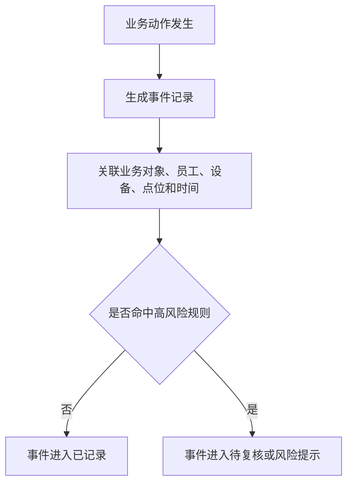
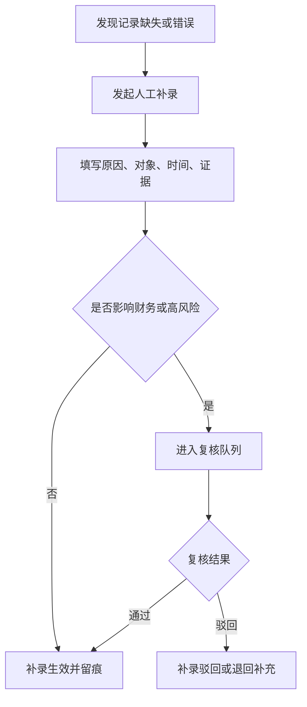
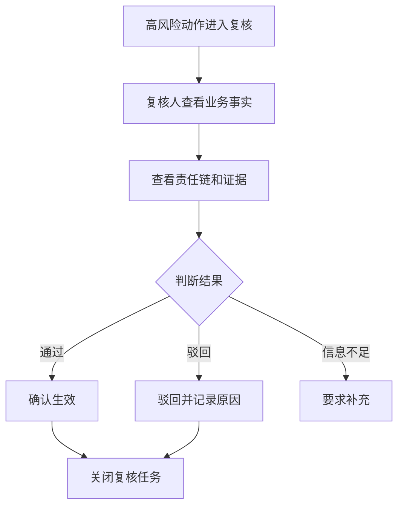
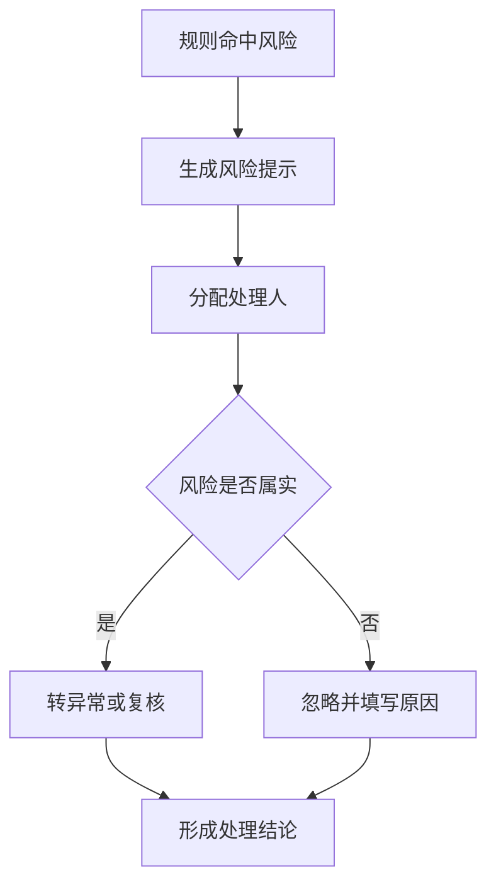
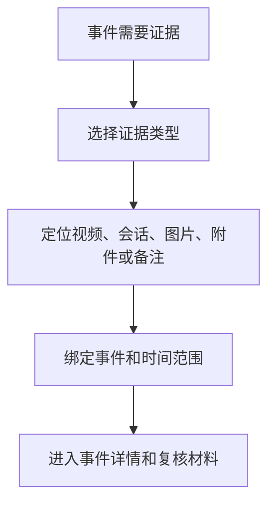
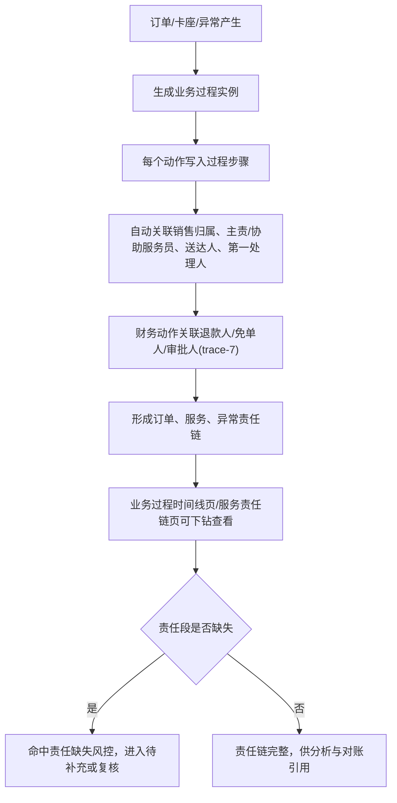

# 证据留痕与风控层关键流程图 V0.1

## 1. 文档定位

本文档描述证据留痕与风控层 P0 关键流程，包括事件生成、人工补录、复核、风险提示和证据绑定。

## 2. F1 事件自动留痕

## 3. F2 人工补录

## 4. F3 复核处理

## 5. F4 风险提示处理

## 6. F5 证据绑定

## 6.1 F6 责任链追溯（依据 tracewire-6，对齐 PRD §7.4）

> 修订说明（2026-06-07）：补"业务过程时间线"与"服务责任链"两页对应的追溯流程，使 page-list §9/§10 两页有流程支撑。

## 7. 流程验收标准

- 每个高风险动作必须进入复核或风险提示。
- 人工补录不能绕过留痕。
- 复核驳回必须说明原因。
- 证据必须绑定事件才能作为复核依据。
- 风险忽略必须填写原因。
- 责任链追溯必须能形成订单/服务/异常责任链，并关联退款人/免单人等财务责任（trace-7）。
  > 修订说明（2026-06-07，broken-ref-1/overclaim-2 收口）：退款人(refunded_by)/免单人(waived_by)/审批人(approved_by)为产品字段已定义，落库以 `service_responsibility_records` 财务责任段为准（地基已补，权威落点 foundation-database §6.12，已核对），本流程图节点据此关联，不悬挂未建表。

## 8. 本版结论

证据留痕与风控层流程已覆盖 P0 追溯和风控闭环，并补责任链追溯流程（含财务责任段）。

## 9. 变更日志

| 日期 | 类型 | 位置 | 内容 | 原因/依据 |
|---|---|---|---|---|
| 2026-06-07 | 增 | §6.1 | 新增 F6 责任链追溯流程，含退款人/免单人财务责任段，对齐 PRD §7.4 与 page-list §9/§10 | tracewire-6/trace-7 |
| 2026-06-07 | 改 | §7 | 责任链财务责任段就地标注落库以 service_responsibility_records 财务责任段为准（地基已补，foundation-database §6.12），统一全链路落库口径 | broken-ref-1/overclaim-2 |
