# 平台治理层关键流程图 V0.1

## 1. 文档定位

本文档承接《平台治理层产品需求 PRD V0.1》《平台治理层页面清单 V0.1》和《平台治理层字段字典 V0.1》，用于把平台治理层 P0 的关键业务流程串起来。

本文档只定义产品流程、角色分工、前置条件、状态变化、异常分支和页面关系，不做视觉设计、不写技术方案、不写接口、不写数据库、不写代码。

平台治理层流程的核心目标是：让综合体在正式开展票务、酒吧、游乐、第三方接入、结算和留痕之前，先把项目、空间、商户、合同、人员、设备、权限和责任关系建立清楚。

## 2. P0 流程总览

平台治理层 P0 应先打通以下十条流程：

| 编号 | 流程 | 目标 |
|---|---|---|
| F1 | 综合体项目初始化 | 建立最高管理单元 |
| F2 | 空间/区域/点位配置 | 明确业务发生位置 |
| F3 | 商户入驻与合同生效 | 明确谁凭什么经营 |
| F4 | 商户经营范围绑定 | 明确商户在哪里经营什么 |
| F5 | 合同准入检查与升级审批 | 明确业务是否允许继续 |
| F6 | 员工私人手机注册、设备凭证绑定与账号生成 | 明确员工可信身份如何建立（"NFC绑定"按 D8 改为"设备凭证绑定"，2026-06-07 收口） |
| F7 | 员工入职、岗位与班次 | 明确谁在什么时间负责什么 |
| F8 | 企业设备入库、领用与归还 | 明确谁拿着什么设备执行工作 |
| F9 | 角色权限与数据范围授权 | 明确谁能看、谁能操作 |
| F10 | 关键配置变更与操作留痕 | 明确变更责任和追溯链 |
| F11 | 终端开关启停、灰度与被拒访问 | 明确各端是否开放、如何灰度、被拒如何留痕 |

整体关系如下：

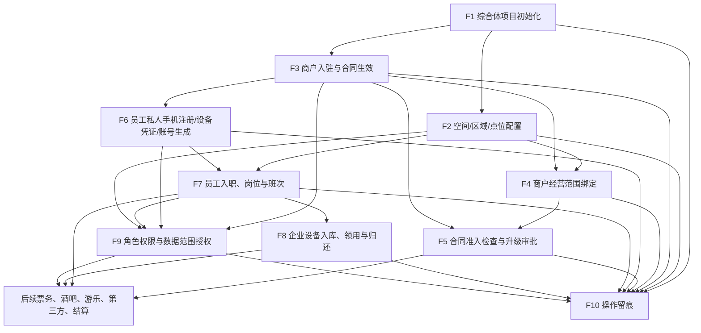

## 3. F1 综合体项目初始化

### 3.1 流程目标

建立综合体最高管理单元。没有项目，就不应继续创建正式空间、商户、合同、员工、设备和权限关系。

### 3.2 参与角色

- 综合体管理层
- 平台运营
- 系统管理员

### 3.3 前置条件

- 明确综合体项目名称、地址、经营定位和责任主体。
- 明确项目负责人或平台运营负责人。

### 3.4 正常流程

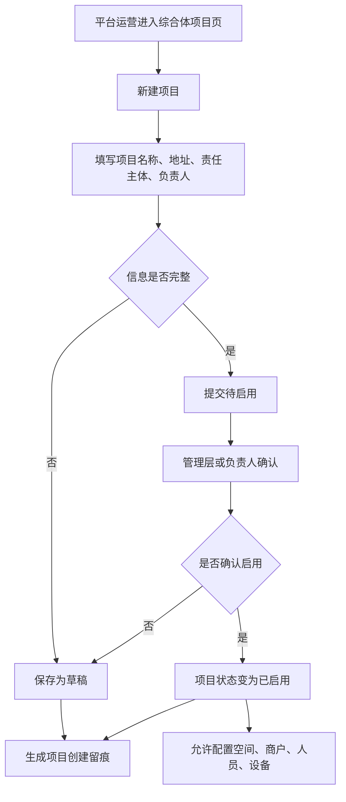

### 3.5 状态流转

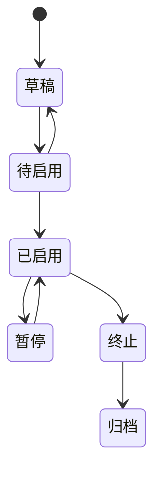

### 3.6 异常分支

| 异常 | 处理方式 |
|---|---|
| 项目名称重复 | 提示重复项目，要求修改名称或确认是否为同一项目 |
| 责任主体未明确 | 不允许启用，只能保存草稿 |
| 项目被暂停 | 暂停新增经营绑定，但保留查询和历史留痕 |
| 项目终止 | 限制新增空间、商户、合同、员工和设备绑定 |

### 3.7 输出结果

- 已启用的综合体项目。
- 项目基础档案。
- 项目创建和启用留痕。

### 3.8 涉及页面

- 综合体项目页
- 治理总览页
- 操作留痕页

## 4. F2 空间/区域/点位配置

### 4.1 流程目标

建立综合体的物理空间结构，明确业务发生位置和责任位置。

### 4.2 参与角色

- 平台运营
- 现场主管
- 招商/商户管理
- 安保/巡检

### 4.3 前置条件

- 综合体项目已创建。
- 若空间用于正式经营，项目应处于已启用状态。

### 4.4 正常流程

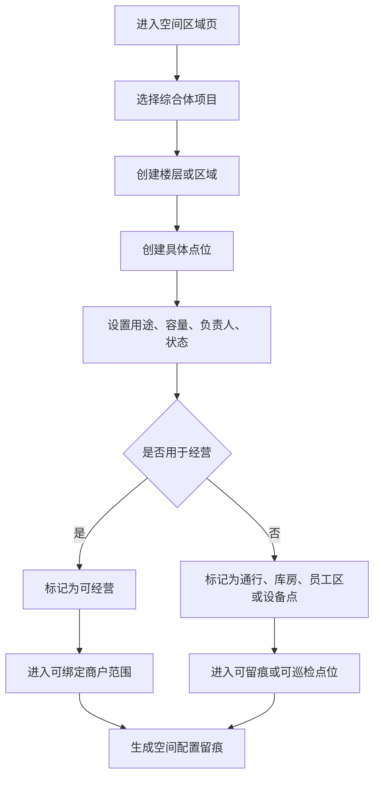

### 4.5 状态流转

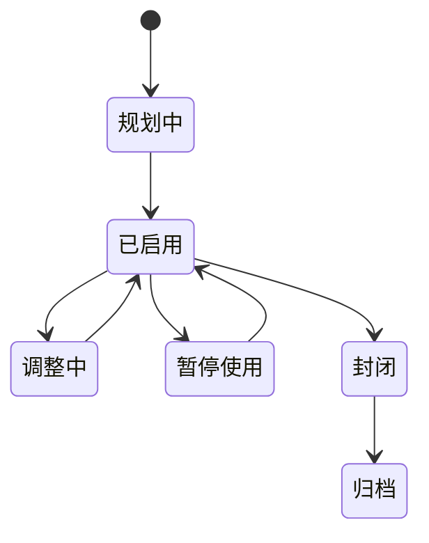

### 4.6 异常分支

| 异常 | 处理方式 |
|---|---|
| 上级空间不存在 | 不允许创建下级空间 |
| 空间编号重复 | 要求修改编号或自动生成新编号 |
| 已封闭空间被绑定商户 | 阻止绑定并提示空间不可经营 |
| 空间调整影响现有商户 | 进入待确认状态，并提示需要商户/合同复核 |

### 4.7 输出结果

- 空间层级。
- 具体点位。
- 可经营空间和可留痕点位。
- 空间变更留痕。

### 4.8 涉及页面

- 空间区域页
- 商户管理页
- 员工岗位页
- 设备台账页
- 操作留痕页

## 5. F3 商户入驻与合同生效

### 5.1 流程目标

明确“谁在综合体内经营”和“凭什么经营”。

### 5.2 参与角色

- 招商/商户管理
- 财务
- 平台运营
- 综合体管理层
- 商户管理员

### 5.3 前置条件

- 综合体项目已创建。
- 业态已配置。
- 若要绑定经营位置，空间应已配置。

### 5.4 正常流程

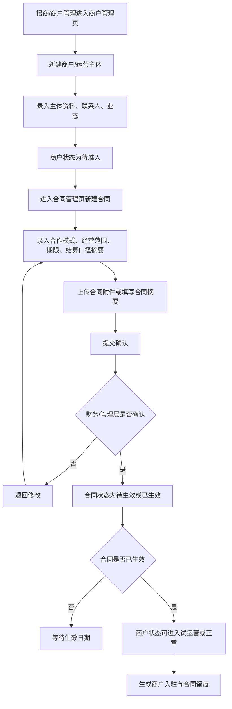

### 5.5 商户状态流转

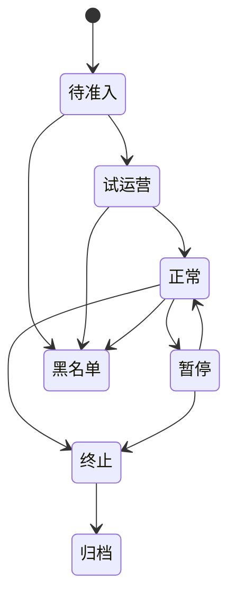

### 5.6 合同状态流转

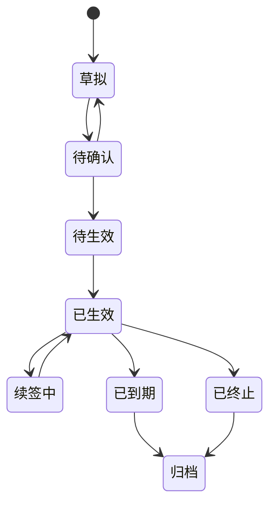

### 5.7 异常分支

| 异常 | 处理方式 |
|---|---|
| 商户资料不完整 | 只能保存待准入，不能进入正常经营 |
| 合同未生效 | 不允许作为正式经营依据 |
| 合同到期 | 提醒续签或终止，不允许新增经营绑定 |
| 商户被暂停 | 保留历史查询，限制新增经营动作 |
| 商户进入黑名单 | 禁止新增合同和经营范围 |

### 5.8 输出结果

- 商户主体档案。
- 合同和合作关系。
- 商户经营依据。
- 商户与合同留痕。

### 5.9 涉及页面

- 商户管理页
- 合同管理页
- 业态管理页
- 空间区域页
- 操作留痕页

## 6. F4 商户经营范围绑定

### 6.1 流程目标

明确商户可以在哪些项目、空间、区域或点位经营，以及经营哪些业态。

### 6.2 参与角色

- 招商/商户管理
- 平台运营
- 财务
- 商户管理员

### 6.3 前置条件

- 商户已建档。
- 合同已确认或已生效。
- 空间已配置。
- 业态已启用。

### 6.4 正常流程

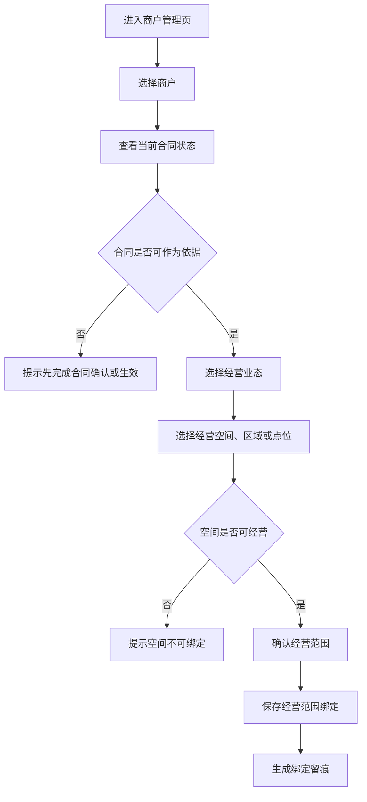

### 6.5 异常分支

| 异常 | 处理方式 |
|---|---|
| 商户状态不是正常或试运营 | 阻止新增绑定 |
| 空间已封闭或归档 | 阻止绑定 |
| 业态已停用 | 阻止绑定 |
| 经营范围超出合同 | 提示需先变更合同或补充确认 |
| 同一空间多个商户共享 | 要求明确共享说明和责任边界 |

### 6.6 输出结果

- 商户经营范围。
- 商户可用空间。
- 后续业务系统可引用的经营边界。
- 经营范围绑定留痕。

### 6.7 涉及页面

- 商户管理页
- 合同管理页
- 空间区域页
- 业态管理页
- 操作留痕页

## 7. F5 合同准入检查与升级审批

### 7.1 流程目标

在票务发布、酒吧下单、游乐开放、第三方接入和结算前，先检查业务是否符合合同、空间、业态、有效期和基础定义。

### 7.2 参与角色

- 平台运营
- 招商/商户管理
- 财务
- 风控/审计
- 综合体管理层

### 7.3 前置条件

- 商户、合同、经营范围和空间已建立。
- 合同核心摘要已录入。
- 准入规则已启用，或可按合同摘要即时检查。

### 7.4 正常流程

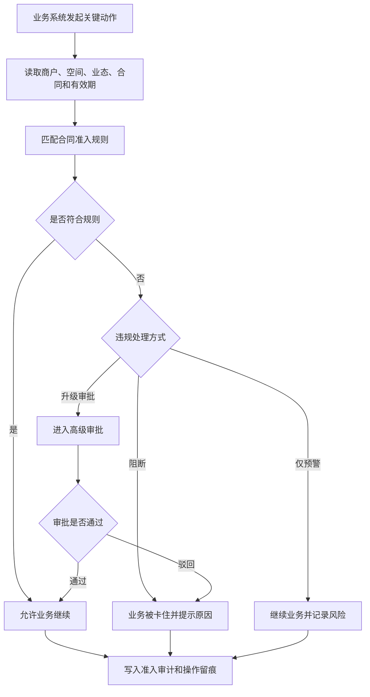

### 7.5 异常分支

| 异常 | 处理方式 |
|---|---|
| 合同未生效或已到期 | 默认阻断，除非管理层配置允许升级审批 |
| 业务超出合同经营范围 | 默认阻断或进入高级审批 |
| 业务空间不在合同允许范围 | 阻断并提示需变更合同或空间绑定 |
| 商户资质过期 | 阻断或进入风控复核 |
| 准入规则缺失 | 允许保存草稿，但正式业务不应继续 |

### 7.6 输出结果

- 准入检查结果。
- 阻断或升级审批记录。
- 后续业务可引用的准入审计。
- 事件中心留痕。

### 7.7 涉及页面

- 合同管理页
- 合同准入规则页
- 商户管理页
- 操作留痕页
- 后续票务、酒吧、游乐、第三方和结算页面

## 8. F6 员工私人手机注册、设备凭证绑定与账号生成

> 修订说明（2026-06-10 收口）：本节（含 §8.4 mermaid 设计图）按 D8/A6 改写——废止"申请 NFC 权限、读取手机本机 NFC 唯一标识"，私人手机身份改为"安装期在设备 Keystore 生成设备公钥/不可逆设备指纹（device_key_fingerprint）"，对应节点改为"生成并绑定设备凭证"。工作手机通过摄像头/扫码模块读取外部客人二维码，NFC 仅读取外部 NFC 腕带、标签、卡或设备中的权益标识，不在本流程。依据 finding decision-land-1/baseline-conf-1、D8 条。

### 8.1 流程目标

让员工先通过私人手机 App 提交注册资料、在设备 Keystore 生成设备公钥/不可逆设备指纹（device_key_fingerprint）作为设备凭证，后台审核后再生成员工账号、角色、职级、权限，并与公司工作手机建立一一对应关系；换手机必须先解绑旧手机设备凭证再绑定新手机。

### 8.2 参与角色

- 员工
- 平台运营
- 现场主管
- 商户管理员
- 系统管理员

### 8.3 前置条件

- 员工所属组织或商户已存在。
- 岗位、职级和权限模板已配置。
- 设备凭证绑定规则已确认：私人手机 App 安装期在设备 Keystore 生成设备公钥/不可逆设备指纹（device_key_fingerprint）作为唯一可信标识；废止"读取手机本机 NFC 唯一标识"（D8/A6，2026-06-07 收口，finding decision-land-1）。

### 8.4 正常流程

> 修订说明（2026-06-08 三轮收口）：在"提交资料后、建档前"插入"展示员工数据处理与监控告知→员工签署/确认→写 employee_notices"节点（B1→B2→B3），使 C4/C10「告知须在员工注册审批环节取得员工知悉/同意并留存同意凭据」在流程图有触发点，避免 foundation §6B.3 employee_notices 表建而无写入方。employee_notice_id 即作为 staff_profiles 同意凭据指向（见 §9 员工注册审批页字段、PRD §7.6/§9）。依据 finding compliance-wired-6、合规 C4/C10。

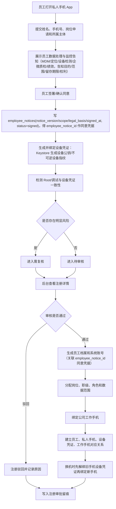

### 8.5 状态流转

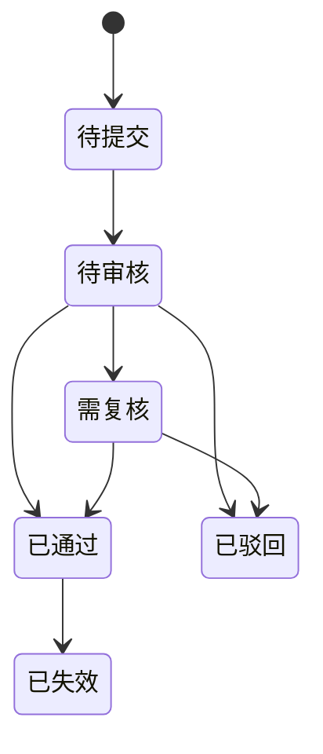

### 8.6 异常分支

| 异常 | 处理方式 |
|---|---|
| Root 或调试环境 | 私人手机 App 失效，进入复核 |
| 设备指纹变化 | 标记设备变更待审 |
| 设备凭证已绑定其他员工 | 阻止通过，进入复核（原"NFC 已绑定其他员工"按 D8 改为设备凭证，2026-06-07 收口） |
| 换手机未先解绑旧手机 | 阻止新绑定，要求先走解绑流程 |
| 员工资料不完整 | 驳回并要求补充 |
| 未绑定公司工作手机 | 可生成员工档案，但不能上岗执行现场操作 |

### 8.7 输出结果

- 员工注册审批记录。
- 员工档案和账号。
- 岗位、职级、角色、数据范围。
- 私人手机、设备凭证（设备公钥/不可逆设备指纹）、公司工作手机对应关系，以及换机解绑重绑留痕（原"手机 NFC 唯一标识"按 D8 改为设备凭证，2026-06-07 收口）。
- 注册审批和设备异常留痕。

### 8.8 涉及页面

- 员工注册审批页
- 员工岗位页
- 设备台账页
- 设备领还页
- 角色权限页
- 操作留痕页

## 9. F7 员工入职、岗位与班次

### 9.1 流程目标

明确员工归属、岗位职责、当班时间和责任区域。

### 9.2 参与角色

- 平台运营
- 现场主管
- 商户管理员
- 系统管理员

### 9.3 前置条件

- 员工所属平台或商户已存在。
- 员工注册审批已通过，或由后台创建且已经主管确认。
- 岗位已配置。
- 职级和默认权限模板已配置，职级支持 M1-M10 及上/中/下细分。
- 如需要排班，空间或责任区域已配置。

### 9.4 正常流程

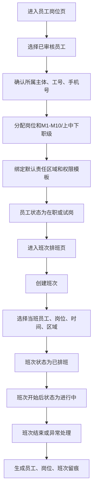

### 9.5 状态流转

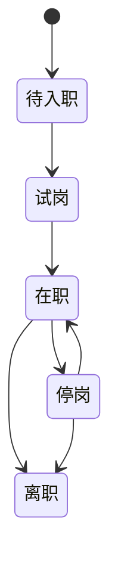

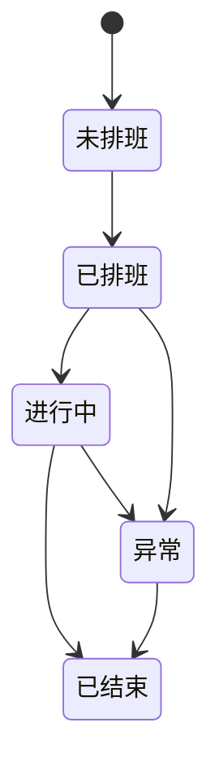

### 9.6 异常分支

| 异常 | 处理方式 |
|---|---|
| 员工未绑定主体 | 不允许保存为可上岗状态 |
| 注册审批未通过 | 不允许进入正式上岗流程 |
| 未完成设备凭证或公司工作手机对应 | 可以建档，但不能领取现场作业设备（"NFC"按 D8 改为设备凭证，2026-06-07 收口） |
| 员工停岗或离职 | 不允许加入新班次 |
| 岗位停用 | 不允许继续分配 |
| 班次缺少责任区域 | 允许保存，但提示责任链不完整 |
| 班次异常 | 必须填写异常说明 |

### 9.7 输出结果

- 员工档案。
- 岗位归属。
- 职级和默认权限依据。
- 班次安排。
- 现场责任链。

### 9.8 涉及页面

- 员工岗位页
- 班次排班页
- 空间区域页
- 角色权限页
- 操作留痕页

## 10. F8 企业设备入库、领用与归还

### 10.1 流程目标

明确企业设备的归属、流转、当班责任人和异常处理方式。

### 10.2 参与角色

- 设备管理员
- 现场主管
- 员工
- 平台运营

### 10.3 前置条件

- 设备已入库。
- 员工已建档，注册审批和设备凭证绑定已通过。
- 公司工作手机已与员工、私人手机和设备凭证建立对应关系（"NFC"按 D8 改为设备凭证，2026-06-07 收口，finding decision-land-1）。
- 班次已创建，或现场主管允许临时领用。

### 10.4 正常流程

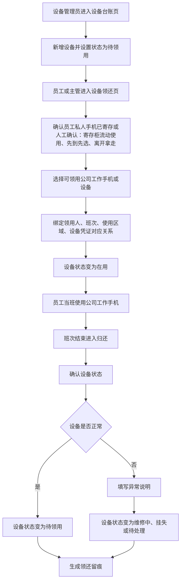

### 10.5 状态流转

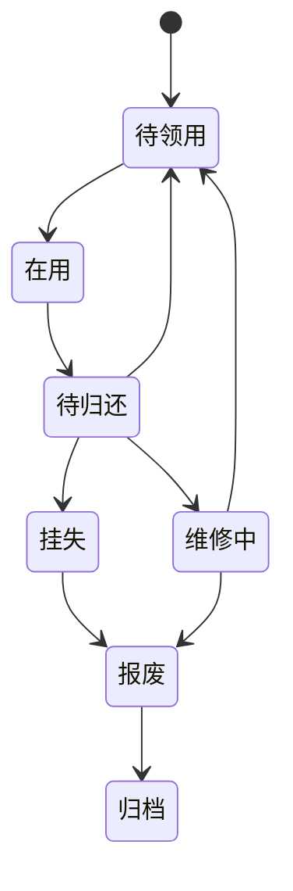

### 10.6 异常分支

| 异常 | 处理方式 |
|---|---|
| 设备维修中或挂失 | 不允许领用 |
| 员工无有效班次 | 允许主管临时处理，但必须留痕 |
| 员工私人手机未寄存 | 提示主管确认或阻止现场设备领用 |
| 公司工作手机未与员工/设备凭证对应 | 阻止领用或进入复核（"NFC"按 D8 改为设备凭证，2026-06-07 收口） |
| 设备未按时归还 | 进入待归还提醒或异常待处理 |
| 设备损坏 | 填写损坏说明，可进入主管复核 |
| 设备丢失 | 状态变为挂失，必须记录责任人 |

### 10.7 输出结果

- 设备领用记录。
- 设备归还记录。
- 设备异常记录。
- 员工、班次、设备责任链。

### 10.8 涉及页面

- 设备台账页
- 设备领还页
- 班次排班页
- 员工岗位页
- 操作留痕页

## 11. F9 角色权限与数据范围授权

### 11.1 流程目标

明确员工、商户管理员和平台人员能看什么、能操作什么、在哪些范围内操作。

### 11.2 参与角色

- 系统管理员
- 平台运营负责人
- 商户管理员
- 现场主管

### 11.3 前置条件

- 员工或账号主体已存在。
- 项目、商户、空间等数据范围已存在。
- 角色模板、职级和岗位权限模板已定义或可新建。

### 11.4 正常流程

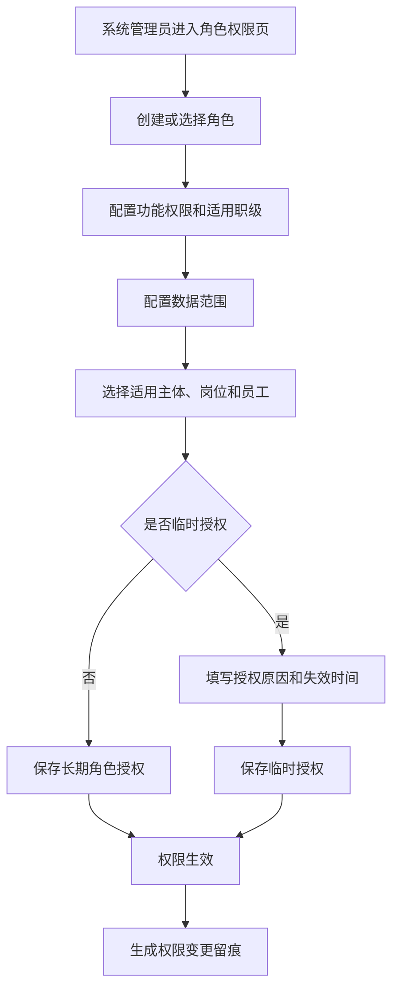

### 11.5 异常分支

| 异常 | 处理方式 |
|---|---|
| 数据范围超出授权主体 | 阻止保存 |
| 临时授权缺少失效时间 | 阻止保存 |
| 敏感权限未填写授权原因 | 要求补充原因 |
| 职级与敏感权限不匹配 | 阻止保存或要求高级审批 |
| 员工离职或停岗 | 自动提示收回权限 |
| 商户暂停或终止 | 提示商户相关权限应停用或只读 |

### 11.6 输出结果

- 角色配置。
- 功能权限。
- 职级权限关系。
- 数据范围。
- 长期授权或临时授权。
- 权限变更留痕。

### 11.7 涉及页面

- 角色权限页
- 员工岗位页
- 商户管理页
- 操作留痕页

## 12. F10 关键配置变更与操作留痕

### 12.1 流程目标

记录平台治理层关键对象的创建、编辑、启停、归档、授权、异常和复核，确保所有重要动作可追溯。

### 12.2 参与角色

- 所有治理层操作角色
- 平台运营
- 财务
- 系统管理员
- 综合体管理层

### 12.3 触发条件

以下动作必须形成留痕：

- 项目启用、暂停、终止、归档。
- 空间启用、封闭、归档、绑定商户。
- 商户准入、暂停、终止、黑名单。
- 合同确认、生效、续签、终止、归档。
- 合同准入规则启用、暂停、阻断、升级审批。
- 员工注册审批、设备凭证绑定、私人手机失效、公司工作手机绑定（"NFC绑定"按 D8 改为"设备凭证绑定"，2026-06-07 收口）。
- 员工停岗、离职、岗位变更、职级变更。
- 设备领用、归还、维修、挂失、报废。
- 权限授予、变更、收回、临时授权。
- 人工补录、复核、驳回、作废。

### 12.4 正常流程

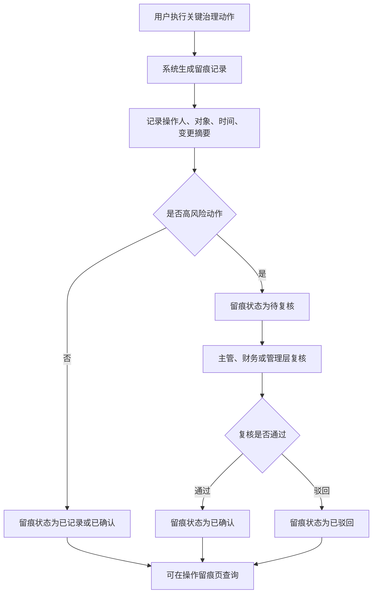

### 12.5 状态流转

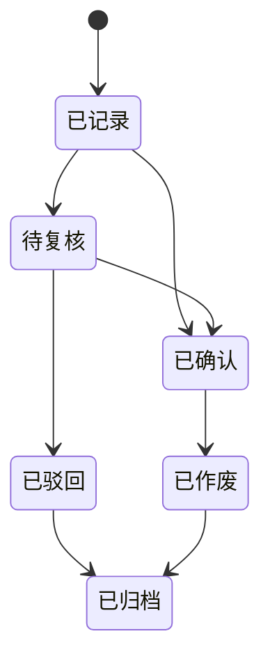

### 12.6 异常分支

| 异常 | 处理方式 |
|---|---|
| 操作原因缺失 | 对暂停、终止、归档、授权、异常类动作阻止提交 |
| 高风险变更未复核 | 允许暂存，但不进入最终确认 |
| 需要作废留痕 | 不允许删除，只能标记作废并记录原因 |
| 关联对象已归档 | 留痕仍可查询，但对象详情只读 |

### 12.7 输出结果

- 操作留痕记录。
- 复核记录。
- 变更责任链。
- 后续审计和风控依据。

### 12.8 涉及页面

- 操作留痕页
- 治理总览页
- 所有对象详情页

## 12A. F11 终端开关启停、灰度与被拒访问

> 新增说明（2026-06-07）：依 govfam-1/govern-4，终端开关此前在流程图中完全缺失，但 acceptance/completion-audit 自评其全覆盖。本节补终端开关的启停、灰度发布和被拒访问三条流程，与 page-list §14A 终端开关页、字段字典 §3.1/§14.13 对齐。

### 12A.1 流程目标

让平台统一控制 10 端（对齐 D5：App、小程序、Web、平板、员工工作手机、员工私人手机、商户侧门户、商户侧 App、一体机、移动管理端）是否开放，支持按项目/商户/业务系统/模块/设备/版本灰度，并对被拒访问留痕。

### 12A.2 参与角色

- 系统管理员
- 平台运营负责人
- 综合体管理层

### 12A.3 前置条件

- 综合体项目、商户、业务系统已存在。
- 需控制的终端类型来自 10 端权威枚举（字段字典 §3.1）。

### 12A.4 启停与灰度正常流程

```mermaid
flowchart TD
    A["进入终端开关页"] --> B["选择终端类型(10端)与开关范围"]
    B --> C["选择业务系统/模块/项目/商户/设备/版本"]
    C --> D{"是否定时生效"}
    D -- "否" --> E["设置是否启用并立即生效"]
    D -- "是" --> F["设置生效时间/失效时间/定时策略"]
    E --> G{"是否灰度"}
    F --> G
    G -- "是" --> H["配置灰度名单或比例(项目/商户/设备/版本)"]
    G -- "否" --> I["全量开放或关闭"]
    H --> J["保存开关并生成留痕"]
    I --> J
    J --> K["到达生效/失效时间自动切换启停"]
```

### 12A.5 被拒访问流程

```mermaid
flowchart TD
    A["终端发起业务动作"] --> B["读取该端开关与灰度配置"]
    B --> C{"是否启用且在生效区间内"}
    C -- "是" --> D{"是否命中灰度范围"}
    D -- "是/全量" --> E["允许业务，仍受权限和数据范围控制"]
    D -- "否" --> F["按未开放处理，拒绝并提示"]
    C -- "否" --> F
    F --> G["写入被拒访问记录(终端类型、设备、时间、原因)"]
    E --> H["写入操作留痕"]
    G --> H
```

### 12A.6 状态流转

```mermaid
stateDiagram-v2
    [*] --> 草稿
    草稿 --> 已启用
    已启用 --> 已停用
    已停用 --> 已启用
    已启用 --> 归档
    已停用 --> 归档
```

> 说明：定时策略下"定时启用/定时停用"为过渡态，由生效/失效时间自动驱动进入"已启用/已停用"，不单列为独立持久态（对齐字段字典 §14.13）。

### 12A.7 异常分支

| 异常 | 处理方式 |
|---|---|
| 生效时间晚于失效时间 | 阻止保存并提示 |
| 启用定时策略但生效/失效时间为空 | 阻止保存，要求补时间 |
| 关闭某端后该端仍尝试访问 | 拒绝业务动作并写入被拒访问记录 |
| 灰度名单为空但选择了灰度 | 提示需补灰度名单或改为全量 |

### 12A.8 输出结果

- 终端开关配置与灰度范围。
- 被拒访问记录。
- 开关启停/灰度变更留痕。

### 12A.9 涉及页面

- 终端开关页
- 治理总览页
- 操作留痕页

## 13. 跨流程依赖关系

| 依赖项 | 依赖说明 | 如果缺失的影响 |
|---|---|---|
| 项目 | 所有治理对象的最高归属 | 无法建立正式空间、商户、人员和设备 |
| 空间 | 商户、员工、设备、事件的位置基础 | 业务无法判断发生在哪里 |
| 业态 | 商户和合同的经营分类 | 后续统计和权限容易混乱 |
| 商户 | 合同、员工、权限、结算的主体 | 无法判断谁经营和谁负责 |
| 合同 | 商户经营的依据 | 无法判断是否可正式经营 |
| 合同准入规则 | 后续票务、酒吧、游乐、第三方和结算的卡控依据 | 超合同或超空间业务无法被系统阻断或高审 |
| 员工 | 现场作业和系统操作的人 | 无法形成责任链 |
| 私人手机注册 | 员工账号建立和身份审核的入口 | 员工身份来源不清晰 |
| 设备凭证绑定 | 员工身份辅助确认和设备绑定依据（设备公钥/不可逆设备指纹） | 私人手机、员工、工作手机难以形成对应关系（"NFC绑定"按 D8 改为"设备凭证绑定"，2026-06-07 收口） |
| 职级 | 默认权限、审批层级和薪资口径摘要 | 权限和审批无法按管理层级区分 |
| 班次 | 员工现场责任的时间边界 | 无法判断当时谁在岗 |
| 设备 | 现场操作的工具和证据入口 | 无法追踪设备责任 |
| 权限 | 操作和数据可见范围 | 容易发生越权 |
| 终端开关 | 各端/商户/模块/设备/版本是否开放的统一控制 | 终端可绕过开关、被拒访问无留痕 |
| 留痕 | 关键动作的追溯依据 | 无法审计和复盘 |

## 14. P0 流程验收标准

| 验收点 | 标准 |
|---|---|
| 项目初始化 | 能创建、启用、暂停、终止和归档项目，并形成留痕 |
| 空间配置 | 能建立空间层级和点位，并限制不可用空间继续绑定业务 |
| 商户入驻 | 能建立商户、合同和合作关系，并区分待准入、试运营、正常等状态 |
| 经营范围绑定 | 能把商户绑定到业态和空间，并校验合同状态 |
| 合同准入 | 能按合同、空间、业态、有效期判断通过、阻断或升级审批 |
| 员工注册 | 能审核私人手机注册、设备凭证绑定、Root/设备异常，并生成账号、职级和权限（"NFC绑定"按 D8 改为"设备凭证绑定"，2026-06-07 收口） |
| 员工班次 | 能基于已审核员工建立岗位、班次和责任区域 |
| 设备领还 | 能完成设备入库、领用、归还和异常处理 |
| 权限授权 | 能配置角色、功能权限、数据范围和临时授权 |
| 操作留痕 | 关键治理动作能查询、复核、驳回或作废 |
| 终端开关 | 能按 10 端/项目/商户/模块/设备/版本启停与灰度，被拒访问能留痕 |
| 页面联动 | 总览、项目、空间、商户、合同、员工、设备、权限、留痕之间能互相跳转 |
| 后续支撑 | 能为票务、酒吧、游乐、第三方、结算和事件中心提供清晰基础对象、合同准入和员工可信身份 |

## 15. 已确认规则和后续细化事项

已确认：

1. 员工私人手机 App 安装期在设备 Keystore 生成设备公钥/不可逆设备指纹（device_key_fingerprint）作为唯一可信标识，换手机必须先解绑旧手机设备凭证再绑定新手机；废止"读取手机本机 NFC 唯一标识"（D8/A6，2026-06-07 收口，finding decision-land-1）。工作手机通过摄像头/扫码模块读取外部客人二维码，NFC 仅读取外部 NFC 腕带、标签、卡或设备中的权益标识。
2. Root/调试/异常环境由手机端检测，异常时 App 失效并进入复核。
3. 办公区寄存柜流动使用、先到先选、离开拿走。
4. 员工职级、权限模板和薪资大范围 P0 纳入流程，职级支持 M1-M10 及上/中/下细分。

后续细化：

无方向性悬空事项。已确认按以下口径执行：

1. 项目启用 P0 由平台运营提交，管理层或系统管理员确认后启用。
2. 空间调整影响商户经营时必须进入合同/主体绑定复核。
3. 商户试运营必须有已确认合同或试运营授权；正式经营必须合同已生效。
4. 合同生效必须经过财务确认结算口径和保证金/押金/应收应付初始事项。
5. 多商户共享同一空间必须有显式空间授权、责任主体和结算口径，不默认允许。
6. 员工排班 P0 绑定责任区域，用于责任留痕。
7. 设备领用 P0 绑定人员和班次；无班次岗位只能查询，不得做现场受控动作。
8. 敏感权限包括财务、退款/免单/调账、主体绑定、合同生效/终止、敏感证据查看、开放平台密钥和设备解封，必须二次确认或审批。
9. 高风险财务调整、敏感证据查看、设备异常解封、权限提升、主体绑定变更、合同准入放行必须复核；普通查询和低风险留痕仅记录即可。
10. 操作留痕支持附件或证据引用；高风险操作必须支持附件/证据。
11. 合同过期、必填证照缺失/过期、消防/特种设备资质过期、空间/业态超范围默认阻断；可配置高级审批放行但必须留痕。

## 16. 本版结论

平台治理层 P0 的关键流程应先把项目、空间、商户、合同、合同准入、员工私人手机注册、设备凭证、职级、设备、权限和留痕串成闭环（"NFC"按 D8 已统一为"设备凭证"，2026-06-07 收口）。这个闭环不是为了直接完成经营动作，而是为了让后续票务、酒吧、游乐、第三方接入、结算和数据分析都有清楚的归属、责任、准入和状态依据。

本版确认后，下一步可以继续拆《平台治理层低保真原型说明 V0.1》，把页面布局、列表/详情/表单结构和关键交互说明补齐。

## 17. 变更日志

| 日期 | 类型 | 位置 | 内容 | 原因/依据 |
|---|---|---|---|---|
| 2026-06-07 | 增 | §2 流程总览、§12A F11 | 新增 F11 终端开关启停、灰度与被拒访问流程（启停/灰度/被拒三图 + 状态流转） | govfam-1、govern-4 |
| 2026-06-07 | 增 | §13 跨流程依赖 | 补"终端开关"依赖行 | govfam-1 |
| 2026-06-10 | 改 | §2/§8（含 §8.4 mermaid）/§10/§11/§13/§14/§15/§16 | 按 D8/A6 把"申请 NFC 权限、读手机本机 NFC 唯一标识/NFC 绑定"改为"在 Keystore 生成并绑定设备凭证（设备公钥/不可逆设备指纹 device_key_fingerprint）"，§8.4 mermaid 节点重绘为"生成并绑定设备凭证"，前置条件同步；明确二维码摄像头扫码、NFC 读取外部 NFC 腕带/标签/卡 | D8、finding decision-land-1/baseline-conf-1；二维码/NFC 技术边界复核 |
| 2026-06-07 | 增 | §14 P0 流程验收 | 补"终端开关"验收点 | govfam-1 |
| 2026-06-08 | 增 | §8.4 注册审批正常流程 | 在"提交资料后、建档前"插入"展示员工数据处理与监控告知→员工签署/确认→写 employee_notices(notice_version/scope/legal_basis/signed_at, status=signed)"节点（B1→B2→B3），并把建档节点关联 employee_notice_id 同意凭据，使 C4/C10 告知/同意有触发点、employee_notices 表有写入方 | 三轮收口 finding compliance-wired-6、合规 C4/C10 |
