# 终端展示层关键流程图 V0.1

## 1. 文档定位

本文档描述终端展示层 P0 流程，明确不同终端如何承接业务。

## 2. F1 管理后台处理流程

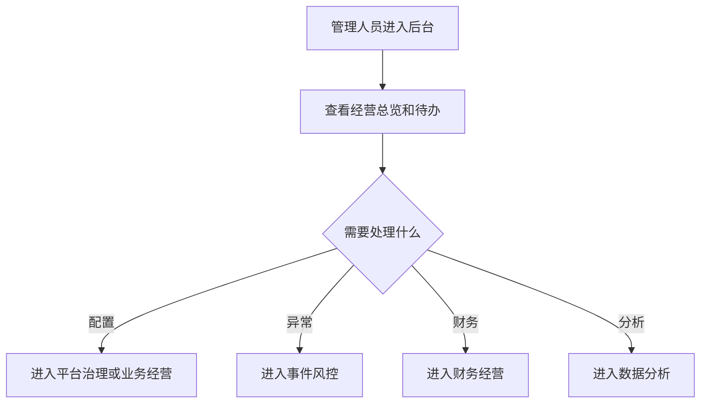

## 3. F2 Web 前端查看与轻量确认流程

> 修订说明（2026-06-07）：原 F2 否认 Web 端任何"业务确认"能力，与 PRD/验收"允许少量业务确认动作"自相矛盾（finding webmobile-2）。此处把"纯只读"改为"以只读为主+白名单内少量确认"，补一条"轻量确认"分支；白名单（对账差异确认、异常待办标记已读、结算单查看确认）见 `terminal-page-product-prd §9.1`，排除项见 §9.2。

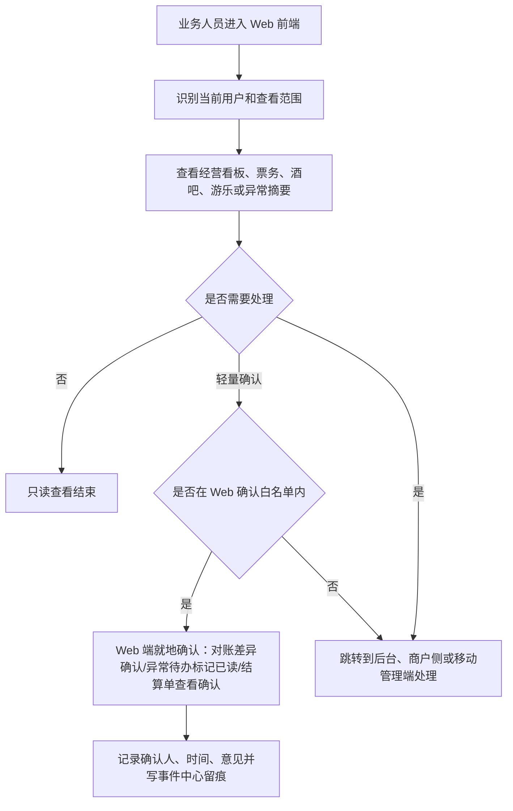

## 4. F3 商户侧使用流程

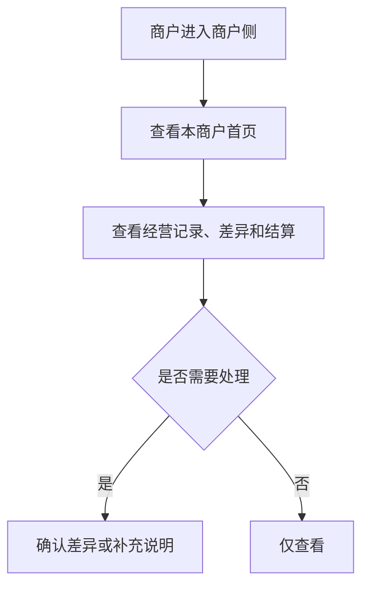

## 5. F4 现场作业端流程

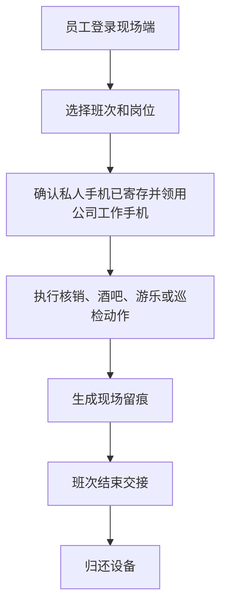

## 6. F5 工作人员平板 App 酒吧点酒下单流程

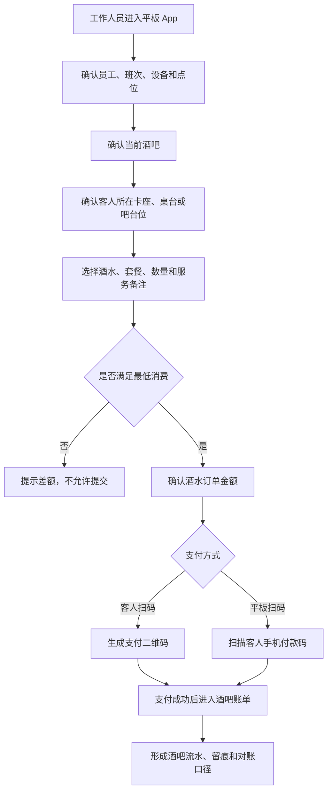

## 7. F6 移动管理端复核流程

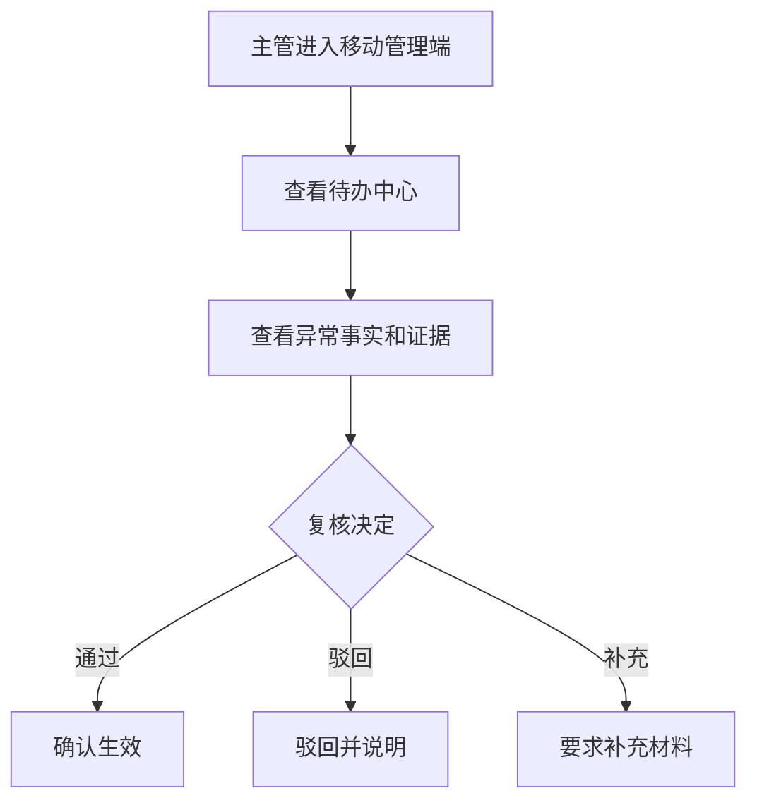

## 8. F7 客人购票 App/小程序流程

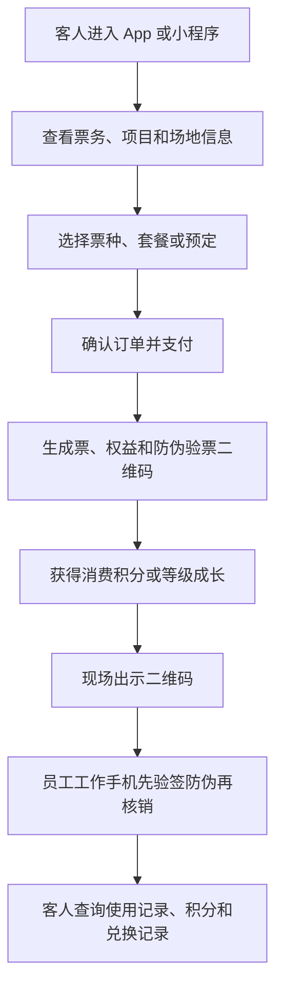

## 9. F8 App 与小程序打通流程

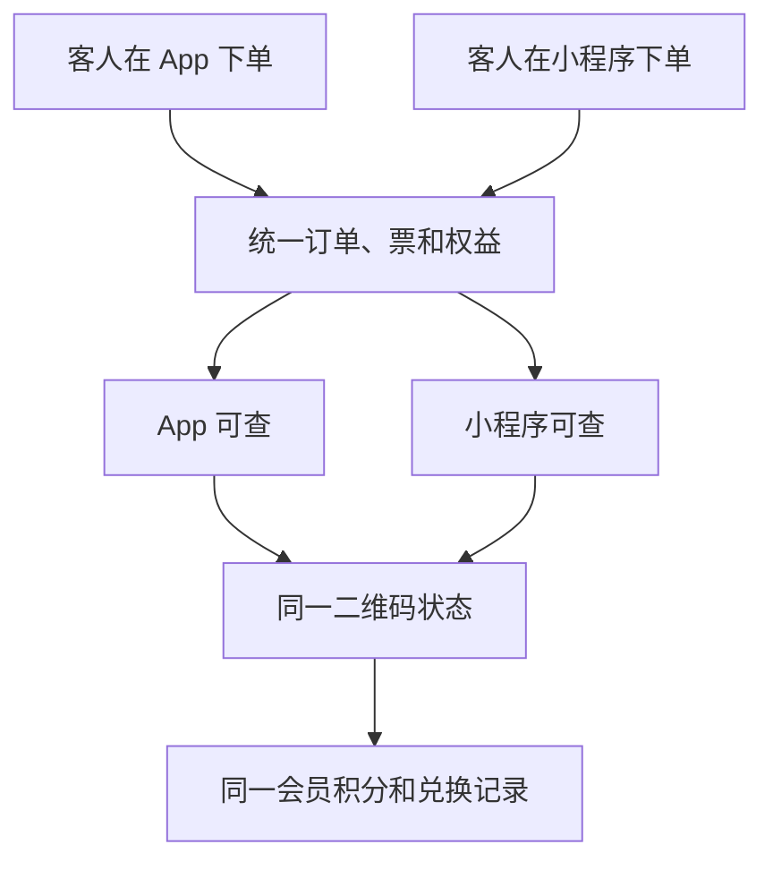

## 10. F9 员工工作手机核销流程

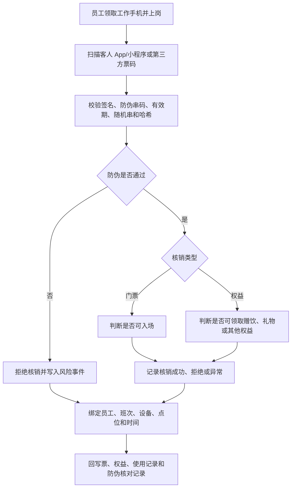

## 11. F10 员工私人手机 App 注册流程

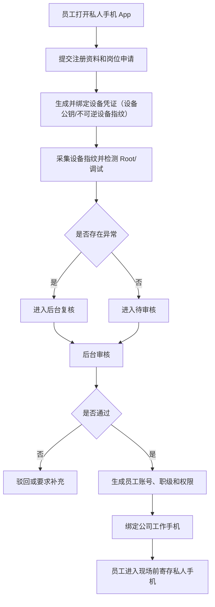

## 12. F11 触摸屏一体机自助服务流程

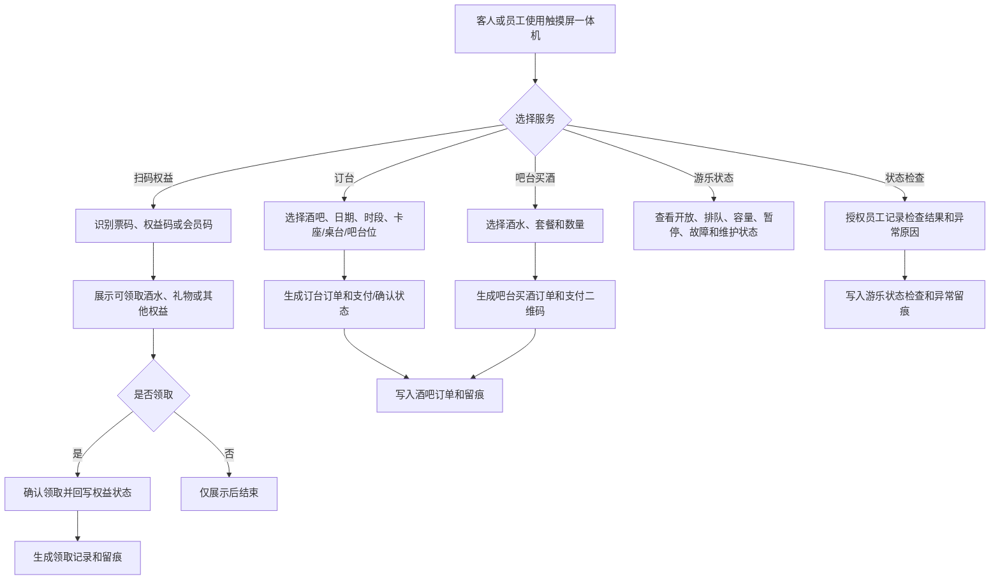

## 13. 流程验收标准

- 后台负责配置、复核、对账和分析。
- Web 前端以只读查看为主，允许白名单内的少量业务确认（对账差异确认、异常待办标记已读、结算单查看确认，见 `terminal-page-product-prd §9.1`），其余需要处理时跳到对应端。
- 商户侧只处理本商户事项。
- 现场端必须形成作业留痕。
- 现场端领用公司工作手机前，必须能确认员工注册/设备凭证/设备对应关系；私人手机只做注册和通知。
- 工作人员平板 App 只做酒吧点酒下单，必须绑定员工、设备、班次、酒吧和卡座/桌台。
- 平板点酒必须校验最低消费，未满足最低消费不可提交。
- 门票只能由客人通过官方 App/小程序或第三方渠道购买。
- 员工工作手机负责核销门票、赠饮和其他权益，核销前必须校验防伪签名、防伪串码、有效期和哈希。
- 员工私人手机 App 只负责注册、通知、状态查看和设备凭证绑定，不允许核销、点单、放行、结算、补录或审批/复核。
- 触摸屏一体机负责展示/领取权益，也可做订台下单、吧台买酒下单、游乐状态查看和授权状态检查，不承担门票售卖。
- 移动端可处理待办但不承担复杂配置。
- 客人 App/小程序能完成官方购票、预定、防伪二维码展示、会员积分和兑换记录查看。
- App 与小程序的订单、票、权益、二维码、积分和兑换状态必须一致。

## 14. 本版结论

终端展示层流程已覆盖 P0 各角色使用路径，并补充 Web 前端、工作人员平板 App、员工工作手机、员工私人手机 App、触摸屏一体机、客人购票 App/小程序的关键流程。

## 15. 变更日志

| 日期 | 类型 | 位置 | 内容 | 原因/依据 |
|---|---|---|---|---|
| 2026-06-07 | 改 | §3 F2 | "纯只读"改为"以只读为主+白名单内少量确认"，补"轻量确认"分支与留痕 | F2 否认确认能力与 PRD/验收矛盾（webmobile-2/1） |
| 2026-06-07 | 改 | §11 F10、§13 验收 | 私人手机"绑定 NFC 标识"改为"生成并绑定设备凭证" | 对齐基准 D8（废止读取手机本机 NFC 唯一标识） |
