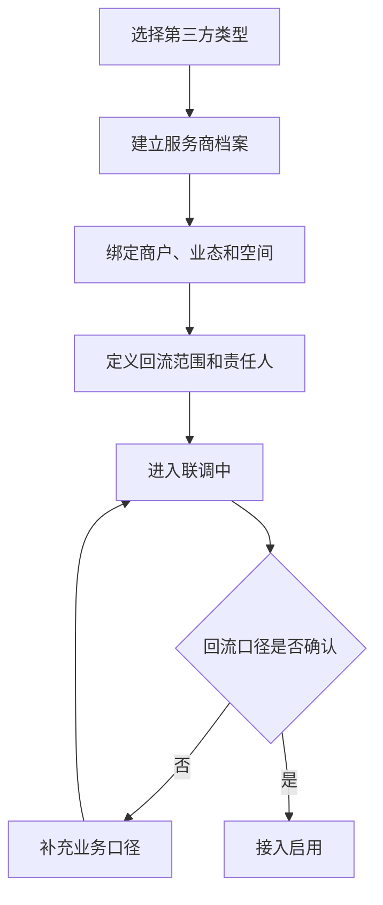
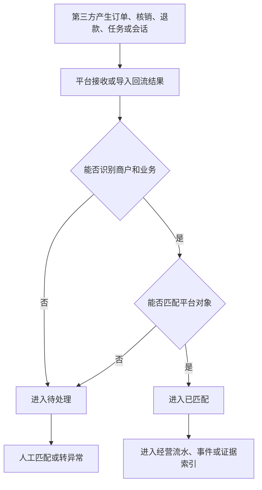
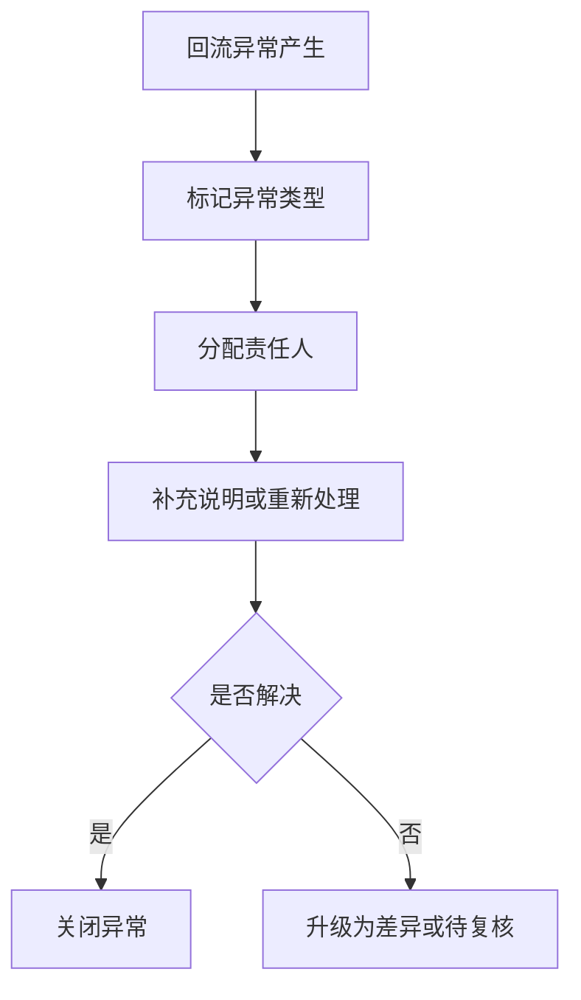
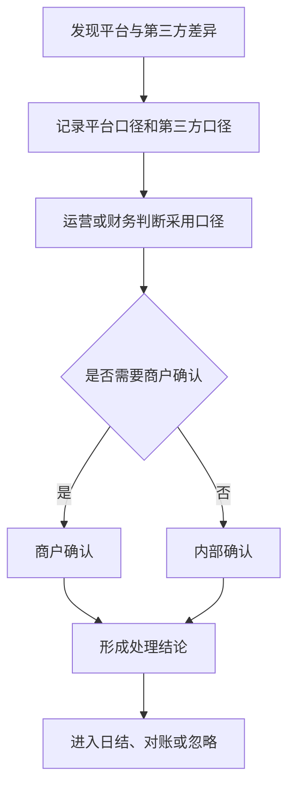
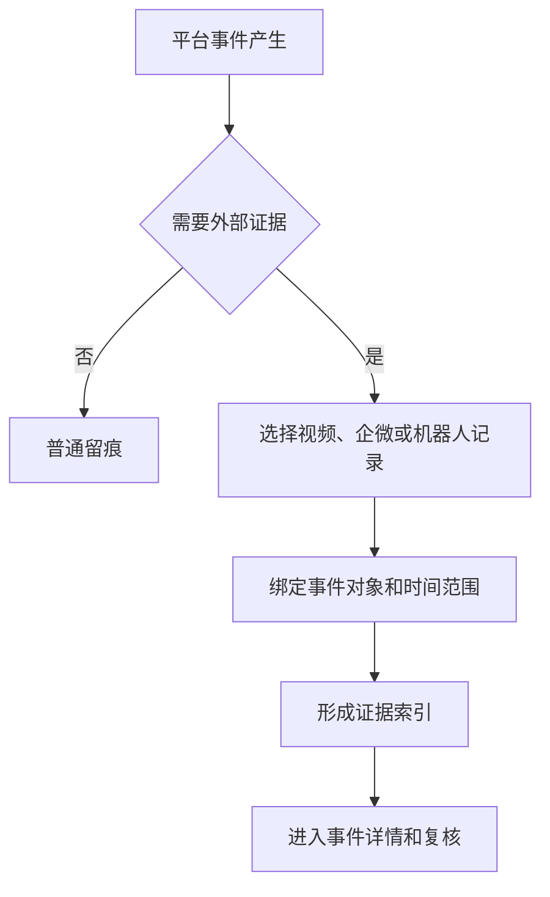
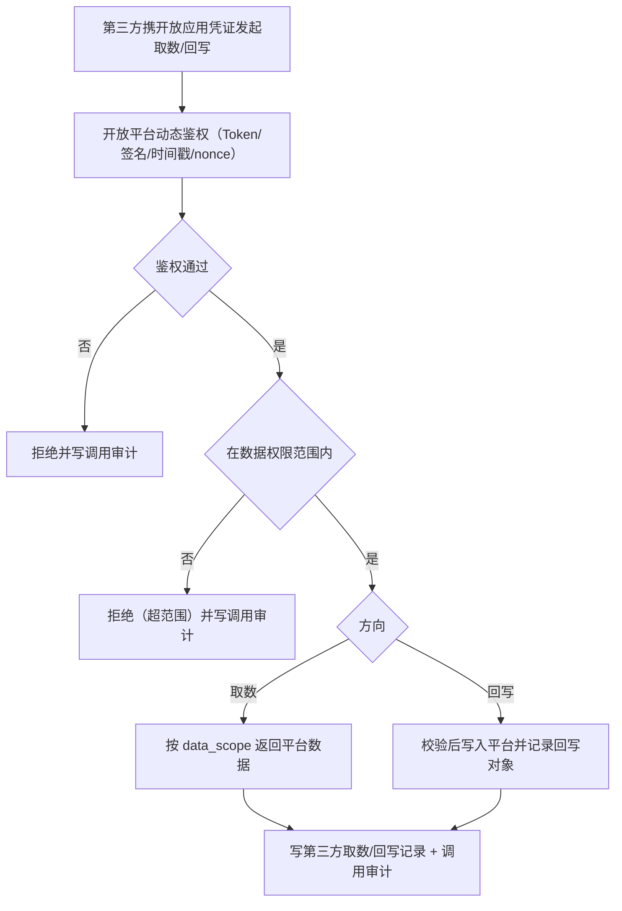

# 第三方接入层关键流程图 V0.1

## 1. 文档定位

本文档描述第三方接入层 P0 产品流程，用于明确接入、回流、匹配、异常和差异处理路径。

## 2. 流程总览

> 修订说明（2026-06-07）：新增 F6"对外开放授权取数/回写"流程，承载入站回流之外的第二方向——第三方在授权范围内主动从平台取数或回写数据（finding third-1，复用开放平台动态鉴权，统一口径基准 D3）。

| 编号 | 流程 | 目标 |
|---|---|---|
| F1 | 第三方接入关系建立 | 明确外部系统归属和回流范围 |
| F2 | 业务结果回流与匹配（入站方向） | 明确外部结果如何纳入平台 |
| F3 | 回流异常处理 | 明确失败、延迟、重复如何处理 |
| F4 | 差异确认与对账协同 | 明确平台和第三方口径不一致如何关闭 |
| F5 | 外部证据关联 | 明确视频、企微、机器人结果如何关联事件 |
| F6 | 对外开放授权取数/回写（对外方向） | 明确第三方在授权范围内如何取数/回写并留痕 |

## 3. F1 第三方接入关系建立

## 4. F2 业务结果回流与匹配

## 5. F3 回流异常处理

## 6. F4 差异确认与对账协同

## 7. F5 外部证据关联

## 7A. F6 对外开放授权取数/回写

> 修订说明（2026-06-07）：新增对外方向流程（finding third-1）。第三方先获授权与数据权限范围，再经动态鉴权调用，取数/回写全程写调用审计。

## 8. 流程验收标准

> 修订说明（2026-06-07）：补对外取数/回写方向验收项（finding third-1）。

- 第三方结果不能直接进入经营口径，必须先匹配平台对象。
- 无法匹配的结果必须进入待处理或异常。
- 差异必须有处理结论。
- 外部证据必须关联平台事件。
- 对外取数/回写必须经动态鉴权与数据权限范围校验，并全程写调用审计。
- 接入关系停用后不能继续作为有效经营来源。

## 9. 本版结论

第三方接入层流程已覆盖接入、回流、异常、差异和证据关联，满足 P0 产品闭环。

## 10. 变更日志

| 日期 | 类型 | 位置 | 内容 | 原因/依据 |
|---|---|---|---|---|
| 2026-06-07 | 增 | §2、§7A | 新增 F6 对外开放授权取数/回写流程及流程图 | finding third-1：对外取数/回写方向无流程 |
| 2026-06-07 | 改 | §8 | 补对外取数/回写动态鉴权+权限范围+调用审计验收项 | finding third-1 |
