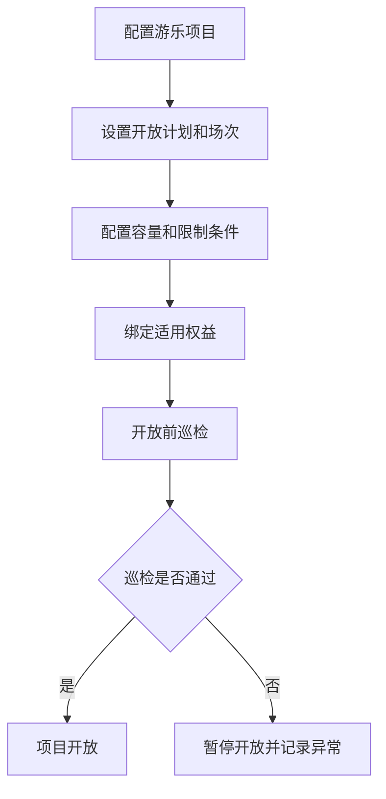
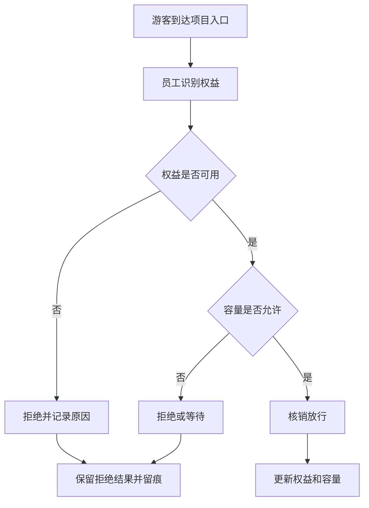
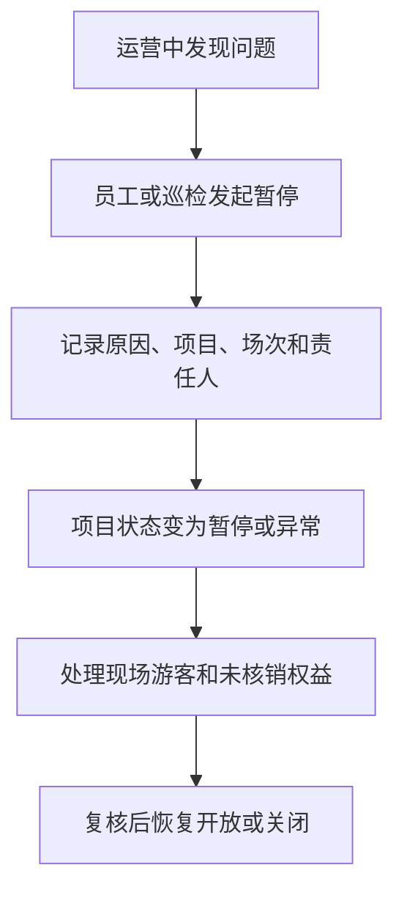

# 游乐基础运营产品 PRD V0.15

> **锚点口径（2026-08-05 R7·GAP-36 锚点重建）**：本文引用三份业务 HTML（BSM＝`business-system-map-for-operations-v0.1.html`／PGM＝`platform-governance-map-for-operations-v0.1.html`／ENUM＝`business-enum-quick-reference-v0.1.html`）时，一律采用**「条目名主锚点 + 行号辅助」**；标注「实测 L…」的行号为 **2026-08-05** 按现行 HTML `sed -n 'Np'` 逐条实测值，**以条目名为主锚点**，行号漂移不影响条目效力。变更日志章及既有「锚点复核」块内的历史行号为当时记录，一律不改写。

> 权限边界：本 PRD 只提供产品细化；三份业务 HTML 拥有最终业务解释权。其他文档、配置、代码和数据结构均不得覆盖 HTML；HTML 未记载的新规则须经用户批准并写入 HTML 后方可生效。

> 2026-07-04 逻辑一致性修订：①超容两处置模式去歧义——block_hard=硬上限阻断+软上限告警放行、warn_only=软上限仅告警放行但**硬上限（安全容量）永不旁路仍阻断**（F-OPS-03，代码枚举为 warn_only）②§7.2 核销流程补验证顺序与拒绝优先级（实名年龄→权益有效期→资格→三维容量取最小（**已作废**，见下方 2026-08-04「口径更新提示」；现行只按单个项目的实时在玩人数判定）→放行/按优先级返回拒绝原因）。
>
> **口径更新提示（2026-08-04）**：上条中的「三维容量取最小」已被 2026-07-23 决策台账 §27 取代，现行口径为**只按具体项目的实时在玩人数控制容量**，见 §4、§7.2、§9、§11 与 §11A.1 的历史标注。
>
> **口径更新提示（2026-08-09）**：上条②中校验链的第一步「实名年龄」**已删除**，现行 §7.2 校验链为三步（权益有效期→资格→容量）；项目身高/年龄等限制条件只作现场核验留痕、不作为核销拒绝依据，见 §4 与 §11 后续细化第 2 条。
>
> **M07 收口（2026-09-01，V0.02）**：清除场次/点位设备容量、人工核销处理和电子排队残留；补游乐商户隔离与「园区容量」原文承接。经 James 逐句批准，P1 保留动态容量，P2 保留客流预测、自动调度、智能安全预警和游客体验分析；约束见 §10，且已同步写入三份业务 HTML。
>
> **M07 二轮复审（2026-09-01，V0.03）**：P1 增强清单严格收口为 HTML 已批准的「动态容量」；项目联票、现场核验留痕和视频证据均按现行业务承接，不再列为 P1。

## 1. 文档定位

本文档按主题游乐设施的经营动作拆解 P0 产品能力。它回答“项目如何开放、游客如何使用权益、场次和容量如何控制、安全和异常如何留痕”。

本文档不写技术实现，不做设备控制系统，不替代专业安全系统；P0 聚焦经营管理、核销、容量和留痕。

## 2. P0 目标

游乐 P0 目标是建立基础运营闭环：
- 能建立游乐项目和入口点位。
- 能配置开放时间、场次和容量；**容量只按具体项目的实时在玩人数控制，不再按场次/时段或点位/设备另设容量**。场次可以用于运营安排或信息展示，但不参与容量占用和阻断。
- 能绑定适用票务权益。
- 能现场核销，并明确返回放行、拒绝或失败结果；系统不提供人工放行。
- 能记录项目暂停、关闭、巡检和异常。
- 能为管理层提供项目客流、核销、容量和安全异常视图。

## 3. 角色

| 角色 | 关注重点 |
|---|---|
| 游乐运营 | 项目开放、场次、容量、核销和异常 |
| 现场员工 | 入场核销、查看放行/拒绝结果、按授权补录原因和证据；不得人工放行 |
| 安保/巡检 | 安全检查、暂停、异常上报 |
| 票务运营 | 游乐权益配置和核销规则 |
| 管理层 | 游乐项目表现、客流、风险 |

### 3.1 游乐商户范围与数据隔离

- 游乐/乐园商户在授权范围内使用本商户的项目、项目场次安排、实时在玩人数容量、核销、巡检、检修、异常、员工和看板。
- 游乐/乐园商户不得查看其他商户数据、平台全局配置或跨项目数据；跨商户、跨项目访问必须由后端独立拒绝并留痕。

## 4. 业务对象

| 对象 | 定义 | 关键关系 |
|---|---|---|
| 游乐项目 | 可运营的主题游乐设施或体验项目 | 关联空间、入口、票务权益 |
| 项目入口 | 执行核销和放行的点位 | 关联员工、设备、核销记录 |
| 开放计划 | 项目的开放日期和时间 | 关联项目、场次、状态 |
| 场次 | 某项目在某时间段的接待批次 | 只作运营安排和信息展示，关联核销与异常；不承载容量维度 |
| 容量 | 某个具体游乐项目允许的**最大实时在玩人数** | 关联核销数量和放行结果；**只按具体项目的实时在玩人数控制容量**，不再按场次/时段或点位/设备另设容量；**排队人数不占用项目容量、排队本身不设人数上限**，预计等待时间由**现场大屏**提示（2026-07-23 决策台账 §27，见 §9/§11） |
| 园区容量 | 园区容量。 | 仅承接 HTML 原文；HTML 未定义更细算法，不得据此自行增加园区容量控制规则 |
| 现场排队 | 项目满员时客人在项目现场形成的**实体队伍** | 不产生票务核销、不占用实时在玩容量；摄像头只做人形数量统计用于估算等待时间，**只作现场提示、不形成电子排队顺序**；容量释放后按实体排队先后入场 |
| 项目限制 | 身高、年龄、健康、人数等使用限制 | 关联权益和现场确认 |
| 游乐核销记录 | 游客使用游乐权益的记录 | 关联权益、项目、员工、设备 |
| 巡检记录 | 项目开放前或运营中安全检查 | 关联项目、员工、时间、结果 |
| 项目异常 | 暂停、关闭、超容、设备故障、游客争议等 | 关联项目、场次、责任人 |

## 5. 项目状态

> 修订说明（2026-06-07）：补"中文↔英文 code"双列（fielddb-5、《统一口径基准》D7"每个状态表必须给中英两列"）。本表只列 HTML 规定的七个对客经营态，不另增内部业务状态。maintenance（检修中）由"定期检修"触发，恢复营业须主管确认（见 §11）。
>
> **失实断言删除与实现缺口登记（2026-08-04 F3）**：原修订说明称本表"与数据库 `amusement_project.status` 的 CHECK 取值**逐项对应**"，**该断言不成立，已删除**。实测：
>
> - **业务口径为 7 态**（本表：unopened / preparing / open / paused / maintenance / closed / abnormal），与 ENUM「项目开放状态」条、BSM「项目开放状态」条 一致。
> - **数据库现只有 4 态**：`V014__p0_amusement_safety_session_verification.sql` 的 `CONSTRAINT chk_amusement_projects_open_status CHECK (open_status IN ('open', 'paused', 'closed', 'maintenance'))`；列名也不是 `status` 而是 **`open_status`**。契约侧同样只有 4 值：`docs/openapi/openapi-p0.yaml` `AmusementProjectRequest.open_status` `enum [open, paused, closed, maintenance]`。
> - 因此 **`unopened`（未开放）、`preparing`（准备中）、`abnormal`（异常）三态在 DB 与 OpenAPI 均无对应取值**，属**待改造缺口**，须补入 CHECK 与契约枚举。实现现状不得反向覆盖本表业务口径。

| 状态 | 英文 code | 含义 | 页面影响 |
|---|---|---|---|
| 未开放 | unopened | 项目暂未运营 | 不允许核销 |
| 准备中 | preparing | 开放前检查中 | 可做巡检，不允许正式放行 |
| 开放中 | open | 项目正常运营 | 可核销放行 |
| 暂停 | paused | 临时暂停运营 | 暂停核销，保留排队或已到场信息 |
| 检修中 | maintenance | 定期检修/长期停机检修 | 暂停核销，恢复营业须主管确认 |
| 已关闭 | closed | 当日运营结束或长期关闭 | 不允许核销 |
| 异常 | abnormal | 存在故障、安全或经营争议 | 需要处理和复核 |

## 6. 场次状态

> 修订说明（2026-09-01 M07）：英文 code 与开发设计 §5.2 统一承接 HTML 七态；“已满员”只作项目实时在玩人数推算的派生展示，不持久化。旧稿的 `accepting_reservation`、`suspended` 已删除，不得作为额外场次状态。

| 状态 | 英文 code | 含义 |
|---|---|---|
| 未开始 | scheduled | 场次尚未到时间 |
| 入场中 | checkin_open | 当前可核销入场 |
| 已满员 | —（**无持久 code**，派生展示态） | **该项目实时在玩人数已达上限**时的只读展示；**满员是项目侧的实时计算量、不是场次的持久化状态**，不写入场次状态字段、不参与场次状态流转（容量口径见 §4/§9/§11） |
| 进行中 | running | 场次已开始 |
| 已结束 | completed | 场次结束 |
| 取消 | cancelled | 场次取消 |
| 异常 | abnormal | 场次存在争议或安全问题，禁止新增核销并进入处置复核 |

> **`full` 持久态删除（2026-08-04 F3）**：原表把「已满员」写成场次的持久 code `full`。按 2026-07-23 决策台账 §27，**容量已改为只按具体项目的实时在玩人数控制、场次不参与容量占用**，因此「满员」只能是**项目侧的只读计算量**（实时在玩人数 ≥ 项目最大实时在玩人数），**不构成场次的持久化状态**。故删除 `full` 这一持久 code，保留「已满员」作为**派生展示态**——ENUM「场次状态」条 与 BSM「场次状态」条 均列有「已满员」，本表不删该条目、只更正其性质。
>
> **实现缺口登记（2026-08-04 F3，实测）**：
>
> - 数据库：`V014__p0_amusement_safety_session_verification.sql` 的 `CONSTRAINT chk_amusement_sessions_status CHECK (status IN ('scheduled', 'open', 'closed', 'cancelled'))` —— **只有 4 态**。
> - 契约：`docs/openapi/openapi-p0.yaml` 场次 `status` `enum [scheduled, open, closed, cancelled]` —— **同为 4 态**。
> - 因此 **`checkin_open` / `running` / `completed` 三个业务 code 在 DB 与 OpenAPI 均无对应取值**（现由 `open` / `closed` 粗粒度承接），`abnormal` 亦无。
> - **已裁决补齐（2026-08-04 第三轮用户裁决 UD-10 / DEC-R6-27；M07 更正）**：对外严格承接 HTML 七个中文状态；其中「已满员」是项目侧只读派生展示态，其余六态对应 `scheduled` / `checkin_open` / `running` / `completed` / `cancelled` / `abnormal`，不得另增 `open` 持久态。
> - **DB CHECK 扩展与 OpenAPI 枚举扩展列入排期**：当前 4 值须收口为上述六个持久 code，并由项目实时在玩人数派生「已满员」展示，属**待改造缺口**（登记见修复台账 §7.4）。改造前实现现状不得反向覆盖业务口径。

## 7. P0 流程

### 7.1 项目开放

### 7.2 游乐核销

**验证顺序与拒绝优先级（2026-07-04 逻辑一致性修订，补齐流程未明确的判定次序）：** 核销按以下固定顺序逐项判定，命中即停并按该项优先级返回拒绝原因，全部通过才放行——

1. **权益有效期**：赠饮/游乐权益是否在有效期内且状态可用，不通过 → 拒绝（原因 `entitlement_invalid`）。
2. **资格匹配**：权益是否绑定本项目/场次（不做无限制跨项目任选，见 §11 后续细化第 1 条），不匹配 → 拒绝（原因 `scope_mismatch`）。
3. **容量（项目实时在玩人数）**：按该游乐项目配置的最大实时在玩人数判定（§9、§11 已确认第 2 条）；达上限 → 立即阻断该项目的新增入场核销（原因 `capacity_exhausted`），客人在项目现场实体排队等待名额释放；**排队不占容量、不设人数上限**。容量双阈值处置见 §11A.1。

放行后更新权益核销状态与该项目的实时在玩人数计数；拒绝一律记录原因码、判定项、员工、设备、点位与时间进留痕。

核销记录采用 ENUM「核销记录状态」条五态：成功、拒绝、失败、已冲正、异常。平台已记录成功并扣次数，但现场未放行或实际交付有争议、需主管核实的，进入异常复核并保留原成功与扣次事实；核实后的冲正、恢复次数或补偿按既有规则办理，不自动退款。普通规则拒绝仍记拒绝，明确设备或网络失败仍记失败；复核是处置过程，不新增「待复核」核销状态。

> **已裁决（原 E-06，2026-08-04 第三轮用户裁决 UD-09 / DEC-R6-10）——游乐「当天／每天」一律按营业日**：上述第 1 步「权益有效期」在判定 `consumption_window = unlimited_in_day`（游乐当天无限，口径见 `settlement-rebuild-prd-v1.0.md` §6.3）时，「天」的边界**定为营业日**。
>
> - **定稿口径**：游乐域一切「当天／每天」表述**一律按营业日计**——当日 10:00 至次日 10:00，起止时点沿用营业日配置（**安全阈值**，每个综合体的游乐业务统一配置一套、不同综合体分别配置，不按单项游乐设备配置，也不是全平台共用一套，调整须最高权限审批并留痕）；**时区取项目所在地时间，禁止使用服务器／JVM 默认时区**。跨夜营业不在凌晨切日。已写入 ENUM 游乐运营章「游乐「当天／每天」口径」条与 BSM 票务权益章·一人多次票／通票行。
> - **本轮接线（TK-17）**：游乐当天不限次权益以真实综合体已审批生效的营业日窗口激活，首次入场按原权益扣一次，同一锁定窗口内再次入场不重复扣次或重复产生首刷奖励、结算；新的营业日须重新核查剩余权益。缺点位／设备所属项目、归属或日切配置时明确待补，不回退服务器自然日。直接游乐核销与票务分流使用相同的入场事实和幂等处理，真实新入场的正式票务核销、奖励事实及结算回调与入场计数在同一事务中；同一请求跨入口重放不重复占容量，改变原请求事实时拒绝。只读预览不激活权益。

### 7.2B 出场自动扣减与在玩人数计数（2026-08-05 按 DEC-R7-01 用户重写口径全面改写）

> **口径标注（2026-08-05，DEC-R7-01）**：本节按 **DEC-R7-01**（2026-08-05 用户逐项批准的重写口径）全面改写，依据 **BSM「出场自动扣减」条**、**BSM「在玩人数不允许人工调整」条**。
> **原「客人/闸机扫同一张凭证出场核销」与「主管一键清零在场人数（override）」两项设计一律废止、不得实现**；已落地的对应实现（`AmusementService.exitVerification` / `createManualOverride`、override 记录与相关端点）**登记为须下线的已废止实现**，改造前不得据以反向定义业务口径。
> 容量口径仍按 2026-07-23 决策台账 §27 与 **ENUM「容量双阈值」条**：**只按单个项目的实时在玩人数控制容量**、场次不参与容量占用；旧稿中的场次席位维属**历史实现**；TK-15 核心与票务分流均改按项目实时人数，旧场次/点位配置不再参与硬容量。

游乐项目按**实时在玩人数的释放方式**分两类；两类容量都只记在单个项目的实时在玩人数上，不形成场次、时段或点位/设备容量维度，也不是项目容量类型开关：

| 类型 | 典型场景 | 项目实时在玩人数如何释放 | 出场处理 |
|---|---|---|---|
| 自由进出型 | park 区、体验馆等人随时进出 | 入场核销增加；匹配到入场记录的出场感应自动减一 | 逐人自动释放；同一次入场只释放一次 |
| 场次 / 批次型 | 木马每轮、密室每批 | 入场核销仍增加该项目实时在玩人数；场次结束时系统自动清空本场尚未释放的在玩人数 | 不设场次席位容量；散场由系统自动清空 |

**出场自动扣减（DEC-R7-01）**：游乐项目**出口设置闸机或摄像头感应器**；发现有人走过出口、**且该人在入场闸机或入场摄像头留有入场记录**时，系统自动把该项目**实时在玩人数减一**。整个动作由设备感应触发，**不需要客人扫码、也不需要工作人员操作**。

- **有入场记录才扣**：只有该人留有入场记录时才扣减；**没有入场记录的经过一律不扣减**，不写脏记录、不误减容量。
- **同一人重复经过不重复扣减**：同一人的同一次入场只扣减一次，重复经过出口不再扣。
- **场次型项目散场自动清空**：按场清场的场次型项目由场次结束事件触发系统清空在玩人数。获授权现场负责人可以在确认实际清场完成后提前结束该游乐项目场次；仍有客人在场时不得以提前结束直接清零。已售未履行权益按既有取消、补偿规则处理并留痕；提前结束不终结整张综合体通票或正常酒吧权益，不构成人工修改人数的入口。
- **不改变权益核销事实**：自动扣减只修正实时在玩人数计数，**不回滚已消耗的权益次数、不产生退款、不冲正结算**。
- 每次自动扣减留痕：项目、出口点位/感应设备、匹配到的入场记录、扣减时刻；留痕由系统生成，无人工录入入口。
- **系统释放实现（2026-10-18，TK-17/18，V483/V484）**：每综合体游乐业务统一使用已审批生效的时区和营业日版本；场次及成功入场记录保存综合体、版本、营业日和起止边界。场次结束只释放该场尚未释放的成功入场人数；营业日结束按入场记录锁定边界释放，不再根据快照最后更新时间清空整项目。先进入新营业日的客人不影响旧日记录释放，旧场出场也不能再次扣减新人。项目没有新增类型开关，仍维持按场结束和营业日结束双轨。缺真实归属、原记录锁定日窗或历史生效版本时留待处理，不从当前配置、旧时间或旧清零日志推算回填；新建场次与新成功入场在原事务中锁版。并发核销须在取得项目锁后确定实际成功时刻，并按同一时刻校验场次和保存日窗。获授权负责人提前结束须主动确认实际清场、填写实际时刻与原因，时刻后有成功入场即拒绝；系统保存不可回改的结束原件，计划结束时间不改。已入场、个人预约及团体预约的未结事项关联待办；本批不通过备注或手工完成标记替代后续真实取消/补偿结果。系统释放只读接口与核销页展示来源、边界、执行时间及释放人数。

**在玩人数不允许任何人工调整（DEC-R7-01，硬约束）**：**任何岗位（含主管与最高权限）都不得手工修改、清零或修正在玩人数**；计数**只能由入场核销、出场自动扣减、系统按场次结束自动清空和营业日结束自动清零产生**。

- 系统**不提供**任何人工修改、清零或修正在玩人数的入口、端点、后台功能或密钥放行通道；**不存在「填理由 + 留痕即可执行」的例外**——**留痕不构成执行依据**。
- 现场出现计数虚高（感应漏读、绕行出场）时，**只能通过修复出口闸机/摄像头感应与入场记录本身解决**，不得以人工调整计数替代；相关设备故障按 §11B.1「设备分级与停机判定」处置。

**已废止设计，不得实现（2026-08-05，DEC-R7-01）**

| 已废止设计 | 原描述要点 | 处置 |
|---|---|---|
| 扫码出场核销 | 客人/闸机出场扫同一张凭证 → 找到未出场的入场记录 → 按入场点位/设备减在场人数 → 盖出场时刻并落「出场」方向核销记录；含「重复扫不多减」「没入场就扫出场拒绝」「同券同场次不占两位」「场次/批次型静默跳过」四条分支 | **废止**，由「出场自动扣减」取代；对应实现（`AmusementService.exitVerification`）须下线 |
| 主管一键清零在场人数（override） | 高权限人工干预通道，填理由 + 落 override 记录（谁放的/何时/何项目/何理由/附证据），只清并发在场不动场次席位 | **废止，不得实现**；对应实现（`createManualOverride`、override 记录与端点）须下线 |
| override 的两条前置条件 | ①项目已关闭/暂停/检修或现场确认无人在玩；②仍开放中的清零后必须立即重新点数入账，否则阻断新增核销 | **随主体设计一并废止**（前置条件是对已废止动作的约束，动作不存在则条件失去对象） |

> 上述三项**不再是本 PRD 的产品口径**，任何文档、配置或代码不得据以恢复该能力；实现下线前，其存在**不得反向定义业务规则**。

**看板**：后台「游乐核销记录」页（ADM-AMU-005）三视图**只读**——核销记录（入场/出场，可按项目/场次/方向/日期筛；出场记录来源为**出口感应自动扣减**，非人工核销）、在场容量（现在里面多少人、上限多少、**还能进多少**、占用率、超容标红）、与通票的交叉对账。**本页及全系统均不提供在玩人数的写入口**（DEC-R7-01）。

### 7.3 暂停和关闭

## 8. 页面清单

| 页面 | P0 内容 |
|---|---|
| 游乐运营总览 | 今日开放项目、核销、容量、暂停、异常 |
| 游乐项目管理 | 项目名称、入口、适用权益、限制条件 |
| 开放计划 | 开放日期、时间、状态 |
| 项目容量 | 项目最大实时在玩人数、当前在玩人数、剩余可进、满员状态；场次只作运营安排/信息展示，不参与容量占用 |
| 现场排队看板 | 摄像头估算排队人数、预计等待时长（标注为预计值）、摄像头设备状态；估算不可用时显示「排队数据暂不可用，请以现场为准」 |
| 游乐核销工作台 | 权益识别、容量判断、核销或拒绝 |
| 游乐核销记录（ADM-AMU-005） | 入场核销记录与**出场自动扣减记录**（出场由出口闸机/摄像头感应自动产生，非人工核销；DEC-R7-01）、在场容量（在场人数/上限/剩余可进/占用率/超容）、与通票交叉对账；单列系统清零留痕区块，显示来源场次或营业日及系统执行结果，保留原核销记录；**记录页只读，不提供在玩人数写入口** |
| 巡检记录 | 开放前检查、运营中巡检、结果 |
| 定期检修 | 工程师、检修单位（复用供应商）、点位、来源终端、检修时间、检修结果、异常说明、主管确认恢复营业；现状（第十八批 N 段 120-R6）：主管确认恢复营业（`POST /api/v1/amusement/maintenance-records/{id}/confirm-resume`）的确认人取当前登录主管，请求不再收确认人，后台安全巡检页去掉手填「复工主管 id」；检修结果须为通过、已确认的不能再确认；项目处于检修中（maintenance）才回到开放，在营项目的检修确认后项目不动，设备回到运行；安卓一体机与工作手机检修屏见终端与页面 PRD §11「定期检修与主管确认」行 |
| 项目异常 | 暂停、关闭、故障、超容、争议 |
| 一体机游乐设施状态（安卓一体机） | 现状（第十八批 N 段 120-R5）：`GET /api/v1/amusement/projects/status-board`，与查询游乐项目同权限同范围；每个项目一行：开放状态、容量、在玩人数（项目维容量快照，没有即 0）、排队人数（排队中）、维护中设备数（设备状态为维护）、未结故障数（故障事件已登记、处理中、待外部）、当前生效的安全提示标题；不出客人编号与排队号；读取留痕 `amusement.status_board.viewed` 记终端、设备号与绑定点位 |

### 8.1A 经营数据展示口径（指针，2026-07-28 重裁）

游乐经营看板/管理后台指标遵循 `data-analysis-layer-spec-v0.2.md` §F（**DEC-DATA-BACKEND-ACCURATE-001**）：

- **后台/管理端数据必须精准**，不得以「近似值」冒充正式经营结果。
- 源延迟、缺数、回补未完成时：**不得**用估算数填充为正式指标；应显示无数据/计算中/延迟状态，或阻断该卡片的正式取值直至权威数据就绪。
- 允许的「最近快照」仅可标注为**非最终/待刷新**，且不得进入结算、对账、分红、提成等资金与考核口径。

## 9. P0 验收标准

> **承接补句（2026-08-06 R10，依据 ENUM「游乐核销归属」条、「域归属对照」条、BSM「游乐收入归属」条、「核销单位」条；DEC-R8-27/29）**：
>
> - **游乐未核销款归属**：游乐权益核销收入按**具体游乐项目**归属；**游乐票与游乐核销收入统一归游乐公司确认全额**，不按经营域比例拆给各商户，游乐公司再按已批准的内部结算价或域内规则与实际提供服务的游乐商户结算。**游乐通票的未核销权益款亦归游乐公司**——此为 ENUM「域归属对照」条总规则（游乐域 → 游乐公司）在游乐票上的适用，不另设第二套口径。
> - **场次窗口**：本 PRD 的「场次」只用于运营安排与信息展示，**不参与容量占用和阻断**（容量只按项目实时在玩人数判定）。票务侧的**场次终结制**（BSM「核销单位」条）是另一回事：客人每完成一次检票环节即开启一个**独立场次窗口**，票面各项权益仅限当场消耗、**场次结束即终结**，未核销的按未核销份额进入分账减除并按「域归属对照」条归属；游乐权益若落在该窗口内未被核销，其款项归游乐公司。两处「场次」不得混用：游乐场次≠票务场次窗口。

- 游乐项目必须能绑定空间点位和适用权益。
- 开放中项目才允许正常核销。
- 项目实时在玩人数达到该项目最大容量后，必须立即阻断该项目的新增入场核销；已在玩客人退出释放名额后，立即按现场实体排队顺序恢复下一位客人的入场核销。
- 容量**只按具体项目的实时在玩人数**判定，不再按场次/时段或点位/设备另设容量；场次只用于运营安排或信息展示，不参与容量占用和阻断；排队人数不占容量、排队不设人数上限，预计等待时间由现场大屏提示（2026-07-23 决策台账 §27）。
- 核销必须记录游客权益、项目、员工、设备、点位和时间。
- 暂停、关闭和异常必须记录原因和责任人。
- 定期检修必须记录工程师、检修单位、供应商、检修结果和异常说明。
- 检修完成后必须由主管确认，项目或设备才能恢复营业。
- 项目核销结果能进入票务权益、日结和经营看板。

## 10. P1/P2

| 阶段 | 能力 |
|---|---|
| P1 | 动态容量 |
| P2 | 客流预测、自动调度、智能安全预警、游客体验分析 |

> **James 2026-09-01 逐句批准的边界**：动态容量只允许调整单个项目的运营容量（软上限）配置，不得按场次/时段或点位/设备新增容量维度，不得改变安全容量（硬上限）不可绕过、达到即阻断并自动停运的规则；P2 能力只输出经营或安全辅助结果，不得直接执行核销、放行、停运、恢复、审批或修改在玩人数。所有结果仍受综合体、游乐公司、游乐商户、项目、员工和设备权限范围约束。

## 11. 已确认规则和后续细化事项

已确认：

1. **容量只按具体项目的实时在玩人数控制**（例如鬼屋最多同时 20 人），不再按场次/时段或点位/设备另设容量；每个游乐项目分别设置一个最大实时在玩人数。客人实际进入项目时才核销权益并占用一个在玩名额，退出后释放名额。
2. **排队不占容量**：项目满员时客人在项目现场实体排队，排队本身不设人数上限、不产生票务核销、不占用实时在玩容量；不设置电子排队号、远程取号、系统叫号、到场保留时间或过号机制。项目现场摄像头只做人形数量统计（不做人脸识别、不建立顾客身份）用于估算排队人数与预计等待时长，结果由**现场大屏**提示客人，**只作现场提示、不形成电子排队顺序**，也不改变按实体队伍先后入场的规则；预计等待时长必须标注为预计值，不构成承诺入场时间。

> **历史实现标注（2026-08-04）**：此前 PRD 与代码采用的「三维容量（项目 / 场次 / 点位设备）取最小可放行余量」为**历史实现（V083 / V104 等）**，**已被 2026-07-23 决策台账 §27 取代**（`docs/prd-audit/business-decision-ledger.md` §27 可查证）。本 PRD 已按现行口径改写；**TK-15 已将核销直连、票务分流、团体预约及看板统一到项目实时人数**；场次独立容量与点位容量新增入口退休，历史记录保留，零项目硬容量明确待配置。
3. 一体机承接游乐设施定期检修记录；检修由工程师执行，**检修单位作为供应商记录 = 复用供应链 `suppliers` 主数据**（检修记录用 `maintenance_vendor_id` 外键引用，供应商 `supplier_category ∈ {maintenance, service}`），不另建独立维保供应商表。
   > 修订说明（2026-06-07，amuse-3 / 《统一口径基准》D7）：原文仅自然语言"作为供应商记录"，无外键口径，无法判断入哪张供应商表。此处明确复用供应链供应商主数据；对齐方以 supply-chain 开发设计为准，本 PRD 仅引用口径不编辑供应链文件。
4. 检修完成后必须由主管确认，游乐设施才能恢复营业。**"主管确认前不可恢复营业"为状态机硬约束**：检修中（maintenance）项目/设备唯有经主管确认（记录确认人、确认时间、恢复营业时间）后方可回到"开放中"，检修不通过或未确认时核销一律拒绝。
   > 修订说明（2026-06-07，kiosk-4）：把恢复营业前置确认从"流程描述"升级为状态机约束，落地见开发设计 §5.1.1 与检修记录表 `supervisor_confirmed_by/confirmed_at/resume_business_at`。

后续细化：

无方向性悬空事项。已确认按以下口径执行：

1. 游乐权益 P0 不做无限制跨项目任选；必须绑定指定项目或明确的可用项目集合，核销时按权益配置校验项目、权益指定场次（如有）和项目实时在玩人数容量；点位/设备不得成为容量或资格维度。
2. 项目限制条件 P0 必须记录现场核验结果；涉及身高、年龄、健康提示、安全告知或拒绝的，至少记录核验人、时间、结果、原因和证据引用（原含「人工放行」，**已废止**——ENUM「核销记录状态」条 明确「系统不提供人工放行：核销要么成功、要么拒绝或失败，任何岗位、任何权限都不能以人工方式让一笔不满足规则的核销通过」；DEC-CFG-2026-08-03-12）。
3. 暂停项目后，未使用权益不自动无条件延期或退款；系统先标记受影响权益，按票种/合同/活动规则支持延期、退款或人工审批处理。
4. 开放前巡检和定期检修 P0 使用两套模板类型，但共用同一巡检/检修记录引擎、状态机和主管确认恢复规则。

## 11A. 超容放行与准入拦截现行细化

> 本节是产品细化；迁移号、operationId、权限点、事件常量和验收证据等当前实现细节见 `docs/v099-v124-feature-implementation-and-acceptance-spec-v0.1.md`。该实现规格不得覆盖三份业务 HTML。

### 11A.1 游乐超容（over_capacity）软/硬阈值放行策略（实现依据：spec §7，V104）

> **口径标注（2026-08-04）**：本节的 `block_hard` / `warn_only` 与迁移号为**实现现状**，据实保留。按 2026-07-23 决策台账 §27 的现行口径，两档阈值一律作用于**该游乐项目的实时在玩人数**，不再作用于场次席位或点位/设备容量；TK-15 两阈值已统一取项目人数，兼容错误码 `SESSION_CAPACITY_EXHAUSTED` 仅表示项目硬容量不足，不恢复场次容量语义。

能力描述：把项目实时在玩人数的容量阈值细化为**双阈值**——

| 阈值 | 口径 | 现场处置 |
|---|---|---|
| 硬上限（安全容量） | 项目安全容量（V083），安全优先不可人工绕过 | **硬阻断**放行（达上限即拒绝继续正常核销，SESSION_CAPACITY_EXHAUSTED 口径） |
| 软上限（运营容量） | 项目维配置的运营容量（`operating_capacity`，默认 0=未配置） | **软告警放行**（达上限不阻断）；是否生成异常事件按下文「记录异常事件（出厂默认）/仅提示」两值处置方式决定（DEC-R7-02） |

业务规则：
- **达硬上限（安全容量）必落事件与异常**：达安全容量一律阻断并触发自动停运，**无论处置模式为何，均**写入 `over_capacity` 类项目异常（复用 §4「项目异常」对象，`incident_type=over_capacity`）+ 落超容事件（含操作人/原因/时段），杜绝"超容不留痕"。
- **软上限（运营容量）达线处置方式后台可配（2026-08-05 按 DEC-R7-02 对齐 HTML 措辞；依据 ENUM「容量双阈值」条、BSM「容量分两道」条）**——**该开关已获 HTML 授权**（ENUM 现行文字：「软上限处置方式后台可配：记录异常事件（出厂默认）/仅提示；不影响硬上限阻断」），不再是 PRD 侧的未授权扩展（原 DIFF-B-041 登记的「HTML 未授权处置模式开关」已由 DEC-R7-02 关闭）。两值按项目维一行配置，二选一：
  - **「记录异常事件」（出厂默认）**：**超过软上限即生成异常事件留痕**（落 `over_capacity` incident + 超容事件），告警放行、不阻断。**对应代码枚举 `block_hard`**（实现命名，非业务口径措辞）。
  - **「仅提示」**：**只在现场提示、不生成异常事件**，同样告警放行、不阻断。**对应代码枚举 `warn_only`**（实现命名，非业务口径措辞）。
  - **两种方式都不改变硬安全容量的阻断与自动停运**——硬上限永不旁路，任何模式达安全容量均阻断并触发自动停运（F-OPS-03）；两值的差异**仅在软上限是否生成异常事件**。切换本身受权限控制并留痕。
  - **措辞口径**：业务侧一律使用 HTML 措辞「记录异常事件」/「仅提示」；`block_hard`/`warn_only` 只作为**实现枚举别名**保留，**不得反向作为业务口径措辞**。
- **自动停运的目标态与恢复路径（2026-08-04 F3 补；依据 BSM「容量分两道」条——达硬安全容量「必须阻断核销入场，并自动让该项目停止运营」）**：
  - **目标态明确为 `paused`（暂停）**，不是 `closed`、也不是 `abnormal`：达安全容量属**容量触发的临时停运**，满足下述恢复条件即可恢复，与「当日运营结束/长期关闭」和「故障争议」性质不同。停运同时落 `over_capacity` 项目异常与超容事件。
  - **硬超容停运即刻生效、不等审批**：该安全容量阻断不等待审批；与 §11B.3 全园故障须双岗位共同确认后生效的规则分别执行，不将全园故障改为先执行、后补审批。
  - **恢复路径**：实时在玩人数回落到**安全容量以下**，且系统校验现有开放前安全巡检合格、无阻断项后，项目才由 `paused` 自动回到 `open`、恢复核销；沿用现有合格巡检，不要求每次超容恢复都重新巡检。**实现承接（2026-10-18，TK-16）**：出场真实释放及系统定时重评均先锁定项目，仅对 `auto_paused_reason=hard_capacity` 复用现有巡检与阻断条件；只豁免这次硬超容自身导致的未开放状态，过期设备巡检、未提交巡检、事故或人工暂停不能绕过。原合格巡检仍有效时无须重巡检。硬超容事件在主核销事务结束后独立落库，避免持项目锁时另开事务自锁；并发恢复只成功一次并保存系统事件。**超容停运的恢复不设主管确认前置**——ENUM「容量双阈值」条只把阻断与自动停运绑定在「达安全容量」这一条件上，三份业务 HTML 未对超容恢复另设主管确认；§11 已确认第 4 条的主管确认只适用于检修场景（依据 BSM 游乐运营章「主管确认检修通过后，设施才能恢复营业」），不得外推到超容恢复。
  - 「达安全容量自动停运」「恢复核销」「项目停止运行（关闭/检修）」是**三个不同事件**，必须分别用不同状态与时间记录，不得混为「项目停止运营」一条（与 §11B.3 末条一致）。
- 未配置运营容量的项目向后兼容：退化为"仅硬上限阻断、无软上限告警"，不影响既有核销。

验收口径要点（细化 G/W/T 见 spec §7）：
- 配置运营容量 80 / 安全容量 100 / 处置方式**「记录异常事件」（出厂默认，代码 `block_hard`）**：在场达 80 → 告警放行 + 落 over_capacity 异常与事件；在场达 100 → 硬阻断 + 自动停运 + 落 over_capacity 异常与事件。
- 处置方式**「仅提示」（代码 `warn_only`）**：达运营容量（软上限）**只现场提示、不生成异常事件**、告警放行；**达安全容量（硬上限）仍阻断**（F-OPS-03 不可旁路、触发自动停运）**并必落 over_capacity 异常与事件**。
- 未配置运营容量：退化为仅硬上限阻断、无软上限告警。

### 11A.2 准入闸：游乐入场 over_space / over_contract_scope 拦截与升级放行（实现依据：spec §1，V099）

能力描述：游乐相关受控动作（项目核销重开、异常关闭、团体/包场审批等）在执行前经统一**准入闸**判定是否越界，命中即先卡住（fail-closed 进主管复核），消除"无策略=判定空转放行"的隐患。

业务规则：
- 两类越界触发：`over_space`（对象可解析到空间 → 物理越界，如对超出本项目合同租赁空间的对象发起动作）；`over_contract_scope`（无空间归属 → 经营范围越界）。
- 命中即先卡住 + 升级放行：命中越界一律先 `block` 并生成 pending 主管复核，按**所需审批级别**逐级放行/驳回——物理越界类（含游乐重开/异常关闭/团体包场审批）需上两级（required_level=3）。
- fail-closed 兜底（安全优先）：准入判定过程异常或对象空间无法解析时，一律按卡住处理（不放行），并留证据留痕，绝不 fail-open 放行。

验收口径要点（细化 G/W/T 见 spec §1）：
- 对超出合同租赁空间的游乐对象发起受控动作 → 返回 block + 生成 pending 复核，未达审批级别不可放行。
- 准入判定异常 / 空间不可解析 → fail-closed 卡住，留痕，非放行。

### 11A.3 团体/包场：由「未做」更正为「已落地」

口径更正：原 §10 P1 表把「预约排队」「项目联票」等列入 P1；团体/包场（团体票批量入场、整场/时段包场）此前在产品侧未明确承接。经 grep 实证，团体/包场能力**已落地**（迁移 `V035__p2_amusement_group_private_bookings.sql` 建 `amusement_group_bookings` 表，`booking_type ∈ {group, private}`，`booking_status` 四态机 `pending_approval → approved → released / cancelled`；服务层 `AmusementBookingService` 提供创建与审批；审批受 `amusement.group_booking.approve` 权限 + V099 over_space 准入闸双控）。

业务规则：
- 团体/包场支持两类：`group`（团体批量预订）、`private`（整场/时段包场）。**包场期间该项目整体停止对外核销**——包场不是「占用整场次容量」，而是该项目在包场时段内**不再受理包场客群以外的任何入场核销**；包场客群自身的入场仍按 §11A.1 的双阈值（运营容量软上限告警、安全容量硬上限阻断+自动停运）与**项目实时在玩人数**口径判定，安全容量对包场同样不可旁路。
- 状态机：发起 → `pending_approval`（待审批）→ 主管审批 → `approved`（生效）/ `cancelled`（取消）；包场占用到期或主动释放 → `released`。
- 审批受准入闸约束：包场审批为受控动作，命中 over_space 越界先卡住进主管复核（见 §11A.2），合法范围内方可 `approved`。

验收口径要点（细化 G/W/T 见 spec §1/§18）：
- 发起团体/包场 → `pending_approval`；主管审批通过 → `approved`，留痕审批人/时间。
- 包场审批触碰越界空间 → 准入闸 block 进复核，未升级放行不得 approved。

> **现行承接（2026-09-01 M07）**：团体/包场已由 ENUM「团体/包场」条与 BSM「团体/包场」条定义为现行业务，A-C 不再把它降为 P2，也不再另设 P 级待确认问句；实现与验收按本节现行规则承接。

> **HTML 口径冲突已关闭（原 C 类登记 HC-04 / F3-D-03；2026-08-04 第三轮用户裁决 DEC-R6-17 定稿）**：**ENUM「团体/包场」条**原写作「包场（整场/时段，占用整场次容量）」，沿用已废止的「场次维容量」模型，与 **2026-07-23 决策台账 §27**、**ENUM「容量双阈值」条**（只按单个项目实时在玩人数控制容量、不再按场次/时段或点位/设备另设容量）、**BSM 游乐章「容量控制」行**互相矛盾。
>
> **该冲突已由 DEC-R6-17 更正**：ENUM「团体/包场」条现为「团体（批量预订）、包场（整场/时段，**包场期间该游乐项目整体停止对外核销，仅该团体客人可入**）」，原「占用整场次容量」表述**作废**。**ENUM 与本 PRD §11A.3 口径一致**，原「ENUM「团体/包场」条未更正、不采信其场次容量表述」的声明**已失效并删除**。

## 11B. 设备分级、停机判定与巡检细则（2026-08-04 对齐 BSM）

### 11B.1 设备分级与停机范围判定

- 每个游乐项目可以关联多台设备，并区分「**关键安全设备**」与「**辅助设备**」；**每台设备按各自的安全检查周期巡检**。
- 某台设备巡检超期、巡检不合格或发生故障时，按其类别处置：
  - **辅助设备**：只停用该台设备本身。项目是否可以在其余条件下继续运行，**由工程岗位或安全岗位判断，不得由当班运营人员自己判断**；**判断结论必须留痕**——记下**是谁判的、什么时间判的、依据了哪几项条件**；**没有留痕的一律按停止运行处理**。
  - **关键安全设备**：看它与其余关键安全设备之间是否存在**依赖关系**——不存在依赖关系且其余关键安全设备均无故障的，只停该台故障设备、项目可继续运行；**存在依赖关系的，整个游乐项目停止新增核销并停止运行**。
- **依赖关系判定标准**：按客人走完这个游乐项目的实际流程来判——该设备是客人必经环节、少了它流程走不下去的属**依赖**；有同类设备可顶替、或该环节可绕过而客人仍能走完整个项目的属**不依赖**。
- 每台关键安全设备属于哪一种，**须在设备台账中登记**，作为故障时判定停机范围的依据；登记内容变更须经**工程或安全审批**。
- 项目上线后要把某台关键安全设备改为辅助设备，必须**重新经过工程或安全审批**，并且**只能在该项目停运后生效**；普通系统管理员或普通运营人员不得直接降级。
- **停用的设备完成合格巡检后才放行**（恢复使用），检修后仍须主管确认才能恢复营业（见 §11 已确认第 4 条）。
- 关键设备停运事件与辅助设备停用事件必须**分别记录**设备、原因、时间、处置和恢复审批。

### 11B.2 巡检细则

- **按点位顺序完成**：巡检必须按点位顺序完成，**缺一个点位、上一个点位就不能通过**；**未走完全部点位的巡检不成立**、不得标记为已完成；**确需补录的一律须附证据（照片／录音／录像等）并经主管复核后方生效**，补录记录与原始巡检记录**并列展示、互不覆盖**（2026-08-04 第三轮用户裁决 UD-14 / DEC-R6-09；与 BSM 游乐章·巡检检修行同批新文本一致）。
- **三类巡检检修**：
  1. **开放前巡检**；
  2. **营业中抽检**——有最低频次要求，每隔多久至少抽检一次由后台配置（**安全阈值，按项目可配，须同时配置上限与下限，出厂默认每 2 小时一次**），**达不到最低频次的视为当班未抽检**；
  3. **定期检修**——**不另设周期，直接采用设备台账中该设备已经登记的安全检查周期**。
- 检修单位复用供应商档案（见 §11 已确认第 3 条）；检修后必须**主管确认**才能恢复营业，**禁止巡检员单人闭环**。
- 当日无合格巡检或有未复检阻断项的，**拒绝核销**。

### 11B.3 故障提示、停售与全园故障补偿

- **局部故障**：单台设备或单个游乐项目因故障不可使用时，购票页面必须在**付款前明确提示**具体不可玩的设备或项目及当前故障状态；完成故障提示后客人仍可继续购买游乐门票，但故障设备或项目在恢复前不得核销和体验。单台设备或单个项目故障**不直接触发**补偿通票。
- **全园故障**：指全部游乐项目均不可运行，或供电、消防、入口系统等公共关键设施故障导致游乐园必须整体关闭。
  - **全园故障状态生效后，必须立即停止所有纯游乐门票和所有包含游乐权益的通票的新销售**；全园故障期间**不得仅靠风险提示继续销售**无法履约的游乐权益。
  - 生效期间仅停止游乐相关核销，联合票中正常酒吧权益仍按原规则可用。上述停售票种的待支付订单停止付款；停售期间新收到、尚未被平台成功受理的渠道回流订单，即使实际付款发生在故障生效前，也拒绝承接。核实已收款后按原支付路径退款，保留真实收退款凭证，持续跟踪至实际成功，不重复退款；此前已成功受理订单的重复回调仍返回原结果，不另建退款。
  - **生效与解除的确认（ENUM「全园故障与补偿通票」条，2026-10-17 按 HTML 现文改写，CG-08a）**：全园故障状态**由游乐公司负责人和工程或安全岗位共同确认后生效**；解除**同样由游乐公司负责人和工程或安全岗位共同确认**，解除后恢复上述票种的新销售；**局部设备或单个项目故障，才允许在客人付款前明确提示后继续销售**。现场任一岗位可以立即发起，另一岗位确认即生效，不走事后审批流程。（原「现场授权人员发起、系统随即停止售票和核销」表述按 HTML 现文改为两岗位共同确认后生效。）
  - **既有实现记录（CG-08a，迁移 V446）**：表 `amusement_park_wide_faults`（按综合体项目一条未解除记录；状态 待第二岗位确认生效 → 生效中 → 待第二岗位确认解除 → 已解除）与留痕表 `amusement_park_wide_fault_actions`；端点 `POST /api/v1/amusement/park-wide-faults`（发起）、`POST …/{fault_id}/confirm-activation`、`POST …/{fault_id}/initiate-lift`、`POST …/{fault_id}/confirm-lift`、`GET …`、`GET …/{fault_id}/actions`。两次确认须不同人（403 `PARK_WIDE_FAULT_SAME_PERSON_FORBIDDEN`，同一人换岗位亦拒）且分别为两个岗位（409 `PARK_WIDE_FAULT_ROLE_PAIR_REQUIRED`）；岗位 → 权限码：游乐公司负责人＝`amusement.park_fault.confirm_as_head`，工程或安全岗位＝`amusement.park_fault.confirm_as_engineering_safety`。生效起直至解除确认（含待确认解除阶段），票务下单对含任一游乐类权益（`entitlement_type` 以 amusement 开头）的票种返回 409 `PARK_WIDE_FAULT_SALES_SUSPENDED`（库存扣减前拒单，零副作用），酒吧票、演出票不受影响；解除确认后恢复。后台页「游乐 → 全园故障状态」（ADM-AMU-006）。TK-07、TK-08 通过 V463 锁定新票订单售票时的综合体项目；票种商户／明确点位出现多项目冲突、或含游乐而无可信唯一归属时不能先售票收款。后续读原快照，历史无快照不回填。本批补齐既有未付款单停付（含储值）、停售后确认收到款项取消受理并登记原路待退、未受理渠道晚回流拒收及待退关联，以及票务通用核销与游乐直连核销的权益级故障闸。正常酒吧权益仍可核销。退款沿财务实际执行、不同人员核实结果的流程，资金结果未知保持未结，来源项目未明禁止出款；已受理或已拒收订单的重复回流分别保留原结果，不重复出票或退款。
  - **补偿（2026-08-04 F3 改写，依据 ENUM「全园故障与补偿通票」条；与 `ticketing-entitlement-checkin-product-prd-v0.1.md` §8.3.3 同步）**：可以向受影响客人发放**补偿通票**。
    - **补偿通票不是独立的新票**，仍在原票下关联受影响的人份或次份。仍符合下述补偿资格且尚未核销的，只延长该原核销权、不增加次数；故障时已入场且本场次履约受影响的，另补一次完整票面权益，酒水、礼品重新提供，原核销及结算不回改，不重复发积分和成长值。家庭票、多人票及多次票仅处理受影响份额，不增加未受影响的剩余人数或次数。
    - **补偿有效期为按项目配置的业务参数，允许范围 1～3650 天，默认一年，自发放日起算**；配置及版本沿既有机制执行，不把默认值写死为不可配置。
    - 补偿通票必须**关联原票、全园故障事件和发放原因**，以防重复补偿。“我的票”按对应人份或次份显示补偿标注及实际有效期，不增加短信或专用通知渠道。
  - **补偿资格**：故障时点的核销状态与有效期仅形成候选依据，还须按本次受影响原人份或次份的原入场事实判断。故障解除后才完成本次原入场的，取消该事件下补偿资格，即使故障时持有效未核票，也不保留该事件下的延期资格。未核延期及延期后首次使用正常计分只对仍符合资格的对象适用；故障时已经原入场受影响、后来在解除后使用获发补偿的，不在取消范围。本项不自动作废正常原票、不自动退款，不追收已实际使用的历史补偿，也不改变大楼系统故障兜底或多次通票安全事件恢复一次的既有规则。
  - 批量发放补偿通票前，必须由**游乐公司负责人与工程或安全岗位共同确认**全园故障事件及影响时间范围。
  - **既有实现记录（CG-08b，迁移 V447）**：补偿有效期参数表 `amusement_compensation_policies`（按综合体项目；出厂回落行 365 天；天数与上下限须同时填写，`POST /api/v1/amusement/compensation-policies/{project_id}`）。补偿批次 `amusement_fault_compensation_batches`：第一岗位发起（`POST /api/v1/amusement/park-wide-faults/{fault_id}/compensation-batches`，须填发放原因与**决定发放补偿的域主管公司法律主体**）即按全园故障生效时点与原票核销状态、有效期做**对象快照**——故障发生时已完成入场核销且本场次履约受影响的人份 → `full_reissue`（另补一次完整票面权益，含酒水、礼品），尚未核销但游乐权益仍在有效期内的人份/次份 → `extend`（只延长原核销权、不增加次数，多次票只补受影响的 1 次份）；另一岗位、另一人确认（`POST /api/v1/amusement/compensation-batches/{batch_id}/confirm`）即实际发放，有效期自发放之日起算。补偿记录 `amusement_fault_compensation_items` 关联原票权益、人份（父票/座次）、原场次、原入场核销、故障事件与发放原因，**同一故障同一人份只补偿一次**（唯一键）；补发权益行仍在原票（同订单、同父票座次）下、标记 `compensation_item_id`，核销时**不重复产生原人份的积分与成长值**（不计入原订单积分份额），履约（核销记录、时点、内部结算价）锁定到补偿记录、**用一次即用尽**；原核销与原结算记录不回改。**FS-012 实装现状（2026-10-19，V505）**：补发权益每次实际履约逐笔记录（`amusement_compensation_fulfillments`），锁定履约时内部结算价目录生效价及目录行版本（不沿用原售票或原履约价格）；由批次承担主体（须为主体主数据中在用的法律主体）对实际提供方追加一条补偿应付（`compensation_fulfillment`，记在批次项目、不挂任一商户账本），到期日按该钱路财务指定付账日、次月出账日起的异议期与银行工作日推算并固化（同财务 PRD §4B FS-021）；零元、无内部结算价或提供方即承担主体时不挂账；补偿核销不写普通核销结算事实、不进原票分账、不挂赠饮应付；该次核销冲正时按 V344 追加严格取反的冲正行（原行不动）；已付部分再追加重述行承接，并另挂一笔对提供方的追收应收（`compensation_fulfillment_recovery`，到期日按该钱路付账日规则推算并固化，单独收回），全部未付时只冲正（操作员裁决 2026-10-19 第二轮第 5 条「已付部分另挂追收」：比照门票分账裁决：冲正只取消未付部分；已付出的部分另挂一笔对提供方的追收应收，单独收回）。后台页「游乐 → 全园故障补偿」（ADM-AMU-007）。 TK-12 已补齐页面、服务与数据库的 1～3650 天含边界限制，默认仍为365天。
  - **实现现状（TK-09、TK-10、TK-13，2026-10-21；依据 ENUM「全园故障与补偿通票」条、ENUM「有效期类型」条、BSM L862「「我的票」显示补偿标注及对应人份或次份的实际补偿有效期」、2026-10-21 操作员裁决补充第 3 条「没来的一律不延期」）**：全园故障补偿批次的对象快照只取故障时已入场核销且本场次履约受影响的人份（`full_reissue`）；故障期间没入场、持有效未核票的持票人一律不延期、原票照原有效期使用，原 `extend` 未核延期快照与发放（含原权益 `valid_to` 延长）已删除，批次不再有延期计数，审计与后台页（ADM-AMU-007）去掉延期计数与文案；场次提前结束（`session_early_end`）批次本就只有完整补发，不受影响。完整补发按票种每条权益绑定的票面份数各补一行，人数不展开（只补受影响这一人份、沿用原座次）；每行次数＝该绑定一个次份的次数——原票为多次票时按受影响原权益次数折算为单次份（如 3 次票各绑定次数 ÷3、至少 1），单次票取绑定全部次数。客人两条只读口（`GET /api/v1/customer/orders/{order_id}/tickets`、`GET /api/v1/customer/my-tickets`）每条票实例带 `compensation_kind`（`full_reissue`＝补偿补发行，其 `valid_to` 即该人份实际补偿有效期）；客人端「我的订单 / 我的票」按人份单列「补偿（第 N 人）· 补偿有效期至…」及出码按钮，补偿行不并入原票「剩余 x/y 次」；不新增通知渠道。
  - **实现现状（TK-05-R3，2026-10-21，迁移 V526；依据 BSM「退款」条「多次通票……只恢复本次入场已消耗的 1 次使用机会……作为一次完整补偿使用机会」、台账 §33 Q30B1/Q30B2、CG #42）**：补偿批次增事件类型 `safety_restore`（关联票务安全事件，不关联全园故障与场次结束原件），由夜班值班经理及以上批准安全事件即生成并发放一条 `full_reissue` 记录（同一事件只一条），补发、有效期、补偿标记与承担方履约结算沿用本节完整补偿规则。
- **事件不得混同**：满员阻断、恢复核销、停止运行是三个不同事件，必须使用不同状态和时间记录，不得混为「项目停止运营」。

### 11B.4 安全严重度与巡检任务状态枚举（2026-08-04 F3 补两张整缺枚举表）

此前 §11B.1/§11B.2 用自然语言描述了巡检与停机处置，但**两套枚举一直未成表**，导致「阻断」「等待主管恢复」等取值在 PRD 内无定义。现按 HTML 补齐。

#### 安全严重度（四级，依据 ENUM「安全严重度」条、BSM「安全严重度」条）

| 严重度 | 含义 | 对核销/运行的影响 |
|---|---|---|
| 提醒 | 轻微问题，不影响安全与运行 | 记录即可，不影响核销 |
| 警告 | 需关注并限期整改，暂不构成安全风险 | 不阻断核销，进整改跟踪 |
| **阻断** | 构成安全风险，整改复检通过前不得运行 | **拒绝核销**；当日无合格巡检或存在未复检的阻断项，一律拒绝核销 |
| 重大 | 重大安全事件或重大隐患 | 进项目异常与风控留痕 |

#### 巡检任务状态（八态，依据 ENUM「巡检任务状态」条）

| 状态 | 含义 |
|---|---|
| 草稿 | 巡检任务已建、尚未提交 |
| 已提交 | 巡检已按点位顺序走完并提交（**未走完全部点位的巡检不成立、不得提交为已完成；确需补录的一律须附证据并经主管复核后方生效，补录与原始记录并列展示、互不覆盖**，见 §11B.2 与 DEC-R6-09） |
| 通过 / 警告 / 阻断 | 巡检结论，取值与上表「安全严重度」对应；「阻断」结论必须进入整改 |
| 整改中 | 针对警告或阻断项进行整改 |
| 已复检 | 整改后完成复检 |
| 等待主管恢复 | 复检通过，等待主管确认恢复营业（**禁止巡检员单人闭环**，见 §11B.2 与 §11 已确认第 4 条） |
| 已恢复 | 主管确认后恢复营业，记录确认人、确认时间、恢复营业时间 |
| 取消 | 任务作废，须记录原因与责任人 |

> 「通过 / 警告 / 阻断」在 HTML 中列为**同一条目内的三个并列结论**，本表照此保留为一行三值，不拆成三个独立状态，以免与 ENUM「巡检任务状态」条 的八态计数不一致。

## 12. 本版结论

游乐 P0 的核心是“项目开放计划 -> 项目实时在玩容量 -> 权益核销 -> 安全巡检 -> 异常留痕”。电子预约排队一类能力已按 2026-07-23 决策台账 §27 废止（现场实体排队 + 摄像头估算仅作提示），自动化安全联动可以后移，但核销、容量和暂停关闭必须在 P0 形成可靠经营事实。

## 13. 变更日志

| 日期 | 类型 | 位置 | 内容 | 原因/依据 |
|---|---|---|---|---|
| 2026-11-03 | 改 | §8 定期检修行 | V0.15 同版：第十八批 N 段第 120 条 120-R6——确认人取当前登录主管；去掉「项目须处于检修中才能确认」的前置（项目建成后没有任何路径把开放状态改成检修中，在营项目的检修此前确认不了），改为项目处于检修中才回到开放、在营项目不动 | BSM:992「工程师可在授权后填写游乐设施定期检修记录，检修单位作为供应商记录。」；BSM:993「检修完成后必须由主管确认，设施才能恢复营业。」；BSM:1269「工程师可在一体机上填写定期检修记录，记录检修单位、检修人员、结果和异常原因。」；BSM:1270「主管确认检修通过后，设施才能恢复营业。」 |
| 2026-11-03 | 增 | 抬头 / §8 | V0.15：第十八批 N 段第 120 条 120-R5——页面清单补「一体机游乐设施状态」：服务端只读汇总接口与安卓一体机状态屏，读取留痕记设备、点位 | BSM:991「查看游乐设施状态：开放、排队、容量、暂停、关闭、故障、维护或安全提醒。」；BSM:1268「通过触摸屏一体机展示游乐设施开放、排队、容量、暂停、故障和维护状态。」；BSM:1002「……展示游乐设施开放状态、容量和异常，并形成状态检查……记录。」；BSM:1004「……一体机的下单、领取、状态检查和异常提示都要记录设备、点位和时间。」 |
| 2026-10-21 | 增 | §11B.3 | TK-05-R3：多次通票安全事件恢复的 1 次比照完整补偿规则，以 `safety_restore` 补偿批次（关联安全事件，批准即发放）补发完整票面一份 | BSM「退款」条；台账 §33 Q30B1/Q30B2；CG #42；迁移 V526 |
| 2026-10-21 | 改 | 抬头 / §11B.3 | V0.14：TK-09 全园故障补偿不再建未核延期（extend）项、删除延期发放，补偿只给故障时已入场受影响人份，审计与后台页去掉延期计数；TK-10 完整补发按票面绑定份数与单次份次数补发（人数不展开）；TK-13 客人票投影 `compensation_kind` 与「我的票」按人份显示补偿标注及实际补偿有效期、补偿行不并入原票总次数；删去既有实现记录里与此矛盾的「本轮同步要求」（extend 候选资格）句 | ENUM「全园故障与补偿通票」「有效期类型」条；BSM L862；2026-10-21 操作员裁决补充第 3 条「没来的一律不延期」 |
| 2026-10-19 | 增 | §11A.1 | V0.13：FS-012 补偿新增履约逐笔记录、锁目录价与版本、承担主体对提供方的补偿应付（三个付账日、不挂商户账本）、承担主体校验、补偿核销不进原票分账与赠饮应付、核销冲正的已付部分重述承接并另挂对提供方追收（操作员裁决第二轮第 5 条） | BSM L800、ENUM「全园故障与补偿通票」条；铁律 4 |
| 2026-10-17 | 修 | §11A.1、§11B.3 | V0.09：修正全园故障章节引用，明确硬超容即时阻断与全园故障共同确认生效分别适用 | 同批交叉引用复核 |
| 2026-10-18 | 改/增 | §7.2B、§11、§11A.1 | V0.12：项目单层硬容量、实际人数软告警、巡检条件恢复、审批日切锁版、场次实际结束原件与按入场事实系统释放；未履约待办保持真实后续业务处理 | TK-15/16/17/18；既有已确认规则，业务HTML未修改 |
| 2026-10-17 | 改/增 | §7.2、§7.2B、§8、§11B.3 | V0.08：同步每综合体游乐营业日、实际清场后提前结束与清零展示、核销五态及履约争议异常、全园故障停付/晚回流退款与权益级停核销、补偿资格排除及有效期/展示；保留历史实现事实，不宣称代码完成 | 本轮已批准 BSM/ENUM 对应条目，C03/C08/C09及附件32/34/35/40/43/45 |
| 2026-10-17 | 增 | 抬头 / §7.2B | 版本升至 V0.07：CG-03（V448）：在玩人数系统自动清零——场次结束置 closed 并清空该场次与项目并发维；营业日结束按 amusement 域日切清零上一营业日的并发快照；每项目每营业日 / 每场次一次，留痕表与系统审计；无人工入口；场次型/非场次型字段缺失登记待裁决 | BSM「出场自动扣减」「在玩人数不允许人工调整」条；分支 fix/CG-03-concurrent-count-auto-reset |
| 2026-10-17 | 增 | 抬头 / §11B.3 | 版本升至 V0.06：CG-08b（V447）：补偿通票实现现状——按项目补偿有效期参数（出厂一年、上下限同配）、补偿批次双岗位两人确认、对象快照（已入场核销受影响 → 完整补发；未核销有效期内 → 延长核销权）、原票下办理、同故障同人份只补一次、补偿使用不重复计分并锁定履约、后台页 ADM-AMU-007 | ENUM「全园故障与补偿通票」条现文；分支 fix/CG-08b-fault-compensation-pass |
| 2026-10-17 | 改/增 | 抬头 / §11B.3 | 版本升至 V0.05（与 CG-02 的 V0.04 合并后顺延）：CG-08a：全园故障状态生效与解除改为「游乐公司负责人和工程或安全岗位共同确认」两步（原「发起即停售」表述作废）；补实现现状（V446 状态表与留痕表、六个端点、双岗位两人校验与错误码、岗位→权限码映射、票务下单闸 `PARK_WIDE_FAULT_SALES_SUSPENDED`、后台页 ADM-AMU-006）；补偿通票发放另批 | ENUM「全园故障与补偿通票」条现文；分支 fix/CG-08a-park-wide-fault-status |
| 2026-10-17 | 改 | §11A.1 自动停运的目标态与恢复路径 | 版本升至 V0.04：CG-02 硬安全容量自动停运后由系统自动恢复开放——出场释放后项目维在玩人数回落到硬上限以下即 CAS paused→open 并留痕 `amusement.project.auto_reopened`；新增 `auto_paused_reason`（V443）区分硬超容/高危事故停运，事故停运与人工状态不自动恢复；硬超容停运改独立事务落库（修复随被拒核销回滚的缺口）。场次结束触发随 CG-03 | BSM「容量分两道」L1266、「容量控制」L1294、ENUM「容量双阈值」L145；实现 `AmusementService` / `JdbcAmusementRepository.reopenProjectIfHardCapacityRecovered` |
| 2026-09-01 | 改 | §10、§11A | V0.03 Grok 只读复审返修：P1 清单只保留 HTML 已批准的动态容量；项目联票、现场核验留痕、视频证据改回现行业务，不再列为 P1；移除 §11A 的历史 P1 目标标签 | M07 同一 Grok 会话复审阻断项 1；ENUM「游乐增强阶段」与 BSM「后续增强能力」 |
| 2026-09-01 | 改/增 | 全文、§3.1、§4、§6、§7.2B、§10、§11、§11A.3 | V0.02 M07 收口：删除人工处理、旧场次状态、场次席位容量、点位/设备核销维与「改期」切片；补园区容量原文、商户隔离；团体/包场改现行承接；经 James 批准保留 P1 动态容量与 P2 四项增强并写明不绕过现行硬规则 | M07 Codex/Grok 双审与交叉审计；James 2026-09-01 弹窗裁决及三份 HTML 精确文本批准 |
| 2026-08-05 | 改/删 | §7.2B（整节重写）、§8 页面清单 | 按 **DEC-R7-01** 用户重写口径：§7.2B 改为「**出场自动扣减与在玩人数计数**」——出口设闸机或摄像头感应器，有入场记录才自动扣减一、同一人重复经过不重复扣减、无入场记录不扣减、场次型项目散场由系统按场次结束自动清空；**在玩人数不允许任何人工调整（任何岗位含主管与最高权限），系统不提供修改/清零/修正入口，留痕不构成执行依据**。**删除并降格**：「主管一键清零在场人数（override）」及其两条前置条件、「扫码出场核销」四条分支，统一列入「已废止设计，不得实现」表，对应实现（`exitVerification` / `createManualOverride`、override 记录与端点）登记为须下线 | DEC-R7-01（2026-08-05 用户逐项批准）；BSM「出场自动扣减」条、BSM「在玩人数不允许人工调整」条；原 DIFF-B-040（3-B）随之关闭 |
| 2026-08-05 | 改 | §11A.1 | 按 **DEC-R7-02** 对齐 HTML 措辞：软上限达线处置方式两值更名为**「记录异常事件」（出厂默认）/「仅提示」**，`block_hard`/`warn_only` 降为**实现枚举别名**、不得作为业务措辞；注明**该开关已获 HTML 授权**（ENUM「容量双阈值」条现行文字），原 DIFF-B-041「HTML 未授权处置模式开关」登记随之关闭；「仅提示」下软上限不生成异常事件，硬上限阻断与自动停运两值一致、必落异常与事件 | DEC-R7-02（2026-08-05 用户逐项批准）；ENUM「容量双阈值」条、BSM「容量分两道」条 |
| 2026-08-04 终审返工 | 改 | §11B.2 / §11B.4 巡检任务状态表 | 终审返工：两处「也不存在事后补录」改为裁决口径——**确需补录的一律须附证据（照片／录音／录像等）并经主管复核后方生效**，补录与原始记录**并列展示、互不覆盖**；与 BSM 游乐章·巡检检修行同批新文本对齐 | 第三轮用户裁决 UD-14 / DEC-R6-09；BSM 游乐章·巡检检修行（CL R6T-02） |
| 2026-08-04 终审返工 | 改 | §11A.3 HTML 口径冲突登记块 | 终审返工：原 C 类登记（ENUM「团体/包场」条未更正、不采信）**已由 DEC-R6-17 更正**——ENUM「团体/包场」条现为「包场期间该游乐项目整体停止对外核销，仅该团体客人可入」，登记块改写为「冲突已关闭、ENUM 与本 PRD 口径一致」 | 第三轮用户裁决 HC-04 / DEC-R6-17；ENUM「团体/包场」条（CL R6T-05） |
| 2026-08-04 | 改 | §7.2 | 第三轮裁决落地：游乐「当天／每天」口径定稿为**营业日 + 项目所在地时区**（10:00→次日 10:00，安全阈值按项目可配，禁用服务器默认时区）；原 E-06 待裁决标注改「已裁决，实现改造列入排期（现用 JVM 自然日为缺口）」 | 第三轮用户裁决 UD-09 / DEC-R6-10；ENUM 游乐运营章「游乐「当天／每天」口径」条、BSM 票务权益章·一人多次票／通票行（CL R6B-04） |
| 2026-08-04 | 改 | §6 | 第三轮裁决落地：场次 7 态按裁决**补齐持久化**（不降为展示派生）；原「待裁决」标注改「已裁决补齐，DB CHECK + OpenAPI 枚举扩展列入排期」 | 第三轮用户裁决 UD-10 / DEC-R6-27；ENUM「场次状态」条（CL R6B-05） |
| 2026-06-07 | 改 | §4 业务对象 | 容量对象补"三维度取最小可放行余量"口径 | amuse-1 |
| 2026-06-07 | 改 | §5 项目状态 | 补中文↔英文 code 双列（unopened/preparing/open/paused/maintenance/closed/abnormal） | fielddb-5、基准 D7 |
| 2026-06-07 | 改 | §6 场次状态 | 补英文 code 列，与开发设计场次状态机对齐 | 基准 D7 |
| 2026-06-07 | 改 | §8 页面清单 | 定期检修页补点位、来源终端、检修时间、异常说明、主管确认恢复营业 | kiosk-4 |
| 2026-06-07 | 改 | §9 验收 | 补三维度容量取最小值验收项 | amuse-1 |
| 2026-06-07 | 改 | §11 已确认规则 | 检修单位明确=复用供应链 suppliers 主数据；主管确认前不可恢复营业升级为状态机约束 | amuse-3、kiosk-4、基准 D7 |
| 2026-06-20 `文档goalP1` | 增 | §11A | 新增超容放行与准入拦截能力补充；当前实现细节见 v099-v124-feature-implementation-and-acceptance-spec-v0.1.md §1/§7/§18，不覆盖三份业务 HTML | 文档goalP1；实现证据见 V104/V099/V035、AmusementService 和 AmusementBookingService |

| 2026-07-28 | 增 | §8.1A | 数据展示指针 ADV-ED-008 |
| 2026-07-28 | 改 | §8.1A | 用户重裁：后台数据必须精准，废止近似填充（DEC-DATA-BACKEND-ACCURATE-001） |
| 2026-08-04 | 改 | 头部提示、§2、§4、§6、§7.2、§7.2B、§8 页面清单、§9、§10、§11、§11A.1、§12 | 容量模型对齐现行口径：只按具体项目的实时在玩人数控制容量，不再按场次/时段或点位/设备另设容量；排队不占容量、不设人数上限、等待时间由现场大屏提示；三维容量取最小如实标注为历史实现（V083/V104 等），已被 2026-07-23 决策台账 §27 取代，代码改造列为待办缺口；`block_hard`/`warn_only` 作为实现现状保留 | PRD 同步（2026-08-04）：BSM「设置开放日期、开放时间、场次和容量」条/BSM「容量控制」条 + 2026-07-23 决策台账 §27（`docs/prd-audit/business-decision-ledger.md`）；台账见 `docs/prd-sync-change-log-20260804.md` §8 B3-11。**2026-08-04 F3 复核更正**：原记 BSM L1115 指向 `
` 结构行、L1118 指向「建立游乐项目和项目入口点位」（与容量无关），核对实际为 L1119（容量只按项目实时在玩人数、排队不占容量）与 L1149（容量控制行） |
| 2026-08-04 | 删 | §10 P1 清单 | 删除「预约排队」「候场提醒」：电子排队号、远程取号、系统叫号、到场保留时间、过号机制均已废止；现场实体排队 + 摄像头估算只作提示、不形成顺序 | 2026-07-23 决策台账 §27；B3-12 |
| 2026-08-04 | 增 | §11B.1 / §11B.2 / §11B.3 | 补设备分级与停机判定（每台设备按各自安全检查周期巡检、辅助设备停机判断结论必须留痕否则按停止运行、停用设备完成合格巡检后才放行、关键安全设备依赖关系判定与降级审批）；补巡检细则（按点位顺序、不成立不得标记完成、无事后补录、开放前巡检+营业中抽检（出厂默认每 2 小时、须配上下限）+定期检修采用设备台账安全检查周期）；补故障提示与全园故障补偿（全园故障即停售所有纯游乐票与含游乐权益通票、局部故障付款前提示后可继续销售、补偿通票自发放之日起一年内有效） | BSM「每个游乐项目可以关联多台设备」条、L1152「巡检检修」、ENUM「设备关键/辅助分级」条、ENUM「全园故障与补偿通票」条 + 决策台账 §27；B3-13/B3-14/B3-15。**2026-08-04 F3 复核更正**：原记 BSM L1122 实为「容量分两道」（容量双阈值，与设备分级/巡检/全园故障无关）、L1147 实为「场次状态」，核对实际依据为 BSM L1126、L1152 与 ENUM L100、L101 |
| 2026-07-28 | 增 | §7.2B、§8 页面清单 | 回写 2026-07-05 已落地的「出场核销 + 主管释放」口径（此前只有代码无 PRD）：自由进出型出场回收在场容量、场次/批次型不释放（判定依据=容量所在维度）、主管清场须填理由并留痕、ADM-AMU-005 核销记录页三视图；容量看板补「剩余可进」列 | 实读 V234 + AmusementService.exitVerification/createManualOverride + ADM-AMU-005 |
| 2026-08-04 F3 | 删/改 | §5 项目状态 | 删除「与数据库 `amusement_project.status` 的 CHECK 取值逐项对应」失实断言；改记为：业务 7 态；DB 现仅 4 态且列名为 `open_status`（`chk_amusement_projects_open_status CHECK (open_status IN ('open','paused','closed','maintenance'))`，V014），OpenAPI `AmusementProjectRequest.open_status` 同为 4 值；`unopened`/`preparing`/`abnormal` 登记为待改造缺口 | 实读 `V014__p0_amusement_safety_session_verification.sql` L20-26、`docs/openapi/openapi-p0.yaml` `AmusementProjectRequest`；ENUM「项目开放状态」条、BSM「项目开放状态」条 |
| 2026-08-04 F3 | 删/改 | §6 场次状态 | 删除持久 code `full`：容量已改项目维，「满员」＝项目侧实时在玩人数的**只读计算量**、非场次持久态（保留中文「已满员」为派生展示态，因 ENUM L98 / BSM L1147 均列有该条目）；登记 `checkin_open`/`running`/`completed`/`abnormal` 在 DB 与 OpenAPI 均无对应取值（两侧同为 `scheduled/open/closed/cancelled` 4 态），属待改造缺口或按 4 态收口待裁决 | 实读 `V014` `chk_amusement_sessions_status`、`docs/openapi/openapi-p0.yaml` 场次 `status` 枚举；2026-07-23 决策台账 §27、ENUM「容量双阈值」条、BSM「容量控制」条 |
| 2026-08-04 F3 | 改/增 | §11A.3 | 包场由「占用整场次容量」改为「**包场期间该项目整体停止对外核销**」，包场客群自身入场仍按 §11A.1 双阈值与项目实时在玩人数口径判定、安全容量不可旁路；ENUM「团体/包场」条仍写「占用整场次容量」，与 ENUM L99 / BSM L1149 矛盾，登记为 **C 类 HTML 建议**（本次不改 HTML，待用户批准） | 2026-07-23 决策台账 §27、ENUM「容量双阈值」条、BSM「容量控制」条；冲突项 ENUM「团体/包场」条 |
| 2026-08-04 F3 | 增 | §11A.1 | 达安全容量自动停运补目标态与恢复路径：目标态明确为 `paused`（非 closed/abnormal）、停运即刻生效不等审批；恢复复用 §11 已确认第 4 条主管确认范式——人数回落到安全容量以下只是必要条件，须主管确认（记确认人/确认时间/恢复营业时间/确认时在玩人数）方可回 `open`，确认前一律拒绝核销；三类事件不得混同 | BSM「容量分两道」条（达硬安全容量必须阻断并自动停止运营）、ENUM「容量双阈值」条；§11 已确认第 4 条 |
| 2026-08-04 F3 | 增 | §7.2B | 主管一键清零在场人数补前置条件：仅「项目已关闭/暂停/检修或现场确认无人在玩」或「清零后立即重新点数入账（记点数结果/点数人/点数时间）」两者之一满足方可执行，未重新点数入账的视为未完成并阻断新增入场核销；明确清零不回滚权益次数、不产生退款、不冲正结算 | 本 PRD §7.2B override 留痕口径；§5 项目状态 |
| 2026-08-04 F3 | 改 | §11B.3 | 全园故障补偿口径与 `ticketing-entitlement-checkin-product-prd-v0.1.md` §8.3.2 同步：删「该票是独立的新票」与「自发放之日起一年内有效」硬编码；改为补偿通票只延长原票/原次权益的核销权、不改变原票核销次数（单次票仍只核销一次、家庭/多人票按原人数次数规则、多次票只延长其中某一次），补偿有效期为业务参数按项目可配、出厂默认一年 | ENUM「全园故障与补偿通票」条 |
| 2026-08-04 F3 | 增 | §11B.4 | 补两张整缺枚举表：安全严重度四级（提醒/警告/阻断/重大，含「当日无合格巡检或有未复检阻断项则拒绝核销」）、巡检任务八态（草稿/已提交/通过·警告·阻断/整改中/已复检/等待主管恢复/已恢复/取消） | ENUM「安全严重度」条、ENUM「巡检任务状态」条、BSM「安全严重度」条、BSM「巡检检修」条 |
| 2026-08-04 F3 | 增 | §7.2 | 待用户裁决登记 E-06：游乐「当天无限」的「当天」＝营业日还是自然日未裁决；实现现状为 `TicketVerificationService.verifyUnlimitedInDay` 取 `ZoneId.systemDefault()` 的自然日，与 ENUM「运营营业日」条（10:00 至次日 10:00）冲突，跨夜时切日结果不同 | 实读 `backend/src/main/java/com/complex/platform/ticketing/TicketVerificationService.java` `verifyUnlimitedInDay`；`settlement-rebuild-prd-v1.0.md` §6.3、ENUM L120 |
| 2026-08-04 F3 | 改 | §13 变更日志 | 行号锚点复核更正为双锚点格式（行号+条目名）：BSM L1115→L1119、L1118→L1119/L1149、L1122→L1126、L1147→L1152，并补记 ENUM L100/L101 | 实读 `business-system-map-for-operations-v0.1.html` L1112-1153、`business-enum-quick-reference-v0.1.html` L96-106 |
| 2026-08-09 | 删 | §7.2A（整节） | 删除「多限制冲突与监护」整节（校验链六步表、监护要求、明确不做、终端与证据四小节）；`DEC-ADM-PRIORITY-001` 同步在决策台账标废止；§7.2B 编号不改名，留编号空档 | 用户 2026-08-09 裁定：「监护」在三份业务 HTML（BSM／PGM／ENUM）与 `docs/prd-audit/authority-rule-ledger.csv` 全表零命中，属无 HTML 授权的 PRD 侧自造扩展；且其成立前提（未成年人可持权益站在项目入口）与 BSM「年龄核验」条「全场 18+、未成年拒入」相斥 |
| 2026-08-09 | 改 | §7.2 第 1 步 | 「实名/年龄核验」补「无结论时如何取值」：拒绝仅限已继承到结论且结论为不通过、或项目自身身高/年龄限制不满足；系统内没有该结论时不得据此拒绝，按人工抽查已放行处理、客人继续进场 | 依据 BSM「年龄核验」条：设备尚未安装或发生故障时进入人工抽查，人工抽查期间系统不得把入场人员标记为「已完成年龄核验」。原文只写「不通过 → 拒绝」，按字面实现会把「查不到结论」当作「不通过」，设备一故障即全园游乐核销整体拒客，与该铁律相反 |
| 2026-08-09 | 删 | §7.2 校验链第 1 步 | 删除「实名/年龄核验」整步（含拒绝原因码 `age_or_identity`），原第 2/3/4 步依次上移为第 1/2/3 步，§7.2 内「上述第 2 步」引用同步改为「上述第 1 步」；项目身高/年龄等限制条件的现场核验留痕义务不变（§4、§11 后续细化第 2 条） | 用户 2026-08-09 裁定「PRD 必须严格按 HTML 口径，自造的去除」；BSM「现场核销时判断权益是否可用、容量是否允许」条只授权判断权益与容量两项，BSM「使用限制」条对身高、年龄等只要求「现场核验留痕」、未授权据此拒绝核销；「限制条件」在三份业务 HTML 零命中 |
| 2026-08-09 | 删 | §7.2 校验链·资格匹配步 | 「权益是否绑定本项目/场次/点位设备」删去「/点位设备」，保留「本项目/场次」 | BSM「容量控制」条与 ENUM「容量双阈值」条一致写「不再按场次/时段或点位/设备另设容量」；「本项目/场次」有 BSM 票务权益章「游乐（指定项目/次数/场次）」授权 |
| 2026-08-09 | 删 | §11B.4 安全严重度表·「重大」行 | 删除「拒绝核销并按 §11B.1 判定停机范围」两项后果，该行只保留「进项目异常与风控留痕」；枚举值「重大」本身保留 | ENUM「安全严重度」条只列提醒、警告、阻断、重大四个取值，不定义后果；BSM「安全严重度」条只授权「当日无合格巡检或有未复检阻断项则拒绝核销」两种拒绝情形，未把「重大」与拒绝核销挂钩；停机范围判定在 ENUM「设备关键/辅助分级」条里的触发条件是设备巡检超期、巡检不合格或故障，与安全严重度无授权连接 |
| 2026-08-09 | 删 | §11A.1、§11A.1 事件划分行 | 删除超容停运恢复路径上的主管确认前置及其「主管确认前一律拒绝核销」后果；保留「实时在玩人数回落到安全容量以下」这一恢复条件（ENUM「容量双阈值」条授权）。事件划分行的「主管确认恢复核销」改为「恢复核销」，与 §11B.3 末条「满员阻断、恢复核销、停止运行是三个不同事件」同措辞，三事件划分不变 | 「超容恢复须主管确认」在三份业务 HTML 零命中；BSM 游乐运营章只授权检修场景（「主管确认检修通过后，设施才能恢复营业」），PRD 原文自标「恢复路径**复用** §11 已确认第 4 条的主管确认范式」，而 §11 已确认第 4 条全文只讲检修，属类比外推 |
