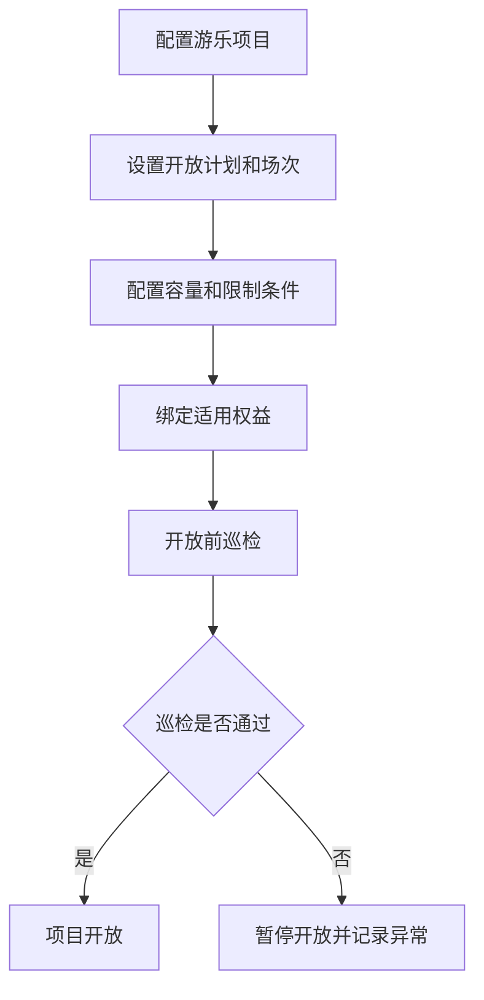
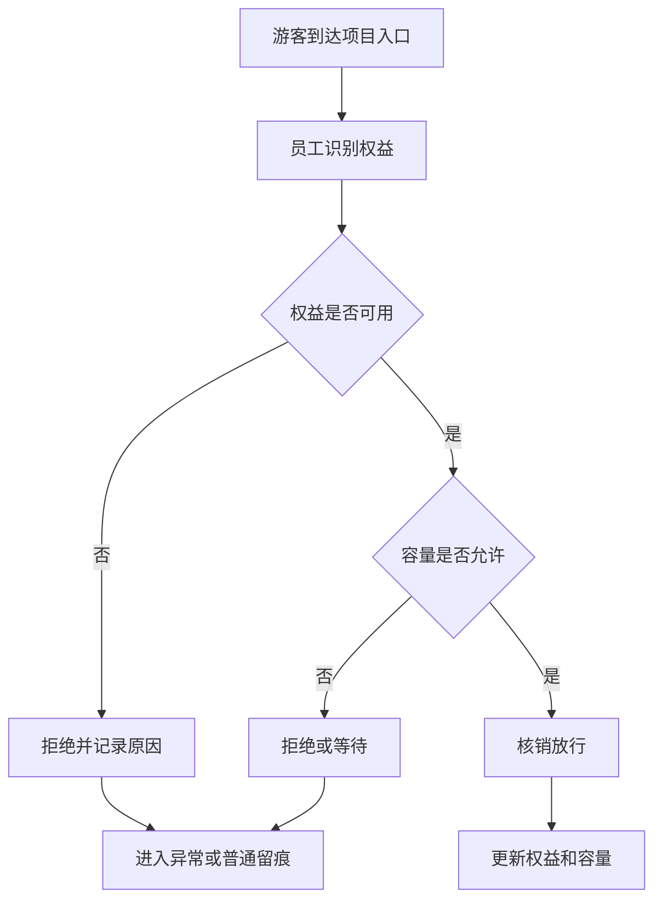
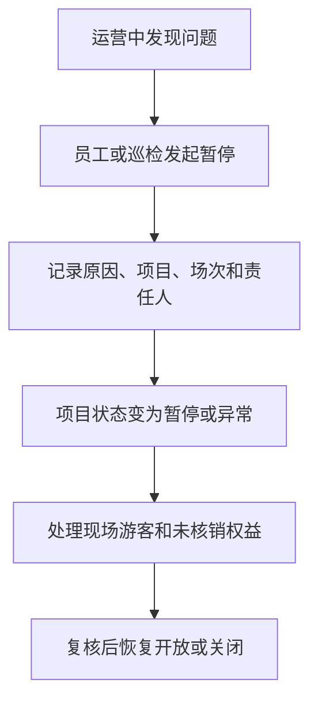

# 游乐基础运营产品 PRD V0.1

> 权限边界：本 PRD 只提供产品细化；三份业务 HTML 拥有最终业务解释权。其他文档、配置、代码和数据结构均不得覆盖 HTML；HTML 未记载的新规则须经用户批准并写入 HTML 后方可生效。

> 2026-07-04 逻辑一致性修订：①超容两处置模式去歧义——block_hard=硬上限阻断+软上限告警放行、warn_only=软上限仅告警放行但**硬上限（安全容量）永不旁路仍阻断**（F-OPS-03，代码枚举为 warn_only）②§7.2 核销流程补验证顺序与拒绝优先级（实名年龄→权益有效期→资格→三维容量取最小→放行/按优先级返回拒绝原因）。
>
> **口径更新提示（2026-08-04）**：上条中的「三维容量取最小」已被 2026-07-23 决策台账 §27 取代，现行口径为**只按具体项目的实时在玩人数控制容量**，见 §4、§7.2、§9、§11 与 §11A.1 的历史标注。

## 1. 文档定位

本文档按主题游乐设施的经营动作拆解 P0 产品能力。它回答“项目如何开放、游客如何使用权益、场次和容量如何控制、安全和异常如何留痕”。

本文档不写技术实现，不做设备控制系统，不替代专业安全系统；P0 聚焦经营管理、核销、容量和留痕。

## 2. P0 目标

游乐 P0 目标是建立基础运营闭环：
- 能建立游乐项目和入口点位。
- 能配置开放时间、场次和容量；**容量只按具体项目的实时在玩人数控制，不再按场次/时段或点位/设备另设容量**。场次可以用于运营安排或信息展示，但不参与容量占用和阻断。
- 能绑定适用票务权益。
- 能现场核销、放行、拒绝或人工处理。
- 能记录项目暂停、关闭、巡检和异常。
- 能为管理层提供项目客流、核销、容量和安全异常视图。

## 3. 角色

| 角色 | 关注重点 |
|---|---|
| 游乐运营 | 项目开放、场次、容量、核销和异常 |
| 现场员工 | 入场核销、放行、拒绝、补录 |
| 安保/巡检 | 安全检查、暂停、异常上报 |
| 票务运营 | 游乐权益配置和核销规则 |
| 管理层 | 游乐项目表现、客流、风险 |

## 4. 业务对象

| 对象 | 定义 | 关键关系 |
|---|---|---|
| 游乐项目 | 可运营的主题游乐设施或体验项目 | 关联空间、入口、票务权益 |
| 项目入口 | 执行核销和放行的点位 | 关联员工、设备、核销记录 |
| 开放计划 | 项目的开放日期和时间 | 关联项目、场次、状态 |
| 场次 | 某项目在某时间段的接待批次 | 关联容量、核销、异常 |
| 容量 | 某个具体游乐项目允许的**最大实时在玩人数** | 关联核销数量和放行结果；**只按具体项目的实时在玩人数控制容量**，不再按场次/时段或点位/设备另设容量；**排队人数不占用项目容量、排队本身不设人数上限**，预计等待时间由**现场大屏**提示（2026-07-23 决策台账 §27，见 §9/§11） |
| 现场排队 | 项目满员时客人在项目现场形成的**实体队伍** | 不产生票务核销、不占用实时在玩容量；摄像头只做人形数量统计用于估算等待时间，**只作现场提示、不形成电子排队顺序**；容量释放后按实体排队先后入场 |
| 项目限制 | 身高、年龄、健康、人数等使用限制 | 关联权益和现场确认 |
| 游乐核销记录 | 游客使用游乐权益的记录 | 关联权益、项目、员工、设备 |
| 巡检记录 | 项目开放前或运营中安全检查 | 关联项目、员工、时间、结果 |
| 项目异常 | 暂停、关闭、超容、设备故障、游客争议等 | 关联项目、场次、责任人 |

## 5. 项目状态

> 修订说明（2026-06-07）：补"中文↔英文 code"双列，与开发设计 §5.1 状态机及数据库 `amusement_project.status` 的 CHECK 取值逐项对应（fielddb-5、《统一口径基准》D7"每个状态表必须给中英两列"）。开发设计另含 draft（草稿）、archived（归档）两个内部生命周期态，本表只列对客经营态。maintenance（检修中）由"定期检修"触发，恢复营业须主管确认（见 §11）。

| 状态 | 英文 code | 含义 | 页面影响 |
|---|---|---|---|
| 未开放 | unopened | 项目暂未运营 | 不允许核销 |
| 准备中 | preparing | 开放前检查中 | 可做巡检，不允许正式放行 |
| 开放中 | open | 项目正常运营 | 可核销放行 |
| 暂停 | paused | 临时暂停运营 | 暂停核销，保留排队或已到场信息 |
| 检修中 | maintenance | 定期检修/长期停机检修 | 暂停核销，恢复营业须主管确认 |
| 已关闭 | closed | 当日运营结束或长期关闭 | 不允许核销 |
| 异常 | abnormal | 存在故障、安全或经营争议 | 需要处理和复核 |

## 6. 场次状态

> 修订说明（2026-06-07）：补英文 code 列，与开发设计 §5.2 场次状态机对齐（《统一口径基准》D7 中英两列原则）。开发设计另含 scheduled（已排期）、accepting_reservation（可预约）、suspended（临时暂停）等过程态，本表为经营视图主态。

| 状态 | 英文 code | 含义 |
|---|---|---|
| 未开始 | scheduled | 场次尚未到时间 |
| 入场中 | checkin_open | 当前可核销入场 |
| 已满员 | full | 该项目实时在玩人数已达上限、暂停新增入场核销（场次本身不设容量，见 §4/§11） |
| 进行中 | running | 场次已开始 |
| 已结束 | completed | 场次结束 |
| 取消 | cancelled | 场次取消 |
| 异常 | abnormal | 场次存在争议或安全问题（开发设计以 suspended/取消等表达，经营口径归"异常"） |

## 7. P0 流程

### 7.1 项目开放

### 7.2 游乐核销

**验证顺序与拒绝优先级（2026-07-04 逻辑一致性修订，补齐流程未明确的判定次序）：** 核销按以下固定顺序逐项判定，命中即停并按该项优先级返回拒绝原因，全部通过才放行——

1. **实名/年龄核验**：游客身份与年龄限制（继承综合体统一入场刷脸闸结论 + 项目身高/年龄限制条件），不通过 → 拒绝（原因 `age_or_identity`）。
2. **权益有效期**：赠饮/游乐权益是否在有效期内且状态可用，不通过 → 拒绝（原因 `entitlement_invalid`）。
3. **资格匹配**：权益是否绑定本项目/场次/点位设备（不做无限制跨项目任选，见 §11 后续细化第 1 条），不匹配 → 拒绝（原因 `scope_mismatch`）。
4. **容量（项目实时在玩人数）**：按该游乐项目配置的最大实时在玩人数判定（§9、§11 已确认第 2 条）；达上限 → 立即阻断该项目的新增入场核销（原因 `capacity_exhausted`），客人在项目现场实体排队等待名额释放；**排队不占容量、不设人数上限**。容量双阈值处置见 §11A.1。

放行后更新权益核销状态与该项目的实时在玩人数计数；拒绝一律记录原因码、判定项、员工、设备、点位与时间进留痕。

### 7.2A 多限制冲突与监护（DEC-ADM-PRIORITY-001，2026-07-28）

> 闭合审计 ADV-ED-003。用户选择 **方案 2：固定优先级链，只报第一条失败**（ADM-PRIORITY-CHAIN）。
> 身高/年龄/是否需监护等阈值一律后台可配（DEC-CFG-ALL-NUMERIC-001），禁止写死。

#### 校验链（默认顺序，顺序本身可配）

按下列顺序**逐项**校验，**命中第一条失败即停止并拒绝**，响应只返回该条失败码/原因（可附规则版本号便于排障）；不一次返回全部失败项。

| 序号 | 检查项 | 失败时 |
|---:|---|---|
| 1 | 项目/场次/点位可开放且未因安全关闭、暂停、故障阻断 | 拒绝核销/入项 |
| 2 | 安全告知/风险知悉已按项目要求完成确认 | 拒绝 |
| 3 | 身高限制（可配区间/下限） | 拒绝 |
| 4 | 年龄限制（可配区间/下限） | 拒绝 |
| 5 | 健康声明/禁忌项（项目配置的必答或必声明） | 拒绝 |
| 6 | **监护要求**（见下） | 拒绝 |

#### 监护要求

- 当项目规则判定「需要监护人」时（通常按年龄阈值可配，也可按项目强制）：
  - 必须存在**合格监护关系/到场确认**（绑定方式与凭证类型可配）；
  - 缺失、过期、与未成年人不匹配 → 在本链第 6 步失败并拒绝。
- 监护人不替代身高/年龄等客观限制：链上更前项已失败时，不进入监护判断。

#### 明确不做（本裁决下）

- 不做「多失败原因一次性全部返回」（那是 ADM-DENY-ANY 展示策略）。
- 不做默认「主管一键豁免越过限制」；若未来要豁免，须单独裁决（双人、留痕、范围），不得默认打开。

#### 终端与证据

- 工作手机/一体机/闸机核销路径共用同一优先级链与同一失败码。
- 失败与成功均留痕：项目、场次、点位、游客/权益、命中规则项、操作人、时间。

### 7.2B 出场核销与主管释放（2026-07-05 用户拍板，已落地）

> **口径标注（2026-08-04）**：本节按 2026-07-05 落地的实现据实记录。按 2026-07-23 决策台账 §27 的现行口径，容量**只按项目实时在玩人数**控制、场次不参与容量占用，因此下表「场次 / 批次型」的场次席位维属**历史实现**，代码改造为待办缺口；出场释放在玩名额的机制本身与现行口径一致。

游乐容量分两类，**判定依据是「这个项目的容量记在哪个维度」，不是项目上另设的类型开关**：

| 类型 | 典型场景 | 容量记在哪 | 出场要不要释放 |
|---|---|---|---|
| 自由进出型 | park 区、体验馆等人随时进出 | 并发在场快照（点位/设备维 + 项目维） | **要**。人不出来，位子就一直占着 |
| 场次 / 批次型 | 木马每轮、密室每批 | 场次席位（每场次已用/容量） | **不要**。这一轮的座位已经消耗，满了等下一场 |

**出场核销**：客人/闸机出场扫同一张凭证 → 系统按凭证找到他那条「还没出场的入场记录」→ 按入场时留痕的点位/设备把在场人数减掉他入场时的人数（多人票整单进整单出）→ 给入场记录盖上出场时刻，并落一条方向为「出场」的核销记录。

- **重复扫不会多减**：同一条入场只释放一次，第二次扫直接返回上次那条出场记录。
- **没入场就扫出场**：拒绝并提示无可释放的入场，不写脏记录、不误减容量。
- **同一张券同一场次不能同时占两个位**：并发重复提交由数据库唯一约束兜住，防超扣。出场后可以再进（自由进出），各扣一次权益。
- **场次/批次型扫出场**：无并发容量可退 → 静默跳过，**绝不动场次席位**。

**主管释放（异常清场）**：现场难免有人忘了扫出场、闸机漏读，在场人数虚高会把后面的客人挡在外面。主管可对整个项目**一键清零在场人数**。

- 属高权限操作，须走人工干预（override）通道，**必须填理由**，系统落一条 override 记录：谁放的、什么时候、什么项目、什么理由、附证据。该记录即审计凭据，事后可查可追。
- 同样**只清并发在场，不动场次席位**——不会把已经卖出去的某一轮座位凭空放出来。

**看板**：后台「游乐核销记录」页（ADM-AMU-005）三视图只读——核销记录（入场/出场，可按项目/场次/方向/日期筛）、在场容量（现在里面多少人、上限多少、**还能进多少**、占用率、超容标红）、与通票的交叉对账。

### 7.3 暂停和关闭

## 8. 页面清单

| 页面 | P0 内容 |
|---|---|
| 游乐运营总览 | 今日开放项目、核销、容量、暂停、异常 |
| 游乐项目管理 | 项目名称、入口、适用权益、限制条件 |
| 开放计划 | 开放日期、时间、状态 |
| 项目容量 | 项目最大实时在玩人数、当前在玩人数、剩余可进、满员状态；场次只作运营安排/信息展示，不参与容量占用 |
| 现场排队看板 | 摄像头估算排队人数、预计等待时长（标注为预计值）、摄像头设备状态；估算不可用时显示「排队数据暂不可用，请以现场为准」 |
| 游乐核销工作台 | 权益识别、容量判断、核销或拒绝 |
| 游乐核销记录（ADM-AMU-005） | 入场/出场核销记录、在场容量（在场人数/上限/剩余可进/占用率/超容）、与通票交叉对账；只读 |
| 巡检记录 | 开放前检查、运营中巡检、结果 |
| 定期检修 | 工程师、检修单位（复用供应商）、点位、来源终端、检修时间、检修结果、异常说明、主管确认恢复营业 |
| 项目异常 | 暂停、关闭、故障、超容、争议 |

### 8.1A 经营数据展示口径（指针，2026-07-28 重裁）

游乐经营看板/管理后台指标遵循 `data-analysis-layer-spec-v0.2.md` §F（**DEC-DATA-BACKEND-ACCURATE-001**）：

- **后台/管理端数据必须精准**，不得以「近似值」冒充正式经营结果。
- 源延迟、缺数、回补未完成时：**不得**用估算数填充为正式指标；应显示无数据/计算中/延迟状态，或阻断该卡片的正式取值直至权威数据就绪。
- 允许的「最近快照」仅可标注为**非最终/待刷新**，且不得进入结算、对账、分红、提成等资金与考核口径。

## 9. P0 验收标准

- 游乐项目必须能绑定空间点位和适用权益。
- 开放中项目才允许正常核销。
- 项目实时在玩人数达到该项目最大容量后，必须立即阻断该项目的新增入场核销；已在玩客人退出释放名额后，立即按现场实体排队顺序恢复下一位客人的入场核销。
- 容量**只按具体项目的实时在玩人数**判定，不再按场次/时段或点位/设备另设容量；场次只用于运营安排或信息展示，不参与容量占用和阻断；排队人数不占容量、排队不设人数上限，预计等待时间由现场大屏提示（2026-07-23 决策台账 §27）。
- 核销必须记录游客权益、项目、员工、设备、点位和时间。
- 暂停、关闭和异常必须记录原因和责任人。
- 定期检修必须记录工程师、检修单位、供应商、检修结果和异常说明。
- 检修完成后必须由主管确认，项目或设备才能恢复营业。
- 项目核销结果能进入票务权益、日结和经营看板。

## 10. P1/P2

| 阶段 | 能力 |
|---|---|
| P1 | 动态容量、项目联票、更多限制条件、视频证据绑定 |
| P2 | 客流预测、自动调度、智能安全预警、游客体验分析 |

## 11. 已确认规则和后续细化事项

已确认：

1. **容量只按具体项目的实时在玩人数控制**（例如鬼屋最多同时 20 人），不再按场次/时段或点位/设备另设容量；每个游乐项目分别设置一个最大实时在玩人数。客人实际进入项目时才核销权益并占用一个在玩名额，退出后释放名额。
2. **排队不占容量**：项目满员时客人在项目现场实体排队，排队本身不设人数上限、不产生票务核销、不占用实时在玩容量；不设置电子排队号、远程取号、系统叫号、到场保留时间或过号机制。项目现场摄像头只做人形数量统计（不做人脸识别、不建立顾客身份）用于估算排队人数与预计等待时长，结果由**现场大屏**提示客人，**只作现场提示、不形成电子排队顺序**，也不改变按实体队伍先后入场的规则；预计等待时长必须标注为预计值，不构成承诺入场时间。

> **历史实现标注（2026-08-04）**：此前 PRD 与代码采用的「三维容量（项目 / 场次 / 点位设备）取最小可放行余量」为**历史实现（V083 / V104 等）**，**已被 2026-07-23 决策台账 §27 取代**（`docs/prd-audit/business-decision-ledger.md` §27 可查证）。本 PRD 已按现行口径改写；**对应的代码改造属待办缺口**，实现证据不得反向覆盖本节口径。
3. 一体机承接游乐设施定期检修记录；检修由工程师执行，**检修单位作为供应商记录 = 复用供应链 `suppliers` 主数据**（检修记录用 `maintenance_vendor_id` 外键引用，供应商 `supplier_category ∈ {maintenance, service}`），不另建独立维保供应商表。
   > 修订说明（2026-06-07，amuse-3 / 《统一口径基准》D7）：原文仅自然语言"作为供应商记录"，无外键口径，无法判断入哪张供应商表。此处明确复用供应链供应商主数据；对齐方以 supply-chain 开发设计为准，本 PRD 仅引用口径不编辑供应链文件。
4. 检修完成后必须由主管确认，游乐设施才能恢复营业。**"主管确认前不可恢复营业"为状态机硬约束**：检修中（maintenance）项目/设备唯有经主管确认（记录确认人、确认时间、恢复营业时间）后方可回到"开放中"，检修不通过或未确认时核销一律拒绝。
   > 修订说明（2026-06-07，kiosk-4）：把恢复营业前置确认从"流程描述"升级为状态机约束，落地见开发设计 §5.1.1 与检修记录表 `supervisor_confirmed_by/confirmed_at/resume_business_at`。

后续细化：

无方向性悬空事项。已确认按以下口径执行：

1. 游乐权益 P0 不做无限制跨项目任选；必须绑定指定项目或明确的可用项目集合，核销时按权益配置校验项目、场次、点位/设备和容量。
2. 项目限制条件 P0 必须记录现场核验结果；涉及身高、年龄、健康提示、安全告知、人工放行或拒绝的，至少记录核验人、时间、结果、原因和证据引用。
3. 暂停项目后，未使用权益不自动无条件延期或退款；系统先标记受影响权益，按票种/合同/活动规则支持延期、改期、退款或人工审批处理。
4. 开放前巡检和定期检修 P0 使用两套模板类型，但共用同一巡检/检修记录引擎、状态机和主管确认恢复规则。

## 11A. 超容放行与准入拦截能力补充 `文档goalP1(2026-06-20)`

> 本节是产品细化；迁移号、operationId、权限点、事件常量和验收证据等当前实现细节见 `docs/v099-v124-feature-implementation-and-acceptance-spec-v0.1.md`。该实现规格不得覆盖三份业务 HTML。

### 11A.1 游乐超容（over_capacity）软/硬阈值放行策略（实现依据：spec §7，V104）

> **口径标注（2026-08-04）**：本节的 `block_hard` / `warn_only` 与迁移号为**实现现状**，据实保留。按 2026-07-23 决策台账 §27 的现行口径，两档阈值一律作用于**该游乐项目的实时在玩人数**，不再作用于场次席位或点位/设备容量；代码侧仍按场次维计数（含 `SESSION_CAPACITY_EXHAUSTED` 口径）的部分属**待办改造缺口**，不得反向覆盖 §4/§9/§11 的业务口径。

能力描述：把项目实时在玩人数的容量阈值细化为**双阈值**——

| 阈值 | 口径 | 现场处置 |
|---|---|---|
| 硬上限（安全容量） | 项目安全容量（V083），安全优先不可人工绕过 | **硬阻断**放行（达上限即拒绝继续正常核销，SESSION_CAPACITY_EXHAUSTED 口径） |
| 软上限（运营容量） | 项目维配置的运营容量（`operating_capacity`，默认 0=未配置） | **软告警放行**（达上限不阻断，但落超容事件 + 异常） |

业务规则：
- 超容必落事件与异常：无论硬阻断还是软告警放行，**均**写入 `over_capacity` 类项目异常（复用 §4「项目异常」对象，`incident_type=over_capacity`）+ 落超容事件（含放行人/原因/时段），杜绝"超容不留痕"。
- 处置模式后台可切换（项目维一行配置，**代码枚举 = `block_hard` / `warn_only`**）：
  - **`block_hard`（默认）**：硬上限（安全容量）阻断 + 软上限（运营容量）告警放行，两档均留痕。
  - **`warn_only`**：软上限仅告警放行、不阻断；**但硬上限（安全容量）永不旁路——F-OPS-03 起任何模式达安全容量均阻断并触发自动停运**，`warn_only` 仅对软上限生效并作 incident 留痕标注。
  - 两模式对硬上限行为完全一致（均阻断），差异仅在软上限 incident 留痕语义；切换本身受权限控制。
- 未配置运营容量的项目向后兼容：退化为"仅硬上限阻断、无软上限告警"，不影响既有核销。

验收口径要点（细化 G/W/T 见 spec §7）：
- 配置运营容量 80 / 安全容量 100 / 模式 block_hard：在场达 80 → 告警放行 + 落 over_capacity 异常与事件；在场达 100 → 硬阻断 + 落 over_capacity 异常与事件。
- 模式 warn_only：**达安全容量（硬上限）仍阻断**（F-OPS-03 不可旁路、触发自动停运），达运营容量（软上限）告警放行；超容均必落 over_capacity 异常与事件。
- 未配置运营容量：退化为仅硬上限阻断、无软上限告警。

### 11A.2 准入闸：游乐入场 over_space / over_contract_scope 拦截与升级放行（实现依据：spec §1，V099）

能力描述：游乐相关受控动作（项目核销重开、异常关闭、团体/包场审批等）在执行前经统一**准入闸**判定是否越界，命中即先卡住（fail-closed 进主管复核），消除"无策略=判定空转放行"的隐患。

业务规则：
- 两类越界触发：`over_space`（对象可解析到空间 → 物理越界，如对超出本项目合同租赁空间的对象发起动作）；`over_contract_scope`（无空间归属 → 经营范围越界）。
- 命中即先卡住 + 升级放行：命中越界一律先 `block` 并生成 pending 主管复核，按**所需审批级别**逐级放行/驳回——物理越界类（含游乐重开/异常关闭/团体包场审批）需上两级（required_level=3）。
- fail-closed 兜底（安全优先）：准入判定过程异常或对象空间无法解析时，一律按卡住处理（不放行），并留证据留痕，绝不 fail-open 放行。

验收口径要点（细化 G/W/T 见 spec §1）：
- 对超出合同租赁空间的游乐对象发起受控动作 → 返回 block + 生成 pending 复核，未达审批级别不可放行。
- 准入判定异常 / 空间不可解析 → fail-closed 卡住，留痕，非放行。

### 11A.3 团体/包场：由「未做」更正为「已落地」`文档goalP1(2026-06-20)`

口径更正：原 §10 P1 表把「预约排队」「项目联票」等列入 P1；团体/包场（团体票批量入场、整场/时段包场）此前在产品侧未明确承接。经 grep 实证，团体/包场能力**已落地**（迁移 `V035__p2_amusement_group_private_bookings.sql` 建 `amusement_group_bookings` 表，`booking_type ∈ {group, private}`，`booking_status` 四态机 `pending_approval → approved → released / cancelled`；服务层 `AmusementBookingService` 提供创建与审批；审批受 `amusement.group_booking.approve` 权限 + V099 over_space 准入闸双控）。

业务规则：
- 团体/包场支持两类：`group`（团体批量预订）、`private`（整场/时段包场，占用整场次容量）。
- 状态机：发起 → `pending_approval`（待审批）→ 主管审批 → `approved`（生效）/ `cancelled`（取消）；包场占用到期或主动释放 → `released`。
- 审批受准入闸约束：包场审批为受控动作，命中 over_space 越界先卡住进主管复核（见 §11A.2），合法范围内方可 `approved`。

验收口径要点（细化 G/W/T 见 spec §1/§18）：
- 发起团体/包场 → `pending_approval`；主管审批通过 → `approved`，留痕审批人/时间。
- 包场审批触碰越界空间 → 准入闸 block 进复核，未升级放行不得 approved。

> 待业务确认（amusement）：团体/包场此前在 PRD 主体（§4–§12）未单列页面与验收，本节据 V035 已落地据实补「已落地」口径；是否需把「团体/包场预订与审批」补入 §8 页面清单与 §9 P0 验收作为正式 P0 交付项（而非 §10 P1 规划），需业务最终确认其 P 级归属。

## 11B. 设备分级、停机判定与巡检细则（2026-08-04 对齐 BSM）

### 11B.1 设备分级与停机范围判定

- 每个游乐项目可以关联多台设备，并区分「**关键安全设备**」与「**辅助设备**」；**每台设备按各自的安全检查周期巡检**。
- 某台设备巡检超期、巡检不合格或发生故障时，按其类别处置：
  - **辅助设备**：只停用该台设备本身。项目是否可以在其余条件下继续运行，**由工程岗位或安全岗位判断，不得由当班运营人员自己判断**；**判断结论必须留痕**——记下**是谁判的、什么时间判的、依据了哪几项条件**；**没有留痕的一律按停止运行处理**。
  - **关键安全设备**：看它与其余关键安全设备之间是否存在**依赖关系**——不存在依赖关系且其余关键安全设备均无故障的，只停该台故障设备、项目可继续运行；**存在依赖关系的，整个游乐项目停止新增核销并停止运行**。
- **依赖关系判定标准**：按客人走完这个游乐项目的实际流程来判——该设备是客人必经环节、少了它流程走不下去的属**依赖**；有同类设备可顶替、或该环节可绕过而客人仍能走完整个项目的属**不依赖**。
- 每台关键安全设备属于哪一种，**须在设备台账中登记**，作为故障时判定停机范围的依据；登记内容变更须经**工程或安全审批**。
- 项目上线后要把某台关键安全设备改为辅助设备，必须**重新经过工程或安全审批**，并且**只能在该项目停运后生效**；普通系统管理员或普通运营人员不得直接降级。
- **停用的设备完成合格巡检后才放行**（恢复使用），检修后仍须主管确认才能恢复营业（见 §11 已确认第 4 条）。
- 关键设备停运事件与辅助设备停用事件必须**分别记录**设备、原因、时间、处置和恢复审批。

### 11B.2 巡检细则

- **按点位顺序完成**：巡检必须按点位顺序完成，**缺一个点位、上一个点位就不能通过**；**未走完全部点位的巡检不成立**，不得标记为已完成，**也不存在事后补录**。
- **三类巡检检修**：
  1. **开放前巡检**；
  2. **营业中抽检**——有最低频次要求，每隔多久至少抽检一次由后台配置（**安全阈值，按项目可配，须同时配置上限与下限，出厂默认每 2 小时一次**），**达不到最低频次的视为当班未抽检**；
  3. **定期检修**——**不另设周期，直接采用设备台账中该设备已经登记的安全检查周期**。
- 检修单位复用供应商档案（见 §11 已确认第 3 条）；检修后必须**主管确认**才能恢复营业，**禁止巡检员单人闭环**。
- 当日无合格巡检或有未复检阻断项的，**拒绝核销**。

### 11B.3 故障提示、停售与全园故障补偿

- **局部故障**：单台设备或单个游乐项目因故障不可使用时，购票页面必须在**付款前明确提示**具体不可玩的设备或项目及当前故障状态；完成故障提示后客人仍可继续购买游乐门票，但故障设备或项目在恢复前不得核销和体验。单台设备或单个项目故障**不直接触发**一年期补偿通票。
- **全园故障**：指全部游乐项目均不可运行，或供电、消防、入口系统等公共关键设施故障导致游乐园必须整体关闭。
  - **全园故障状态生效后，必须立即停止所有纯游乐门票和所有包含游乐权益的通票的新销售**；全园故障期间**不得仅靠风险提示继续销售**无法履约的游乐权益。
  - 现场授权人员可以立即发起全园故障状态，系统随即停止相关售票和核销，**不得等待事后审批才执行安全阻断**。
  - **补偿**：可以向受影响客人发放一张**全新的游乐补偿通票**，该票是独立的新票，**自发放之日起一年内有效**，必须关联原票、全园故障事件和发放原因以防重复补偿。
  - **补偿对象**：故障发生时已完成游乐园入场核销的客人；以及故障发生时尚未核销、但对应游乐门票或游乐权益仍在有效期内的持票客人。补偿资格以**全园故障发生时间**与原票/原游乐权益的核销状态、有效期做**快照判定**。
  - 批量发放一年期补偿通票前，必须由**游乐公司负责人与工程或安全岗位共同确认**全园故障事件及影响时间范围。
- **事件不得混同**：满员阻断、恢复核销、停止运行是三个不同事件，必须使用不同状态和时间记录，不得混为「项目停止运营」。

## 12. 本版结论

游乐 P0 的核心是“项目开放计划 -> 项目实时在玩容量 -> 权益核销 -> 安全巡检 -> 异常留痕”。电子预约排队一类能力已按 2026-07-23 决策台账 §27 废止（现场实体排队 + 摄像头估算仅作提示），自动化安全联动可以后移，但核销、容量和暂停关闭必须在 P0 形成可靠经营事实。

## 13. 变更日志

| 日期 | 类型 | 位置 | 内容 | 原因/依据 |
|---|---|---|---|---|
| 2026-06-07 | 改 | §4 业务对象 | 容量对象补"三维度取最小可放行余量"口径 | amuse-1 |
| 2026-06-07 | 改 | §5 项目状态 | 补中文↔英文 code 双列（unopened/preparing/open/paused/maintenance/closed/abnormal） | fielddb-5、基准 D7 |
| 2026-06-07 | 改 | §6 场次状态 | 补英文 code 列，与开发设计场次状态机对齐 | 基准 D7 |
| 2026-06-07 | 改 | §8 页面清单 | 定期检修页补点位、来源终端、检修时间、异常说明、主管确认恢复营业 | kiosk-4 |
| 2026-06-07 | 改 | §9 验收 | 补三维度容量取最小值验收项 | amuse-1 |
| 2026-06-07 | 改 | §11 已确认规则 | 检修单位明确=复用供应链 suppliers 主数据；主管确认前不可恢复营业升级为状态机约束 | amuse-3、kiosk-4、基准 D7 |
| 2026-06-20 `文档goalP1` | 增 | §11A | 新增超容放行与准入拦截能力补充；当前实现细节见 v099-v124-feature-implementation-and-acceptance-spec-v0.1.md §1/§7/§18，不覆盖三份业务 HTML | 文档goalP1；实现证据见 V104/V099/V035、AmusementService 和 AmusementBookingService |

| 2026-07-28 | 增 | §8.1A | 数据展示指针 ADV-ED-008 |
| 2026-07-28 | 改 | §8.1A | 用户重裁：后台数据必须精准，废止近似填充（DEC-DATA-BACKEND-ACCURATE-001） |
| 2026-08-04 | 改 | 头部提示、§2、§4、§6、§7.2、§7.2B、§8 页面清单、§9、§10、§11、§11A.1、§12 | 容量模型对齐现行口径：只按具体项目的实时在玩人数控制容量，不再按场次/时段或点位/设备另设容量；排队不占容量、不设人数上限、等待时间由现场大屏提示；三维容量取最小如实标注为历史实现（V083/V104 等），已被 2026-07-23 决策台账 §27 取代，代码改造列为待办缺口；`block_hard`/`warn_only` 作为实现现状保留 | PRD 同步（2026-08-04）：BSM L1115 / L1118 + 2026-07-23 决策台账 §27（`docs/prd-audit/business-decision-ledger.md`）；台账见 `docs/prd-sync-change-log-20260804.md` §8 B3-11 |
| 2026-08-04 | 删 | §10 P1 清单 | 删除「预约排队」「候场提醒」：电子排队号、远程取号、系统叫号、到场保留时间、过号机制均已废止；现场实体排队 + 摄像头估算只作提示、不形成顺序 | 2026-07-23 决策台账 §27；B3-12 |
| 2026-08-04 | 增 | §11B.1 / §11B.2 / §11B.3 | 补设备分级与停机判定（每台设备按各自安全检查周期巡检、辅助设备停机判断结论必须留痕否则按停止运行、停用设备完成合格巡检后才放行、关键安全设备依赖关系判定与降级审批）；补巡检细则（按点位顺序、不成立不得标记完成、无事后补录、开放前巡检+营业中抽检（出厂默认每 2 小时、须配上下限）+定期检修采用设备台账安全检查周期）；补故障提示与全园故障补偿（全园故障即停售所有纯游乐票与含游乐权益通票、局部故障付款前提示后可继续销售、补偿通票自发放之日起一年内有效） | BSM L1122、L1147 + 决策台账 §27；B3-13/B3-14/B3-15 |
| 2026-07-28 | 增 | §7.2B、§8 页面清单 | 回写 2026-07-05 已落地的「出场核销 + 主管释放」口径（此前只有代码无 PRD）：自由进出型出场回收在场容量、场次/批次型不释放（判定依据=容量所在维度）、主管清场须填理由并留痕、ADM-AMU-005 核销记录页三视图；容量看板补「剩余可进」列 | 实读 V234 + AmusementService.exitVerification/createManualOverride + ADM-AMU-005 |
