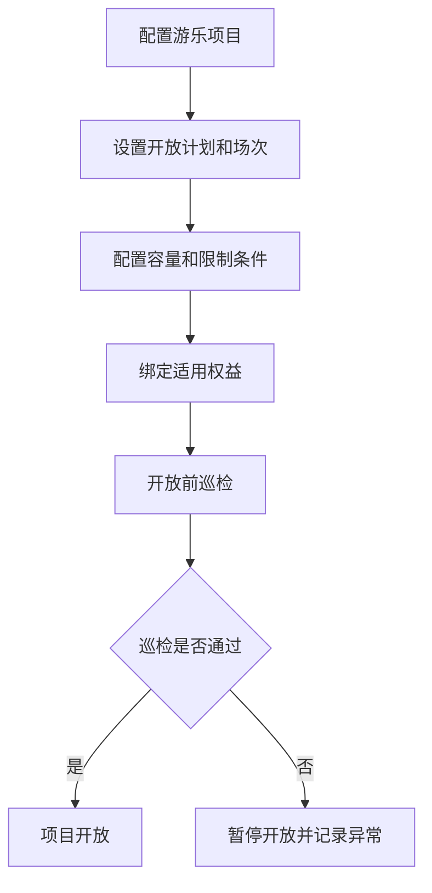
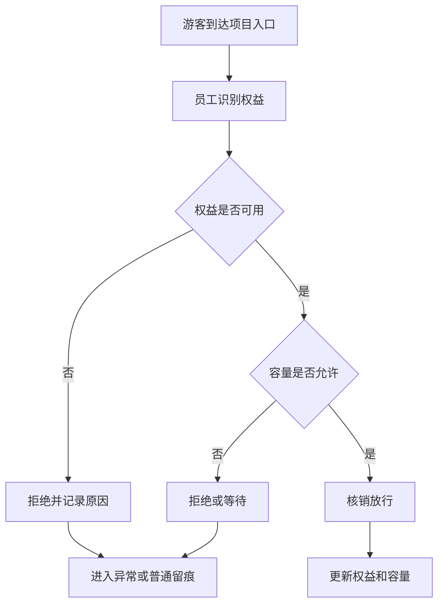
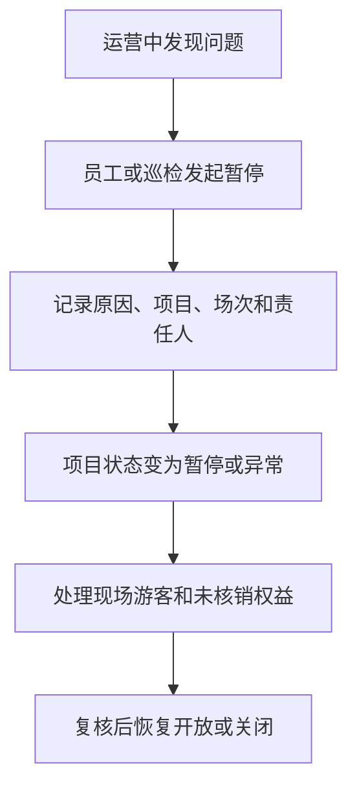

# 游乐基础运营产品 PRD V0.1

## 1. 文档定位

本文档按主题游乐设施的经营动作拆解 P0 产品能力。它回答“项目如何开放、游客如何使用权益、场次和容量如何控制、安全和异常如何留痕”。

本文档不写技术实现，不做设备控制系统，不替代专业安全系统；P0 聚焦经营管理、核销、容量和留痕。

## 2. P0 目标

游乐 P0 目标是建立基础运营闭环：
- 能建立游乐项目和入口点位。
- 能配置开放时间、场次和容量；P0 按具体项目 + 具体场次/时段 + 点位/设备控制容量。
- 能绑定适用票务权益。
- 能现场核销、放行、拒绝或人工处理。
- 能记录项目暂停、关闭、巡检和异常。
- 能为管理层提供项目客流、核销、容量和安全异常视图。

## 3. 角色

| 角色 | 关注重点 |
|---|---|
| 游乐运营 | 项目开放、场次、容量、核销和异常 |
| 现场员工 | 入场核销、放行、拒绝、补录 |
| 安保/巡检 | 安全检查、暂停、异常上报 |
| 票务运营 | 游乐权益配置和核销规则 |
| 管理层 | 游乐项目表现、客流、风险 |

## 4. 业务对象

| 对象 | 定义 | 关键关系 |
|---|---|---|
| 游乐项目 | 可运营的主题游乐设施或体验项目 | 关联空间、入口、票务权益 |
| 项目入口 | 执行核销和放行的点位 | 关联员工、设备、核销记录 |
| 开放计划 | 项目的开放日期和时间 | 关联项目、场次、状态 |
| 场次 | 某项目在某时间段的接待批次 | 关联容量、核销、异常 |
| 容量 | 具体项目、具体场次/时段、点位/设备允许接待的人数上限 | 关联核销数量和放行结果；项目总量只做汇总和安全上限；现场放行按三维度（项目/场次/点位设备）取最小可放行余量判定（amuse-1，见 §9） |
| 项目限制 | 身高、年龄、健康、人数等使用限制 | 关联权益和现场确认 |
| 游乐核销记录 | 游客使用游乐权益的记录 | 关联权益、项目、员工、设备 |
| 巡检记录 | 项目开放前或运营中安全检查 | 关联项目、员工、时间、结果 |
| 项目异常 | 暂停、关闭、超容、设备故障、游客争议等 | 关联项目、场次、责任人 |

## 5. 项目状态

> 修订说明（2026-06-07）：补"中文↔英文 code"双列，与开发设计 §5.1 状态机及数据库 `amusement_project.status` 的 CHECK 取值逐项对应（fielddb-5、《统一口径基准》D7"每个状态表必须给中英两列"）。开发设计另含 draft（草稿）、archived（归档）两个内部生命周期态，本表只列对客经营态。maintenance（检修中）由"定期检修"触发，恢复营业须主管确认（见 §11）。

| 状态 | 英文 code | 含义 | 页面影响 |
|---|---|---|---|
| 未开放 | unopened | 项目暂未运营 | 不允许核销 |
| 准备中 | preparing | 开放前检查中 | 可做巡检，不允许正式放行 |
| 开放中 | open | 项目正常运营 | 可核销放行 |
| 暂停 | paused | 临时暂停运营 | 暂停核销，保留排队或已到场信息 |
| 检修中 | maintenance | 定期检修/长期停机检修 | 暂停核销，恢复营业须主管确认 |
| 已关闭 | closed | 当日运营结束或长期关闭 | 不允许核销 |
| 异常 | abnormal | 存在故障、安全或经营争议 | 需要处理和复核 |

## 6. 场次状态

> 修订说明（2026-06-07）：补英文 code 列，与开发设计 §5.2 场次状态机对齐（《统一口径基准》D7 中英两列原则）。开发设计另含 scheduled（已排期）、accepting_reservation（可预约）、suspended（临时暂停）等过程态，本表为经营视图主态。

| 状态 | 英文 code | 含义 |
|---|---|---|
| 未开始 | scheduled | 场次尚未到时间 |
| 入场中 | checkin_open | 当前可核销入场 |
| 已满员 | full | 容量已达上限 |
| 进行中 | running | 场次已开始 |
| 已结束 | completed | 场次结束 |
| 取消 | cancelled | 场次取消 |
| 异常 | abnormal | 场次存在争议或安全问题（开发设计以 suspended/取消等表达，经营口径归"异常"） |

## 7. P0 流程

### 7.1 项目开放

### 7.2 游乐核销

### 7.3 暂停和关闭

## 8. 页面清单

| 页面 | P0 内容 |
|---|---|
| 游乐运营总览 | 今日开放项目、核销、容量、暂停、异常 |
| 游乐项目管理 | 项目名称、入口、适用权益、限制条件 |
| 开放计划 | 开放日期、时间、状态 |
| 场次容量 | 场次、容量、已核销、剩余、满员状态 |
| 游乐核销工作台 | 权益识别、容量判断、核销或拒绝 |
| 巡检记录 | 开放前检查、运营中巡检、结果 |
| 定期检修 | 工程师、检修单位（复用供应商）、点位、来源终端、检修时间、检修结果、异常说明、主管确认恢复营业 |
| 项目异常 | 暂停、关闭、故障、超容、争议 |

## 9. P0 验收标准

- 游乐项目必须能绑定空间点位和适用权益。
- 开放中项目才允许正常核销。
- 场次容量达到上限后必须阻止继续正常核销。
- 容量按三维度（项目/场次/点位设备）取最小可放行余量判定，任一受控维度达上限即阻止正常核销（amuse-1）。
- 核销必须记录游客权益、项目、员工、设备、点位和时间。
- 暂停、关闭和异常必须记录原因和责任人。
- 定期检修必须记录工程师、检修单位、供应商、检修结果和异常说明。
- 检修完成后必须由主管确认，项目或设备才能恢复营业。
- 项目核销结果能进入票务权益、日结和经营看板。

## 10. P1/P2

| 阶段 | 能力 |
|---|---|
| P1 | 预约排队、动态容量、候场提醒、项目联票、更多限制条件、视频证据绑定 |
| P2 | 客流预测、自动调度、智能安全预警、游客体验分析 |

## 11. 已确认规则和后续细化事项

已确认：

1. 因游乐设施分布在综合体不同位置，P0 按具体项目 + 具体场次/时段 + 点位/设备控制容量。
2. 项目总量只作为上层汇总和安全上限，不作为现场放行唯一口径。现场放行按三维度取最小可放行余量判定（amuse-1，落地见开发设计 §6.4）。
3. 一体机承接游乐设施定期检修记录；检修由工程师执行，**检修单位作为供应商记录 = 复用供应链 `suppliers` 主数据**（检修记录用 `maintenance_vendor_id` 外键引用，供应商 `supplier_category ∈ {maintenance, service}`），不另建独立维保供应商表。
   > 修订说明（2026-06-07，amuse-3 / 《统一口径基准》D7）：原文仅自然语言"作为供应商记录"，无外键口径，无法判断入哪张供应商表。此处明确复用供应链供应商主数据；对齐方以 supply-chain 开发设计为准，本 PRD 仅引用口径不编辑供应链文件。
4. 检修完成后必须由主管确认，游乐设施才能恢复营业。**"主管确认前不可恢复营业"为状态机硬约束**：检修中（maintenance）项目/设备唯有经主管确认（记录确认人、确认时间、恢复营业时间）后方可回到"开放中"，检修不通过或未确认时核销一律拒绝。
   > 修订说明（2026-06-07，kiosk-4）：把恢复营业前置确认从"流程描述"升级为状态机约束，落地见开发设计 §5.1.1 与检修记录表 `supervisor_confirmed_by/confirmed_at/resume_business_at`。

后续细化：

无方向性悬空事项。已确认按以下口径执行：

1. 游乐权益 P0 不做无限制跨项目任选；必须绑定指定项目或明确的可用项目集合，核销时按权益配置校验项目、场次、点位/设备和容量。
2. 项目限制条件 P0 必须记录现场核验结果；涉及身高、年龄、健康提示、安全告知、人工放行或拒绝的，至少记录核验人、时间、结果、原因和证据引用。
3. 暂停项目后，未使用权益不自动无条件延期或退款；系统先标记受影响权益，按票种/合同/活动规则支持延期、改期、退款或人工审批处理。
4. 开放前巡检和定期检修 P0 使用两套模板类型，但共用同一巡检/检修记录引擎、状态机和主管确认恢复规则。

## 12. 本版结论

游乐 P0 的核心是“项目开放计划 -> 场次容量 -> 权益核销 -> 安全巡检 -> 异常留痕”。复杂预约排队和自动化安全联动可以后移，但核销、容量和暂停关闭必须在 P0 形成可靠经营事实。

## 13. 变更日志

| 日期 | 类型 | 位置 | 内容 | 原因/依据 |
|---|---|---|---|---|
| 2026-06-07 | 改 | §4 业务对象 | 容量对象补"三维度取最小可放行余量"口径 | amuse-1 |
| 2026-06-07 | 改 | §5 项目状态 | 补中文↔英文 code 双列（unopened/preparing/open/paused/maintenance/closed/abnormal） | fielddb-5、基准 D7 |
| 2026-06-07 | 改 | §6 场次状态 | 补英文 code 列，与开发设计场次状态机对齐 | 基准 D7 |
| 2026-06-07 | 改 | §8 页面清单 | 定期检修页补点位、来源终端、检修时间、异常说明、主管确认恢复营业 | kiosk-4 |
| 2026-06-07 | 改 | §9 验收 | 补三维度容量取最小值验收项 | amuse-1 |
| 2026-06-07 | 改 | §11 已确认规则 | 检修单位明确=复用供应链 suppliers 主数据；主管确认前不可恢复营业升级为状态机约束 | amuse-3、kiosk-4、基准 D7 |
