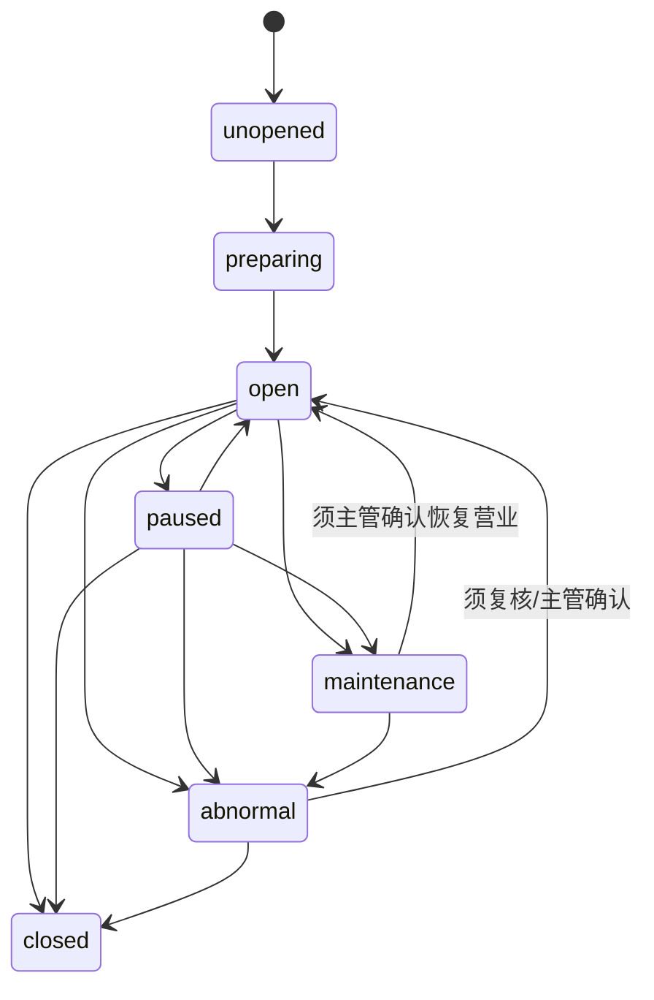

# 游乐设施运营系统开发设计文档 V0.06

> **口径修订（2026-08-06 R10）：「人工放行」已废止**——ENUM「核销记录状态」条 明确「**系统不提供人工放行：核销要么成功、要么拒绝或失败，任何岗位、任何权限都不能以人工方式让一笔不满足规则的核销通过**」（DEC-CFG-2026-08-03-12 / DEC-R6-08）。本文原有的「人工放行」流程（§6.5）、表 `AmusementManualOverride`、状态取值 `manual_override`、端点 `/api/v1/amusement/manual-overrides`、权限点 `amusement.verification.override`、事件 `amusement.verification_overridden`、指标与页面入口**一律废止**，废止处就地标注；已实现的表、端点与取值待代码轮下线，期间不得新增调用、不得新写入。

> **口径修订（2026-08-06 R10）：「场次容量／三维度容量」已废止**——BSM「容量控制」条 明确「**只按单个游乐项目的实时在玩人数控制容量，不再按场次/时段或点位/设备另设容量；排队人数不占用容量**」（DEC-R5-2026-08-04-04；R8 用户裁决 D-02）。本文原「按项目 + 场次/时段 + 点位/设备三维度取最小可放行余量」的容量判定口径**整体废止**，一律改为「**项目容量（实时在玩人数）**」单维；双阈值不变（运营容量软上限告警放行、安全容量硬上限阻断并自动停运）。`amusement_capacity_config`、`amusement_capacity_snapshot` 的场次维与点位/设备维字段待代码轮下线，期间不得据以新增受控维度。

> 版本：V0.05 ｜ 最后更新：2026-09-01 ｜ 覆盖迁移基线：当前 main 最大 V385 ｜ 状态：现行
> 新功能承接见 docs/v099-v124-feature-implementation-and-acceptance-spec-v0.1.md
> <!-- 文档goalP3(2026-06-20)：补版本/日期/覆盖迁移头，未改正文 -->
>
> **M07 收口（2026-09-01）**：现行容量仅为单项目实时在玩人数；电子预约排队、人工放行、离线游乐核销、场次/点位设备容量均为已废止待下线实现。补出场自动扣减、设备关键/辅助分级、点位顺序巡检、全园故障、营业日/项目时区、游乐商户隔离和结算输出；代码事实核到 V385。
>
> **M07 二轮复审（2026-09-01，V0.03）**：P1 增强只保留动态容量；事故/故障/投诉记录、设备状态和现场核验留痕按现行业务承接。`approveReopen` 当前只联动 `maintenance/closed → open`，对 `paused` 不强制翻转，完整恢复闭环仍有代码缺口。
>
> **M07 三轮复审（2026-09-01，V0.04）**：游乐报表按现行 P0 经营看板承接；P2 增强仍严格限定为客流预测、自动调度、智能安全预警、游客体验分析。
>
> **M07 门禁同步（2026-09-01，V0.05）**：仅把变更日志中的 BSM 经营看板引用补全为唯一条目名，并同步 HTML 权威锚点治理镜像；不改变任何业务口径。
>
> 2026-07-04 逻辑一致性修订：现场核销统一二维码扫码——作废 NFC 腕带/手环核销与闸机 NFC 联动。改动处：§3 核销员权限、§6.4 项目核销流程、§7.7 核销记录 method 取值、§7.9 设备类型、§10.1 核销员作业、§12.2 安卓端承接、§12.3 第三方设备、§16 P2、§17 排期。硬件"NFC 读卡器/NFC 手环"标不再采购。（注：私人手机身份绑定早已改 Keystore 设备凭证，与本次无关，保持不动）

> **✅ R7 复审上修标注（2026-06-19，只读核验真实迁移/代码后回填）**
> R5 横幅与下方 D11 原标注的四项缺口已在本会话 P0 实现并落库（V081/V082/V083，且代码已接线），以下上修；仅"一体机端侧实际集成"保持开放。
> - **✅ 检修整表 + 恢复营业联动已落地（V081）**：新建 `amusement_maintenance_record`（检修单位复用供应链供应商 supplier_category∈{maintenance,service}、工程师、检修结果、异常说明、来源终端/点位结构化、`supervisor_confirmed_by`/`resume_business_at`）；主管确认恢复时联动写 `amusement_projects.open_status`(maintenance→open)，`AmusementMaintenanceService` 提供提交检修 / `confirm-resume` 端点；CHECK 硬约束确认前不得由 maintenance 流转回 open。
> - **✅ 现场核销校验票务权益已落地（V082）**：新建 `amusement_project_entitlements`（项目↔权益类型绑定）；`AmusementService.createVerification` 经 `AmusementEntitlementGateway` 在线校验存在/active/有效期/剩余次数/游乐类/绑定本项目，不可用即拒绝（`ENTITLEMENT_USED`/`ENTITLEMENT_EXPIRED`/无剩余次数等）。当前“项目无任何绑定配置时仅校验游乐类放行”的兼容回退与 HTML“绑定哪些票务权益可以使用这个项目”不一致，登记为待修代码缺口。
> - **✅ 三维度容量已落地（V083）**（**口径已废止·见文首口径**：三维度容量整体作废，现行只按项目实时在玩人数单维控量；本条只记录当时的落地事实）：新建 `amusement_capacity_config`（点位/设备维并发容量）+ `amusement_capacity_snapshot`（项目/场次/点位设备各维在场计数物化），核销按"项目安全上限 / 场次 / 点位设备"三维度取最小可放行余量原子 check+increment；仅校验已配置受控维度，未配置维度退化为场次单维。
> - **端侧现状（M07 复核）**：`apps/android-terminal/` 已有游乐在线核销、游乐离线核销排队、检修提交和主管确认恢复调用；原“无 amusement/safety 实际端侧集成”已失效。在线核销与检修链可复用；游乐离线核销违反 HTML“必须在线、不做离线核销”，登记为须下线实现，不得新增调用。
> - **验收口径（已正式）**：检修主管确认通过后项目 `open_status` 自动恢复为 `open`；无有效/未绑定本项目权益核销失败并返回明确原因；项目容量（实时在玩人数）余量为 0 即拒绝（`session_full`）（原按「场次/三维度容量」，已废止·见文首口径）。

本文档覆盖【游乐设施运营系统：项目、场次、核销、巡检】的开发级设计。目标是让后端、前端、安卓端、数据分析和第三方设备对接可以直接按本文档拆任务和编码。

## 1. 系统定位

游乐设施运营系统负责综合体内主题游乐项目的日常运营。现行闭环覆盖项目档案、开放计划、场次安排、项目容量（实时在玩人数）、票务权益在线核销、团体/包场、阻断式安全巡检、整改复检和主管恢复审批；电子预约排队与人工放行已废止。经 James 2026-09-01 批准，P1 增强为动态容量，P2 增强为客流预测、自动调度、智能安全预警和游客体验分析，边界见 §14。

业务已确认：容量只按单个游乐项目的实时在玩人数控制，不按场次/时段或点位/设备另设容量；排队不占容量。票务二维码必须在线核验，不做离线核验。

本系统不负责售票和通票定价。售票、订单、支付、退款和权益生成归属于票务通票系统；游乐系统只消费票务系统生成的游乐权益实例，并把核销结果、容量结果和异常事件回写给票务和事件中心。

## 2. 业务边界

### 2.1 本系统负责

- 游乐项目档案维护。
- 项目开放日历、开放时段和场次配置。
- 项目容量控制只按具体项目实时在玩人数；场次/时段和点位/设备不得成为容量维度。
- 员工现场辅助入场；客人按现场实体队伍先后入场，摄像头估算只用于现场大屏提示，不形成电子顺序。
- 单项目票、通票内游乐权益的在线核销；不提供快速通道或离线游乐核销。
- 项目设备状态管理。
- P0 开放前安全巡检、营业中抽检、阻断项暂停、整改复检和主管恢复审批。
- 记录事故、故障、投诉及其复核留痕；不据此新增 HTML 未批准的深度事故工单能力（原含「人工放行」，已废止·见文首口径）。
- 安卓端现场核销和巡检作业。
- 游乐运营数据指标输出。

### 2.2 本系统不负责

- 售票订单和支付。
- 通票权益生成。
- 财务分账和结算主逻辑。
- 视频监控平台自身录像存储。
- 第三方闸机、NFC 厂商协议的底层驱动（⚠️ 2026-07-04 现场核销统一二维码扫码，闸机 NFC/NFC 手环不再采购，本项作为历史边界保留）。

这些能力分别由票务通票系统、结算系统、第三方集成系统、视频证据中心和安卓设备端承接。

### 2.3 游乐公司、游乐商户与结算输出

- 游乐票与游乐核销收入统一归游乐公司全额确认，不按经营域比例拆给游乐商户；游乐公司再按已批准的内部结算价或域内规则，与实际提供服务的游乐商户结算。
- 游乐系统必须向结算域输出具体项目、权益核销事实、实际服务游乐商户、锁定的内部结算价或域内规则版本及业务时间，不在本域自行计算财务分账主逻辑。
- 游乐/乐园商户只可访问本商户授权范围内的项目、场次安排、实时在玩人数容量、核销、巡检、检修、异常、员工和看板；其他商户数据、平台全局配置和跨项目数据由后端拒绝并留痕。

## 3. 角色与权限

| 角色 | 权限范围 |
|---|---|
| 平台管理员 | 管理全部项目、规则、容量上限配置、异常、报表；不得人工改实时在玩人数 |
| 游乐运营经理 | 管理本商户或本园区项目、开放计划、场次、员工排班 |
| 项目主管 | 管理指定项目的场次安排、容量上限配置、暂停、恢复、事故；不得人工改实时在玩人数 |
| 核销员 | 二维码扫码核销、查看当前场次、处理普通异常（⚠️ 2026-07-04 作废 NFC 腕带核销，现场核销统一二维码扫码） |
| 巡检员 | 提交开园、闭园、定时巡检记录 |
| 安全负责人 | 审核事故、故障恢复、高风险异常（原含「人工放行」，已废止·见文首口径） |
| 商户管理员 | 查看本商户项目数据、配置本商户项目基础信息 |
| 数据分析员 | 查看聚合指标，不可改业务数据 |

权限控制必须同时校验：

- 商户范围。
- 门店/园区范围。
- 项目范围。
- 岗位角色。
- 设备绑定和当班状态。
- 高风险操作二次授权。

## 4. 领域模型

### 4.1 核心聚合

| 聚合 | 说明 | 聚合根 |
|---|---|---|
| 项目聚合 | 游乐项目、限制条件、容量、状态 | AmusementProject |
| 开放计划聚合 | 日历、开放时段、场次 | AmusementSchedule |
| 核销聚合 | 权益核销、失败记录（原含「人工放行」，已废止·见文首口径） | AmusementVerification |
| 设备与巡检聚合 | 设备状态、巡检模板、巡检记录、定期检修记录 | AmusementDevice |
| 事故异常聚合 | 事故、故障、投诉、处理记录 | AmusementIncident |

### 4.2 核心对象

| 对象 | 说明 |
|---|---|
| AmusementProject | 游乐项目档案 |
| AmusementProjectRule | 项目限制规则，如身高、年龄、健康限制 |
| AmusementSchedule | 项目开放日历 |
| AmusementSession | 具体场次或开放时段 |
| AmusementCapacitySnapshot | 项目实时在玩人数快照；场次/点位设备维为已废止实现 |
| ParkCapacity | 园区容量；仅承接 HTML 原文，HTML 未定义算法，不得自行实现控制规则 |
| AmusementVerification | 核销记录 |
| AmusementManualOverride | 人工放行记录（**已废止·见文首口径**，待代码轮下线，不得新写入） |
| AmusementDevice | 项目设备 |
| AmusementDeviceStatus | 当前设备状态快照；状态变更历史由审计事件承载 |
| SafetyCheckTemplate | 巡检模板 |
| SafetyCheckItem | 巡检项 |
| SafetyCheckRecord | 巡检记录 |
| AmusementMaintenanceRecord | 一体机/设备定期检修记录（含检修单位、工程师、结果、主管确认恢复营业） |
| AmusementCapacityConfig | 点位/设备并发容量配置（**已废止待下线**，不得据以新增受控维度） |
| AmusementIncident | 事故、故障、投诉 |
| AmusementIncidentAction | 事故处理动作 |

## 5. 状态机

### 5.1 项目状态机

> 业务目标严格对齐 HTML 七态；当前数据库 `open_status` 仍只有 `open/paused/closed/maintenance` 四值，`unopened/preparing/abnormal` 为待改实现缺口。不得用 `draft/archived` 扩展业务状态。

| 状态(英文 code) | 中文 | 说明 |
|---|---|---|
| unopened | 未开放 | 已建档但暂未运营，不允许核销 |
| preparing | 准备中 | 筹备/开放前检查中，可配置规则和场次、可巡检，不允许正式放行 |
| open | 开放中 | 正常开放，可核销放行 |
| paused | 暂停 | 临时暂停，如天气、轻微故障；暂停核销，保留现场等待估算和已入场事实 |
| maintenance | 检修中 | 长期停机检修中，不允许核销；定期检修触发，恢复营业须主管确认 |
| abnormal | 异常 | 存在故障、安全或经营争议，需处理和复核（PRD 6 态之"异常"） |
| closed | 已关闭 | 当日运营结束或长期关闭，不再开放 |

> maintenance 归并确认：游乐设施"定期检修"期间项目置 `maintenance`（设备同步置设备级 `maintenance`）；轻微/临时故障置 `paused`；安全或经营争议置 `abnormal`。三者对客均"不可核销"，差异在恢复路径（见 5.1.1）。

流转规则：



#### 5.1.1 检修恢复营业约束（状态机硬约束）

> 修订说明（2026-06-07）：将"主管确认前不可恢复营业"写为状态机约束（kiosk-4 建议）。依据 PRD §11 已确认规则"检修完成后必须由主管确认，游乐设施才能恢复营业"。

- 项目处于 `maintenance`（或设备处于 `maintenance`）时，**禁止**任何系统/角色直接将状态流转回 `open`。
- 唯一恢复路径：先提交检修记录（`amusement_maintenance_record.result = pass`），再由主管执行"主管确认恢复营业"（`supervisor_confirmed_by` 非空、写入 `confirmed_at`），系统据此把 `resume_business_at` 置当前时间并允许 `maintenance → open`。
- 检修记录 `result = fail` 或主管未确认时，状态保持 `maintenance`/`abnormal`/`paused`，核销 API 一律拒绝（失败原因 `project_closed`/`project_not_allowed`）。
- 同一约束适用于 `abnormal → open`：必须有复核/主管确认动作留痕。

### 5.2 场次状态机

| 状态 | 说明 |
|---|---|
| scheduled | 未开始 |
| checkin_open | 入场中 |
| —（派生展示） | 已满员；由项目实时在玩人数自动推算显示，不持久化、不可人工设置 |
| running | 体验中 |
| completed | 已结束 |
| cancelled | 取消 |
| abnormal | 异常 |

关键规则：

- 场次只用于运营安排和状态展示，不承载独立容量；“已满员”只由所属项目实时在玩人数达到项目容量时自动推算，不使用持久化 `full` code。
- 场次取消后，系统标记受影响的未核销权益，按票种、合同或活动规则支持延期、退款或人工审批处理；不生成预约释放或改期流程。
- 场次异常时禁止新增核销；任何岗位、任何权限都不得人工放行，也不得人工扩大安全容量。

### 5.3 电子预约（已废止）

电子预约不属于现行业务，`pending/confirmed/queued/called/checked_in/no_show/cancelled/expired` 预约状态不得新写入；现有数据库和 OpenAPI 承载登记为须下线实现，不得据以反向定义业务。

### 5.4 电子排队号（已废止）

系统不生成排队号、电子顺序、叫号或过号状态。客人按现场实体队伍先后入场；摄像头只统计人形数量并估算等待时间，结果只在现场大屏提示，不产生电子排队权利。现有排队表与 OpenAPI 端点登记为须下线实现。

### 5.5 核销状态机

| 状态 | 说明 |
|---|---|
| success | 成功 |
| rejected | 拒绝（规则不允许） |
| failed | 失败（设备或网络原因） |
| reversed | 已冲正 |
| pending_review | 待复核；超时按已批准分级时限升级，不得自动通过或作废 |
| abnormal | 异常 |

> 对外只允许上述 HTML 六态，不设“预检通过”。旧实现的 `pending_sync`、`conflict` 和 `manual_override` 均已废止待下线，不得新增写入。

核销失败原因：

- ticket_not_found
- entitlement_not_found
- entitlement_used
- entitlement_expired
- project_not_allowed
- session_full
- project_closed
- device_not_authorized
- duplicate_verification
- risk_blocked

### 5.6 巡检状态机

| 状态 | 说明 |
|---|---|
| draft | 草稿 |
| submitted | 已提交 |
| passed | 通过 |
| warning | 警告 |
| blocked | 阻断 |
| rectifying | 整改中 |
| rechecked | 已复检 |
| reopen_pending | 等待主管恢复 |
| reopened | 已恢复 |
| cancelled | 取消 |

> 本文旧稿曾提出 `conditional_pass`，但 V114 并未创建该取值；James 2026-09-01 已明确删除，不得进入业务状态或后续迁移。V114 当前结构化结论仍为 `pass/fail/pending_rectification`，与 HTML 的“通过/警告/阻断”尚需代码映射收口。生命周期状态与单项结论可以分字段承载，但对外只得映射为本表口径。

### 5.7 事故状态机

| 状态 | 说明 |
|---|---|
| reported | 已上报 |
| acknowledged | 已确认 |
| processing | 处理中 |
| waiting_external | 等待外部处理 |
| resolved | 已解决 |
| closed | 已关闭 |
| escalated | 已升级 |

## 6. 核心业务流程

### 6.1 项目建档流程

1. 平台管理员或游乐运营经理创建项目。
2. 绑定商户、门店、区域、入口点位。
3. 配置项目类型、体验时长、单个项目的运营容量（软上限）、安全容量（硬上限）、限制条件和设备关键/辅助分类；不配置场次/时段或点位/设备容量。
4. 电子预约排队、快速通道和离线游乐核销均保持关闭；现有相关字段与实现待下线。
5. 设置项目状态为准备中。
6. 完成巡检模板和开放计划后，项目可转为开放。
7. 写入 `amusement.project.created` 和 `amusement.project.opened` 事件。

### 6.2 场次配置流程

1. 运营经理选择项目。
2. 创建开放日历。
3. 配置开放时段或固定场次。
4. 配置场次起止时间与入场时间窗口；场次不配置独立容量或预约时间。
5. 系统生成场次并置为 `scheduled`（未开始）。
6. 到达入场窗口后转为 `checkin_open`；满员状态只按项目实时在玩人数推算。
7. 写入 `amusement.session.created` 事件。

### 6.3 电子预约排队流程（已废止）

不实现创建预约、电子排队、叫号、过号或快速通道。现有代码、数据库表和 OpenAPI 路径属于须下线实现；现行流程只有现场实体排队、现场大屏等待时间提示和在线权益核销。

### 6.4 项目核销流程

1. 安卓端扫描二维码。⚠️ 2026-07-04 作废：现场核销统一二维码扫码，不再读取 NFC 腕带。
2. 后端识别票实例和权益实例。
3. 在线校验项目、权益指定场次（如有）、有效期、剩余次数、设备权限和容量。**容量只按该项目的实时在玩人数单维判定**（原「按三维度取最小可放行余量」**已废止·见文首口径**）。
4. 校验通过后扣减权益。
5. 写入核销记录。
6. 更新项目容量（实时在玩人数）快照（原「同时刷新场次维与点位/设备维度快照」**已废止·见文首口径**，见 7.x amusement_capacity_snapshot）。
7. 写入事件中心。
8. 返回核销结果给安卓端。

#### 6.4.1 出场自动扣减

1. 项目出口的闸机或摄像头感应到人员通过。
2. 系统匹配该人在本项目的有效入场记录；匹配成功时自动把项目实时在玩人数减一。
3. 同一次入场只允许扣减一次；重复经过不重复扣减，没有入场记录的经过不扣减。
4. 按场清场的场次型项目，场次结束时由系统自动清空该场尚未释放的在玩人数。
5. 任何岗位（含主管与最高权限）都不得手工修改、清零或修正在玩人数。当前 `/verifications/exit` 依赖扫码、`manual-overrides` 允许人工修正，均为须下线代码缺口，不是目标流程。

#### 6.4.2 营业日与项目时区

- 游乐规则中的“当天”“每天”一律按营业日计算：默认当日 10:00 至次日 10:00，起止时点是按项目配置的安全阈值，调整须最高权限审批、留痕并配置上下限。
- 日期、场次归属与巡检有效期必须使用项目所在地时区，禁止使用服务器默认时区；配置变更只影响未来记录，不回改历史。
- 当前 `TicketVerificationService` 仍以 `ZoneId.systemDefault()` 计算自然日，这是待修代码缺口，不得作为业务口径。

> **~~三维度容量校验规则~~（修订说明 2026-06-07，amuse-1 / PRD §11 已确认规则 1）——本规则于 2026-08-06 R10 整块废止**：
> 依据 BSM「容量控制」条「只按单个游乐项目的实时在玩人数控制容量，不再按场次/时段或点位/设备另设容量；排队人数不占用容量」
> （DEC-R5-2026-08-04-04；R8 用户裁决 D-02）。原规则（按项目 + 场次/时段 + 点位/设备三维度分别算余量、取最小值放行、
> 任一维度为 0 即拒绝、三维度均未配置时退化为场次维度）**一律作废**，不得再据以开发或验收。
>
> **现行容量判定口径（单维 + 双阈值）**：
> 1. 判定基准只有一个——该游乐项目的**实时在玩人数**；排队人数不占用容量，排队本身不设人数上限。
> 2. **安全容量（硬上限）**：物理满员即阻断核销入场并自动让该项目停止运营，任何岗位、任何处置方式都不可绕过。
> 3. **运营容量（软上限）**：仅经营建议线，超过时告警提示、仍可放行；处置方式后台可配「记录异常事件」（出厂默认）或「仅提示」，两者都不改变硬上限的阻断与自动停运。
> 4. `amusement_sessions.capacity`/`used_capacity`、`amusement_capacity_config.max_concurrent`、`amusement_device.max_concurrent` 等场次维与点位/设备维字段**不再参与放行判定**，待代码轮下线。

> **超容/争议口径对齐（P0）（修正(2026-06-19 R5业务HTML缺口审计 F11/F12)）：**
> 依据业务HTML #amusement「记录巡检、暂停、关闭、故障、超容和游客争议」列为 P0。当前代码仍通过 `claimCapacityAcrossDimensions` 执行已废止的场次/点位设备/项目三维 claim；任一维度耗尽时会调用 `recordOverCapacity` 落 `over_capacity` incident 和 `amusement.incident.over_capacity` 事件，其中硬超容联动 `open → paused`。三维 claim 本身须改为单项目实时在玩人数，但事件落库与硬上限停运链可复用。本节目标如下：
> 1. **incident_type 的 `over_capacity` 独立枚举已实现**（见 §7.15），超容不与 fault/risk 混并，可独立筛选与复核。
> 2. **超容除报警外必须落 incident 事件**：触发项目安全容量硬上限时，除拒绝与自动停运外，必须落一条 `amusement.incident.over_capacity` 事件（见 §11），写入项目、触发时实时在玩人数、容量上限和来源终端，使其成为可后续复核的独立事件，而非仅瞬时告警。
> 3. **游客争议（complaint）入口与状态机确认为 P0**：投诉/争议作为 `incident_type = complaint` 走 §5.7 事故状态机（reported→acknowledged→processing→…→resolved/closed），P0 必须有上报入口与可复核留痕；其工单深度处理可延后，但"可记录可复核"为 P0 口径（与 §2.1「P0 只记录与核销、安全阻断相关的事件留痕」相比，本次把 over_capacity 与 complaint 的"记录+复核"上提为 P0）。
> 4. **与 F2 统一异常责任链衔接**：超容/争议事件进入平台统一异常复核链时，`source_domain = amusement`（与第三方集成 F2 回流异常/对账差异同链区分来源域），便于跨域异常归集与责任留痕。
> 5. **验收**：触发超容产生独立 `over_capacity` 事件（incident_type=over_capacity）并可在事件中心/事故中心按类型筛选复核；游客争议可上报并按事故状态机复核闭环。
>
> **业务确认(2026-06-19，2026-08-05 收口)**：硬上限任何情况都阻断并自动停运，不存在告警放行或人工扩容旁路；软上限只告警放行，处置方式可配“记录异常事件”（出厂默认）或“仅提示”。
>
> **✅ 已实现修复（F-OPS-03，2026-06-22，已在 .160 编译通过）**：上条"处置模式后台可切换为仅告警留痕"的可切换语义**严格限定在软上限（运营容量）一侧**，硬上限（安全容量）不受处置模式影响——收口口径如下：
> 1. **硬安全容量禁 `warn_only` 旁路**：处置模式 `warn_only` 仅作用于**软上限（运营容量）**告警放行；**硬上限（`amusement_projects.capacity` 传入的项目安全容量）任何处置模式都阻断核销**（当前失败码仍为 `session_full`/`SESSION_CAPACITY_EXHAUSTED`，命名待收口），不存在“切到 warn_only 即可超过安全容量放行”的旁路。
> 2. **over_capacity 事件 severity 恒 `high` 触发自动停运**：硬上限维超容落 `amusement.incident.over_capacity` 事件时 `severity` **恒为 `high`**，并据此自动把项目 `open → paused`（停运），不依赖人工处置。软上限告警放行落的 over_capacity 事件按告警口径，不强制停运。
> 3. 与 §5.1 状态机一致：自动停运走 `open → paused`（§5.1 已有 `open --> paused` 流转），恢复仍按既有 paused→open 路径。

> **离线核销下线口径（M07）**：Android 端已有本地权益摘要、待同步流水和恢复联网同步实现，但 HTML 明确游乐权益必须在线核验、不做离线核销。该实现登记为须下线，禁止新增离线核销、待同步或冲突流水。

### 6.5 人工放行流程（**已废止·见文首口径**）

> 本节于 2026-08-06 R10 整节废止：依据 ENUM「核销记录状态」条「系统不提供人工放行」（DEC-CFG-2026-08-03-12 / DEC-R6-08）。
> 原流程（核销失败或现场特殊情况触发人工放行 → 核销员填写原因 → 高风险原因主管或安全负责人二次授权 → 系统记录人工放行 →
> 可选择是否扣减权益 → 写入事件中心并标记高风险留痕）**一律作废**，不得再据以开发或验收。
>
> 现行口径：核销失败即失败，核销不满足规则即拒绝，任何岗位、任何权限都不得让其通过；失败/拒绝原因必须写入核销记录与事件中心。
> 已实现的 `AmusementManualOverride` 表、`/api/v1/amusement/manual-overrides` 端点、`amusement.verification.override` 权限点与
> `manual_override` 状态取值待代码轮下线，期间不得新增调用、不得新写入。

### 6.6 安全巡检流程

1. 系统按项目、设备和已配置的点位顺序生成巡检任务；未完成前一点位，不得进入下一点位并把任务标记通过。
2. 巡检员在安卓端逐点位填写巡检项；缺任一点位或未走完全部点位，巡检不成立、不得标记完成。
3. 必要项要求照片、录音、录像或签名。确需补录时，补录必须附证据并经主管复核后才生效；补录与原始记录并列展示、互不覆盖。
4. 巡检分开放前巡检、营业中抽检和定期检修。开放前巡检通过才可开放；营业中抽检最低频次按项目配置为安全阈值，须有上下限，出厂默认每 2 小时一次；定期检修直接使用设备台账登记的安全检查周期，不另设周期。
5. 单项结论为通过、警告或阻断。阻断项自动停止相关设备或项目新增核销并进入整改；“重大”是安全严重度，只触发通知、升级和高优先级处置，不因严重度名称本身自动阻断，除非该项同时判定为阻断或设备分类规则要求停运。
6. 整改后执行复检；复检通过进入 `reopen_pending`，必须由主管确认后才恢复开放。
7. 任务生成、原始记录、补录证据、整改、复检、主管恢复和状态变化全部写入事件中心。

### 6.6.1 一体机定期检修流程

1. 系统按项目、设备、点位和检修周期生成定期检修任务。
2. 工程师在触摸屏一体机或授权终端填写检修记录。
3. 检修单位作为供应商记录，必须填写检修单位、工程师、检修时间、检修结果和异常说明。
4. 检修不通过时（`result = fail`），项目或设备保持暂停、检修中或异常状态，核销 API 一律拒绝。
5. 检修通过后（`result = pass`）进入主管确认。
6. 主管确认后，项目或设备才允许恢复营业（写入 `supervisor_confirmed_by`/`confirmed_at`/`resume_business_at`，状态机方可 `maintenance → open`，见 5.1.1）。
7. 检修记录、主管确认、恢复营业动作全部写入事件中心（`amusement.safety_inspection.reopened`、`amusement.project.resumed`，见第 11 节）。

> **检修单位口径（修订说明 2026-06-07，amuse-3 / 《统一口径基准》D7 供应商）：**
> "检修单位作为供应商记录"明确为**复用供应链 `suppliers` 主数据**，不另建独立维保供应商表。检修记录用 `maintenance_vendor_id` 外键引用 `suppliers.id`，且该供应商 `supplier_category ∈ {maintenance, service}`（维保/服务类）。供应链侧供应商档案需支持 `supplier_category` 区分物料类与维保/服务类——此为引用口径，对齐方以 supply-chain 开发设计为准，**本文不编辑供应链文件**。`engineer_id` 指向该供应商下的工程师（或以 `engineer_name` 文本留痕，便于外部工程师无系统账号场景）。

> **✅ 已实现修复（F-OPS-04，2026-06-22；M07 复核到 V385）**：把“按周期生成定期检修任务 + 每设备安全检查周期 + 巡检过期阻断核销”从散文落为可编码结构，本节第 1 步现有真实承载：
> 1. **设备主数据 `amusement_devices`**：每设备携带安全检查周期 `safety_check_interval_hours`。HTML 要求直接采用设备台账已登记周期；当前代码在该列为空时回退固定 24 小时，属于待修缺口，不得反向写成目标默认值。
> 2. **核销准入增加巡检时效判定**：核销前置 `evaluateOpenEligibility` 在原"最近 PASS 巡检存在"基础上，增加**"最近 PASS 巡检须在该设备 `safety_check_interval_hours` 周期内有效"**判定；超过周期（巡检过期）返回新原因 **`SAFETY_INSPECTION_EXPIRED`** 阻断核销（与 §5.5 既有 `project_closed`/`project_not_allowed` 等失败原因并列，但语义独立指向"巡检超期"）。
> 3. **PASS 巡检刷新设备时效锚点**：巡检结果 PASS 时刷新 `amusement_devices.last_pass_inspection_at`，作为上条周期判定的起算锚点；下次核销据此 + `safety_check_interval_hours` 判定是否仍在有效期内。
> 4. **定期任务承载表 + 调度**：新表 **`amusement_inspection_tasks`**、`AmusementInspectionTaskJob` 与 `generateDueInspectionTasks` 已承载按周期批量生成任务；配置未提供时默认关闭，`application-prod.yml` 已显式开启，部署验收仍须验证任务实际运行。

> **设备主数据与巡检任务表口径（F-OPS-04，2026-06-22）**：本次新增的 `amusement_devices`（设备主数据，含 `safety_check_interval_hours`/`last_pass_inspection_at`）与 `amusement_inspection_tasks`（定期检修任务）为承载上述周期判定与任务生成的真实表；与 §7.9 历史 `amusement_device`（单数，原设备表）的字段收敛/合并以真实迁移为准，§6.6.1 周期判定与核销准入以本组新表字段为准。

### 6.6.2 设备关键/辅助分级与故障范围

1. 一个游乐项目可关联多台设备；设备台账必须登记“关键安全设备”或“辅助设备”，关键设备还须登记与其他关键设备的流程依赖关系。
2. 辅助设备巡检超期、不合格或故障时，只停用该设备；项目能否继续运行由工程或安全岗位判断并留痕。没有判断留痕时，一律停止项目运行。
3. 关键设备不存在流程依赖、且其余关键设备均无故障时，只停该设备；存在流程依赖时，整个项目停止新增核销并停止运行。是否依赖按客人完成项目的实际必经流程和可替代性判断。
4. 分类或依赖关系变更须经工程或安全审批。项目上线后把关键设备降为辅助设备，只能在项目停运后生效；普通管理员或运营人员不得直接降级。
5. 停用设备完成合格巡检后才可放行；涉及项目恢复时仍须经过主管确认。

### 6.7 事故处理流程

1. 员工或主管上报事故。
2. 绑定项目、设备、场次、票务权益、游客信息、视频证据。
3. 安全负责人确认。
4. 记录处理动作。
5. 必要时升级。
6. 处理完成后关闭。
7. 输出给风控和数据分析。

### 6.8 全园故障与补偿通票

- 单台设备或单个项目故障不直接触发补偿通票；只有整个游乐园故障并影响整体履约时，才可向受影响客人发放补偿通票。
- 补偿对象包括故障发生时已完成入场核销的客人，以及尚未核销但门票或权益仍在有效期内的持票客人；补偿只延长原票某次核销权，不增加原票人数或核销次数。
- 补偿通票须关联原票、全园故障事件和发放原因并防重复；有效期为按项目配置的业务参数，须有上下限，出厂默认一年。批量发放前须由游乐公司负责人和工程或安全岗位共同确认。
- 全园故障生效后，立即停止所有纯游乐门票和含游乐权益通票的新销售；局部设备或单项目故障，仅可在客人付款前明确提示后继续销售。

## 7. 数据库表结构

以下为 PostgreSQL/Flyway 建表建议，字段可在 Java 实现时继续补充审计字段。

### 7.1 amusement_projects

> 当前真实列以 V014、V049、V084、V114、V143 为准；下表不把未迁移的旧稿字段写成现状。

| 字段 | 类型 | 说明 |
|---|---|---|
| id | varchar(64) | 主键 |
| project_name | varchar(120) | 项目名称 |
| merchant_id | varchar(64) | 游乐商户 ID；V049 已增补，用于授权隔离 |
| space_id | varchar(64) | 所属空间；V084 已增补 |
| open_status | varchar(32) | 当前 V014 CHECK 仅 `open/paused/closed/maintenance`；HTML 目标七态见 §5.1，`unopened/preparing/abnormal` 为待迁移缺口，不得新增 `draft/archived` |
| capacity | int | 单个项目实时在玩人数的容量上限字段；运营容量软上限如另有已批准配置，不得改变本安全容量硬上限的阻断与自动停运 |
| location_point_id | varchar(64) | 项目入口点位；已由 V114 增补，可空，现场核销与巡检按点位归集 |
| safety_template_id | varchar(64) | 安全巡检模板 ID |
| eligibility_rule_json | jsonb | 准入规则 |
| safety_check_interval_hours | int | V143 项目级回退字段；当前默认 24h 与 HTML“采用设备台账已登记周期”不一致，待代码轮收口 |
| created_at | timestamptz | 创建时间 |
| updated_at | timestamptz | 更新时间 |

索引：

- `idx_amusement_projects_status`
- `idx_amusement_project_location_point`（V114）

### 7.2 amusement_project_rules

> 当前真实列以 V014 为准。

| 字段 | 类型 | 说明 |
|---|---|---|
| id | varchar(64) | 主键 |
| project_id | varchar(64) | 项目 ID |
| rule_type | varchar(64) | 当前 CHECK：age、height、weight、capacity、safety_notice、manual；`manual` 为遗留枚举，不得解释为人工放行 |
| rule_value | varchar(1000) | 规则值 |
| effective_from / effective_to | varchar(64) | 生效区间 |
| blocking | boolean | 是否阻断 |
| status | varchar(32) | 规则状态 |
| evidence_attachment_ids | jsonb | 证据附件 |
| created_at / updated_at | timestamptz | 审计时间 |

### 7.3 amusement_schedule

当前迁移截至 V385 不存在 `amusement_schedule` 表。开放批次/场次由 `amusement_sessions` 承载；不得仅凭旧稿另建开放计划表。

### 7.4 amusement_sessions

> 当前真实列以 V014 + V035 为准；场次仍承载开放批次和团体/包场关联，但场次容量列不再作为现行容量判定维度。

| 字段 | 类型 | 说明 |
|---|---|---|
| id | varchar(64) | 主键 |
| project_id | varchar(64) | 项目 ID |
| start_time | timestamptz | 开始时间 |
| end_time | timestamptz | 结束时间 |
| capacity | int | V014 遗留场次容量，现行业务不读取，待代码轮下线 |
| used_capacity | int | V014 遗留场次占用计数，现行业务不读取，待代码轮下线；实时在玩人数只按项目维护 |
| locked_capacity | int | V035 团体/包场遗留锁定字段；不得恢复为场次容量判定，待按单项目容量口径收口 |
| status | varchar(32) | 当前 CHECK 为 `scheduled/open/closed/cancelled`；HTML 七态映射见 §5.2，待迁移收口 |
| evidence_attachment_ids | jsonb | 证据附件 |
| created_at / updated_at | timestamptz | 审计时间 |

索引：

- `idx_amusement_sessions_project_status`

### 7.5 amusement_reservations（已废止待下线）

> V014 已建预约表，但电子预约不属于现行业务。以下只记录遗留表事实，禁止新增写入或依赖。

| 字段 | 类型 | 说明 |
|---|---|---|
| id | varchar(64) | 主键 |
| project_id | varchar(64) | 项目 ID |
| session_id | varchar(64) | 场次 ID |
| customer_id | varchar(64) | 游客/会员 ID，可为空 |
| reservation_status | varchar(64) | 遗留预约状态 |
| created_at / updated_at | timestamptz | 审计时间 |

### 7.6 amusement_queue_entries（已废止待下线）

> V014 已建电子排队表，但现行只允许现场实体排队。以下只记录遗留表事实，禁止新增写入或依赖。

| 字段 | 类型 | 说明 |
|---|---|---|
| id | varchar(64) | 主键 |
| project_id | varchar(64) | 项目 ID |
| session_id | varchar(64) | 场次 ID |
| customer_id | varchar(64) | 游客/会员 ID，可为空 |
| queue_no | varchar(64) | 遗留排队号；现行业务不得形成电子顺序 |
| status | varchar(64) | 遗留队列状态 |
| created_at / updated_at | timestamptz | 审计时间 |

### 7.7 amusement_verifications

> 当前真实列以 V014 + V132 + V234 为准。V234 的扫码出场实现须改为出口设备感应自动扣减；可复用配对与幂等字段，但不得要求客人或员工扫码，也不得提供人工修改在玩人数入口。

| 字段 | 类型 | 说明 |
|---|---|---|
| id | varchar(64) | 主键/幂等标识 |
| project_id | varchar(64) | 项目 ID |
| session_id | varchar(64) | 场次 ID |
| credential_payload | varchar(255) | 核销凭证载荷 |
| device_id | varchar(128) | 设备业务编码 |
| staff_id | varchar(128) | 操作员工 |
| verification_result | varchar(64) | 核销结果 |
| failure_reason | varchar(128) | 失败原因 |
| evidence_attachment_ids | jsonb | 证据附件 |
| verified_people | int | V132 已落：本次实际核销人数，必须大于 0 |
| direction | varchar(8) | V234 已落：`entry/exit`；`exit` 目标由出口感应自动产生 |
| released_at | timestamptz | 对应入场容量释放时间 |
| entry_verification_id | varchar(64) | 出场记录关联的入场记录，用于防重复扣减 |
| entitlement_id | varchar(128) | 已核销权益实例 |
| location_point_id | varchar(128) | 入场点位 |
| created_at | timestamptz | 核销记录时间 |

索引：

- `idx_amusement_verifications_session`
- `uk_amusement_verifications_active_entry`
- `uk_amusement_verifications_exit_of_entry`

### 7.8 amusement_manual_overrides（已废止待下线）

> V014 已建人工 override 表，但任何岗位都不得人工放行或修改在玩人数。以下只记录遗留表事实，禁止新增写入。

| 字段 | 类型 | 说明 |
|---|---|---|
| id | varchar(64) | 主键 |
| project_id | varchar(64) | 项目 ID |
| session_id | varchar(64) | 场次 ID，可为空 |
| override_type | varchar(64) | 当前遗留 CHECK：allow、deny、pause、resume、release；不得作为现行业务入口 |
| reason | text | 原因 |
| status | varchar(64) | 遗留处理状态 |
| operator_note | text | 操作备注 |
| evidence_attachment_ids | jsonb | 证据附件 |
| created_at | timestamptz | 创建时间 |

### 7.9 amusement_devices

| 字段 | 类型 | 说明 |
|---|---|---|
| id | varchar(64) | 主键（V143） |
| project_id | varchar(64) | 项目 ID |
| device_code | varchar(128) | 设备业务编码，桥接遗留设备 ID |
| name | varchar(255) | 设备名称 |
| status | varchar(32) | 当前 CHECK：active、inactive、maintenance、retired |
| location_point_id | varchar(64) | 点位 ID |
| safety_check_interval_hours | int | 设备台账登记的安全检查周期；为空时当前代码回退项目级 24h，此固定回退与 HTML 不一致，待修 |
| last_pass_inspection_at | timestamptz | 最近一次合格巡检时间，作为周期判定锚点 |
| merchant_id | varchar(64) | 游乐商户 ID，用于数据隔离 |
| safety_class | varchar(32) | **目标增补**：`critical_safety/auxiliary`（关键安全设备/辅助设备），须经工程或安全审批 |
| dependency_mode | varchar(32) | **目标增补**：关键设备的必经依赖或可替代/可绕行关系，按客人完成项目的实际流程判断 |
| classification_approved_by / classification_approved_at | varchar(64) / timestamptz | **目标增补**：分类或依赖关系审批留痕；关键降辅助仅能在项目停运后生效 |
| created_at / updated_at | timestamptz | 审计时间 |

> V143 已创建 `amusement_devices`、为巡检记录增补 `device_id` 并创建 `amusement_inspection_tasks`。`AmusementInspectionTaskJob` 和 `generateDueInspectionTasks` 已实现；调度在配置未提供时默认关闭，`application-prod.yml` 已显式开启。设备关键/辅助分类与依赖关系字段尚未落迁移，是待实现缺口。

### 7.10 amusement_device_statuses

> V014 当前只有设备状态快照表，没有 `amusement_device_status_log` 历史表；状态变化历史以审计事件承载，若后续确需独立表须先进入技术方案与迁移。

| 字段 | 类型 | 说明 |
|---|---|---|
| id | varchar(64) | 主键 |
| project_id | varchar(64) | 项目 ID |
| device_id | varchar(128) | 设备业务编码 |
| provider_code | varchar(64) | 设备提供方编码 |
| status | varchar(64) | 当前状态 |
| last_seen_at | timestamptz | 最近在线时间 |
| raw_status_json | jsonb | 原始状态 |
| created_at / updated_at | timestamptz | 审计时间 |

### 7.11 amusement_safety_templates

> 当前真实列以 V014 + V049 为准；项目关联由 `amusement_projects.safety_template_id` 表达。

| 字段 | 类型 | 说明 |
|---|---|---|
| id | varchar(64) | 主键 |
| template_name | varchar(120) | 模板名称 |
| items_json | jsonb | 巡检项数组 |
| effective_from | date | 生效日期 |
| status | varchar(32) | 模板状态 |
| evidence_attachment_ids | jsonb | 证据附件 |
| merchant_id | varchar(64) | 游乐商户 ID；V049 已增补 |
| created_at / updated_at | timestamptz | 审计时间 |

### 7.12 amusement_safety_template_items

> **整表目标增补（P0，尚未迁移）（D6，2026-06-18）：** 真实迁移 V014 **不存在** `amusement_safety_template_items` 子表，模板巡检项当前内嵌在 `amusement_safety_templates.items_json` 数组中；`amusement-p0-safety-inspection-spec` §4 声称的 `amusement_safety_template_items.severity` 列在真实迁移中**不存在**（severity 仅作为 V024 P1 表 `amusement_incidents.severity` 存在，与巡检项严重度无关）。下表 `severity` 等为目标结构化拆表方案，落地需新迁移。

| 字段 | 类型 | 说明 |
|---|---|---|
| id | uuid | 主键 |
| template_id | uuid | 模板 ID |
| item_name | varchar(128) | 巡检项 |
| item_type | varchar(32) | boolean、number、text、photo |
| severity | varchar(16) | 严重度 notice/warning/blocking/critical（**目标增补字段（P0，尚未迁移）**） |
| required | boolean | 是否必填 |
| sort_order | int | 排序 |

> `blocking` 表示业务阻断；`critical` 表示重大严重度，负责通知和升级，不得仅凭 `critical` 名称自动停运。若重大项同时需要阻断，必须显式记录阻断结论。

### 7.13 amusement_safety_inspections

> **当前迁移事实（M07 核到 V385）**：V014 建主表；V114 已增补 `inspector_id`、`inspection_result`、`abnormal_found`、`abnormal_note`；V143 已增补 `device_id`。恢复审批仍由 `reopen_status` + `amusement_safety_actions` 承载，无独立 `amusement_reopen_approvals` 表。

真实列（V014 + V114 + V143）：

| 字段 | 类型 | 说明 |
|---|---|---|
| id | varchar(64) | 主键 |
| project_id | varchar(64) | 项目主关联；巡检不挂场次，V143 另增可空 `device_id` |
| template_id | varchar(64) | 模板 ID |
| items_json | jsonb | 单项结果数组（严重度/通过/证据内嵌于此，非独立子表） |
| overall_result | varchar(64) | 总体结果，CHECK：pass/fail/pending_rectification |
| inspection_status | varchar(64) | 巡检状态 |
| rectification_status | varchar(64) | 整改状态 |
| reopen_status | varchar(64) | 恢复审批状态（恢复审批以此列 + `amusement_safety_actions` 行表达） |
| inspected_at / submitted_at / rechecked_at / approved_at | timestamptz | 各阶段时间 |
| operator_note | text | 操作备注 |
| evidence_attachment_ids | jsonb | 证据附件 |
| inspector_id | varchar(64) | V114 已落：结构化巡检人 |
| inspection_result | varchar(32) | V114 已落：当前 CHECK 为 pass/fail/pending_rectification，待映射为通过/警告/阻断 |
| abnormal_found | boolean | V114 已落：是否发现异常；不等于自动阻断 |
| abnormal_note | text | V114 已落：异常说明 |
| device_id | varchar(128) | V143 已落：设备业务编码，可空表示项目级巡检 |
| created_at / updated_at | timestamptz | 审计时间 |

剩余结构化缺口：

| 字段 | 类型 | 说明 |
|---|---|---|
| reviewed_by / reviewed_at | varchar(64) / timestamptz | 主管复核人与时间；当前仅有 `approved_at` 和动作行，需保证补录复核可直接追溯 |
| ordered_point_results | jsonb 或最小子表 | 点位稳定标识、顺序、完成时间、原始/补录证据与复核引用；必须执行“缺一点位不得完成” |

### 7.14 amusement_safety_inspection_items

> **整表目标增补（P0，尚未迁移）（D6，2026-06-18）：** 真实迁移 V014 **不存在** `amusement_safety_inspection_items` 子表，单项巡检结果（结果值/是否通过/严重度/证据）当前内嵌在 `amusement_safety_inspections.items_json` 数组中。下表为目标结构化拆表方案，落地需新迁移。

| 字段 | 类型 | 说明 |
|---|---|---|
| id | uuid | 主键 |
| inspection_id | uuid | 巡检记录 ID |
| item_id | uuid | 巡检项 ID |
| result_value | text | 结果 |
| passed | boolean | 是否通过 |
| evidence_file_id | uuid | 附件 |

### 7.14a amusement_maintenance_record

> 新增表（2026-06-07，amuse-2 / kiosk-4）：原"定期检修"仅有 6.6.1 散文流程，复用 `amusement_safety_inspections` 无法承载检修单位/工程师/检修结果/异常说明/主管确认恢复营业等专有字段。本表专门承载一体机/设备定期检修记录。

| 字段 | 类型 | 说明 |
|---|---|---|
| id | varchar(64) | 主键 |
| project_id | varchar(64) | 项目 ID |
| device_id | varchar(128) | 设备 ID（一体机/游乐设备），可为空 |
| location_point_id | varchar(64) | 点位 ID |
| maintenance_vendor_id | varchar(64) | 检修单位，软引用供应链 `suppliers.id`（`supplier_category ∈ {maintenance, service}`，amuse-3） |
| engineer_id | varchar(64) | 执行工程师 ID，可为空（外部工程师无账号时留空） |
| engineer_name | varchar(128) | 工程师姓名（文本留痕，外部工程师场景必填） |
| maintenance_at | timestamptz | 检修时间 |
| result | varchar(16) | 检修结果：pass、fail |
| exception_note | text | 异常说明（result=fail 必填） |
| source_terminal | varchar(32) | 来源终端类型，取《统一口径基准》D5 10 端枚举（一体机=`kiosk`，授权平板=`tablet` 等） |
| status | varchar(32) | 检修单状态：submitted（已提交）、pending_confirm（待主管确认）、confirmed（已确认恢复）、rejected（确认驳回） |
| supervisor_confirmed_by | varchar(64) | 主管确认人 ID（确认恢复营业的主管），可为空 |
| confirmed_at | timestamptz | 主管确认时间，可为空 |
| resume_business_at | timestamptz | 恢复营业时间；主管确认前必须为空（5.1.1 状态机约束） |
| merchant_id | varchar(64) | 游乐商户 ID |
| created_at | timestamptz | 创建时间 |

索引：

- idx_amusement_maint_project_time
- idx_amusement_maint_device
- idx_amusement_maint_vendor

约束（5.1.1）：`resume_business_at` 与 `confirmed_at`/`supervisor_confirmed_by` 必须同时为空或同时非空；`result = pass` 且主管确认前，项目/设备不得由 `maintenance` 流转回 `open`。检修结果 `result` 与放行无金额计算关系；如涉及检修费用结算，金额一律按《统一口径基准》D1 以**整数分（bigint）**计，由供应链/结算域承接，本表不存金额。

### 7.14b amusement_capacity_config（已废止待下线）

> V083 曾用于点位/设备/时段容量配置。该容量维度已经废止，以下只记录遗留表事实；禁止新增配置或在核销判定中读取。

| 字段 | 类型 | 说明 |
|---|---|---|
| id | varchar(64) | 主键 |
| project_id | varchar(64) | 项目 ID |
| location_point_id | varchar(128) | 点位 ID，可为空 |
| device_id | varchar(128) | 设备 ID，可为空 |
| max_concurrent | int | 该点位/设备最大并发在场人数 |
| effective_session_pattern | varchar(64) | 生效场次/时段匹配规则，默认空串 |
| enabled | boolean | 是否启用 |
| created_at / updated_at | timestamptz | 审计时间 |

### 7.14c amusement_capacity_snapshot（遗留结构待收口）

> V083 曾物化项目/场次/点位设备三维容量。现行业务只允许项目实时在玩人数；场次和点位设备维字段、索引及写入链均待下线。若复用本表，只能保留 `project` 维项目实时在玩人数。

目标口径：入场在线核销增加单个项目实时在玩人数，出场自动扣减或场次结束自动清空负责释放；任何人工调整、场次容量或点位设备容量均不得写入。

| 字段 | 类型 | 说明 |
|---|---|---|
| id | varchar(64) | 主键 |
| project_id | varchar(64) | 项目 ID |
| session_id | varchar(64) | 遗留场次维度，可为空，待下线 |
| location_point_id | varchar(128) | 遗留点位维度，可为空，待下线 |
| device_id | varchar(128) | 遗留设备维度，可为空，待下线 |
| dimension | varchar(16) | 维度：project、session、point_device |
| capacity_limit | int | 该维度容量上限 |
| occupied_count | int | 当前已占用（在场）人数 |
| updated_at | timestamptz | 最近更新时间 |

索引：

- uk_amusement_capacity_snapshot_key（project_id, session_id, location_point_id, device_id, dimension 唯一）
- idx_amusement_capacity_snapshot_session

### 7.15 amusement_incidents

> 当前真实列以 V024 + V049 + V104 为准。

| 字段 | 类型 | 说明 |
|---|---|---|
| id | varchar(64) | 主键 |
| project_id / amusement_project_id | varchar(64) | 平台项目与游乐项目关联 |
| session_id / device_id / customer_id | varchar(64) | 场次、设备、客人关联，可为空 |
| incident_type | varchar(32) | accident、fault、complaint、risk、**over_capacity**；V104 已落，当前 `recordOverCapacity` 已写事故与事件，安全硬上限触发时自动停运 |
| severity | varchar(16) | low、medium、high、critical；重大只通知升级，不自动等同阻断 |
| status | varchar(32) | 当前 CHECK：created、processing、pending_external、resolved、closed、cancelled |
| title | varchar(160) | 标题 |
| description | varchar(2000) | 描述 |
| reported_by_user_id / reported_channel | varchar(64) | 上报人、渠道 |
| occurred_at / closed_at | timestamptz | 发生与关闭时间 |
| resolution | varchar(2000) | 处理结果 |
| evidence_attachment_ids | jsonb | 证据附件 |
| merchant_id | varchar(64) | 游乐商户 ID；V049 已增补 |
| created_at / updated_at | timestamptz | 审计时间 |

### 7.16 amusement_incident_actions

| 字段 | 类型 | 说明 |
|---|---|---|
| id | varchar(64) | 主键 |
| incident_id | varchar(64) | 事故 ID |
| action_type | varchar(32) | 当前 CHECK：created、commented、status_changed、closed |
| from_status / to_status | varchar(32) | 状态变更前后值 |
| operator_user_id | varchar(64) | 操作人 |
| operator_note | varchar(1000) | 处理说明 |
| evidence_attachment_ids | jsonb | 证据附件 |
| created_at | timestamptz | 创建时间 |

### 7.18 项目入口点位与巡检结构化（当前迁移事实）

- V114 已为 `amusement_projects` 增补 `location_point_id`，并为 `amusement_safety_inspections` 增补 `inspector_id`、`inspection_result`、`abnormal_found`、`abnormal_note`；这些不再是“尚未迁移”的目标字段。
- V143 已为 `amusement_safety_inspections` 增补 `device_id`，并建立设备主数据和到期巡检任务表。
- 当前 `inspection_result` CHECK 为 `pass/fail/pending_rectification`；旧稿提出的 `conditional_pass` 从未落迁移且现已明确删除。目标业务结论只允许“通过/警告/阻断”，代码须完成映射或迁移收口。
- `abnormal_found` 只表示发现异常，不能一律自动暂停；只有结论为“阻断”或设备分类/依赖规则要求停运时，才触发 `amusement.safety_inspection.blocked` 并停止相关设备或项目。
- 点位顺序、缺点位不得完成、证据补录与主管复核仍缺结构化承载；实现应复用 `items_json` 中稳定的点位标识和顺序，或做最小迁移，不新增 HTML 未授权状态。

验收：项目入口、设备、巡检人和结论可结构化追溯；巡检事件携带项目、点位、设备、巡检人、结论和异常证据；警告不误触发阻断；阻断后未经整改、复检和主管确认不得恢复。

## 8. API 接口设计

本章统一使用 `/api/v1/amusement` 前缀，并以 `docs/openapi/openapi-p0.yaml/json` 为当前接口事实。M07 实测发现 OpenAPI 和 Controller 已存在 `manual-overrides`、`queue-entries`、`reservations`，Controller 另有扫码式 `/verifications/exit`；这些均与现行 HTML 冲突，登记为须下线实现，不能因为已进入 OpenAPI 就视为获业务授权。

### 8.1 项目管理 API

| 方法 | 路径 | 说明 | 权限 |
|---|---|---|---|
| GET | `/api/v1/amusement/projects` | 查询项目列表 | amusement.project.read |
| POST | `/api/v1/amusement/projects` | 创建项目 | amusement.project.create |
| GET | `/api/v1/amusement/projects/{id}/open-eligibility` | 查询项目是否允许开放，包含未完成安全巡检/整改阻断原因 | amusement.project.read |
| 后续扩展 | OpenAPI 后续扩展字段/流程 | 项目详情、更新、开放、暂停、维护、关闭等状态细分动作 | amusement.project.status |

### 8.2 规则 API

| 方法 | 路径 | 说明 |
|---|---|---|
| P0 内嵌 | `/api/v1/amusement/projects` | 限制规则作为项目配置字段或安全模板字段维护 |
| 未授权 | 不进入现行 OpenAPI | 三份 HTML 未批准独立规则 CRUD；如需新增必须先完成业务立法 |

### 8.3 场次 API

| 方法 | 路径 | 说明 |
|---|---|---|
| GET | `/api/v1/amusement/sessions` | 查询场次 |
| POST | `/api/v1/amusement/sessions` | 创建场次 |
| 后续扩展 | OpenAPI 后续扩展字段/流程 | 场次更新、开启检票、暂停、取消、结束等状态细分动作 |

### 8.4 预约排队 API（已废止待下线）

| 方法 | 路径 | 说明 |
|---|---|---|
| GET/POST | `/api/v1/amusement/reservations` | OpenAPI/Controller 已存在；停止新增调用并下线 |
| POST | `/api/v1/amusement/reservations/{id}/status` | OpenAPI/Controller 已存在；停止状态流转并下线 |
| GET/POST | `/api/v1/amusement/queue-entries` | OpenAPI/Controller 已存在；停止新增调用并下线 |
| POST | `/api/v1/amusement/queue-entries/{id}/status` | OpenAPI/Controller 已存在；停止叫号/过号等电子顺序并下线 |

### 8.5 核销 API

| 方法 | 路径 | 说明 |
|---|---|---|
| POST | `/api/v1/amusement/verifications` | 在线核销；预检逻辑由服务端在同一动作内完成 |
| POST | `/api/v1/amusement/manual-overrides`（**已废止·见文首口径**，待代码轮下线，不得新增调用） | 人工放行（停用） |
| POST | `/api/v1/amusement/verifications/exit`（Controller 已存在、待改造/下线） | 当前依赖扫码出场；目标必须改为出口设备感应自动扣减，不得要求客人或员工操作 |
| 已废止 | Android 离线核销与同步调用 | 当前端侧已有实现；停止新增调用并下线，不作为后续版本 |
| 后续扩展 | OpenAPI 后续扩展字段/流程 | 查询核销记录、冲正等管理查询动作 |

在线核销入参建议：

```json
{
  "projectId": "uuid",
  "sessionId": "uuid",
  "ticketCode": "string",
  "method": "qr",
  "deviceId": "uuid",
  "operatorId": "uuid",
  "locationPointId": "uuid"
}
```

返回建议：

```json
{
  "accepted": true,
  "verificationId": "uuid",
  "entitlementInstanceId": "uuid",
  "projectName": "示例项目",
  "remainingUses": 0,
  "message": "核销成功"
}
```

### 8.6 设备 API

| 方法 | 路径 | 说明 |
|---|---|---|
| GET | `/api/v1/amusement/projects/{projectId}/devices` | 查询项目设备 |
| POST | `/api/v1/amusement/projects/{projectId}/devices` | 新增设备 |
| 后续扩展 | `/api/v1/amusement/devices/{id}` 等 | 更新设备、变更状态和查询历史须先进入 OpenAPI/追溯附录 |

> **✅ 已实现修复（F-OPS-04，2026-06-22，已在 .160 编译通过）**：设备 CRUD 端点已落地并按 dot 风格权限码（《统一口径基准》D3）接入权限校验：
>
> | 方法 | 路径 | 说明 | 权限 |
> |---|---|---|---|
> | GET | `/api/v1/amusement/projects/{id}/devices` | 查询项目设备（含 `safety_check_interval_hours`/`last_pass_inspection_at`，见 §7.9） | `amusement.device.view` |
> | POST | `/api/v1/amusement/projects/{id}/devices` | 新增设备主数据（可配每设备安全检查周期） | `amusement.device.manage` |
>
> 设备主数据为 §6.6.1 巡检周期判定与核销准入 `SAFETY_INSPECTION_EXPIRED` 阻断的配置来源；正式路径仍以 OpenAPI/追溯附录为事实源（见 §8 开篇收口口径）。


### 8.6a 项目↔权益绑定 API（V341 软删范式）

> **✅ 已实现（v7 审计 R-12，2026-07-27，迁移 V341）**：项目↔权益类型绑定（`amusement_project_entitlements`）由**物理删除改软删**。
> 原 `POST /api/v1/amusement/projects/{id}/entitlements/{entitlementType}/remove` 直接 `DELETE FROM amusement_project_entitlements`，解绑即抹行，
> 违反删除铁律（删除 = 存库 + 前台不显 + 可恢复 + 分类 + 填理由 + 最高权限批准）。现照 V255/V260/V271/V272 范式重做：
>
> | 方法 | 路径 | 说明 | 权限 |
> |---|---|---|---|
> | GET | `/api/v1/amusement/projects/{id}/entitlements` | 查绑定；默认只返回**生效中**（未存档且未审批删除）；`?include_archived=true` 才带出已存档/墓碑 | `amusement.project_entitlement.manage` |
> | POST | `/api/v1/amusement/projects/{id}/entitlements` | 新建绑定；命中既有已存档/墓碑行时**复绑=恢复**（保留原 id/created_at，清空存档与删除标记） | `amusement.project_entitlement.manage` |
> | POST | `/api/v1/amusement/projects/{id}/entitlements/{entitlementType}/archive` | 存档（停用），**存档理由必填** | `amusement.project_entitlement.manage` |
> | POST | `/api/v1/amusement/projects/{id}/entitlements/{entitlementType}/remove` | 同 archive（保留旧路径不断链，语义已由物理删改为存档） | `amusement.project_entitlement.manage` |
> | POST | `/api/v1/amusement/projects/{id}/entitlements/{entitlementType}/unarchive` | 恢复；若为墓碑（`delete_status='approved'`）则再要 `...approve` 权限 | `amusement.project_entitlement.manage` |
> | POST | `/api/v1/amusement/projects/{id}/entitlements/{entitlementType}/delete-request` | 发起删除申请：**须先存档**、**删除理由必填** | `amusement.project_entitlement.manage` |
> | POST | `/api/v1/amusement/projects/{id}/entitlements/{entitlementType}/delete-approve` | 审批删除：`action=approved` 落墓碑 / `rejected` 回 `none`；**申请人禁自审** | `amusement.project_entitlement.approve` |
>
> **字段族（V341，与 V271 一字不差）**：`archived_at` / `archived_by` / `archive_reason` / `delete_status`(`none`\|`pending`\|`approved`) /
> `delete_requested_by` / `delete_requested_at` / `delete_reason`；CHECK 约束 `chk_amusement_project_entitlement_delete_status`；
> 偏索引 `idx_amusement_project_entitlements_active_list (project_id, entitlement_type) WHERE archived_at IS NULL AND delete_status <> 'approved'`。
>
> **分类（删除铁律「分类」项）**：两轴即分类——存档轴（软下线可恢复）与删除轴（审批后墓碑），库内分别可查、可分别筛出；后台状态列展示「生效中 / 已存档 / 待审批删除 / 已删除（可恢复）」。
>
> **最高权限批准**：`amusement.project_entitlement.approve`（`critical` + `requires_approval`）**只授 `role_platform_admin`**（系统内最高角色），
> 与发起权 `amusement.project_entitlement.manage` 职责分离。
>
> **读取路径口径（全部过滤墓碑与已存档）**：
> ① `§6.4` 核销绑定校验（`listProjectEntitlementTypes`）只认生效绑定——存档后该绑定不再收紧核销，也不留幽灵绑定；
> ② 管理端列表（`listProjectEntitlements`）默认过滤，`include_archived` 才放行；
> ③ 单条读取（`findProjectEntitlement`）**故意不过滤**，因为存档→申请删除→审批→恢复整链都要读得到该行（仅管理链内部使用，不出现在任何前台/统计/结算读取路径）。
> 本表不参与结算、分析、导出、对账任何读取路径（全仓引用仅 `JdbcAmusementRepository`，已逐条核对）。
>
> **前端**：后台「项目与场次」页新增「项目权益绑定」区——按项目筛选、默认不显示已归档、「查看已归档」开关、行内「停用（存档）/ 恢复 / 申请删除 / 批准删除 / 驳回」，停用与申请删除强制填理由。

### 8.7 巡检 API

| 方法 | 路径 | 说明 |
|---|---|---|
| GET/POST | `/api/v1/amusement/safety-templates` | 查询/创建巡检模板（以 OpenAPI 现行具体路径为准） |
| GET/POST | `/api/v1/amusement/safety-inspections` | 查询/创建巡检记录 |
| POST | `/api/v1/amusement/safety-inspections/{id}/submit` | 提交巡检 |
| POST | `/api/v1/amusement/safety-inspections/{id}/rectify` | 提交整改 |
| POST | `/api/v1/amusement/safety-inspections/{id}/recheck` | 提交复检 |
| POST | `/api/v1/amusement/safety-inspections/{id}/approve-reopen` | 主管确认恢复；业务目标为恢复开放。当前代码仅联动 `maintenance/closed → open`，`paused` 不强制翻转，属待修缺口 |

### 8.7.1 定期检修 API

> 新增（2026-06-07，amuse-2 / kiosk-4）：原第 8 节无任何检修提交/确认接口。新增"提交检修"与"主管确认恢复营业"两个 API。

| 方法 | 路径 | 说明 | 权限 |
|---|---|---|---|
| POST | `/api/v1/amusement/maintenance-records` | 提交检修（工程师在一体机/授权终端填写检修单位、工程师、检修时间、结果、异常说明、来源终端、点位） | amusement.maintenance.submit |
| GET | `/api/v1/amusement/maintenance-records` | 查询检修记录 | amusement.maintenance.read |
| GET | `/api/v1/amusement/maintenance-records/{id}` | 检修记录详情 | amusement.maintenance.read |
| POST | `/api/v1/amusement/maintenance-records/{id}/confirm-resume` | 主管确认恢复营业（result=pass 方可，写 supervisor_confirmed_by/confirmed_at/resume_business_at，触发 maintenance→open） | amusement.maintenance.confirm |

提交检修入参建议：

```json
{
  "projectId": "uuid",
  "deviceId": "uuid",
  "locationPointId": "uuid",
  "maintenanceVendorId": "uuid",
  "engineerId": "uuid",
  "engineerName": "string",
  "maintenanceAt": "2026-06-07T10:00:00+08:00",
  "result": "pass",
  "exceptionNote": "",
  "sourceTerminal": "kiosk"
}
```

主管确认恢复营业入参建议：

```json
{
  "supervisorConfirmedBy": "uuid",
  "remark": "string"
}
```

> 约束（5.1.1）：`confirm-resume` 仅当对应检修记录 `result = pass` 时可调用；调用成功才把项目/设备 `maintenance → open` 并写 `resume_business_at`。`result = fail` 调用返回 409 并保持检修中/异常状态。权限编码采用《统一口径基准》D3 的 dot 风格 `domain.resource.action`。

### 8.8 事故 API

| 方法 | 路径 | 说明 |
|---|---|---|
| POST | `/api/v1/amusement/incidents` | 上报事故/故障/投诉 |
| GET | `/api/v1/amusement/incidents` | 查询事故列表 |
| POST | `/api/v1/amusement/incidents/{incidentId}/actions` | 新增处理动作或流转状态 |
| POST | `/api/v1/amusement/incidents/{incidentId}/close` | 关闭事故 |

## 9. 后台页面清单

| 页面 | 说明 | P级 |
|---|---|---|
| 游乐项目列表 | 查看项目、状态、容量、今日核销 | P0 |
| 项目详情 | 项目档案、规则、设备、场次、巡检 | P0 |
| 项目编辑 | 创建/修改项目 | P0 |
| 场次日历 | 按日查看开放和场次 | P0 |
| 场次管理 | 创建、暂停、取消、完成场次 | P0 |
| 核销记录 | 查询成功/失败（原含「/人工放行」，已废止·见文首口径） | P0 |
| 员工辅助入场 | 查看现场辅助入场和容量占用 | P0 |
| 设备状态 | 查看设备和故障 | P0 |
| 巡检模板 | 配置 P0 开放前、营业中抽检和阻断项巡检项 | P0 |
| 巡检记录 | 查看巡检、整改、复检和恢复审批 | P0 |
| 事故中心 | 记录事故、故障、投诉及复核留痕；不新增未获 HTML 批准的深度工单 | P0 |
| 游乐报表 | 客流、核销、容量和异常经营看板 | P0 |

## 10. 安卓端作业流

### 10.1 核销员

- 查看负责项目。
- 查看当前场次。
- 二维码扫码核销（⚠️ 2026-07-04 作废 NFC 腕带核销）。
- 查看失败原因。
- ~~提交人工放行申请~~（**已废止·见文首口径**，该入口不再提供）。
- 只允许在线核销。Android 当前离线排队与恢复同步实现须下线，不得作为后续能力。

### 10.2 巡检员

- 查看待巡检任务。
- 填写巡检项。
- 拍照或上传证据。
- 提交巡检结果。
- 查看整改要求。

### 10.3 项目主管

- 查看项目状态。
- 暂停/恢复项目。
- ~~处理人工放行审批~~（**已废止·见文首口径**，该入口不再提供）。
- 处理巡检失败。
- 上报或关闭普通事故。

## 11. 事件留痕点

| 事件名 | 触发时机 |
|---|---|
| amusement.project.created | 创建项目 |
| amusement.project.updated | 更新项目 |
| amusement.project.status_changed | 项目状态变化 |
| amusement.session.created | 创建场次 |
| amusement.session.status_changed | 场次状态变化 |
| amusement.verification_succeeded | 核销成功 |
| amusement.verification_failed | 核销失败 |
| amusement.verification_overridden | 人工放行（**已废止·见文首口径**，该事件停用，待代码轮下线） |
| amusement.device_status_changed | 设备状态变化 |
| amusement.safety_inspection.submitted | 提交巡检 |
| amusement.safety_inspection.blocked | 巡检阻断 |
| amusement.safety_inspection.rectification_submitted | 巡检整改提交 |
| amusement.safety_inspection.reopened | 主管确认检修/巡检结果（恢复营业前置确认） |
| amusement.project.resumed | 项目/设备经主管确认后恢复营业（maintenance/abnormal → open） |
| amusement.incident.reported | 上报事故 |
| amusement.incident.over_capacity | 超容事件：安全容量硬上限触发时携带项目、实时在玩人数、上限和 source_domain=amusement；软上限仅在处置方式为“记录异常事件”时生成 |
| amusement.incident.closed | 关闭事故 |

> 修订说明（2026-06-10 审计收口）：巡检相关事件统一采用 `amusement.safety_inspection.*` 命名，历史 `safety_check.*` / `amusement.safety_check.*` 仅作为旧文档别名，不得进入 OpenAPI、Flyway 迁移或事件中心实现。主管确认恢复统一写 `amusement.safety_inspection.reopened` 与 `amusement.project.resumed`。

事件标准字段必须包含：

- tenantId / merchantId / storeId
- projectId / sessionId
- operatorId / deviceId / locationPointId
- eventTime
- sourceSystem
- riskLevel
- traceId
- payload

## 12. 与其他系统关系

### 12.1 与票务权益系统

游乐系统依赖票务系统提供：

- 票实例。
- 权益实例。
- 权益适用项目。
- 权益有效期。
- 剩余次数。
- 退款状态。

游乐系统向票务系统回写：

- 核销成功。
- 核销失败。
- ~~人工放行~~（**已废止·见文首口径**，不再回写该结果）。
- 场次取消影响。

### 12.2 与安卓设备端

安卓端承接：

- 现场二维码扫码核验（⚠️ 2026-07-04 作废外部 NFC 腕带读取，现场核销统一二维码扫码）。
- 在线核验。当前 Android 端在线游乐核销已存在；离线核销排队已存在但须下线。
- 巡检拍照。
- 检修提交和主管确认恢复；当前 Android 端调用已存在。
- 事故、故障、投诉上报与复核留痕；不新增未获 HTML 批准的深度事故工单。
- 设备绑定和岗位权限校验。

后端需要给安卓端提供：

- 当班项目列表。
- 可核销权益摘要。
- 场次和容量摘要。

### 12.3 与第三方设备系统

可能对接：

- 扫码枪。
- 出口闸机或摄像头感应器，用于匹配入场记录后自动扣减实时在玩人数。
- 项目控制设备。
- 视频监控。
- ⚠️ 2026-07-04 作废：闸机 NFC 联动、NFC 手环（现场核销统一二维码扫码，不再采购 NFC 读卡器/手环/闸机 NFC）。

第三方设备接入必须通过开放平台与安全鉴权，不允许直接写核心表。

### 12.4 与数据分析风控

输出指标：

- 项目客流。
- 项目核销数。
- 核销失败率。
- ~~人工放行率~~（**已废止·见文首口径**，该指标停用）。
- 项目容量利用率。
- 现场实体排队的估算等待时长（仅现场大屏提示）。
- 巡检失败率。
- 事故率。
- 设备故障时长。

高风险信号：

- 同一权益短时间多次核销。
- ~~人工放行过高~~（**已废止·见文首口径**，该风控信号停用）。
- 巡检失败后仍发生核销。
- 设备维护状态下产生入场。

## 13. 风控与异常处理

| 异常 | 处理 |
|---|---|
| 权益已使用 | 拒绝核销，写失败事件 |
| 项目安全容量已满 | 恒定拒绝并自动停运，任何岗位不得扩容绕过 |
| 项目暂停 | 拒绝普通核销 |
| 人工放行（**已废止·见文首口径**） | 该动作不再提供；核销只能成功、拒绝或失败 |
| 巡检警告 | 留痕并通知，不自动暂停 |
| 巡检阻断 | 按设备分类/依赖关系停止相关设备或项目新增核销，进入整改复检 |
| 设备故障 | 按关键/辅助分类与依赖关系决定停单台设备或整个项目；判断和审批留痕 |
| 检修未确认即尝试恢复 | 拒绝状态流转，保持 maintenance，写风险事件（5.1.1） |
| 检修中产生核销 | 拒绝核销（project_not_allowed），记高风险信号 |
| 超容触发 | 安全容量硬上限恒拒绝（session_full）、自动停运并落 `amusement.incident.over_capacity`；运营容量软上限告警放行，按配置记录事件或仅提示 |
| 全园故障 | 停止所有纯游乐票及含游乐权益通票的新销售；共同确认后按原票人数/次数发补偿通票 |
| 游客争议/投诉 | 以 incident_type=complaint 上报并走事故状态机复核闭环（P0 记录+可复核，修正(2026-06-19 R5业务HTML缺口审计 F11/F12)） |
| 事故上报 | 进入事故处理流程 |

## 14. P0/P1/P2 开发顺序

### P0：最小运营闭环

- 项目档案。
- 项目规则。
- 场次管理。
- 容量控制。
- 在线扫码核销。
- 核销失败记录。
- ~~人工放行~~（**已废止·见文首口径**，该 P0 范围项作废）。
- 核销事件留痕。
- P0 安全巡检模板。
- 开放前安全巡检。
- 营业中抽检。
- 阻断项自动暂停。
- 整改复检。
- 主管恢复开放审批。
- 后台项目和核销页面。
- 安卓端项目核销。
- 定期检修记录与主管确认恢复营业（PRD §9 已列 P0 验收：检修必填项留痕、主管确认前不可恢复营业）。
- 设备关键/辅助分类、依赖关系和故障停运范围。
- 团体/包场现行业务及主管审批。
- 游乐公司、游乐商户结算输出和数据隔离。

### P1：现场运营增强

- 动态容量：只调整单个项目运营容量（软上限）的已批准配置。

### P2：智能分析和深度集成

- 客流预测。
- 自动调度。
- 智能安全预警。
- 游客体验分析。

> **James 2026-09-01 逐句批准的边界**：动态容量只允许调整单个项目的运营容量（软上限）配置，不得按场次/时段或点位/设备新增容量维度，不得改变安全容量（硬上限）不可绕过、达到即阻断并自动停运的规则；P2 能力只输出经营或安全辅助结果，不得直接执行核销、放行、停运、恢复、审批或修改在玩人数。上述能力须按综合体、游乐公司、游乐商户、项目、员工与设备权限隔离数据。

## 15. Java 后端模块建议

包名建议：

```text
com.complex.amusement
├── project
├── schedule
├── verification
├── capacity
├── device
├── safety
├── maintenance
├── incident
├── event
└── api
```

每个子包建议包含：

- controller
- application
- domain
- repository
- dto
- mapper

## 15A. 全园故障状态（CG-08a，迁移 V446，依据 ENUM「全园故障与补偿通票」）

- **表**：`amusement_park_wide_faults`（id、project_id→projects、status pending_activation|active|pending_lift|lifted、reason、initiated_by/role/at、activation_confirmed_by/role、activated_at、lift_initiated_by/role/at、lift_reason、lift_confirmed_by/role、lifted_at；部分唯一索引 `(project_id) WHERE status <> 'lifted'`：同综合体同一时刻只允许一条未解除记录）；`amusement_park_wide_fault_actions`（fault_id、action initiate|confirm_activation|initiate_lift|confirm_lift、actor_id、actor_role、note、created_at）。
- **岗位 → 权限码**（技术决定）：游乐公司负责人＝`amusement.park_fault.confirm_as_head`；工程或安全岗位＝`amusement.park_fault.confirm_as_engineering_safety`；查看＝`amusement.park_fault.view`。请求以 `role` 指明本次所用岗位，服务端按该岗位的权限码校验。
- **服务** `AmusementParkWideFaultService`：`initiate`（任一岗位发起 → pending_activation；同综合体已有未解除记录 409 `PARK_WIDE_FAULT_ALREADY_OPEN`）、`confirmActivation`（第二人且另一岗位 → active；同一人 403 `PARK_WIDE_FAULT_SAME_PERSON_FORBIDDEN`，同岗位 409 `PARK_WIDE_FAULT_ROLE_PAIR_REQUIRED`，非待确认 409 `PARK_WIDE_FAULT_NOT_PENDING_ACTIVATION`）、`initiateLift`（仅 active → pending_lift，否则 409 `PARK_WIDE_FAULT_NOT_ACTIVE`）、`confirmLift`（同上双人双岗 → lifted，非待确认解除 409 `PARK_WIDE_FAULT_NOT_PENDING_LIFT`）、`list`、`listActions`。所有写操作幂等键必填、审计事件 `amusement.park_fault.initiated/activated/lift_initiated/lifted` 与 `*_failed`。
- **售票闸**：`ticketing.ParkWideFaultSalesGate`（amusement 域实现 `AmusementParkWideFaultSalesGate`，只读）。`TicketOrderService.createOrder` 在库存扣减前：票种含任一游乐类权益（`entitlement_type` 以 amusement 开头）且所属综合体处于 active 或 pending_lift → 409 `PARK_WIDE_FAULT_SALES_SUSPENDED`。综合体定位：当前项目范围 → 单店票归属酒吧的 `merchants.project_id` → 都定位不到则任一综合体生效即停售（fail-closed）。
- **后台页** ADM-AMU-006「全园故障状态」（`/admin/amusement/park-wide-faults`）：当前状态卡、发起 / 第二岗位确认生效 / 发起解除 / 第二岗位确认解除、留痕表、历史表。
- **未含**：核销侧停止、补偿通票发放（CG-08b 另批）；局部设备/单个项目故障的付款前提示沿用既有项目/设备状态口径。

## 16. 验收标准

P0 完成时必须满足：

- 可以创建游乐项目。
- 可以配置场次安排和单个项目运营/安全容量；场次、时段、点位或设备不得另设容量。
- 安卓端或接口可以核销游乐权益。
- 只能在线核销；离线核销、电子预约排队、快速通道和人工放行入口均不可用。
- 重复核销会失败。
- 项目暂停后不能普通核销。
- ~~人工放行有权限、有原因、有事件~~（**已废止·见文首口径**，改为反向验收：任何岗位都不得放行不满足规则的核销，见 p0-end-to-end AC-AMU-02）。
- 每次核销成功或失败都能在事件中心查询。
- 后台能查看项目、场次、核销记录。
- ~~容量校验可按三维度（项目/场次/点位设备）取最小值放行，任一维度满即拒绝~~（**已废止·见文首口径**）；现行：容量只按该项目的实时在玩人数判定，安全容量硬上限满即阻断并自动停运，运营容量软上限告警放行。
- 出口设备感应匹配有效入场记录后自动减一；重复经过、无入场记录不扣减，任何岗位不得手工修改在玩人数。
- 项目状态和场次状态对外严格映射 HTML 七态；场次“已满员”只能自动推算。
- 巡检按点位顺序完成，缺点位不得完成；补录附证据并经主管复核；警告不误阻断，阻断进入整改、复检、主管恢复链。
- 设备按关键/辅助和依赖关系决定停运范围，分类变更有工程/安全审批留痕。
- 定期检修可记录检修单位（复用供应商）、工程师、检修时间、结果、异常说明、来源终端、点位。
- 主管确认前项目/设备不能从检修中恢复营业；确认后写 resume_business_at 并产生 amusement.project.resumed 事件。
- 游乐“当天/每天”按项目营业日和项目所在地时区计算，不使用服务器默认时区。
- 全园故障停止新增销售并按已批准规则发补偿通票；局部故障不得直接发补偿通票。
- 游乐商户只能访问授权数据，结算输出含实际服务商户与已批准规则版本。

## 17. 已确认排期与后续供应商/法务资料事项

已确认：

1. 只支持现场实体排队和员工辅助入场；电子预约、电子排队、叫号、过号不进入任何后续 P 级。
2. 快速通道与离线游乐核销均废止，不进入后续 P 级。
3. ⚠️ 2026-07-04 作废：原"闸机/NFC 保留接口与硬件采购"取消——现场核销统一二维码扫码，不再采购 NFC 读卡器/闸机 NFC/NFC 手环。
4. 只有阻断结论或设备分类/依赖规则要求时自动停相关设备或项目；重大严重度负责通知升级，不单凭名称自动阻断；恢复营业必须主管确认。
5. 团体/包场是现行业务；P1/P2 增强范围及不得绕过的边界以 §14 James 2026-09-01 批准文本为准。

后续供应商/法务资料：

1. ⚠️ 2026-07-04 作废：原"真实闸机/NFC 厂商 SDK/API"取消（现场核销统一二维码扫码，无需 NFC 厂商适配）。
2. HTML 已列安全告知的正式文本由运营与法务提供；当前不新增电子免责或深度事故工单能力。

## 18. 变更日志

| 日期 | 类型 | 位置 | 内容 | 原因/依据 |
|---|---|---|---|---|
| 2026-10-17 | 增 | 抬头、§15A | V0.06：CG-08a 全园故障状态表、岗位→权限码、服务与错误码、票务售票闸、后台页 | ENUM「全园故障与补偿通票」条；迁移 V446 |
| 2026-09-01 | 改 | 文首、§18 | V0.05 门禁同步：把 BSM 经营看板引用补全为唯一条目名；业务正文与范围不变 | `verify:entry-anchors` 唯一锚点要求 |
| 2026-09-01 | 改 | §9 | V0.04 Grok 只读复审返修：游乐报表改回现行 P0 经营看板，不再把现行客流、核销、容量和异常看板误标为 P2 | M07 同一 Grok 会话第二次复审阻断项 1；BSM「连接经营看板，管理层看项目客流、容量和异常」及 A §8 |
| 2026-09-01 | 改 | §2.1、§8、§9、§12.2、§14、§17 | V0.03 Grok 只读复审返修：P1 增强只保留动态容量；事故/故障/投诉记录、设备状态和现场核验留痕改回现行业务；删除未获 HTML 批准的电子免责与深度工单增强；准确登记 `approveReopen` 只联动 `maintenance/closed → open`、不强翻 `paused` 的代码缺口 | M07 同一 Grok 会话复审阻断项 1-2；ENUM「游乐增强阶段」、BSM「后续增强能力」及 `AmusementInspectionService.reopenProjectIfBlocked` |
| 2026-09-01 | 改/删/增 | 全文 | V0.02 M07 收口：容量改单项目实时在玩人数；电子预约排队、快速通道、离线核销、人工放行与扫码出场登记下线；对齐项目/场次/巡检状态、设备分级、点位顺序巡检、全园故障、营业日/时区、游乐商户结算与隔离；代码事实核到 V385；写入 James 批准的 P1/P2 增强边界 | M07 Codex/Grok 双审及交叉审计；James 2026-09-01 裁决与三份 HTML 精确文本批准 |
| 2026-06-07 | 增 | §4.2 核心对象 | 新增 AmusementMaintenanceRecord、AmusementCapacityConfig 对象 | 检修记录与点位/设备容量第三维需有承载对象（amuse-1/amuse-2/kiosk-4） |
| 2026-06-07 | 改 | §4.1 设备与巡检聚合 | 聚合说明补"定期检修记录" | 检修纳入设备与巡检聚合（amuse-2/kiosk-4） |
| 2026-06-07 | 改 | §5.1 项目状态机 | 补 unopened/abnormal 两态，给中英双列映射，明确 maintenance 归并口径与流转 | 与 PRD/字段字典 6 态对齐（fielddb-5、基准 D7） |
| 2026-06-07 | 增 | §5.1.1 | 新增检修恢复营业状态机硬约束"主管确认前不可恢复营业" | kiosk-4 建议、PRD §11 已确认规则 |
| 2026-06-07 | 改 | §6.4 核销流程 | 新增三维度容量校验取最小值规则，第 6 步补刷新点位/设备容量快照 | 三维度容量第三维落地（amuse-1、PRD §11） |
| 2026-06-07 | 改 | §6.6.1 检修流程 | 明确检修单位=复用供应链 suppliers 主数据（maintenance_vendor_id 外键、supplier_category=maintenance/service） | amuse-3、基准 D7 供应商口径 |
| 2026-06-07 | 改 | §7.1 amusement_project | status 列出完整 CHECK 取值并补 unopened/abnormal | fielddb-5 |
| 2026-06-07 | 改 | §7.9 amusement_device | 增 capacity/max_concurrent 字段 | amuse-1 点位/设备维度容量 |
| 2026-06-07 | 增 | §7.14a/§7.14b/§7.14c | 新增 amusement_maintenance_record、amusement_capacity_config、amusement_capacity_snapshot 三表及字段字典 | amuse-1/amuse-2/kiosk-4；容量快照物化口径落地 |
| 2026-06-07 | 增 | §8.7.1 | 新增"提交检修""主管确认恢复营业"两个 API | amuse-2/kiosk-4 |
| 2026-06-07 | 增 | §11 事件留痕 | 补主管确认恢复与项目恢复事件，现已统一为 `amusement.safety_inspection.reopened`、`amusement.project.resumed` | kiosk-4；命名遵基准 D4 |
| 2026-06-07 | 改 | §13 风控表 | 补"检修未确认即恢复""检修中产生核销"异常处理 | kiosk-4 状态机约束 |
| 2026-06-07 | 改 | §14 P0、§16 验收 | 检修记录与主管确认恢复营业归 P0，补三维度容量与检修验收项 | PRD §9 验收口径 |
| 2026-06-07 | 改 | §15 Java 模块 | 增 capacity、maintenance 子包 | 与新增表/能力对齐 |
| 2026-06-08 对抗式复核 | 改 | §5.5/§11/§12.1/§13/§18 | 将离线核销待同步、离线冲突和对应事件/风险项统一标注为 P1 预留、P0 不启用 | 避免实施方把游乐离线核销误做成 P0 功能；对齐票务二维码必须在线核验、截图无效的已拍板规则 |
| 2026-06-10 审计收口执行 | 改 | §1/§2/§9/§14/§18 | 明确 P0 只做项目、场次、容量、在线核销、人工放行、安全巡检、整改复检和主管恢复；巡检模板/记录改 P0；安全告知/事故工单 P1；游客自助预约排队、团体/包场和集团视图 P2 | 总控确认按推荐执行，修复游乐 P0 安全巡检与旧 P1 页面/排期冲突 |
| 2026-06-12 默认方案收口 | 改 | §8 | 删除 `/api/amusement` 和相对路径作为当前开发依据，统一改为 `docs/openapi/openapi-p0.yaml` 已定义的 `/api/v1/amusement/*`；预约排队、离线同步、项目状态细分动作和独立规则 CRUD 标为后续扩展 | 执行“OpenAPI 为接口唯一事实源”的默认收口方案，避免游乐域前后端按旧路径开发 |
| 2026-06-13 OpenAPI 追溯闸口 | 改 | §8 | 游乐 P0 接口必须同时对齐 OpenAPI、operation 验收矩阵和 `p0-openapi-contract-closure-appendix-v0.1.md`；未进入追溯附录不得生成 Controller、SDK/mock 或接口自动化 | 防止游乐核销、容量、状态、安全巡检和恢复审批遗漏权限、事件、终端或样例准入追溯 |
| 2026-06-18 D6 字段口径统一 | 改 | §6.4/§7.4/§7.12/§7.13/§7.14 | 以真实迁移 V014 为准：容量计数列统一 `used_capacity`（弃用 `checked_in_count`）；`amusement_safety_inspections` 列出真实列并把 `session_id/device_id/inspector_id/reviewed_by` 标为「目标增补字段（P0，尚未迁移）」；`amusement_safety_inspection_items`、`amusement_safety_template_items`（含 `severity`）标为整表目标增补；与 `amusement-p0-safety-inspection-spec` §4 口径一致 | 消除文档「声称已存在」与真实迁移不符的假象（三方字段口径统一） |
| 2026-06-18 D11 游乐现状标注 | 增 | 顶部横幅后 | 新增 D11 现状补强：①现场核销未校验票务权益 ②approveReopen 不联动 open_status、无项目级 pause/resume 端点 ③检修表/`/maintenance-records`/`/confirm-resume` 缺失 ④三维度容量仅场次单维（capacity_config/snapshot 未实现），每条写「现状→目标→候选验收口径（已升正式验收）」 | 让 §6/§7/§8/§16 中「声称已落地」但真实缺失的能力对齐真实迁移/代码 |
| 2026-06-19 R5业务HTML缺口审计 F11 | 增/改 | §6.4/§7.15/§11/§13 | 超容/争议口径对齐(P0)：incident_type 增 over_capacity 独立枚举；超容除报警/拒绝外必须落 amusement.incident.over_capacity 事件；游客争议 complaint 入口+状态机确认 P0；与 F2 统一异常责任链衔接 source_domain=amusement；补验收与"硬阻断 vs 仅告警留痕"待业务确认 | 业务HTML #amusement 把超容/游客争议列 P0，但代码超容仅报警不落事件、incident_type 无 over_capacity（Grep 佐证：§7.15 枚举、JdbcAmusementRepository 安全上限维 check、V024 无 incident_type CHECK） |
| 2026-06-22 已实现修复回写 | 注 | §6.4 | F-OPS-03：硬安全容量禁 warn_only 旁路——warn_only 仅作用软上限告警放行，硬上限任何处置模式都阻断核销；over_capacity 事件 severity 恒 high 触发自动停运 open→paused | 回写 .160 已编译通过的修复（F-OPS-03） |
| 2026-06-22 已实现修复回写 | 注/增 | §6.6.1/§7.9/§8.6 | F-OPS-04：新增 amusement_devices 主数据 + 每设备 safety_check_interval_hours（空回退项目级 24h）；evaluateOpenEligibility 增"最近 PASS 巡检须在设备周期内有效"判定，过期返回 SAFETY_INSPECTION_EXPIRED 阻断核销；PASS 刷新 last_pass_inspection_at；新表 amusement_inspection_tasks + 薄 @Scheduled AmusementInspectionTaskJob（当时标为阶段4待实现，M07 已核实任务生成逻辑现已实现）；新增设备 CRUD 端点 GET/POST /api/v1/amusement/projects/{id}/devices（权限 amusement.device.view/manage） | 回写 .160 已编译通过的修复（F-OPS-04 + §6.6.1） |
| 2026-07-04 逻辑一致性修订 | 改 | §3/§6.4/§7.7/§7.9/§10.1/§12.2/§12.3/§16/§17 | 现场核销统一二维码扫码：作废 NFC 腕带/手环核销、闸机 NFC 联动；核销 method 弃 nfc/gate，设备类型弃 nfc/gate；硬件 NFC 读卡器/NFC 手环标不再采购 | 用户 2026-07-04 决定：现场核销统一二维码扫码，免采购 NFC 读卡器，客人凭证统一二维码（私人手机身份 Keystore 凭证与本次无关，保持不动） |
| 2026-07-27 v7审计 R-12 | 增/改 | §8.6a/§18 | 项目↔权益绑定由物理删改软删（迁移 V341）：加 archived_at/archived_by/archive_reason/delete_status/delete_requested_by/delete_requested_at/delete_reason 字段族（对齐 V271）+ CHECK + 生效偏索引；新增 archive/unarchive/delete-request/delete-approve 四端点，/remove 保留但语义改为存档；存档与删除理由必填、须先存档再申请删除、申请人禁自审、审批权 amusement.project_entitlement.approve 只授 role_platform_admin；核销绑定校验与管理列表只认生效绑定，墓碑行留库可恢复 | 删除铁律（删除=存库+前台不显+可恢复+分类+填理由+最高权限批准）；v7 审计 R-12 判 P0 守，见 docs/dev-plan-v7-audit-20260722.md |
