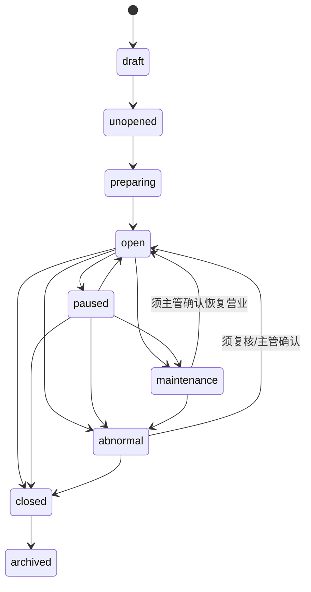

# 游乐设施运营系统开发设计文档

> 版本：V0.x ｜ 最后更新：2026-06-20 ｜ 覆盖迁移基线：见各小节迁移号（最新 V124）｜ 状态：现行
> 新功能承接见 docs/v099-v124-feature-implementation-and-acceptance-spec-v0.1.md
> <!-- 文档goalP3(2026-06-20)：补版本/日期/覆盖迁移头，未改正文 -->

> **✅ R7 复审上修标注（2026-06-19，只读核验真实迁移/代码后回填）**
> R5 横幅与下方 D11 原标注的四项缺口已在本会话 P0 实现并落库（V081/V082/V083，且代码已接线），以下上修；仅"一体机端侧实际集成"保持开放。
> - **✅ 检修整表 + 恢复营业联动已落地（V081）**：新建 `amusement_maintenance_record`（检修单位复用供应链供应商 supplier_category∈{maintenance,service}、工程师、检修结果、异常说明、来源终端/点位结构化、`supervisor_confirmed_by`/`resume_business_at`）；主管确认恢复时联动写 `amusement_projects.open_status`(maintenance→open)，`AmusementMaintenanceService` 提供提交检修 / `confirm-resume` 端点；CHECK 硬约束确认前不得由 maintenance 流转回 open。
> - **✅ 现场核销校验票务权益已落地（V082）**：新建 `amusement_project_entitlements`（项目↔权益类型绑定）；`AmusementService.createVerification` 经 `AmusementEntitlementGateway` 在线校验存在/active/有效期/剩余次数/游乐类/绑定本项目，不可用即拒绝（`ENTITLEMENT_USED`/`ENTITLEMENT_EXPIRED`/无剩余次数等），不再原样入库；无绑定配置的项目回退为"仅校验游乐类放行"（向后兼容，待运营配置后自动收紧）。
> - **✅ 三维度容量已落地（V083）**：新建 `amusement_capacity_config`（点位/设备维并发容量）+ `amusement_capacity_snapshot`（项目/场次/点位设备各维在场计数物化），核销按"项目安全上限 / 场次 / 点位设备"三维度取最小可放行余量原子 check+increment；仅校验已配置受控维度，未配置维度退化为场次单维。
> - **仍开放——一体机端侧实际集成**：整条检修/核销链当前在 admin Web/legacy-console 已可用，`apps/android-terminal/` 仍无 amusement/safety 实际端侧集成、device_status 无端侧写入口（属客人端/Android 终端端侧实现遗留，待端侧排期）。
> - **验收口径（已正式）**：检修主管确认通过后项目 `open_status` 自动恢复为 `open`；无有效/未绑定本项目权益核销失败并返回明确原因；任一受控容量维度余量为 0 即拒绝（`session_full`）。

本文档覆盖【游乐设施运营系统：项目、场次、核销、巡检】的开发级设计。目标是让后端、前端、安卓端、数据分析和第三方设备对接可以直接按本文档拆任务和编码。

## 1. 系统定位

游乐设施运营系统负责综合体内主题游乐项目的日常运营。P0 只覆盖项目档案、开放计划、场次、容量、票务权益在线核销、人工放行、阻断式安全巡检、整改复检和主管恢复审批；安全告知/电子免责、事故工单进入 P1；游客自助预约排队、团体/包场和集团视图进入 P2。

业务已确认：因游乐设施分布在综合体不同位置，P0 容量按具体项目 + 具体场次/时段 + 点位/设备控制；项目总量只作为上层汇总和安全上限。票务二维码必须在线核验，不做离线核验。

本系统不负责售票和通票定价。售票、订单、支付、退款和权益生成归属于票务通票系统；游乐系统只消费票务系统生成的游乐权益实例，并把核销结果、预约结果、异常事件回写给票务和事件中心。

## 2. 业务边界

### 2.1 本系统负责

- 游乐项目档案维护。
- 项目开放日历、开放时段和场次配置。
- 项目容量控制，P0 按具体项目 + 具体场次/时段 + 点位/设备控制。
- 员工现场辅助入场；游客自助预约、排队、叫号、过号进入 P2。
- 单项目票、通票内游乐权益的在线核销；快速通道权益核销进入 P2。
- 项目设备状态管理。
- P0 开放前安全巡检、营业中抽检、阻断项暂停、整改复检和主管恢复审批。
- 事故、故障、投诉记录作为 P1 事故工单能力；P0 只记录与核销、人工放行、安全阻断相关的事件留痕。
- 安卓端现场核销和巡检作业。
- 游乐运营数据指标输出。

### 2.2 本系统不负责

- 售票订单和支付。
- 通票权益生成。
- 财务分账和结算主逻辑。
- 视频监控平台自身录像存储。
- 第三方闸机、NFC 厂商协议的底层驱动。

这些能力分别由票务通票系统、结算系统、第三方集成系统、视频证据中心和安卓设备端承接。

## 3. 角色与权限

| 角色 | 权限范围 |
|---|---|
| 平台管理员 | 管理全部项目、规则、容量、异常、报表 |
| 游乐运营经理 | 管理本商户或本园区项目、开放计划、场次、员工排班 |
| 项目主管 | 管理指定项目的场次、容量、暂停、恢复、事故 |
| 核销员 | 扫码/NFC 核销、查看当前场次、处理普通异常 |
| 巡检员 | 提交开园、闭园、定时巡检记录 |
| 安全负责人 | 审核事故、故障恢复、人工放行、高风险异常 |
| 商户管理员 | 查看本商户项目数据、配置本商户项目基础信息 |
| 数据分析员 | 查看聚合指标，不可改业务数据 |

权限控制必须同时校验：

- 商户范围。
- 门店/园区范围。
- 项目范围。
- 岗位角色。
- 设备绑定和当班状态。
- 高风险操作二次授权。

## 4. 领域模型

### 4.1 核心聚合

| 聚合 | 说明 | 聚合根 |
|---|---|---|
| 项目聚合 | 游乐项目、限制条件、容量、状态 | AmusementProject |
| 开放计划聚合 | 日历、开放时段、场次 | AmusementSchedule |
| 预约排队聚合（P2 预留） | 预约、排队号、叫号、过号 | AmusementReservation |
| 核销聚合 | 权益核销、人工放行、失败记录 | AmusementVerification |
| 设备与巡检聚合 | 设备状态、巡检模板、巡检记录、定期检修记录 | AmusementDevice |
| 事故异常聚合 | 事故、故障、投诉、处理记录 | AmusementIncident |

### 4.2 核心对象

| 对象 | 说明 |
|---|---|
| AmusementProject | 游乐项目档案 |
| AmusementProjectRule | 项目限制规则，如身高、年龄、健康限制 |
| AmusementSchedule | 项目开放日历 |
| AmusementSession | 具体场次或开放时段 |
| AmusementCapacitySnapshot | 容量快照 |
| AmusementReservation | 预约记录 |
| AmusementQueueTicket | 排队号 |
| AmusementVerification | 核销记录 |
| AmusementManualOverride | 人工放行记录 |
| AmusementDevice | 项目设备 |
| AmusementDeviceStatusLog | 设备状态变更记录 |
| SafetyCheckTemplate | 巡检模板 |
| SafetyCheckItem | 巡检项 |
| SafetyCheckRecord | 巡检记录 |
| AmusementMaintenanceRecord | 一体机/设备定期检修记录（含检修单位、工程师、结果、主管确认恢复营业） |
| AmusementCapacityConfig | 点位/设备并发容量配置（容量三维度之第三维） |
| AmusementIncident | 事故、故障、投诉 |
| AmusementIncidentAction | 事故处理动作 |

## 5. 状态机

### 5.1 项目状态机

> 修订说明（2026-06-07）：原 7 态缺 PRD 明确定义且影响核销放行的"未开放(unopened)""异常(abnormal)"两态，且 maintenance 与 PRD 口径无对应（fielddb-5、《统一口径基准》D7）。本次补齐中英双列映射，并明确 maintenance 归并口径：检修/维护期统一以 **abnormal（异常）+ 设备级 maintenance** 表达对客侧"不可核销"，项目本体 status **保留 maintenance 仅表示"长期停机检修中"**，与"临时暂停 paused"区分；对客判定一律以"是否 open"为准。中文↔英文逐项对应数据库 CHECK 取值（D7 原则）。

| 状态(英文 code) | 中文 | 说明 |
|---|---|---|
| draft | 草稿 | 草稿，未对外开放（内部建档阶段） |
| unopened | 未开放 | 已建档但暂未运营，不允许核销（PRD 6 态之"未开放"） |
| preparing | 准备中 | 筹备/开放前检查中，可配置规则和场次、可巡检，不允许正式放行 |
| open | 开放中 | 正常开放，可核销放行 |
| paused | 暂停 | 临时暂停，如天气、排队过载、轻微故障；暂停核销，保留排队/已到场信息 |
| maintenance | 检修中 | 长期停机检修中，不允许预约和核销；定期检修触发，恢复营业须主管确认 |
| abnormal | 异常 | 存在故障、安全或经营争议，需处理和复核（PRD 6 态之"异常"） |
| closed | 已关闭 | 当日运营结束或长期关闭，不再开放 |
| archived | 归档 | 归档，仅保留历史数据 |

> maintenance 归并确认：游乐设施"定期检修"期间项目置 `maintenance`（设备同步置设备级 `maintenance`）；轻微/临时故障置 `paused`；安全或经营争议置 `abnormal`。三者对客均"不可核销"，差异在恢复路径（见 5.1.1）。

流转规则：



#### 5.1.1 检修恢复营业约束（状态机硬约束）

> 修订说明（2026-06-07）：将"主管确认前不可恢复营业"写为状态机约束（kiosk-4 建议）。依据 PRD §11 已确认规则"检修完成后必须由主管确认，游乐设施才能恢复营业"。

- 项目处于 `maintenance`（或设备处于 `maintenance`）时，**禁止**任何系统/角色直接将状态流转回 `open`。
- 唯一恢复路径：先提交检修记录（`amusement_maintenance_record.result = pass`），再由主管执行"主管确认恢复营业"（`supervisor_confirmed_by` 非空、写入 `confirmed_at`），系统据此把 `resume_business_at` 置当前时间并允许 `maintenance → open`。
- 检修记录 `result = fail` 或主管未确认时，状态保持 `maintenance`/`abnormal`/`paused`，核销 API 一律拒绝（失败原因 `project_closed`/`project_not_allowed`）。
- 同一约束适用于 `abnormal → open`：必须有复核/主管确认动作留痕。

### 5.2 场次状态机

| 状态 | 说明 |
|---|---|
| scheduled | 已排期 |
| accepting_reservation | 可预约 |
| full | 已满 |
| checkin_open | 开始入场核销 |
| running | 体验中 |
| completed | 已结束 |
| cancelled | 已取消 |
| suspended | 临时暂停 |

关键规则：

- 场次取消后，未核销预约需要通知票务系统释放权益或进入改期/退款流程。
- 场次满员后不再接受预约，但可允许管理员扩容。
- 场次暂停时禁止普通核销，只允许安全负责人人工放行。

### 5.3 预约状态机

| 状态 | 说明 |
|---|---|
| pending | 待确认 |
| confirmed | 已预约 |
| queued | 已进入排队 |
| called | 已叫号 |
| checked_in | 已核销入场 |
| no_show | 过号或未到 |
| cancelled | 已取消 |
| expired | 预约过期 |

### 5.4 排队号状态机

| 状态 | 说明 |
|---|---|
| waiting | 等待中 |
| called | 已叫号 |
| checked_in | 已入场 |
| skipped | 已过号 |
| cancelled | 已取消 |
| expired | 队列失效 |

### 5.5 核销状态机

| 状态 | 说明 |
|---|---|
| accepted | 核销成功 |
| rejected | 核销失败 |
| pending_sync | 离线核销待同步（P1 预留，P0 不启用） |
| conflict | 离线同步冲突（P1 预留，P0 不启用） |
| reversed | 已冲正 |
| manual_override | 人工放行 |

核销失败原因：

- ticket_not_found
- entitlement_not_found
- entitlement_used
- entitlement_expired
- project_not_allowed
- session_full
- project_closed
- device_not_authorized
- duplicate_verification
- risk_blocked

### 5.6 巡检状态机

| 状态 | 说明 |
|---|---|
| draft | 草稿 |
| submitted | 已提交 |
| passed | 通过 |
| failed | 未通过 |
| rectifying | 整改中 |
| rechecked | 复检完成 |
| closed | 已关闭 |

### 5.7 事故状态机

| 状态 | 说明 |
|---|---|
| reported | 已上报 |
| acknowledged | 已确认 |
| processing | 处理中 |
| waiting_external | 等待外部处理 |
| resolved | 已解决 |
| closed | 已关闭 |
| escalated | 已升级 |

## 6. 核心业务流程

### 6.1 项目建档流程

1. 平台管理员或游乐运营经理创建项目。
2. 绑定商户、门店、区域、入口点位。
3. 配置项目类型、体验时长、项目安全上限、具体场次/时段容量、点位/设备容量和限制条件。
4. 配置是否支持预约、排队、快速通道；预约排队和快速通道为 P2 预留，P0 不启用离线核销。
5. 设置项目状态为筹备中。
6. 完成巡检模板和开放计划后，项目可转为开放。
7. 写入 `amusement.project.created` 和 `amusement.project.opened` 事件。

### 6.2 场次配置流程

1. 运营经理选择项目。
2. 创建开放日历。
3. 配置开放时段或固定场次。
4. 设置每场容量、提前预约时间、检票时间窗口。
5. 系统生成场次。
6. 场次进入可预约状态。
7. 写入 `amusement.session.created` 事件。

### 6.3 预约排队流程（P2 预留，P0 不实现）

1. 游客或员工选择项目和场次。
2. 系统检查项目状态、场次容量、权益是否可用。
3. 创建预约记录。
4. 到场后进入排队队列。
5. 工作人员叫号。
6. 游客核销入场。
7. 未到场则标记过号或预约过期。

### 6.4 项目核销流程

1. 安卓端扫描二维码或读取 NFC。
2. 后端识别票实例和权益实例。
3. 在线校验项目、场次、有效期、剩余次数、设备权限和容量。**容量按三维度取最小可放行余量判定**（见下方"三维度容量校验规则"）。
4. 校验通过后扣减权益。
5. 写入核销记录。
6. 更新场次容量快照（同时刷新点位/设备维度的容量快照，见 7.x amusement_capacity_snapshot）。
7. 写入事件中心。
8. 返回核销结果给安卓端。

> **三维度容量校验规则（修订说明 2026-06-07，amuse-1 / PRD §11 已确认规则 1）：**
> 业务拍板"P0 按具体项目 + 具体场次/时段 + 点位/设备控制容量；项目总量只作汇总和安全上限"。核销时按三维度分别计算剩余可放行人数，取 **最小值** 作为本次能否放行的口径，任一维度为 0 即拒绝（失败原因 `session_full`）：
> 1. **项目维度（安全上限）**：`amusement_project.default_capacity` 仅作上层汇总与安全上限，超过即报警但**不**作为现场放行唯一口径。
> 2. **场次/时段维度**：`amusement_sessions.capacity - used_capacity`（字段口径以真实迁移 V014 为准，已用 `used_capacity`；本文旧称 `checked_in_count` 作废，见 §7.4 标注）。
> 3. **点位/设备维度**：`amusement_capacity_config.max_concurrent`（或 `amusement_device.max_concurrent`）减去该点位/设备当前在场人数（来自 `amusement_capacity_snapshot`）。
>
> 放行余量 = min(场次余量, 点位/设备余量)；项目维度仅做"是否超安全上限"的旁路校验。任一受控维度 ≤ 0 拒绝。三维度均未配置时退化为场次维度。

> **超容/争议口径对齐（P0）（修正(2026-06-19 R5业务HTML缺口审计 F11/F12)）：**
> 依据业务HTML #amusement「记录巡检、暂停、关闭、故障、超容和游客争议」列为 P0。代码核验：超容当前仅在 `JdbcAmusementRepository`（项目安全上限维 `context.projectSafetyCapacity() > 0` 的原子 check）报警/拒绝放行（失败原因 `session_full`），**不落 incident 事件**；`incident_type` 枚举（§7.15）原仅 `accident/fault/complaint/risk`，无独立 `over_capacity`，V024 迁移亦未列举 incident_type CHECK。本次对齐如下：
> 1. **incident_type 增加 `over_capacity` 独立枚举**（见 §7.15），超容不再与 fault/risk 混并，可独立筛选与复核。
> 2. **超容除报警外必须落 incident 事件**：触发项目安全上限维超容（或任一受控维度被超容性放行/扩容）时，除现有报警/拒绝外，必须落一条 `amusement.incident.over_capacity` 事件（见 §11），写入项目/场次/点位设备维度键、触发时容量与上限、来源终端，使其成为可后续复核的独立事件，而非仅瞬时告警。
> 3. **游客争议（complaint）入口与状态机确认为 P0**：投诉/争议作为 `incident_type = complaint` 走 §5.7 事故状态机（reported→acknowledged→processing→…→resolved/closed），P0 必须有上报入口与可复核留痕；其工单深度处理可延后，但"可记录可复核"为 P0 口径（与 §2.1「P0 只记录与核销、人工放行、安全阻断相关的事件留痕」相比，本次把 over_capacity 与 complaint 的"记录+复核"上提为 P0）。
> 4. **与 F2 统一异常责任链衔接**：超容/争议事件进入平台统一异常复核链时，`source_domain = amusement`（与第三方集成 F2 回流异常/对账差异同链区分来源域），便于跨域异常归集与责任留痕。
> 5. **验收**：触发超容产生独立 `over_capacity` 事件（incident_type=over_capacity）并可在事件中心/事故中心按类型筛选复核；游客争议可上报并按事故状态机复核闭环。
>
> **待业务确认**：超容是否需要"阻断进一步放行"（达上限即硬阻断，与现有 `session_full` 拒绝一致）vs "仅告警 + 留痕"（允许主管扩容/人工放行但必落 over_capacity 事件）。两种口径对放行控制流影响不同，需业务拍板后再固化是否在安全上限维做硬阻断。
>
> **业务确认(2026-06-19)** `R6 业务确认回填(2026-06-19)`：超容处置确认为**默认 硬上限阻断 + 软上限告警放行（两类均落 `amusement.incident.over_capacity` 事件）**，且**处置模式后台可切换为"仅告警 + 留痕（不阻断）"**。即：处置模式后台可配，默认硬阻断（达硬上限即 `session_full` 拒绝）+ 软上限告警放行（允许放行但落事件），可切换为仅告警留痕（不阻断、必落事件）。此项不再为待定项。
>
> **✅ 已实现修复（F-OPS-03，2026-06-22，已在 .160 编译通过）**：上条"处置模式后台可切换为仅告警留痕"的可切换语义**严格限定在软上限（运营容量）一侧**，硬上限（安全容量）不受处置模式影响——收口口径如下：
> 1. **硬安全容量禁 `warn_only` 旁路**：处置模式 `warn_only` 仅作用于**软上限（运营容量）**告警放行；**硬上限（项目安全容量 `default_capacity` 维度）任何处置模式都阻断核销**（达硬上限恒 `session_full` 拒绝），不存在"切到 warn_only 即可超过安全容量放行"的旁路。即 warn_only 放宽的是运营容量告警，绝不放宽安全容量阻断。
> 2. **over_capacity 事件 severity 恒 `high` 触发自动停运**：硬上限维超容落 `amusement.incident.over_capacity` 事件时 `severity` **恒为 `high`**，并据此自动把项目 `open → paused`（停运），不依赖人工处置。软上限告警放行落的 over_capacity 事件按告警口径，不强制停运。
> 3. 与 §5.1 状态机一致：自动停运走 `open → paused`（§5.1 已有 `open --> paused` 流转），恢复仍按既有 paused→open 路径。

离线核销时（P1 预留，P0 不启用）：

1. 安卓端使用本地权益摘要缓存。
2. 本地生成待同步核销流水。
3. 本地防重复。
4. 恢复网络后上传。
5. 后端二次校验。
6. 正常则确认，冲突则生成异常事件和工单。

### 6.5 人工放行流程

1. 核销失败或现场特殊情况触发人工放行。
2. 核销员填写原因。
3. 高风险原因需要主管或安全负责人二次授权。
4. 系统记录人工放行。
5. 可选择是否扣减权益。
6. 写入事件中心，并标记为高风险留痕。

### 6.6 安全巡检流程

1. 系统按项目和设备生成巡检任务。
2. 巡检员在安卓端填写巡检项。
3. 必要项要求拍照、视频或签名。
4. 巡检失败时自动暂停项目或场次。
5. 主管发起整改。
6. 复检通过后恢复开放。
7. 全流程写入事件中心。

### 6.6.1 一体机定期检修流程

1. 系统按项目、设备、点位和检修周期生成定期检修任务。
2. 工程师在触摸屏一体机或授权终端填写检修记录。
3. 检修单位作为供应商记录，必须填写检修单位、工程师、检修时间、检修结果和异常说明。
4. 检修不通过时（`result = fail`），项目或设备保持暂停、检修中或异常状态，核销 API 一律拒绝。
5. 检修通过后（`result = pass`）进入主管确认。
6. 主管确认后，项目或设备才允许恢复营业（写入 `supervisor_confirmed_by`/`confirmed_at`/`resume_business_at`，状态机方可 `maintenance → open`，见 5.1.1）。
7. 检修记录、主管确认、恢复营业动作全部写入事件中心（`amusement.safety_inspection.reopened`、`amusement.project.resumed`，见第 11 节）。

> **检修单位口径（修订说明 2026-06-07，amuse-3 / 《统一口径基准》D7 供应商）：**
> "检修单位作为供应商记录"明确为**复用供应链 `suppliers` 主数据**，不另建独立维保供应商表。检修记录用 `maintenance_vendor_id` 外键引用 `suppliers.id`，且该供应商 `supplier_category ∈ {maintenance, service}`（维保/服务类）。供应链侧供应商档案需支持 `supplier_category` 区分物料类与维保/服务类——此为引用口径，对齐方以 supply-chain 开发设计为准，**本文不编辑供应链文件**。`engineer_id` 指向该供应商下的工程师（或以 `engineer_name` 文本留痕，便于外部工程师无系统账号场景）。

> **✅ 已实现修复（F-OPS-04，2026-06-22，已在 .160 编译通过）**：把"按周期生成定期检修任务 + 每设备安全检查周期 + 巡检过期阻断核销"从散文落为可编码结构，本节第 1 步"按项目、设备、点位和检修周期生成定期检修任务"现有真实承载：
> 1. **新增设备主数据 `amusement_devices`**：每设备携带安全检查周期 `safety_check_interval_hours`；该列为空时**回退项目级缺省 24h**（即设备未单独配置周期时按 24 小时判定）。
> 2. **核销准入增加巡检时效判定**：核销前置 `evaluateOpenEligibility` 在原"最近 PASS 巡检存在"基础上，增加**"最近 PASS 巡检须在该设备 `safety_check_interval_hours` 周期内有效"**判定；超过周期（巡检过期）返回新原因 **`SAFETY_INSPECTION_EXPIRED`** 阻断核销（与 §5.5 既有 `project_closed`/`project_not_allowed` 等失败原因并列，但语义独立指向"巡检超期"）。
> 3. **PASS 巡检刷新设备时效锚点**：巡检结果 PASS 时刷新 `amusement_devices.last_pass_inspection_at`，作为上条周期判定的起算锚点；下次核销据此 + `safety_check_interval_hours` 判定是否仍在有效期内。
> 4. **定期任务承载表 + 薄调度**：本节"按周期生成定期检修任务"由新表 **`amusement_inspection_tasks`** + **`AmusementInspectionTaskJob`**（薄 `@Scheduled` 任务）承载；调度骨架已就位，**实际按周期批量生成任务的填充逻辑列阶段4待实现**（薄壳已落、不空跑误判为已完成）。

> **设备主数据与巡检任务表口径（F-OPS-04，2026-06-22）**：本次新增的 `amusement_devices`（设备主数据，含 `safety_check_interval_hours`/`last_pass_inspection_at`）与 `amusement_inspection_tasks`（定期检修任务）为承载上述周期判定与任务生成的真实表；与 §7.9 历史 `amusement_device`（单数，原设备表）的字段收敛/合并以真实迁移为准，§6.6.1 周期判定与核销准入以本组新表字段为准。

### 6.7 事故处理流程

1. 员工或主管上报事故。
2. 绑定项目、设备、场次、票务权益、游客信息、视频证据。
3. 安全负责人确认。
4. 记录处理动作。
5. 必要时升级。
6. 处理完成后关闭。
7. 输出给风控和数据分析。

## 7. 数据库表结构

以下为 PostgreSQL/Flyway 建表建议，字段可在 Java 实现时继续补充审计字段。

### 7.1 amusement_project

| 字段 | 类型 | 说明 |
|---|---|---|
| id | uuid | 主键 |
| merchant_id | uuid | 商户 ID |
| store_id | uuid | 门店/园区 ID |
| area_id | uuid | 区域 ID |
| code | varchar(64) | 项目编码 |
| name | varchar(128) | 项目名称 |
| project_type | varchar(64) | 项目类型 |
| description | text | 项目说明 |
| status | varchar(32) | 项目状态，CHECK 取值见 5.1：draft/unopened/preparing/open/paused/maintenance/abnormal/closed/archived（fielddb-5 对齐，已补 unopened/abnormal） |
| duration_minutes | int | 单次体验时长 |
| default_capacity | int | 默认容量（项目维度，仅作汇总与安全上限，非现场放行唯一口径，见 6.4 三维度规则） |
| allow_reservation | boolean | 是否允许预约；P2 预留，P0 固定为 false |
| allow_queue | boolean | 是否允许排队；P2 预留，P0 固定为 false |
| allow_fast_pass | boolean | 是否允许快速通道；P2 预留，P0 固定为 false |
| allow_offline_verify | boolean | 是否允许离线核销；P0 固定为 false |
| location_point_id | uuid | **入口点位绑定（目标增补字段，R6 全闭环(2026-06-19)，收口审计 BP1）**：项目入口/检票点位，FK 关联点位主数据；现场核销、巡检按此点位归集与责任落点。真实迁移当前无此列，落地需新迁移，详见 §7.18 收口小节 |
| created_at | timestamptz | 创建时间 |
| updated_at | timestamptz | 更新时间 |

索引：

- idx_amusement_project_merchant
- idx_amusement_project_store_status
- uk_amusement_project_code
- idx_amusement_project_location_point（R6 入口点位增补，见 §7.18）

### 7.2 amusement_project_rule

| 字段 | 类型 | 说明 |
|---|---|---|
| id | uuid | 主键 |
| project_id | uuid | 项目 ID |
| rule_type | varchar(64) | height、age、health、custom |
| operator | varchar(16) | >=、<=、between、in |
| value_text | varchar(255) | 规则值 |
| warning_text | varchar(255) | 前端提示 |
| is_blocking | boolean | 是否硬阻断 |
| enabled | boolean | 是否启用 |

### 7.3 amusement_schedule

| 字段 | 类型 | 说明 |
|---|---|---|
| id | uuid | 主键 |
| project_id | uuid | 项目 ID |
| schedule_date | date | 日期 |
| open_time | time | 开放开始 |
| close_time | time | 开放结束 |
| status | varchar(32) | normal、closed、special |
| reason | varchar(255) | 关闭或特殊原因 |

### 7.4 amusement_session

| 字段 | 类型 | 说明 |
|---|---|---|
| id | uuid | 主键 |
| project_id | uuid | 项目 ID |
| schedule_id | uuid | 开放计划 ID |
| session_code | varchar(64) | 场次编码 |
| start_at | timestamptz | 开始时间 |
| end_at | timestamptz | 结束时间 |
| checkin_start_at | timestamptz | 检票开始 |
| checkin_end_at | timestamptz | 检票结束 |
| capacity | int | 当前场次/时段容量，需结合项目、点位/设备容量控制 |
| reserved_count | int | 已预约（**目标增补字段（P2，尚未迁移）**：真实迁移 V014 `amusement_sessions` 无此列，预约排队为 P2 预留） |
| used_capacity | int | 已占用/已入场容量（**真实迁移为准**：V014 `amusement_sessions` 实际列名为 `used_capacity` 且带 CHECK `0 ≤ used_capacity ≤ capacity`；本文旧称 `checked_in_count` 作废，全文容量计数列统一为 `used_capacity`） |
| status | varchar(32) | 场次状态（真实 CHECK：scheduled/open/closed/cancelled，本文 §5.2 八态多数为目标增补，尚未迁移） |

索引：

- idx_amusement_session_project_time
- idx_amusement_session_status

### 7.5 amusement_reservation

| 字段 | 类型 | 说明 |
|---|---|---|
| id | uuid | 主键 |
| project_id | uuid | 项目 ID |
| session_id | uuid | 场次 ID |
| ticket_instance_id | uuid | 票实例 ID |
| entitlement_instance_id | uuid | 权益实例 ID |
| customer_id | uuid | 游客/会员 ID，可为空 |
| customer_phone_masked | varchar(32) | 脱敏手机号 |
| status | varchar(32) | 预约状态 |
| reserved_at | timestamptz | 预约时间 |
| expires_at | timestamptz | 过期时间 |

### 7.6 amusement_queue_ticket

| 字段 | 类型 | 说明 |
|---|---|---|
| id | uuid | 主键 |
| project_id | uuid | 项目 ID |
| session_id | uuid | 场次 ID |
| reservation_id | uuid | 预约 ID，可为空 |
| queue_no | varchar(32) | 排队号 |
| priority_type | varchar(32) | normal、fast_pass、manual |
| status | varchar(32) | 排队状态 |
| called_at | timestamptz | 叫号时间 |
| checked_in_at | timestamptz | 入场时间 |

### 7.7 amusement_verification

| 字段 | 类型 | 说明 |
|---|---|---|
| id | uuid | 主键 |
| project_id | uuid | 项目 ID |
| session_id | uuid | 场次 ID |
| reservation_id | uuid | 预约 ID，可为空 |
| ticket_instance_id | uuid | 票实例 ID |
| entitlement_instance_id | uuid | 权益实例 ID |
| verification_code | varchar(128) | 核销码摘要 |
| method | varchar(32) | qr、nfc、manual、gate |
| status | varchar(32) | 核销状态 |
| failure_reason | varchar(64) | 失败原因 |
| device_id | uuid | 设备 ID |
| operator_id | uuid | 操作人 ID |
| offline_request_id | varchar(128) | 离线请求 ID |
| verified_at | timestamptz | 核销时间 |

索引：

- idx_amusement_verification_project_time
- idx_amusement_verification_entitlement
- uk_amusement_verification_offline_request

### 7.8 amusement_manual_override

| 字段 | 类型 | 说明 |
|---|---|---|
| id | uuid | 主键 |
| verification_id | uuid | 核销记录 ID |
| project_id | uuid | 项目 ID |
| reason_code | varchar(64) | 放行原因 |
| reason_text | text | 说明 |
| approved_by | uuid | 审批人 |
| deduct_entitlement | boolean | 是否扣权益 |
| evidence_file_id | uuid | 证据附件 |
| created_at | timestamptz | 创建时间 |

### 7.9 amusement_device

| 字段 | 类型 | 说明 |
|---|---|---|
| id | uuid | 主键 |
| project_id | uuid | 项目 ID |
| code | varchar(64) | 设备编码 |
| name | varchar(128) | 设备名称 |
| device_type | varchar(64) | ride、gate、nfc、scanner、screen |
| status | varchar(32) | normal、paused、maintenance、fault |
| location_point_id | uuid | 点位 ID |
| capacity | int | 该设备/点位单次接待容量（点位/设备维度容量，可空，amuse-1） |
| max_concurrent | int | 该设备/点位允许的最大并发在场人数（容量三维度之第三维，核销取最小值参与判定，amuse-1） |
| enabled | boolean | 是否启用 |

> 修订说明（2026-06-07，amuse-1）：原表缺点位/设备维度容量字段，导致三维度容量第三维无处落地。本次补 `capacity`/`max_concurrent`。若同一点位下多设备需独立配额或需按时段差异化配额，使用 7.x `amusement_capacity_config` 表细化，本表字段作为默认值。

> **✅ 已实现修复（F-OPS-04，2026-06-22，已在 .160 编译通过）**：设备主数据已落表 `amusement_devices`，在本表（历史 `amusement_device`）字段基础上补两列承载"每设备安全检查周期"与核销准入巡检时效判定：
>
> | 增补列 | 类型 | 说明 |
> |---|---|---|
> | `safety_check_interval_hours` | int | 每设备安全检查周期（小时）；为空回退**项目级缺省 24h**。核销准入 `evaluateOpenEligibility` 据此判定"最近 PASS 巡检是否仍在周期内有效"，过期返回 `SAFETY_INSPECTION_EXPIRED` 阻断核销（见 §6.6.1） |
> | `last_pass_inspection_at` | timestamptz | 最近一次 PASS 巡检时间；巡检 PASS 时刷新，作为周期判定起算锚点 |
>
> 另新增 `amusement_inspection_tasks`（定期检修任务表）承载 §6.6.1"按周期生成定期检修任务"，由薄 `@Scheduled` `AmusementInspectionTaskJob` 调度（任务生成填充逻辑阶段4待实现）。表名/字段最终以真实迁移为准。

### 7.10 amusement_device_status_log

| 字段 | 类型 | 说明 |
|---|---|---|
| id | uuid | 主键 |
| device_id | uuid | 设备 ID |
| previous_status | varchar(32) | 原状态 |
| new_status | varchar(32) | 新状态 |
| reason | varchar(255) | 原因 |
| operator_id | uuid | 操作人 |
| changed_at | timestamptz | 变更时间 |

### 7.11 amusement_safety_templates

| 字段 | 类型 | 说明 |
|---|---|---|
| id | uuid | 主键 |
| project_id | uuid | 项目 ID |
| name | varchar(128) | 模板名称 |
| check_type | varchar(32) | opening、closing、periodic、maintenance |
| enabled | boolean | 是否启用 |

### 7.12 amusement_safety_template_items

> **整表目标增补（P0，尚未迁移）（D6，2026-06-18）：** 真实迁移 V014 **不存在** `amusement_safety_template_items` 子表，模板巡检项当前内嵌在 `amusement_safety_templates.items_json` 数组中；`amusement-p0-safety-inspection-spec` §4 声称的 `amusement_safety_template_items.severity` 列在真实迁移中**不存在**（severity 仅作为 V024 P1 表 `amusement_incidents.severity` 存在，与巡检项严重度无关）。下表 `severity` 等为目标结构化拆表方案，落地需新迁移。

| 字段 | 类型 | 说明 |
|---|---|---|
| id | uuid | 主键 |
| template_id | uuid | 模板 ID |
| item_name | varchar(128) | 巡检项 |
| item_type | varchar(32) | boolean、number、text、photo |
| severity | varchar(16) | 严重度 notice/warning/blocking/critical（**目标增补字段（P0，尚未迁移）**） |
| required | boolean | 是否必填 |
| sort_order | int | 排序 |

### 7.13 amusement_safety_inspections

> **字段口径修正（D6，以真实迁移 V014 为准，2026-06-18）：** 真实迁移 `amusement_safety_inspections` 实际列为：`id, project_id, template_id, items_json, overall_result, inspection_status, rectification_status, reopen_status, inspected_at, submitted_at, rechecked_at, approved_at, operator_note, evidence_attachment_ids, created_at, updated_at`。本文与 `amusement-p0-safety-inspection-spec` §4 曾声称的 `session_id/device_id/inspector_id(checker_id)` 在真实迁移中**不存在**，巡检主记录仅挂在 `project_id` 上、单项结果与严重度内嵌在 `items_json` 中、恢复审批用 `reopen_status` 列 + `amusement_safety_actions` 行表达（**无独立 `amusement_reopen_approvals` 表**）。下表「真实列」为现状，「目标增补」为 P0 待迁移项。

真实列（现状，V014）：

| 字段 | 类型 | 说明 |
|---|---|---|
| id | varchar(64) | 主键 |
| project_id | varchar(64) | 项目 ID（巡检主记录仅挂项目，无场次/设备外键） |
| template_id | varchar(64) | 模板 ID |
| items_json | jsonb | 单项结果数组（严重度/通过/证据内嵌于此，非独立子表） |
| overall_result | varchar(64) | 总体结果，CHECK：pass/fail/pending_rectification |
| inspection_status | varchar(64) | 巡检状态 |
| rectification_status | varchar(64) | 整改状态 |
| reopen_status | varchar(64) | 恢复审批状态（恢复审批以此列 + `amusement_safety_actions` 行表达） |
| inspected_at / submitted_at / rechecked_at / approved_at | timestamptz | 各阶段时间 |
| operator_note | text | 操作备注 |
| evidence_attachment_ids | jsonb | 证据附件 |
| created_at / updated_at | timestamptz | 审计时间 |

目标增补字段（P0，尚未迁移）：

| 字段 | 类型 | 说明 |
|---|---|---|
| session_id | uuid | 场次 ID，可为空（**目标增补字段（P0，尚未迁移）**：真实 V014 无此列，巡检无法按场次维度归集） |
| device_id | uuid | 设备/点位 ID，可为空（**目标增补字段（P0，尚未迁移）**：真实 V014 无此列，无法按设备点位归集巡检） |
| inspector_id | uuid | 巡检人（**目标增补字段（P0，尚未迁移）**：真实 V014 无 `inspector_id`/`checker_id` 列，巡检人仅能在 `operator_note`/`items_json` 中非结构化留痕） |
| reviewed_by / reviewed_at | uuid / timestamptz | 复核人与时间（**目标增补字段（P0，尚未迁移）**：真实 V014 仅有 `approved_at`，无结构化复核人外键） |

### 7.14 amusement_safety_inspection_items

> **整表目标增补（P0，尚未迁移）（D6，2026-06-18）：** 真实迁移 V014 **不存在** `amusement_safety_inspection_items` 子表，单项巡检结果（结果值/是否通过/严重度/证据）当前内嵌在 `amusement_safety_inspections.items_json` 数组中。下表为目标结构化拆表方案，落地需新迁移。

| 字段 | 类型 | 说明 |
|---|---|---|
| id | uuid | 主键 |
| inspection_id | uuid | 巡检记录 ID |
| item_id | uuid | 巡检项 ID |
| result_value | text | 结果 |
| passed | boolean | 是否通过 |
| evidence_file_id | uuid | 附件 |

### 7.14a amusement_maintenance_record

> 新增表（2026-06-07，amuse-2 / kiosk-4）：原"定期检修"仅有 6.6.1 散文流程，复用 `amusement_safety_inspections` 无法承载检修单位/工程师/检修结果/异常说明/主管确认恢复营业等专有字段。本表专门承载一体机/设备定期检修记录。

| 字段 | 类型 | 说明 |
|---|---|---|
| id | uuid | 主键 |
| project_id | uuid | 项目 ID |
| device_id | uuid | 设备 ID（一体机/游乐设备），可为空 |
| location_point_id | uuid | 点位 ID |
| maintenance_vendor_id | uuid | 检修单位，外键指向供应链 `suppliers.id`（`supplier_category ∈ {maintenance, service}`，amuse-3） |
| engineer_id | uuid | 执行工程师 ID，可为空（外部工程师无账号时留空） |
| engineer_name | varchar(128) | 工程师姓名（文本留痕，外部工程师场景必填） |
| maintenance_at | timestamptz | 检修时间 |
| result | varchar(16) | 检修结果：pass、fail |
| exception_note | text | 异常说明（result=fail 必填） |
| source_terminal | varchar(32) | 来源终端类型，取《统一口径基准》D5 10 端枚举（一体机=`kiosk`，授权平板=`tablet` 等） |
| status | varchar(32) | 检修单状态：submitted（已提交）、pending_confirm（待主管确认）、confirmed（已确认恢复）、rejected（确认驳回） |
| supervisor_confirmed_by | uuid | 主管确认人 ID（确认恢复营业的主管），可为空 |
| confirmed_at | timestamptz | 主管确认时间，可为空 |
| resume_business_at | timestamptz | 恢复营业时间；主管确认前必须为空（5.1.1 状态机约束） |
| created_at | timestamptz | 创建时间 |

索引：

- idx_amusement_maint_project_time
- idx_amusement_maint_device
- idx_amusement_maint_vendor

约束（5.1.1）：`resume_business_at` 与 `confirmed_at`/`supervisor_confirmed_by` 必须同时为空或同时非空；`result = pass` 且主管确认前，项目/设备不得由 `maintenance` 流转回 `open`。检修结果 `result` 与放行无金额计算关系；如涉及检修费用结算，金额一律按《统一口径基准》D1 以**整数分（bigint）**计，由供应链/结算域承接，本表不存金额。

### 7.14b amusement_capacity_config

> 新增表（2026-06-07，amuse-1）：落地"点位/设备维度"容量的可配置化（按点位/设备、可选按时段差异化配额），作为 amusement_device 默认容量之外的细化配置。

| 字段 | 类型 | 说明 |
|---|---|---|
| id | uuid | 主键 |
| project_id | uuid | 项目 ID |
| location_point_id | uuid | 点位 ID，可为空 |
| device_id | uuid | 设备 ID，可为空 |
| max_concurrent | int | 该点位/设备最大并发在场人数 |
| effective_session_pattern | varchar(64) | 生效场次/时段匹配规则，可为空（空=全时段默认） |
| enabled | boolean | 是否启用 |

### 7.14c amusement_capacity_snapshot

> 新增表（2026-06-07，amuse-1）：第 4.2 节列了 AmusementCapacitySnapshot 为核心对象但第 7 节缺建表，导致容量快照无处存储。本表物化三维度实时容量快照，核销时读快照算余量、核销后刷新（见 6.4 第 3/6 步）。

物化口径：每条快照对应一个 (项目, 场次, 点位/设备) 维度键，记录该维度的容量上限与当前已占用，由核销/释放/扩容动作实时增量更新（事务内与核销记录一并写），非定时全量重算；项目维度快照仅作汇总展示与超安全上限告警。

| 字段 | 类型 | 说明 |
|---|---|---|
| id | uuid | 主键 |
| project_id | uuid | 项目 ID |
| session_id | uuid | 场次 ID，可为空（点位维度独立快照时可空） |
| location_point_id | uuid | 点位 ID，可为空 |
| device_id | uuid | 设备 ID，可为空 |
| dimension | varchar(16) | 维度：project、session、point_device |
| capacity_limit | int | 该维度容量上限 |
| occupied_count | int | 当前已占用（在场）人数 |
| remaining | int | 剩余可放行人数（= capacity_limit - occupied_count，物化冗余便于读取） |
| updated_at | timestamptz | 最近更新时间 |

索引：

- uk_amusement_capacity_snapshot_key（project_id, session_id, location_point_id, device_id, dimension 唯一）
- idx_amusement_capacity_snapshot_session

### 7.15 amusement_incident

| 字段 | 类型 | 说明 |
|---|---|---|
| id | uuid | 主键 |
| project_id | uuid | 项目 ID |
| session_id | uuid | 场次 ID，可为空 |
| device_id | uuid | 设备 ID，可为空 |
| incident_type | varchar(64) | accident、fault、complaint、risk、**over_capacity**（修正(2026-06-19 R5业务HTML缺口审计 F11/F12)：业务HTML #amusement 把"超容"列为 P0 必记事件，原枚举无独立 over_capacity，超容仅在 `JdbcAmusementRepository` 项目安全上限维 check 后报警/拒绝放行而不落 incident。本次新增 `over_capacity` 独立枚举，使超容可作为独立可复核事件落库；CHECK 取值同步补 over_capacity） |
| severity | varchar(32) | low、medium、high、critical |
| status | varchar(32) | 事故状态 |
| title | varchar(255) | 标题 |
| description | text | 描述 |
| reporter_id | uuid | 上报人 |
| reported_at | timestamptz | 上报时间 |
| closed_at | timestamptz | 关闭时间 |

### 7.16 amusement_incident_action

| 字段 | 类型 | 说明 |
|---|---|---|
| id | uuid | 主键 |
| incident_id | uuid | 事故 ID |
| action_type | varchar(64) | acknowledge、assign、resolve、close、escalate |
| content | text | 处理内容 |
| operator_id | uuid | 操作人 |
| created_at | timestamptz | 创建时间 |

### 7.18 项目入口点位字段 + 巡检结构化（收口）`R6 全闭环(2026-06-19)`

> 收口背景：本节统一收口两处长期以"目标增补字段（P0，尚未迁移）"散落标注的缺口——①§7.1 `amusement_project` 缺入口点位绑定列（承接收口审计 BP1），导致项目核销/巡检无法落到具体入口点位；②§7.13 `amusement_safety_inspections` 的巡检人 `inspector_id` 与单项巡检结果/异常长期只能在 `operator_note`/`items_json` 中非结构化留痕（§7.13/§7.14 已标注）。本节不改动 §7.13「真实列」现状描述，仅把两处增补口径收敛为一处可落地的迁移方案 + 事件 + 验收，落地需新迁移。

#### 7.18.1 amusement_project.location_point_id 入口点位绑定（承接 BP1）

| 增补列 | 类型 | 说明 |
|---|---|---|
| `location_point_id` | uuid | 项目入口/检票点位，FK 关联点位主数据；nullable（兼容存量项目，运营补绑后收紧）。现场核销（§7.7 `amusement_verification.location_point_id`，已存在）、巡检（见 7.18.2）按本列回归项目入口点位，形成"项目↔入口点位"一一定位 |

- 用途：核销与巡检的点位责任落点统一到项目入口点位；BP1 审计要求项目入口可结构化定位。
- 兼容：存量项目 `location_point_id` 可空，新建项目建议必填；与 §7.7/§7.9/§7.13.1（device/point）的 `location_point_id` 同口径关联点位主数据。

#### 7.18.2 巡检 inspection 主表 inspector_id 结构化 + 巡检结果/异常字段

承接 §7.13「目标增补字段」标注，把巡检人与巡检结果/异常从非结构化（`operator_note`/`items_json`）升为结构化主表列。**保留 §7.13 真实列现状描述不变**，下表为 `amusement_safety_inspections` 的目标增补列（落地需新迁移）：

| 增补列 | 类型 | 说明 |
|---|---|---|
| `inspector_id` | uuid | 巡检人（结构化，非自由文本）；替代当前仅在 `operator_note`/`items_json` 留痕的方式，可按巡检人归集与追责 |
| `location_point_id` | uuid | 巡检点位，可空；与 7.18.1 项目入口点位/设备点位对齐，巡检按点位归集 |
| `inspection_result` | varchar(32) | 巡检结果枚举 `pass/fail/conditional_pass`（与 `overall_result` 对齐或替代其自由口径），CHECK 约束 |
| `abnormal_flag` | boolean | 是否存在异常项，存在异常即阻断式暂停项目/场次（与 §5.6 巡检状态机、§6.6「巡检失败自动暂停」一致） |
| `abnormal_note` | text | 异常说明（结构化字段，承载异常描述，替代散落在 `operator_note` 的自由文本） |
| `abnormal_item_ids` | jsonb | 命中异常的巡检项 ID 列表（指向 §7.14 巡检项结构化拆表落地后的行，或 `items_json` 内项标识） |

> 与既有列关系：`inspector_id`/`inspection_result`/`abnormal_*` 为增补结构化列，不删除真实迁移既有的 `overall_result`/`items_json`/`operator_note`；落地阶段以结构化列为查询/统计/追责口径，`items_json` 作为单项明细载体保留（与 §7.14 整表目标增补方向一致）。

#### 7.18.3 事件

- 沿用 §11 既有巡检事件命名 `amusement.safety_inspection.*`（权威命名见 §11 修订说明，不另起名）。结构化后：
  - `amusement.safety_inspection.submitted`（提交巡检）payload 补 `inspector_id`、`location_point_id`、`inspection_result`、`abnormal_flag`。
  - `amusement.safety_inspection.blocked`（巡检阻断）由 `abnormal_flag=true` 触发，携带 `abnormal_note`/`abnormal_item_ids`，并联动项目/场次暂停（§5.6/§6.6）。
- 项目入口点位：核销/巡检事件 payload 的 `location_point_id` 回归 7.18.1 入口点位，使事件可按入口点位归集。

#### 7.18.4 验收

| 项 | 验收点 |
|---|---|
| 入口点位 | `amusement_project.location_point_id` 可落库并被核销/巡检引用；项目入口可结构化定位（BP1） |
| 巡检人结构化 | 巡检主记录可按 `inspector_id` 归集与追责，不再依赖 `operator_note`/`items_json` 自由文本 |
| 巡检结果/异常 | `inspection_result`/`abnormal_flag`/`abnormal_note` 可落库；存在异常时巡检 `blocked` 事件触发并自动暂停项目/场次 |
| 事件可归集 | 巡检事件携带巡检人/点位/结果，可按巡检人、入口点位维度统计 |
| 不破坏现状 | 不删除 §7.13 真实列与 `items_json`，增补列与既有列并存 |

> **待业务确认**：①`location_point_id` 在 `amusement_project` 是否本期必填（涉及存量项目补绑工作量）；②巡检结果是否需 `conditional_pass`（有条件通过）态，或仅 `pass/fail` 二态即可；③`inspection_result` 是替代还是与 `overall_result` 并存（建议替代，避免两套结果口径）。

## 8. API 接口设计

2026-06-12 收口口径，2026-06-13 追溯闸口补强：本章接口路径不再使用 `/api/amusement` 或相对路径作为开发依据。P0 正式接口统一以 `docs/openapi/openapi-p0.yaml/json`、`p0-openapi-operation-acceptance-matrix-v0.1.md` 和 `p0-openapi-contract-closure-appendix-v0.1.md` 为事实源，前缀为 `/api/v1/amusement`；预约排队、离线核销同步、项目状态细分动作等未进入 OpenAPI 和追溯附录的能力保留为后续版本，不得在 MVP 中另起路径、Controller、SDK/mock 或接口自动化。

### 8.1 项目管理 API

| 方法 | 路径 | 说明 | 权限 |
|---|---|---|---|
| GET | `/api/v1/amusement/projects` | 查询项目列表 | amusement.project.read |
| POST | `/api/v1/amusement/projects` | 创建项目 | amusement.project.create |
| GET | `/api/v1/amusement/projects/{id}/open-eligibility` | 查询项目是否允许开放，包含未完成安全巡检/整改阻断原因 | amusement.project.read |
| 后续扩展 | OpenAPI 后续扩展字段/流程 | 项目详情、更新、开放、暂停、维护、关闭等状态细分动作 | amusement.project.status |

### 8.2 规则 API

| 方法 | 路径 | 说明 |
|---|---|---|
| P0 内嵌 | `/api/v1/amusement/projects` | 限制规则作为项目配置字段或安全模板字段维护 |
| 后续扩展 | OpenAPI 后续扩展字段/流程 | 独立规则 CRUD，进入 P1/P2 后再开放 |

### 8.3 场次 API

| 方法 | 路径 | 说明 |
|---|---|---|
| GET | `/api/v1/amusement/sessions` | 查询场次 |
| POST | `/api/v1/amusement/sessions` | 创建场次 |
| 后续扩展 | OpenAPI 后续扩展字段/流程 | 场次更新、开启检票、暂停、取消、结束等状态细分动作 |

### 8.4 预约排队 API（P2 预留，P0 不实现）

| 方法 | 路径 | 说明 |
|---|---|---|
| P2 | OpenAPI 后续扩展字段/流程 | 创建预约 |
| P2 | OpenAPI 后续扩展字段/流程 | 查询预约 |
| P2 | OpenAPI 后续扩展字段/流程 | 取消预约 |
| P2 | OpenAPI 后续扩展字段/流程 | 生成排队号 |
| P2 | OpenAPI 后续扩展字段/流程 | 查询队列 |
| P2 | OpenAPI 后续扩展字段/流程 | 叫号 |
| P2 | OpenAPI 后续扩展字段/流程 | 过号 |

### 8.5 核销 API

| 方法 | 路径 | 说明 |
|---|---|---|
| POST | `/api/v1/amusement/verifications` | 在线核销；预检逻辑由服务端在同一动作内完成 |
| POST | `/api/v1/amusement/manual-overrides` | 人工放行 |
| 后续扩展 | OpenAPI 后续扩展字段/流程 | 离线核销同步，P1 预留；P0 不启用 |
| 后续扩展 | OpenAPI 后续扩展字段/流程 | 查询核销记录、冲正等管理查询动作 |

在线核销入参建议：

```json
{
  "projectId": "uuid",
  "sessionId": "uuid",
  "ticketCode": "string",
  "method": "qr",
  "deviceId": "uuid",
  "operatorId": "uuid",
  "locationPointId": "uuid"
}
```

返回建议：

```json
{
  "accepted": true,
  "verificationId": "uuid",
  "entitlementInstanceId": "uuid",
  "projectName": "示例项目",
  "remainingUses": 0,
  "message": "核销成功"
}
```

### 8.6 设备 API

| 方法 | 路径 | 说明 |
|---|---|---|
| GET | `/projects/{projectId}/devices` | 查询项目设备 |
| POST | `/projects/{projectId}/devices` | 新增设备 |
| PUT | `/devices/{id}` | 更新设备 |
| POST | `/devices/{id}/status` | 变更设备状态 |
| GET | `/devices/{id}/status-logs` | 状态历史 |

> **✅ 已实现修复（F-OPS-04，2026-06-22，已在 .160 编译通过）**：设备 CRUD 端点已落地并按 dot 风格权限码（《统一口径基准》D3）接入权限校验：
>
> | 方法 | 路径 | 说明 | 权限 |
> |---|---|---|---|
> | GET | `/projects/{id}/devices` | 查询项目设备（含 `safety_check_interval_hours`/`last_pass_inspection_at`，见 §7.9） | `amusement.device.view` |
> | POST | `/projects/{id}/devices` | 新增设备主数据（可配每设备安全检查周期） | `amusement.device.manage` |
>
> 设备主数据为 §6.6.1 巡检周期判定与核销准入 `SAFETY_INSPECTION_EXPIRED` 阻断的配置来源；正式路径仍以 OpenAPI/追溯附录为事实源（见 §8 开篇收口口径）。

### 8.7 巡检 API

| 方法 | 路径 | 说明 |
|---|---|---|
| GET | `/projects/{projectId}/safety-templates` | 查询巡检模板 |
| POST | `/projects/{projectId}/safety-templates` | 创建模板 |
| POST | `/safety-records` | 提交巡检 |
| GET | `/safety-records` | 查询巡检记录 |
| POST | `/safety-records/{id}/review` | 复核巡检 |
| POST | `/safety-records/{id}/rectify` | 提交整改 |

### 8.7.1 定期检修 API

> 新增（2026-06-07，amuse-2 / kiosk-4）：原第 8 节无任何检修提交/确认接口。新增"提交检修"与"主管确认恢复营业"两个 API。

| 方法 | 路径 | 说明 | 权限 |
|---|---|---|---|
| POST | `/maintenance-records` | 提交检修（工程师在一体机/授权终端填写检修单位、工程师、检修时间、结果、异常说明、来源终端、点位） | amusement.maintenance.submit |
| GET | `/maintenance-records` | 查询检修记录 | amusement.maintenance.read |
| GET | `/maintenance-records/{id}` | 检修记录详情 | amusement.maintenance.read |
| POST | `/maintenance-records/{id}/confirm-resume` | 主管确认恢复营业（result=pass 方可，写 supervisor_confirmed_by/confirmed_at/resume_business_at，触发 maintenance→open） | amusement.maintenance.confirm |

提交检修入参建议：

```json
{
  "projectId": "uuid",
  "deviceId": "uuid",
  "locationPointId": "uuid",
  "maintenanceVendorId": "uuid",
  "engineerId": "uuid",
  "engineerName": "string",
  "maintenanceAt": "2026-06-07T10:00:00+08:00",
  "result": "pass",
  "exceptionNote": "",
  "sourceTerminal": "kiosk"
}
```

主管确认恢复营业入参建议：

```json
{
  "supervisorConfirmedBy": "uuid",
  "remark": "string"
}
```

> 约束（5.1.1）：`confirm-resume` 仅当对应检修记录 `result = pass` 时可调用；调用成功才把项目/设备 `maintenance → open` 并写 `resume_business_at`。`result = fail` 调用返回 409 并保持检修中/异常状态。权限编码采用《统一口径基准》D3 的 dot 风格 `domain.resource.action`。

### 8.8 事故 API

| 方法 | 路径 | 说明 |
|---|---|---|
| POST | `/incidents` | 上报事故/故障/投诉 |
| GET | `/incidents` | 查询事故 |
| GET | `/incidents/{id}` | 事故详情 |
| POST | `/incidents/{id}/actions` | 新增处理动作 |
| POST | `/incidents/{id}/close` | 关闭事故 |
| POST | `/incidents/{id}/escalate` | 升级事故 |

## 9. 后台页面清单

| 页面 | 说明 | P级 |
|---|---|---|
| 游乐项目列表 | 查看项目、状态、容量、今日核销 | P0 |
| 项目详情 | 项目档案、规则、设备、场次、巡检 | P0 |
| 项目编辑 | 创建/修改项目 | P0 |
| 场次日历 | 按日查看开放和场次 | P0 |
| 场次管理 | 创建、暂停、取消、完成场次 | P0 |
| 核销记录 | 查询成功/失败/人工放行 | P0 |
| 员工辅助入场 | 查看现场辅助入场和容量占用 | P0 |
| 预约排队 | 查看预约、队列、叫号 | P2 |
| 设备状态 | 查看设备和故障 | P1 |
| 巡检模板 | 配置 P0 开放前、营业中抽检和阻断项巡检项 | P0 |
| 巡检记录 | 查看巡检、整改、复检和恢复审批 | P0 |
| 事故中心 | 事故、故障、投诉处理 | P1 |
| 游乐报表 | 客流、核销、容量利用率、排队时长 | P2 |

## 10. 安卓端作业流

### 10.1 核销员

- 查看负责项目。
- 查看当前场次。
- 扫码/NFC 核销。
- 查看失败原因。
- 提交人工放行申请。
- 在线核销；离线核销和恢复同步为 P1 预留。

### 10.2 巡检员

- 查看待巡检任务。
- 填写巡检项。
- 拍照或上传证据。
- 提交巡检结果。
- 查看整改要求。

### 10.3 项目主管

- 查看项目状态。
- 暂停/恢复项目。
- 处理人工放行审批。
- 处理巡检失败。
- 上报或关闭普通事故。

## 11. 事件留痕点

| 事件名 | 触发时机 |
|---|---|
| amusement.project.created | 创建项目 |
| amusement.project.updated | 更新项目 |
| amusement.project.status_changed | 项目状态变化 |
| amusement.session.created | 创建场次 |
| amusement.session.status_changed | 场次状态变化 |
| amusement.reservation.created | 创建预约 |
| amusement.reservation.cancelled | 取消预约 |
| amusement.queue.called | 叫号 |
| amusement.queue.skipped | 过号 |
| amusement.verification_succeeded | 核销成功 |
| amusement.verification_failed | 核销失败 |
| amusement.verification.offline_synced | 离线核销同步（P1 预留，P0 不触发） |
| amusement.verification.conflict | 离线核销冲突（P1 预留，P0 不触发） |
| amusement.verification_overridden | 人工放行 |
| amusement.device_status_changed | 设备状态变化 |
| amusement.safety_inspection.submitted | 提交巡检 |
| amusement.safety_inspection.blocked | 巡检阻断 |
| amusement.safety_inspection.rectification_submitted | 巡检整改提交 |
| amusement.safety_inspection.reopened | 主管确认检修/巡检结果（恢复营业前置确认） |
| amusement.project.resumed | 项目/设备经主管确认后恢复营业（maintenance/abnormal → open） |
| amusement.incident.reported | 上报事故 |
| amusement.incident.over_capacity | 超容事件（修正(2026-06-19 R5业务HTML缺口审计 F11/F12)：超容除报警/拒绝放行外必须落此独立事件，incident_type=over_capacity，携带项目/场次/点位设备维度键、触发容量与上限、source_domain=amusement，供后续复核，见 §6.4 超容/争议口径对齐） |
| amusement.incident.closed | 关闭事故 |

> 修订说明（2026-06-10 审计收口）：巡检相关事件统一采用 `amusement.safety_inspection.*` 命名，历史 `safety_check.*` / `amusement.safety_check.*` 仅作为旧文档别名，不得进入 OpenAPI、Flyway 迁移或事件中心实现。主管确认恢复统一写 `amusement.safety_inspection.reopened` 与 `amusement.project.resumed`。

事件标准字段必须包含：

- tenantId / merchantId / storeId
- projectId / sessionId
- operatorId / deviceId / locationPointId
- eventTime
- sourceSystem
- riskLevel
- traceId
- payload

## 12. 与其他系统关系

### 12.1 与票务权益系统

游乐系统依赖票务系统提供：

- 票实例。
- 权益实例。
- 权益适用项目。
- 权益有效期。
- 剩余次数。
- 退款/改期状态。

游乐系统向票务系统回写：

- 核销成功。
- 核销失败。
- 人工放行。
- 离线核销冲突（P1 预留，P0 不启用离线核销）。
- 场次取消影响。

### 12.2 与安卓设备端

安卓端承接：

- 现场扫码/外部 NFC 读取。
- 在线核验；离线核销仅 P1 预留，P0 不启用。
- 巡检拍照。
- 事故上报（P1 事故工单能力，P0 不作为上线阻断）。
- 设备绑定和岗位权限校验。

后端需要给安卓端提供：

- 当班项目列表。
- 可核销权益摘要。
- 场次和容量摘要。
- 离线缓存包。
- 同步接口。

### 12.3 与第三方设备系统

可能对接：

- 闸机。
- NFC 手环。
- 扫码枪。
- 项目控制设备。
- 视频监控。

第三方设备接入必须通过开放平台与安全鉴权，不允许直接写核心表。

### 12.4 与数据分析风控

输出指标：

- 项目客流。
- 项目核销数。
- 核销失败率。
- 人工放行率。
- 场次利用率。
- 平均等待时长。
- 过号率。
- 巡检失败率。
- 事故率。
- 设备故障时长。

高风险信号：

- 同一权益短时间多次核销。
- 离线核销冲突（P1 预留，P0 不启用离线核销）。
- 人工放行过高。
- 巡检失败后仍发生核销。
- 设备维护状态下产生入场。

## 13. 风控与异常处理

| 异常 | 处理 |
|---|---|
| 权益已使用 | 拒绝核销，写失败事件 |
| 场次已满 | 拒绝或需要主管扩容 |
| 项目暂停 | 拒绝普通核销 |
| 离线冲突 | 生成冲突记录和风险事件 |
| 人工放行 | 必须记录原因和审批人 |
| 巡检失败 | 自动暂停项目或设备 |
| 设备故障 | 关闭相关场次或项目 |
| 检修未确认即尝试恢复 | 拒绝状态流转，保持 maintenance，写风险事件（5.1.1） |
| 检修中产生核销 | 拒绝核销（project_not_allowed），记高风险信号 |
| 超容触发 | 报警 + 拒绝放行（session_full）外，必须落 `amusement.incident.over_capacity` 独立事件（incident_type=over_capacity）供复核；是否硬阻断进一步放行待业务确认（修正(2026-06-19 R5业务HTML缺口审计 F11/F12)，见 §6.4） |
| 游客争议/投诉 | 以 incident_type=complaint 上报并走事故状态机复核闭环（P0 记录+可复核，修正(2026-06-19 R5业务HTML缺口审计 F11/F12)） |
| 事故上报 | 进入事故处理流程 |

## 14. P0/P1/P2 开发顺序

### P0：最小运营闭环

- 项目档案。
- 项目规则。
- 场次管理。
- 容量控制。
- 在线扫码核销。
- 核销失败记录。
- 人工放行。
- 核销事件留痕。
- P0 安全巡检模板。
- 开放前安全巡检。
- 营业中抽检。
- 阻断项自动暂停。
- 整改复检。
- 主管恢复开放审批。
- 后台项目和核销页面。
- 安卓端项目核销。
- 定期检修记录与主管确认恢复营业（PRD §9 已列 P0 验收：检修必填项留痕、主管确认前不可恢复营业）。

### P1：现场运营增强

- 设备状态。
- 安全告知/电子免责。
- 事故工单、故障工单、投诉处理。
- 离线核销同步，P1 预留。
- 场次暂停和恢复。

### P2：智能分析和深度集成

- 游客自助预约排队。
- 团体/包场。
- 集团视图。
- 快速通道动态配额。
- 等待时长预测。
- 闸机/NFC 深度联动。
- 视频证据自动绑定。
- 设备厂商接口。
- 游乐经营报表。
- 风控自动预警。

## 15. Java 后端模块建议

包名建议：

```text
com.complex.amusement
├── project
├── schedule
├── reservation
├── verification
├── capacity
├── device
├── safety
├── maintenance
├── incident
├── event
└── api
```

每个子包建议包含：

- controller
- application
- domain
- repository
- dto
- mapper

## 16. 验收标准

P0 完成时必须满足：

- 可以创建游乐项目。
- 可以配置场次和容量。
- 安卓端或接口可以核销游乐权益。
- 重复核销会失败。
- 项目暂停后不能普通核销。
- 人工放行有权限、有原因、有事件。
- 每次核销成功或失败都能在事件中心查询。
- 后台能查看项目、场次、核销记录。
- 容量校验可按三维度（项目/场次/点位设备）取最小值放行，任一维度满即拒绝。
- 定期检修可记录检修单位（复用供应商）、工程师、检修时间、结果、异常说明、来源终端、点位。
- 主管确认前项目/设备不能从检修中恢复营业；确认后写 resume_business_at 并产生 amusement.project.resumed 事件。

## 17. 已确认排期与后续供应商/法务资料事项

已确认：

1. P0 先支持员工现场排队/员工辅助入场，游客自助预约排队进入 P2。
2. 快速通道权益不纳入 P0，进入 P2 票务/游乐增强。
3. 闸机/NFC P0 先保留标准接口和凭证字段，真实硬件接入按现场采购节奏进入 P1/P2。
4. 项目安全巡检失败后，严重/阻断项自动暂停项目，普通项先预警给主管；恢复营业必须主管确认。
5. 游乐安全告知/电子免责、事故工单进入 P1；预约排队、团体/包场和集团视图进入 P2。

后续供应商/法务资料：

1. 真实闸机/NFC 厂商 SDK/API、签名和回调能力。
2. 安全告知、电子免责、事故工单与保险/法务/客服的正式文本和接口边界。

## 18. 变更日志

| 日期 | 类型 | 位置 | 内容 | 原因/依据 |
|---|---|---|---|---|
| 2026-06-07 | 增 | §4.2 核心对象 | 新增 AmusementMaintenanceRecord、AmusementCapacityConfig 对象 | 检修记录与点位/设备容量第三维需有承载对象（amuse-1/amuse-2/kiosk-4） |
| 2026-06-07 | 改 | §4.1 设备与巡检聚合 | 聚合说明补"定期检修记录" | 检修纳入设备与巡检聚合（amuse-2/kiosk-4） |
| 2026-06-07 | 改 | §5.1 项目状态机 | 补 unopened/abnormal 两态，给中英双列映射，明确 maintenance 归并口径与流转 | 与 PRD/字段字典 6 态对齐（fielddb-5、基准 D7） |
| 2026-06-07 | 增 | §5.1.1 | 新增检修恢复营业状态机硬约束"主管确认前不可恢复营业" | kiosk-4 建议、PRD §11 已确认规则 |
| 2026-06-07 | 改 | §6.4 核销流程 | 新增三维度容量校验取最小值规则，第 6 步补刷新点位/设备容量快照 | 三维度容量第三维落地（amuse-1、PRD §11） |
| 2026-06-07 | 改 | §6.6.1 检修流程 | 明确检修单位=复用供应链 suppliers 主数据（maintenance_vendor_id 外键、supplier_category=maintenance/service） | amuse-3、基准 D7 供应商口径 |
| 2026-06-07 | 改 | §7.1 amusement_project | status 列出完整 CHECK 取值并补 unopened/abnormal | fielddb-5 |
| 2026-06-07 | 改 | §7.9 amusement_device | 增 capacity/max_concurrent 字段 | amuse-1 点位/设备维度容量 |
| 2026-06-07 | 增 | §7.14a/§7.14b/§7.14c | 新增 amusement_maintenance_record、amusement_capacity_config、amusement_capacity_snapshot 三表及字段字典 | amuse-1/amuse-2/kiosk-4；容量快照物化口径落地 |
| 2026-06-07 | 增 | §8.7.1 | 新增"提交检修""主管确认恢复营业"两个 API | amuse-2/kiosk-4 |
| 2026-06-07 | 增 | §11 事件留痕 | 补主管确认恢复与项目恢复事件，现已统一为 `amusement.safety_inspection.reopened`、`amusement.project.resumed` | kiosk-4；命名遵基准 D4 |
| 2026-06-07 | 改 | §13 风控表 | 补"检修未确认即恢复""检修中产生核销"异常处理 | kiosk-4 状态机约束 |
| 2026-06-07 | 改 | §14 P0、§16 验收 | 检修记录与主管确认恢复营业归 P0，补三维度容量与检修验收项 | PRD §9 验收口径 |
| 2026-06-07 | 改 | §15 Java 模块 | 增 capacity、maintenance 子包 | 与新增表/能力对齐 |
| 2026-06-08 对抗式复核 | 改 | §5.5/§11/§12.1/§13/§18 | 将离线核销待同步、离线冲突和对应事件/风险项统一标注为 P1 预留、P0 不启用 | 避免实施方把游乐离线核销误做成 P0 功能；对齐票务二维码必须在线核验、截图无效的已拍板规则 |
| 2026-06-10 审计收口执行 | 改 | §1/§2/§9/§14/§18 | 明确 P0 只做项目、场次、容量、在线核销、人工放行、安全巡检、整改复检和主管恢复；巡检模板/记录改 P0；安全告知/事故工单 P1；游客自助预约排队、团体/包场和集团视图 P2 | 总控确认按推荐执行，修复游乐 P0 安全巡检与旧 P1 页面/排期冲突 |
| 2026-06-12 默认方案收口 | 改 | §8 | 删除 `/api/amusement` 和相对路径作为当前开发依据，统一改为 `docs/openapi/openapi-p0.yaml` 已定义的 `/api/v1/amusement/*`；预约排队、离线同步、项目状态细分动作和独立规则 CRUD 标为后续扩展 | 执行“OpenAPI 为接口唯一事实源”的默认收口方案，避免游乐域前后端按旧路径开发 |
| 2026-06-13 OpenAPI 追溯闸口 | 改 | §8 | 游乐 P0 接口必须同时对齐 OpenAPI、operation 验收矩阵和 `p0-openapi-contract-closure-appendix-v0.1.md`；未进入追溯附录不得生成 Controller、SDK/mock 或接口自动化 | 防止游乐核销、容量、状态、安全巡检和恢复审批遗漏权限、事件、终端或样例准入追溯 |
| 2026-06-18 D6 字段口径统一 | 改 | §6.4/§7.4/§7.12/§7.13/§7.14 | 以真实迁移 V014 为准：容量计数列统一 `used_capacity`（弃用 `checked_in_count`）；`amusement_safety_inspections` 列出真实列并把 `session_id/device_id/inspector_id/reviewed_by` 标为「目标增补字段（P0，尚未迁移）」；`amusement_safety_inspection_items`、`amusement_safety_template_items`（含 `severity`）标为整表目标增补；与 `amusement-p0-safety-inspection-spec` §4 口径一致 | 消除文档「声称已存在」与真实迁移不符的假象（三方字段口径统一） |
| 2026-06-18 D11 游乐现状标注 | 增 | 顶部横幅后 | 新增 D11 现状补强：①现场核销未校验票务权益 ②approveReopen 不联动 open_status、无项目级 pause/resume 端点 ③检修表/`/maintenance-records`/`/confirm-resume` 缺失 ④三维度容量仅场次单维（capacity_config/snapshot 未实现），每条写「现状→目标→候选验收口径（已升正式验收）」 | 让 §6/§7/§8/§16 中「声称已落地」但真实缺失的能力对齐真实迁移/代码 |
| 2026-06-19 R5业务HTML缺口审计 F11 | 增/改 | §6.4/§7.15/§11/§13 | 超容/争议口径对齐(P0)：incident_type 增 over_capacity 独立枚举；超容除报警/拒绝外必须落 amusement.incident.over_capacity 事件；游客争议 complaint 入口+状态机确认 P0；与 F2 统一异常责任链衔接 source_domain=amusement；补验收与"硬阻断 vs 仅告警留痕"待业务确认 | 业务HTML #amusement 把超容/游客争议列 P0，但代码超容仅报警不落事件、incident_type 无 over_capacity（Grep 佐证：§7.15 枚举、JdbcAmusementRepository 安全上限维 check、V024 无 incident_type CHECK） |
| 2026-06-22 已实现修复回写 | 注 | §6.4 | F-OPS-03：硬安全容量禁 warn_only 旁路——warn_only 仅作用软上限告警放行，硬上限任何处置模式都阻断核销；over_capacity 事件 severity 恒 high 触发自动停运 open→paused | 回写 .160 已编译通过的修复（F-OPS-03） |
| 2026-06-22 已实现修复回写 | 注/增 | §6.6.1/§7.9/§8.6 | F-OPS-04：新增 amusement_devices 主数据 + 每设备 safety_check_interval_hours（空回退项目级 24h）；evaluateOpenEligibility 增"最近 PASS 巡检须在设备周期内有效"判定，过期返回 SAFETY_INSPECTION_EXPIRED 阻断核销；PASS 刷新 last_pass_inspection_at；新表 amusement_inspection_tasks + 薄 @Scheduled AmusementInspectionTaskJob（阶段4待实现）；新增设备 CRUD 端点 GET/POST /projects/{id}/devices（权限 amusement.device.view/manage） | 回写 .160 已编译通过的修复（F-OPS-04 + §6.6.1） |
