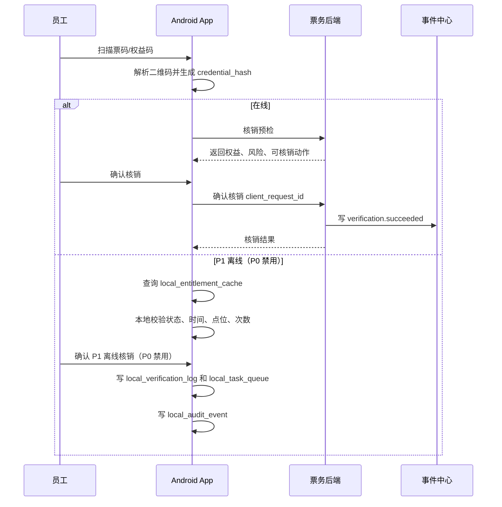
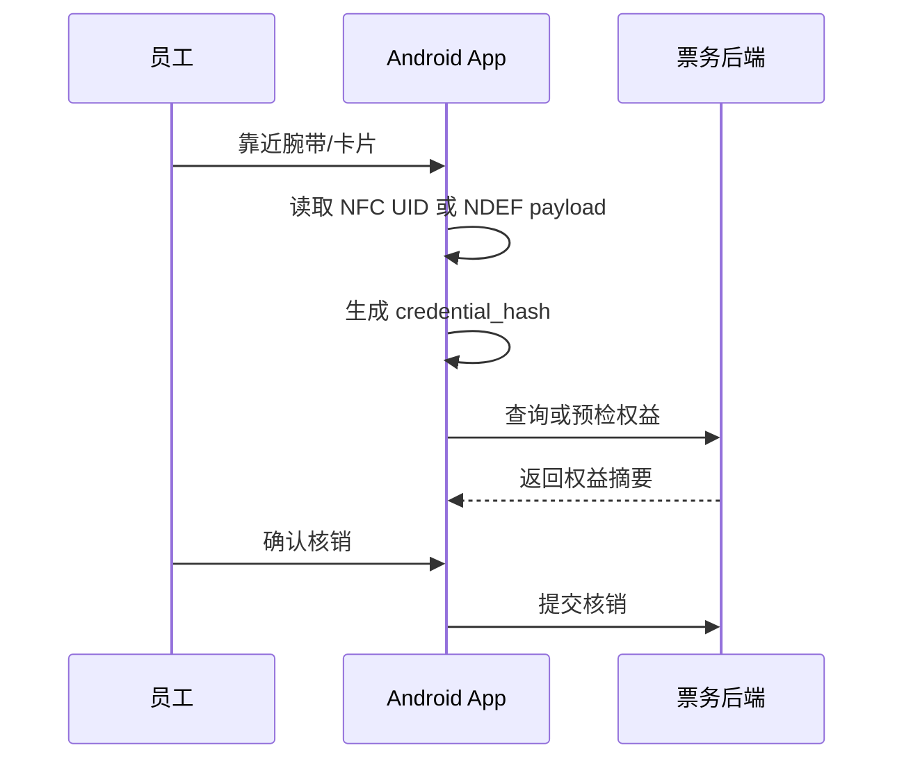
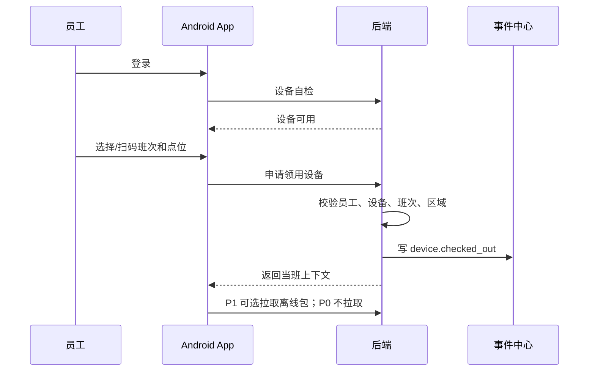

# Android 设备端开发设计：员工工作手机、酒吧点酒平板、触摸屏一体机

> **⚠️ R5 业务HTML缺口审计修正标注（2026-06-18，只读审计后回填，未改代码）**
> 以业务说明地图 #staff/#device 为基准核验真实代码：
> - **员工设备凭证零落地**：`staff_device_credentials`（Keystore 设备公钥/不可逆指纹）后端无表、无 API；现存 `terminal_device_credentials`(V011) 是 **kiosk 一体机随机 token 的 SHA-256**，与员工私人手机指纹是不同实体——不可当作"员工设备凭证已覆盖"。
> - **Android 端**：`apps/android-terminal/.../MainActivity.kt` 仅一个健康检查 Activity，**无注册/Keystore 指纹/Root 检测/换机解绑重绑**；换机无 supersedes/"换机待审"中间态，状态机不闭环。
> - **MDM 阻断**：依赖外部商业 MDM + Android Enterprise/AMAPI，属外部依赖占位（不计闭环）；自有侧 `management_status`/`policy_status`/`last_policy_sync_at`/`device_credential_hash` 字段亦缺失。
> - **业务裁决（2026-06-18）**：员工三表 + Android 端凭证（注册/Keystore 指纹/Root 检测/换机解绑重绑）本期 P0；MDM 阻断按"凡第三方一律预留接口+后台开关"处理，不阻塞其它功能。**二轮裁决（2026-06-18）**：MDM 自有侧字段本期**暂缓**（仅保留接口 + 开关占位，不落 management_status 等字段）；MDM 缺供应商时验收降级签字责任人 = IT 安全负责人（2026-06-18 业务确认定稿）。
> - **候选验收口径**：换机走"解绑旧→绑新（待审）→生效"，Root/调试设备绑定失效并进复核；员工凭证与 kiosk 凭证两套互不串用。

本文档用于指导【移动端设备：员工工作手机、酒吧点酒平板、触摸屏一体机】进入 Kotlin Android 开发。当前阶段只写设计，不写代码。

关联文档：

- `docs/system-development-spec.md`
- `docs/project-progress-dashboard.md`
- `docs/android-terminal-breakdown.md`
- `docs/ticketing-pass-entitlement-development-design.md`
- `docs/system-breakdown.md`
- `docs/system-development-spec.md`（正式技术栈入口）
- `docs/server-160-runbook-v0.2.md`
- `docs/openapi/openapi-p0.yaml`、`docs/openapi/openapi-p0.json`
- `docs/p0-openapi-operation-acceptance-matrix-v0.1.md`
- `docs/code-contract-difference-and-migration-audit-v0.1.md`

## 1. 设计结论

Android 设备端不是游客 App 的替代品，也不是工作人员代客售票入口。门票必须由客人通过官方 App/小程序、售票型一体机或第三方平台自助购买；Android 设备端负责员工工作手机核销、酒吧平板点酒，以及触摸屏一体机的自助服务。触摸屏一体机分售票型和非售票型：售票型承担官方自助购票、取票和订单查询；非售票型承担权益展示/领取、订台下单、吧台买酒下单、游乐状态查看和授权状态检查。员工私人手机可安装轻量 App，但只用于注册、通知、状态查看和**设备凭证绑定（设备公钥/设备指纹，phone-3/D8 废止读手机本机 NFC 唯一标识）**，不允许承担现场业务操作。

核心结论：

| 结论 | 说明 |
|---|---|
| 设备是工作身份的一部分 | 每次业务操作必须绑定员工、设备、班次、区域、点位；一体机必须绑定固定点位 |
| 离线能力只作为 P1 预留 | P0 不启用离线核销；P1 可离线查看策略摘要并仅对普通低风险权益使用最小摘要，高价值酒水、退款、改权限、调账、人工放行必须在线 |
| 核销以权益实例为准 | 安卓端核销必须最终落到后端 `issued_entitlement` 和 `verification_record` |
| 本地只保存摘要和待同步流水 | 不在本地保存完整订单、完整客户、完整财务数据 |
| 所有关键动作写事件 | 登录、领用、归还、扫码、NFC、同步、补录、锁定都要写入事件中心；离线核销仅 P1 预留 |
| 三类设备职责不同 | 工作手机做门票/权益核销；平板做员工协助点酒、最低消费和支付引导；触摸屏一体机按 `kiosk_mode` 做售票型或非售票型固定点位自助服务 |
| 私人手机不做现场业务 | 员工私人手机 App 只做注册、通知、状态查看、**设备凭证绑定（设备公钥/设备指纹，非 NFC）**和审批结果查看；进入办公区后私人手机需要寄存 |
| P0 先做三端基础闭环 | 工作手机核销、平板点酒、售票型一体机自助购票/取票/订单查询、非售票型一体机权益展示/领取、订台、吧台买酒、游乐状态查看、销售归属、服务责任、异常首响、设备绑定、同步和事件留痕 |

## 2. 业务边界

### 2.1 本端负责

| 范围 | 负责内容 |
|---|---|
| 设备识别 | 读取设备编号、序列号、设备注册状态、管控状态 |
| 员工登录 | 员工账号登录、企业微信身份绑定状态读取 |
| 设备领用归还 | 员工、设备、班次、岗位、区域绑定和解除 |
| 工作台 | 按角色展示核销、酒吧、游乐、库房、巡检、主管等入口 |
| 员工私人手机 App | 注册资料提交、设备凭证绑定（安装期生成存 Keystore 的设备公钥/不可逆设备指纹）、换机解绑重绑、通知收发、班次/审批状态查看、Root/设备异常检测 |
| 二维码核销 | 使用摄像头或扫码枪识别票码、权益码、券码 |
| NFC 读取 | 读取腕带、卡片、标签 UID 或加密 payload |
| 离线核销 | P1 预留；P0 票务二维码必须在线核验，截图无效 |
| 本地队列 | 保存待同步核销、补录、事件、设备状态变化 |
| 人工补录 | 异常核销、设备异常、客诉、库存差异等基础补录 |
| 事件上报 | 将本端关键操作转成事件上报后端事件中心 |
| 设备安全 | Kiosk、禁截屏、Root 检测、应用白名单、远程锁定执行 |
| 酒吧平板点酒 | 绑定酒吧和卡座/桌台，校验最低消费，生成支付二维码或扫描客人付款码 |
| 触摸屏一体机 | 售票型支持自助购票/取票/订单查询；非售票型支持扫码展示/领取权益、订台下单、吧台买酒下单、支付引导、游乐状态查看和授权状态检查 |
| 企业微信管控 | 工作手机预装企业微信，读取绑定状态和策略状态，禁止私人微信承接业务 |
| 访问管控 | 执行预装软件清单、应用白名单和网站白名单策略 |

### 2.2 本端不负责

| 范围 | 边界 |
|---|---|
| 票务最终扣次 | 后端完成事务扣次、结算明细、风控判断 |
| 退款改期 | 安卓端不做离线退款，P0 不做退款入口 |
| 门票购买 | 员工工作手机和平板不提供购票、代客购票、售票员报价或票种销售入口；售票型一体机只作为官方自助购票渠道，必须复用票务系统价格、库存、支付、出票和防伪二维码能力 |
| 私人手机现场操作 | 员工私人手机 App 不提供核销、点单、放行、结算、异常补录等现场业务入口 |
| 完整财务结算 | 安卓端只展示必要结果，不计算结算 |
| 完整餐饮零售 POS | 由第三方系统负责，安卓端最多做券核销或异常记录 |
| 机器人调度内核 | 机器人服务商负责，安卓端做取货、送达、签收确认 |
| 企业微信会话归档 | 企业微信官方会话存档接口和后端负责，安卓端不直接抓取聊天内容，只保证工作手机使用企业微信和设备策略合规 |
| 视频录像保存 | 监控系统和视频证据中心负责，安卓端只关联事件和点位 |

## 3. 角色与设备形态

### 3.1 设备形态

| 设备形态 | 典型位置 | 绑定方式 | 主要能力 | UI 重点 |
|---|---|---|---|---|
| 员工工作手机 | 核销员、服务员、巡检员、库管随身携带 | 绑定员工、班次、区域 | 摄像头扫码、NFC、拍照、定位、在线核验 | 快速扫码、单手可用、强提醒 |
| 员工私人手机 App | 员工自有手机 | 绑定员工注册资料、**设备公钥/不可逆设备指纹**（安装期生成存 Keystore，废止"读手机本机 NFC 唯一标识"） | 注册、通知、状态查看、审批结果、Root 检测、换机解绑重绑（先解绑旧设备凭证再绑新） | 轻量、非现场作业、异常即失效 |
| 酒吧点酒平板 | 酒吧吧台、卡座服务点、酒吧服务台 | 绑定员工、酒吧、卡座/桌台/吧台位 | 大屏酒水列表、卡座账单、最低消费校验、支付二维码、扫客人付款码 | 桌台清晰、金额醒目、少步骤 |
| 触摸屏一体机 | 入口/票务服务点、权益领取点、吧台旁、游乐或活动服务点 | 绑定设备、点位、商户、`kiosk_mode` | Kiosk、扫码器、NFC、摄像头、触摸操作、支付二维码 | 售票型显示购票/取票/订单查询；非售票型大字展示权益、订台、买酒、游乐状态和处理结果 |

> 修订说明（2026-06-10，依据 phone-3 / 统一口径基准 D8）：**废止"私人手机 App 安装时读取手机本机 NFC 唯一标识作为身份绑定依据"**。技术原因——Android NFC API 只能读取**外部**标签/卡片的 UID，不向普通 App 暴露"本机手机稳定的 NFC 硬件唯一标识"（HCE 模式也不提供稳定硬件标识），该值在主流 Android 编码期根本取不到，会导致身份绑定/换机解绑/一一对应关系全部落空。改为：私人手机身份 = **安装期生成并存于设备 Keystore 的设备公钥 / 不可逆设备指纹**作为唯一可信标识；**换机 = 先解绑旧设备凭证再绑新**；Root/调试/设备异常判不可信失效复核；**仅持久化不可逆哈希/公钥指纹**，不存原始标识（PIPL 数据最小化，见 §13.1 与合规文档 C4）。注意：**工作手机通过摄像头/扫码模块读取外部客人二维码；NFC 仅读取外部 NFC 腕带、标签、卡或设备中的权益标识**（见 §9.2）。

### 3.2 用户角色

| 角色 | 手机 | 平板 | 一体机 | P0 权限 | P1/P2 权限 |
|---|---|---|---|---|---|
| 核销员 | 支持 | 不支持 | 只展示/领取 | 二维码在线核销、异常上报 | NFC、批量入场、容量提示 |
| 酒吧服务员/门口核验员 | 支持 | 支持 | 支持 | 平板点酒、最低消费校验、支付引导、服务责任留痕；一体机订台/吧台买酒；工作手机做权益核销、酒吧门口年龄/人脸核验触发、送达确认和异常首响 | 客诉深化 |
| 吧台员工 | 可选 | 支持 | 支持 | 平板处理出品和卡座账单；一体机处理吧台买酒和领取内容 | 存酒、库存提醒 |
| 游乐核销员 | 支持 | 不支持 | 支持 | 项目权益核销、异常上报；一体机查看状态和记录授权检查 | 排队预约、快速通道、容量控制 |
| 巡检员 | 支持 | 不支持 | 支持 | 巡检补录、拍照留痕；一体机可录入固定点位状态检查 | 完整巡检模板、事故上报 |
| 库管 | 支持 | 不支持 | 不推荐 | 物料异常补录、机器人取货确认简版 | 入库、出库、调拨、盘点 |
| 现场主管 | 支持 | 不支持 | 不推荐 | 审批异常、解锁设备、查看同步状态 | 全场状态、员工调度、风险处置 |
| 设备管理员 | 支持 | 不支持 | 支持 | 设备登记、领用、归还、锁定 | 远程清除、MDM 策略下发 |

## 4. App 模块

### 4.1 模块总览

| 模块 | P0 | P1 | P2 |
|---|---|---|---|
| 启动与设备自检 | 必做 | 增强 | 增强 |
| 员工登录与会话 | 必做 | 企业微信单点 | 生物识别辅助 |
| 设备领用归还 | 必做 | 设备柜/NFC 联动 | 自动盘点设备 |
| 工作台 | 必做 | 分角色精细工作台 | 可配置工作台 |
| 二维码核销 | 必做 | 扫码枪适配 | 多码连续扫 |
| NFC 核销 | 预留/基础读取 | 完整核销 | 加密腕带/卡 |
| 离线核销 | P1 预留；P0 不启用 | 离线容量/风控 | 多点离线协同 |
| 同步中心 | 必做 | 增量同步优化 | 消息推送同步 |
| 人工补录 | 基础 | 模板化审批 | 证据包联动 |
| 酒吧年龄/人脸核验 | 工作手机触发第三方人脸/年龄核验或等效设备核验、展示通过/拒绝/超时原因、写入入场记录和事件；供应商未配置时生产阻断 | 多设备核验台、队列优化 | 更深合规分析 |
| 酒吧平板点酒 | 绑定酒吧和卡座、点酒、最低消费、支付引导、销售归属和服务责任留痕 | 出品流程细化、卡座账单筛选 | 存酒/库存深度 |
| 触摸屏一体机 | 售票型：自助购票/取票/订单查询；非售票型：权益展示/领取、订台、吧台买酒、游乐状态查看和基础检查 | 异常呼叫、更多订单状态、与库存/排队联动 | 更多自助服务 |
| 游乐作业 | 工作手机项目核销 | 队列/容量 | 巡检/事故 |
| 库房与机器人 | 工作手机简版确认 | 入出库/盘点 | 机器人全链路 |
| 企业微信入口 | 绑定状态、每日上传状态提示 | 会话入口 | 质检提醒 |
| 设备安全/Kiosk | 应用白名单、网站白名单、预装软件校验 | MDM 联动 | 策略远程下发 |

### 4.2 P0 模块说明

| 模块 | 功能 | 关键约束 |
|---|---|---|
| 设备自检 | 检查设备注册、App版本、网络、时间、Root、调试状态 | 未登记设备不能登录 |
| 登录 | 员工账号登录，获取角色、岗位、数据范围 | Token 短时效，离线只允许使用已登录会话 |
| 领用 | 员工选择或扫码班次、区域、点位后领用设备 | 领用成功前不能核销 |
| 核销预检 | 扫码后先请求后端预检，展示权益和风险 | 预检不扣次 |
| 核销确认 | 员工确认后由后端在线扣次 | 每次核销有 `client_request_id` |
| 离线核销 | P1 预留，本地权益摘要不用于 P0 核验 | P0 票务二维码截图无效，必须在线核验 |
| 同步 | WorkManager 上传本地任务和事件 | 下班前必须完成同步 |
| 归还 | 检查未同步任务，解除绑定 | 未同步高风险任务不能归还 |
| 补录 | 填写异常类型、说明、照片、定位 | 补录只提交，不直接改业务结果 |
| 酒吧年龄/人脸核验 | 工作手机或入口设备触发后端供应商适配器，展示成年/未成年/超时/供应商未配置等结果 | 必须在线；生产未配置供应商或等效设备时不得标记正式通过 |
| 平板点酒 | 选择酒吧、卡座/桌台、酒水、数量，校验最低消费 | 不允许出现门票购买入口 |
| 平板支付 | 生成支付二维码或扫描客人付款码 | 支付结果回到酒吧账单 |
| 一体机自助服务 | 售票型：自助购票、取票、订单查询；非售票型：扫码展示/领取权益，订台下单，吧台买酒下单，查看游乐设施状态，授权员工记录状态检查；**支持工作手机扫附赠权益码→指定/就近一体机展示的跨设备协同（见 §5.5，phone-4）** | 售票型不得离线出票或绕过票务价格/库存/支付；非售票型不显示购票入口；订单、领取结果、状态检查都要写事件 |

## 5. 页面流

### 5.1 总页面结构

```text
启动页
└── 设备自检页
    ├── 设备未登记页
    ├── 设备锁定页
    └── 登录页
        └── 领用/接班页
            └── 角色工作台
                ├── 员工工作手机核销模块
                ├── 酒吧门口年龄/人脸核验模块
                ├── 酒吧平板点酒模块
                ├── 触摸屏一体机自助服务模块
                ├── 离线同步中心
                ├── 人工补录
                ├── 游乐作业
                ├── 库房/机器人
                ├── 企业微信入口
                └── 交班/归还页
```

### 5.2 手机页面流

```text
登录 -> 领设备 -> 我的工作台
  -> 扫码核销 -> 核销预检 -> 确认核销 -> 结果页
  -> 酒吧门口年龄/人脸核验 -> 扫票/选入场记录 -> 触发供应商核验 -> 展示通过/拒绝/超时/未配置 -> 写事件
  -> P1离线预留 -> 本地记录 -> 同步中心
  -> 人工补录 -> 拍照/定位 -> 提交/待同步
  -> 交班 -> 未同步检查 -> 归还设备
```

手机 UI 原则：

- 首页显示今日班次、设备状态、网络状态、未同步数量。
- 扫码入口必须固定在显眼位置。
- 离线状态用顶部常驻警示条，不用弹窗反复打断。
- 高风险操作必须二次确认，必要时主管授权。

### 5.3 平板页面流

```text
登录/点位绑定 -> 选择/确认酒吧
  -> 选择卡座/桌台/吧台位
  -> 点酒下单
  -> 最低消费校验
  -> 生成客人扫码支付二维码 / 扫客人付款码
  -> 支付结果
  -> 卡座账单和出品状态
```

平板 UI 原则：

- 只显示酒吧点酒、最低消费、支付和卡座账单。
- 支持左右分栏：卡座列表 + 点酒/账单详情。
- 不显示票种、门票购买、游乐权益购买或核销入口。
- 固定岗位平板允许长会话，但必须定时刷新权限。

### 5.4 一体机页面流

```text
Kiosk启动 -> 点位自检 -> 自助服务首页
  -> 售票型首页 -> 购票/取票/订单查询 -> 官方票务产品/库存/聚合支付/出票/防伪二维码
  -> 扫码/NFC权益领取 -> 展示可领取酒水、礼物和权益 -> 领取确认/不可领取提示
  -> 订台下单 -> 选择酒吧/日期/时段/卡座/人数 -> 订单确认/支付引导
  -> 吧台买酒 -> 选择酒水/套餐/数量 -> 生成吧台订单/支付二维码
  -> 游乐状态 -> 查看开放/排队/容量/暂停/故障/维护
  -> 授权状态检查 -> 员工登录或扫码授权 -> 记录检查结果/异常原因
  -> 异常呼叫员工/主管
```

一体机 UI 原则：

- 大按钮、大字号、少层级。
- 第一屏按 `kiosk_mode` 展示入口：售票型展示购票、取票、订单查询；非售票型展示扫码权益、订台、吧台买酒、游乐状态四类入口。
- 涉及下单和状态检查的页面必须清楚显示当前绑定点位、商户、设备编号和责任员工。
- 自动返回首页。
- 禁止系统导航退出。
- 网络断开时显示“离线受限模式”，不允许用户进入复杂操作。

### 5.5 工作手机扫码→一体机展示跨设备协同

> 修订说明（2026-06-07，phone-4）：原始需求隐含一个跨设备动作——员工用**工作手机**扫客人附赠酒水/权益二维码，结果在**就近/指定一体机**大屏向客人展示可领取内容。原文把它拆成两个互不关联的入口（工作手机核销 + 一体机自助扫码），缺设备/点位配对、触发机制与权益会话关联，导致客人需在一体机重复扫一次或场景无法落地。本节补齐跨设备触发流程、配对规则与会话关联字段。

**产品形态（采纳）：** 工作手机扫码 → **指定/就近一体机推送展示**（非"一体机自助扫码"）。工作手机与一体机通过点位配对，共享同一 `entitlement_session_id` 关联同一权益实例。

#### 5.5.1 设备/点位配对规则

- 一体机绑定固定点位（已有约束）；工作手机扫码时按**当前点位/区域**解析"就近可展示一体机"，或由员工**手动指定目标一体机编号**。
- 一台点位可对应多台一体机时，默认推送到"就近空闲"一体机，并在工作手机回显已指派的一体机编号供员工核对。
- 配对关系在 `shift-context`/点位配置下发时携带"点位→可展示一体机列表"。

#### 5.5.2 跨设备触发流程

```text
工作手机扫客人附赠权益码
  -> 后端校验权益实例，生成 entitlement_session_id（关联同一 issued_entitlement）
  -> 后端按点位/指定解析目标一体机
  -> 推送(优先 WebSocket/长连)或一体机轮询拉取待展示会话
  -> 目标一体机大屏展示可领取酒水/礼物/权益 + entitlement_session_id
  -> 客人在一体机确认领取 -> 领取结果回写同一 entitlement_session_id
  -> 工作手机收到结果回执（领取成功/超时/取消）
```

- **推送优先、轮询兜底：** 一体机在线优先收实时推送；推送不可达时按固定间隔轮询 `pending sessions`。
- **会话时效：** `entitlement_session_id` 设短时效（如默认 5 分钟），超时自动失效并通知工作手机，避免错领。
- **防错领：** 一体机展示页明确显示会话来源（哪台工作手机/哪位员工发起）与权益摘要；同一会话只能被领取一次，领取以服务端为准。

#### 5.5.3 会话关联字段与事件

- 工作手机核销动作与一体机展示/领取日志（`local_entitlement_display_log`）通过 `entitlement_session_id` 关联同一 `issued_entitlement`。
- 新增字段 `entitlement_session_id`（工作手机扫码请求、一体机展示请求、一体机领取请求三处共享）。
- 事件（见 §15.1）：`kiosk.entitlement.session_pushed`（工作手机扫码触发并指派一体机）、`kiosk.entitlement.session_displayed`（一体机展示）、`kiosk.entitlement.session_claimed`（一体机领取，复用既有 `kiosk.entitlement.claimed` 并带 `entitlement_session_id`）。

## 6. Kotlin / Compose 工程结构

### 6.1 技术栈

| 项目 | 选择 |
|---|---|
| 语言 | Kotlin |
| UI | Jetpack Compose + Material 3 |
| 架构 | MVVM + Repository + UseCase |
| 本地数据库 | Room |
| 网络 | Retrofit + OkHttp，或 Ktor Client；P0 推荐 Retrofit |
| 后台任务 | WorkManager |
| 依赖注入 | Hilt |
| 分页 | Paging 3 |
| 序列化 | kotlinx.serialization 或 Moshi |
| 图片 | Coil |
| 扫码 | CameraX + ML Kit Barcode；外接扫码枪走输入事件 |
| NFC | Android NFC API |
| 加密 | Android Keystore；P1 引入 SQLCipher |
| 日志 | Timber + 本地审计日志 |

### 6.2 工程目录

```text
apps/android-terminal
├── app
│   ├── build.gradle.kts
│   └── src/main
├── core
│   ├── common              通用工具、Result、错误码
│   ├── network             Retrofit、签名、拦截器
│   ├── database            Room、DAO、Entity
│   ├── security            Keystore、Root检测、Kiosk
│   ├── device              设备识别、NFC、扫码、定位
│   └── sync                同步队列、WorkManager
├── domain
│   ├── auth                登录、会话
│   ├── device-session      领用、归还、班次绑定
│   ├── verification        核销
│   ├── manual-record       人工补录
│   ├── bar                 酒吧作业
│   ├── amusement           游乐作业
│   └── inventory           库房作业
├── feature
│   ├── startup
│   ├── login
│   ├── device-checkout
│   ├── workbench
│   ├── verification
│   ├── sync-center
│   ├── manual-record
│   ├── bar-ops
│   ├── amusement-ops
│   ├── inventory-ops
│   └── settings
└── build-logic
```

### 6.3 包命名建议

```text
com.complex.terminal
com.complex.terminal.core.network
com.complex.terminal.core.database
com.complex.terminal.core.security
com.complex.terminal.core.device
com.complex.terminal.core.sync
com.complex.terminal.domain.verification
com.complex.terminal.feature.verification
```

### 6.4 关键编码约定

| 约定 | 说明 |
|---|---|
| 所有离线操作生成本地唯一ID | 使用 `client_request_id`，建议 `device_id + timestamp + random` |
| API 返回统一 Result | 包含 `code`、`message`、`data`、`trace_id` |
| 本地表使用服务端 ID + 本地 ID | 同步前用本地 ID，同步后回填服务端 ID |
| 不在 ViewModel 直接访问网络 | 通过 UseCase 和 Repository |
| 同步任务不可依赖页面存活 | 必须由 WorkManager 和本地队列驱动 |
| 所有关键操作先落本地事件 | 即使上传失败，也保留本地 `local_audit_event` |

## 7. Room 本地表设计

### 7.1 `local_device_profile`

本机设备档案。

| 字段 | 类型 | 说明 |
|---|---|---|
| `device_id` | String | 后端设备ID |
| `device_code` | String | 设备编号 |
| `device_type` | String | `phone`、`tablet`、`kiosk` |
| `serial_no` | String | 序列号 |
| `imei_hash` | String? | IMEI 哈希 |
| `merchant_id` | String? | 归属商户 |
| `venue_id` | String? | 所属场地 |
| `area_id` | String? | 所属区域 |
| `location_point_id` | String? | 点位 |
| `registered_status` | String | `registered`、`unregistered`、`locked` |
| `kiosk_enabled` | Boolean | 是否启用 Kiosk |
| `last_seen_at` | Long | 最近自检时间 |

索引：`device_code`、`serial_no`。

### 7.2 `local_staff_session`

当前员工会话和当班信息。

| 字段 | 类型 | 说明 |
|---|---|---|
| `session_id` | String | 本地会话ID |
| `staff_id` | String | 员工ID |
| `user_id` | String | 账号ID |
| `staff_name` | String | 员工名 |
| `merchant_id` | String? | 商户 |
| `venue_id` | String? | 场地 |
| `shift_assignment_id` | String | 班次绑定ID |
| `position_code` | String | 岗位 |
| `role_codes_json` | String | 角色列表JSON |
| `data_scope_json` | String | 数据范围JSON |
| `access_token_encrypted` | String | 加密 Token |
| `token_expires_at` | Long | Token 过期时间 |
| `checked_out_at` | Long | 设备领用时间 |
| `status` | String | `active`、`expired`、`checked_in`、`force_locked` |

### 7.3 `local_location_point`

点位摘要。

| 字段 | 类型 | 说明 |
|---|---|---|
| `location_point_id` | String | 点位ID |
| `venue_id` | String | 场地 |
| `area_id` | String | 区域 |
| `point_type` | String | `gate`、`bar_counter`、`booth`、`amusement_entry`、`warehouse` |
| `name` | String | 点位名称 |
| `merchant_id` | String? | 归属商户 |
| `offline_allowed` | Boolean | 是否允许离线操作 |
| `updated_at` | Long | 更新时间 |

### 7.4 `local_entitlement_cache`

离线权益摘要，不保存完整票务订单。

| 字段 | 类型 | 说明 |
|---|---|---|
| `entitlement_id` | String | 权益实例ID |
| `ticket_id` | String | 票实例ID |
| `credential_hash` | String | 二维码/NFC 凭证哈希 |
| `entitlement_type` | String | `entry`、`bar_entry`、`drink`、`amusement`、`coupon` |
| `merchant_id` | String | 权益归属商户 |
| `venue_id` | String? | 可用场地 |
| `project_id` | String? | 游乐项目 |
| `remaining_times` | Int | 剩余次数摘要 |
| `valid_from` | Long | 有效开始 |
| `valid_to` | Long | 有效结束 |
| `offline_policy` | String | `allow`、`deny`、`supervisor_required` |
| `risk_level` | String | `normal`、`notice`、`high` |
| `version` | Long | 服务端版本 |
| `synced_at` | Long | 同步时间 |

索引：`credential_hash`、`entitlement_id`、`merchant_id + venue_id`。

### 7.5 `local_verification_log`

本地核销流水，包括联网和离线。

| 字段 | 类型 | 说明 |
|---|---|---|
| `local_id` | String | 本地ID |
| `client_request_id` | String | 幂等请求ID |
| `server_verification_id` | String? | 服务端核销ID |
| `entitlement_id` | String? | 权益实例 |
| `credential_hash` | String | 凭证哈希 |
| `verification_method` | String | `qr`、`nfc`、`manual` |
| `verification_mode` | String | `online`、`offline` |
| `merchant_id` | String? | 商户 |
| `venue_id` | String? | 场地 |
| `location_point_id` | String? | 点位 |
| `staff_id` | String | 员工 |
| `device_id` | String | 设备 |
| `occurred_at` | Long | 本地发生时间 |
| `result` | String | `success`、`failed`、`pending_sync`、`conflict` |
| `sync_status` | String | `pending`、`syncing`、`accepted`、`rejected`、`conflict` |
| `failure_reason` | String? | 失败原因 |
| `payload_json` | String | 原始摘要 |

唯一约束：`client_request_id`。

### 7.6 `local_task_queue`

通用待同步任务队列。

| 字段 | 类型 | 说明 |
|---|---|---|
| `task_id` | String | 本地任务ID |
| `task_type` | String | `verification`、`manual_record`、`audit_event`、`device_status`、`inventory_action` |
| `business_local_id` | String | 关联本地记录ID |
| `priority` | Int | 优先级，数字越小越高 |
| `idempotency_key` | String | 幂等键 |
| `payload_json` | String | 请求数据 |
| `status` | String | `pending`、`running`、`success`、`failed`、`conflict` |
| `retry_count` | Int | 重试次数 |
| `next_retry_at` | Long | 下次重试时间 |
| `created_at` | Long | 创建时间 |
| `updated_at` | Long | 更新时间 |

索引：`status + priority + next_retry_at`。

### 7.7 `local_manual_record`

人工补录。

| 字段 | 类型 | 说明 |
|---|---|---|
| `local_id` | String | 本地ID |
| `server_record_id` | String? | 服务端补录ID |
| `record_type` | String | `verification_exception`、`device_exception`、`customer_complaint`、`inventory_exception` |
| `merchant_id` | String? | 商户 |
| `venue_id` | String? | 场地 |
| `area_id` | String? | 区域 |
| `location_point_id` | String? | 点位 |
| `staff_id` | String | 提交员工 |
| `content_json` | String | 补录内容 |
| `attachment_local_paths_json` | String | 本地附件 |
| `attachment_remote_urls_json` | String? | 上传后附件URL |
| `approval_status` | String | `draft`、`pending_sync`、`submitted`、`approved`、`rejected` |
| `created_at` | Long | 创建时间 |
| `sync_status` | String | 同步状态 |

### 7.8 `local_audit_event`

本地事件队列。

| 字段 | 类型 | 说明 |
|---|---|---|
| `event_local_id` | String | 本地事件ID |
| `server_event_id` | String? | 服务端事件ID |
| `event_type` | String | 事件名 |
| `event_category` | String | 事件大类 |
| `occurred_at` | Long | 发生时间 |
| `source_type` | String | `android_terminal` |
| `merchant_id` | String? | 商户 |
| `venue_id` | String? | 场地 |
| `actor_type` | String | `staff`、`device` |
| `actor_id` | String | 员工或设备 |
| `device_id` | String | 设备 |
| `result` | String | 结果 |
| `risk_level` | String | 风险等级 |
| `summary` | String | 摘要 |
| `payload_json` | String | 扩展数据 |
| `sync_status` | String | `pending`、`synced`、`failed` |

### 7.9 `local_sync_checkpoint`

同步游标。

| 字段 | 类型 | 说明 |
|---|---|---|
| `scope` | String | `entitlement_cache`、`config`、`device_policy`、`ticketing` |
| `cursor` | String? | 服务端游标 |
| `last_sync_at` | Long | 最近同步时间 |
| `version` | Long | 版本号 |
| `status` | String | `ok`、`failed` |

### 7.10 酒吧平板和一体机本地表

| 表 | 用途 |
|---|---|
| `local_bar_context` | 当前平板绑定的酒吧、卡座/桌台、员工和班次 |
| `local_bar_table_snapshot` | 卡座/桌台状态摘要 |
| `local_bar_order_draft` | 酒吧点酒草稿，P0 只允许暂存，提交和支付必须联网 |
| `local_entitlement_display_log` | 一体机扫码展示和领取确认日志 |
| `local_amusement_session_snapshot` | 游乐场次和容量摘要，P1 |
| `local_inventory_snapshot` | 库存摘要，P1/P2 |
| `local_robot_task` | 机器人任务摘要，P2 |
| `local_media_attachment` | 照片、视频附件上传队列 |

## 8. 离线核销数据策略（P1 预留，P0 不启用）

本章仅作为 P1 扩展设计保留。P0 票务和权益二维码必须在线核验，断网时不得离线放行或记录为成功核销。

### 8.1 离线数据下发原则

后端不应把完整票务数据下发到终端，只下发“可离线判断的最小摘要”。

下发范围：

| 数据 | 下发粒度 | 说明 |
|---|---|---|
| 当班权限 | 员工 + 设备 + 班次 | 决定可操作范围 |
| 点位配置 | 设备绑定点位 | 决定可核销权益类型 |
| 权益摘要 | 当日、当前场地、当前点位可用权益 | 不跨区域下发 |
| 黑名单/冻结摘要 | 票/权益/设备/员工摘要 | 防止风险核销 |
| 离线策略 | 权益类型级别 | 决定 allow/deny/supervisor_required |
| 补录模板 | 按岗位和场景 | 支持离线补录 |

### 8.2 离线包范围

P1 预留的离线权益包按以下条件生成：

```text
merchant_id + venue_id + location_point_id + business_date + shift_id
```

限制：

- 每台设备只拉取自己有权限点位的权益摘要。
- 离线包有效期默认不超过当前班次。
- 离线包超过 4 小时未刷新，禁止继续 P1 离线核销；P0 不启用离线包。
- 高价值酒水、退款、改期、人工放行默认不进入离线包。

### 8.3 离线允许矩阵

| 操作 | P1 离线允许 | 条件 |
|---|---|---|
| 入园权益核销 | 允许 | 本地权益摘要存在，未过期，点位匹配 |
| 酒吧入场核销 | 允许 | 酒吧入口点位匹配 |
| 酒吧年龄/人脸核验 | 不允许 | 必须联网调用供应商适配器或等效设备；P1 离线包也不允许补过 |
| 普通游乐项目核销 | 允许 | 项目点位匹配，剩余次数足够 |
| 酒水券核销 | 谨慎允许 | 仅低价值/指定酒水，主管可配置 |
| 酒吧点酒草稿 | 允许暂存 | 只能暂存未提交草稿，提交订单和支付必须联网 |
| 餐饮零售券 | P0 不建议 | 第三方 POS 优先联网核销 |
| 手动输入核销 | 离线不允许 | 防止误核销和造假 |
| 退款/改期 | 不允许 | 必须联网 |
| 权限变更 | 不允许 | 必须联网 |
| 人工补录 | 允许暂存 | 恢复后提交审批 |

### 8.4 本地防重

本地防重层级：

1. `credential_hash + location_point_id + business_date`
2. `entitlement_id + verification_rule_id`
3. `client_request_id`
4. 本设备已核销记录

注意：本地防重只能防止本设备重复核销，不能完全防止多设备离线冲突。最终冲突以服务端同步结果为准。

## 9. 扫码与 NFC 流程

### 9.1 二维码扫码流程



扫码输入来源：

| 来源 | 处理方式 |
|---|---|
| CameraX 摄像头 | App 内扫码页识别 |
| USB/蓝牙扫码枪 | 作为键盘输入，焦点落在隐藏输入框 |
| 一体机内置扫码头 | 优先按厂商 SDK；否则按键盘输入 |

### 9.2 NFC 读取流程



NFC 策略：

> 修订说明（2026-06-07，phone-3 / D8）：本节 NFC 读取**仅指工作手机/一体机读取外部客人腕带、卡片、标签的 UID 或加密 payload 用于权益核销**，与"私人手机身份绑定"无关，**保留不变**。私人手机身份不再使用 NFC，改用设备公钥/设备指纹凭证（见 §3.1 修订说明与 §13.1）。

- P0 只预留 `credential_hash`、凭证类型和界面入口结构，不把 NFC 真实读取纳入验收。
- P1 支持读取 UID/NDEF，并接入与二维码一致的核销流程。
- P2 支持加密腕带 payload。
- P2 支持腕带补绑、挂失、换绑。

### 9.3 手动输入

手动输入仅用于在线异常处理：

- P0 只允许主管或授权员工使用。
- 离线模式不允许手动输入核销。
- 手动输入必须填写原因并写入 `verification.manual_input` 事件。

## 10. 同步协议

> 执行口径：本章 `/api/mobile/*` 是 Android 端本地同步协议和 BFF 依赖名，用于描述端侧数据需求，不是正式后端路径。P0 后端接口必须落到 `docs/openapi/openapi-p0.yaml`、`docs/openapi/openapi-p0.json` 的 `/api/v1/terminals`、`/api/v1/ticketing`、`/api/v1/bar`、`/api/v1/inventory`、`/api/v1/amusement`、`/api/v1/evidence` 等域，并按 `p0-openapi-operation-acceptance-matrix-v0.1.md` 和 `p0-openapi-contract-closure-appendix-v0.1.md` 校验字段、权限、认证上下文、终端、幂等、事件、任务簇和样例准入；如需要移动端专用聚合接口，必须先补 OpenAPI 再开发并通过 `npm run verify:openapi-closure`。现有 `apps/android-terminal` 旧路径迁移按 `code-contract-difference-and-migration-audit-v0.1.md` 执行。

### 10.1 同步方向

| 方向 | 数据 | 触发 |
|---|---|---|
| 后端 -> App | 设备策略、点位、权限、离线权益包、补录模板 | 登录、领用、定时刷新 |
| App -> 后端 | 核销记录、补录、事件、设备状态、附件 | 实时、网络恢复、交班前 |
| 双向 | 同步游标、冲突结果、服务端确认状态 | 每次同步 |

### 10.2 通用请求头

| 字段 | 说明 |
|---|---|
| `Authorization` | 员工登录 Token |
| `X-Device-Id` | 设备ID |
| `X-Device-Code` | 设备编号 |
| `X-Shift-Assignment-Id` | 当前班次绑定ID |
| `X-Location-Point-Id` | 当前点位 |
| `X-Client-Request-Id` | 幂等请求ID |
| `X-Client-Time` | 客户端时间 |
| `X-Signature` | 请求签名，P1 强制 |

### 10.3 下行同步

#### `GET /api/mobile/bootstrap`

用途：App 启动后获取基础配置。

返回：

| 字段 | 说明 |
|---|---|
| `device_profile` | 设备注册和锁定状态 |
| `server_time` | 服务端时间 |
| `app_policy` | 版本、Kiosk、Root、调试策略 |
| `feature_flags` | 功能开关 |

#### `GET /api/mobile/shift-context`

用途：员工登录和领用设备后获取当班上下文。

返回：

| 字段 | 说明 |
|---|---|
| `staff` | 员工摘要 |
| `roles` | 角色 |
| `permissions` | 权限 |
| `data_scopes` | 数据范围 |
| `venue` | 场地 |
| `area` | 区域 |
| `location_point` | 点位 |
| `offline_policy` | 离线策略 |

#### `GET /api/mobile/offline-package`

用途：拉取离线包。

参数：

| 参数 | 说明 |
|---|---|
| `shift_assignment_id` | 班次绑定 |
| `location_point_id` | 点位 |
| `business_date` | 营业日 |
| `cursor` | 增量游标 |

返回：

| 字段 | 说明 |
|---|---|
| `package_id` | 离线包ID |
| `expires_at` | 过期时间 |
| `entitlements` | 权益摘要数组 |
| `blocked_credentials` | 黑名单摘要 |
| `config_version` | 配置版本 |
| `next_cursor` | 下次游标 |

### 10.4 上行同步

#### `POST /api/mobile/sync/verification`

用途：上传单条或批量离线核销，P1 预留；P0 票务二维码必须在线核验，不启用离线核销。

请求：

| 字段 | 说明 |
|---|---|
| `client_request_id` | 幂等键 |
| `device_id` | 设备 |
| `staff_id` | 员工 |
| `shift_assignment_id` | 班次 |
| `location_point_id` | 点位 |
| `credential_hash` | 凭证哈希 |
| `entitlement_id` | 本地匹配到的权益，可为空 |
| `verification_method` | `qr`、`nfc` |
| `occurred_at` | 本地发生时间 |
| `offline_package_id` | 离线包ID |
| `evidence` | 照片、定位等证据摘要 |

返回：

| 字段 | 说明 |
|---|---|
| `sync_status` | `accepted`、`rejected`、`conflict` |
| `server_verification_id` | 服务端核销记录 |
| `conflict_reason` | 冲突原因 |
| `server_decision` | 服务端处理结果 |

#### `POST /api/mobile/sync/tasks`

用途：批量同步本地任务队列。

规则：

- 每批最多 100 条。
- 按优先级排序：核销 > 设备状态 > 补录 > 事件。
- 服务端按 `idempotency_key` 幂等。
- 返回逐条结果，不因单条失败阻断整批。

#### `POST /api/mobile/events`

用途：上报本地事件队列。

规则：

- 支持批量。
- 服务端按 `event_local_id + device_id` 幂等。
- 事件失败不应阻塞核销同步，但必须继续重试。

### 10.5 同步触发

| 触发 | 动作 |
|---|---|
| 登录成功 | 拉取 bootstrap 和 shift-context |
| 设备领用成功 | P0 拉取点位配置；P1 才拉取离线包 |
| 每 5 分钟 | 上传高优先级任务，刷新策略 |
| 网络恢复 | 立即触发全量待同步 |
| 每次核销成功 | 在线立即写服务端；P1 离线核销才写本地队列 |
| 交班前 | 强制同步，失败时阻止归还或要求主管确认 |
| 服务端返回锁定 | 立即锁定 App 操作 |

## 11. 冲突处理

### 11.1 冲突类型

| 冲突 | 服务端处理 | App 展示 |
|---|---|---|
| 同一权益被其他设备先核销 | 标记 `conflict`，生成异常事件 | 显示冲突，要求主管复核 |
| 权益已退款/冻结 | 拒绝同步，标记高风险 | 显示权益不可用 |
| 离线包过期后核销 | 拒绝或待审批 | 显示离线包过期 |
| 点位不匹配 | 拒绝 | 显示无权限点位 |
| 次数超额 | 冲突，生成异常工单 | 显示次数不足 |
| 本地时间异常 | 标记可疑 | 提示校准设备时间 |
| 手动改本地数据 | 拒绝，锁定设备 | 显示设备风险 |

### 11.2 冲突状态机

```text
pending_sync -> syncing -> accepted
                         -> rejected
                         -> conflict -> supervisor_review -> resolved
```

### 11.3 App 侧处理规则

- 冲突记录不得删除。
- 冲突记录在交班页必须展示。
- 高风险冲突阻止普通员工交班，必须主管确认。
- 同步结果必须写入 `local_verification_log.sync_status`。
- 冲突必须写入 `local_audit_event` 并上报。

## 12. 设备领用归还

### 12.1 设备领用流程



后端校验：

- 员工状态正常。
- 设备在白名单，未锁定。
- 员工具备该岗位和区域权限。
- 设备未被其他员工领用。
- 当前时间在班次允许范围内。

### 12.2 设备归还流程

```text
员工点击交班
-> App 检查待同步任务
-> App 检查冲突和未完成补录
-> 允许归还 / 主管确认归还
-> 后端解除设备绑定
-> 写 device.returned 事件
-> 清理本地敏感数据
```

归还拦截：

| 情况 | 处理 |
|---|---|
| 有待同步核销 | 阻止归还，先同步 |
| 有同步冲突 | 主管确认 |
| 有未提交补录 | 允许保存草稿，但必须标记 |
| 设备锁定 | 只能设备管理员处理 |
| 离线状态 | 普通员工不可归还，主管可离线备注后待同步 |

## 13. MDM / Kiosk / 安全

### 13.1 设备管控策略

| 能力 | P0 | P1 | P2 |
|---|---|---|---|
| 设备白名单 | 必做 | 继续 | 继续 |
| App 版本强制升级 | 必做 | 差异化策略 | 灰度发布 |
| 禁止截屏 | 敏感页面 | 全策略配置 | 水印追踪 |
| Root/调试检测 | 必做 | 更严格 | 风险评分 |
| Kiosk 模式 | 一体机必做；工作手机受管态准入见 §13.1.1（A8 前置，phone-6） | 平板支持 | 统一策略下发 |
| 应用白名单 | 只允许预装业务 App、企业微信和系统必要软件；后台维护清单；通过 Android Enterprise / Android Management API + 商业 MDM 下发 | 商业 MDM 策略细化 | 企业策略中心 |
| 禁止私装软件 | P0 在受管设备上禁止安装；未受管设备只能检测并上报，不允许作为正式发放状态 | 自动卸载或锁定 | 策略中心下发 |
| 网站白名单 | 通过 Android Enterprise / Android Management API + 商业 MDM 执行系统级限制，业务 App 内白名单作为二次校验 | 接入安全网关/MDM | 按岗位动态策略 |
| 企业微信强制使用 | P0 校验企业微信安装、绑定和会话上传状态 | P1 质检提醒 | P2 服务评分联动 |
| 私人手机 App 管控 | P0 注册审批、**设备凭证绑定（Keystore 设备公钥/不可逆设备指纹，废止读手机本机 NFC 唯一标识）**、Root/调试检测、PIPL 告知同意/最小化/解绑删除（见本节末与合规文档 C4） | P1 设备变更复核、办公区寄存记录 | P2 与门禁/考勤/薪资联动 |
| 远程锁定 | 后端下发锁定状态 | MDM 联动 | 远程清除 |
| 本地数据清理 | 归还时清理敏感数据 | 远程清理 | 自动过期清理 |

P0 网站白名单默认包括：平台后台/API 域名、企业微信相关域名、对象存储上传域名、设备策略服务域名和必要系统更新时间服务。其他网站访问必须被拦截并写入 `device.policy_violation` 事件。需要注意：普通 App 不能系统级阻止员工安装其他软件或使用外部浏览器，正式发放的工作手机必须进入设备所有者、Kiosk、Android Enterprise 或厂商 MDM 等受管状态。

#### 13.1.1 工作手机受管态准入（P0 前置，A8）

> 修订说明（2026-06-10 总控拍板）：工作手机/平板设备管控已确认采用 **Android Enterprise / Android Management API + 商业 MDM**。平台公司 IT 部门负责选型、采购、配置和运维；业务系统只消费设备档案、策略摘要、合规状态、启停和审计结果。

**准入分档（P0 验收按设备实际管控档位分别验收，不得混用）：**

| 档位 | 前置条件 | P0 验收口径 |
|---|---|---|
| 受管态（强管控） | Android Enterprise / Android Management API + 商业 MDM；设备进入设备所有者/全托管/专用设备模式；下发应用白名单、网站白名单、禁止私装策略 | 受管工作手机**不能安装非预装软件**、**不能访问非白名单网站**、强制仅企业微信、远程锁定可达；策略命中与封禁进入留痕 |
| 应急试点（非正式发放） | 未完成商业 MDM 接入前，仅可用于小范围验证业务 App、扫码、企微状态和设备档案 | 只能检测并上报 `device.policy_violation`，不得作为正式工作手机发放，不得通过 P0 强管控验收 |

**实施边界：** 自研 DPC、仅 App 内检测、未配置商业 MDM 的设备均不作为正式 P0 强管控方案，只能用于开发/试点。正式验收以商业 MDM 策略实际下发、设备合规状态回传和后台审计记录为准。

**D10 "未纳管禁用" 收口口径（与 `p0-action-event-evidence-matrix-v0.1.md` §3.1 同一口径，2026-06-18 业务定稿）：** 本文"MDM 自有侧本期暂缓"与 `p0-action-event-evidence-matrix` 的 `mdm.policy_checked`"未纳管设备不得生产使用"存在矛盾，两文件统一收口如下（2026-06-18 业务定稿）：

- **本期 MDM 自有侧暂缓**：仅保留外部 MDM/Android Enterprise/AMAPI 接口与后台开关占位，不落 `management_status`/`policy_status`/`last_policy_sync_at`/`device_credential_hash` 等自有侧字段。
- **"未纳管设备禁用高风险动作"由终端开关 + 人工准入代偿**：纳管未就绪期间通过终端能力开关关闭未纳管设备的高风险动作（核销、点单、放行、结算、调账等），并以人工准入审核设备发放，达到等效"未纳管禁用"。
- **验收降级，由 IT 安全负责人签字（2026-06-18 业务确认）**：MDM 强管控验收降级为"终端开关 + 人工准入"代偿验收，由 IT 安全负责人作为签字责任人对降级口径负责留痕。
- **`mdm.policy_checked` 事件标注**："依赖外部 MDM，本期以终端开关代偿，纳管后恢复硬禁用"；外部 MDM 纳管就绪后恢复对未纳管设备的硬禁用。
- **MDM 白名单 / 预装清单 / AMAPI 拦截留痕字段为 P1**：在外部 MDM 纳管落地阶段（P1）补齐，不计入本期 P0 闭环。

验收降级签字责任人 = IT 安全负责人（2026-06-18 业务确认定稿）。

员工私人手机 App 安全要求：

> 修订说明（2026-06-07，phone-3 / D8）：原文以"手机 NFC 唯一标识"为身份依据，技术不可行（见 §3.1 修订说明），整体改写为"设备公钥/不可逆设备指纹"凭证；并补 PIPL 告知同意/最小化/解绑删除（C4）。

- 只允许注册、通知、班次/审批状态查看和**设备凭证绑定**，不允许现场核销、点单、放行、结算。
- 身份唯一标识 = **安装期生成并存于设备 Keystore 的设备公钥 / 不可逆设备指纹**（`device_key_fingerprint`），**不再读取手机本机 NFC 唯一标识**（Android 不可行，phone-3）。
- 必须记录**设备公钥指纹**、Root/调试检测结果和员工注册审批状态；**仅持久化不可逆哈希/公钥指纹，不存原始标识**（PIPL 数据最小化，C4）。
- 换机 = **先解绑旧设备凭证再绑定新设备凭证**；解绑即删除对应绑定凭据。
- Root、调试环境、**设备凭证/指纹变化或不匹配（mismatch）**时，私人手机 App 立即失效并进入后台复核。
- 私人手机与公司工作手机建立一一对应关系后，现场作业只认公司工作手机。
- 员工进入办公区或现场作业区时，私人手机寄存状态应可记录或至少可在后台人工确认。

PIPL 合规要求（私人手机 App 个人信息处理，回填合规文档 C4）：

- **告知同意：** 安装/注册时**单独告知并取得同意**——将生成/绑定设备凭证、做 Root/调试检测、采集必要设备指纹；在"员工注册审批"页留存同意凭据（版本、时间、范围）。
- **数据最小化：** 仅持久化不可逆哈希/设备公钥指纹，**不存原始唯一标识**；用途限定为身份绑定与可信校验，不得他用。
- **解绑删除：** 换机解绑或离职注销时，删除对应设备绑定凭据。
- **统一监控告知（C10）：** Root/调试检测、设备指纹采集属员工数据处理，须并入"员工数据处理与监控合规"统一告知（入职协议/规章制度），用途限定与查看审计。

### 13.2 一体机 Kiosk

一体机必须满足：

- 开机自动启动业务 App。
- 禁止返回桌面。
- 禁止下拉通知栏或切换应用。
- 断网时进入受限模式。
- 5 分钟无操作自动回首页。
- 设备锁定后只显示设备编号和联系管理员提示。

### 13.3 本地安全

| 数据 | 安全要求 |
|---|---|
| Token | Keystore 加密保存 |
| 离线权益包 | P1 预留能力，建议引入 SQLCipher；P0 不下发离线权益包 |
| 客户手机号 | 本地脱敏展示 |
| 照片附件 | 上传成功后可按策略清理本地原图 |
| 审计日志 | 不允许用户删除 |
| 调试日志 | 生产环境禁止保存敏感参数 |

### 13.4 权限封禁处置（策略违规闭环）

> 修订说明（2026-06-07，phone-5）：原始口径区分"阻止访问"（白名单拦截，已落地为 `device.policy_violation` + 设备锁定）与"封禁权限"（对违规员工/设备收回或停用业务操作权限）。后者原文仅有"权限被封禁需留痕"一句概述，缺触发条件、封禁对象、状态机、解封流程与留痕字段，编码无法实现"违规→自动/人工封禁→可解封"闭环。本节补齐，使"封禁权限并留痕"可编码，并与 `data-risk-ai-development-design §10.7` 设备策略违规规则 `STAFF_DEVICE_ABNORMAL` 联动。

封禁与设备远程锁定不同：远程锁定是**设备级**停机；权限封禁是**主体级**收回业务操作能力（可只封某些权限点而不停整机），二者可独立或叠加。

#### 13.4.1 违规阈值（触发条件）

| 触发 | 阈值（默认，可后台配置） | 来源 |
|---|---|---|
| 网站/应用白名单违规 | 单设备/单员工 24h 内 `device.policy_violation` ≥ N 次 | 本端上报 |
| Root/调试/设备指纹异常 | 命中即触发待复核，复核确认后封禁 | 设备自检 + `STAFF_DEVICE_ABNORMAL` |
| 企业微信会话未上传/绕过 | 连续 M 天上传失败或检出私单/私收款高风险 | 企微存档质检 |
| 私装软件（受管设备） | 受管态下检出非预装 App | MDM/DPC 策略 |
| 人工研判 | 主管/安全人员手动发起 | 后台 |

阈值命中后由风控引擎（`STAFF_DEVICE_ABNORMAL`）产出封禁建议，低风险可人工确认、高风险可配置自动封禁。

#### 13.4.2 封禁动作（按范围分级）

| 范围 | 动作 | 说明 |
|---|---|---|
| 权限点级 | **停用相关权限点** | 收回核销/点单/放行/结算等具体权限点，账号仍可登录看通知 |
| 当班绑定级 | **解除当班绑定**（解绑员工-设备-班次） | 强制交班，需重新领用且通过准入 |
| 设备级 | **停用设备**（置 `locked`，触发远程锁定） | 设备进入锁定页，仅设备管理员可处理 |

封禁动作可组合下发；下发后本端立即生效（在线收锁定状态，离线在下次同步/心跳时强制生效）。

#### 13.4.3 留痕字段（封禁记录）

每条封禁记录至少包含：

| 字段 | 说明 |
|---|---|
| `ban_id` | 封禁记录ID |
| `subject_type` | 封禁对象类型：`staff`、`device`、`staff_device` |
| `subject_id` | 员工/设备ID |
| `ban_scope` | 范围：`permission_point`、`shift_binding`、`device`（可多值） |
| `affected_permission_points` | 被停用的权限点列表（范围为权限点级时必填） |
| `ban_reason` | 封禁原因（含触发规则编码，如 `STAFF_DEVICE_ABNORMAL`/白名单违规阈值） |
| `triggered_by` | 触发方式：`auto`（风控自动）、`manual`（操作人手动） |
| `operator_id` | 操作人（自动时为系统/规则ID，人工时为审批人） |
| `banned_at` | 封禁时间 |
| `status` | 状态机取值（见下） |
| `unban_apply_by`/`unban_approved_by`/`unbanned_at` | 解封申请人/审批人/解封时间 |
| `unban_reason` | 解封理由 |

#### 13.4.4 解封审批与状态机

```text
active(生效中)
  -> unban_requested(已申请解封) -> unban_approved -> released(已解封)
                                  -> unban_rejected -> active
  -> expired(到期自动解封)        -> released
```

- 解封必须走审批：普通员工只能**申请**，由主管/安全人员**审批**；高风险封禁（Root/私单）建议双人复核。
- 自动封禁可配置到期自动解封（如白名单轻微违规设观察期），高风险封禁不允许自动解封。
- 解封后若准入仍不达标（如设备仍越权/未受管），重新领用时被准入校验再次拦截。
- 全流程写事件：`device.permission_banned`、`device.permission_ban_lifted`（含 `ban_id`、范围、操作人、时间），与 `STAFF_DEVICE_ABNORMAL` 关联同一事件链，便于后台审计。

## 14. 端侧能力需求与正式 OpenAPI 补契约清单

> 执行口径：下表保留为端侧能力清单和验收依赖。正式 Java 后端不得按 `/api/mobile/*` 直接实现新业务路径；必须先在 P0 OpenAPI 中定义对应 `/api/v1/{domain}` operation、权限、认证上下文、数据范围、允许终端、幂等和留痕事件，并进入 operation 验收矩阵和 OpenAPI 追溯附录。售票型一体机和非售票型一体机必须通过设备绑定、`kiosk_mode` 和能力开关区分职责。

> 强制执行规则：下表中的 `/api/mobile/*` 只表示 Android、平板、工作手机和一体机端侧需要的能力名，不是 Controller 路径、不是测试路径、不是供应商联调路径。若某一行能力尚未进入 `docs/openapi/openapi-p0.yaml/json`、`p0-openapi-operation-acceptance-matrix-v0.1.md` 和 `p0-openapi-contract-closure-appendix-v0.1.md`，开发前必须先补 OpenAPI operation、请求体 schema、`x-auth-context`、`x-permission`、`x-data-scope`、终端/设备能力限制、幂等、审计事件和样例准入，并通过 `npm run verify:openapi-closure`；否则该能力不得进入 P0 正式编码。
>
> 表格中的 `是/P0/P1/P2` 只表示端侧能力阶段，不表示 `/api/mobile/*` 路径可直接开发。Android、平板、一体机 SDK/mock、接口自动化和后端 Controller 一律以正式 OpenAPI operation 和追溯附录为准。

### 14.1 认证和设备

| 方法 | 历史能力路径 | 用途 | 能力阶段（非正式接口路径） |
|---|---|---|---|
| `POST` | `/api/mobile/auth/login` | 员工登录 | 是 |
| `POST` | `/api/mobile/auth/refresh` | 刷新 Token | 是 |
| `GET` | `/api/mobile/bootstrap` | 设备自检和策略 | 是 |
| `POST` | `/api/mobile/devices/check-out` | 设备领用 | 是 |
| `POST` | `/api/mobile/devices/check-in` | 设备归还 | 是 |
| `POST` | `/api/mobile/devices/heartbeat` | 设备心跳 | 是 |
| `GET` | `/api/mobile/shift-context` | 当班上下文 | 是 |

### 14.2 核销

| 方法 | 历史能力路径 | 用途 | 能力阶段（非正式接口路径） |
|---|---|---|---|
| `POST` | `/api/mobile/verifications/preview` | 核销预检 | 是 |
| `POST` | `/api/mobile/verifications/confirm` | 在线确认核销 | 是 |
| `GET` | `/api/mobile/offline-package` | 拉取离线包，P1 预留 | P1 |
| `POST` | `/api/mobile/sync/verification` | 上传离线核销，P1 预留 | P1 |
| `GET` | `/api/mobile/verifications/{id}` | 查看核销结果 | 否 |

### 14.3 同步与事件

| 方法 | 历史能力路径 | 用途 | 能力阶段（非正式接口路径） |
|---|---|---|---|
| `POST` | `/api/mobile/sync/tasks` | 批量同步任务 | 是 |
| `POST` | `/api/mobile/events` | 批量上报事件 | 是 |
| `GET` | `/api/mobile/sync/status` | 查询同步状态 | 是 |
| `GET` | `/api/mobile/config/changes` | 增量配置同步 | P1 |

### 14.4 人工补录

| 方法 | 历史能力路径 | 用途 | 能力阶段（非正式接口路径） |
|---|---|---|---|
| `GET` | `/api/mobile/manual-record/templates` | 补录模板 | 是 |
| `POST` | `/api/mobile/manual-records` | 提交补录 | 是 |
| `POST` | `/api/mobile/attachments/presign` | 获取附件上传地址 | 是 |
| `GET` | `/api/mobile/manual-records/{id}` | 补录结果 | P1 |

### 14.5 酒吧平板、一体机、游乐、库房扩展

| 方法 | 历史能力路径 | 用途 | 能力阶段（非正式接口路径） |
|---|---|---|---|
| `GET` | `/api/mobile/bar/context` | 当前平板绑定酒吧和卡座上下文 | P0 |
| `POST` | `/api/mobile/bar/context/bind` | 绑定酒吧、卡座/桌台/吧台位 | P0 |
| `GET` | `/api/mobile/bar/tables` | 卡座/桌台摘要 | P0 |
| `GET` | `/api/mobile/bar/menu-items` | 酒水和套餐列表 | P0 |
| `POST` | `/api/mobile/bar/orders/quote` | 点酒订单试算和最低消费校验 | P0 |
| `POST` | `/api/mobile/bar/orders` | 创建点酒订单 | P0 |
| `POST` | `/api/mobile/bar/orders/{id}/payment-qr` | 生成客人扫码支付二维码 | P0 |
| `POST` | `/api/mobile/bar/orders/{id}/scan-pay` | 平板扫描客人付款码支付 | P0 |
| `GET` | `/api/mobile/bar/orders/{id}` | 查询卡座账单和支付结果 | P0 |
| `POST` | `/api/mobile/bar/service-responsibilities` | 记录销售归属、主责服务员和协助服务员 | P0 |
| `POST` | `/api/mobile/bar/service-responsibilities/{id}/actions` | 记录加单、送达、换人、异常首响等服务动作 | P0 |
| `POST` | `/api/mobile/bar/age-verifications/preview` | 酒吧门口年龄/人脸核验预检，返回供应商配置状态和需核验对象 | P0 |
| `POST` | `/api/mobile/bar/age-verifications` | 触发第三方人脸/年龄核验或等效设备核验并写入入场/拒绝结果 | P0 |
| `GET` | `/api/mobile/bar/age-verifications/{id}` | 查询核验结果、失败原因、供应商流水引用和生产就绪状态 | P0 |
| `POST` | `/api/mobile/work-phone/entitlements/push-to-kiosk` | 工作手机扫附赠权益码，生成 `entitlement_session_id` 并指派/广播到目标一体机展示（phone-4 跨设备协同） | P0 |
| `GET` | `/api/mobile/kiosk/ticket-products` | 售票型一体机查询可售票种、基础价/派生价、库存和可售日期 | P0 |
| `POST` | `/api/mobile/kiosk/ticket-orders` | 售票型一体机创建自助购票订单并锁定库存 | P0 |
| `POST` | `/api/mobile/kiosk/ticket-orders/{id}/payment-qr` | 售票型一体机生成聚合支付二维码 | P0 |
| `GET` | `/api/mobile/kiosk/ticket-orders/{id}` | 售票型一体机查询订单、支付、出票和二维码状态 | P0 |
| `POST` | `/api/mobile/kiosk/tickets/pickup` | 售票型一体机按订单/手机号/取票码取票或重显防伪二维码 | P0 |
| `GET` | `/api/mobile/kiosk/entitlements/pending-sessions` | 一体机轮询拉取待展示会话（推送不可达时兜底） | P0 |
| `POST` | `/api/mobile/kiosk/entitlements/preview` | 一体机扫码展示可领取权益 | P0 |
| `POST` | `/api/mobile/kiosk/entitlements/claim` | 一体机领取确认（带 `entitlement_session_id` 时回写并回执工作手机） | P0 |
| `GET` | `/api/mobile/kiosk/bar/reservation-options` | 一体机订台可选酒吧、日期、时段、卡座/桌台/吧台位 | P0 |
| `POST` | `/api/mobile/kiosk/bar/reservations` | 一体机创建订台订单 | P0 |
| `GET` | `/api/mobile/kiosk/bar/menu-items` | 一体机吧台买酒商品和套餐列表 | P0 |
| `POST` | `/api/mobile/kiosk/bar/orders` | 一体机创建吧台买酒订单 | P0 |
| `POST` | `/api/mobile/kiosk/bar/orders/{id}/payment-qr` | 一体机生成订单支付二维码 | P0 |
| `GET` | `/api/mobile/kiosk/amusement/status` | 一体机查看游乐设施开放、排队、容量和异常状态 | P0 |
| `POST` | `/api/mobile/kiosk/amusement/status-checks` | 授权员工在一体机提交游乐设施状态检查 | P0 |
| `GET` | `/api/mobile/amusement/projects` | 游乐项目摘要、开放状态和安全状态 | P0 |
| `GET` | `/api/mobile/amusement/queues` | 游客自助预约队列 | P2 |
| `POST` | `/api/mobile/amusement/inspection-records` | 提交 P0 安全巡检记录和照片证据 | P0 |
| `GET` | `/api/mobile/inventory/snapshot` | 库存摘要 | P2 |
| `GET` | `/api/terminal/bootstrap-capabilities` | 终端启动和进入模块时查询可用能力开关 | P0 |
| `POST` | `/api/mobile/inventory/trace-codes/{code}/scan` | 酒水或物品追踪码扫码，记录出库、交接、接收、送达 | P0 |
| `GET` | `/api/mobile/inventory/trace-codes/{code}` | 查询追踪码、订单匹配和当前责任节点 | P0 |
| `POST` | `/api/mobile/robot/tasks/{id}/handover` | 机器人交接记录，真实机器人调度接口后置 | P0 记录/P1 联动 |

## 15. 事件留痕

### 15.1 Android 端事件名

> 修订说明（2026-06-07，D4 事件命名权威）：唯一权威事件字典 = `operation-traceability-and-terminal-switch-prd §4.1`，Android 端不得另起命名。本表中跨端共用事件（销售归属、服务责任、送达、异常首响等）已统一为权威字典的点+下划线命名（`order.sales_attributed`、`table.service_assigned`、`table.service_changed`、`bar.order_delivered`、`exception.first_handled`）；其余 `mobile.*`/`kiosk.*`/`verification.*` 等为本端专有事件，沿用点+下划线风格。
>
> 修订说明（2026-06-08 三轮收口）：补登一处遗漏的跨端共用事件改名——点酒订单创建 `bar.order.created`（点+点）改为权威名 `bar.order_created`（点+下划线，operation-traceability §4.1.2 注「权威命名；替代 `bar.order.created`」），与 bar-operations §9.2 一致。一体机专有事件 `kiosk.bar.order.created` 保留 kiosk. 前缀（本端交互事件），但写入权威字典时其点酒订单创建语义归并到 `bar.order_created`。依据 finding event-consumers-7、D4 条。

| 事件名 | 触发 |
|---|---|
| `mobile.app.started` | App 启动 |
| `mobile.device.self_check` | 设备自检 |
| `mobile.auth.login_success` | 登录成功 |
| `mobile.auth.login_failed` | 登录失败 |
| `device.checked_out` | 领用设备 |
| `device.returned` | 归还设备 |
| `device.locked` | 设备锁定 |
| `device.policy_violation` | 应用/网站白名单或私装软件等策略违规命中 |
| `device.permission_banned` | 权限封禁生效（phone-5，含 `ban_id`、范围、操作人、时间） |
| `device.permission_ban_lifted` | 权限封禁解除（phone-5，解封审批通过或到期自动解封） |
| `verification.qr.scanned` | 二维码扫描 |
| `verification.nfc.read` | NFC 读取 |
| `verification.previewed` | 核销预检 |
| `verification.confirmed` | 在线核销成功 |
| `verification.offline.recorded` | 离线核销本地记录（P1 预留，P0 不触发） |
| `verification.offline.synced` | 离线核销同步成功（P1 预留，P0 不触发） |
| `verification.offline.conflict` | 离线核销冲突（P1 预留，P0 不触发） |
| `bar.table.bound` | 平板绑定酒吧和卡座 |
| `order.sales_attributed` | 销售归属确认或变更（原 `bar.sales.attributed`，按 D4 改用权威事件字典命名） |
| `table.service_assigned` | 卡座或订单服务责任分配（原 `bar.service.assigned`，按 D4 改名） |
| `table.service_changed` | 服务责任变更（原 `bar.service.changed`，按 D4 改名） |
| `bar.order_delivered` | 点单或酒水送达确认（原 `bar.order.delivered`，按 D4 改用点+下划线命名） |
| `exception.first_handled` | 异常第一处理人接单 |
| `bar.order.quoted` | 点酒订单试算和最低消费校验 |
| `bar.order_created` | 点酒订单创建（原 `bar.order.created`，按 D4 改用权威事件字典命名 operation-traceability §4.1.2，2026-06-08 三轮收口 event-consumers-7） |
| `bar.payment.qr_created` | 生成支付二维码 |
| `bar.payment.scan_pay_submitted` | 扫客人付款码发起支付 |
| `bar.age_verification.previewed` | 酒吧入口年龄/人脸核验预检 |
| `bar.age_verification.requested` | 触发第三方人脸/年龄核验或等效设备核验 |
| `bar.age_verification.passed` | 核验通过并写入入场/售酒前置结果 |
| `bar.age_verification.rejected` | 未成年、醉酒、资格不符、供应商拒绝等原因导致拒绝 |
| `bar.age_verification.blocked` | 生产环境未配置供应商/设备、超时或合规阻断，不能标记通过 |
| `kiosk.entitlement.session_pushed` | 工作手机扫附赠权益码触发并指派/广播到一体机（phone-4 跨设备协同，带 `entitlement_session_id`） |
| `kiosk.ticket.order_created` | 售票型一体机创建自助购票订单（业务结果归并票务 `ticket.issued`/支付事件，保留 kiosk 交互来源） |
| `kiosk.ticket.payment.qr_created` | 售票型一体机生成购票支付二维码 |
| `kiosk.ticket.picked_up` | 售票型一体机取票或重显防伪二维码 |
| `kiosk.entitlement.session_displayed` | 一体机展示来自工作手机的待领取会话（phone-4） |
| `kiosk.entitlement.previewed` | 一体机展示可领取权益 |
| `kiosk.entitlement.claimed` | 一体机确认领取（来自跨设备会话时带 `entitlement_session_id` 并回执工作手机） |
| `kiosk.bar.reservation.created` | 一体机创建订台订单 |
| `kiosk.bar.order.created` | 一体机创建吧台买酒订单（一体机专有交互事件，沿用 kiosk. 前缀；其承载的点酒订单创建写入权威事件字典时归并到 `bar.order_created`，见 operation-traceability §4.1.2，2026-06-08 三轮收口核对 event-consumers-7） |
| `kiosk.bar.payment.qr_created` | 一体机生成支付二维码 |
| `kiosk.amusement.status.viewed` | 一体机查看游乐设施状态 |
| `kiosk.amusement.status_checked` | 授权员工在一体机提交游乐状态检查 |
| `terminal.capability.checked` | 终端启动或进入模块时检查开关状态 |
| `terminal.access_rejected` | 端或模块关闭导致访问拒绝 |
| `inventory.trace_code.scanned` | 扫描酒水或物品追踪码 |
| `inventory.outbound_verified` | 出库核验订单和物品二维码 |
| `inventory.handover_to_robot` | 员工确认交给机器人 |
| `bar_kitchen.goods_received` | 后厨扫码接收 |
| `bar_service.goods_picked_up` | 服务员从后厨取走 |
| `bar_service.goods_delivered` | 服务员送达客人或卡座 |
| `manual_record.created` | 创建补录 |
| `manual_record.synced` | 补录同步 |
| `sync.started` | 同步开始 |
| `sync.completed` | 同步完成 |
| `sync.failed` | 同步失败 |

### 15.2 事件公共字段

每个事件至少包含：

| 字段 | 说明 |
|---|---|
| `event_local_id` | 本地事件ID |
| `event_type` | 事件名 |
| `occurred_at` | 客户端发生时间 |
| `device_id` | 设备ID |
| `staff_id` | 员工ID |
| `shift_assignment_id` | 班次ID |
| `merchant_id` | 商户 |
| `venue_id` | 场地 |
| `area_id` | 区域 |
| `location_point_id` | 点位 |
| `result` | 结果 |
| `risk_level` | 风险等级 |
| `payload` | 扩展信息 |

## 16. P0 / P1 / P2 开发顺序

### 16.1 P0：工作手机核销、平板点酒、一体机自助服务闭环

目标：能在公司设备上完成登录、领用、终端开关校验、工作手机扫码核销、库房和物品交接扫码、平板点酒下单、销售归属和服务责任留痕、异常首响、售票型一体机自助购票/取票/订单查询、非售票型一体机权益展示/领取、订台下单、吧台买酒、游乐状态查看、授权状态检查、同步、归还和事件留痕。

任务：

1. Android 工程骨架：Kotlin、Compose、Room、Hilt、Retrofit、WorkManager。
2. 设备自检：设备注册状态、版本、网络、时间、Root/调试基础检测。
3. 员工登录：登录、Token、会话保存、权限摘要。
4. 设备领用：绑定员工、设备、班次、区域、点位。
5. 工作台：首页、网络状态、未同步数量、扫码入口。
6. 二维码扫码：CameraX + ML Kit，扫码枪输入预留。
7. 在线核销：预检、确认、结果页。
8. 离线权益包：P1 预留；P0 不启用。
9. 离线核销：P1 预留；P0 票务二维码必须在线核验。
10. 同步中心：WorkManager 上传补录、事件和 P1 预留离线任务。
11. 人工补录：基础模板、照片、说明、待同步。
12. 设备归还：未同步检查、解除绑定、本地敏感数据清理。
13. 事件上报：本地事件队列和批量上报。
14. 酒吧平板：绑定酒吧和卡座/桌台，点酒下单，最低消费校验。
15. 服务责任留痕：自动记录当前员工、班次、设备、点位、销售归属、主责服务员、加单和送达。
16. 酒吧平板支付：生成支付二维码，扫描客人付款码，展示支付结果。
17. 售票型触摸屏一体机：自助购票、取票、订单查询，复用官方票务产品、库存锁定、聚合支付、出票和防伪二维码能力。
18. 非售票型触摸屏一体机：扫码展示/领取可领取酒水、礼物和权益。
19. 一体机基础 Kiosk：禁止退出、固定首页、自动返回。
20. 一体机订台下单：选择酒吧、日期、时段、卡座/桌台/吧台位、人数和备注，形成订台订单。
21. 一体机吧台买酒：选择酒水、套餐、数量，生成吧台订单和支付二维码。
22. 一体机游乐状态：查看开放、排队、容量、暂停、关闭、故障和维护状态。
23. 一体机授权状态检查：员工授权后记录游乐设施检查结果和异常原因。
24. 员工私人手机 App：注册信息提交、**设备凭证绑定（Keystore 设备公钥/不可逆设备指纹，phone-3/D8 废止读手机本机 NFC 唯一标识）**、换机解绑重绑（先解绑旧设备凭证再绑新）、Root/调试检测、审批状态查看、PIPL 告知同意/最小化/解绑删除（C4）。
25. 私人手机与公司工作手机一一对应：后台可查看员工、私人手机、**设备公钥指纹**、公司工作手机绑定关系。
26. 工作手机企业微信策略：校验企业微信安装、账号绑定、每日会话上传状态。
27. 工作手机应用和网站白名单：受管设备执行拦截；未受管设备发现非预装软件或非白名单访问时上报风险，并不得通过正式验收。
28. 终端能力开关：启动和进入业务模块前查询后台开关，关闭的端或模块不能进入业务动作。
29. 酒水和物品交接扫码：扫码平台唯一二维码，展示订单匹配、上一节点、下一节点和异常上报入口，支持出库核验、机器人交接、后厨接收、服务员取走和送达确认。
30. 酒吧门口年龄/人脸核验：工作手机或入口设备触发后端供应商适配器，展示通过、拒绝、超时、供应商未配置等结果，写入入场记录和事件；生产未配置供应商或等效设备时阻断正式通过。

验收：

- 在线核销可成功扣次。
- 断网后不能误记为核销成功，只能提示联网核验或形成受控异常记录。
- 网络恢复后可同步受控异常记录并收到服务端 accepted/conflict。
- 下班前存在未同步核销时不能普通归还。
- 每个关键动作能在事件中心查到。
- 关闭的端或模块不能执行对应业务动作，并能在后台看到拒绝留痕。
- 酒水或物品追踪码扫码后，后台能查到出库、交接、后厨接收、服务员取走和送达时间线。
- 平板点酒和工作手机动作后，后台能查到订单销售归属、卡座服务责任、加单人、送达人和异常第一处理人。
- 平板不能出现门票购买入口，只能完成酒吧点酒和支付引导。
- 最低消费不满足时不能提交点酒订单。
- 售票型一体机能完成自助购票、取票、订单查询、库存锁定、聚合支付、出票和防伪二维码展示；非售票型一体机不得出现购票入口。
- 一体机能创建订台订单和吧台买酒订单，并生成支付引导。
- 一体机能查看游乐设施状态，授权员工能提交状态检查和异常原因。
- **受管态（强管控）**工作手机不能安装非预装软件，不能访问非白名单网站；正式发放设备必须接入 Android Enterprise / Android Management API + 商业 MDM，并回传设备档案、策略摘要、合规状态、启停和审计记录。未配置商业 MDM 的设备只能用于开发/应急试点，不得作为正式工作手机发放，不得通过 P0 强管控验收。
- 企业微信会话每日上传状态能在后台查看，上传失败会进入异常列表。
- 员工私人手机 App 只能完成注册、通知和状态查看，Root 或设备异常时失效；**私人手机身份用 Keystore 设备公钥/设备指纹凭证（phone-3/D8），不读手机本机 NFC 唯一标识**。
- 后台能看到员工私人手机、**设备公钥指纹**、公司工作手机的一一对应关系。
- 员工进入办公区后的私人手机寄存状态可记录或人工确认。
- 私人手机 App 安装/注册时有 PIPL 单独告知同意凭据；仅存不可逆哈希/公钥指纹不存原始标识；解绑即删除绑定凭据（C4）。
- 策略违规命中阈值后能按 §13.4（phone-5）封禁权限（停权限点/解当班绑定/停设备），留痕完整，且可走解封审批解封。
- 酒吧门口年龄/人脸核验必须在线；测试环境可用 mock adapter 跑通，生产环境未配置供应商或等效设备时必须显示阻断原因，不能把 `age_verified` 标记为正式通过。

### 16.2 P1：场景增强

目标：增强 NFC、出品、送达、事故工单和更完整的现场作业。P0 安全巡检已前移到最小可验收范围，不再作为 P1 增强项。

任务：

1. NFC UID/NDEF 读取并接入核销流程。
2. 酒吧出品、送达确认、卡座账单筛选和赠饮领取协同。
3. 游乐设备状态增强、游客自助预约队列摘要（P2 预留入口）。
4. 事故上报（P1 事故工单能力，不含 P0 安全巡检）。
5. 主管本地授权和异常审批。
6. 附件上传队列和 MinIO 预签名上传。
7. 平板分栏 UI 增强。
8. 一体机点位模式增强。
9. 企业微信质检提醒、会话风险处理入口。
10. 请求签名和设备密钥。

### 16.3 P2：深度运营

目标：支持存酒、库存、机器人、商业 MDM 增强管控。

任务：

1. 存酒查询、取酒确认、拍照签名。
2. 酒吧库存深度联动和高级促销。
3. 库房入库、出库、调拨、盘点、报损。
4. 机器人取货、送达、异常交接。
5. 商业 MDM 增强集成：更细策略中心、批量远程清除、自动合规报表、跨厂商策略模板。
6. 远程锁定、远程清除、策略下发的批量化和自动化增强。
7. SQLCipher 或更完整本地数据加密。
8. 生产 APK 自动打包流水线。
9. 多设备离线协同策略优化。

## 16A. AI-ready 四件套执行入口

本文为 Android 工作手机、平板和一体机实现设计。进入编码前必须按下表执行，不允许只按本文件中的历史 `/api/mobile/*` 能力路径直接开发。

| 四件套 | 本文执行要求 | 权威引用 |
|---|---|---|
| 反模式 | 不得把 `/api/mobile/*` 当作正式后端路径；不得把 P1 离线核销、NFC 真实核销、未纳管设备、未配置年龄/人脸供应商能力做成 P0 正式通过；不得在平板提供票务购买入口 | `00-current-effective-document-entry-v0.1.md` §7、`code-contract-difference-and-migration-audit-v0.1.md`、本文 §8/§13/§14/§16 |
| 测试用例 | P0 端侧能力必须映射到正式 OpenAPI operation、OpenAPI 追溯附录、端到端验收和边界场景；售票型/非售票型一体机必须按 `kiosk_mode` 和能力开关分别验收 | `p0-openapi-operation-acceptance-matrix-v0.1.md`、`p0-openapi-contract-closure-appendix-v0.1.md`、`p0-end-to-end-acceptance-and-edge-cases-v0.1.md`、本文 §14/§16 |
| 错误处理 | 必须覆盖断网拒绝在线核销、设备未受管、能力开关关闭、权限不足、幂等冲突、支付失败、年龄/人脸供应商未配置或超时、同步冲突和附件上传失败 | `p0-api-contract-pack-v0.1.md`、`p0-action-event-evidence-matrix-v0.1.md`、`third-party-supplier-integration-kit-v0.1.md`、本文 §10/§11/§13/§15 |
| 精确引用 | Android SDK/mock、接口自动化和 Controller 只引用 OpenAPI exact path、operationId 或追溯附录条目；本文 §14 表格仅为端侧能力清单 | `docs/openapi/openapi-p0.yaml`、`docs/openapi/openapi-p0.json`、`p0-openapi-contract-closure-appendix-v0.1.md`、`p0-task-api-permission-event-acceptance-map-v0.1.md` |

## 17. 与后端开发的依赖

Android P0 启动前，后端至少需要提供：

| 后端能力 | 说明 |
|---|---|
| 员工登录 | 返回员工、权限、Token |
| 设备表和设备状态 | 支持登记、锁定、领用、归还 |
| 班次和点位 | 返回当班上下文 |
| 票务核销预检和确认 | 支持二维码凭证 |
| 断网失败提示和事件上报 | P0 必须支持断网时拒绝核销、提示恢复网络，并上报失败/异常事件 |
| 离线权益包 | P1 预留，按设备/点位/班次生成；P0 不作为启动依赖 |
| 离线核销同步 | P1 预留，返回 accepted/conflict/rejected；P0 不作为启动依赖 |
| 酒吧点酒 API | 支持酒吧/卡座绑定、菜单、最低消费试算、下单、支付二维码和付款码支付 |
| 触摸屏一体机 API | 支持售票型自助购票/取票/订单查询；支持非售票型扫码展示/领取权益、订台下单、吧台买酒、支付引导、游乐状态查看和授权状态检查 |
| 终端能力开关 API | 返回端类型、商户、业务系统、模块、设备和版本可用状态 |
| 物品追踪码 API | 支持追踪码查询、扫码交接、异常上报和时间线 |
| 企业微信同步状态 API | 返回员工企业微信绑定、每日会话上传状态、上传失败原因 |
| 设备策略 API | 返回预装软件清单、应用白名单、网站白名单和违规处理策略 |
| 事件中心 API | 支持批量上报 Android 事件 |
| 人工补录 API | 支持模板、提交、附件 |

## 18. 已确认执行口径与后续采购/实施事项

| 问题 | 影响 | 已确认口径 |
|---|---|---|
| Android 是否单独建仓还是放入当前 monorepo | 影响工程结构和 CI | P0 可放当前仓库 `apps/android-terminal`，后期再拆仓 |
| P0 是否必须支持 NFC 真核销 | 影响设备选型和后端凭证表 | P0 只预留凭证字段和入口结构，真读取与核销放 P1 |
| 一体机操作系统是否全部为 Android | 影响是否需要 Electron/PWA 分支 | 优先采购 Android 一体机，减少多端维护 |
| 一体机是否承担售票职责 | 影响票务入口、支付、库存和终端开关 | **已确认：** 一体机分售票型和非售票型；售票型作为官方自助售票终端，复用票务系统价格、库存、聚合支付、出票、防伪二维码和财务对账；非售票型不显示购票入口 |
| 票务二维码在线核验规则 | 影响风险和运营连续性 | 已确认：P0 不做离线核验，票务二维码必须在线核验，截图无效；离线仅 P1 预留 |
| 酒吧年龄/人脸核验端侧规则 | 影响酒吧合规上线 | 已确认：工作手机或入口设备只负责触发和展示结果；真实核验由第三方人脸/年龄核验接口或等效设备承接，供应商未配置时生产阻断，测试环境仅可 mock |
| 平板是否允许任何票务功能 | 影响端侧页面边界和权限 | 不允许，平板只做酒吧点酒、最低消费和支付引导 |
| 最低消费按什么维度生效 | 影响平板下单校验 | 默认按酒吧 + 卡座/桌台 + 时段，可后续增加人数维度 |
| 一体机是否直接确认领取 | 影响权益状态变更和现场责任 | P0 允许展示和领取确认，但关键领取可要求员工工作手机复核 |
| 一体机订台和吧台买酒支付规则 | 影响订单状态和对账 | 已确认：订台需要定金，吧台买酒优先线上支付，同时必须允许现金和 POS 机并进入账单、日结和对账 |
| 一体机游乐状态检查权限 | 影响安全责任和复核 | 默认仅授权员工可提交检查，暂停/关闭/故障解除需主管复核 |
| 是否采购 MDM 或 Android Enterprise | 影响强管控能力 | **已拍板：** 采用 Android Enterprise / Android Management API + 商业 MDM；平台公司 IT 负责选型、采购、配置和运维；未配置商业 MDM 的设备只能试点，不得正式发放 |
| 私人手机设备身份绑定规则 | 影响注册和身份确认 | **已改写（phone-3 / D8）：** 废止"读手机本机 NFC 唯一标识"（Android 不可行）；私人手机身份 = 安装期生成存 Keystore 的设备公钥/不可逆设备指纹；换机必须先解绑旧设备凭证再绑新；仅存哈希/公钥指纹（PIPL 最小化，C4）。工作手机通过摄像头/扫码模块读取外部客人二维码；NFC 仅读取外部 NFC 腕带、标签、卡或设备中的权益标识 |
| 私人手机寄存是否系统化记录 | 影响现场合规 | 已确认：寄存柜流动使用、先到先选、离开拿走；P0 可人工确认，P1 可接门禁/储物柜/考勤 |
| 企业微信统一存储实施责任 | 影响每日会话上传和质检落地 | 已确认使用企业微信已有会话能力；管理员一次性完成企业微信后台授权和密钥配置，系统自动做账号映射、同步、失败告警、基础规则质检和留存策略 |
| 预装软件清单和网站白名单维护规则 | 影响设备策略和违规处理 | 已确认：后台维护，策略命中和封禁结果进入留痕 |
| 是否在 160 上安装 Android SDK 做打包 | 影响 CI/CD | P0 APK 验收必须在本机、CI 或 160 等效环境完成；若 160 承担 P0 总验收，则必须安装 Android SDK 并通过 `npm run verify:android-env`、`android:p0:build`、`android:p0:smoke`、`android:p0:apk`；`android:p0:smoke` 必须配置专用种子测试管理员 `P0_ADMIN_USERNAME`、`P0_ADMIN_PASSWORD`，并要求鉴权与核心 P0 业务接口可访问，不得使用真实生产管理员密码；更完整的自动打包流水线可放 P1 |
| 外接扫码枪和 NFC 设备型号 | 影响驱动和 SDK | P0 先支持键盘输入型扫码枪，NFC 用系统 API |
| 设备时间是否允许自动校准 | 影响在线核验可信度 | 生产设备必须启用自动时间，时间偏差超限禁止核验 |

## 19. 文档状态

| 项 | 状态 |
|---|---|
| 角色和设备形态 | 已定义 |
| App 模块 | 已定义 |
| 页面流 | 已定义 |
| Kotlin/Compose 工程结构 | 已定义 |
| Room 本地表 | 已定义 |
| 离线核销数据策略 | 已定义（P1 预留，P0 不启用） |
| 扫码/NFC 流程 | 已定义 |
| 同步协议 | 已定义 |
| 冲突处理 | 已定义 |
| 设备领用归还 | 已定义 |
| MDM/Kiosk 安全 | 已定义 |
| 后端 API 需求 | 已定义 |
| P0/P1/P2 | 已定义 |

## 变更日志

| 日期 | 类型 | 位置 | 内容 | 原因/依据 |
|---|---|---|---|---|
| 2026-06-10 | 改 | §1/§2.1/§3.1/§9.2/§13.1/§16.1/§18 | 私人手机身份从"读手机本机 NFC 唯一标识"改为"安装期生成存 Keystore 的设备公钥/不可逆设备指纹"；换机=先解绑旧设备凭证再绑新；仅存哈希/公钥指纹；工作手机通过摄像头扫码读取外部二维码，NFC 仅读取外部 NFC 腕带/标签/卡 | phone-3 / 统一口径基准 D8；二维码不能通过 NFC 读取 |
| 2026-06-10 P0 执行矩阵补齐 | 增/改 | §3.2 / §4.1-4.2 / §5.1-5.2 / §8.3 / §14.5 / §15.1 / §16.1 / §18 | 补酒吧门口年龄/人脸核验端侧触发、API、事件、离线禁止、生产阻断和验收 | 用户确认酒吧年龄强制人脸且需第三方接口采购；供应商未定时只留接口和 mock |
| 2026-06-10 | 改 | §13.1.1/§16.1/§16.3/§18 | 工作手机/平板正式方案收口为 Android Enterprise / Android Management API + 商业 MDM；自研 DPC、仅 App 内检测或未接商业 MDM 只可试点，不得作为 P0 强管控验收兜底；P2 改为商业 MDM 增强能力 | 总控拍板；phone-6 / 决策 A8 |
| 2026-06-07 | 增 | §13.4 | 新增"权限封禁处置"：违规阈值→封禁动作(停权限点/解当班绑定/停设备)→留痕字段(ban_id/范围/原因/操作人/时间)→解封审批与状态机；与 STAFF_DEVICE_ABNORMAL 联动；新增 `device.permission_banned`/`device.permission_ban_lifted` 事件 | phone-5（原文仅一句"封禁需留痕"，缺可编码闭环） |
| 2026-06-07 | 增 | §5.5/§14.5 | 新增"工作手机扫附赠权益码→指定/就近一体机展示"跨设备协同：设备/点位配对 + `entitlement_session_id` 关联 + 推送优先轮询兜底 + 会话时效/防错领 + 新增 push-to-kiosk/pending-sessions API 与 session 事件 | phone-4（两端原各自独立，缺触发与会话关联） |
| 2026-06-07 | 增/改 | §13.1.1/§13.1表/§16.1/§18 | 新增 §13.1.1 工作手机受管态准入：升为 P0 准入前置(A8)，识别未配置 MDM 时系统级强管控无法正式验收的交付风险 | phone-6（已收口为 P0 前置） |
| 2026-06-07 | 增 | §13.1 私人手机 App 安全要求末 | 补 PIPL 告知同意/最小化/解绑删除/统一监控告知 | 合规文档 C4（私人手机个人信息处理）、C10 |
| 2026-06-07 | 改 | §15.1 事件名表 | 跨端共用事件改用权威字典命名：`bar.sales.attributed`→`order.sales_attributed`、`bar.service.assigned`→`table.service_assigned`、`bar.service.changed`→`table.service_changed`、`bar.order.delivered`→`bar.order_delivered`；补 D4 命名权威说明 | 统一口径基准 D4（唯一权威事件字典 = operation-traceability-and-terminal-switch-prd §4.1） |
| 2026-06-08 | 改 | §15.1 事件名表 | 补登遗漏的跨端改名：点酒订单创建 `bar.order.created`→权威名 `bar.order_created`（operation-traceability §4.1.2、bar-operations §9.2）；一体机 `kiosk.bar.order.created` 保留前缀并注明写入时归并到 `bar.order_created` | 三轮收口 finding event-consumers-7、D4 条 |
| 2026-06-08 对抗式复核 | 改 | §8.2/§9.1/§15.1 | 将离线包、离线核销流程和离线事件逐项标注为 P1 预留、P0 不启用/不触发 | 避免实施方按片段误读为 P0 可离线核销；对齐票务二维码必须在线核验规则 |
| 2026-06-12 AI-ready 收口 | 增/改 | §14/§16A | 将 `/api/mobile/*` 表格表头降级为历史能力路径；新增 Android/平板/一体机 AI-ready 四件套执行入口 | 防止端侧旧路径、离线能力、未纳管设备和未配置年龄/人脸供应商被误做成 P0 正式实现 |
| 2026-06-13 OpenAPI 追溯闸口 | 改 | §10/§14 | 端侧能力必须同时进入 OpenAPI、operation 验收矩阵和 `p0-openapi-contract-closure-appendix-v0.1.md`，并通过 `verify:openapi-closure` 后才能开发 SDK/mock、接口自动化或 Controller | 防止 `/api/mobile/*` 能力名被误读为正式接口，补齐权限、事件、终端和样例准入追溯 |
| 2026-06-13 Android smoke 账号闸口 | 改 | §18 | 明确 160 承担 P0 总验收时，`android:p0:smoke` 除 Android SDK/Gradle 外还必须配置专用种子测试管理员账号和可访问的 P0 鉴权/业务接口 | 防止把 Android 环境通过误判为完整 smoke 通过，也防止用生产管理员账号做自动化测试 |
| 2026-06-13 160 完整 P0 smoke 通过 | 改 | §18 | 160 已通过完整 `complex-verify-p0.sh`，覆盖 Android 构建、smoke、APK 和整体健康检查；当前后端业务接口为 dev smoke 切片 | 防止把自动化 smoke 通过误读为生产级业务实现完成 |
| 2026-06-18 D10 MDM 收口【待业务最终确认】 | 增 | §13.1.1 | 新增 D10 "未纳管禁用" 收口口径：本期 MDM 自有侧暂缓，"未纳管设备禁用高风险动作"由终端开关+人工准入代偿，验收降级须签字责任人；`mdm.policy_checked` 标注"依赖外部 MDM，本期以终端开关代偿，纳管后恢复硬禁用"；MDM 白名单/预装清单/AMAPI 拦截留痕字段 P1。与 `p0-action-event-evidence-matrix §3.1` 同一口径 | 消解与 p0-action-event-evidence-matrix `mdm.policy_checked` 的矛盾 |
| 2026-06-18 D10 MDM 收口定稿 | 改 | §8 业务裁决、§13.1.1 | 验收降级签字责任人由【待业务最终确认】定稿为"IT 安全负责人（2026-06-18 业务确认）"；其余 MDM 代偿口径（终端开关+人工准入代偿、白名单/预装清单/AMAPI 留痕字段 P1）不变，与 `p0-action-event-evidence-matrix §3.1` 同一口径 | 业务已拍板，去除待确认标记 |
