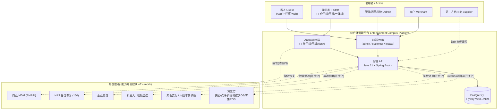
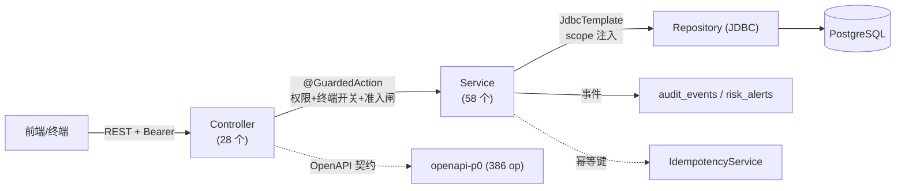
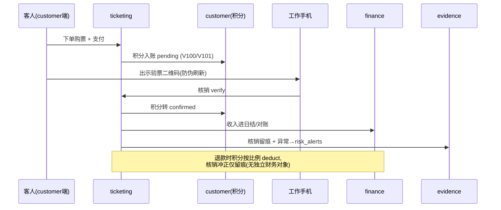
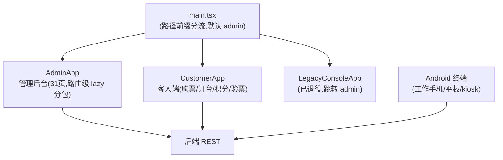

# 架构总览 / Architecture Overview V0.1

> 文档goalP2(2026-06-20)：本文为综合体管理系统的架构总览与架构图集（Mermaid，GitHub 可渲染）。模块名以 `backend/src/main/java/com/complex/platform/*` 真实包、`apps/web/src/*` 真实壳、`docs/openapi/openapi-p0.*` 契约为准。新功能承接见 `docs/v099-v124-feature-implementation-and-acceptance-spec-v0.1.md`。

## 1. 系统上下文（System Context）

## 2. 后端域模块地图（Backend Domain Modules）

后端按业务域分包（`com.complex.platform.*`）。治理/网关为底座，业务域在其上，留痕/分析为横切。

> 模块对应代码包（实证）：`access` / `amusement` / `analytics` / `auth` / `bar` / `common` / `compliance` / `customer` / `evidence` / `finance` / `floorplan` / `gate` / `governance` / `integration` / `inventory` / `merchantbilling` / `merchantservice` / `ops` / `system` / `terminal` / `ticketing`。

## 3. 分层与数据流（Layering & Request Flow）

每个写动作经 `@GuardedAction`（权限点 + 终端开关 + 准入闸 AdmissionGuard）→ Service（业务+幂等+留痕）→ JDBC Repository（强制注入 merchant_id/project_id scope）→ PostgreSQL，并发布审计事件；异常进统一责任链 `risk_alerts`。

## 4. 关键业务链（示例：购票→核销→财务/留痕）

## 5. 前端与终端（Frontend & Terminals）

## 6. 交付闸口与验证（Delivery Gates）

`verify:delivery-gates`（约 50 子闸聚合）+ `verify:p0-contract` + `verify:tenant-isolation --strict` + 后端 `mvn test`（1251）+ 前端 `e2e`（42）+ semgrep。生产上线由 `verify:production-blockers` 把关（外部依赖未到位即阻断）。

---
版本：V0.1 ｜ 最后更新：2026-06-20 ｜ 状态：现行 ｜ 配套：`README.md` / `README.en.md` / `docs/documentation-map-v0.1.md`
