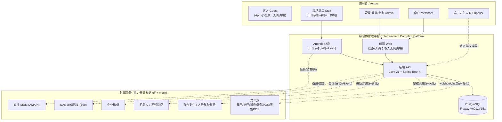
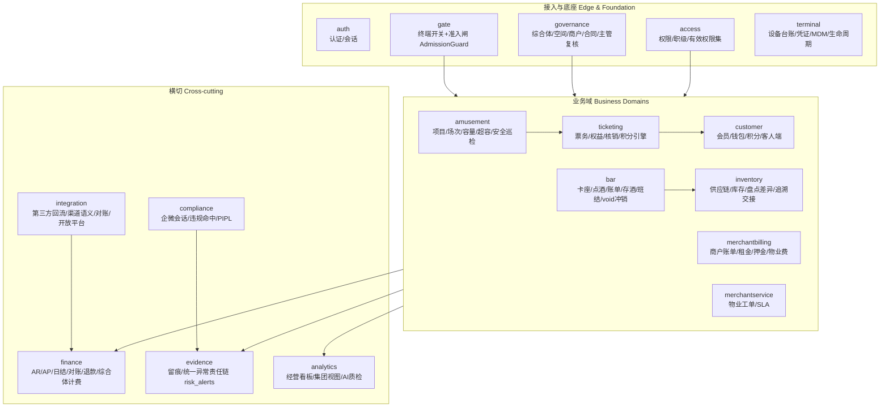
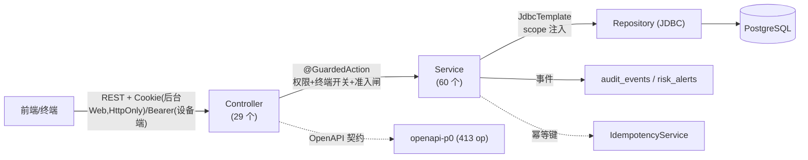
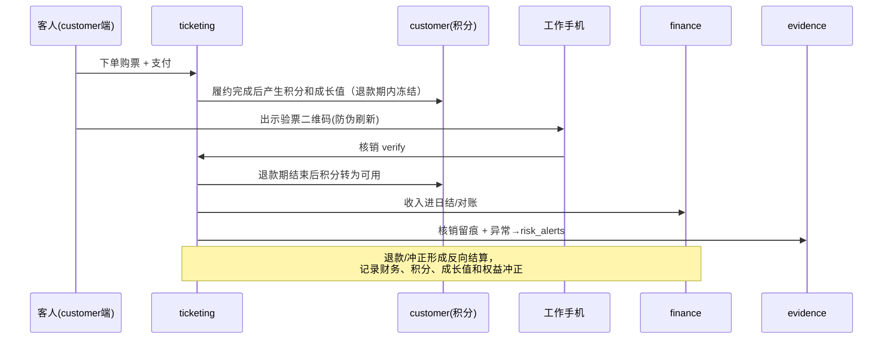
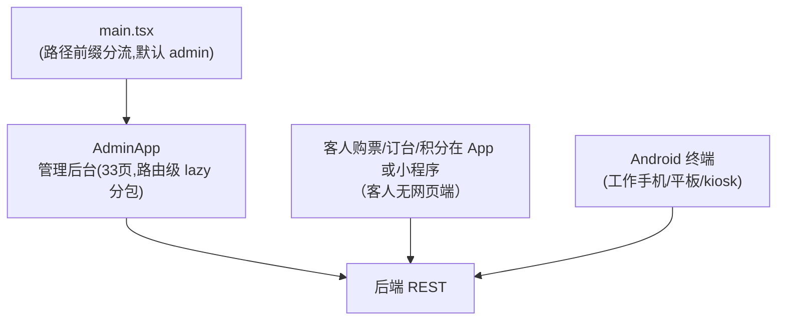

# 架构总览 / Architecture Overview V0.1

> 文档goalP2(2026-06-20)：本文为综合体管理系统的架构总览与架构图集（Mermaid，GitHub 可渲染）。**业务名称、子系统入口与终端边界以三份 HTML（业务系统地图、平台治理地图、业务枚举速查表）中经用户批准的内容为准**；发生冲突时 PRD、其他文档、代码包名、OpenAPI 契约、后台配置、设计和实现均不得覆盖。下列 Java 包、前端壳与 `openapi-p0` 仅为实现分包与工程契约，不是覆盖 HTML 的业务总图。新功能承接见 `docs/v099-v124-feature-implementation-and-acceptance-spec-v0.1.md`。

## 1. 系统上下文（System Context）

## 2. 后端代码分包（实现细化，不覆盖业务总图）

后端按代码包分包（`com.complex.platform.*`）。**下图英文包名是实现分包，不是与票务 / 酒吧并列的业务子系统闭集**，也不把 `merchantbilling` / `compliance` / `gate` 立成 HTML 子系统入口。业务总图以 MAP 子系统入口与 GOV 模块入口为准：基础管理、票务权益、客人端、酒吧平板/工作手机、触摸屏一体机、酒吧管理、供应链库存、游乐管理、商户管理、招商租赁、物业服务、楼宇运营、第三方接入、留痕与异常、财务对账、持股分红、经营看板、各类入口。平台治理层不是一个业务部门，而是所有业务的底座。

> 下列为代码包实证（实现细化，**不是**业务子系统闭集，不得覆盖 MAP/GOV 入口）：`access` / `amusement` / `analytics` / `auth` / `bar` / `common` / `compliance` / `customer` / `evidence` / `finance` / `floorplan` / `gate` / `governance` / `integration` / `inventory` / `merchantbilling` / `merchantservice` / `ops` / `system` / `terminal` / `ticketing`。

## 3. 分层与数据流（Layering & Request Flow）

每个写动作经 `@GuardedAction`（权限点 + 终端开关 + 准入闸 AdmissionGuard）→ Service（业务+幂等+留痕）→ JDBC Repository（强制注入 merchant_id/project_id scope）→ PostgreSQL，并发布审计事件；异常进统一责任链 `risk_alerts`。

## 4. 关键业务链（示例：购票→核销→财务/留痕）

## 5. 前端与终端（Frontend & Terminals）

## 6. 交付闸口与验证（Delivery Gates）

`verify:delivery-gates`（约 50 子闸聚合）+ `verify:p0-contract` + `verify:tenant-isolation --strict` + 后端 `mvn test`（1412）+ 前端 `e2e`（42）+ semgrep。生产上线由 `verify:production-blockers` 把关（外部依赖未到位即阻断）。

> 📌 **前端测试路径口径**：前端单测采用 **colocated 范式**——测试文件与被测源码同目录（`apps/web/src/**/*.test.tsx`，如 `apps/web/src/admin/pages/*.test.tsx`），由 vitest 就地发现。**`apps/web/tests` 不是正式测试目录**（当前为空 0 文件）；任何按 `apps/web/tests` 路径找前端测试而得出"无测试"的审计结论均为路径误判，应改查 colocated 的 `src/**/*.test.tsx`。前端 `e2e`（Playwright）另见 `playwright*.config.ts`。

---
版本：V0.1 ｜ 最后更新：2026-06-20 ｜ 状态：现行 ｜ 配套：`README.md` / `README.en.md` / `docs/documentation-map-v0.1.md`
