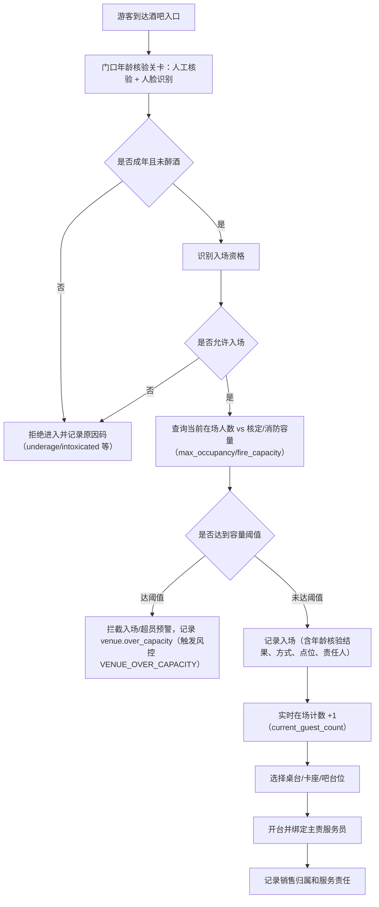
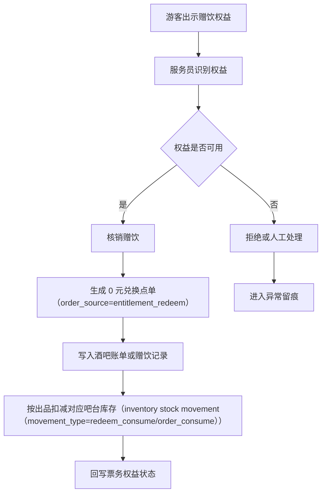
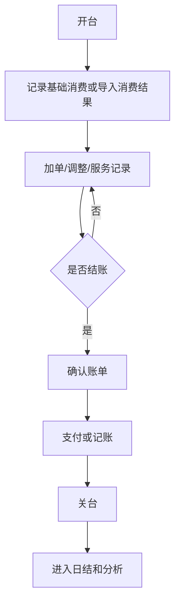
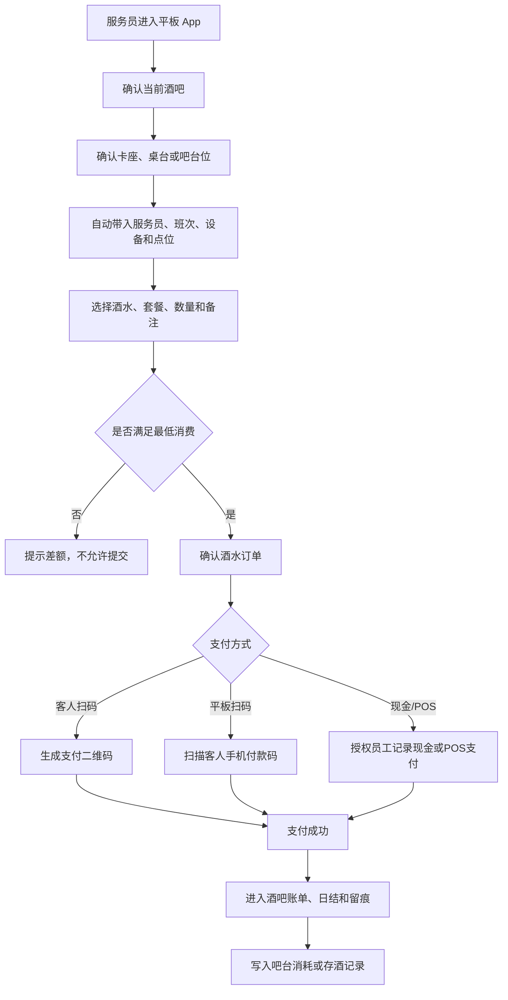
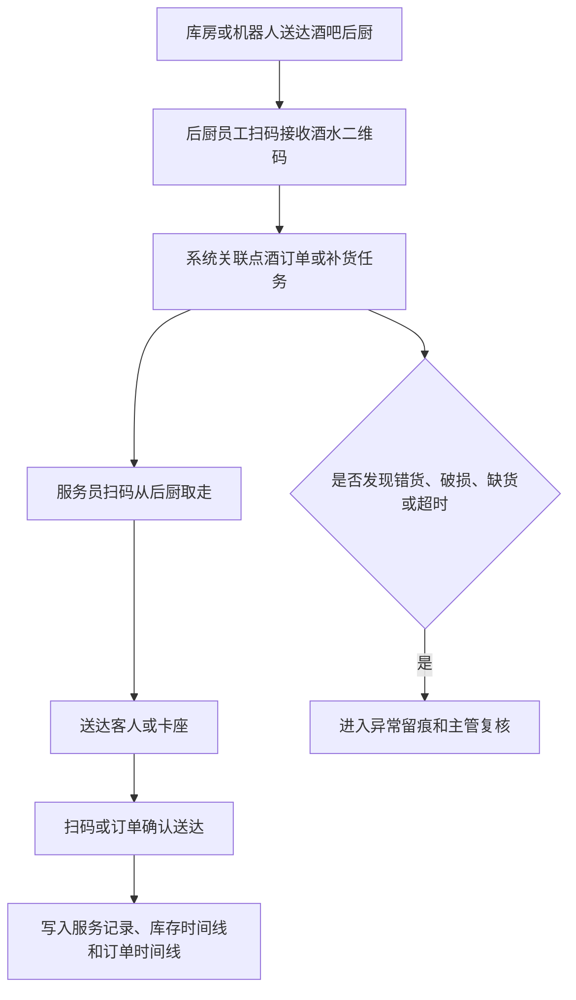
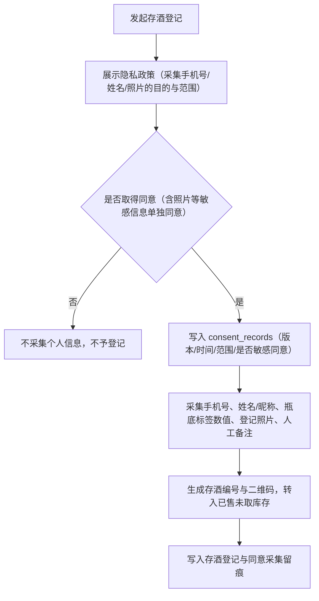

# 酒吧基础经营产品 PRD V0.1

## 1. 文档定位

本文档按酒吧真实经营过程拆解 P0 产品能力。它回答“游客如何入场、如何开台、如何消费、票务赠饮如何核销、如何结账关台、如何进入财务和分析”。

合作模式、合同、租金、联营、自营等基础关系归平台治理层管理；本文只描述酒吧经营发生后的现场业务动作。

## 2. P0 目标

酒吧 P0 目标是建立基础经营闭环：
- 能记录酒吧入场资格和入场事实。
- 能管理桌台、卡座、吧台位等现场经营单元。
- 能接收官方 App、小程序、触摸屏一体机和销售人员工作台产生的订台订单，并记录定金。
- 能记录订台和订单的销售归属、来源渠道、创建终端和责任人。
- 能通过工作人员平板 App 完成酒吧点酒下单、最低消费校验、支付和账单记录。
- 能记录卡座或桌台的主责服务员、协助服务员、加单人、送达人和服务责任变更。
- 能核销票务赠送的酒水权益。
- 能把吧台售卖、赠饮、兑换和出品形成的酒水消耗写入供应链库存。
- 能把客人喝不完或暂存的酒转入存酒管理。
- 能承接供应链的酒水二维码和交接留痕，记录后厨接收、服务员取走、送达客人或卡座。
- 能记录员工服务、异常调整、退款或免单原因。
- 能输出酒吧经营流水，进入日结、结算和分析。

业务边界：
- 工作人员平板 App 只允许做酒吧点酒下单，不允许帮助客人购买门票。
- 平板点酒必须先绑定具体酒吧，再绑定卡座、桌台或吧台位。
- 点酒下单必须满足最低消费规则，未满足最低消费时不能提交订单。
- 支付方式优先支持生成二维码供客人手机扫码支付，也支持平板扫描客人手机付款码完成支付；现场现金和 POS 机支付必须被允许，并写入账单、日结和对账。
- 供应商、供应合同、采购周期、库房、酒类、消耗品和其他物品的完整台账由供应链库存模块管理，酒吧系统只把点酒、赠饮、兑换、出品和存酒结果回写给供应链。

## 3. 角色

| 角色 | 关注重点 |
|---|---|
| 酒吧运营 | 桌台状态、开台关台、账单、服务异常 |
| 现场服务员 | 入场、开台、平板点酒、工作手机/一体机协同赠饮核销、关台 |
| 财务 | 酒吧收入、退款、免单、赠饮核销、差异 |
| 票务运营 | 赠饮权益是否正确核销 |
| 管理层 | 酒吧收入、翻台、客流、异常 |

## 4. 业务对象

| 对象 | 定义 | 关键关系 |
|---|---|---|
| 酒吧场地 | 酒吧经营区域 | 关联综合体空间、商户、合同 |
| 桌台/卡座/吧台位 | 可开台的现场经营单元 | 关联区域、状态、账单 |
| 入场记录 | 游客进入酒吧的事实 | 关联游客、票务权益、员工、时间、年龄核验结果与拒绝原因 |
| 订台订单 | 客人或销售发起的桌台/卡座预定 | 来源包括 App、小程序、一体机、销售人员，关联定金、到店、取消和退款 |
| 销售人员 | 可售卖卡座并承接客户维护、销售归属和提成统计的岗位 | 关联员工岗位、订台订单、卡座账单和提成记录 |
| 开台记录 | 某桌台开始服务 | 关联桌台、服务员、人数、时间 |
| 点酒订单 | 平板为某卡座或桌台创建的酒水订单 | 关联酒吧、卡座、服务员、最低消费、支付 |
| 服务责任链 | 一桌客人从订台、开台、点单、送达到关台的责任归属 | 关联销售人员、主责服务员、协助服务员、送达人和换人记录 |
| 吧台售卖消耗 | 按杯、按瓶、按套餐或其他形式售卖后形成的酒水消耗 | 关联供应链库存、吧台、订单、出品员工 |
| 酒水履约留痕 | 酒水从后厨到服务员再到客人或卡座的交接事实 | 关联供应链追踪码、点酒订单、后厨接收人、服务员、设备和时间 |
| 客人存酒 | 客人已购买但未喝完或暂存在场内的酒 | 关联手机号、姓名/昵称、瓶底标签数值、照片、人工备注、有效期；采集个人信息前须取得隐私同意（consent_records，合规 C2） |
| 酒吧账单 | 开台后形成的消费、调整和结账结果 | 关联桌台、订单、支付、退款 |
| 最低消费规则 | 某酒吧、卡座、位置和时间对应的最低消费要求 | 支持平日、周末、节假日和自定义时段；原则上不按人数计算 |
| 卡座预约入场名额 | 卡座预定者可携带的免通票入场人数 | 按卡座/桌台配置，仅限进入预定卡座所在酒吧，不抵扣低消 |
| 卡座销售提成 | 按卡座实际消费额计算的员工业务提成 | 销售人员 15%，非销售人员 10%；不含通票、票务权益、退款、免单和赠酒成本 |
| 赠饮权益 | 票务或活动赠送的酒水兑换权 | 关联票务权益和核销记录 |
| 服务记录 | 员工执行服务动作 | 关联员工、桌台、账单 |
| 账单调整 | 折扣、免单、抹零、补录、退款等 | 关联原因、责任人、复核 |
| 关台记录 | 桌台经营结束 | 关联账单、结账、异常 |

## 5. 桌台状态

> 修订说明（2026-06-07）：依《统一口径基准》D7「桌台 6 态权威集合」补英文 code，并与 bar-operations-development-design §4.1 对齐，消除两文档桌台状态命名/取值不一致（finding bar-5）。权威集合 = 空闲/已预留/已开台/待清台/停用/异常 → idle/reserved/opened/pending_clear/disabled/abnormal，不再用点位 active/inactive 顶替。

| 状态 | 英文 code | 含义 | 页面影响 |
|---|---|---|---|
| 空闲 | `idle` | 可开台 | 可选择开台 |
| 已预留 | `reserved` | 暂不可开台 | 显示预留信息 |
| 已开台 | `opened` | 正在服务 | 可加单、核销、结账 |
| 待清台 | `pending_clear` | 已结账但现场未完成清理 | 不可再次开台 |
| 停用 | `disabled` | 桌台暂不可用 | 不可开台 |
| 异常 | `abnormal` | 存在争议或未结事项 | 需要处理 |

## 6. 账单状态

> 修订说明（2026-06-07）：依《统一口径基准》D7「账单 6 态权威集合」补英文 code，并与 bar-operations-development-design §4.4 对齐（finding bar-5）。权威集合 = 待结/部分支付/已结/部分退款/已退款/异常 → unpaid/partial_paid/settled/partial_refunded/refunded/abnormal。原"进行中"为开台会话态，不属账单态，账单未支付统一用"待结(unpaid)"。

| 状态 | 英文 code | 含义 |
|---|---|---|
| 待结 | `unpaid` | 已确认消费，等待支付或确认 |
| 部分支付 | `partial_paid` | 混合支付或分次支付，已收部分金额 |
| 已结 | `settled` | 账单完成 |
| 部分退款 | `partial_refunded` | 部分金额退款 |
| 已退款 | `refunded` | 全额退款或账单冲销 |
| 异常 | `abnormal` | 存在争议、免单、补录或支付差异 |

## 7. P0 流程

### 7.1 入场到开台

> 修订说明（2026-06-07）：依合规决策 C1（见 `compliance-and-personal-information-protection-requirements-v0.1.md §2`，用户 2026-06-07 拍板）补"门口年龄核验关卡（人工核验 + 人脸识别）"。未成年判定即拒绝进入并记原因码，醉酒可人工拒售；点酒环节做二次复核（finding bar-1）。
>
> 修订说明（2026-06-07 收口）：依合规 C8（见 `compliance §9`）与 finding compliance-land-5/critic-8，在入场判定中补"**实时在场人数 vs 核定/消防容量卡控**"节点：入场前查询当前在场人数与 `max_occupancy`/`fire_capacity` 比对，达阈值拦截入场、临界值超员预警；并明确酒吧维护**实时在场计数**——每次成功入场计数 +1、离场（关台/客人离场登记）计数 −1，落 `bar_venues.current_guest_count`（见开发设计 §6.1）。超容触发风控规则 `VENUE_OVER_CAPACITY` 与事件 `venue.over_capacity`（权威字典 §4.1.4）。
>
> 修订说明（2026-06-10 收口）：门口人脸/年龄核验正式生产必须接入第三方人脸/年龄核验接口或等效设备。供应商未确定前只保留接口占位和测试 mock，不允许生产环境仅靠人工口头确认标记为正式通过。
>
> 修订说明（2026-06-08 三轮收口）：依 finding compliance-wired-4，明确容量卡控的 **P0 承载边界**——P0 仅做**酒吧场地级**卡控：以 `bar_venues.current_guest_count`（实时在场人数）对 `bar_venues.capacity`/`max_occupancy`（核定/消防容量）做比对，与 data-risk §10.9 `VENUE_OVER_CAPACITY` 触发口径（已对齐 `current_guest_count`）一致。**area/全场级实时在场聚合 P0 不做、列入 P1**：foundation areas/venues 仅有静态阈值 `max_occupancy`/`fire_capacity`，平台治理空间容量对象 P0 无实时在场字段承载；故下文"全场口径由平台治理空间容量汇总"为 P1 目标，P0 不做无承载的全场/area 聚合声称。

> 离场计数：客人离场登记或关台时，实时在场计数 −1（`current_guest_count`），保证在场人数与容量卡控口径准确。**P0 容量卡控仅到酒吧场地级**（`bar_venues.current_guest_count` vs `max_occupancy`/`fire_capacity`）；area/全场级实时在场汇总为 **P1**——届时由平台治理空间容量对象补实时在场字段、由酒吧/各点位上报本场地实时在场数汇总（合规 C8）。<!-- 改（2026-06-08 三轮收口）：finding compliance-wired-4，把"全场口径由平台治理空间容量汇总"降调为 P1（平台治理 P0 无实时在场字段承载），消除无承载的全场/area 聚合声称；P0 明确仅场地级卡控，与 data-risk §10.9 current_guest_count 对齐 -->

### 7.2 赠饮权益核销

> 修订说明（2026-06-07）：把"赠饮/兑换核销→0 元兑换点单→吧台库存扣减"补为确定闭环（P0），消除原"是否生成 0 元点单"待决歧义（finding bar-7，见开发设计 §7.8/§15 已确认项）。

### 7.3 开台到关台

### 7.4 平板点酒下单

### 7.5 酒水后厨接收到送达

### 7.6 客人存酒登记

> 修订说明（2026-06-07 收口）：依合规 C2（见 `compliance §3`，PIPL 收集个人信息前须告知同意）与 finding compliance-land-2，存酒登记同属个人信息收集入口（采集手机号、姓名/昵称、照片），原流程缺同意采集节点，现补"**展示隐私政策并取得同意后再采集**"前置节点，与客人端登录/购票口径一致；同意记录写入 `consent_records`（`consent_scope` 含存酒登记，照片属敏感个人信息须单独同意 `is_sensitive_consent=true`），`consent_channel` 取采集终端（如 staff 平板代登记则记录代填来源）。

## 8. 页面清单

| 页面 | P0 内容 |
|---|---|
| 酒吧经营总览 | 今日入场、开台、营收、赠饮、异常 |
| 酒吧入场 | 入场资格识别、门口年龄核验（人工+人脸识别）、入场记录、拒绝原因码（含 underage/intoxicated）、实时在场人数 vs 核定/消防容量卡控与超员预警 |
| 桌台看板 | 空闲、已开台、待清台、异常状态 |
| 订台管理 | App、小程序、一体机、销售人员订台，定金、到店、取消、退款 |
| 开台/关台 | 开台信息、服务员、人数、关台确认 |
| 服务责任链 | 销售归属、主责服务员、协助服务员、加单人、送达人、换人记录 |
| 卡座销售提成 | 卡座销售归属、消费额基数、销售人员/非销售人员倍率、提成台账、冲正复核 |
| 平板点酒 | 当前酒吧、卡座/桌台、酒水、套餐、数量、备注 |
| 吧台售卖消耗 | 按杯、按瓶、按套餐或其他形式形成消耗 |
| 酒水履约留痕 | 后厨接收、服务员取走、送达客人、异常原因 |
| 客人存酒 | 隐私政策展示与同意采集（含照片敏感信息单独同意）、瓶底标签、标签数值、手机号、姓名/昵称、拍照、备注、取酒、有效期、作废 |
| 最低消费校验 | 当前金额、最低消费、差额提示、是否可提交 |
| 支付处理 | 支付二维码、扫描客人付款码、现金、POS 机、支付状态 |
| 酒吧账单 | 消费记录、点酒明细、赠饮、调整、结账状态 |
| 赠饮核销 | 票务赠饮权益识别和核销记录 |
| 服务记录 | 服务员动作、备注、异常说明 |
| 酒吧异常 | 免单、退款、争议、补录、待复核 |

## 9. P0 验收标准

- 桌台状态可支撑开台、服务、结账、待清台和异常。
- 酒吧入场记录能关联游客、票务权益、员工和时间。
- 门口年龄核验（人工核验 + 人脸识别）能判定成年与否，未成年判定即拒绝进入并记录原因码（underage），醉酒可人工拒售（intoxicated），核验方式/责任人/点位/时间进入事件留痕；点酒环节做二次复核。正式生产必须接入第三方人脸/年龄核验接口或等效设备，供应商未配置时只能测试模拟，不能标记正式通过。<!-- 增（2026-06-07）：依合规 C1 落地售酒年龄核验 P0 验收，finding bar-1；2026-06-10 收口补供应商生产阻断 -->
- 赠饮/兑换权益核销后必须生成 0 元兑换点单并相应扣减对应吧台库存（库存可演示减少）。<!-- 增（2026-06-07）：finding bar-7，赠饮核销打通库存闭环 -->
- 现金/POS 机支付的进账必须记录收款人，POS 支付必须记录 POS 流水号，并进入账单、日结和对账。<!-- 增（2026-06-07）：finding bar-3，现金/POS 为 P0，补收款人/POS 流水号 -->
- 按杯销售必须按后台配置的每杯标准出酒量扣减，记录单次实际出酒量，实际超标准容量部分记为损耗，损耗超阈值生成损耗异常事件供核查。<!-- 增（2026-06-07）：finding bar-2，按杯标准出酒量/实际出量/损耗阈值落地 -->
- 高价值酒水报损、盘点差异和存酒作废必须同时上传照片和视频双证据并主管复核。<!-- 增（2026-06-07）：finding supply-3，高价值双证据强制 -->
- 订台订单能从 App、小程序、一体机和销售人员工作台进入酒吧账台，并记录定金。
- 订台和订单能记录来源渠道、销售人员、创建终端和支付结果。
- 销售人员岗位可作为卡座销售归属；销售人员售卖卡座按该卡座消费额 15% 生成提成记录，非销售人员归属卡座销售时按 10% 生成提成记录。
- 卡座提成基数只取酒吧卡座账单实收可计提消费额，不含通票、票务权益、卡座预约入场名额、赠酒成本、退款、免单、抹零和不可计提调整。
- 平板点酒必须绑定酒吧、卡座/桌台、服务员、班次和设备。
- 开台、加单、送达、换服务员和关台必须形成服务责任链。
- 平板点酒必须校验最低消费，未满足时不能提交订单。
- 票务权益、通票和卡座预约入场名额不得抵扣最低消费；低消只按酒吧实际点单、套餐、简餐等可计入消费金额计算。
- 卡座预定者可按卡座配置的入场名额携客免通票进入预定卡座所在酒吧；不同卡座名额可不同，超出名额或进入其他酒吧必须按正常票务/入场规则处理。
- 平板点酒支持生成支付二维码和扫描客人付款码；现金和 POS 机支付必须允许并进入账单、日结和对账。
- 吧台售卖、赠饮、兑换和出品必须形成供应链消耗记录。
- 后厨接收、服务员取走、送达客人或卡座必须通过扫码、设备确认或订单确认留痕。
- 客人存酒必须可登记、查询、取酒和作废，登记时保留瓶底标签数值、照片、人工备注、手机号和姓名/昵称，并能进入异常复核。
- 存酒登记在采集手机号/姓名/照片前必须展示隐私政策并取得同意（照片等敏感信息单独同意），同意记录写入 `consent_records` 可供事后举证；未同意不得采集个人信息、不予登记。<!-- 增（2026-06-07 收口）：finding compliance-land-2、合规 C2，存酒登记补 PIPL 收集前同意 -->
- 酒吧入场必须对当前实时在场人数与核定/消防容量（`max_occupancy`/`fire_capacity`）做卡控：达阈值拦截入场或超员预警，入场 +1、离场 −1 维护实时在场计数（`current_guest_count`），超容触发风控规则与事件。<!-- 增（2026-06-07 收口）：finding compliance-land-5、合规 C8，酒吧入场容量卡控 P0 -->

- 平板不得用于门票购买。
- 赠饮权益核销必须回写票务权益状态。
- 酒吧账单至少能记录点酒明细、金额、赠饮、调整、结账和异常。
- 免单、退款、人工调整必须记录原因和责任人。
- 关台后桌台可回到空闲或待清台。
- 酒吧经营数据能进入财务日结和经营看板。

## 10. P1/P2

| 阶段 | 能力 |
|---|---|
| P1 | 安全库存、保质期预警、复杂杯卖扣减、预约、营销套餐、复杂低消策略 |
| P2 | 智能排台、消费预测、自动补货、供应商评分、服务质量分析、会员偏好分析 |

### 10.1 成熟 POS 深度缺口规划（对照成熟酒吧/餐饮 POS）

> 说明（2026-06-18 新增）：本节对照成熟餐饮/酒吧 POS（Oracle Simphony、Toast、Lightspeed Restaurant 等）逐项标注本项目尚缺的"出品后/结账后"深度能力。除注明者外**统一标 P2**（P0 先把现场经营事实管住，见 §12 本版结论）；其中**反结/退酒涉及已出品资金回退，标 `【待业务最终确认：是否升 P1】`**。本节为产品演进规划，不作为 P0 编码入口；任一项要进入 P0/P1 须回当前有效入口与 OpenAPI 契约确认。

| 能力 | 业务链价值 | 市场参考理由 | 验收口径（粗） | 优先级 |
|---|---|---|---|---|
| 退菜退酒（出品前/出品后撤单） | 客人临时取消、上错品、口味不符时可规范撤单，避免账单与库存虚高、避免私下抹账 | 成熟 POS 标配"void/return item"，区分出品前撤单（不计库存损耗）与出品后退品（计损耗或归责），并强制原因码+权限 | 可对单项明细发起退菜退酒，记录原因/责任人/是否已出品；已出品退品按损耗或归责处理并回写库存；账单金额相应回退且留痕 | P2 |
| 反结 / 作废已结账单（re-open / void settled bill） | 结错账、支付方式记错、需追加消费时可重开已结账单，避免开新单导致翻台/营收口径错乱 | 成熟 POS 提供"re-open check / void closed check"，强制主管权限+原因+审计，并冲正原支付与日结 | 已结账单可在授权下反结回 `unpaid`/`partial_paid` 或整单作废，原支付按 §6 退款/冲正处理，日结与对账同步冲正，全程留痕+主管复核 | P2 `【待业务最终确认：是否升 P1】`（涉及已出品资金回退） |
| 退酒（已出品酒水资金回退） | 已出品酒水因质量/客诉需退，涉及实际资金回退与库存/损耗归属 | 成熟 POS 把"已出品退品"与"未出品撤单"严格分流，前者必须走退款冲正+损耗/责任归属 | 已出品酒水可发起退酒，触发退款冲正、库存损耗或责任归属、主管复核，账单与日结同步 | P2 `【待业务最终确认：是否升 P1】`（涉及已出品资金回退） |
| 沽清 / 估清（86 / out-of-stock 标记） | 售罄商品实时下架，避免服务员点了无法出品、避免客诉与退单 | 成熟 POS 的"86 list / out-of-stock"让前台即时看到不可售商品并阻止下单 | 商品可手工或按库存阈值标记沽清/估清，平板与下单端即时隐藏或禁选，恢复供应可解除；标记/解除留痕 | P2 |
| 小费（tip） | 支持客人给服务员小费并入账、归属与分配，提升服务积极性 | 成熟 POS 普遍内置 tip（固定额/比例/自定义），并支持小费归属与交班结算 | 结账时可录入小费（额/比例），计入支付与账单、归属服务员、进交班/日结对账；小费不计入低消与提成基数（除非另配） | P2 |
| 独立交班 / 班结对账（shift close / cash drawer reconciliation） | 按班次/收银员对现金、POS、扫码、小费做交接对账，定位差异、明确责任 | 成熟 POS 的"shift report / cash drawer reconciliation"是现金管理与防损核心 | 可按班次/收银员发起交班，汇总各支付方式应收 vs 实收、现金抽屉点钞、差异登记与责任归属，生成班结报表进对账 | P2 |

<!-- 修正(2026-06-19 R5业务HTML缺口审计 F1/F3)：依据 business-system-map-for-operations-v0.1.html #supply 与 matrix-migration-claims.json -->
> **⚠️ §10.1 交班/班结对账（cash drawer）口径收口（2026-06-19，就地追加不删原表）**
> 上表"独立交班/班结对账"原标 **P2**，但该能力已由 `backend/src/main/resources/db/migration/V095__bar_shift_handover.sql` + `BarShiftService` **落地**（按收银员/吧台收银班次：`opening_cash`/`declared_cash`/`system_cash`/`cash_diff`/`needs_review` 状态机；现金差异 = 实点 −（备用金 + 系统现金应收），超阈值标记 `needs_review` 进复核；并对 POS/扫码聚合/退款/小费等分通道快照对账）。**本 PRD 口径升级为 P0 已交付**（依据 `matrix-migration-claims.json` 2026-06-19 V095 条目），不再作为 P2 规划项。
> - **仍缺 G/W/T 验收**：当前为代码+迁移落地，端到端 Given/When/Then 验收尚未补齐。
> - **验收口径**：开班记备用金（`opening_cash`）→班结录实点现金（`declared_cash`，含备用金）→系统算现金差异（`cash_diff` = 实点 −（备用金 + 系统现金应收 `system_cash`））→超阈值进复核（`needs_review`）。
> - **待业务确认**：现金差异阈值默认值（当前 0=任何差异即标记 `needs_review`）是否符合业务，是否需要按门店/班次配置容差区间。

### 10.2 出品后异常与沽清（优先级收口）`R6 全闭环(2026-06-19)`

> 说明（2026-06-19 新增，R6 全闭环）：本小节承接 `business-decision-log-v0.1.md` R6-D14（退菜/退酒、反结升 P0；沽清 86 保持 P1）对 §10.1 成熟 POS 深度缺口的优先级收口。原 §10.1 把退菜退酒、反结、退酒统一标 P2 并附"待业务最终确认是否升 P1"；R6-D14 已最终拍板将其**直接升 P0**（成熟酒吧 POS 必备的"出品后/结账后"资金与库存回退能力，不升 P0 会导致私下抹账、营收/库存口径错乱）。<!-- R6 业务确认回填(2026-06-19) --> **业务确认(2026-06-19)：沽清 86 一并升 P0**——R6-D14 最终为"退菜/退酒、反结、沽清 86 三项全升 P0"，原"沽清 86 保持 P1"口径已被覆盖（沽清虽非资金回退，但临时不可售状态直接影响点单可售口径与库存准确性，纳入 P0 同批交付，需补 G/W/T 验收）。本小节为业务规则与验收口径权威，开发落地见 `bar-operations-development-design.md` §17。
>
> 注（依据据实标注）：经核 `backend/.../db/migration/V091__bar_pos_depth.sql` 与 `BarController`/`BarService`，退菜退酒、反结、沽清 86 已先行落库并暴露端点（`void-item`/`reopen`/`sold-out`）；故本小节的"升 P0"是把**优先级与业务规则口径**正式收口为 P0，并补 G/W/T 验收，而非从零开发。

#### 10.2.1 退菜/退酒（出品后撤单）升 P0 `R6-D14`

- **业务规则**
  - 撤单必须三要素齐备：**原因码 + 操作权限 + 是否退回库存判定**。任一缺失拒绝撤单。
  - **出品前撤单（cancel，明细未出品）**：明细处于未出品态（pending），撤单不计库存损耗、不产生实际出酒消耗；账单相应金额回退。
  - **出品后退品（return，已出品 served/delivered）**：必须判定库存处置——
    - **未动可回库**：整杯/整瓶未开封未动用，可标记回库（return_to_stock=true），库存回补；
    - **已出品损耗**：已开封/已制作/已倒出无法回库，记为损耗（return_to_stock=false），按损耗或责任归属处理，不回补库存。
  - 撤单必须留痕原因、责任人、是否已出品、是否回库、关联账单调整。已结账单上的明细退品须先经反结（见 §10.2.2）或走退款冲正。
  - 高价值酒水退品（退酒）涉及实际资金回退，按 §6 退款/冲正口径处理，并按高价值规则要求证据与主管复核。
- **权限**：撤单为高危动作，需具备退菜退酒权限（`bar.order_item.void`）；高价值退酒须主管审批。
- **R6-D14 默认值**
  - 出品状态 → 库存处置默认判定：`pending` 默认不计损耗；`served/delivered` 默认 `return_to_stock=false`（计损耗），需操作人显式勾选"未动可回库"才回补库存（默认从严，防止已出品酒水被误回库刷库存）。
  - 撤单默认 `approval_required=true`（默认需审批留痕）；低值且出品前撤单可按后台配置降为免审批。
- **验收口径（G/W/T 粗口径）**
  - 可对单项明细发起退菜/退酒，记录原因/责任人/是否已出品/是否回库；
  - 出品前撤单不产生库存损耗、账单金额回退可演示；
  - 出品后退品：勾选"未动可回库"则库存回补可演示，否则记损耗不回补；
  - 退酒涉及资金回退时退款/冲正进账单、日结与对账同步，全程留痕。

#### 10.2.2 反结已结账单升 P0 `R6-D14`

- **业务规则**
  - 已结账单（`settled`）可在授权下 **reopen 反结**回 `unpaid`/`partial_paid`，或整单作废，用于结错账、支付方式记错、需追加消费等场景，避免另开新单导致翻台/营收口径错乱。
  - 反结必须：**主管审批 + 留痕（原因/审批人/时点）+ 财务联动**。原支付按 §6 退款/冲正处理，日结与对账同步冲正。
  - 反结与日结锁定协同：已进入日结锁定期的账单反结须按财务冲正口径处理，不得直接改写已锁定日结数据。
- **权限**：反结为高危动作，需主管级反结权限（`bar.bill.reopen`），并强制主管审批节点。
- **R6-D14 默认值**
  - 反结默认 `approval_required=true`（默认强制主管审批，不可免审批）；
  - 反结后默认回退至 `unpaid`（或按已收金额回 `partial_paid`），不默认整单作废；整单作废须显式选择并单独审批。
- **验收口径（G/W/T 粗口径）**
  - 已结账单在授权+主管审批下可反结回 `unpaid`/`partial_paid` 或整单作废；
  - 原支付按退款/冲正处理，日结与对账同步冲正可对账；
  - 反结全程留痕（原因/审批人/时点）可事后举证。

#### 10.2.3 沽清 86 升 P0 `R6-D14`

- **业务规则**
  - 商品可手工或按库存阈值标记**沽清/估清（86 / out_of_stock）临时不可售状态**，平板与下单端即时隐藏或禁选该商品，阻止服务员点了无法出品；恢复供应可解除沽清。
  - 沽清/解除均须留痕（操作人、时点、原因/触发方式）。
- **业务确认(2026-06-19)** `R6 业务确认回填(2026-06-19)`：沽清 86 **升 P0**（R6-D14 三项全升 P0），与退菜退酒/反结同批 P0 交付；原"保持 P1"口径按业务确认覆盖。
- **优先级**：~~保持 P1（非资金回退、临时状态）~~ → **升 P0**（见上方业务确认），与退菜退酒/反结同批 P0 交付。
- **R6-D14 默认值**：沽清默认手工标记优先；按库存阈值自动沽清作为配置项（阈值后台可配）。
- **验收口径（G/W/T 粗口径）**：商品可标记沽清→下单端即时禁选/隐藏（下单被 `PRODUCT_SOLD_OUT` 拒）→恢复供应可解除；标记/解除留痕。

## 11. 已确认规则和后续细化事项

已确认：

1. 订台入口包括官方 App、小程序、触摸屏一体机和销售人员工作台，订台需要支付定金。
2. 吧台买酒和点酒优先线上支付，同时必须允许现金和 POS 机支付，并进入账单、日结和对账。
3. 客人存酒按瓶底标签数值、拍照、人工备注、手机号和姓名/昵称管理。
4. 酒吧 P0 点酒必须记录每一项商品明细、数量、金额、出品员工和订单状态。
5. 最低消费按时间、卡座和位置配置，支持平日、周末、节假日和自定义时段；**P0 一律不按人数计算**，`guest_count` 仅记录、不参与低消计算；"原则上"的按人数例外作为后置扩展（见开发设计 §5.2.2）。<!-- 改（2026-06-07）：finding bar-6，明确 P0 不按人数、guest_count 仅记录、例外后置 -->
5a. 票务权益、通票和卡座预约入场名额**不允许抵扣最低消费**；卡座预约入场名额只解决预定卡座所在酒吧的入场资格，不生成票务通票权益，不参与低消和票务分账。
5b. 新增销售人员岗位：销售人员售卖卡座时，按该卡座消费额 15% 计算业务提成；非销售人员售卖或被归属为卡座销售时，按该卡座消费额 10% 计算业务提成。提成仅针对卡座消费，不含通票、票务权益、卡座预约入场名额、赠酒成本、退款、免单和不可计提调整。
6. 吧台按杯销售按后台配置的每杯标准出酒量/容量（`standard_pour_volume`）扣减库存，记录单次实际出酒量（`actual_pour_volume`），超出标准容量的部分记为损耗（`loss_volume=实际-标准`），损耗超阈值（`loss_threshold`）时生成损耗异常事件进入异常核查。<!-- 改（2026-06-07）：finding bar-2，承接标准出酒量/实际出量/损耗阈值字段 -->
7. 免单、账单调整、人工放行、退款和调账按后台配置的审批层级主管复核。
8. 高价值酒水报损、盘点差异和存酒作废必须**同时拍照和视频（双证据）**留证，并主管复核。<!-- 改（2026-06-07）：finding supply-3，把"拍照/视频"斜杠歧义改为"拍照和视频"双证据，与决策口径一致 -->
9. 酒水从库房或机器人送达后厨、服务员取走、送达客人或卡座的全过程必须留痕。
10. 订单获取、销售归属、卡座服务、加单送达、服务责任变更和异常第一处理人必须留痕，优先由平板、工作手机、登录账号、班次和点位自动生成。

后续细化：

无方向性悬空事项。已确认按以下口径执行：

1. 酒吧允许存在多个合作主体，但必须通过经营对象/运营主体/合同主体/结算主体的唯一绑定关系和合同授权范围控制。票务权益 P0 默认绑定明确酒吧/商户/经营对象；跨主体共享权益必须有显式授权关系和结算口径，不得默认共享。
2. 赠饮权益 P0 必须绑定可扣库存的酒水 SKU、酒水品类或可选 SKU 集合。若配置为“品类券”，核销出品时必须在允许范围内选择具体 SKU 后再扣减吧台库存。

## 11A. 出品成本采集与 void 驳回冲销能力补充 `文档goalP1(2026-06-20)`

> 本节为产品语言的能力描述 + 业务规则 + 验收口径要点；可开发 + 可验收的权威细节（迁移号、operationId、`x-permission`、事件常量、错误码、G/W/T）以 `docs/v099-v124-feature-implementation-and-acceptance-spec-v0.1.md` 为准（本节对应该文第 5 项「pour cost 强制采集」、第 17 项「void 驳回反向冲销」）。先经 grep 后端/迁移核实功能真实存在再写。

### 11A.1 pour cost 出品成本强制采集（按杯必采 actual_pour_volume）（权威：spec §5）

能力描述：承接 §9 与 §11 已确认第 6 条「按杯标准出酒量/实际出量/损耗阈值」，明确按杯出品时**实际倒酒量为强制采集项**，消除"不传则 loss=0"的静默绕过。经 grep 实证落于服务层 `BarOrderService`（按杯出品 + actual/standard 比对 + 损耗异常）。

业务规则：
- **拒绝模式（默认，从严）**：商品配置了每杯标准出酒量（按杯出品）时，出品/结算缺 `actual_pour_volume` → **直接拒单**（错误码 `POUR_VOLUME_REQUIRED`），不允许无实际出量提交。
- **标准量兜底模式（后台开关）**：缺量时按 `standard_pour_volume × quantity` 计、loss=0，但**必落损耗异常事件**（reason=`pour_volume_fallback`），把"缺量"显式留痕为可核查异常，而非静默归零。
- 非按杯出品项（未配置标准出酒量）：维持原行为，loss=0，不强制采集。
- 已采集且实际 > 标准：记损耗（`loss_volume = actual − standard`），超阈值落损耗异常供核查（与 §11 第 6 条一致）。

验收口径要点（细化 G/W/T 见 spec §5）：
- 按杯商品 + 拒绝模式 + 不传 actual_pour_volume → 拒单（`POUR_VOLUME_REQUIRED`）。
- 按杯商品 + 兜底模式 + 缺量 → 按标准量计、loss=0，落损耗异常（reason=pour_volume_fallback）。
- 按杯出品 actual > standard → 记损耗，超阈值落损耗异常。

> 待业务确认（bar）：拒绝模式 vs 兜底模式的默认值（当前默认拒绝模式从严）是否符合各门店运营，是否需按门店/班次配置；以及损耗阈值默认值口径（与 §11 第 6 条 loss_threshold 联动）。

### 11A.2 void 驳回反向冲销（退菜退酒驳回 → 对称回滚）（权威：spec §17，V117 + V124）

能力描述：承接 §10.2.1 退菜退酒 P0（R6-D14），补全"**void 被驳回时把已施加副作用对称回滚、恢复到 void 前状态**"的闭环。经 grep 实证：发起 void（`voidBarOrderItem`）时同步施加副作用（库存回补、账单减项 waiver、已结退款过账 refund）并落 pending；审批决策（`decideBarOrderItemVoid`）若**驳回（rejected）= void 无效**，则按对称冲销回滚。迁移 `V124` 把账单调整类型扩出 `waiver_reversal` / `refund_reversal`。

业务规则（驳回对称回滚）：
- **未结账单**：原减项为 waiver（让免）→ 驳回写一条 `waiver_reversal`（加回应付，不带退款时点），库存对称回补回滚，恢复 void 前账单。
- **已结账单**：原减项为 refund（已过账退款）→ 驳回写一条 `refund_reversal`（加回应付 + 对冲退款应收，带退款时点落经营日窗口）；经营日净额按 `refund − refund_reversal` 归集使退款净额归零，**不重复计入退款额**。
- 退菜退酒为高危动作（`bar.order_item.void`，发起 + 决策同权限），高价值退酒须主管审批（与 §10.2.1 一致）；驳回全程留痕（原因/审批人/时点）。

验收口径要点（细化 G/W/T 见 spec §17）：
- 未结账单退酒 void 已施加 waiver、流水 pending → 驳回 → 写 `waiver_reversal` 加回应付、库存回补对称回滚。
- 已结账单退酒 void 已过账 refund → 驳回 → 写 `refund_reversal`（加回应付 + 带退款时点），经营日 refund 净额归零、不重复计退款。
- `refund_reversal` 缺退款时点 → 被 DB CHECK 拒绝（refund/refund_reversal 必带退款时点，其余类型不得带）。

## 12. 本版结论

酒吧 P0 先把现场经营事实管住：入场（含门口年龄核验）、订台定金、销售归属、桌台/卡座、服务责任、平板点酒、最低消费、线上支付、现金/POS 机支付、赠饮核销、吧台售卖消耗、酒水履约交接、客人存酒、账单、关台和异常。复杂自动补货、复杂 BOM 和会员玩法可以后移，但点酒订单、销售和服务责任、赠饮权益、库存消耗、存酒、酒水送达和酒吧经营流水必须在 P0 进入统一经营口径。

## 13. 变更日志

| 日期 | 类型 | 位置 | 内容 | 原因/依据 |
|---|---|---|---|---|
| 2026-06-07 | 改 | §4 入场记录对象 | 关键关系补"年龄核验结果与拒绝原因" | finding bar-1 + 合规 C1 |
| 2026-06-07 | 改 | §5 桌台状态 | 补英文 code（idle/reserved/opened/pending_clear/disabled/abnormal），与开发设计 §4.1 对齐 | finding bar-5、基准 D7 |
| 2026-06-07 | 改 | §6 账单状态 | 补英文 code（unpaid/partial_paid/settled/partial_refunded/refunded/abnormal），"进行中"归为会话态 | finding bar-5、基准 D7 |
| 2026-06-07 | 改 | §7.1 入场到开台流程 | 增门口年龄核验关卡（人工+人脸识别），未成年/醉酒拒绝并记原因码 | finding bar-1 + 合规 C1 |
| 2026-06-07 | 改 | §7.2 赠饮权益核销流程 | 补"0 元兑换点单→吧台库存扣减"确定闭环 | finding bar-7 |
| 2026-06-07 | 改 | §8 页面清单（酒吧入场） | 增门口年龄核验、拒绝原因码 | finding bar-1 |
| 2026-06-07 | 增 | §9 P0 验收标准 | 增年龄核验、赠饮核销扣库存、现金/POS 收款人与流水号、按杯标准出量/损耗、高价值双证据 5 条 | finding bar-1/2/3/7、supply-3 |
| 2026-06-07 | 改 | §11 已确认第 5/6/8 条 | 明确 P0 不按人数；承接标准出酒量/实际出量/损耗阈值；"拍照/视频"改"拍照和视频"双证据 | finding bar-6/2、supply-3 |
| 2026-06-07 收口 | 改 | §7.1 入场到开台流程 | 补"实时在场人数 vs 核定/消防容量卡控+超员预警"节点，明确入场+1/离场−1 实时在场计数（current_guest_count），超容触发 VENUE_OVER_CAPACITY/venue.over_capacity | finding compliance-land-5/critic-8、合规 C8 |
| 2026-06-07 收口 | 增 | §7.6 客人存酒登记 | 新增存酒登记流程，补"采集手机号/姓名/照片前展示隐私政策并取得同意，写入 consent_records"节点（照片敏感信息单独同意） | finding compliance-land-2、合规 C2 |
| 2026-06-07 收口 | 改 | §4 客人存酒对象 / §8 客人存酒页 / §8 酒吧入场页 | 存酒补同意采集口径与隐私同意提示；入场页补容量卡控与超员预警 | finding compliance-land-2/5、合规 C2/C8 |
| 2026-06-07 收口 | 增 | §9 P0 验收标准 | 增"存酒登记收集前同意（consent_records）"与"入场实时在场容量卡控/超员预警"两条验收 | finding compliance-land-2/5、合规 C2/C8 |
| 2026-06-08 三轮收口 | 改 | §7.1 入场到开台 | 明确 P0 容量卡控仅酒吧场地级（`bar_venues.current_guest_count` vs `max_occupancy`/`fire_capacity`，对齐 data-risk §10.9）；area/全场级实时在场聚合降调为 P1（平台治理 P0 无实时在场字段承载），消除无承载的全场/area 聚合声称 | finding compliance-wired-4、合规 C8 |
| 2026-06-10 总控拍板 | 增/改 | §4/§9/§11 | 明确卡座预约可按卡座配置免通票入场名额，但仅限预定卡座所在酒吧；票务权益、通票和卡座预约入场名额不得抵扣低消 | 总控最新拍板 |
| 2026-06-10 卡座销售提成 | 增 | §4/§8/§9/§11 | 新增销售人员岗位与卡座提成口径：销售人员按卡座消费额 15%，非销售人员 10%，不含通票和票务权益 | 用户新增业务规则 |
| 2026-06-10 | 增/改 | §7.1 / §9 | 补酒吧年龄/人脸核验生产阻断：供应商未确定前只做接口和 mock，生产不得标记正式通过 | 用户确认酒吧年龄强制人脸且需第三方接口采购 |
| 2026-06-18 | 增 | §10.1 成熟 POS 深度缺口规划 | 新增对照成熟 POS 的退菜退酒、反结/作废已结账单、退酒、沽清估清、小费、独立交班/班结对账规划，统一标 P2；反结/退酒（涉及已出品资金回退）标"待业务最终确认是否升 P1" | D13 成熟 POS 缺口规划 |
| 2026-06-19 `R6 全闭环` | 增 | §10.2 出品后异常与沽清（优先级收口） | 承接 R6-D14：退菜/退酒（出品后撤单）、反结已结账单、沽清 86 三项全升 P0（业务确认 2026-06-19 覆盖原"沽清 86 保持 P1"；业务规则+G/W/T 验收）。据实标注 V091 已先行落库（void-item/reopen/sold-out 端点已暴露），本节为优先级与业务口径正式收口 | R6-D14（business-decision-log）、§10.1 成熟 POS 缺口 |
| 2026-06-20 `文档goalP1` | 增 | §11A | 新增「出品成本采集与 void 驳回冲销能力补充」：①pour cost 出品成本强制采集（按杯必采 actual_pour_volume，拒绝模式不传拒单 POUR_VOLUME_REQUIRED / 兜底模式标记 pour_volume_fallback 异常）②void 驳回反向冲销（V117/V124，驳回→对称回滚库存/账单/应付到 void 前，waiver_reversal/refund_reversal）。权威指向 v099-v124-feature-implementation-and-acceptance-spec-v0.1.md §5/§17 | 文档goalP1；grep 实证 BarOrderService（POUR_VOLUME_REQUIRED/pour_volume_fallback）+ V124（waiver_reversal/refund_reversal）+ decideBarOrderItemVoid |
