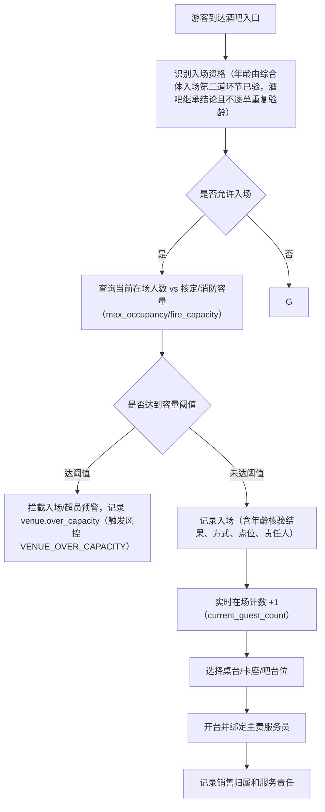
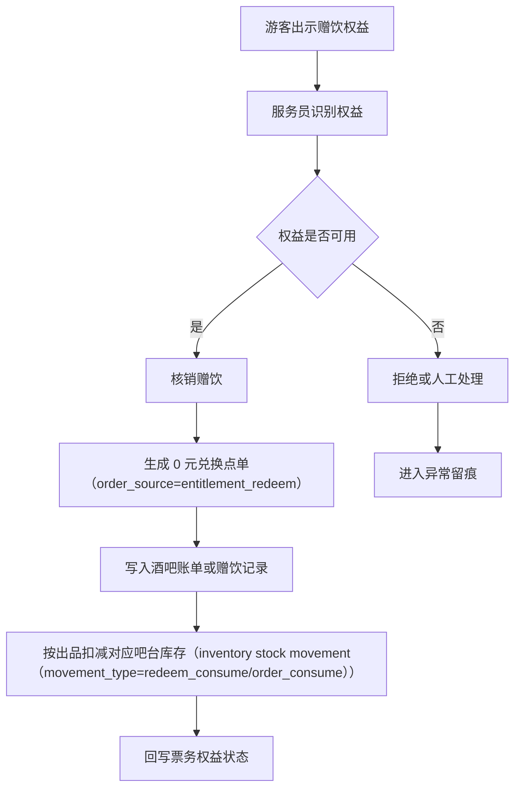
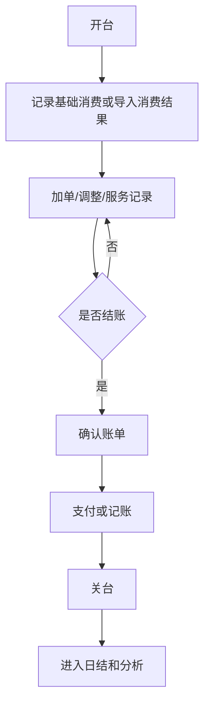
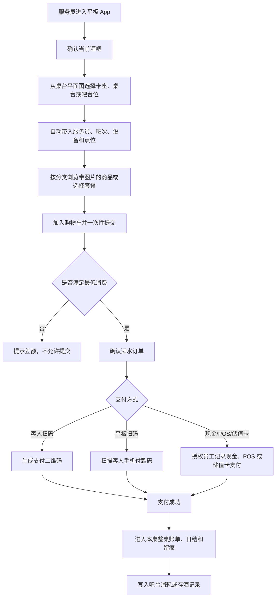
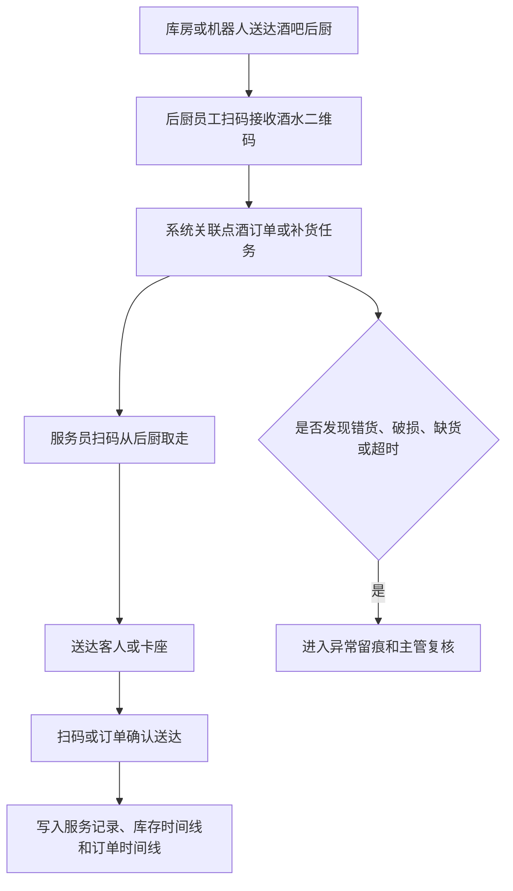
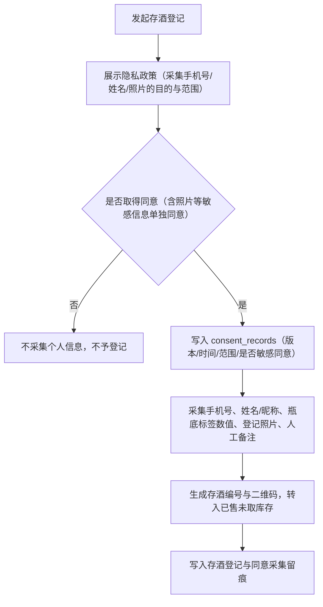

# 酒吧基础经营产品 PRD V0.18

> 权限边界：本 PRD 只提供产品细化；三份业务 HTML 拥有最终业务解释权。其他文档、配置、代码和数据结构均不得覆盖 HTML；HTML 未记载的新规则须经用户批准并写入 HTML 后方可生效。**三份 HTML 之间若出现冲突，按确认时间线判定：凡经用户确认过的内容，确认时间越晚的优先级越高，后确认的覆盖先确认的（以决策台账记录的裁决时间为准）；无法确定确认时间先后的，仍须逐项重新裁决**（2026-08-05 补，依据 PGM「解释权声明」条；DIFF-A-051）。

> 历史记录（其中③已被下方 2026-08-09 订正覆盖，现行口径以下方订正为准）：2026-07-04 逻辑一致性修订：①卡座提成率改后台可配（默认销售15%/非销售10%）；可计提类别按三份 HTML 的固定清单执行，不做后台可配②最低消费明确P0按时间/卡座/位置配置、不按人数计③pour cost拒绝/兜底开关明确按商品/商户维度配、损耗阈值参数化④免单/void会计凭证口径挪至结算PRD，本PRD只留流程与权限。

> 2026-07-22 拍板收口（D-20260722-8）：上条②原留的「按人数」可配活口取消——最低消费一律不按人数计，不设按人数的可配开关或例外（口径见 §11 已确认第 5 条）。

> 2026-08-09 订正（按 ENUM「点酒方式」条 / BSM 同条）：上条③作废——pour cost 不存在「拒绝/兜底」开关，也不按商品/商户维度配置；分支条件是**该吧台是否配有出酒量采集设备**这一物理事实，未配设备的一律按标准出酒量扣减并计标准损耗、**不得按零损耗记账**；损耗阈值粒度改为**按酒吧**（口径见 §11A.1）。

## 1. 文档定位

本文档按酒吧真实经营过程拆解 P0 产品能力。它回答“游客如何入场、如何开台、如何消费、票务赠饮如何核销、如何结账关台、如何进入财务和分析”。

酒吧门店只能从已经走完“招商租赁 → 合同 → 商户准入”的酒吧商户中选择并建立经营扩展，不单独凭空新建酒吧；合作模式只取自营、租赁、联营、代运营、服务商接入、其他。股权、经营牌照、场地和资金由平台治理层分别记录，经营牌照登记在实际经营法律主体名下，不得因持股自动推定牌照主体；本文只引用这些治理记录，描述酒吧经营发生后的现场业务动作。

## 2. P0 目标

酒吧 P0 目标是建立基础经营闭环：
- 能记录酒吧入场资格和入场事实。
- 能管理桌台、卡座、吧台位等现场经营单元。
- 能接收官方 App、小程序、触摸屏一体机和销售人员工作台产生的订台订单，并记录定金。
- 能记录订台和订单的销售归属、来源渠道、创建终端和责任人。
- 能通过工作人员平板 App 完成酒吧点酒下单、最低消费校验、支付和账单记录。
- 能记录卡座或桌台的主责服务员、协助服务员、加单人、送达人和服务责任变更。
- 能核销票务赠送的酒水权益。
- 能把吧台售卖、赠饮、兑换和出品形成的酒水消耗写入供应链库存。
- 能把客人喝不完或暂存的酒转入存酒管理。
- 能承接供应链的酒水二维码和交接留痕，记录后厨接收、服务员取走、送达客人或卡座。
- 能记录员工服务、异常调整、退款或免单原因。
- 能输出酒吧经营流水，进入日结、结算和分析。

业务边界：
- 工作人员平板 App 只允许做酒吧点酒下单，不允许帮助客人购买门票。
- 平板点酒必须先绑定具体酒吧，再绑定卡座、桌台或吧台位。
- 平板第一次使用先绑定员工所属酒吧，此后只服务该店；公司工作手机负责门票和权益扫码核销及企业微信工作沟通，必须现场完成的动作一律使用公司工作手机，员工私人手机不得用于现场动作。
- 触摸屏一体机可承接权益查询与领取、订台、吧台买酒和支付引导；只有启用售票能力的一体机才允许授权服务人员辅助售票，在酒吧门口或前台只能售卖本酒吧单店门票，不得售卖综合体通票。酒吧系统接收一体机产生的订台、吧台买酒、支付和权益状态，不接管票务出票。
- 公共经营大屏只展示匿名、聚合或非个人经营信息，不得展示可识别个人的消费金额、储值余额、充值情况或个人排行榜。
- 点酒下单必须满足最低消费规则：**本次下单后的累计消费金额**（**按打折前的订单消费金额累计**，见 §11 已确认第 5 条）必须达到该台位适用的最低消费，未达到的不允许提交订单（完整口径见 §11 已确认第 5 条）。
- 支付方式优先支持生成二维码供客人手机扫码支付，也支持平板扫描客人手机付款码完成支付；现场现金、POS 机和**储值卡**支付必须被允许，并写入账单、日结和对账（支付方式全清单与收款通则见 §6）。
- 供应商、供应合同、采购周期、库房、酒类、消耗品和其他物品的完整台账由供应链库存模块管理，酒吧系统只把点酒、赠饮、兑换、出品和存酒结果回写给供应链。

## 3. 角色

| 角色 | 关注重点 |
|---|---|
| 酒吧运营 | 桌台状态、开台关台、账单、服务异常 |
| 现场服务员 | 入场、开台、平板点酒、工作手机/一体机协同赠饮核销、关台 |
| 财务 | 酒吧收入、退款、免单、赠饮核销、差异 |
| 票务运营 | 赠饮权益是否正确核销 |
| 管理层 | 酒吧收入、翻台、客流、异常 |

## 4. 业务对象

| 对象 | 定义 | 关键关系 |
|---|---|---|
| 酒吧场地 | 酒吧经营区域 | 关联综合体空间、商户、合同 |
| 桌台/卡座/吧台位 | 可开台的现场经营单元 | 关联区域、状态、账单 |
| 入场记录 | 游客进入酒吧的事实 | 关联游客、票务权益、员工、时间、年龄核验结果与拒绝原因 |
| 订台订单 | 客人或销售发起的桌台/卡座预定 | 来源包括 App、小程序、一体机、销售人员，关联定金、到店、取消和退款 |
| 销售人员 | 可售卖卡座并承接客户维护、销售归属和提成统计的岗位 | **岗位以员工档案的「销售岗」标识承载**（V349 `staff_profiles.is_sales_position`，维护入口「人事 → 员工档案」ADM-STF-004，改动必填事由并留审计）；据此关联订台订单、卡座账单和提成记录 |
| 开台记录 | 某桌台开始服务 | 关联桌台、服务员、人数、时间；另记**客人来源**与**销售人员**——**开台记录中服务员与销售人员是两个独立字段**，来源四分支自动判定与人工兜底见 §7.1（2026-08-19 补，依据 BSM「记录卡座位置、服务员、人数、点酒明细、最低消费和账单状态」条现文；DEC-R8-97-28） |
| 点酒订单 | 平板为某卡座或桌台创建的酒水订单 | 关联酒吧、卡座、服务员、最低消费、支付 |
| 服务责任链 | 一桌客人从订台、开台、点单、送达到关台的责任归属 | 关联销售人员、主责服务员、协助服务员、送达人和换人记录 |
| 吧台售卖消耗 | 按杯、按瓶、按套餐或其他形式售卖后形成的酒水消耗 | 关联供应链库存、吧台、订单、出品员工 |
| 酒水履约留痕 | 酒水从后厨到服务员再到客人或卡座的交接事实 | 关联供应链追踪码、点酒订单、后厨接收人、服务员、设备和时间 |
| 客人存酒 | 客人已购买但未喝完或暂存在场内的酒 | 关联手机号、姓名/昵称、瓶底标签数值、照片、人工备注、有效期；采集个人信息前须取得隐私同意（consent_records，合规 C2） |
| 酒吧账单 | 开台后形成的消费、调整和结账结果 | 关联桌台、订单、支付、退款 |
| 最低消费规则 | 某酒吧、卡座、位置和时间对应的最低消费要求 | P0 按时间/卡座/位置配置，支持平日、周末、节假日和自定义时段；**不按人数计**（D-20260722-8 拍板收口） |
| 卡座预约入场名额 | 卡座预定者可携带的免通票入场人数 | 按卡座/桌台配置，仅限进入预定卡座所在酒吧，不抵扣低消 |
| 卡座销售提成 | 按卡座实际消费额计算的员工业务提成 | 一张账单只计一次，只归帮客人预订的人；自来客或无销售归属不产生销售提成。归属员工有「销售岗」标识时用销售人员费率，其余归属员工用非销售人员费率；费率按订单实际发生酒吧配置，出厂默认 15%/10%，须同时配置上下限并在下单时锁定版本。固定不计提项为通票及票务权益整类、卡座入场名额、赠送成本、退款、免单，券抵扣与现场打折部分也不产生提成；类别清单不做后台可配 |
| 赠饮权益 | 票务或活动赠送的酒水兑换权 | 关联票务权益和核销记录 |
| 服务记录 | 员工执行服务动作 | 关联员工、桌台、账单 |
| 账单调整 | 折扣、免单、补录、退款等 | 关联原因、责任人、复核。<!-- 2026-06-24 删抹零：经业主确认无抹零业务（用户取消） --> |
| 关台记录 | 桌台经营结束 | 关联账单、结账、异常 |

## 5. 桌台状态

> 修订说明（2026-06-07）：依《统一口径基准》D7 补桌台 6 态英文 code，并与 bar-operations-development-design §4.1 对齐。当前产品集合 = 空闲/已预留/已开台/待清台/停用/异常 → idle/reserved/opened/pending_clear/disabled/abnormal；如与三份业务 HTML 冲突，以 HTML 为准。

| 状态 | 英文 code | 含义 | 页面影响 |
|---|---|---|---|
| 空闲 | `idle` | 可开台 | 可选择开台 |
| 已预留 | `reserved` | 已被一笔有效预留占用，**除该预留客人本人到店开台外不可开台**（迁移规则见 §5.1） | 显示预留信息 |
| 已开台 | `opened` | 正在服务 | 可加单、核销、结账 |
| 待清台 | `pending_clear` | 已结账但现场未完成清理 | 不可再次开台 |
| 停用 | `disabled` | 桌台暂不可用 | 不可开台 |
| 异常 | `abnormal` | 存在争议或未结事项 | 需要处理 |

> **生命周期与经营状态是两个字段（E-02，2026-08-04 声明）**：本表六态是桌台的**经营状态**（现场可否开台 / 服务，对齐 ENUM「桌台/卡座/吧台位状态」条）；桌台另有一个独立的**生命周期状态**（`active` 在用 / `paused` 暂停 / `archived` 归档），**两者是两个字段，不得合并为一列**——`disabled`（停用）属经营状态的临时不可用，**不等同于生命周期的 `paused` / `archived`**（后者决定该桌台是否还是一个在用经营单元，影响历史账单归档与台号回收）。**实现现状（待改造缺口）**：`bar_tables`（V013）现仅有单一 `status` 列，**无独立生命周期列**，两类语义被挤在同一字段上。

### 5.1 台位状态迁移规则（2026-08-19 补，依据 BSM「台位状态」条 / ENUM「桌台/卡座/吧台位状态」条现文；DEC-R8-97-05、DEC-R8-97-16、DEC-R8-97-R1-03）

> 上表只列六个状态本身，迁移规则此前整节缺失。本节逐条承接 HTML 现文。

- **进入已预留的两个触发**：客人自助订台**支付定金成功**、或员工代订**提交成功**时，该台位即进入已预留。
- **排他锁**：一个台位同一时刻**只能存在一笔有效预留**（排他锁，不是展示标记）。
- **空出可续订**：台位未被占用——**既无有效预留也未开台**——时即可再次接受预订；同一营业日内前一波客人接待完毕、台位恢复空闲后可以继续预订。
- **冲突裁定三句**：冲突时**先支付定金者得**；**员工代订不得覆盖已付定金的自助订单**；**两笔员工代订相撞先提交者得**。
- **超时释放三句**：超时自动释放后台位回到空闲，既可**现场先到先接待**，也可**再次接受预订**，**不设补位队列**。
- **已预留的三条退出路径**：已预留只能经**取消订台、超时释放、到店开台**三条路径退出；**店长及以上可人工取消预留，必须填原因并留痕**。上表「已预留＝暂不可开台」据此限定为**不可由他人开台**——该预留客人本人到店开台是正常退出路径，不受此限。
- **停用与异常**：台位停用与恢复由**店长及以上**操作，填原因留痕；**异常**由系统告警或人工登记进入，处置完成后由**当班主管确认恢复**，全程留痕。
- **关台与待清台**：关台前置条件见 §7.3；**关台成功后台位自动进入待清台**，由负责该台位的服务员完成清理后在系统登记恢复空闲，**散台与卡座同一动作**。
- **并台与拆台期间的台位状态**：并台期间**全部原台位保持已开台**并归属该合并台组；拆台后各结果台位**保持已开台、各自独立计账**。
- **待清台超时提醒**：待清台超过后台配置时限（**业务参数，按酒吧可配，出厂默认 15 分钟，须同时配置上下限**）未恢复空闲的，系统**提醒当班主管**。
- **实现现状（待改造缺口，2026-08-19 登记）**：订台超时自动释放台位的定时任务在代码侧**尚未实现**（酒吧域无调度入口），本节超时释放三句为业务口径，**实现对齐前不得据此声称已交付**。

## 6. 账单状态

> **下单与支付双时点（2026-08-07 补，依据 BSM「桌台/账单状态与经营规则·下单与支付时间」条；REGX-07）**：**每一笔酒吧点单和账单都分别记录两个时间**——**下单时间**是这笔单子提交的时刻，**支付时间**是这笔钱支付成功的时刻。**两个时间各记各的，不能拿下单时间当支付时间用**；**还没付钱的，支付时间就空着**。这两个时间用于**对账、时效统计和全链追溯**。

> 修订说明（2026-06-07）：依《统一口径基准》D7 补账单 6 态英文 code，并与 bar-operations-development-design §4.4 对齐。当前产品集合 = 待结/部分支付/已结/部分退款/已退款/异常 → unpaid/partial_paid/settled/partial_refunded/refunded/abnormal；如与三份业务 HTML 冲突，以 HTML 为准。

| 状态 | 英文 code | 含义 |
|---|---|---|
| 待结 | `unpaid` | 已确认消费，等待支付或确认 |
| 部分支付 | `partial_paid` | 混合支付或分次支付，已收部分金额 |
| 已结 | `settled` | 账单完成 |
| 部分退款 | `partial_refunded` | 部分金额退款 |
| 已退款 | `refunded` | 全额退款或账单冲销 |
| 异常 | `abnormal` | 存在争议、免单、补录或支付差异 |

> **实现现状（第十六批第 16 条，2026-10-26）**：`bar_bills.payment_status` 补 `partial_refunded`（部分退款）与 `refunded`（已退款）：已结账单按已成功的退款额回写——退回储值卡的部分即时成功，其余渠道挂出的退款应付须经财务实付结清才算，退品待审核或被驳回的退款不算（BSM「只有实际退款成功才记为已退」）；成功退款额小于实收为部分退款、退满实收为已退款；`settlement_status` 仍为 `settled`，退款、反结等判断不变；后台订单页账单状态显示中文。`abnormal`（异常，V552，操作员裁决补充第 2 条「系统自动＋员工登记」）：客人对账单提出争议时，持账单调整权限 `bar.bill.adjust` 的员工在后台订单页「账单争议与异常处置」登记争议原因（`POST /api/v1/bar/bills/{bill_id}/anomaly`），账单置异常并留存进入前的状态（`abnormal_prior_status`），异常期间收款（结账、支付意向）与反结返回 409 `BAR_BILL_ABNORMAL`；主管（`bar.bill.anomaly.resolve`）按 ENUM「异常状态的统一出口」二选一（`POST /api/v1/bar/bills/{bill_id}/anomaly/resolve`）：「更正后恢复」回到进入异常之前的那个状态（已结账单再按已成功退款额重算部分退款／已退款），「作废并冲正」账单与结算状态置 `void`（已作废）、已登记的收款流水按反结同一做法冲正（不再计入营收与对账），作废后不能再收款或再登记，关台不再算未结清；异常未处置完的账单（开单或收款落在该营业日）使所属日结锁定被拒（409 `DAY_CLOSE_ANOMALY_PENDING`，ENUM「异常状态的统一出口」「异常单据未处置完毕，所属日结不得确认锁定」），「作废并冲正」与反结同一做法、结账营业日已锁定日结的拒绝（409 `DAY_CLOSE_LOCKED`，走补录调整）；登记与处置原因随成功审计留痕。系统自动那一半（收款金额与账单不符、支付结果未知）：现行酒吧账单收款全由员工登记（结账不查渠道，支付意向只落库、不发渠道）（扫码点单在到账后、成单前比对实付与账单金额，不符即整单不成立并原路退回，不产生账单），没有可判的回调或查单结果，未挂。
>
> **实现现状（第十七批，2026-10-26，操作员裁决补充第 1 条「全部自动冲回」）**：主管「作废并冲正」在同一事务内自动冲回：①已收款项（实收减已成功登记的退款）按收款相反顺序逐笔原路待退，沿用退款原路分配（TK-20-R2）——储值部分当场回原卡，其余渠道合并挂一笔退款应付（应付、`source_type`＝`refund`、`source_id`＝账单 ID）由财务实付结清；不另记账单退款调整（收款流水已冲正、不计营收，再记退款会在日结、分红与经营分析里重复冲减），账单保持「已作废」；本单低消留款（`min_spend_retained`，含在实收里已随作废退回）与本单的留款抵用（`min_spend_retained_applied`）置 `reversed`：前者不再作台组抵用额，后者占用的台组留款回到台组余额（BSM L1064「以该笔留款抵付的部分不重复收款、不重复确认收入」，同退品驳回做法）；②本单商户消费积分与成长值按有效消费为 0 全额冲回，不等退款实际退出（待确认积分取消，已可用的从原获分会员扣回、不足挂待追回；成长值冲回后按当前滚动成长值重新定级）；③本单销售提成（`bar_commission_calculations`）置 `void`，工资单不再以「酒吧账单尚未确认结算」挂待定（此前工资单记下的该项待定当即结清），已计入定格工资的在原期补发中以负额冲回；派驻／营销人员的该单提成已随提成月结（`bar_commission_settlements`）拨付所属主体的，向所属主体追加一笔应收（`receivable`、`source_type`＝`dispatch_commission_transfer`、`source_id`＝提成 ID）冲回，原月结不改（BSM L1143「由该酒吧按月拨付给人员所属主体」）；作废后再计提成返回 409 `BAR_BILL_VOIDED`。同一处置重放返回第一次结果、不重复退款。复核补齐（同批，控制席按裁决原文与「冲正」字面判定）：④作废前已办过退款的只冲正未退部分的收款——已退部分已在退款营业日冲减（现有跨期退款口径，那一天可能已锁日结，不改），收款流水整体置冲正后，被已退额占用的部分（按退款原路同序，后收的先退）按原收款时点、渠道另记一笔不冲正的留存流水，作废账单在日结、分红与经营分析的各期合计为 0（商户范围日结的酒吧退款按账单归属，不按收款流水逐行连接，账单有多笔收款流水时不重复计；退回储值卡的退款即时退成、在分红与经营分析按退款时点冲减，挂应付的按应付付清时点冲减）；⑤挂账账单（`on_account`／`receivable`）作废时冲销挂账挂出的应收（`source_type`＝`bar_bill`），同合同预排账单作废的冲正行写法（追加一行回指原行、未收金额取反、`reversed`），原行之后不能再登记收款、不计欠款，财务不再追收，原行已由财务登记收回的部分并入退款应付原路待退、由财务按原收款方式结清；⑥本单收进的小费、服务费分项按全额退款处理（等同退款链对分项的冲减，作废前已退的分项不重复扣），酒吧报酬月结不再以「原收款账单尚未完成真实收款」挂待结，重新月结出负额分配冲回已确认分配（跨主体的负额单列应收、不轧差），工资单按收入冲正现有做法扣回；⑦作废产生的原路退款应付实付结清后，停车消费抵免按「对应消费退款成功」同样重核（第十二批 HP-P01：未使用的撤销或按剩余组成重核，已使用的保留）。低消留款已被同台组另一张账单抵用后原单再作废的，现行处理：台组留款余额按不小于 0 计，不向新账单加收（这一多条件子情形维持现行、不改）。
>
> **历史登记（待改造缺口 E-35，2026-08-04）**：现实现 `bar_bills.payment_status` 实际使用 `paid` / `partial_paid` / `on_account` / `merged` 等取值（见 `BarBillRecords`、`BarBillingService`），**与本表 `settled` 命名不一致**；**`partial_refunded` / `refunded` / `abnormal` 三态未落地**；`bar_bills`（V013）亦**无 status 类 CHECK 约束**。本表为业务口径（对齐 ENUM「账单状态」条），**实现对齐前不得据此声称六态已交付**。

**支付与收款通则（2026-08-19 补，依据 BSM「账单状态」「支付方式」「退款资金流向」条与 ENUM 同名条现文；DEC-R8-97-11）**

- **部分支付定义**：**账单已有成功收款但未收足应结金额的状态**；**由分次收款产生，收足即转已结**。
- **分笔收款**：**同一张账单允许多笔、多种支付方式分笔收款，每笔独立记录支付方式、金额、时间与收款人。**
- **支付方式清单**：**客人扫码、扫客人付款码、现金（记收款人）、POS（记流水号＋收款人）、储值卡（卡内先扣本金后扣赠送金——既有规则）**；**各支付方式之间不规定收款先后顺序，按现场实际收取**。
- **找零与抹零**：**现金收款可以找零；不提供抹零，应收金额精确到分收取。**
- **收款人认定二分**：**扫客人付款码的收款记操作员为收款人**；**客人主动扫码支付记录发起收款的终端与登录人**。
- **混合支付的退款顺序**：**混合支付的退款按收款相反顺序逐笔原路退回（后收的先退，单笔退足再退上一笔）**；**储值部分回冲仍按先赠送金后本金的既有顺序**（与 §10.2.1 退品退款、§11A.2 冲销队列并列适用）。
- **交班归栏**：一张账单多种方式收款的，交班对账按每笔收款的支付方式分别归入对应栏目（见 §10.1）。

## 6A. 正式挂起订单状态机（2026-08-19 新增，依据 BSM“正式未付款订单挂起”块与 ENUM“正式挂起订单状态”“正式挂起订单规则”条现文；DEC-R8-97-08、DEC-R8-98-07）

> **建模口径（DEC-R8-98-07 用户裁决）**：挂起是**订单级的并行状态机**，§6 账单六态照旧不变、**不合并为一列**；**含挂起未结清订单的账单不算结清**（关台前置见 §7.3）。

> 挂起对象是**已经正式下单的未付款订单，不是暂存购物车**；挂起后**立即出品并扣减库存**，**必须在本营业日结清**。

| 挂起订单状态 | 含义 |
|---|---|
| 已挂起待付款 | 已正式下单并出品，尚未收款 |
| 已结清 | 已收足应结金额 |
| 取消审批中 | 已发起取消，等待经理审批 |
| 已取消 | 取消审批生效，未完成付款作废 |
| 待退款 | 取消后迟到到账，须退回客人 |
| 坏账损耗处理中 | 经理确认最终无法收款后转入 |
| 已核销结案 | 未收售价、库存成本与赔偿记录经财务确认后转入 |

**禁止无日志删除。**

- **挂起权限与留痕**：收银员可以直接挂起，**不设单笔金额和当班累计金额上限**；必须填写原因并记录**金额、桌台、责任人、操作时间和完整日志**。**未结清订单阻止交班和日结。**
- **取消与出品**：已出品挂起订单取消**须经理审批**；能回库的商品继续执行既有退菜、退酒和高价值退品证据审批链，并同步记录退菜、库存回补和审计流水，**经理审批不能替代既有高价值审批链**（与 §11 已确认第 8 条一致）。**取消审批生效与付款成功只能有一项先完成，先完成者生效**；取消生效时作废未完成付款，取消后迟到到账进入**待退款**，**不得恢复订单或继续出品**。
- **不可回库商品**：不可回库的已出品商品**不得走普通取消**；经理确认最终无法收款后转为**坏账损耗处理中**并**解除该订单对交班、日结的阻断**；经理未及时确认时任务升级给店长或夜班值班经理，**在转入该状态前继续阻断**。
- **责任归属**：服务员责任以**商品出品时该桌绑定的主责服务员**为准，后续换台、换班或改绑**不追溯变更**；出品时没有主责服务员的**记为门店损耗**，不转由其他员工承担；该责任**不以证明故意、过失或因果关系为前提**。上述员工成本赔偿规则**必须先完成法务审查；审查通过前只登记，不得自动扣减工资、绩效或提成**。
- **四条资金规则**：
  1. **挂起订单在结清前不计入**商户营业额、营业额抽成基数、销售提成基数与分红净利润基数；
  2. **结清后按实际结清金额计入，归属结清所在营业日**；
  3. **转坏账核销的订单不产生销售提成，也不计入分红净利润基数**（营业额与抽成基数不计入按既有规则）；**商户核销未收售价不确认销售收入**，同时建立**实际商品成本赔偿记录**，财务确认未收售价、库存成本和赔偿记录均完成后订单转为**已核销结案**；
  4. **已核销结案后又收回的款项按收回时点单独入账，不追溯重开提成**。
- **风险看板**：不设额度时，风险看板和审计导出必须**持续展示挂起金额、账龄、责任人和未结清数量**。

## 7. P0 流程

### 7.1 入场到开台

> 修订说明（2026-06-07 补门口年龄核验；2026-06-24 售酒豁免收口；2026-08-10 OPS-004 收口）：原"酒吧门口独立年龄核验 + 点酒二次复核 + 系统自动醉酒判断与拦截"已下线——售酒年龄核验由综合体入场的年龄核验环节 18+ 承接，售酒环节继承入场结论、不逐单验龄；系统不自动判断醉酒、不自动拦截订单，但现场工作人员仍可依据现场观察人工停止继续向某位客人售酒，并记录原因、责任人和处置结果；订单可选择“现场停止售酒”作为取消或拒绝原因并保留必要的订单操作留痕（年龄核验详见合规 §2；醉酒处置依据 BSM“年龄核验”条）。
>
> 修订说明（2026-06-07 收口）：依合规 C8 与审计结论，在入场判定中补“实时在场人数 vs 核定／消防容量卡控”；超容触发风控规则 `VENUE_OVER_CAPACITY` 与事件 `venue.over_capacity`，当前实现字典见 §4.1.4。
>
> 修订说明（2026-06-10 收口，2026-09-01 对齐现行 HTML）：综合体入场第二道年龄核验正式生产使用统一核验设备；酒吧只读取入场核验结论，不另设门口人脸/年龄核验，也不逐单重复验龄。
>
> 修订说明（2026-06-08 三轮收口）：依 finding compliance-wired-4，明确容量卡控的 **P0 承载边界**——P0 仅做**酒吧场地级**卡控：以 `bar_venues.current_guest_count`（实时在场人数）对 `bar_venues.capacity`/`max_occupancy`（核定/消防容量）做比对，与 data-risk §10.9 `VENUE_OVER_CAPACITY` 触发口径（已对齐 `current_guest_count`）一致。**area/全场级实时在场聚合 P0 不做、列入 P1**：foundation areas/venues 仅有静态阈值 `max_occupancy`/`fire_capacity`，平台治理空间容量对象 P0 无实时在场字段承载；故下文"全场口径由平台治理空间容量汇总"为 P1 目标，P0 不做无承载的全场/area 聚合声称。

> 离场计数：客人离场登记或关台时，实时在场计数 −1（`current_guest_count`），保证在场人数与容量卡控口径准确。**P0 容量卡控仅到酒吧场地级**（`bar_venues.current_guest_count` vs `max_occupancy`/`fire_capacity`）；area/全场级实时在场汇总为 **P1**——届时由平台治理空间容量对象补实时在场字段、由酒吧/各点位上报本场地实时在场数汇总（合规 C8）。<!-- 改（2026-06-08 三轮收口）：finding compliance-wired-4，把"全场口径由平台治理空间容量汇总"降调为 P1（平台治理 P0 无实时在场字段承载），消除无承载的全场/area 聚合声称；P0 明确仅场地级卡控，与 data-risk §10.9 current_guest_count 对齐 -->

**开台客人来源的自动判定与人工兜底（2026-08-19 补，依据 BSM「记录卡座位置、服务员、人数、点酒明细、最低消费和账单状态」条现文；DEC-R8-97-28）**

- **开台时系统自动判定并记录客人来源**：**经第三方团购券核销或第三方预订到店的，按回流渠道自动记（美团点评、抖音等）**；**经平台自有渠道订台或购票到店的，自动记平台自有渠道**；**由有销售归属的订台开台的，自动记营销带客并带出该销售人员**；**以上都不命中的直接到店开台默认记自来客——此时现场可人工补选营销带客并选定销售人员，不补选即维持自来客**。
- **来源枚举项为业务参数，按项目可配。**
- **开台记录中服务员与销售人员是两个独立字段。**
- **自来客由该来源记录定义，销售提成判定引用此记录**（提成侧口径见 §11 已确认第 5c 条）。
- **来源与销售人员的事后改派须店长复核并留痕，只能在该账单结清前办理。**

### 7.1A 订台定金与到店时限（2026-08-04 对齐 BSM）

> **已裁决（2026-08-04 第三轮用户裁决 UD-13 / DEC-R6-05）——定金不抵扣消费、达标原路退回**：原「已支付定金到店后抵扣消费、是否计入低消进度」的悬空问题按此收口——**定金一律不抵扣消费、也不计入最低消费累计进度**；客人在该台位的消费**达到该台位最低消费后，定金原路退回**；到店未达低消、爽约或超时取消的按既有规则没收。已写入 ENUM「订台定金状态」条与 BSM 酒吧章·订台定金与到店时限行。

- **定金收取**：**客人自助订台必须支付定金**，定金**直接进该卡座所属的酒吧商户**；**员工代客订台不收定金**。定金按固定额或按低消比例计，取消按时限退还或没收（**业务参数，按项目可配，须同时配置上下限**）。
- **定金不抵扣消费（UD-13 / DEC-R6-05）**：**定金既不抵扣账单金额、也不计入最低消费累计进度**——低消是否达成一律只看该台位的**实际消费金额**，定金只作预付担保款项（与合同押金无关）。因此「到店未达低消即没收定金」的判定基数**不含定金本身**。
- **达标后原路退回**：该台位累计消费**达到适用最低消费**后，定金**按原支付路径全额退回**（原路退回、不转余额、不折抵、不转赠），退回动作留痕（触发时点、判定依据金额、退回渠道、经手人/系统）。
- **最晚到店时间（必填）**：**无论是否支付定金，每一笔订台都必须填写最晚到店时间**；超过最晚到店时间未到店的，**系统自动释放该台位**——**已付定金的按爽约规则没收定金，未付定金的直接作废**。
- **到店未达低消**：客人已到店但**未满足该台位最低消费**的，**定金不退、予以没收**。
- **没收定金的账期与责任归属**：因爽约、超时取消或到店未达最低消费而没收的定金，按**爽约发生当日所属的营业日**归属账期；**员工代订爽约记到经手员工名下，不记客人**；**客人自助订台超时未到店只按规则没收定金，不记客人爽约**。
- **员工代订爽约率停权**：经手员工的爽约率超过后台配置的上限时（**业务参数，按酒吧可配，须同时配置上下限**），系统**自动停用其代订权限**，由**店长复核后恢复**。
- **没收定金的收入归属**：因客人爽约或超时取消而没收的定金，**全额归该卡座所属的酒吧商户，作为空置补偿**，**计入该商户营业额与营业额抽成基数**，**不计入销售提成基数、不产生积分**；**定金达标后按原支付路径退回，不构成消费收入**（UD-13 / DEC-R6-05：定金不抵扣消费，故不存在「按实际消费项目确认定金收入」的情形）。
- **定金状态（七态，依据 ENUM「订台定金状态」条）**：**未支付、免收（员工代订）、已支付、达标已原路退回、已退还、已没收、已超时释放**。其中「**达标已原路退回**」由原「到店已抵扣」按 UD-13 / DEC-R6-05 更名改义——**不再表示抵扣，而表示该台位消费达低消后定金已原路退回**。其中「**已超时释放**」对应上款「超过最晚到店时间未到店、系统自动释放台位」中**未付定金直接作废**的情形（已付定金超时的按爽约规则转「已没收」）；「**已没收**」含①爽约或超时取消、②到店未满足最低消费两种情形，两者均按爽约发生当日所属营业日归属账期。
- **实现现状（待改造缺口，2026-08-04 登记）**：`bar_reservations`（V013）**无最晚到店时间字段**（全库检索 `latest_arrival` / `arrival_deadline` / `arrive_by` 零命中），本节「每笔订台必填最晚到店时间、超时自动释放台位」**零承载**；`deposit_status` 现有取值亦未覆盖「已超时释放」。**2026-08-04 第三轮裁决新增缺口**：`deposit_status` 现有「到店已抵扣」语义为**抵扣**，与 UD-13 / DEC-R6-05 定稿的「达标已原路退回」相反，须改值改义并新增「达低消触发原路退回」的自动判定与退款出口。以上均属**待改造缺口**（登记见修复台账 §7.4），改造前不得对外声称已实现本节口径。
- **实现现状（2026-10-20 第十批 TK-24 及复核修复）**：开单不再抵扣订台定金（账单定金抵扣额恒为 0，历史账单只读保留）；台组（当前有效并台链，含整体转台结转的消费）低消进度达标时，各笔已支付定金逐笔挂原路退款应付，**定金仍为已支付（退款处理中）**，财务登记实付结清后才置「达标已原路退回」；关台时仍未达标、且不在退款处理中的定金没收。上款 2026-08-04 缺口中的「达低消原路退回」已实现；最晚到店时间与「已超时释放」仍为待改造缺口。
- **实现现状（2026-10-21 第十三批 ROOT-03 B 段）**：客人在官方 App/小程序为本人订台在线付定金（`POST /api/v1/customer/bar-reservations/{reservation_id}/deposit-payments`，金额＝该订台定金，由服务端定），回前台查单确认（`…/deposit-payments/{payment_intent_id}/confirm`）；支付渠道查单成功才按员工登记定金同口径置已支付并记付款渠道，达标退回按此原路；客人付完款没回前台的由服务端结算作业查单入账。同一订台重新发起时旧的未付款定金单作废。台位排他预留另行承接。
- **实现现状（2026-10-22 第十三批 ROOT-03 B 段 B-bar，V539）**：每笔订台必填最晚到店时间（客人自助与员工代订的 `latest_arrival_at`，缺失 400）。台位排他预留按 ENUM「桌台/卡座/吧台位状态」条落地：订台带占台状态（占台中／已退出），库内一个台位同一时刻只允许一笔占台中；客人定金在线付款查单成功、或员工代订提交成功即在台位行锁下占台，台位已被占或已开台、待清台、停用时 409 `BAR_TABLE_ALREADY_RESERVED`——员工代订整笔不落库，客人定金后到者订台取消、已收定金按原付款渠道登记原路待退（先付者得）；客人下单前先预检，已被占的台位直接拒绝，订台选项对已被占的台位标 `reserved`。占台只经取消订台、超时释放、到店开台三条路径退出。超时释放作业（prod 每 60 秒一轮）取超过最晚到店时间仍未到店的订台：已付定金按爽约没收，未付定金的订台直接作废（订台置已取消）。员工代订按操作员裁决第十三批第 7 条必须录入客人手机号，查到会员且受限的拒绝（403 `CUSTOMER_RESTRICTED`），查不到会员的照常代订，手机号只用于核对、不落库；后台「卡座与订台」页与员工手机「帮客订位」同步加客人手机号与最晚到店时间两项必填。**复核修复（2026-10-22）**：超时释放时未付定金的定金状态记「已超时释放」（`timeout_released`，V542）。到店开台：台位正被有效预留占着时只有带上占台那笔订台号才能开台（后台开台表单新增订台号），散客开台、带别的订台号或转台转入 409 `BAR_TABLE_ALREADY_RESERVED`，台位列表显示「已预留 · 订台号」；到店开台即该订台退出占台（含定金未付、尚未占台的订台），超时作业不再按爽约处理、已付定金不被没收。客人自助订台归台位所属的酒吧商户（该酒吧员工可见、可确认并签发邀请函），定金付款单收款主体＝该商户（商户直收）；发起定金付款时台位已被别人占着的 409 不拉起付款；重新发起付款前先向渠道查旧单，已付的按到账处理、不作废；订台已取消（员工取消或超时释放）后才到账的定金登记原路待退（`bar_deposit_rejection`）并报 409 `BAR_DEPOSIT_NOT_PAYABLE`。员工代订录入的客人手机号去掉空格与横线后须为 11 位。仍为缺口：员工代订爽约计入经手员工爽约率未实现。
- **实现现状（2026-10-24 第十三批 ROOT-03 B 段复核修复）**：按 BSM「客人自助订台必须支付定金」，本酒吧未配定金规则（或按规则算出无定金可付）时客人自助订台不可用（409 `BAR_SELF_RESERVATION_UNAVAILABLE`「该酒吧暂未开放自助订台」），去掉原「未配置即下单占台」的向后兼容；员工代订不受影响。
- **实现现状（2026-10-25 第十四批 OBS-13-03，V545）**：订台相关短信按 BSM「系统在重要事项发生时通过短信平台自动提醒相关方。给客人」条接上触发点并留痕（通知日志域 `bar_reservation`，每类事件每笔订台只发一次，业务提交后才发）：员工代订提交成功、客人定金到账占台成功发「订台成功确认」（员工代订同时知会代订人，取员工档案姓名）；员工取消或登记爽约、定金到账时台位已被先付者占而取消的发「订台取消确认」；超时作业释放仍占着台位的订台发「超时释放台位通知」（未付定金、从未占台的自助订台超时作废不发）；爽约、超出免费时限取消、超时释放已付定金、关台未达低消没收时发「定金没收通知」；「定金原路退回通知」只在退款实际成功时发——达标原路退款应付经财务实付结清，或原路待退经财务核实成功。按 BSM「订台定金与到店时限」条，已付定金在免费时限内取消改为按原付款渠道登记原路待退（`bar_deposit_rejection`），定金保持已支付（退款处理中），核实成功才回写「已退还」，不再取消当场记已退；台位已被先付者占而取消的那笔原路待退核实成功同样回写已退还。最晚到店时间前提醒：后台票务策略页按项目配提前分钟数（`GET/PUT /api/v1/bar/arrival-reminder-policies/{project_id}`，出厂 30 分钟，值与上下限同配，项目级参数商户账号不能改），订台超时作业每轮对仍占着台位、最晚到店时间落在提前量内的订台各发一次（项目取酒吧所属商户的项目）。员工代订录入的客人手机号去掉空格与横线后加密留存（`bar_reservations.customer_phone`，只作订台短信收件人、不回显），取代上文 2026-10-22 实现现状「手机号只用于核对、不落库」；短信发送留痕的收件人手机号同样加密存放（`notification_send_log.recipient`，V547，各域短信一并，PGM「客人和员工的手机号、身份信息等个人信息，在系统里一律加密存放」）。后台短信通知开关页新增订台域与六类事件开关。短信供应商未接入时只做触发与留痕，发送如实记失败（`SMS_PROVIDER_NOT_CONFIGURED`）。
- **两个时间各记各的**：每一笔订台**分别记录下单时间**（订台提交时刻）**与支付时间**（定金支付成功时刻），**不能拿下单时间当支付时间用**；员工代客订台不收定金、没有支付动作的，**支付时间就空着**。

### 7.1B 订卡邀请函状态（2026-09-01 对齐 ENUM）

- **五个业务状态**：未签发、已签发、（成员）已确认接受、（成员）已入场、（成员）已取消。
- **确认即占名额**：成员确认接受时即占用该卡座的免通票入场名额，并绑定本人的动态入场码。
- **入场后不可移出**：已经入场的成员不可再被移出邀请函，已经占用的名额不得释放。
- **实现现状（2026-10-22 第十三批 ROOT-03 B 段 B-bar）**：签发按操作员裁决第十三批第 4 条「酒吧员工确认后签发」，后台「卡座与订台」页「确认并签发」（`POST /api/v1/bar/reservations/{id}/invitation`）。客人侧：我的订台（`GET /api/v1/customer/bar-reservations`）；扫邀请函二维码预览（`GET /api/v1/customer/bar-invitations/preview`，不占名额）；接受时把二维码里的防伪标记、卡座、可进人数一并回传核验，被复制或篡改 409 `BAR_INVITATION_SIGNATURE_INVALID`、不占名额；开卡人移出尚未入场的被邀请人（`POST …/{reservation_id}/members/{member_id}/remove`，已入场 409 `BAR_INVITATION_MEMBER_ENTERED`，成功与失败均留痕操作人与时间）；已接受未入场的本人（含开卡人）取动态入场码（`GET …/{reservation_id}/entry-code`，窗口＝全场统一二维码刷新间隔，不落库）。门口入场核验只认本人未过期的动态入场码，客人号、手机号明文一律 409 `BAR_INVITATION_ENTRY_CODE_INVALID`；后台核验输入改为「请出示本人动态入场码」。**复核修复（2026-10-22）**：订台取消或超时释放时邀请函一并吊销——未接受的不能再接受、已接受的取不到动态入场码、门口核验 409 `BAR_INVITATION_NOT_ACTIVE`；被开卡人移出的人再次接受＝沿用原记录重新占名额，名额已满 409 `BAR_INVITATION_CAPACITY_EXHAUSTED`；我的订台、邀请函预览、取本人动态入场码按 OpenAPI 声明记成功与失败审计。

### 7.2 赠饮权益核销

> 修订说明（2026-06-07）：把"赠饮/兑换核销→0 元兑换点单→吧台库存扣减"补为确定闭环（P0），消除原"是否生成 0 元点单"待决歧义（finding bar-7，见开发设计 §7.8/§15 已确认项）。

> **修订说明（2026-08-01，三份业务 HTML 约束）**：酒吧通票权益按下列规则核销与结算——
> 1. **每样赠品都是独立权益**：票里加赠的酒水、小食、餐饮、零售各自绑定**提供它的商户**，客人须**到对应商户核销**；
> 2. **赠酒按酒吧分配**：一张通票覆盖的**每个酒吧赠酒杯数不得低于后台按票种配置的最低赠酒杯数（出厂默认 1 杯）**，各酒吧分别赠几杯**在售票时写明票面**；**低于该下限的票种不得发布上架**——该**发布/上架闸在票务侧**，交叉引用 `docs/ticketing-entitlement-checkin-product-prd-v0.1.md`（票种发布校验；**票务侧上架闸条文由 2026-08-04 同批 F3 补入**）。该最低赠酒杯数属**票面强制要求提供的权益，一律记为域主管公司出资**，核销后按锁定的内部结算价结算给该酒吧（依据 ENUM「通票赠酒下限」条、ENUM「收费与免费权益结算」条）；
> 3. **不得跨吧核销**：**A 酒吧的赠酒只能在 A 酒吧核销**，拿到其他酒吧核销一律拒绝（与既有「同一酒吧须先核入场、再核该吧酒水」的核销顺序并存，两条都要过）；
> 4. **按成本承担方式兑付**：商户让利型免费权益不结算；由域主管公司承担的权益，核销后按锁定内部结算价或该域批准的比例规则与实际提供方结算。作出规则决定的域主管公司承担低于内部结算价的差额并取得高于内部结算价的余额；娱乐平台公司只承担酒吧域内由其决定或出资的权益；
> 5. **按经营域分记**：酒吧、餐饮供应链、游乐、演出、资产或其他域的成本和差额分别归对应域主管公司，不因权益出现在酒吧通票或跨域组合通票中就统一归娱乐平台公司。
>
> 产品细化可参考结算 PRD和决策日志；最终业务解释以三份业务 HTML 为准。
> **实现状态**：第 2、3 条（按吧配额与跨吧核销拒绝）与第 5 条（按业态分记、差额调账）**代码尚未实现**，属待开发缺口。
>
> **修订说明（2026-07-28 第二轮，业务 HTML `e314c595` + `88eba70c`，用户逐条批准 C/D）**——两条直接改变各酒吧拿多少钱：
> 6. **可分配池两段分配**：娱乐平台公司在系统中配置并审批各酒吧适用的固定金额、固定单价或排名档位规则。第一段按固定金额或固定单价先分，第二段由未参加第一段的酒吧按排名档位分配余额；同一酒吧不得同时参加两段。商户只能提交资料或异议，无权自行选择或修改分配方式。
> 7. **免费权益成本承担分两类**：商户让利型不结算；域主管公司出资型在核销后按锁定内部结算价结算。承担方必须在票种配置中明确并经对应域主管公司审批，商户不能自行决定。
> 8. **酒吧入场资格例外**：目前只有酒吧入场资格不设置内部结算价并进入酒吧可分配池；不得把该例外扩大到所有非实物权益。
>
> **实现状态**：第 6、7 条**代码均未实现**（引擎现按单一分配方式整池一次分完；核销侧对 0 元权益一律取价结算，等价于全按「平台出资型」处理）。

### 7.3 开台到关台

**关台前置条件（2026-08-19 补，依据 BSM「台位状态」条 / ENUM「桌台/卡座/吧台位状态」条现文；DEC-R8-97-16、DEC-R8-97-R1-03）**：**关台指账单全部结清、或该台账单已按坏账流程转入坏账损耗处理中或已核销结案后，结束本次开台，由当班服务员或收银执行；除上述情形外，账单未结清（含挂起未结清）不得关台**（挂起订单状态机见 §6A）。关台成功后台位**自动进入待清台**（见 §5.1）。

**关台后的未完成交付（2026-10-17，W01批准同步）**：关台、清台及新客开台不自动完成原接待会话的未送达商品，不删除原交付记录或转给新客；原责任人仍按实际送达、既有退撤或异常流程处理留痕。不新增一律禁止关台的硬闸，不改变既定转台后原台立即释放规则。

### 7.3A 卡座转台与并台（DEC-SEAT-TRANSFER-001 / DEC-SEAT-MERGE-001，2026-07-28）

> 闭合审计 ADV-TX-007。用户确认：**有转台、有并台；无「续卡/续时」产品规则**（不做该能力，文档与实现均不得偷偷做续时重置/续费会话）。
> 数值类（低消额、名额、提成率等）仍遵循可配原则（DEC-CFG-ALL-NUMERIC-001），本节定结构不写死金额。
> **原子性边界（2026-08-11 / OPS-005）**：转台、并台、拆台、撤销转台、人工归属和容量校验均须原子完成；任一校验失败不得产生部分状态。

#### 7.3A.1 转台（原卡 → 新卡）

适用：同一酒吧经营会话中，已开台卡座/桌台客人改坐另一卡座/桌台（转台）。

1. **目标台规则与消费进度**：转台后，可邀请人数和最低消费额均按目标台规则执行；原台已经发生的消费金额随台结转，并按目标台最低消费额重新计算完成进度，不足部分继续消费，超出部分不退款。
2. **邀请与成员迁移**：原台已发出但尚未接受的邀请、已接受但尚未入场的成员和已入场成员全部随台迁移到目标台，尚未接受的邀请继续有效。
3. **名额校验与阻断**：迁移后，尚未接受的邀请不占名额；按目标台可邀请人数校验“已接受但尚未入场成员数＋已入场成员数”。超额即阻断转台，只能由开卡人先明确移出足够的未入场成员；已入场成员不得移出，已占名额不得释放，处理后仍超额则不得转台。
4. **账单与销售归属**：
   - 转台前已产生的消费明细**保留原销售归属**；
   - **相关销售提成不变**（不因转台重算、不改归属人）。
5. **服务人员提成/服务责任**：
   - 服务责任链随客人转到新台；
   - **服务员提成记到新台会话**（服务侧跟台走）；销售侧提成按上款不变。
6. **权限与留痕**：转台须授权岗位操作；记录原台、新台、操作人、时间、结转低消进度、新台低消目标、是否需补差。
7. **小费归属（2026-08-05 补，依据 ENUM「账单操作」条；DIFF-A-036）**：**小费跟实际提供服务的人走——转台后由新台的服务提供人取得**；**同一服务提供人同时照看两个台位时归属不变**。小费归属只认实际提供服务的人，不随台位编号自动迁移，也不随销售归属人走。

8. **原台释放（2026-08-19 补，依据 BSM「拆单 / 合单」条现文；DEC-R8-97-05）**：**原台随转台成功立即释放，可供其他客人预订或开台**；单台转台与合并台组转台同样适用（合并台组转台段的同义句作「可以供」，见 §7.3A.5）。

#### 7.3A.2 并台（多台 → 一台）

适用：两个原本独立的台或合并台组合并为一个新的合并台。

1. **合并方式与数值**：合并后的可邀请人数和最低消费额，分别按两侧所包含全部原台的对应数值相加计算。
2. **最低消费完成进度**：两侧独立台或合并台组在本次并台前已经发生的消费金额相加，作为新合并台的最低消费完成进度；并台后的新增消费继续累计。
3. **邀请与成员**：参与并台的各独立台或合并台组中已发出但尚未接受的邀请继续有效，并保留各自的原台来源记录；已有的已接受成员和已入场成员一并进入新的合并台。
4. **来源链快照**：每次并台必须保留两侧台或台组所包含的全部原台标识、并台层级和本次并台前快照；拆台后，剩余台组仍须保留完整来源链，不得因并台或拆出台位而丢失历史关系。
5. **销售归属不变**：历史及并台后新产生明细仍按开单时的销售归属记录；**不因并台改写销售归属**。
6. **服务员提成各记**：各服务员既有服务/提成记录**分别保留**；并台不把他人提成合并到一人，也不重算历史提成。
7. **权限与留痕**：并台须授权；记录两侧独立台或合并台组、所含全部原台、数值加总过程和操作人。
8. **小费归属（2026-08-05 补，依据 ENUM「账单操作」条；DIFF-A-036）**：**小费按各自台位的实际服务提供人分别记，不合并**——并台不把各台小费归集到新的合并台服务提供人名下，各台小费仍分别归属其实际服务提供人。

#### 7.3A.3 明确不做

- **无续卡 / 续时规则**：不提供「同一会话续费延时并自动延续/重置低消」的独立产品能力。
- 需要继续消费：在**当前已开台会话**内正常加单；或**关台后重新开台**（新开台按新规则，不继承已关台进度，除非走本节目的转台/并台）。
- 禁止用「续时」名义绕过关台清台与低消结清。

#### 7.3A.4 拆单 / 合单（2026-08-04 补，依据 ENUM「账单操作」条、BSM「拆单 / 合单」条）

- **适用范围**：**未支付、未结算账单**可按金额拆出子账单供客人分别付款，也可将**同一酒吧**内另一张未支付、未结算账单合入主账单；账单合并称为“合单”，不等同于台位“并台”。已结账单需先按 §10.2.2 反结后才能拆合。
- **提成与小费不随拆分散**：**销售提成与小费始终归主账单的相关责任人**，不因拆单分摊到各子账单责任人名下（与 §7.3A.1 转台、§7.3A.2 并台的归属规则并行适用）。
- **留痕**：拆单 / 合单均须留**操作记录、原因与发起人**，并记录主账单、子账单清单与各自金额、合单来源账单、时间与授权岗位。

#### 7.3A.5 拆台 / 撤销转台 / 循环转台（2026-08-04 第三轮用户裁决 HC-06 / DEC-R6-19 落地）

> 依据 ENUM「账单操作」条、BSM 酒吧章·拆单／合单行；本节以 2026-08-11 后续裁决为现行口径，此前与本节冲突的回退方案只作历史，**不得自创其他分支**。

- **合并台整体转台：切断旧并台链**：
  - 合并台组整体转台到目标台后，目标台成为后续业务中的一个新的独立台位起点；原合并台组所包含的各原台及原并台关系，不再参加之后的并台、拆台或数值计算。原台随转台成功立即释放，可以供其他客人预订或开台；原并台关系只作为历史转台快照留痕，仅在满足本规则“撤销转台”条件时用于整笔撤销。
  - 目标台此后再与其他独立台或合并台组并台时，只按目标台当前生效的可邀请人数和最低消费额，与另一侧当前生效的对应数值相加。后续拆台只处理该次转台之后新形成的并台关系，不得再拆出转台前旧并台组中的原台；转台后已经发生再次并台的，属于后续变化，原转台不得再按快照撤销。
  - 验收例：A=4、B=6，并台后整体转到 T=8，再并入 C=5，形成 X=13；拆 X 时只能拆成 T 和 C，不能再拆出 A 或 B。
- **拆台（与只拆账单的 §7.3A.4“拆单”不同）**：
  - 由授权岗位操作。当前合并台仅含两张原台时，可直接拆回两张原台；包含三张以上原台时，既可以按最近一次并台记录拆回该次并台前的两侧台组，也可以任选一张原台单独拆出，也支持一次把全部原台同时拆开。
  - 每次拆台后，拆出的原台恢复其并入当前合并链前冻结的可邀请人数和最低消费额；剩余合并台的可邀请人数和最低消费额，按尚未拆出的全部原台各自在并入当前合并链前冻结的对应数值相加计算。并台前及并台期间已发生的每笔消费，均按实际订单归属重新汇总到拆出的原台或剩余合并台；无法确认订单归属时，须先人工明确归属并留痕，未完成前不得拆台。
  - 并台期间新发出的邀请，以及由这些邀请形成的已接受成员、已入场成员，在首次拆台前由授权人员逐一分配到当前合并台所包含的某一张原台并留痕；已入场成员只调整所属原台，不得被移出，已占名额不得释放。
  - 分配完成后，分别按本次拆台后形成的每个独立原台或合并台组的可邀请人数，校验其“已接受但尚未入场成员数＋已入场成员数”；任一拆分结果超额即阻断拆台，系统不得自动移出成员或释放名额。
  - 任意拆出一张原台后，从并台来源树中删除该原台，并压缩只剩一侧的空层级；以后“按最近一次并台记录拆回”是指剩余台组中仍然存续的最近并台层级。并台不另设独立的“撤销并台”操作，所有恢复两台、按层级拆、任选一台拆出或一次全部拆开的行为统一走“拆台”规则。一次全部拆开必须先完成全部邀请、成员和无法自动确认的消费归属分配及逐台名额校验，再一次性成功或整体失败，不得部分拆开。
  - 当前有效运算树可删除已拆出的叶节点；历史并台记录与快照仍只读保留。拆台后低消不足不阻断，各结果台显示差额并按既有规则继续消费或结账补足。
- **撤销转台（误操作回退）**：
  - 仅当转台后未新增邀请、未发生邀请接受、成员入场或移出，也未新增点单、付款、退款等账单或资金记录时，方可按转台前快照恢复原台位、邀请关系、成员归属、可邀请人数、最低消费额和消费进度，并完整留痕；符合条件的撤销不得以新建单据冒充回退。任一后续变化已发生即阻断撤销，不得用快照覆盖真实记录；如需返回原台，须按当前状态重新发起一次转台并重新校验。
  - 撤销转台前，还必须确认转台前涉及的全部原台均未被其他会话重新预订或开台；任一原台已经被其他会话占用，即阻断撤销，不得驱赶、覆盖或自动迁移新的会话来恢复旧快照。
  - 再次转台、并台、拆台或任何邀请、成员、订单、付款、退款变化，均属于后续变化。撤销只能恢复最近一次仍满足条件的完整快照，不得跨层覆盖历史。
- **循环转台（A→B→A 或 A→B→C→A）**：
  - 低消进度与提成归属仍按 §7.3A.1 转台规则逐次结转，**不因回到原台而重算或清零**；
  - **同一会话转台次数设上限**——**业务参数、按酒吧可配、须同时配置上下限，出厂默认 10 次**；
  - **达上限后再转台须主管审批**方可继续，审批留痕（申请人、审批人、当前次数、理由）。
- **通用留痕**：每次拆单、合单、转台、并台、拆台和撤销转台均须留痕。记录内容包括操作类型、原因、操作人、时间、涉及的原台和目标台，以及适用场景下的操作前后可邀请人数、最低消费额、邀请与成员归属、消费分配、操作前后快照和成功或阻断结果。
- **实现缺口登记**：三项在实现侧均**无承载**（无拆台端点、无撤销转台回退路径、无转台次数计数与上限配置），属**待改造缺口**（登记见修复台账 §7.4）。
- **实现现状（2026-10-20 第十批 TK-25 / TK-27 及复核修复）**：拆台已实现（按最近一次并台拆回、任选一张原台拆出、一次全部拆开），无会话归属的订单须先人工明确归属并留痕，整体转台前的旧并台链不得拆出；并台期间在被并台位点的单归属该台位的并台会话，随台组计低消进度、拆台时按实际订单归属回到原台；合并台组整体转台时组内全部原台随即释放；关台须台组全部账单（含台组台位自开台以来无会话归属订单的账单）结清，台组每张原台进入待清台，清台登记恢复空闲，待清台超过酒吧配置时限（出厂 15 分钟，值与上下限同配）提醒本酒吧此刻有排班且持台位管理权的人员、每台每次只发一次（计时起点单独留痕，编辑台位资料不重置）；退品 / 账单级退款按台组低消进度拆可退与留款，账单级退款同步扣减低消进度。撤销转台与转台次数上限仍为待改造缺口。

### 7.4 平板点酒下单

### 7.4A 客人扫码点单（2026-08-04 对齐 BSM）

- **适用范围**：**扫码点单只适用于散台，卡座不开放扫码点单**。
- **下单与付款**：客人扫描**桌台二维码**即可自助点单，**下单时即时付款、付款成功订单才成立，不挂账**；**酒水必须先完成付款才能出品上台**。
- **账单展示**：付款成功后所点酒水计入该桌位当前账单，账单上**逐项列出物品名称与价格**，并**分别标注已上菜与未上菜**，方便客人看清所点内容、也方便后续追单。
- **清台与账单隔离**：客人离开后，由**散台服务员清理该散台并在系统中登记为可接待新客人**；**卡座的清台责任同样由服务员承担**；**每周排班时须进行轮换——卡座与散台之间轮换，卡座与卡座之间也要轮换**。此后**新客人看到的是一张空账单**，看不到上一位客人的消费。
- **归集用途**：该桌位账单同时用于**归集服务归属**，以及在该台位设有最低消费时**累计低消**。
- **年龄核验**：因入场已统一核验年龄，**点单环节继承入场核验结论、不再重复验龄**。
- **身份边界**：**非会员可以浏览、点单和付款**；只有使用会员权益时才引导本人登录或注册。
- **现场收入归属**：订台低消、二次消费和额外酒水收入归实际发生业务的酒吧商户；卡座服务费由该商户代收，按服务费规则处理。
- **实现现状（2026-10-22 第十三批 ROOT-03 B 段 B-bar，V539）**：后台建台新增「散台」类型，散台行可显示固定桌台码（码不变）。客人扫码按台位定位当前开台会话：非散台 409 `BAR_SCAN_ORDER_TABLE_NOT_ALLOWED`、未开台 409 `BAR_TABLE_NOT_OPENED`；非会员可浏览菜单（沽清置灰不隐藏）、下单与付款，带客人会话时记会员本人；下单按商品现价计价，只落待付单与在线付款单（不成单、不出品），客人不得选赠送（400 `BAR_SCAN_ORDER_GIFT_NOT_ALLOWED`）；支付渠道查单成功才在当前开台会话上成单进出品流转，并记一张已结清的账单（关台时不重复收）；付款成功时该桌已结束接待的，已收款登记原路待退并报 409；下单后到账前所点酒水被沽清或下架、扫码点单被关、或改了价（账单金额≠实付）而成不了单的，只回滚成单、已收款同样登记原路待退并报 409 `BAR_SCAN_ORDER_REJECTED_REFUNDING`（复核修复 2026-10-22，结算作业不再反复重试）；客户端没回前台的由服务端结算作业查单成单。客人可看本桌当前账单（逐项品名、单价、数量、已上菜／未上菜，不含客人身份；新开台为空账单）。旧客人接口 `/api/v1/customer/bar-sessions/{session_id}/…` 已删除。扫码点单仍受功能开关 `bar.scan_order.enabled` 控制；会员储值付用于扫码点单未接入。

### 7.4B 桌台、菜单与优惠券（2026-09-01 对齐 BSM/ENUM）

- **图形化桌台与菜单维护**：平板从桌台平面图直接选择卡座、桌台或吧台位；商品按酒水、饮品、小食等分类并显示后台上传保存的图片，也可选择后台从已有商品组合的套餐；商品分类允许后台自定义。
- **购物车与整桌账单**：选中商品先进入购物车，一次性提交订单，并按该桌整单结账。
- **套餐与交易赠券**：可以限制适用门店、时段、桌台类型或区域，但**不得绑定具体桌号**；换台后须重新校验适用资格。
- **非低消商品**：仍与其他商品在**同一账单**结算，通过商品标志排除低消累计，**不强制拆单**。
- **桌台会话与菜单**：一个业务会话只绑定一张有效桌台；员工可同时服务多桌，但提交操作前必须确认目标桌台。每张桌台同一时刻只允许一套已发布、带版本的菜单生效。
- **隐私桌台**：查看、操作、经理紧急接管三类权限分开；无查看权时不得看到桌台及其营业状态。紧急接管记录事件、原因、桌台、接管人和有效期，到期自动撤权。
- **支付方式集合**：按门店统一配置；同一门店所有具备收银权限的角色与员工使用相同集合，不按人形成差异。
- **计时产品禁令**：桌台不显示运营计时，不建设计费倒计时、钟点房或按时长收费；§7.3A.3 已有无续卡/续时禁令继续适用。
- **自动选券**：结账时自动选择使本单实际支付最低的一张券；优惠相同选最早到期。付款前客人可更换或取消，付款成功前不得核销。
- **付款预占**：开始付款即预留优惠券并锁定订单金额；付款成功与优惠券核销同时生效，任一失败则两者均不生效；付款失败或超时释放预占与金额锁定。付款成功时按符合该项优惠条件的商品金额比例分摊并锁定各明细最终实付；部分退品引用原锁定分摊，规则见 §11B.5。

### 7.5 酒水后厨接收到送达

### 7.5A 出品票据（按场景）与出酒量采集（2026-08-04 对齐 BSM）

**出品流转按场景分四类，不套同一条流水线：**

| 场景 | 流转方式 | 时间留痕 |
|---|---|---|
| **吧台直点** | **即点即取、不走出品流转** | **付款完成时记一个付款时间**；制作完成交付给客人时由制作人员点一次「**交付完成**」，该时刻记为**交付时间** |
| **卡座点酒 / 扫码点单** | 调酒后由传菜员送到卡座；走「**接单 → 制作 → 备好 → 送达**」出品票据留痕 | 各节点分别留痕 |
| **后厨自营小吃** | 同上，走「接单 → 制作 → 备好 → 送达」 | 各节点分别留痕 |
| **独立餐饮商户出品** | 走**第三方餐饮系统**，平台只拿回流、**不自研其后厨流程** | 以第三方回流为准 |

**吧台直点的三条性质（2026-08-19 补，依据 BSM「出品票据（按场景）」条现文；DEC-R8-97-02）**：**吧台直点每笔为一张独立账单，付款完成即结清，不占用台位，也不参与最低消费（最低消费一律绑定台位）。**

**出品票据票面字段（2026-08-19 补，依据 BSM「出品票据（按场景）」条 / ENUM「出品票据状态」条现文；DEC-R8-97-24）**：**出品票据票面只印台位、品项、数量、备注与时间，不印客人身份信息。**

**出品票据状态（六态，2026-08-04 补，依据 ENUM「出品票据状态」条）：**

| 状态 | 含义 |
|---|---|
| 待接单 | 出品票据已生成，后厨/吧台尚未接单 |
| 制作中 | 已接单并开始制作 |
| 已备好 | 制作完成、待传菜员取走 |
| 已送达 | 已送达客人或卡座并确认 |
| **已取消** | 出品前撤单或订单取消导致本票据终止（与 §10.2.1 出品前 cancel 联动） |
| **异常** | 错货、破损、缺货、超时或其他争议；**走 ENUM「异常状态的统一出口」条** |

- **异常出口（ENUM「异常状态的统一出口」条）**：票据进入「异常」后，必须由**主管在系统内选择「更正后恢复」或「作废并冲正」两种方式之一处置**，填写原因并留痕；**恢复后回到进入异常之前的那个状态**。**异常单据未处置完毕，所属日结不得确认锁定**。
- **适用边界**：仅**卡座点酒 / 扫码点单与后厨自营出品**走此六态流转；**吧台直点不走**（即点即取），**独立餐饮商户走第三方**。

**出酒量采集（承接 §9、§11 已确认第 6 条与 §11A.1，本次补齐「未配备设备」一半）：**

- **配有出酒量采集设备的吧台**：**实际出酒量必须由设备采集**，不得手工估填。
- **未配备采集设备的吧台**：**必须按标准出酒量配酒**，**也按该标准计算扣减与标准损耗**，**不得按零损耗记账**。
- **损耗率阈值**：**损耗率 =（当期损耗量 ÷ 标准出酒量）**，**超过后台配置的阈值即转核查工单**（**安全阈值，按酒吧可配，出厂默认 5%，须同时配置上下限**）。

### 7.6 客人存酒登记

> 修订说明（2026-06-07 收口）：依合规 C2（见 `compliance §3`，PIPL 收集个人信息前须告知同意）与 finding compliance-land-2，存酒登记同属个人信息收集入口（采集手机号、姓名/昵称、照片），原流程缺同意采集节点，现补"**展示隐私政策并取得同意后再采集**"前置节点，与客人端登录/购票口径一致；同意记录写入 `consent_records`（`consent_scope` 含存酒登记，照片属敏感个人信息须单独同意 `is_sensitive_consent=true`），`consent_channel` 取采集终端（如 staff 平板代登记则记录代填来源）。

#### 7.6.1 有效期、转存（延期）与到期提醒（2026-08-04 对齐 BSM/ENUM）

- **有效期固化**：客户存酒有效期为**业务参数、按项目可配、出厂默认 30 天、须同时配置上下限**；**登记时即固化本次适用的有效期与到期日**，后续改配置**不追溯**已登记的存酒。
- **转存（延期）**：
  - 每份存酒的**转存次数不得超过后台配置的上限**（**业务参数，按项目可配，出厂默认 2 次，须同时配置上下限**）；
  - **只能在当前到期日前办理**（已过期不得补办）；
  - 每次**从当前到期日起顺延该酒吧当前配置的期限**（**业务参数，按酒吧可配，出厂默认 30 天，须同时配置上下限**）；
  - 转存须由**客人本人短信验证码确认**；员工代办时还须由**当班营销主管复核**；
  - 每次转存**固化当时的配置版本、顺延天数、新到期日、累计转存次数、操作人和确认记录**；
  - 达到转存次数上限后**不再受理，不设例外通道**。
- **到期提醒**：到期前按后台配置的提醒节点**各发一次短信**（**业务参数，按项目可配，出厂默认到期前第 14 天、第 7 天、第 3 天、第 1 天**）；提醒节点与存酒有效期**同一粒度**配置，**超出本次存酒实际有效期的节点自动跳过**。

#### 7.6.2 转让（换人）

- **转让与转存是两个独立动作**：**转让只变更权益人，不消耗转存次数、不改变到期日**；**受让人继承剩余有效期与已用转存次数**。
- **生效方式**：转让由**出让人短信验证码**确认，**验证成功即生效**；**受让人不需另行确认领取**，**不设「等待领取」或「领取前冻结」状态**；**一经生效原客户不得单方撤回**。
- **最小转让单位**：**单个存酒标签对应的酒瓶是最小转让单位**，同一酒瓶的剩余酒量**不得拆分给多个客户**。

#### 7.6.3 取酒核验与人工例外

- **常规取酒核验**：取酒必须核验**当前客户的短信验证码**，或由**已登录的官方手机应用、小程序出示动态取酒码**。**检索存酒记录只能输入手机号，姓名与昵称不得用于检索；手机号也不得单独作为放酒凭证。** 取酒核验、对应标签、取用前后剩余量、操作员工和时间必须留痕。
- **人工例外取酒**：仅在客户手机遗失、停机等**无法获取验证码或动态取酒码**时适用，须**同时满足以下四项**：
  1. **由店长发起并经另一名主管复核**，普通员工不得单独放酒；
  2. **申请手机号在本项目内满足后台配置的任一消费历史条件**（**安全阈值，按项目可配，调整须最高权限审批并留痕，出厂默认：近 1 个月内至少 2 笔、近 3 个月内至少 3 笔、或历史累计至少 5 笔有效卡座消费订单；有效 = 已支付且未全额退款**）。查这段消费历史同样是一次按手机号查客人的动作，**必须走客人查询的专门通道，由发起本笔人工例外的店长本人鉴权后查询，界面仍只显示脱敏信息**，并留痕记下**是谁查的、查的是哪个手机号、什么时间查的、是为哪一笔取酒申请查的**；
  3. **由该客户对应的营销人员确认身份与取酒申请**；营销已离职的由**其主管**确认，历史订单无归属营销的由**存酒所在酒吧当班营销主管**确认，**找不到可承担确认责任的营销主管时流程不得通过**；
  4. **只允许存酒客户本人到场办理，不允许他人代领**。
- **代取的正确路径**：客户需由他人取酒的，必须**先恢复短信或官方手机应用、小程序验证能力，再走正常的存酒转让流程变更客户**。
- **门店边界**：存酒只能在**存入的那家酒吧**取用，不提供跨店取酒或跨店转移库存；客人端可汇总查看本人各店存酒，但每份都须标明存入酒吧。

> **实现现状（待改造缺口，2026-08-04 登记，覆盖 §7.6.1～§7.6.3）**
>
> - **转存（延期）完全无实现**：`saved_bottles`（V012 建，V061 / V102 扩）只有 `expire_at` 单一到期日，**无转存次数上限、无顺延天数、无配置版本固化、无累计转存次数**字段，§7.6.1 的转存规则**零承载**。
> - **转让侧实现与本节口径不一致**：V102 落的是「**转赠**」模型（`transferred_at` / `transfer_to_name_or_nickname` / `transfer_to_phone` / `transfer_to_phone_hash`，原瓶进 `transferred` 终态），而非 §7.6.2 的「**只变更权益人、受让人继承剩余有效期与已用转存次数**」；**已用转存次数无字段可继承**。
> - §7.6.3 的**只能输手机号检索、手机号不得单独作放酒凭证、人工例外四条件**需逐项复核承载（V061 已有 `customer_phone_hash`、V102 已有争议态，但本次未逐项验证完整性）。
>
> 以上均属**待改造缺口**，改造前不得对外声称已实现 §7.6.1～§7.6.3 口径。

#### 7.6.4 到期处置与作废

- **到期自动转库存**：存酒到期后，系统**自动结束客户存酒权益**，该瓶酒**先转为所在酒吧的自有库存资产**；**转为库存时不确认收入，只有日后重新销售时才按实际交易确认该酒吧的收入**。转为库存后的处置须走审批并留痕。
- **作废与赔偿**：**存酒作废酒品的价值按内部结算价计入该酒吧的经营损失**；经复核认定**责任在具体员工**的，属员工损坏店内物品，**照价赔偿**。高价值存酒作废仍须双证据 + 主管复核（见 §11 已确认第 8 条）。

## 8. 页面清单

| 页面 | P0 内容 |
|---|---|
| 酒吧经营总览 | 今日入场、开台、营收、赠饮、异常 |
| 酒吧入场 | 入场资格识别、入场记录、实时在场人数 vs 核定/消防容量卡控与超员预警（年龄由综合体入场第二道环节核验，酒吧继承结论且不逐单重复验龄） |
| 桌台看板 | 空闲、已开台、待清台、异常状态 |
| 订台管理 | App、小程序、一体机、销售人员订台，定金、到店、取消、退款 |
| 开台/关台 | 开台信息、服务员、人数、关台确认 |
| 服务责任链 | 销售归属、主责服务员、协助服务员、加单人、送达人、换人记录 |
| 卡座销售提成 | 卡座销售归属、消费额基数、销售人员/非销售人员倍率、提成台账、冲正复核 |
| 订卡邀请函 | 未签发、已签发、成员已确认接受、成员已入场、成员已取消；确认即占名额，已入场不可移出 |
| 平板点酒 | 当前酒吧、桌台平面图、卡座/桌台/吧台位、带图片分类菜单、套餐、购物车、整桌账单、数量、备注 |
| 吧台售卖消耗 | 按杯、按瓶、按套餐或其他形式形成消耗 |
| 酒水履约留痕 | 后厨接收、服务员取走、送达客人、异常原因 |
| 客人存酒 | 隐私政策展示与同意采集（含照片敏感信息单独同意）、瓶底标签、标签数值、手机号、姓名/昵称、拍照、备注、取酒、有效期、作废 |
| 最低消费校验 | 当前金额、最低消费、差额提示、是否可提交 |
| 支付处理 | 支付二维码、扫描客人付款码、现金、POS 机、支付状态 |
| 酒吧账单 | 消费记录、点酒明细、赠饮、调整、结账状态 |
| 赠饮核销 | 票务赠饮权益识别和核销记录 |
| 服务记录 | 服务员动作、备注、异常说明 |
| 酒吧异常 | 免单、退款、争议、补录、待复核 |

## 9. P0 验收标准

- 桌台状态可支撑开台、服务、结账、待清台和异常。
- 酒吧门店只能从已完成招商租赁、合同和商户准入的酒吧商户中选择，不存在单独凭空创建酒吧；合作模式使用 HTML 的六类固定清单，股权、牌照、场地和资金分别引用平台治理记录。
- 酒吧入场记录能关联游客、票务权益、员工和时间。
- 售酒年龄核验由综合体入场的**年龄核验环节**承接（满 18 岁方可入场，全部售酒点都在入场核验范围内）；**售酒环节继承入场结论、不逐单验龄；系统不自动判断醉酒、不自动拦截订单，但现场工作人员仍可依据现场观察人工停止继续向某位客人售酒，并记录原因、责任人和处置结果；订单可选择“现场停止售酒”作为取消或拒绝原因并保留必要的订单操作留痕**（年龄核验详见合规 §2；醉酒处置依据 BSM“年龄核验”条）。**年龄核验没有开关**——年龄核验环节的设备尚未安装或发生故障时进入人工抽查方式、客人继续进场，不要求工作人员逐人查验证件，但应当对明显疑似未成年的人员进行查验，不得把疑似未成年人当作普通未抽查人员直接放行（合规 §2.1 第 4 条）。<!-- 2026-06-24 售酒年龄豁免收口；2026-08-10 OPS-004 更正：“不醉酒拒售”只表示系统自动判断与自动拦截下线，现场人工停止继续售酒权保留；2026-06-07 finding bar-1 旧年龄口径作废 -->
- 赠饮/兑换权益核销后必须生成 0 元兑换点单并相应扣减对应吧台库存（库存可演示减少）。<!-- 增（2026-06-07）：finding bar-7，赠饮核销打通库存闭环 -->
- 现金/POS 机支付的进账必须记录收款人，POS 支付必须记录 POS 流水号，并进入账单、日结和对账。<!-- 增（2026-06-07）：finding bar-3，现金/POS 为 P0，补收款人/POS 流水号 -->
- 现金、POS 等非扫码付款方式收款时，**收银须现场录入会员号**，以便累计该会员的积分与成长值；客人已关联微信或支付宝并以微信／支付宝付款的**自动累计**，无须录入。会员号录入只用于**付款时识别会员**，不改变以完成短信验证的手机号作为会员唯一识别标准的规定。<!-- 增（2026-08-07）：DEC-R8-77，依据 BSM「积分与成长值获取」条 -->
  - 实现现状（2026-10-21 第十一批 TK-04-a）：结账表单「会员手机号（选填）」随结账提交 `member_phone`，按注册手机号识别并写客人查询留痕，查无会员整笔结账拒绝（不代建会员）；账单结清且出品全部送达后生成商户消费待确认积分与成长值（仅结账未送达不生成，最后一项送达时生成）。第十一批 TK-04-b：已结账单的退款与退品审批结果回写本单消费奖励——退品待审核或退款应付未实际退出时积分继续待确认，退款成功部分取消或扣回对应积分与成长值；订单明细抽屉显示本单消费积分、成长值与状态（`GET /api/v1/bar/bills/{bill_id}/rewards`，`bar.order.view`，限本商户，不显示客人身份）。
- 按杯销售按标准出酒量扣减；配有物理采集设备的吧台由设备采集实际出酒量，超出标准部分记损耗；未配设备的吧台按标准量配酒并计库存扣减与标准损耗，不得记零损耗。损耗率超按酒吧配置且有上下限的阈值时生成核查工单。
- 高价值酒水报损、盘点差异和存酒作废必须同时上传照片和视频双证据并主管复核。<!-- 增（2026-06-07）：finding supply-3，高价值双证据强制 -->
- 订台订单能从 App、小程序、一体机和销售人员工作台进入酒吧账台，并记录定金。
- 订台和订单能记录来源渠道、销售人员、创建终端和支付结果。
- 卡座销售提成只归帮客人预订的人，一张账单只计一次；自来客或无销售归属不生成销售提成。销售归属员工有「销售岗」标识时按订单实际发生酒吧的销售人员费率（出厂默认 15%），其余销售归属员工按该酒吧非销售人员费率（出厂默认 10%）；两档须同时配置上下限并在下单时锁定版本。V340 当前按项目公司 × 商户 × 角色档取数，验收须证明 `merchant` 正是订单实际发生酒吧且无归属分支不计提，否则仍为实现差距。
- 卡座提成基数只取酒吧卡座账单实收可计提消费额；不计提项按三份 HTML 的固定清单执行：通票及票务权益整类（不论收费或免费、由谁出资）、卡座预约入场名额、赠送成本（含赠酒与赠菜）、退款、免单；**券抵扣金额和现场打折部分同样不产生提成**。该类别清单不做后台可配。<!-- 改（2026-09-01）：James 裁决去掉“可计提/不可计提类别后台可配”切片 -->
- **提成基数补充排除与计入项（2026-08-05 补，依据 BSM「销售提成按可计提消费额计」条；DIFF-A-039）**：**娱乐平台公司出资的通票免费酒水不计提成**（与「通票及票务权益整类不计提成」同向，此处点名出资型免费酒水，防止按「已产生实收」误计）；**订卡和卡座消费计入销售提成**。
- **费率版本化与下单锁定（2026-08-05 补，依据 ENUM「销售提成」条；DIFF-A-035）**：**费率变更形成新版本并指定生效日期，只对生效日之后发生的单据有效**；**每笔提成在下单时锁定当时的费率版本**，重新月结**只重算金额、不改已锁定的费率版本**。现行实现只在账单上锁定岗位快照（`bar_bills.sales_role_type`）、未锁定费率版本，改配置后重跑月结会改写历史提成金额——**登记为实现待改造缺口**，改造前不得反向定义业务口径。
- 平板点酒必须绑定酒吧、卡座/桌台、服务员、班次和设备。
- 平板可从桌台平面图选择台位，按分类查看带图片商品和后台组合套餐，商品加入购物车后一次性提交，并进入该桌整桌账单；分类、图片和套餐均可在后台维护。
- 订卡邀请函完整呈现未签发、已签发、成员已确认接受、成员已入场、成员已取消五个业务状态；成员确认即占名额并绑定本人动态入场码，已入场成员不可移出。
- 开台、加单、送达、换服务员和关台必须形成服务责任链。
- 平板点酒必须校验最低消费：**本次下单后的累计消费金额**（**按打折前的订单消费金额累计**，见 §11 已确认第 5 条）必须达到该台位适用的最低消费，未达到的不允许提交订单。
- 转台按目标台的可邀请人数和最低消费额执行，原台已发生消费随台结转并重算完成进度；尚未接受的邀请继续有效且不占名额，已接受但尚未入场成员数与已入场成员数合计超出目标台名额时必须阻断，已入场成员不得移出或释放名额；销售提成不变，服务员提成跟服务责任链和台位会话走，转台后记到新台会话。
- 并台后的可邀请人数、最低消费额和并台前消费完成进度均按两侧所含全部原台对应数值相加；邀请保留原台来源，成员一并进入新合并台，来源树和快照完整保留；销售归属不变，服务员提成各记。
- 合并台 A=4、B=6 整体转到 T=8 后旧 A/B 活动链立即切断，再并入 C=5 形成 X=13；拆 X 只能得到 T 与 C，不得拆出 A/B。A/B 任一已被其他会话预订或开台时，撤销原转台必须阻断。
- 拆台支持两台直接拆回、三台以上按最近存续层级拆回、任选一张原台拆出或一次全部拆开；消费按实际订单归属，无法确认时先人工明确并留痕，成员由授权人员逐一分配。任一结果名额超限、归属未完成或全拆任一校验失败时整体阻断，不得平均分摊、自动分配、自动移出成员、释放已占名额或部分拆开；低消不足不阻断。
- 撤销转台仅可恢复最近一次仍满足条件的完整快照；再次转台、并台、拆台，或任何邀请、成员、订单、付款、退款变化均阻断撤销，不得跨层覆盖历史。
- 每次拆单、合单、转台、并台、拆台和撤销转台均须留痕。记录内容包括操作类型、原因、操作人、时间、涉及的原台和目标台，以及适用场景下的操作前后可邀请人数、最低消费额、邀请与成员归属、消费分配、操作前后快照和成功或阻断结果。
- 不提供续卡/续时产品规则。
- 票务权益、通票和卡座预约入场名额不得抵扣最低消费；低消只按酒吧实际点单、套餐、简餐等可计入消费金额计算。
- 卡座预定者可按卡座配置的入场名额携客免通票进入预定卡座所在酒吧；不同卡座名额可不同，超出名额或进入其他酒吧必须按正常票务/入场规则处理。
- 平板点酒支持生成支付二维码和扫描客人付款码；现金、POS 机和**储值卡**支付必须允许并进入账单、日结和对账（见 §6 支付与收款通则）。
- 吧台售卖、赠饮、兑换和出品必须形成供应链消耗记录。
- 后厨接收、服务员取走、送达客人或卡座必须通过扫码、设备确认或订单确认留痕。
- 客人存酒必须可登记、查询、取酒和作废，登记时保留瓶底标签数值、照片、人工备注、手机号和姓名/昵称，并能进入异常复核。
- 存酒登记在采集手机号/姓名/照片前必须展示隐私政策并取得同意（照片等敏感信息单独同意），同意记录写入 `consent_records` 可供事后举证；未同意不得采集个人信息、不予登记。<!-- 增（2026-06-07 收口）：finding compliance-land-2、合规 C2，存酒登记补 PIPL 收集前同意 -->
- 酒吧入场必须对当前实时在场人数与核定/消防容量（`max_occupancy`/`fire_capacity`）做卡控：达阈值拦截入场或超员预警，入场 +1、离场 −1 维护实时在场计数（`current_guest_count`），超容触发风控规则与事件。<!-- 增（2026-06-07 收口）：finding compliance-land-5、合规 C8，酒吧入场容量卡控 P0 -->

- 平板不得用于门票购买。
- 工作手机完成现场门票与权益核销，私人手机不得承载现场动作；一体机的权益、订台、吧台买酒和支付结果可进入酒吧业务，酒吧前台启用售票的一体机只允许授权人员售卖本酒吧单店门票，不得售卖综合体通票。
- 公共经营大屏不展示可识别个人的消费、储值、充值或个人排行，只展示匿名、聚合或非个人经营信息。
- 赠饮权益核销必须回写票务权益状态。
- 酒吧账单至少能记录点酒明细、金额、赠饮、调整、结账和异常。
- 免单、退款、人工调整必须记录原因和责任人。
- **关台成功后桌台自动进入待清台**，由负责该台位的服务员完成清理后在系统登记恢复空闲（散台与卡座同一动作）；**不存在关台直接回到空闲的第二条路径**（改（2026-08-19）：依据 BSM「台位状态」条 / ENUM「桌台/卡座/吧台位状态」条现文，DEC-R8-97-16；原文「可回到空闲或待清台」为两分支，与 HTML 单一路径相反）。
- 酒吧经营数据能进入财务日结和经营看板。

## 10. P1/P2

| 阶段 | 能力 |
|---|---|
| P1 | 安全库存、保质期预警、复杂配方 BOM、批次成本精算 |
| P2 | 服务质量分析 |

### 10.1 成熟 POS 深度缺口规划（对照成熟酒吧/餐饮 POS）

> 说明（2026-06-18 新增，2026-09-01 收口）：外部 POS 名称只作分析参考，不构成需求来源；本节能力是否进入 P0 以三份 HTML 和本 PRD 后续正式章节为准。退菜退酒、反结、沽清和小费均已在后文收为现行口径，表内优先级同步改为 P0 或指向正式章节。

| 能力 | 业务链价值 | 市场参考理由 | 验收口径（粗） | 优先级 |
|---|---|---|---|---|
| 退菜退酒（出品前/出品后撤单） | 客人临时取消、上错品、口味不符时可规范撤单，避免账单与库存虚高、避免私下抹账 | 成熟 POS 标配"void/return item"，区分出品前撤单（不计库存损耗）与出品后退品（计损耗或归责），并强制原因码+权限 | 可对单项明细发起退菜退酒，记录原因/责任人/是否已出品；已出品退品按损耗或归责处理并回写库存；账单金额相应回退且留痕 | P0，见 §10.2.1 |
| 反结 / 作废已结账单（re-open / void settled bill） | 结错账、支付方式记错、需追加消费时可重开已结账单，避免开新单导致翻台/营收口径错乱 | 成熟 POS 提供"re-open check / void closed check"，强制主管权限+原因+审计，并冲正原支付与日结 | 已结账单可在授权下反结回 `unpaid`/`partial_paid` 或整单作废，原支付按 §6 退款/冲正处理，日结与对账同步冲正，全程留痕+主管复核 | P0，见 §10.2.2 |
| 退酒（已出品酒水资金回退） | 已出品酒水因质量/客诉需退，涉及实际资金回退与库存/损耗归属 | 成熟 POS 把"已出品退品"与"未出品撤单"严格分流，前者必须走退款冲正+损耗/责任归属 | 已出品酒水可发起退酒，触发退款冲正、库存损耗或责任归属、主管复核，账单与日结同步 | P0，见 §10.2.1 |
| 沽清 / 估清（86 / out-of-stock 标记） | 售罄商品实时下架，避免服务员点了无法出品、避免客诉与退单 | 成熟 POS 的"86 list / out-of-stock"让前台即时看到不可售商品并阻止下单 | 商品可手工标记沽清/估清（经主管审批生效），平板与下单端即时置灰展示为已售完、不隐藏，恢复供应可解除；标记/解除留痕 | P0，见 §10.2.3 |
| 小费（tip） | 支持客人给服务员小费并入账、归属与分配，提升服务积极性 | 成熟 POS 普遍内置 tip（固定额/比例/自定义），并支持小费归属与交班结算 | 结账时可录入小费（额/比例），计入支付与账单、归属该桌台主责服务提供人、进交班/日结对账；小费不计入低消与提成基数 | ~~P2~~ → **正式口径，见 §10.3** |
| 独立交班 / 班结对账（shift close / cash drawer reconciliation） | 按班次/收银员对现金、POS、扫码、小费做交接对账，定位差异、明确责任 | 成熟 POS 的"shift report / cash drawer reconciliation"是现金管理与防损核心 | 可按班次/收银员发起交班，汇总各支付方式应收 vs 实收、现金抽屉点钞、差异登记与责任归属，生成班结报表进对账 | P2 |

<!-- 修正(2026-06-19 R5业务HTML缺口审计 F1/F3)：依据 business-system-map-for-operations-v0.1.html #supply 与 matrix-migration-claims.json -->
> **⚠️ §10.1 交班/班结对账（cash drawer）口径收口（2026-06-19，就地追加不删原表）**
> 上表"独立交班/班结对账"原标 **P2**，但该能力已由 `backend/src/main/resources/db/migration/V095__bar_shift_handover.sql` + `BarShiftService` **落地**（按收银员/吧台收银班次：`opening_cash`/`declared_cash`/`system_cash`/`cash_diff`/`needs_review` 状态机；现金差异 = 实点 −（备用金 + 系统现金应收），超阈值标记 `needs_review` 进复核；并对 POS/扫码聚合/退款/小费等分通道快照对账）。**本 PRD 口径升级为 P0 已交付**（依据 `matrix-migration-claims.json` 2026-06-19 V095 条目），不再作为 P2 规划项。
> - **仍缺 G/W/T 验收**：当前为代码+迁移落地，端到端 Given/When/Then 验收尚未补齐。
> - **验收口径**：开班记备用金（`opening_cash`）→班结录实点现金（`declared_cash`，含备用金）→系统算现金差异（`cash_diff` = 实点 −（备用金 + 系统现金应收 `system_cash`））→超阈值进复核（`needs_review`）。
> - **长短款处置（2026-08-04 已裁决，取代原「待业务确认是否配容差」）**：
>   - **不设容差**：**收银不应出现差额，出现任何金额的差额一律进复核、定位责任，不设容差**；谁出现差额由谁补足。当前实现「阈值 0 = 任何差异即 `needs_review`」即为正式口径，**不得**再按门店/班次配置容差区间。
>   - **短款**：由当班收银员**当场补足**，**不补足不能结账交班**；一个班次由多名收银员共同当班的，由该组共同补足。**短款补足即为处理完毕，不另计处罚扣款**。
>   - **长款**：**同样必须登记**，并由**财务调取视频录像**查明差额产生的原因；长款**当期计入该商户营业外收入并单独留痕可查**，**不得留存钱箱、不得用于冲抵其他班次的短款**。

> - **交接主体与交班单（2026-08-19 补，依据 BSM「收银交班对账」条现文；DEC-R8-97-25、DEC-R8-97-31）**：
>   - **由当班收银员完成现金清点与盘收银，接班人与其对接完成交接，并由财务跟班跟进交接完成，同一班次可安排不止一名财务跟进。**
>   - **班结汇总生成交班单（纸质或电子皆可）**；**当班收银员与接班人双方确认签字（电子确认同效）**；**财务跟班见证后归档**；**交班单按留痕通则永久保存**。
>   - **一张账单多种方式收款的，交班对账按每笔收款的支付方式分别归入对应栏目。**

**收银交班状态（五态，2026-08-04 补，依据 ENUM「收银交班状态」条）：**

| 状态 | 含义 | 进入条件 |
|---|---|---|
| 开班 | 收银员开班并登记备用金 | 录入 `opening_cash` |
| 待交班 | 本班次进行中，尚未提交班结 | 开班后、提交班结前 |
| 已交班对账 | 已录实点现金并完成各支付方式应收 vs 实收汇总 | 录入 `declared_cash`，系统算 `cash_diff` |
| 有差异待复核 | 现金差异 ≠ 0（**不设容差**），进复核定位责任 | `cash_diff ≠ 0` → `needs_review` |
| 已平账 | 差异已定位并处置完毕，班结关闭 | 无差异直进；或短款已当场补足 / 长款已登记入营业外收入 |

> 「有差异待复核」未转「已平账」前，**不得结账交班**（与上款「不补足不能结账交班」一致）；未平账的班结所属日结不得确认锁定。

### 10.2 出品后异常与沽清（优先级收口）`R6 全闭环(2026-06-19)`

> 说明（2026-06-19 新增，R6 全闭环）：本小节承接 `business-decision-log-v0.1.md` R6-D14（退菜/退酒、反结升 P0；沽清 86 保持 P1）对 §10.1 成熟 POS 深度缺口的优先级收口。原 §10.1 把退菜退酒、反结、退酒统一标 P2 并附"待业务最终确认是否升 P1"；R6-D14 已最终拍板将其**直接升 P0**（成熟酒吧 POS 必备的"出品后/结账后"资金与库存回退能力，不升 P0 会导致私下抹账、营收/库存口径错乱）。<!-- R6 业务确认回填(2026-06-19) --> **业务确认(2026-06-19)：沽清 86 一并升 P0**——R6-D14 最终为"退菜/退酒、反结、沽清 86 三项全升 P0"，原"沽清 86 保持 P1"口径已被覆盖（沽清虽非资金回退，但临时不可售状态直接影响点单可售口径与库存准确性，纳入 P0 同批交付，需补 G/W/T 验收）。本小节是产品和验收细化，开发落地见 `bar-operations-development-design.md` §16；若与三份业务 HTML 冲突，以 HTML 为准。
>
> 注（依据据实标注）：经核 `backend/.../db/migration/V091__bar_pos_depth.sql` 与 `BarController`/`BarService`，退菜退酒、反结、沽清 86 已先行落库并暴露端点（`void-item`/`reopen`/`sold-out`）；故本小节的"升 P0"是把**优先级与业务规则口径**正式收口为 P0，并补 G/W/T 验收，而非从零开发。

#### 10.2.1 退菜/退酒（出品后撤单）升 P0 `R6-D14`

> **已裁决（原 AUD B-01，2026-08-04 第三轮用户裁决 UD-12 / DEC-R6-04）——退品口径定稿**：
>
> - **正常退品应予退款**，本节既有 waiver / refund / reversal 资金模型**继续适用**，不作收窄；
> - **唯一例外（低消保护）**：**当且仅当退款后该台位累计消费将低于该台位适用的最低消费时，该笔退品不退款**——金额**留在本台位账上**，客人可继续点其他产品；结账时累计消费多出的不退、不足最低消费的要补足；
> - 原「退品一律不退款」口径**已作废**，HTML 侧 BSM 酒吧章·最低消费行／退菜退酒行与 ENUM「最低消费」条已按本裁决改写。
>
> **实现侧缺口登记**：现实现在发起 refund 前**无「低消保护判定」**（不比较退款后累计消费与该台位最低消费），须新增该判定并在命中时改走「不退款、留台位账」分支；属**待改造缺口**（登记见修复台账 §7.4），改造前不得据实现反向定义业务规则。

- **业务规则**
  - 撤单涉及三件事——**原因、操作权限、是否退回库存判定**——分别由下文留痕条、「权限」小节与出品前/出品后两条各自要求；**不设「三要素任一缺失即拒绝撤单」的统一准入闸**：HTML 对普通退品只规定库存处置与原因、责任人留痕，只有高价值退酒才要求证据与主管审批（ENUM「退菜退酒」条、BSM 酒吧章·退菜退酒行）。
  - **出品前撤单（cancel，明细未出品）**：明细处于未出品态（pending），撤单不计库存损耗、不产生实际出酒消耗；账单相应金额回退。
  - **出品后退品（return，已出品 served/delivered）**：必须判定库存处置——
    - **未动可回库**：整杯/整瓶未开封未动用，可标记回库（return_to_stock=true），库存回补；
    - **已出品损耗**：已开封/已制作/已倒出无法回库，记为损耗（return_to_stock=false），按损耗或责任归属处理，不回补库存。
  - 撤单必须留痕原因、责任人、是否已出品、是否回库、关联账单调整。已结账单上的明细退品须先经反结（见 §10.2.2）或走退款冲正。
  - 高价值酒水退品（退酒）涉及实际资金回退，按 §6 退款/冲正口径处理；申请可先保存为待审，但照片和视频两类真实附件均齐全并经主管复核通过前，库存、账单、退款/冲正和退品明细状态均不得生效。
- **权限**：撤单为高危动作，需具备退菜退酒权限（`bar.order_item.void`）；已出品且达高价值阈值的退酒须主管审批（`bar.order_item.void_decide`，申请人不得自批）。
- **审批时机与阈值（业务确认 2026-07-27，方案 A1；编码未改前为现行口径目标）**
  - **只审已出品**：仅 `void_type=return`（已出品 served/delivered）才进入“是否先审后行”判定；**出品前 cancel 不因本条要求先审后行**。
  - **高价值定义（2026-07-28 归一；2026-08-04 依 ENUM「高价值判定」条校正基准与阈值口径；取代原「按账单金额 5000 元」判据）**：全平台一套判定——以**该物品最近一次实际到货价**（**不使用滚动变化的当前平均进货价／移动加权平均进货价**）与后台配置的**一个固定金额阈值**比较，该到货价**大于或等于**阈值即为高价值、低于阈值即为低价值（2026-10-17 CG-04 依 BSM「高价值物品」现句对齐，实现同步改为 ≥）；或该物品被**手工标记**为高价值——**手工标记与取消标记均限库房主管以上岗位，一线库管无此权限**，且**标记与取消标记都必须填写理由并留痕**。退酒、报损、盘点差异、存酒作废等需主管复核或先审后行的场景一律以此判定。**阈值未配置时一律按高价值处理、拦下走审批，不得静默放行**；同理，**最近一次实际到货价未知**（商品未关联库存物料 / 到货台账无到货价记录）也按高价值拦下——否则「不录到货价」就成了绕过主管复核的后门。
    - **阈值口径（统一）**：该阈值为**安全阈值**，**全平台唯一、全平台统一可配**，**调整须最高权限审批并留痕**，**须同时配置上下限**；**出厂默认 5000 元**（2026-08-04 第三轮用户裁决 UD-18 / DEC-R6-06，**已写入 HTML** ENUM「高价值判定」条；DB 种子值 `hvt_default`=500000 分与之一致），阈值本身不得在代码写死、须从配置读取。在授权前，**「阈值未配置一律按高价值拦下走审批、不得静默放行」分支仍然有效**（种子值可被删除或置空，读取侧返回 null 即走从严一侧），不得据种子值声称默认值已获授权。**不按「项目公司 × 商户」分别维护**——该维度与「全平台一套判定」相矛盾，不得作为本项阈值的配置维度。
  - **A1 低价值（已出品且该物品最近一次实际到货价 < 阈值）**：允许**即时生效**（库存/账单副作用可立即施加），须原因码 + 操作权限 + 留痕；`approval_required` 可 false 或仅作抽检配置，不阻塞生效。
  - **高价值（已出品且判为高价值）**：**先审后行**——审批通过前不得把明细标为已撤单、不得回补/扣减库存、不得写 waiver/refund 等资金减项；仅落 void 申请（pending）与必要申请留痕。审批通过后同一业务闭环内再生效；驳回则申请关闭且无资金/库存冲销（因尚未生效）。
  - **双证据与主管复核（高价值已出品）**：申请可先保存为待审；生效前须同时具备照片和视频两类真实附件并经主管复核通过。提交的附件须真实上传、文件可读且实际大小与登记一致；批准前再次检查，文件缺失时保持待审，不先改库存、账单或明细。结构化原因码继续独立必填并留痕，但不属于照片或视频证据，不得替代任一类。低价值不强制照片和视频双证据，仍按本节低价值权限、原因码和留痕规则处理。
    - **落地口径（2026-08-10 OPS-006 收口）**：申请记录保存为 `pending` 时，结构化原因码字段 `reason_code` 仍须独立填写并留痕（与给人看的自由文本 `reason` 分开）。主管发起复核通过动作时，`evidence_attachment_ids` 必须同时包含至少一份照片附件和至少一份视频附件，且每份附件都真实存在于附件表并能识别为对应类型；缺照片、缺视频或任一附件不存在时，复核通过动作须拒绝并返回 `BAR_VOID_EVIDENCE_REQUIRED`，库存、账单、退款/冲正和退品明细状态保持不变。证据齐全时主管方可复核通过；复核通过后，才允许在同一业务闭环内原子施加库存、账单、退款/冲正和退品明细状态。尚未复核通过只阻断这些业务副作用，不构成对复核动作本身的拒绝条件。`reason_code` 不计作照片或视频证据。
    - **退酒原因与责任人必须留痕**：每笔退酒记录原因与责任人，逐笔可追溯（BSM「高危动作」条「记原因+责任人并分级复核」、BSM「人工只在异常、退款、免单、调账、补录时填写原因、照片、视频或复核意见」条）。**原因分几类、各是哪几条，本 PRD 不定义**——「有哪几种」的清单属于业务口径本身，不做后台可配，**该清单须先经批准写入三份业务 HTML 后方可定义**（BSM「业务策略一律可配置」条明文：增加或删减一类必须先经批准写入三份 HTML，不得在后台自行增删）。清单获批前不得在后台自行增删码值，也不得据实现侧既有码值反向定义业务口径。**前端为中文下拉，店员不手打英文短码**（「所有终端零英文」铁律）。
    - **证据上传入口（2026-07-28 补齐）**：`POST /api/v1/evidence/attachments/upload`（multipart，照片/视频，服务端按扩展名判定类型）+ `GET /api/v1/evidence/attachments/{attachment_id}/file`（主管复核回看）。此前附件表只有「登记元数据」端点、`upload_url` 是硬编码假串、后台无任何上传 UI，双证据规则在业务人员侧无法执行；本批**先补入口再打开存在性校验**，中间不留「要求传但传不了」的窗口。
  - **与实现漂移的关系**：~~若运行实现仍为“先生效后审批/驳回再冲销”，视为**实现未对齐本条**的残余风险~~ → **实现已对齐（2026-07-28，P0-C / FLOW-07 收口）**：退酒发起时先读后台可配阈值判定，已出品且超阈值者只落一条待审申请（`approval_mode=approval_first`），**审批通过前不回补/扣减库存、不写账单减项或退款应付、不把明细标 voided**，因而也不进分账；审批通过时才在同一业务闭环内施加副作用；**驳回则无任何资金/库存冲销**（从未生效）。低价值/出品前撤单保持发起即生效（`approval_mode=immediate`），审批为事后抽检、驳回仍按 §11A.2 对称冲销。阈值落 `high_value_thresholds`（出厂默认 `500000` 分＝5000 元），落草案+差人复核转正后生效，**代码内无任何硬编码阈值**。**实现现状（待改造缺口，2026-08-04 登记）**：现实现在「结算配置中心」按 **项目公司 × 商户** 维护该阈值，与上款「全平台唯一」口径（ENUM「高价值判定」条）不一致；需收敛为全平台唯一一条生效记录，**改造前不得据现实现声称已符合 ENUM「高价值判定」条**。**配置缺失时按高价值拦下走审批**（V350 归一后口径；此前为「拒绝受理退酒」，改为拦下更贴业务——主管仍能逐单放行、补配置后自动恢复分流，同样不静默放行）。仍不得反向把本条改回先生效。
- **R6-D14 默认值**
  - 出品状态 → 库存处置默认判定：`pending` 默认不计损耗；`served/delivered` 默认 `return_to_stock=false`（计损耗），需操作人显式勾选"未动可回库"才回补库存（默认从严，防止已出品酒水被误回库刷库存）。
  - 审批默认：已出品且判为高价值（最近一次实际到货价 ≥ 阈值 / 库房主管以上手工标记 / 阈值未配置 / 到货价未知）→ 强制先审后行；已出品低价值 → A1 可即时生效；出品前 cancel → 不按高价值先审规则强制（仍须权限+原因+留痕；是否另配抽检审批由后台可选，默认不阻断）。
- **验收口径（G/W/T 粗口径）**
  - 可对单项明细发起退菜/退酒，记录原因/责任人/是否已出品/是否回库；
  - 出品前撤单不产生库存损耗、账单金额回退可演示；
  - 出品后退品：勾选"未动可回库"则库存回补可演示，否则记损耗不回补；
  - 已出品且按本节规则判为高价值：申请可先保存为待审，库存、账单、退款/冲正和退品明细状态保持不变；照片和视频两类真实附件均齐全并经主管复核通过后才生效，`reason_code` 不能替代任一类证据，申请人不能自批；
  - 已出品且金额 ≤ 阈值：可即时生效并留痕；
  - 退酒涉及资金回退时退款/冲正进账单、日结与对账同步，全程留痕。

#

### 10.2.1A 出品-库存-赠酒-退单守恒（文档口径，2026-07-28）

> 与 §10.2.1（BAR-VOID-A1）配套。本小节只定义**业务守恒式与对账抽检**；编码实现另开，不在本审计线程授权。

> **已裁决（原 AUD B-01，2026-08-04 第三轮用户裁决 UD-12 / DEC-R6-04）——退品口径定稿**：
>
> - **正常退品应予退款**，本节既有 waiver / refund / reversal 资金模型**继续适用**，不作收窄；
> - **唯一例外（低消保护）**：**当且仅当退款后该台位累计消费将低于该台位适用的最低消费时，该笔退品不退款**——金额**留在本台位账上**，客人可继续点其他产品；结账时累计消费多出的不退、不足最低消费的要补足；
> - 原「退品一律不退款」口径**已作废**，HTML 侧 BSM 酒吧章·最低消费行／退菜退酒行与 ENUM「最低消费」条已按本裁决改写。
>
> **实现侧缺口登记**：现实现在发起 refund 前**无「低消保护判定」**（不比较退款后累计消费与该台位最低消费），须新增该判定并在命中时改走「不退款、留台位账」分支；属**待改造缺口**（登记见修复台账 §7.4），改造前不得据实现反向定义业务规则。

**守恒式（单店/单班次可抽检）：**

1. `期初可售库存 + 入库/调入 - 出品消耗 - 已出品且不可回库损耗 - 盘亏 + 盘盈 + 回库 = 期末可售库存`
2. `已支付酒水明细金额（含套餐拆分后） = 客人实付分摊 + 赠酒/免单/waiver 金额 + 退品冲减（已生效） ± 授权调账`
3. `赠酒/免单` 必须有原因码、权限与留痕；不得无单出库。
4. `退品`：未出品 cancel 不计入出品消耗；已出品 return 按是否回库分别进入「回库」或「损耗」；**高价值已出品退酒**遵循 BAR-VOID-A1 **先审后行**（默认阈值 >5000 元可配，仅已出品）。

**对账抽检最小集：** 班次结束抽检未关闭 void 申请、负库存、无单出库、已生效退品与库存流水不一致。

### 10.2.2 反结已结账单升 P0 `R6-D14`

- **业务规则**
  - 已结账单（`settled`）可在授权下 **reopen 反结**回 `unpaid`/`partial_paid`，或整单作废，用于结错账、支付方式记错、需追加消费等场景，避免另开新单导致翻台/营收口径错乱。
  - 反结必须：**主管审批 + 留痕（原因/审批人/时点）+ 财务联动**。原支付按 §6 退款/冲正处理，日结与对账同步冲正。
  - 反结与日结锁定协同：已进入日结锁定期的账单反结须按财务冲正口径处理，不得直接改写已锁定日结数据。
- **权限**：反结为高危动作，需主管级反结权限（`bar.bill.reopen`），并强制主管审批节点。
- **R6-D14 默认值**
  - 反结默认 `approval_required=true`（默认强制主管审批，不可免审批）；
  - 反结后默认回退至 `unpaid`（或按已收金额回 `partial_paid`），不默认整单作废；整单作废须显式选择并单独审批。
- **验收口径（G/W/T 粗口径）**
  - 已结账单在授权+主管审批下可反结回 `unpaid`/`partial_paid` 或整单作废；
  - 原支付按退款/冲正处理，日结与对账同步冲正可对账；
  - 反结全程留痕（原因/审批人/时点）可事后举证。

#### 10.2.3 沽清 86 升 P0 `R6-D14`

- **业务规则**
  - 商品可**手工**标记沽清/估清，分为两档：**临时沽清**只在本营业日有效，营业日切换时自动恢复在售；**长期下架**须主管审批解除后才恢复。平板与下单端即时**置灰展示为已售完、不隐藏**该商品，阻止继续下单。**不设按库存阈值自动沽清的触发机制，库存归零不自动沽清**。<!-- 改（2026-09-01）：补齐 ENUM「高危动作」两档与恢复口径 -->
  - **沽清是高危动作，须主管审批才生效**（ENUM「高危动作（需审批/双证据）」条列入沽清；BSM「高危动作」条：反结、沽清均需主管审批留痕）；沽清与解除沽清均须留痕（操作人、时点、原因）。
- **业务确认(2026-06-19)** `R6 业务确认回填(2026-06-19)`：沽清 86 **升 P0**（R6-D14 三项全升 P0），与退菜退酒/反结同批 P0 交付；原"保持 P1"口径按业务确认覆盖。
- **优先级**：~~保持 P1（非资金回退、临时状态）~~ → **升 P0**（见上方业务确认），与退菜退酒/反结同批 P0 交付。
- **R6-D14 默认值**：沽清一律手工标记，无自动触发路径。
- **验收口径（G/W/T 粗口径）**：发起沽清→主管审批通过后商品置沽清→下单端即时置灰展示为已售完、不隐藏（下单被 `PRODUCT_SOLD_OUT` 拒）→恢复供应可解除；审批未通过不生效；标记/解除留痕。

### 10.3 服务费与小费（正式口径，2026-08-04 由「P2 / 未定」升格）

> 依据 ENUM「服务费」条与 ENUM「小费」条两条，以及 BSM「服务费」条与 BSM「小费」条。本节为**正式业务口径**，不再作为 §10.1 的 P2 规划项。服务费与小费是**两笔不同性质的钱**，不得混用、不得互相冲抵。
>
> **实现衔接（2026-10-18，第六批）**：原账单已有小费列，服务费保留通用加项；本批新增不可变的场次来源、实际服务责任区间、收费及分配规则草案、收费原件、拆合收款关联、月结及逐人分配原件。工资仅读取已确认分配，实际清偿继续以财务真实付款为准。月结与业务收入、抽成、分红及实际清偿展示须共同通过集成验证，不能因新增分配表即宣告整个财务链已验收。跨主体分配按 allocation 逐条写 ar_ap_items（source_type=bar_payroll_transfer，正额应付/负额应收，到期=月末后第一个付账日）。

#### 10.3.1 服务费

- **收取方式**：按**每笔账单金额的固定比例**收取（**业务参数，按项目可配，出厂默认 10%，须同时配置上下限**）；**只对卡座类台位收取；散台与吧台位不收**。<!-- 改（2026-08-19）：依据 BSM「服务费」条 / ENUM「服务费」条现文（DEC-R8-97-02、DEC-R8-97-09）。原文「只对非散台位（卡座等）收取，散台不收」把吧台位划在收取侧，与 HTML 现文相反；并补「须同时配置上下限」 -->
- **代收与发放**：服务费由**商户代收**，按后台选定的分配方式**发放给当班服务提供人**；**是否扣留一部分不予发放、扣留多少由该商户决定**，分配方式与参数可配（**业务参数，按酒吧可配；本参数的配置权归该酒吧主理人，与娱乐平台公司协商决定，须同时配置上下限**）、**变更留痕**。
- **发放与计税**：**月结随薪资发放**，按**工资薪金所得代扣个人所得税**。
- **归属判定（按月结定格判定）**：
  - 当期月结定格为**应发给服务提供人**的部分，作为**代收代付往来**处理，**不计入商户营业额、不计入营业额抽成基数、不计入分红净利润基数**；
  - 当期月结定格的**扣留部分**，扣留金额**计入该商户营业额、计入营业额抽成基数、计入分红净利润基数**。
- **归属时点**：归属按**服务费收取所属账期**认定，以该账期**月结定格时确定的应发数与扣留数**为准，**不以实际发放动作是否完成为准**——应发数与扣留数均为电子数据、分配比例固定，月结定格即行确定，实际发放是其后的独立动作，不影响该数额的确定。
- **日结侧口径（月结定格前的过渡处理，2026-08-04 补）**：**日结先将服务费全额记入代收往来**（**不计入商户营业额、不计入抽成基数与分红净利润基数**）；**待该账期月结定格、扣留数确定后，就扣留部分生成一张计入营业额的调整单**，走 §11A.2 的**冲正 / 调整队列**，据以补记该商户营业额、营业额抽成基数与分红净利润基数。调整单须关联原账期、原账单、应发数与扣留数，逐笔可追溯；**不得在日结当日按预估比例先行计入营业额**，也不得因月结前尚未定格而将整笔服务费预先计入营业额。
- **不计入项**：服务费**不计入最低消费**，也**不计入销售提成基数**。
- **列示要求**：每期服务费的**收取额、月结应发额、月结扣留额与实际支付清偿额分别列示、可逐笔追溯**。

#### 10.3.2 小费

- **定义与录入**：小费是客人在服务费之外**额外给的钱**，结账时可按**金额或比例**录入，**计入账单**。
- **归属**：归**该桌台的主责服务提供人**——即**当日该场次排班中固定到该卡座的服务人员**；**同一卡座在不同场次可以更换服务人员**，**服务人员只跟台位、不跟客人**。
- **散台与吧台位的小费归属（2026-08-19 补，依据 BSM「小费」条 / ENUM「小费」条现文；DEC-R8-97-02）**：**散台与吧台位产生的小费，归当日该场次排班表上负责该台位所在区域的服务人员**；**同区域多人当班且无法唯一确定时，按当班该区域服务人员均分并留痕**。
- **对账**：进**收银交班对账**（见 §10.1）。
- **不计入项**：**不计入最低消费、不计入销售提成基数、不计入商户营业额与营业额抽成基数、不计入分红净利润基数**。
- **发放与计税**：由**公司银行账户收取**的小费，在**当月薪资单中作为独立一栏全额发放**给对应服务提供人，**代扣个人所得税，适用税目按发放时有效的国家法律、纳税主体身份和交易实质确定**，**不留存于商户收入**。<!-- 改（2026-08-19）：依据 BSM「小费」条 / ENUM「小费」条现文（DEC-R8-97-10）——原「按规定代扣个人所得税」未点明税目确定方式 -->
- **红线**：**严禁服务人员以任何方式主动向客人索取小费，违者按奖惩规则处理。**

#### 10.3.3 服务责任与工资原件的实现合同（2026-10-18）

1. 订单在创建事务内锁定实际台位场次；开台、现场交接、停岗离职交接和转台分别记责任区间及当时发薪主体。并台保留原场次及并台前责任区间；并台后改由目标台位实际责任人承接，随后主台的真实交接、转台同步其仍承接的原场次，实际服务结束时结束各原场次区间。转台请求须明确目标台实际接手人，校验在岗员工、目标商户和项目点单权限、该点位该时刻的已发布排班或真实顶班时段；被顶班覆盖的原人员不能按旧排班接手，缺少接手人或真实安排则阻断，不默认原人跟随客人。不能把并台后的服务一直归旧台人员，也不能用当前责任人倒推未知历史。
2. 同一卡座部分顶班的小费按该场实际责任时长计算；例如两人分别负责 2 小时和 6 小时，200 元分别为 50 元和 150 元。区域小费引用本场实际区域排班与原主体快照；缺少排班或历史主体时保留未结，不能用当前档案替代历史。现金小费不登记为公司代收。
3. 项目收费比例及上下限、商户扣留比例及上下限、参与人员、计份和部分顶班折算均以已批准版本为准。商户分配草案由本商户获授权人员与所属经营公司获授权人员分别本人确认，再提交既有审批模型。当前经营主体取生效商户绑定或商户主体字段，并核对综合体多对多关联，不按已废弃的主体父链解析，不依赖另一收费产品的合同。
4. 拆单保持原账单责任，合单保留各客人的原账单。合单后新增小费须明确原客人账单；实际支付与代收总额包含小费，不能在合并时漏计或重复计收。
5. 每一原账单分别核实非冲正实际收款、真实服务闭合和适用分配规则，再形成不可变月结原件。重复处理同一事实复用原件；事实依法变化时只追加差额，不覆盖原原件。逐人金额四舍五入到分，尾差由原结算责任主体单列承担。
6. 工资来源为 `bar_payroll_allocation` 加不可变分配编号；只读取 `confirmed`。缺少责任、规则、收款或明确退款分项的来源继续列未结，不能按零元完成，也不能因此扣住已核实的普通工资。后续确认的补充收入按工资真实补发流程处理。跨主体分配按 allocation 逐条写 ar_ap_items（source_type=bar_payroll_transfer，正额应付/负额应收，到期=月末后第一个付账日）。
7. 查看分配金额、办理规则及月结、规则审批分别受单独高危权限控制；平台管理员身份不自动获得权限。每个请求同时核对真实项目和商户范围，幂等重放仍先核当前权限。依据附件只能挂到本草案，审批人读取还须为本单当前实际节点。
8. 客人同一订单可采用多个渠道付款，真实非冲正收款累计足额且平台确认完成后才确认整单完成收入及可分配收入；未足额流水仍保留，不按每笔渠道猜商品、服务费、小费比例。商品收入排除服务费与小费，服务费仅按原账期最新已确认月结扣留计商户收入，缺月结资料明确列待结，不以零元冒充最终值。
9. 退款由经办选择真实原台、原账单，分别列出商品、服务费、小费金额，合计必须等于实际退款，沿既有退款授权与财务流程核实。处理中也占用分项可退额度；真实付款完成后才按对应分项重算服务收入，以差额追加原件。退款原件和实际支付时间保留，不按总退款同比例摊分，不用退款申请时间冒充付款时间。
10. 页面 `/admin/bar/service-payroll` 承载规则和月结；原卡座会话页登记服务交接及结束。分配确认仅形成应发原件，不表示银行付款成功；财务实付与业务收入调整另行关联真实资金及调整结果。

## 11. 已确认规则和后续细化事项

已确认：

1. 订台入口包括官方 App、小程序、触摸屏一体机和销售人员工作台；客人通过 App、小程序、触摸屏一体机等自助订台必须支付定金，员工通过销售人员工作台代客订台不收定金，支付时间为空。
2. 吧台买酒和点酒优先线上支付，同时必须允许现金、POS 机和储值卡支付，并进入账单、日结和对账。
3. 客人存酒按瓶底标签数值、拍照、人工备注、手机号和姓名/昵称管理。
4. 酒吧 P0 点酒必须记录每一项商品明细、数量、金额、出品员工和订单状态。
5. 最低消费**P0 按时间/卡座/位置三维度配置**，支持平日、周末、节假日和自定义时段；**一律不按人数计**，`guest_count` 仅记录、不参与低消计算。**计算基准**：最低消费是下单的前置条件——客人在该台位下单时，**本次下单后的累计消费金额**必须达到该台位适用的最低消费，未达到的不允许提交订单。**折前口径（2026-08-19 补，依据 BSM「最低消费」条 / ENUM「最低消费」条现文；DEC-R8-97-R1-02）**：**最低消费按打折前的订单消费金额累计判定**；**结账时使用优惠券抵扣与现场打折同属让利，不改变已累计的消费金额，也不倒扣达标进度**。**结账通则**：结账时累计消费**多出的不退、不足最低消费的要补足**（§7.3A.1 转台、§7.3A.2 并台、§7.3A.5 拆台三处的「多不退、少要补」均为本通则在各该场景下的适用）。<!-- 改（2026-06-07）：finding bar-6，P0 不按人数、guest_count 仅记录；2026-07-04 逻辑一致性修订：删除"原则上"含糊表述；2026-07-22 拍板收口（D-20260722-8）：删除原按人数的可配活口（原写默认关闭的开关）及其开发设计落点引用——该扩展点已废弃，改为无条件禁令；2026-08-07 按 ENUM「最低消费」条补计算基准与结账通则两分句 -->
5a. 票务权益、通票和卡座预约入场名额**不允许抵扣最低消费**；卡座预约入场名额只解决预定卡座所在酒吧的入场资格，不生成票务通票权益，不参与低消和票务分账。
5b. 新增销售人员岗位：设有「销售岗」标识的销售归属员工按销售人员费率（出厂默认 15%）计提，其余销售归属员工按非销售人员费率（出厂默认 10%）计提；自来客或无销售归属不产生销售提成。两档费率按订单实际发生酒吧配置，须同时配置上下限、版本化并在下单时锁定。提成仅针对卡座消费；不计提项按三份 HTML 固定清单执行：通票及票务权益整类、卡座预约入场名额、赠送成本（含赠酒与赠菜）、退款、免单；券抵扣金额和现场打折部分也不产生提成。类别清单不做后台可配。
5c. **销售提成的归属唯一性与自来客口径（2026-08-05 补，依据 ENUM「销售提成」条；DIFF-A-033）**：
   - **一张账单的提成只计一次，只归帮该客人预订的那个人**；不因经手人数增加而多计、不按人头分摊。
   - **自来客不产生销售提成**——**自来客由开台记录中的客人来源字段定义**（见 §7.1「开台客人来源的自动判定与人工兜底」：经第三方团购券核销或第三方预订到店的记回流渠道、经平台自有渠道订台或购票到店的记平台自有渠道、由有销售归属的订台开台的记营销带客，三者均不属自来客；都不命中的直接到店开台默认记自来客，现场可人工补选营销带客并选定销售人员，不补选即维持自来客），**销售提成判定引用该来源记录**，不再以「账单上有没有预订归属人」推定。<!-- 改（2026-08-19）：依据 BSM「记录卡座位置、服务员、人数、点酒明细、最低消费和账单状态」条现文（DEC-R8-97-28）。原定义「无预订归属人的账单」会把平台自有渠道无销售归属的开台误判为自来客 -->
   - **协助服务、加单、送达等其他经手人只留销售责任痕迹、不产生销售提成**；服务员提成另按服务责任链和台位会话的转台/并台归属规则处理。
5d. **跨酒吧承接订单的费率解析维度（2026-08-05 补，依据 ENUM「销售提成」条；DIFF-A-034）**：**销售人员可跨酒吧承接订单**，一笔账单一律**按该笔订单实际发生的那家酒吧所配置的费率**计提，**不按销售人员在员工档案中归属的酒吧**计提。费率取值维度以「订单实际发生酒吧」为准，员工档案归属酒吧只用于岗位（销售岗/非销售岗）判定，不参与费率取数。
5e. **销售提成的发放时点（2026-08-07 补，依据 BSM「销售提成」条；REGX-08）**：**销售提成随薪资发放**（此处「次月」按自然月计）；**薪资发放日由后台配置**（业务参数，按项目可配，须同时配置上下限），**不得迟于次月 15 日**。该上限与 `finance-settlement-product-prd-v0.1.md` §4B.3「全部付款时点……一律后台可配，本 PRD 不写死具体日期」并列成硬上限：可配，但不得配到次月 15 日之后。
5f. **退款时的提成与服务费冲回（2026-08-07 补，依据 BSM「销售提成」条；REGX-09）**：
   - **凡属于付给酒吧的收入部分，酒吧按实退金额全额退回**，对应的**销售提成按订单最终保留收入重新计算并冲回差额**。
   - **凡属于服务费、小费与表演报酬的部分，因退款均发生在发放之前，一律按订单最终保留收入重新计算并冲回差额，不由酒吧承担**（其中**服务费与小费**部分与 §10.3 的归属判定并列，不改变其口径；**表演报酬** §10.3 未涉及，本 PRD 不对其归属作任何推断）。
   - **所有冲回都生成一笔反向结算记录，不覆盖原归属、原计算与原结算记录。**
5g. **业绩与销售提成的归属焊接（2026-08-19 补，依据 BSM「帮客人订位」条现文；DEC-R8-97-15）**：
   - **业绩仅为统计与考核口径，本身不产生任何应发的钱**；产生钱的有**销售提成、服务员提成、服务费、小费四条**。
   - **业绩记名人与销售提成归属人始终是同一人——都是帮该客人预订的那个人**；**代录订台等经手操作只留痕、不记业绩**。
   - **销售归属改派后，业绩随提成归属一起改**（改派须店长复核并留痕，只能在该账单结清前办理，见 §7.1 开台客人来源）。
   - **爽约的代订不计业绩，也不产生销售提成。**
6. 吧台按杯销售按后台配置的每杯标准出酒量/容量（`standard_pour_volume`）扣减库存，记录单次实际出酒量（`actual_pour_volume`），超出标准容量的部分记为损耗（`loss_volume=实际-标准`），损耗超阈值（`loss_threshold`）时生成损耗异常事件进入异常核查。<!-- 改（2026-06-07）：finding bar-2，承接标准出酒量/实际出量/损耗阈值字段 -->
7. 主管复核强制项按 ENUM「主管复核强制项」条六项对齐：**免单、退款、调账、高价值报损/盘点差异/存酒作废、敏感视频或企微原文查看、人工补录**，按后台配置的审批层级主管复核；账单调整按 BSM「高危动作」条（免单、账单调整记原因+责任人并分级复核）同样记原因+责任人并分级复核。原列「人工放行」已删除——ENUM「核销记录状态」条明确系统不提供人工放行（2026-08-04 终审返工，CL-45）。
7a. **人工补录的适用边界（2026-08-04 第三轮用户裁决 UD-14 / DEC-R6-09 定稿）**：**全域允许人工补录**——扫码链（交货／交接／收货、酒水履约留痕）与其余单据（账单、入场、服务记录、巡检点位）**一律不再设「绝对禁止补录」的分类**；但**补录一律须附证据（照片／录音／录像等）并经主管复核后方生效**（与上款第 7 条「人工补录」列入主管复核强制项一致）。**补录记录与原始扫码／原始记录并列展示、互不覆盖**，补录须记录补录人、补录时间、被补录事实的原时点、证据引用与复核人。原「扫码链绝对禁止补录」的候选口径**已作废**。
8. 高价值已出品退品（含退酒）、高价值酒水报损、盘点差异和存酒作废必须**同时拍照和视频（双证据）**留证，并经主管复核后方可生效；其中，高价值已出品退品坚持先审后行，`reason_code` 只作独立留痕，不能替代照片或视频。<!-- 改（2026-06-07）：报损、盘点差异与存酒作废双证据；2026-08-10 OPS-006：并列补回高价值已出品退品的照片、视频与主管复核 -->
9. 酒水从库房或机器人送达后厨、服务员取走、送达客人或卡座的全过程必须留痕。
10. 订单获取、销售归属、卡座服务、加单送达、服务责任变更和异常第一处理人必须留痕，优先由平板、工作手机、登录账号、班次和点位自动生成。

后续细化：

无方向性悬空事项。已确认按以下口径执行：

1. 酒吧允许存在多个合作主体，但必须通过经营对象/运营主体/合同主体/结算主体的唯一绑定关系和合同授权范围控制。票务权益 P0 默认绑定明确酒吧/商户/经营对象；跨主体共享权益必须有显式授权关系和结算口径，不得默认共享。
2. 赠饮权益 P0 必须绑定可扣库存的酒水 SKU、酒水品类或可选 SKU 集合。若配置为“品类券”，核销出品时必须在允许范围内选择具体 SKU 后再扣减吧台库存。
   <!-- AUD-015（2026-07-20）：赠饮模板启用前强制校验 bar_item_ref（可扣库存 SKU），缺映射拒绝启用；核销履约缺酒吧/台位/SKU 映射、商户吧缺内部结算价或库存不足一律 fail-closed（回滚本次核销、票权益保留可用），绝不静默标记 delivered/不扣库/不结算。 -->

## 11A. 出品成本采集与 void 驳回冲销能力补充 `文档goalP1(2026-06-20)`

> 本节是产品细化；迁移号、operationId、权限点、事件常量、错误码和验收证据等当前实现细节见 `docs/v099-v124-feature-implementation-and-acceptance-spec-v0.1.md`，不得覆盖三份业务 HTML。

### 11A.1 pour cost 出品成本强制采集（按杯必采 actual_pour_volume）（实现依据：spec §5）

能力描述：承接 §9 与 §11 已确认第 6 条「按杯标准出酒量/实际出量/损耗阈值」，目标是按物理设备条件采集并消除“不传则 loss=0”的静默绕过。**当前实现尚未对齐**：`BarOrderService` 仍保留 `bar.pour-cost.strict-mode`；缺实际出酒量时的 fallback 会落 `loss=0`；`loss_threshold` 仍承载在商品记录而非酒吧配置。以下为 HTML 目标口径，当前代码仅作差距证据。

业务规则：
- **分支条件是物理事实，不是后台开关**：按**该吧台是否配有出酒量采集设备**二分（ENUM「点酒方式」条 / BSM 同条）。不存在「拒绝 / 兜底」模式开关，也不按商品或商户维度配置该分支。
- **配有出酒量采集设备的吧台**：实际出酒量**必须由设备采集**。按杯出品/结算缺 `actual_pour_volume` → **直接拒单**（错误码 `POUR_VOLUME_REQUIRED`），不允许无实际出量提交。
- **未配备采集设备的吧台**：必须按标准出酒量配酒，**也按该标准计算扣减与标准损耗**——按 `standard_pour_volume × quantity` 扣减库存，并按标准损耗计损耗；**不得按零损耗记账**。标准损耗按什么口径取值 HTML 未定义，该口径须先经批准写入三份业务 HTML 后方可定义；在获批之前不得以 `loss=0` 记账，也不得在后台自行设定。
- 非按杯出品项（未配置标准出酒量）：维持原行为，loss=0，不强制采集。
- 已采集且实际 > 标准：记损耗（`loss_volume = actual − standard`）；**损耗率（当期损耗量 ÷ 标准出酒量）超过后台配置阈值 `loss_threshold` 的转核查**——该阈值为**安全阈值、按酒吧可配、出厂默认 5%、须同时配置上下限**（BSM「吧台按杯销售按标准出酒量／容量扣减」条；与 §11 第 6 条一致）。

验收口径要点（细化 G/W/T 见 spec §5）：
- 配有采集设备的吧台 + 按杯商品 + 不传 actual_pour_volume → 拒单（`POUR_VOLUME_REQUIRED`）。
- 未配采集设备的吧台 + 按杯商品 → 按标准出酒量扣减并计标准损耗，**不出现 loss=0 的记账**。
- 按杯出品 actual > standard → 记损耗，损耗率超阈值转核查。

> 说明（2026-08-09 按 ENUM「点酒方式」条 / BSM 同条订正）：原 2026-07-04 写的「拒绝模式 vs 兜底模式按商品/商户维度配置（默认商户级从严）」是自造的后台开关，HTML 的分支条件是「该吧台有没有配出酒量采集设备」这一物理事实，且未配设备时明文**不得按零损耗记账**——原兜底模式落 `loss=0` 与之直接相反，整块删除。损耗阈值 `loss_threshold` 的配置粒度同步由「按商品/商户」改为**按酒吧**（BSM「吧台按杯销售按标准出酒量／容量扣减」条）。

### 11A.2 void 驳回反向冲销（退菜退酒驳回 → 对称回滚）（实现依据：spec §17，V117 + V124）

> **已裁决（原 AUD B-01，2026-08-04 第三轮用户裁决 UD-12 / DEC-R6-04）——退品口径定稿**：
>
> - **正常退品应予退款**，本节既有 waiver / refund / reversal 资金模型**继续适用**，不作收窄；
> - **唯一例外（低消保护）**：**当且仅当退款后该台位累计消费将低于该台位适用的最低消费时，该笔退品不退款**——金额**留在本台位账上**，客人可继续点其他产品；结账时累计消费多出的不退、不足最低消费的要补足；
> - 原「退品一律不退款」口径**已作废**，HTML 侧 BSM 酒吧章·最低消费行／退菜退酒行与 ENUM「最低消费」条已按本裁决改写。
>
> **实现侧缺口登记**：现实现在发起 refund 前**无「低消保护判定」**（不比较退款后累计消费与该台位最低消费），须新增该判定并在命中时改走「不退款、留台位账」分支；属**待改造缺口**（登记见修复台账 §7.4），改造前不得据实现反向定义业务规则。

能力描述：承接 §10.2.1 退菜退酒 P0（R6-D14），补全"**void 被驳回时把已施加副作用对称回滚、恢复到 void 前状态**"的闭环。经 grep 实证：发起 void（`voidBarOrderItem`）时同步施加副作用（库存回补、账单减项 waiver、已结退款过账 refund）并落 pending；审批决策（`decideBarOrderItemVoid`）若**驳回（rejected）= void 无效**，则按对称冲销回滚。迁移 `V124` 把账单调整类型扩出 `waiver_reversal` / `refund_reversal`。

> **适用范围收窄（2026-07-28，V345·BAR-VOID-A1）**：本节的"发起即施加副作用、驳回再对称冲销"自 V345 起**只适用于即时生效路径**（`approval_mode=immediate`＝出品前 cancel 与已出品低价值）。已出品且超阈值的**高价值退酒改为先审后行**（`approval_mode=approval_first`）：发起时不施加任何副作用，**驳回时没有冲销可言**（从未生效），通过时才施加。故"驳回反向冲销"仍是必要能力，但覆盖面缩小到低价值/未出品那一半，见 §10.2.1。

业务规则（本 PRD 只留**流程与权限**，会计凭证/科目方向/经营日净额归集口径以结算 PRD 为准）：
- **谁能免单/驳回、审批层级**：免单（waiver）、退菜退酒 void 及其驳回均为高危动作（`bar.order_item.void`，发起 + 决策同权限），高价值退酒须主管审批（与 §10.2.1 一致）；免单/账单调整审批层级按后台配置（§11 已确认第 7 条）。
- **驳回对称回滚流程**：void 被驳回时把已施加副作用（库存回补、账单减项）对称回滚、恢复到 void 前状态；库存回补由本 PRD 负责，**账单减项冲销的会计凭证口径（waiver_reversal/refund_reversal 科目方向、退款时点、经营日 `refund − refund_reversal` 净额归集不重复计退款）挪至结算 PRD**（对应 spec §17 / V117+V124）。
- 驳回全程留痕（原因/审批人/时点）。

验收口径要点（细化 G/W/T 见 spec §17）：
- 未结账单退酒 void 已施加 waiver、流水 pending → 驳回 → 写 `waiver_reversal` 加回应付、库存回补对称回滚。
- 已结账单退酒 void 已过账 refund → 驳回 → 写 `refund_reversal`（加回应付 + 带退款时点），经营日 refund 净额归零、不重复计退款。
- `refund_reversal` 缺退款时点 → 被 DB CHECK 拒绝（refund/refund_reversal 必带退款时点，其余类型不得带）。

## 11B. 免单、打折、赠送与客诉当场处理（2026-08-04 对齐 BSM）

> 本节补齐 §9「免单、退款、人工调整必须记录原因和责任人」与 §11 已确认第 7 条之下的**具体裁量口径**：谁能免、能免到什么程度、折扣底线在哪、赠送成本谁承担。数值一律后台可配，不得写死。

### 11B.1 免单三情形（除此之外不得免单）

1. **管理岗位赠送额度内免单**：在**本人当月赠送额度以内**的管理岗位赠送，**可赠至全额免单**，按 §11B.3 赠送规则**扣减额度**。
2. **重大责任事故或客人受伤/遭受严重骚扰**：发生重大责任事故，或客人在店内受伤、遭受严重骚扰的，可以考虑免单，须经**店长、夜班值班经理与娱乐平台公司负责人三方批准**。
3. **客人重大情绪不稳定或安全问题**：经**夜班值班经理及以上**批准，**其他非多次通票**可免除其通票费用（即退票）；**多次通票不退现金，只恢复本次入场已消耗的 1 次**，按 BSM「退款」条作为一次完整补偿使用机会处理。此前正常使用及其他未受影响次数保持，本次核销与恢复均留痕，不重复恢复或另加补偿；附带权益、费用、有效期和积分按该专条执行，与票务 PRD §8.4.1 同步。

**除上述三种情形之外不得免单。**

### 11B.2 打折规则与折扣下限

- **折扣两个来源**：
  1. **客人持有代金券或打折券**——这类券**只能通过活动获得或积分兑换取得**，按**券面规则**执行（券面规则的定义见 §11B.5 第 5 项）；
  2. **现场打折**——由**店长、主理人、营销负责人、夜班值班经理、娱乐平台公司负责人、项目负责人及更高层级当场给予**。
- **最高折扣额度设下限**：**含代金券与打折券在内一律不得低于该下限**（**安全阈值，按项目可配，调整须最高权限审批并留痕，出厂默认八折，须同时配置上下限**）；**只有额度赠送不受此限**，因其消耗的是本人额度。**最高折扣额度可按岗位分档配置**（**业务参数，按项目可配，出厂默认各授权岗位一致为八折，须同时配置上下限**）——即项目级下限与岗位分档为两个维度（2026-08-19 补，依据 BSM「高危动作」条现文，DEC-R8-97-03）。**两句在 HTML 内并存且参数类型不同（下限为安全阈值、岗位分档为业务参数），本 PRD 如实引用现行 HTML，二者关系属 HTML 侧待裁事项，本 PRD 不自行裁决。**
- **下限的适用边界**：**本下限只适用于卡座与散台的现场消费折扣**（含客人持有的代金券与打折券）；**票种定价的折扣构成，以及会员价、渠道价、动态价的派生，均不受此限**（通票须先购买才能入场，现场无从赠送或打折）。
- **留痕与报告**：凡**免单、打折与赠送，一律记录原因、责任人、批准人、金额与按内部结算价计算的成本，逐笔可追溯**；系统**每月自动生成免单、打折与赠送的管理报告**，**按门店、按岗位、按人列明笔数、金额与额度使用情况**——**店内的报送该店主理人与店长，各公司的报送该公司最高负责人与平台最高负责人**。

- **让利的出资方（2026-08-19 补，依据 BSM「高危动作」条现文；DEC-R8-97-03）**：**现场打折的让利一律由该商户自行承担，不得转嫁平台或其他主体**；**平台或项目统一活动的折扣按该活动版本固化的出资方承担**。
- **三基数按折后计（同上依据）**：**商户营业额与营业额抽成基数按打折后的实收金额计**；**销售提成基数同样按折后实际成交金额计——现场打折与券抵扣的部分不产生提成**（该三基数句在 HTML 内物理落在「销售提成」条，本 PRD 在 §11 5c／§9 提成条同步引用）。
- **整单执行、禁单品折（同上依据）**：**现场打折按整单执行，不提供单品打折**；**单品让利一律走赠送通道**，按 §11B.3 赠送规则核算额度与留痕。
- **禁改价（同上依据）**：**不提供现场改价——任何岗位不得在点单或结账时手工修改商品单价，价格变更一律走商品价格版本管理。**
- **折券叠加与折赠并用（同上依据）**：**现场打折与优惠券可同单使用，合并后的客人实付不得低于折扣下限**；**现场打折与赠送可同单并用，折扣额度与赠送额度各自独立核算、分别留痕**。整单优惠在付款时按符合条件商品金额比例锁定明细实付，后续部分退品不得把优惠转给保留商品，按 §11B.5 执行。
- **原因分类与月报归集（同上依据）**：**现场打折必须选择原因分类：招待、客诉补偿、活动执行、员工亲友、其他（枚举项业务参数，按项目可配）**；**月度管理报告按原因分类归集**。

### 11B.3 赠送双轨制（营销人员赠送 / 管理岗位赠送）

所有商品可录入**内部结算价（成本价口径）**；销售赠送的菜品/酒**对客算 0 元、不计入消费额**。赠送分两种，**分别处理**：

| 轨 | 成本从哪里出 | 额度 | 对提成的影响 |
|---|---|---|---|
| **营销人员赠送** | 成本按**内部结算价从这笔销售的提成基数中扣除** | **不另设额度上限**，由扣减提成基数自然约束 | **扣减后的提成基数以零为下限、不得为负**；**不得倒扣该员工其他单据的提成**；**超出本单销售额的赠送成本由该店承担** |
| **管理岗位赠送** | 从该人的**月度赠送额度**中扣减 | 额度由**后台按店按人配置、每月更新**，**用尽即不能再赠** | **不影响任何员工的销售提成计算** |

- **设有月度赠送额度的岗位**：**店长、主理人、营销负责人、夜班值班经理、娱乐平台公司负责人、项目负责人及更高层级**。
- **额度计算与免单**：上述额度**一律按内部结算价计算与扣减**；**在本人当月额度以内，可以一路赠送至该桌台全额免单**（对应 §11B.1 第一种情形）。
- **额度核定权**：**店内岗位的月度赠送额度由该店主理人核定与调整、平台备案**；**平台岗位的额度由平台最高管理人决定**。
- **成本归集**：**两种赠送的成本都按内部结算价计入该店成本，并分别留痕、可分别统计**；**赠送成本不计提成**（与 §9 提成排除项一致）。
- **定价与活动权**：**本店自营商品的对客零售价由店长或主理人填写维护**；**主理人可以自行发起本店活动**。
- **供应链红线**：**酒水一律由平台统一采购后分销给商户，商户不得自行更换供应商**；商户可以就酒水的**供货价格**提出异议，由**财务、中央餐饮公司与娱乐平台公司**受理。

### 11B.4 客诉当场处理

- **不得推诿**：客人**当场对账单金额提出异议**的，**当班服务人员必须立即处理，不得推诿或要求客人事后再来**。
- **当场退款**：经**店长与夜班值班经理共同确认**的**可以当场退款，不设金额上限**。
- **闭环兜底**：当场无法得出结论的，**次日由娱乐平台负责人跟进，直至形成闭环**。

### 11B.5 优惠券抵扣与结账（2026-08-19 补，依据 BSM「最低消费」「销售提成」「冻结与有效消费」「券包终态」条与 ENUM 同名条现文；DEC-R8-97-01）

> 本小节承接券在酒吧结账场景的五条口径，此前 bar PRD 零承载。券本身的发行、分组与到期规则见 `points-and-voucher-product-prd-v1.0.md`。

1. **对最低消费**：**结账时使用优惠券抵扣与现场打折同属让利，不改变已累计的消费金额，也不倒扣达标进度**（与 §11 已确认第 5 条的折前口径同源）。
2. **对营业额与三基数**：**券抵扣的金额不计入该商户营业额与营业额抽成基数，也不计入销售提成基数。**
3. **对积分与成长值**：**券抵扣的部分不属于有效消费，不产生积分与成长值，也不刷新积分有效期**；**客人实付部分照常**。
4. **对退品与退款**：整单优惠按符合该项优惠条件的商品金额比例，在付款成功时分摊并锁定各明细最终实付。部分退品仅退对应明细尚未退回的原实付，不把被退明细已经分摊的优惠转给其他商品；分次退款累计不超过原实付。券抵扣部分不折现、不因此返券；整单因商户原因（缺货、错单、质量问题）取消的，该券退回客人可用组并保留原到期日，此既有例外保持；客人自愿整单退的，券不退回。金额精度与尾差、退款资格、最低消费留款和原收款退款顺序沿既有规则执行。例：无低消散台 A 60 元、B 40 元、整单券 20 元，实际付款 80 元，锁定 A 实付 48 元、B 实付 32 元，退 A 仅退 48 元，后续退 B 累计不超过剩余 32 元。
5. **券面规则的定义**：**券面规则指该券发行版本固化的面额或折扣率、适用范围、使用门槛、有效期与出资方**；**真身在券的版本记录里，现场以系统读取结果为准**（§11B.2 折扣两来源第 1 项的「按券面规则执行」即指本项）。

## 11C. 酒吧店面设备检查制度（2026-08-05 补，依据 BSM「酒吧店面设备检查独立成制」条；DIFF-B-016）

> **制度定位**：酒吧店面设备检查**独立成制**，与**游乐设施巡检**（见 `amusement-business-operations-product-prd-v0.1.md` §11B.2）、**楼宇巡检**（见 `building-operations-prd-v1.0.md`）**三套并行、各管各的、不互相合并**——不共用任务表、不共用点位表、不互相顶替、不合并计数与考核。

### 11C.1 班前检查（上班第一件事）

- **责任区域制**：上班第一件事，**弱电工程师、店长、服务员、领班各自检查本人负责的责任区域与设备是否正常**。责任区域与设备清单按岗位在后台维护，逐项落到人。
- **弱电工程师错峰**：**弱电工程师的检查安排在下班之后进行，与店内岗位错峰**——不与班前营业准备抢占现场，检查窗口独立排期。
- **不合格即上报**：发现不正常的，**须及时在系统内上报故障并附照片与视频**；无照片视频的上报不成立、不得提交。

### 11C.2 故障分派与修复时限

- **按严重程度分派**：按故障的严重程度分派由**内部工作人员**或**第三方外包人员**维护修理；**分档与派工规则由后台配置**（业务参数，按项目可配，须同时配置上下限）。
- **修复时限**：**原则上要求在下一班次开始之前完全修好**；到时未修复的须留记录并说明原因，进入未闭环清单跟踪。

### 11C.3 班后复查

- **同一批人员下班后须再做一次故障检查**，此次检查**同样必须携带相关视频设备**。
- 班后检查发现问题**同样上报故障**，要求修理或更换；**修理与更换走对应的系统流程**（维修工单 / 设备更换流程），不在检查表内就地了结。

### 11C.4 检查方法的标准化与留证

- **每一个岗位的检查方法与步骤都必须配有视频教学**，供工作人员对比学习。
- 同时**须以文字形式写成检查步骤，工作人员逐项划钩确认**，确保确实检查过；未逐项划钩的检查记录不成立。
- 检查记录、上报的照片与视频、划钩明细一并留痕，可按岗位、按人、按日期追溯。

### 11C.5 与其他两套巡检的边界

| 制度 | 对象 | 承接文档 | 是否可互相顶替 |
|---|---|---|---|
| 酒吧店面设备检查 | 酒吧店面责任区域与设备 | 本节 §11C | 否 |
| 游乐设施巡检 | 游乐项目与设施设备 | `amusement-business-operations-product-prd-v0.1.md` §11B.2 | 否 |
| 楼宇巡检 | 楼宇公区设施设备与表计 | `building-operations-prd-v1.0.md` | 否 |

> 三套制度**不互相合并**：任一套的合格记录不构成另一套的合格依据；看板与考核分别统计，不合并计数。

## 12. 本版结论

酒吧 P0 先把现场经营事实管住：入场（读取综合体入场第二道年龄核验结论，不在酒吧门口重验）、订台定金、销售归属、桌台/卡座、服务责任、平板点酒、最低消费、线上支付、现金/POS 机/储值卡支付、赠饮核销、吧台售卖消耗、酒水履约交接、客人存酒、账单、关台和异常。复杂自动补货、复杂 BOM 和会员玩法可以后移，但点酒订单、销售和服务责任、赠饮权益、库存消耗、存酒、酒水送达和酒吧经营流水必须在 P0 进入统一经营口径。

## 13. 变更日志

> 本表仅记录文档演进，不是现行业务合同。凡旧条目与正文现行口径或三份业务 HTML 冲突，均已被后续修订覆盖，不得继续作为开发或验收依据。

| 日期 | 类型 | 位置 | 内容 | 原因/依据 |
|---|---|---|---|---|
| 2026-10-25 | 第十四批复核修复（V0.16 同版续记） | §7.1A 订台定金 | 短信发送留痕的收件人手机号加密存放，员工代订录入的客人手机号不再在短信日志里留明文 | PGM「客人和员工的手机号、身份信息等个人信息，在系统里一律加密存放」 |
| 2026-10-25 | 第十四批实现现状（V0.16） | 版本、§7.1A 订台定金 | 登记 OBS-13-03：订台成功确认、订台取消确认、超时释放台位、定金没收、定金原路退回（以退款实际成功为准）短信触发与留痕，最晚到店前提醒（按项目可配、出厂 30 分钟、值与上下限同配）；免费时限内取消改为登记原路待退、核实成功才记已退还；员工代订客人手机号加密留存只作订台短信收件人 | BSM「系统在重要事项发生时通过短信平台自动提醒相关方。给客人」条；BSM「订台定金与到店时限」条；DEC-R8-97-20 |
| 2026-10-24 | 第十三批复核修复（V0.15 同版续记） | §7.1A 订台定金 | 未配定金规则的酒吧客人自助订台不可用（409 `BAR_SELF_RESERVATION_UNAVAILABLE`），去掉未配置即下单占台；员工代订不受影响 | BSM「客人自助订台必须支付定金」 |
| 2026-10-22 | 第十三批复核修复（V0.15 同版续记） | §7.1A 订台定金、§7.1B 订卡邀请函、§7.4A 客人扫码点单 | 到店开台须带占台的订台号（散客开台、转台转入不能占用被订着的台位）、台位列表显示已预留、开台即退出占台（含定金未付的订台）不再被超时没收定金；定金状态「已超时释放」；客人订台归台位商户、定金商户直收；发起定金付款前查台位是否被占、重新发起前先向渠道查旧单；订台已取消后到账的定金原路待退；订台取消吊销邀请函、被移出者可再接受；扫码点单成不了单的原路待退；员工代订手机号归一校验 | ENUM 第 100 行「排他锁，不是展示标记」、第 103 行定金状态「已超时释放」、第 105 行；BSM 第 1025、1036、1062、870 行；操作员裁决第十三批第 4、7 条 |
| 2026-10-22 | 第十三批实现现状（V0.15 同版续记） | §7.1A 订台定金、§7.1B 订卡邀请函、§7.4A 客人扫码点单 | 登记 ROOT-03 R19 台位排他预留、最晚到店时间与超时释放，员工代订必须录入客人手机号核对受限；R6/R25 我的订台、邀请函预览、接受核防伪标记、开卡人移出、本人动态入场码与门口按动态码核验、员工确认并签发；R7/R24 散台固定桌台码扫码点单（付款成功才成单、本桌当前账单、不得自助下赠品） | ENUM「桌台/卡座/吧台位状态」条；BSM「订台定金与到店时限」条；操作员裁决第十三批第 4、7 条 |
| 2026-10-21 | 第十三批实现现状（V0.15） | §7.1A 订台定金 | 登记 ROOT-03 clients-R4：客人本人订台定金在线付款发起与查单确认、服务端自动结算 | BSM「官方 App 和小程序都可以订台，订台需要支付定金」；BSM「客人付款成功后必须出票」 |
| 2026-10-21 | 第十一批实现现状 | §9 P0 验收标准（会员号录入） | 登记 TK-04-b：退款与退品审批结果回写本单商户消费奖励、订单明细显示本单消费积分与成长值 | BSM L823；ENUM L77 |
| 2026-10-21 | 第十一批实现现状（V0.14） | §9 P0 验收标准（会员号录入） | 登记 TK-04-a：结账录入会员手机号识别会员并留痕、结清且全部送达后生成商户消费待确认积分与成长值；修复结账后出品送达把订单支付时点抹空 | BSM L822、L823；PGM L878；2026-10-21 操作员裁决补充第 4 条 |
| 2026-10-20 | 第十批代码与 HTML 对齐（V0.13） | §7.1 定金、§7.3A 拆台 | 登记 TK-24～TK-28 实现现状：定金不抵扣、台组达标逐笔挂原路退款应付且实付结清才记已退；拆台三方式、关台门槛与台组全部原台待清台、清台恢复、待清台超时提醒；整体转台释放组内原台；退品与账单级退款按台组低消拆可退与留款；部分送达不置整单已送达；酒吧商户折扣券结账抵扣（一次结账一张）。撤销转台、转台次数上限、最晚到店时间仍为缺口 | BSM「订台定金与到店时限」「台位状态」「拆单 / 合单」「最低消费」条；第十批复核修复轮 html B3；操作员裁决 2026-10-20 第一、二、三轮 |
| 2026-10-17 | 改/增 | §7.3、§7.4B、§11B.2、§11B.5 | 版本升 V0.09；按 N01 固化付款时优惠比例分摊及部分退款原实付上限；按 W01 补关台后原会话未交付继续跟踪，不新增关台硬闸。本次仅文档同步，不声称代码已经实现 | 用户批准全部修改；BSM「台位状态」「高危动作」「开始付款」条，N01/W01 |
| 2026-09-01 | 改/增 | §1、§2、§7.1B、§7.4、§7.4B、§8-§10 | 版本升 V0.08；补商户准入与治理边界、终端职责、一体机酒吧侧接口、图形化 POS、邀请函五态和公开大屏边界；按 James 裁决只保留 P2“服务质量分析”，删除五项无出处能力 | BSM「酒吧平板/工作手机」「触摸屏一体机」「酒吧管理」及桌台菜单条；ENUM「订卡邀请函状态」「合作模式」；PGM 酒吧治理现文；James 2026-09-01 裁决 |
| 2026-09-01 | 改 | §11 已确认第 2 条、§12 | 版本升 V0.07；在支付能力摘要和本版结论补齐储值卡，消除与 §6、§7.4B 及 HTML 支付集合的漏项 | ENUM「支付方式」；M06 Grok Build 修复切片审计 Q-03 |
| 2026-09-01 | 改/增 | 全文、§7.1A、§7.4A-§7.4B、§7.6、§9、§10.1-§10.3、§11A.1、§11C、§12 | 版本升 V0.06；去“可计提类别后台可配”；按 James 裁决保留服务员提成并同步写入三份 HTML；修正定金爽约责任并补员工代订爽约率停权；补桌台/菜单/隐私/支付集合/计时禁令/自动选券与预占；补扫码身份、收入归属、存酒转存确认与同店边界；补沽清两档、服务费月结四金额、设备参数上下限；登记 pour cost 当前实现差距；清理门口重复验龄残留；标明旧 pour cost 开关口径仅属历史；删除与 P0 预约冲突的 P1 重复项 | 三份 HTML 现文；M06 双席审计与 James 本轮裁决 |
| 2026-08-19 | 增/改 | §5.1 / §6 / §6A / §7.3 / §7.3A.1 / §7.5A / §9 / §10.1 / §10.2.3 / §10.3 / §11 / §11B.2 / §11B.5 / §13 | DEC-R8-98 下游同步：①服务费改「只对卡座类台位收取，散台与吧台位不收」并补费率上下限；②关台改单一路径「自动进待清台→登记后恢复空闲」并补坏账两终态出口；③新增 §5.1 台位状态迁移规则整节；④新增 §6A 正式挂起订单状态机（订单级并行、四条资金规则）；⑤新增 §6 支付与收款通则（部分支付定义、分笔收款、储值卡、找零不抹零、收款人二分、混合退款反序）；⑥沽清「隐藏或禁选」三处改「置灰展示已售完、不隐藏」；⑦自来客改由开台来源记录定义；⑧折扣下限补岗位分档、§11B.2 补打折七分句、新增 §11B.5 券五条并在三处提成排除项补「券抵扣金额」；⑨低消补按打折前累计两句；⑩§4 开台记录与 §7.1 补 D28 客人来源四分支自动判定与人工兜底（技术审查 I-01）；⑪补 §11 5g 业绩与提成归属焊接、§7.3A.1 原台释放、§7.5A 吧台直点三性质与票据票面、§10.1 交班单四句与交接主体、§10.3.2 散台吧台小费档、小费税目改按国家法律确定 | BSM／ENUM 现文（DEC-R8-97-01～03、05、08～11、15、16、24、25、27、28、31、DEC-R8-97-R1-03）；DEC-R8-98-07 挂起建模裁决；RUN 20260819-002 |
| 2026-08-11 | 改 | §7.3A.1～§7.3A.5 / §9 | 同步账单合单与台位并台区分、目标台规则、邀请迁移、并台数值相加、合并台转台切链、拆台三种模式、严格撤销条件、原子性与完整前后快照留痕；删除错误的子账单低消合并判定 | OPS-005；DEC-R8-95；BSM“拆单 / 合单”；ENUM“账单操作” |
| 2026-08-10 | 改 | §7.1 / §9 / §10.2.1 / §11 已确认第 1、8 条 | R13 P0 第七批：订台定金摘要恢复客人自助必付、员工代客免收；醉酒处置收口为系统不自动判断或拦截、现场可人工停止继续售酒并留原因/责任人/结果；高价值已出品退品恢复照片+视频+主管复核且先审后行，`reason_code` 只留痕、不替代证据 | BSM“订台定金与到店时限”“年龄核验”“退菜退酒”；ENUM“订台定金状态”；business-decision-ledger §19；OPS-003/004/006 |
| 2026-08-09 | 删/改 | §10.2.1 撤单三要素 / §10.2.1 退酒原因码 / §10.1 沽清规划行 / §10.2.3 沽清 / §11A.1 pour cost / 抬头第 5 条 | 删除四处无 HTML 授权的自造机制：①撤单「三要素任一缺失拒绝撤单」准入闸（HTML 对普通退品只规定库存处置与原因/责任人留痕）；②退酒原因码出厂八条清单与「后台可增删改」及 `bar_void_reason_codes` 字典命中校验，改标须先经批准写入三份 HTML 后方可定义；③「按库存阈值自动沽清」触发机制，**并补回 HTML 明文要求而现文缺失的「沽清须主管审批」**；④pour cost「拒绝/兜底」双模式开关及兜底分支 `loss=0`，改按「该吧台是否配有出酒量采集设备」二分、未配设备按标准出酒量扣减并计标准损耗不得零损耗记账，损耗阈值粒度由「按商品/商户」改为按酒吧并补安全阈值/出厂 5%/须配上下限 | 用户 2026-08-09 裁决「PRD 严格按 HTML 口径、自造的直接删」；ENUM「退菜退酒」条、BSM 酒吧章·退菜退酒行（①）；BSM「业务策略一律可配置」条 +「原因码」三份 HTML 零命中（②）；ENUM「高危动作（需审批/双证据）」条、BSM「高危动作」条 +「库存阈值」「自动沽清」零命中（③）；ENUM「点酒方式」条 / BSM 同条「不得按零损耗记账」、BSM「吧台按杯销售按标准出酒量／容量扣减」条（④） |
| 2026-08-09 R12-batch4 | 增 | §10.3.1 服务费·代收与发放 / §11 已确认 5b | 按账本 BSM-0715 与 BSM-0702 的 source_text 逐字补写「本参数的配置权归该酒吧主理人，与娱乐平台公司协商决定」两处 | 承接矩阵 BSM-0715 / BSM-0702 缺口分句补齐;R12-batch4 |
| 2026-08-07 | 增 | §9 P0 验收标准 | 现金／POS 收款时收银须现场录入会员号以累计积分与成长值；微信／支付宝已关联的自动累计；该关联只用于付款识别、不改变手机号唯一识别标准 | BSM「积分与成长值获取」条（2026-08-07 恢复 ORPHANED 旧口径）；DEC-R8-77 |
| 2026-08-07 | 增 | §6 账单状态 / §11 已确认 5e、5f（新增） | 零承接缺口照抄 HTML 现文补写：REGX-07 点单与账单下单/支付双时点；REGX-08 销售提成随薪资发放、发放日可配但不得迟于次月 15 日；REGX-09 退款时的提成与服务费冲回口径与反向结算记录 | BSM「桌台/账单状态与经营规则·下单与支付时间」条、BSM「销售提成」条；findings REGX-07/08/09 |
| 2026-08-05 | 改 | §4 业务对象（L62 行）、§9 验收、§11 已确认 5b | 不计提成排除项术语 **「赠酒成本」→「赠送成本（含赠酒与赠菜）」** 三处统一；原口径把赠菜排除在外、范围偏窄 | DIFF-A-008；ENUM「销售提成」条；G-12（commit `bc59a9d8`） |
| 2026-08-05 | 增 | §11 已确认 5c（新增） | 补销售提成归属三条：一张账单的提成只计一次且只归帮该客人预订的那个人；自来客不产生销售提成；协助服务/加单/送达等其他经手人只留责任痕迹、不产生提成。并登记「无销售归属人按非销售费率计提」的实现现状为待改造缺口 | DIFF-A-033；ENUM「销售提成」条 |
| 2026-08-05 | 增 | §11 已确认 5d（新增） | 补费率解析维度：销售人员可跨酒吧承接订单，一律按该笔订单**实际发生酒吧**所配置的费率计提，不按员工档案归属酒吧计提；员工档案归属只用于岗位判定 | DIFF-A-034；ENUM「销售提成」条 |
| 2026-08-05 | 增 | §9 验收标准 | 补费率版本化与下单锁定：费率变更形成新版本并指定生效日期、只对生效日后单据有效；每笔提成在下单时锁定当时费率版本，重新月结只重算金额、不改已锁定版本。现行只锁岗位快照（`bar_bills.sales_role_type`）未锁费率版本，登记为待改造缺口 | DIFF-A-035；ENUM「销售提成」条 |
| 2026-08-05 | 增 | §7.3A.1 第 7 条、§7.3A.2 第 6 条（均新增） | 补转台/并台的小费归属：转台小费跟实际提供服务的人走、由新台服务提供人取得（同一人照看两台不变）；并台小费按各自台位实际服务提供人分别记、不合并 | DIFF-A-036；ENUM「账单操作」条 |
| 2026-08-05 | 增 | §9 验收标准 | 补两条提成基数口径：娱乐平台公司出资的通票免费酒水不计提成；订卡和卡座消费计入销售提成 | DIFF-A-039；BSM「销售提成按可计提消费额计」条 |
| 2026-08-05 | 增 | §11C（新增整节） | 新增「酒吧店面设备检查制度」：班前各岗位责任区检查、弱电工程师下班后错峰、上报附照片视频、按严重程度分派内部/第三方（分档与派工规则按项目可配）、原则上下一班次开始前修好、班后同一批人员再查且必须携带视频设备、每岗位配视频教学 + 文字步骤逐项划钩、与游乐巡检/楼宇巡检三套并行不合并 | DIFF-B-016；BSM「酒吧店面设备检查独立成制」条 |
| 2026-08-05 | 增 | 抬头 | 补权限边界声明与「三份 HTML 之间若出现冲突，不预设先后顺序，必须逐项重新裁决」 | DIFF-A-051；PGM「解释权声明」条 |
| 2026-08-04 终审返工 | 改 | §7.1A「没收定金的收入归属」 | 终审返工：删尾句「定金抵扣消费的，按实际消费项目确认相应收入」（与「定金不抵扣消费」定稿相反），改为「**定金达标后按原支付路径退回，不构成消费收入**」 | 第三轮用户裁决 UD-13 / DEC-R6-05；ENUM「订台定金状态」条（CL R6T-06） |
| 2026-08-04 | 改 | §10.2.1 / §10.2.1A / §11A.2 | 第三轮裁决落地：退品口径定稿——正常退品应退款（既有 refund 模型继续适用），仅当退款致该台位累计消费低于最低消费时不退款、金额留台账续点；删三处「⚠ 待用户裁决 AUD B-01」标注改为裁决结论 + 实现侧「低消保护判定」缺口登记 | 第三轮用户裁决 UD-12 / DEC-R6-04；ENUM「最低消费」条、BSM 酒吧章·最低消费行／退菜退酒行（CL R6B-06） |
| 2026-08-04 | 改 | §7.1A | 第三轮裁决落地：定金**不抵扣消费、不计入低消进度**，达该台位低消后**原路退回**，未达低消／爽约／超时按既有规则没收；定金状态「到店已抵扣」改「达标已原路退回」；实现改造（状态改义 + 达标退回自动判定与退款出口）登记为缺口 | 第三轮用户裁决 UD-13 / DEC-R6-05；ENUM「订台定金状态」条、BSM 酒吧章·订台定金与到店时限行（CL R6B-07） |
| 2026-08-04 | 增 | §7.3A.5 | 第三轮裁决落地：新增拆台／撤销转台／循环转台三条规则（授权岗位；原路回退留痕、不得以新建单据代替；同一会话转台次数上限按酒吧可配、出厂默认 10 次、达上限须主管审批）；三项实现缺口登记 | 第三轮用户裁决 HC-06 / DEC-R6-19；ENUM「账单操作」条、BSM 酒吧章·拆单／合单行（CL R6B-08） |
| 2026-08-04 | 增 | §11 已确认第 7a 条 | 第三轮裁决落地：人工补录边界定稿——**全域允许补录**，一律附证据并经主管复核方生效，补录与原始记录并列展示互不覆盖；原「扫码链绝对禁止补录」候选口径作废 | 第三轮用户裁决 UD-14 / DEC-R6-09；ENUM「跨主体借调」「主管复核强制项」条、BSM 供应链章·跨主体流转行（CL R6B-09） |
| 2026-08-04 | 改 | §10.2.1 阈值口径 | 第三轮裁决落地：高价值判定阈值「出厂默认值待定 / HTML 未授权」改为「**已写入 HTML，出厂默认 5000 元**」 | 第三轮用户裁决 UD-18 / DEC-R6-06；ENUM「高价值判定」条（CL R6B-10） |
| 2026-06-07 | 改 | §4 入场记录对象 | 关键关系补"年龄核验结果与拒绝原因" | finding bar-1 + 合规 C1 |
| 2026-06-07 | 改 | §5 桌台状态 | 补英文 code（idle/reserved/opened/pending_clear/disabled/abnormal），与开发设计 §4.1 对齐 | finding bar-5、基准 D7 |
| 2026-06-07 | 改 | §6 账单状态 | 补英文 code（unpaid/partial_paid/settled/partial_refunded/refunded/abnormal），"进行中"归为会话态 | finding bar-5、基准 D7 |
| 2026-06-07 | 改 | §7.1 入场到开台流程 | 增门口年龄核验关卡（人工+人脸识别），未成年/醉酒拒绝并记原因码 | finding bar-1 + 合规 C1 |
| 2026-06-07 | 改 | §7.2 赠饮权益核销流程 | 补"0 元兑换点单→吧台库存扣减"确定闭环 | finding bar-7 |
| 2026-06-07 | 改 | §8 页面清单（酒吧入场） | 增门口年龄核验、拒绝原因码 | finding bar-1 |
| 2026-06-07 | 增 | §9 P0 验收标准 | 增年龄核验、赠饮核销扣库存、现金/POS 收款人与流水号、按杯标准出量/损耗、高价值双证据 5 条 | finding bar-1/2/3/7、supply-3 |
| 2026-06-07 | 改 | §11 已确认第 5/6/8 条 | 明确 P0 不按人数；承接标准出酒量/实际出量/损耗阈值；"拍照/视频"改"拍照和视频"双证据 | finding bar-6/2、supply-3 |
| 2026-06-07 收口 | 改 | §7.1 入场到开台流程 | 补"实时在场人数 vs 核定/消防容量卡控+超员预警"节点，明确入场+1/离场−1 实时在场计数（current_guest_count），超容触发 VENUE_OVER_CAPACITY/venue.over_capacity | finding compliance-land-5/critic-8、合规 C8 |
| 2026-06-07 收口 | 增 | §7.6 客人存酒登记 | 新增存酒登记流程，补"采集手机号/姓名/照片前展示隐私政策并取得同意，写入 consent_records"节点（照片敏感信息单独同意） | finding compliance-land-2、合规 C2 |
| 2026-06-07 收口 | 改 | §4 客人存酒对象 / §8 客人存酒页 / §8 酒吧入场页 | 存酒补同意采集口径与隐私同意提示；入场页补容量卡控与超员预警 | finding compliance-land-2/5、合规 C2/C8 |
| 2026-06-07 收口 | 增 | §9 P0 验收标准 | 增"存酒登记收集前同意（consent_records）"与"入场实时在场容量卡控/超员预警"两条验收 | finding compliance-land-2/5、合规 C2/C8 |
| 2026-06-08 三轮收口 | 改 | §7.1 入场到开台 | 明确 P0 容量卡控仅酒吧场地级（`bar_venues.current_guest_count` vs `max_occupancy`/`fire_capacity`，对齐 data-risk §10.9）；area/全场级实时在场聚合降调为 P1（平台治理 P0 无实时在场字段承载），消除无承载的全场/area 聚合声称 | finding compliance-wired-4、合规 C8 |
| 2026-06-10 总控拍板 | 增/改 | §4/§9/§11 | 明确卡座预约可按卡座配置免通票入场名额，但仅限预定卡座所在酒吧；票务权益、通票和卡座预约入场名额不得抵扣低消 | 总控最新拍板 |
| 2026-06-10 卡座销售提成 | 增 | §4/§8/§9/§11 | 新增销售人员岗位与卡座提成口径：销售人员按卡座消费额 15%，非销售人员 10%，不含通票和票务权益 | 用户新增业务规则 |
| 2026-06-10 | 增/改 | §7.1 / §9 | 补酒吧年龄/人脸核验生产阻断：供应商未确定前只做接口和 mock，生产不得标记正式通过 | 用户确认酒吧年龄强制人脸且需第三方接口采购 |
| 2026-06-18 | 增 | §10.1 成熟 POS 深度缺口规划 | 新增对照成熟 POS 的退菜退酒、反结/作废已结账单、退酒、沽清估清、小费、独立交班/班结对账规划，统一标 P2；反结/退酒（涉及已出品资金回退）标"待业务最终确认是否升 P1" | D13 成熟 POS 缺口规划 |
| 2026-06-19 `R6 全闭环` | 增 | §10.2 出品后异常与沽清（优先级收口） | 承接 R6-D14：退菜/退酒（出品后撤单）、反结已结账单、沽清 86 三项全升 P0（业务确认 2026-06-19 覆盖原"沽清 86 保持 P1"；业务规则+G/W/T 验收）。据实标注 V091 已先行落库（void-item/reopen/sold-out 端点已暴露），本节为优先级与业务口径正式收口 | R6-D14（business-decision-log）、§10.1 成熟 POS 缺口 |
| 2026-06-20 `文档goalP1` | 增 | §11A | 新增出品成本采集与 void 驳回冲销能力补充；当前实现细节见 v099-v124-feature-implementation-and-acceptance-spec-v0.1.md §5/§17，不覆盖三份业务 HTML | 文档goalP1；实现证据见 BarOrderService、V124 和 decideBarOrderItemVoid |

| 2026-07-27 | 改 | §10.2.1 退菜退酒审批时机 | 业务确认方案 A1：仅已出品进入高价值判定；默认阈值超过 5000 元（可配置，单位分）；高价值先审后行+双证据；低价值可即时生效；明确现行实现若先生效后审为未对齐残余风险，本轮只定文档不改代码 | 用户确认 2026-07-27；对齐 PGM-0089 / dev-plan P0-C |

| 2026-07-28 | 增 | §10.2.1A | 出品-库存-赠酒-退单守恒式与抽检（docs-only；BAR-VOID-A1 配套） |
| 2026-07-28 | 增 | §7.2 | 通票赠送权益核销口径：每样赠品独立权益绑提供方；赠酒每吧至少一杯、杯数写票面、**不得跨吧核销**；兑付主体由「平台」收敛为**娱乐平台公司**；成本按商户业态分记、预扣与实付差额留娱乐平台公司（业务 HTML `f19ea732`，用户 2026-07-28 逐条批准；按吧配额/跨吧拒绝/按业态分记代码待开发） |
| 2026-07-28 | 改 | §10.2.1 高价值定义/双证据 | 「高价值」判定全平台归一：改为按**物品进货价**与后台**一个固定金额阈值**比较（或手工标记），退酒/报损/盘点差异/存酒作废共用同一判定；阈值或进货价缺失一律按高价值拦下走审批（不静默放行）；退酒原因码收口为出厂八条字典（后台可增删改、前端中文下拉）；证据附件补真上传入口并打开存在性校验 | 用户 2026-07-28 拍板；业务HTML「高价值物品」定稿口径；V350/V351 |
| 2026-07-28 | 改 | §10.2.1 / §11A.2 | P0-C·FLOW-07 编码收口：高价值已出品退酒改「先审后行」（V345），审批通过前不动库存/账单/明细、不进分账；阈值 `bar_void_approval_configs` 后台可配（默认 5000 元）零硬编码；双证据落为 `reason_code` + 非空附件（原因码枚举待业务补充）；§11A.2 的"发起即生效、驳回再冲销"适用范围收窄到即时生效路径 |
| 2026-08-04 | 增 | §7.1A | 补订台定金与到店时限：自助订台必付定金且直接进该卡座所属酒吧商户、员工代订不收定金、每笔必填最晚到店时间超时自动释放（已付按爽约没收/未付作废）、到店未达低消定金没收、没收定金按爽约当日营业日归属账期并记爽约到经手人（自助记客人名下）、没收定金全额归该酒吧商户作空置补偿计入营业额与抽成基数但不计提成基数不产生积分、下单时间与定金支付时间分别记录 | PRD 同步（2026-08-04）：BSM「订台定金与到店时限」条、ENUM「订台定金状态」条；B3-22（行号于 2026-08-04 F4 批校正：原标 BSM L997 为空行、原标 ENUM L79 实为「账单状态」） |
| 2026-08-04 | 增 | §7.4A | 补客人扫码点单细则：只适用散台、卡座不开放；下单即时付款、付款成功订单才成立不挂账、先付款才出品上台；账单逐项列名称价格并分标已上菜/未上菜；离台由散台服务员清理并登记可接待（卡座清台同由服务员承担、每周排班轮换）；新客人看空账单；点单继承入场年龄核验不重复验龄 | BSM「扫码点单」条；B3-21（行号于 2026-08-04 F4 批校正：原标 BSM L961 实为「卡座记录项」） |
| 2026-08-04 | 增 | §7.5A | 补出品票据按场景（吧台直点即点即取、记付款时间与交付完成时间；卡座点酒/扫码点单与后厨自营小吃走接单→制作→备好→送达；独立餐饮商户走第三方）与出酒量采集（配设备必须设备采集、未配备必须按标准出酒量配酒并按标准计扣减与标准损耗不得零损耗记账；损耗率＝当期损耗量÷标准出酒量，超阈值转核查工单，按酒吧可配出厂默认 5% 须配上下限） | BSM「出品票据（按场景）」条、BSM「点酒方式」条、BSM「吧台按杯销售按标准出酒量／容量扣减，超出部分记损耗；损耗率」条、ENUM「出品票据状态」条；B3-23（行号于 2026-08-04 F4 批校正：原标 BSM L1011 为空行、BSM L1798 不存在对应条目、ENUM L80 实为「订台定金状态」） |
| 2026-08-04 | 增 | §7.6.1~§7.6.4 | 补存酒转存/转让/取酒核验/人工例外/到期处置：转存次数上限（默认 2 次）只能到期前办理、每次从当前到期日顺延该酒吧配置期限（默认 30 天须配上下限）并固化版本/顺延天数/新到期日/累计次数；转让与转存独立（不消耗次数不改到期日、受让人继承剩余有效期与已用次数、出让人短信验证即生效、受让人不需确认、不设等待领取或冻结、原客户不得单方撤回、单标签酒瓶为最小转让单位）；到期提醒默认前 14/7/3/1 天各一次、超出实际有效期节点自动跳过；取酒只能输手机号检索、手机号不得单独作放酒凭证；人工例外四条件同时满足（店长发起+另一主管复核、消费历史阈值默认近1月≥2笔/近3月≥3笔/累计≥5笔有效卡座订单且须走客人查询专门通道脱敏留痕、对应营销人员确认身份、仅本人到场）；到期自动转所在酒吧自有库存转时不确认收入、作废按内部结算价计经营损失员工责任照价赔偿 | BSM「存酒登记」条、BSM「取酒与人工例外」条、BSM「客人存酒」条、ENUM「客人存酒有效期与转存」条；B3-26（行号于 2026-08-04 F4 批校正：原标 BSM L1005 实为「退菜退酒」、ENUM L91 实为「小费」） |
| 2026-08-04 | 改 | §10.1 交班/班结对账 | 删除「现金差异阈值默认 0、待业务确认是否配容差」的待确认表述，改为已裁决口径：收银不应出现差额、任何金额差额一律进复核定位责任、不设容差；短款由当班收银员当场补足、不补足不能结账交班、多人共同当班由该组共同补足、补足即处理完毕不另计处罚扣款；长款同样必须登记、由财务调取视频录像查明原因、当期计入该商户营业外收入并单独留痕可查、不得留存钱箱不得冲抵其他班次短款 | BSM「收银交班对账」条、ENUM「收银交班状态」条、DEC-R4-26；B3-19（行号于 2026-08-04 F4 批校正：原标 L1012 实为「服务费」） |
| 2026-08-04 | 增/改 | §10.1 小费行、§10.3 | 服务费与小费由「P2/未定」升为正式口径并新增 §10.3：服务费按每笔账单固定比例（按项目可配默认 10%）只对非散台位收取〔2026-08-19 订正：本行为 2026-08-04 写就的历史留档，原文保留不改；现行口径为**只对卡座类台位收取，散台与吧台位不收**，依据 BSM／ENUM「服务费」条现文（DEC-R8-97-02），正文已于 §10.3.1 同步〕、商户代收按后台选定方式发放当班服务提供人、是否扣留及扣留多少由商户决定（按酒吧可配、变更留痕）、月结随薪资发放代扣个税、归属按实际发放判定（已全额发放部分作代收代付往来不计三项基数，扣留部分计入商户营业额/抽成基数/分红净利润基数）、归属按收取所属账期以月结定格时应发数与扣留数为准、不计低消不计提成基数、每期收取额/已发放额/扣留额分别列示逐笔追溯；小费归该桌台主责服务提供人（＝当日该场次排班固定到该卡座的服务人员、同一卡座不同场次可换、只跟台位不跟客人）、进交班对账、不计低消/提成基数/商户营业额与抽成基数/分红净利润基数、公司账户收取的当月薪资独立栏全额发放并代扣个税不留存商户收入、严禁主动索取 | ENUM「服务费」条/ENUM「小费」条、BSM「服务费」条/BSM「小费」条；B3-20（行号于 2026-08-04 F4 批校正：原标 ENUM L89 实为「最低消费」、BSM L1009 实为「取酒与人工例外」） |
| 2026-08-04 | 增 | §11B.1~§11B.4 | 补免单三情形（额度内管理岗位赠送可至全额免单；重大责任事故或客人受伤/遭严重骚扰经店长+夜班值班经理+娱乐平台公司负责人三方批准；客人重大情绪不稳定/安全问题由夜班值班经理及以上免除通票费用即退票；除此之外不得免单）；补打折两来源与最高折扣额度下限（含代金券打折券一律不得低于该下限，安全阈值按项目可配、调整须最高权限审批并留痕、出厂默认八折须配上下限；仅额度赠送不受此限；下限只适用卡座与散台现场消费折扣，票种定价折扣与会员价/渠道价/动态价派生不受此限）与每月自动生成免单打折赠送管理报告；补赠送双轨制（营销人员赠送成本按内部结算价从本单提成基数扣除、以零为下限不得为负不倒扣其他单据、超出本单销售额部分由该店承担、不另设额度上限；管理岗位赠送按月度额度按店按人配置每月更新用尽不能再赠、不影响任何员工提成、额度岗位六类、额度按内部结算价扣减、本人当月额度内可赠至该桌台全额免单、店内额度由该店主理人核定平台备案、平台岗位额度由平台最高管理人决定；两种赠送成本均按内部结算价计入该店成本分别留痕分别统计、赠送成本不计提成；本店自营商品对客零售价由店长或主理人维护、主理人可自行发起本店活动、酒水一律由平台统一采购后分销商户不得自行更换供应商、供货价格异议由财务+中央餐饮公司+娱乐平台公司受理）；补客诉当场处理（当班服务人员必须立即处理不得推诿、经店长与夜班值班经理共同确认可当场退款不设金额上限、当场无结论次日由娱乐平台负责人跟进直至闭环） | BSM「高危动作」条（免单/打折）、BSM「通票中的酒水、小食和其他权益必须分别绑定实际提供方」条、BSM「处理关台、退款、免单、账单调整和争议——客人当场对账单金额提」条；B3-16/B3-17/B3-18/B3-24（行号于 2026-08-04 F4 批校正：原标 BSM L1002 实为「最低消费」、L971 实为「核销顺序」、L974 实为「酒吧域内部结算价」） |
| 2026-08-04 | 删 | §9 提成排除项 | 排除项列表去掉「抹零」（抹零业务已于 2026-06-24 取消，§4 已有取消标注，§9 为残留） | 2026-06-24 取消抹零（提交 4acd38e8）；B3-25 |
| 2026-07-28 | 改 | §4 术语 / §5b / §8 / §9 | **G：卡座销售提成改按员工岗位判定（V349）**。改前按「账单上挂没挂销售归属人」判档——挂了人就按销售档 15%、没挂人才 10%，与 §5b「非销售人员售卖**或被归属为**卡座销售按 10%」方向相反（非销售岗员工被挂上归属反而多拿 5 个点）。改后：销售归属人在员工档案有「销售岗」标识（`staff_profiles.is_sales_position`，「人事 → 员工档案」ADM-STF-004 维护，改动必填事由+审计）→ 销售人员费率，其余 → 非销售人员费率；档位开单即快照进 `bar_bills.sales_role_type`（该列此前建了无人读），计提读快照不回算历史。费率仍读 V340 `bar_commission_rate_configs`，不新建第二套配置。**同批修对账 bug**：后台「销售提成」「酒吧订单」两页此前把 15%/10% 写死在页面文案里、从不读 `bar_commission_calculations.commission_rate_bp`，运营在结算配置中心改成 20% 后页面仍显示 15%，页面与台账对不上；改为页面只显示台账真实落库费率，未计提显示「未计提」 | 业务 HTML 真源 2026-07-28 定稿（`business-system-map` §卡座提成 / `business-enum-quick-reference`）|
| 2026-08-04 F4 | 增/改 | §5 / §6 / §7.1A / §7.2 / §7.3A.4 / §7.5A / §7.6 / §10.1 / §10.2.1 / §10.2.1A / §10.3 / §11 / §11A.2 | PRD 审计修复 F4 批：① 退品资金模型与 HTML「退品不退款」相反，三节登记待用户裁决 AUD B-01（不改模型）；② 高价值判定基准改「最近一次实际到货价」、阈值改全平台唯一安全阈值须配上下限、手工标记限库房主管以上；③ 补拆单/合单规则；④ 补出品票据六态、收银交班五态、定金七态；⑤ 补服务费日结侧代收往来与月结调整单口径；⑥ 补赠酒下限上架闸交叉引用；⑦ 登记服务费/最晚到店时间/转存转让/账单六态/桌台生命周期五项实现缺口；⑧ 全文 BSM/ENUM 行号锚点逐条复核并改为「实际行号 + 条目名」双锚点 | ENUM L31/L78/L79/L80/L84/L86/L87/L88/L90/L91/L92/L114/L149/L151、BSM L965/L975/L978/L1001/L1002/L1003/L1005/L1006/L1008/L1009/L1012/L1013/L1014/L1015/L1016/L1102/L1805；代码依据 V012/V013/V020/V061/V079/V102/V124；台账 F4-01～F4-11 |
| 2026-10-17 CG-04 | 改 | §10.2.1 高价值定义 / R6-D14 | 高价值判定实现对齐 BSM「高价值物品」现句：基准 = 该物品最近一次采购入库流水的实际到货单价（不读移动加权均价），比较符改为大于或等于；低价值 = 到货价低于阈值。退酒处置流程不变 | BSM「高价值物品」L1195、ENUM「高价值判定」L164；实现 `HighValueDecisionService` |
| 2026-08-04 终审返工 | 改 | §11 已确认第 7 条 | 主管复核强制项按 ENUM L149 六项对齐（免单、退款、调账、高价值报损/盘点差异/存酒作废、敏感视频或企微原文查看、人工补录），删去「人工放行」；账单调整按 BSM L1006 保留记原因+责任人并分级复核 | ENUM「主管复核强制项」条、ENUM「核销记录状态」条、BSM「高危动作」条（CL-45；行号于 2026-08-04 F4 批校正） |
| 2026-10-26 | 改 | 标题版本、§6 账单状态 | 版本升至 V0.17：第十六批第 16 条——已结账单退款成功后按金额置部分退款（`partial_refunded`）／已退款（`refunded`），退回储值卡即时成功、其余渠道退款应付经财务实付结清才算、退品待审或驳回不算；结算状态仍为已结；操作员裁决补充第 2 条——客人争议由员工登记置异常（V552），主管「更正后恢复」回到进入前状态或「作废并冲正」（账单作废、收款流水冲正），异常与作废期间不能收款、反结，异常未处置的所属日结不得锁定、已锁定日结的不能作废并冲正；系统自动置异常因现行收款没有渠道回调或查单判定点未挂 | ENUM「账单状态」「异常状态的统一出口」；BSM「账单状态」「订台定金与到店时限」（只有实际退款成功才记为已退）；待开发清单 2026-10-25 第 16 条；第十六批操作员裁决补充第 2 条 |
| 2026-10-26 | 改 | 标题版本、§6 账单状态 | 版本升至 V0.18：第十七批——「作废并冲正」同一事务自动冲回：已收款项按收款倒序原路待退（储值当场回卡，其余渠道挂退款应付由财务结清，不另记账单退款调整），本单商户消费积分与成长值全额冲回并重定级，销售提成作废、工资单不再挂待定、已计入定格工资的原期补发负额冲回、已月结拨付所属主体的派驻提成追加应收冲回、作废后不能再计提成，本单低消留款与留款抵用置冲回 | 操作员裁决补充第 1 条（第十七批）「全部自动冲回（推荐）」；ENUM「异常状态的统一出口」 |
| 2026-10-26 | 改 | §6 账单状态 | V0.18（同版续记，复核补齐）：「作废并冲正」作废前已退款的只冲正未退部分的收款（各期合计为 0、退款营业日不改），挂账账单冲销挂出的应收（已由财务收回的部分并入退款应付原路待退），退回储值卡的退款在分红与经营分析按退款时点冲减，小费服务费分项按全额退款出负额分配、不再挂待结，作废退款结清后停车消费抵免重核；低消留款已被别的账单抵用后原单作废维持现行（不向新账单加收） | 操作员裁决补充第 1 条（第十七批）「全部自动冲回（推荐）」；第十二批 HP-P01（决策台账 N03）；控制席第十七批复核 |
