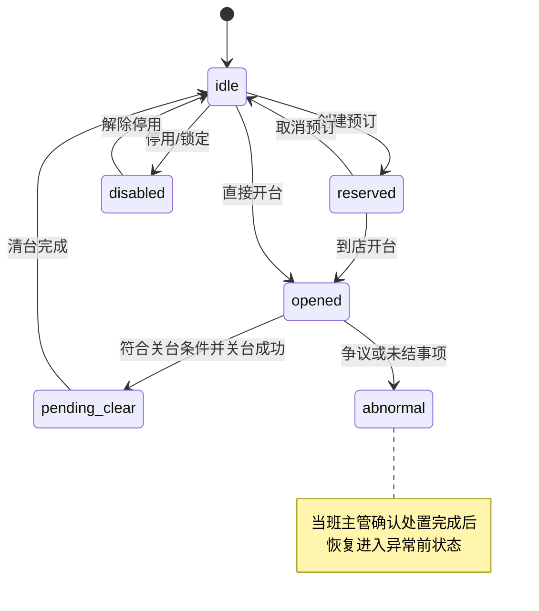
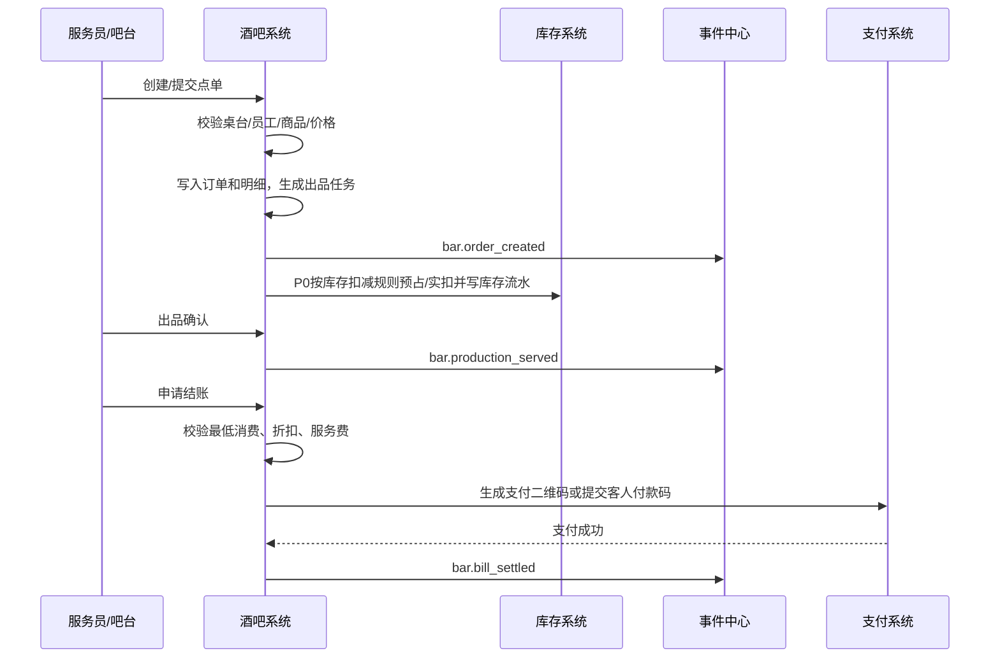

# 酒吧经营：桌台、点单、库存、存酒开发设计

> 版本：V0.08 ｜ 最后更新：2026-09-01 ｜ 当前迁移最高：V385 ｜ 状态：现行
>
> 权限边界：三份业务 HTML 定义业务目标；本设计只承接实现与差距，代码不能反向覆盖 HTML。下文表结构、API、事件和状态若未在“当前实现”中明确为已落地，均按目标设计理解。

### 当前实现与 HTML 目标差距

| 主题 | 当前代码事实 | HTML 目标 |
|---|---|---|
| 订台定金 | V073 仍为 `not_required/pending/paid/settled` 四态；V013 仍有 `deposit_deduct_amount_cent`，`BarEntryService` 仍记录 `bar.reservation_deposit_deducted`；无最晚到店字段与自动释放调度 | 定金不抵扣消费；达低消原路退回；七态；员工代订免收；最晚到店、自动释放、正确爽约责任与员工爽约率停权 |
| 支付 | `BarBillingService` 与 V292 已支持 `stored_value` | 门店统一支付方式集合，含储值卡；同一门店有收银权人员使用同一集合 |
| 出酒损耗 | `BarOrderService` 仍保留 `bar.pour-cost.strict-mode`；fallback 可记 `loss=0`；`loss_threshold` 仍在商品记录 | 按吧台有无物理采集设备二分；无设备也按标准损耗记账，不得记零损耗；阈值按酒吧配置 |
| 存酒 | 现有迁移/接口仍以转赠终态和旧取酒核身为主，转存字段不完整 | 转让只换权益人；转存短信确认/员工代办复核；默认 30 天；同店取用、跨店只汇总查看 |
| 出品后能力 | 退品、反结、沽清基础端点已存在；当前沽清和账单状态仍未完整承接 HTML | 两档沽清、正式挂起、拆合单/转并台、服务费月结四金额、小费、桌台隐私与券预占等按 HTML 完整落地 |
| 服务员提成 | 当前代码未核验完整承载 | James 于 2026-09-01 批准写入三份 HTML：跟服务责任链和台位会话走，转台后记新台会话；并台保留各自记录、不合并、不重算 |

## 0. 现行 HTML 实现合同

以下是本设计必须实现的业务约束，不以当前代码是否具备为前提：

1. **桌台与订台**：桌台经营六态为 `idle/reserved/opened/pending_clear/disabled/abnormal`；预订须排他锁台，冲突即拒绝；超过最晚到店时间自动释放。员工代订免收定金；客人自助订台须付定金；定金不抵扣消费，达低消原路退回，采用未支付、免收、已支付、达标已原路退回、已退还、已没收、已超时释放七态。员工代订爽约记经手员工，自助超时只没收定金、不记客人爽约；员工爽约率超按酒吧配置且有上下限的阈值时自动停用代订权限，店长复核后恢复。
2. **低消与点单**：最低消费按本次下单后累计的折前订单消费额判断，不按人数；提交不足即拒绝，结账不足必须补足。非低消商品仍在同一账单结算，通过商品标志排除，不强制拆单。扫码点单只适用于散台、先付款后出品；非会员可浏览、点单和付款，使用会员权益时才登录或注册。
3. **桌台与菜单**：一个业务会话只绑定一张有效桌台；员工可服务多桌，但提交前必须确认目标桌台。每桌同一时刻只允许一套已发布、带版本菜单生效。隐私桌台的查看、操作、经理紧急接管分权；无查看权时桌台及营业状态不可见；接管记事件、原因、桌台、接管人和有效期，到期自动撤权。
4. **支付与优惠券**：支付方式集合按门店统一，对该店所有具备收银权限的角色与员工完全一致，含客人扫码、扫客人付款码、现金、POS、储值卡。套餐或交易赠券可限制门店、时段、桌台类型或区域，不得绑定具体桌号，换台须重校验。结账自动选择使本单实付最低的一张券，同额选最早到期；付款前可更换或取消。开始付款即预留券并锁定金额；付款成功与券核销同时生效，任一失败均不生效，失败或超时释放。
5. **计时禁令**：桌台不显示运营计时，不建设计费倒计时、钟点房、按时长收费、续卡或续时产品。
6. **账单操作**：拆单、合单与并台严格区分；转台、并台、拆台、撤销转台和循环转台按 ENUM「账单操作」完整规则执行，原台转台成功即释放。正式未付款订单采用已挂起待付款、已结清、取消审批中、已取消、待退款、坏账损耗处理中、已核销结案七态；正式下单即出品并扣库存，不等待付款。
7. **提成、服务费与小费**：销售提成不计提类别按 HTML 固定清单执行，不做后台可配；仅费率是带上下限的配置。服务员提成跟服务责任链和台位会话走：转台后记到新台会话，销售提成仍按原归属不变；并台保留各服务员既有服务/提成记录，不合并到一人、不重算历史。服务费只对卡座收取，月结定格应发与扣留，不以实付动作判断归属，分别列收取额、月结应发额、月结扣留额、实际支付清偿额。小费按 HTML 归主责服务提供人并排除四类基数，严禁主动索取。
8. **存酒**：默认有效期 30 天并配上下限；到期提醒、转存次数/期限均按 HTML 固化。转存须客人本人短信确认；员工代办还须当班营销主管复核；达到次数上限不设例外。转让只换权益人，出让人短信成功即生效，不进入等待领取/冻结/转赠终态。取酒用短信或已登录官方端动态码；仅手机号查询，姓名/昵称不得检索；人工例外同时满足四项条件。只能在存入酒吧取用，不跨店取酒或转移库存；客人端可跨店汇总查看并标明存入店。
9. **出品、沽清与设备**：库存按实际出品、赠送、核销或销售触发扣减，不等待账单结清。沽清分临时本营业日与长期下架两档，置灰显示“已售完”且不隐藏，库存归零不自动沽清。出酒量按有无物理采集设备二分；无设备也按标准损耗记账。设备班前/班后检查、弱电错峰、照片视频上报、视频教学与文字逐项划钩分别留痕；故障分级/派单参数须有上下限。
10. **现场收入**：订台低消、二次消费和额外酒水归实际发生业务的酒吧商户；服务费按代收规则处理。

本文档用于指导【酒吧经营：桌台、点单、库存、存酒】子系统进入后端、前端、安卓端和数据分析开发。

关联文档：

- `docs/system-development-spec.md`
- `docs/project-progress-dashboard.md`
- `docs/business-systems-breakdown.md`
- `docs/ticketing-pass-entitlement-development-design.md`
- `docs/foundation-systems-breakdown.md`

执行口径：本文负责酒吧桌台、点单、库存、存酒和卡座业务设计，不直接冻结正式后端路径。酒吧 P0 Controller、前端/平板 API client、SDK/mock 和接口自动化必须以 `docs/openapi/openapi-p0.yaml/json`、`p0-openapi-operation-acceptance-matrix-v0.1.md` 和 `p0-openapi-contract-closure-appendix-v0.1.md` 为准；未进入追溯附录并通过 `verify:openapi-closure` 的历史能力，不得作为正式联调或验收依据。

## 1. 模块定位

酒吧经营系统负责综合体内酒吧业态的独立运营管理。酒吧门店只能从已完成“招商租赁 → 合同 → 商户准入”的既有酒吧商户中选择并建立经营扩展，不单独凭空创建；合作模式固定为自营、租赁、联营、代运营、服务商接入、其他。

股权、经营牌照、场地和资金由平台治理层分别记录，本模块只引用对应治理记录；经营牌照以实际经营法律主体为准，不得因持股自动推定牌照主体。

本系统必须坚持以下原则：

| 原则 | 说明 |
|---|---|
| 酒吧和游乐独立 | 酒吧与游乐设施是不同经营主体，必须按 `merchant_id` 隔离 |
| 票务只提供权益 | 酒吧入场、酒水兑换来自票务权益；卡座预约入场名额由酒吧预约/卡座系统控制；桌台、点单、库存、存酒由酒吧系统负责 |
| 账单和库存分离 | 点单产生账单；库存按实际出品、赠送、核销或销售等对应业务触发点扣减，正式挂起订单正式下单后即出品并扣库存，不等待付款或账单结清；库存不直接依赖票务订单 |
| 存酒独立建模 | 存酒属于已售未取客户资产，不等同于可售库存 |
| 留痕优先自动化 | 订单来源、销售归属、开台服务、点单、出品、送达、结账、存取酒、出入库、报损、人工调整、异常首响、库房到后厨到客人的交接都必须写入事件中心 |
| 支持第三方运营 | 商户后台只允许查看和操作本酒吧商户数据 |

## 2. 业务边界

### 2.1 本模块负责

| 范围 | 说明 |
|---|---|
| 酒吧入场 | 酒吧通票、活动票、酒吧入场权益核销结果承接（年龄由综合体入场第二道年龄核验环节统一核验，酒吧继承结论、不逐单重复验龄；系统不自动判断醉酒或拦截订单，现场工作人员仍可人工停止继续售酒并留痕） |
| 桌台卡座 | 桌台档案、预订、开台、转台、并台、低消、清台 |
| 点单 | 服务员点单、吧台点单、扫码点单入口预留、退单、赠送、折扣 |
| 账单 | 桌台挂账、吧台即时结账、低消校验、服务费、支付记录 |
| 商品 | 酒水、套餐、杯卖、瓶卖、简餐、服务费、活动商品 |
| 吧台出品 | 接单、制作、出品、取消、异常 |
| 存酒 | 存酒登记、取酒、剩余量、有效期、转让、转存、作废 |
| 库存 | 入库、出库、调拨、盘点、报损、库存余额 |
| 物料 | 酒水、果料、冰块、杯具、耗材、简餐原料 |
| 配方 BOM | 鸡尾酒、杯卖酒、简餐的物料消耗规则 |
| 报表 | 桌台收入、酒水销量、低消达成、库存损耗、存酒余额 |
| 终端接口 | 承接平板、工作手机和一体机产生的酒吧订单、支付、权益与设备/班次上下文，不在本模块重复建设终端管理 |

### 2.2 本模块不直接负责

| 范围 | 边界 |
|---|---|
| 售票和通票配置 | 由票务通票系统负责 |
| 权益实例生成 | 由票务系统在支付出票后生成 |
| 酒吧入场权益扣次 | 由票务核销服务负责，酒吧系统接收入场结果 |
| 微信/支付宝清算 | 由支付结算系统负责，酒吧只记录账单支付结果 |
| 机器人调度算法 | 由第三方机器人系统负责，酒吧系统只创建配送需求和接收状态 |
| 视频原始存储 | 由第三方监控系统负责，酒吧系统只关联视频证据索引 |
| 完整会员体系 | 由会员系统负责，酒吧只引用客户和会员摘要 |
| 商户准入与治理记录 | 招商租赁、合同、商户准入及酒吧股权、牌照、场地、资金由平台治理层负责；本模块不得凭空创建酒吧或推定牌照主体 |

## 3. 领域模型

### 3.1 聚合划分

| 聚合 | 核心对象 | 职责 |
|---|---|---|
| 酒吧场地聚合 | `BarVenue`, `BarArea`, `BarTable` | 管理门店、区域、桌台卡座 |
| 桌台会话聚合 | `BarTableSession`, `BarReservation` | 管理预订、开台、转台、并台、清台 |
| 服务责任聚合 | `BarServiceResponsibility`, `BarServiceAction` | 管理销售归属、主责服务员、协助服务员、加单人、送达人和换人记录 |
| 卡座提成聚合 | `BarTableCommission` | 管理卡座销售归属、消费额基数、提成率、提成金额、复核和冲正 |
| 服务员提成归属聚合 | `BarServiceCommissionAttribution` | 只管理服务员提成与服务责任链、台位会话的归属关系及转台/并台历史，不定义费率、基数、结算或税务口径 |
| 商品聚合 | `BarProduct`, `BarProductCategory`, `BarProductPrice` | 管理酒水、简餐、套餐、服务费 |
| 点单聚合 | `BarOrder`, `BarOrderItem`, `BarProductionTicket` | 管理点单、出品、取消、赠送、退单 |
| 账单聚合 | `BarBill`, `BarBillItem`, `BarBillPayment` | 管理挂账、低消、折扣、服务费、结账 |
| 存酒聚合 | `SavedBottle`, `SavedBottleMovement` | 管理客户存酒资产和取用记录 |
| 库存聚合 | `BarInventoryItem`, `BarStockBatch`, `BarStockMovement` | 管理入库、出库、调拨、盘点、报损 |
| 配方聚合 | `BarRecipe`, `BarRecipeItem` | 管理 BOM 和自动扣料 |
| 履约聚合 | `BarDeliveryTask`, `BarGoodsHandover` | 管理机器人或人工配送任务引用、后厨接收、服务员取走和送达确认 |

### 3.2 核心对象说明

| 对象 | 中文名 | 关键字段 | 说明 |
|---|---|---|---|
| `BarVenue` | 酒吧门店 | `merchant_id`, `venue_id`, `capacity`, `status` | 绑定多商户系统中的酒吧场地 |
| `BarArea` | 酒吧区域 | `bar_venue_id`, `area_id`, `area_type` | 大厅、卡座区、吧台区、库房 |
| `BarTable` | 桌台/卡座 | `table_no`, `table_type`, `min_spend_amount`, `status` | 管理可开台点位 |
| `BarReservation` | 桌台预订 | `customer_id`, `reserved_at`, `deposit_amount`, `deposit_status`, `order_source`, `status` | P0 必做一体机/线上订台+订金（见 §6.3、§13.1，finding kiosk-1） |
| `BarTableSession` | 开台会话 | `table_id`, `opened_by`, `customer_id`, `status` | 一次开台到结账清台的完整周期 |
| `BarServiceResponsibility` | 服务责任 | `session_id`, `order_id`, `sales_staff_id`, `primary_service_staff_id`, `assist_staff_ids`, `status` | 一桌客人或一笔订单的销售和服务责任链 |
| `BarServiceAction` | 服务动作 | `responsibility_id`, `action_type`, `staff_id`, `device_id`, `location_point_id`, `event_id` | 加单、送达、换人、异常处理等动作 |
| `BarServiceCommissionAttribution` | 服务员提成归属 | `service_responsibility_id`, `table_session_id`, `service_staff_id`, `source_attribution_id` | 只承载服务员提成随转台/并台的归属关系和历史留痕，不承载未获批准的计算或发放口径 |
| `BarProduct` | 酒吧商品 | `product_type`, `sale_unit`, `price`, `stock_deduct_mode` | 酒水、简餐、套餐、服务费 |
| `BarOrder` | 点单 | `session_id`, `order_source`, `status`, `total_amount` | 一次点单动作 |
| `BarOrderItem` | 点单明细 | `product_id`, `quantity`, `item_status` | 商品明细，支持退单和赠送 |
| `BarBill` | 酒吧账单 | `session_id`, `payable_amount`, `paid_amount`, `status` | 桌台账单或吧台账单 |
| `SavedBottle` | 存酒 | `customer_id`, `product_id`, `remaining_volume`, `expire_at`, `status` | 已售未取的客户资产 |
| `BarInventoryItem` | 库存物料 | `item_type`, `unit`, `cost_price`, `status` | 酒水、食材、耗材、杯具 |
| `BarStockBatch` | 库存批次 | `inventory_item_id`, `batch_no`, `quantity`, `expire_at` | 批次、成本、保质期 |
| `BarStockMovement` | 库存流水 | `movement_type`, `quantity`, `reason`, `operator_id` | 所有库存变化的依据 |
| `BarRecipe` | 配方 | `product_id`, `version`, `status` | 商品到物料的消耗配置 |
| `BarDeliveryTask` | 配送任务 | `task_type`, `source_point_id`, `target_point_id`, `status` | 机器人或人工配送任务 |
| `BarGoodsHandover` | 酒水交接 | `trace_code_id`, `handover_node`, `from_holder`, `to_holder`, `scanned_by`, `device_id`, `event_id` | 关联平台物品追踪码和操作交接记录 |

## 4. 状态机

### 4.1 桌台状态

> HTML 目标：桌台经营六态为 `idle/reserved/opened/pending_clear/disabled/abnormal`。当前 V013 `bar_tables` 尚无 `business_status` 承载列，必须作为实现差距处理，不能用记录级 `status` 冒充已落地。预订对台位加排他锁；超时释放回 `idle`；关台仅在账单全部结清、坏账处理中或已核销结案后成立，成功后进入 `pending_clear`；超时未清台按酒吧配置且有上下限的时限提醒主管；异常处置完成须由当班主管确认，并恢复到进入异常之前的状态。

| 状态 | 中文 | 说明 |
|---|---|---|
| `idle` | 空闲 | 可开台 |
| `reserved` | 已预留 | 有预订但未到店 |
| `opened` | 已开台 | 客人已入座，可点单、加单、核销、结账 |
| `pending_clear` | 待清台 | 已结账但现场未完成清理，不可再次开台 |
| `disabled` | 停用 | 维修、包场、人工锁定等桌台暂不可用 |
| `abnormal` | 异常 | 存在争议或未结事项；主管确认处置完成后回到进入异常前的状态 |



### 4.2 开台会话状态

| 状态 | 中文 | 说明 |
|---|---|---|
| `active` | 进行中 | 可点单、加单、转台 |
| `pending_payment` | 待结账 | 已申请结账 |
| `paid` | 已支付 | 账单已结清 |
| `closed` | 已关闭 | 清台完成 |
| `cancelled` | 已取消 | 误开台或异常取消 |

### 4.3 点单状态

| 状态 | 中文 | 说明 |
|---|---|---|
| `draft` | 草稿 | 未提交 |
| `submitted` | 已下单 | 已进入出品或待出品 |
| `producing` | 制作中 | 吧台或厨房制作 |
| `served` | 已出品 | 已交付 |
| `partially_cancelled` | 部分取消 | 部分明细取消 |
| `cancelled` | 已取消 | 整单取消 |

### 4.4 账单状态

> HTML 目标：账单业务六态为 `unpaid/partial_paid/settled/partial_refunded/refunded/abnormal`，目标字段为 `bar_bills.business_status`；当前 V013 尚无该列，属于待改差距。记录级 `status` 仅表 `active/void`，不得冒充业务流转态。低消、折扣和服务费计算只是账单内部瞬态；退款用 `partial_refunded/refunded` 表达并与支付退款记录协同。账单进入异常后，主管必须选择“更正后恢复”并回到进入异常前状态，或选择“作废并冲正”；异常未处置完毕时所属日结不得确认锁定。

| 状态 | 中文 | 说明 |
|---|---|---|
| `unpaid` | 待结 | 已确认消费，等待支付或确认 |
| `partial_paid` | 部分支付 | 混合支付或分次支付，已收部分金额 |
| `settled` | 已结 | 账单结清完成 |
| `partial_refunded` | 部分退款 | 部分金额退款 |
| `refunded` | 已退款 | 全额退款或账单冲销 |
| `abnormal` | 异常 | 争议、免单、补录或支付差异；主管按“更正后恢复/作废并冲正”二选一处置 |

### 4.5 存酒状态

| 状态 | 中文 | 说明 |
|---|---|---|
| `stored` | 已存 | 可取用 |
| `partially_used` | 部分取用 | 剩余量大于 0 |
| `finished` | 已取完 | 剩余量为 0 |
| `expired` | 已过期 | 超过有效期 |
| `disputed` | 争议 | 归属/数量争议冻结，待人工或主管处置后流转 <!-- 修正(2026-06-19 R5业务HTML缺口审计 F4/F7)：补争议态 --> |
| `voided` | 已作废 | 丢失、破损、异常处理 |

### 4.6 库存流水状态

| 状态 | 中文 | 说明 |
|---|---|---|
| `draft` | 草稿 | 未确认 |
| `pending_approval` | 待审批 | 高价值或异常操作需审批 |
| `confirmed` | 已确认 | 已影响库存余额 |
| `reversed` | 已冲正 | 原流水被反向冲正 |
| `rejected` | 已驳回 | 审批不通过 |

## 5. 核心业务流程

### 5.1 桌台流程

#### 5.1.1 直接开台

1. 员工在安卓端或后台选择空闲桌台。
2. 系统校验员工当班、设备绑定、桌台归属商户和区域权限。
3. 录入人数、客户手机号或会员、服务员、低消规则。
4. 创建 `bar_table_sessions`。
5. 创建或打开 `bar_bills`。
6. 桌台状态改为 `opened`。
7. 写入 `bar.table.opened` 事件。

#### 5.1.2 预订后开台

1. 创建预订并填写最晚到店时间，记录来源、下单时间、终端、责任人、设备和点位；客人自助订台必须支付定金，员工代订免收定金。预订成功后以排他锁把桌台置为 `reserved`，冲突订单拒绝。
2. 超过最晚到店时间仍未到店时自动释放桌台。自助订单没收定金但不记客人爽约；员工代订记经手员工爽约。员工爽约率超过按酒吧配置且有上下限的阈值时自动停用代订权限，由店长复核后恢复。
3. 到店后由员工执行开台并记录 `arrived_at`。定金不抵扣消费；客人在该台位的消费达到适用最低消费后，定金原路退回；未达低消、爽约或超时取消时按规则没收。
4. 预订状态变为 `arrived`，进入直接开台后续流程。定金支付成功时单独记录支付时间；员工代订无支付动作，支付时间为空。

#### 5.1.3 转台

1. 员工选择当前会话和目标空闲桌台。
2. 校验目标桌台可用、同一酒吧商户、同一门店。
3. 转台成功后原桌台立即改为 `idle` 并释放，可供其他客人预订或开台。
4. 目标桌台状态改为 `opened`。
5. 会话 `table_id` 更新为目标桌台。
6. 写入 `bar.table.transferred` 事件。

#### 5.1.4 清台

1. 账单全部结清，或该台账单已进入坏账损耗处理中，或已核销结案；除此之外不得关台。
2. 桌台进入 `pending_clear`。<!-- 改（2026-06-07）：finding bar-5，cleaning 统一为 D7 的 pending_clear -->
3. 员工确认清洁完成。
4. 桌台变为 `idle`，会话变为 `closed`。
5. 写入 `bar.table.cleared` 事件。

#### 5.1.5 账单操作与台位操作

- **拆单/合单**：只处理未支付、未结算账单。拆单按金额生成子账单供分别付款；合单只允许把同一酒吧另一张未支付、未结算账单合入主账单。账单合单不等同于台位并台；销售提成和小费始终归主账单相关责任人，不随拆单分散。
- **转台**：整张台转到目标台后，邀请人数与最低消费按目标台规则重新校验；原消费随台结转，不足继续消费、超出不退。未接受邀请继续有效且不占名额；已接受未入场与已入场人数合计超目标台容量时阻断，已入场成员不得移出。原台随转台成功立即释放。销售提成仍跟预订归属；服务员提成与服务责任链转到新台会话；小费归新台实际服务提供人。
- **并台**：两侧可邀请人数、最低消费额和已发生消费分别相加；邀请保留原台来源，已接受与已入场成员进入新合并台。每次保留全部原台标识、并台层级、来源树和并台前快照；销售提成保持各自归属，服务员既有服务/提成记录分别保留且不合并、不重算，小费按各台实际服务提供人分别记录。
- **拆台**：两台可直接拆回；三台以上可按最近并台层级拆、任选一张原台拆出或一次全部拆开。消费按实际订单归属重新汇总；不能确定时须先人工明确并留痕。邀请与成员先逐一分配并逐台校验容量，任一结果超额即整体阻断，不得自动移出成员或释放已占名额。拆后低消不足不阻断，但显示差额并继续消费或结账补足。
- **撤销/循环转台**：仅当转台后没有新增邀请、邀请接受、成员变化、点单、付款、退款，也未再次转台、并台或拆台，且原台均未被新会话占用时，才可按最近一次完整快照原子撤销；否则必须按当前状态重新发起转台。循环转台次数按酒吧配置上限，出厂默认 10 次且须同时配置上下限，达到上限后须主管审批。每种操作均记录原因、人员、时间、对象、前后快照和成功或阻断结果。

### 5.2 点单与账单流程



> 修订说明（2026-06-07 收口）：上图事件名同步对齐权威字典命名（finding baseline-conf-5、D4）：`bar.order.created`/`bar.order.submitted` 合并为 `bar.order_created`（创建即提交为同一登记动作），`bar.order.served` → `bar.production_served`，`bar.bill.paid` → `bar.bill_settled`。

#### 5.2.1 点单规则

| 规则 | 说明 |
|---|---|
| 桌台/卡座点酒必须绑定 `bar_table_session_id` | 否则不能提交点酒订单 |
| 平板必须绑定酒吧和卡座/桌台/吧台位 | 用于确认消费位置、服务员责任和最低消费规则 |
| 商品价格以下单快照为准 | 后续改价不影响历史订单 |
| 提交前必须校验最低消费 | 本次下单后累计的折前订单消费额未达到最低消费时不能提交订单 |
| 取消点单必须填写原因 | 高价值商品取消需主管权限 |
| 赠送必须有权限 | 赠饮、免单、折扣都要留痕 |
| 酒水兑换权益不直接等于点单 | 先核销票务权益，再生成兑换类订单或账单抵扣 |
| 售酒年龄继承年龄核验环节 | 全部售酒点在综合体入场年龄核验范围内，酒吧继承入场结论、**不逐单重复验龄**。系统不自动判断醉酒、不自动拦截订单；现场工作人员仍可依据现场情况人工停止继续向某位客人售酒，并记录原因、责任人和处置结果。**年龄核验没有开关**——年龄核验环节设备尚未安装或发生故障时进入人工抽查方式，不要求工作人员逐人查验证件，但明显疑似未成年人必须查验，不得直接放行。原 bar 侧 `BarAgeVerificationService`/`createAgeVerification`/`bar_age_verifications` 已移除；酒吧不建设独立验龄链路（详见合规 §2） |

#### 5.2.2 低消计算

最低消费按开台会话和本次点酒草稿计算：

```text
是否可提交 = 可计入最低消费金额 >= 桌台/卡座最低消费
最低消费差额 = max(桌台/卡座最低消费 - 可计入最低消费金额, 0)
```

P0 规则：

- 酒水、套餐、简餐默认计入低消。
- 服务费、赠送、已取消项不计入低消。
- **票务权益、通票、卡座预约入场名额一律不抵扣最低消费**：低消只按酒吧点酒/套餐/简餐等实际消费金额计算；票务与卡座预定只解决入场或预定资格，不参与低消金额抵扣。
- **P0 低消一律不按人数计算**：最低消费只取桌台/卡座按时间/位置配置的 `min_spend_amount` 快照，`bar_table_sessions.guest_count` 仅作开台人数记录，不参与上述任一公式。<!-- 增（2026-06-07）：finding bar-6，明确 P0 不按人数、guest_count 仅记录，消除"原则上"歧义 -->
- 未达到最低消费时，平板显示差额提示，不能提交点酒订单。
- 结账时累计消费不足最低消费的，必须补足；最低消费不作为独立收入类型入账。

P1/P2 扩展：

- 不同商品配置是否计入低消。
- 不同时段、活动、卡座类型配置不同低消。
- **~~按人数低消例外（后置）~~（2026-07-22 定案废弃）**：用户 2026-07-22 拍板最低消费**绝对不按人数计**、取消"原则上"活口，`by_headcount` 扩展点**不再预留**；低消计算固定 `by_position`。<!-- 改（2026-07-22）：CONF-02 定案取消按人数例外，原 finding bar-6 预留作废 -->

#### 5.2.3 卡座预约入场名额

卡座预约可以附带入场名额，但它不是通票抵扣，也不是低消抵扣。

P0 规则：

1. 不同卡座/桌台可配置不同 `included_entry_guest_count`。
2. 卡座预定者可带不超过该名额的客人免除通票进入酒吧。
3. 免通票入场只允许进入预定卡座所在酒吧，不允许进入其他酒吧、其他区域或其他游乐项目。
4. 入场仍必须通过年龄核验、容量卡控、黑名单/风险规则和现场责任留痕。
5. 超出名额的客人必须按正常票务/入场规则购买或核销对应权益。
6. 该入场名额不计入最低消费金额，不生成票务通票权益，不参与票务分账。

并发与幂等要求：

1. `/api/v1/bar/reservations/{id}/entry-allowance/verify` 请求必须携带 `idempotencyKey`、`reservation_id`、`bar_venue_id`、`device_id`、`staff_id`、本次入场人数；如能识别具体客人，还应携带不可逆哈希后的 `entry_guest_identifier_hash`。
2. 服务端必须以预约入场额度为准做事务校验，可采用行锁（如 `SELECT ... FOR UPDATE`）或乐观锁版本号，已提交的 `bar_table_guest_checkins` 才计入已用额度。
3. 同一 `reservation_id + idempotencyKey` 重试必须返回第一次处理结果，不得重复扣占名额；同一可识别客人不得在同一预约下重复免通票入场。
4. 成功写入 `bar.table_guest.checked_in`，拒绝写入 `bar.table_guest.rejected`，两者都要记录剩余额度、拒绝原因、设备、员工和点位。

#### 5.2.4 正式挂起未付款订单

1. 正式挂起订单是已正式下单、已出品并已扣库存但尚未付款的订单，采用 `hanging_unpaid/settled/cancel_pending_approval/cancelled/pending_refund/bad_debt_processing/written_off_closed` 七态，依次对应已挂起待付款、已结清、取消审批中、已取消、待退款、坏账损耗处理中、已核销结案；英码只作机读映射，不新增业务态。
2. 收银员可直接挂起且不设额度，但必须记录原因、金额、桌台、责任人和完整日志；未结清时阻止交班和日结。
3. 取消须经理审批；可回库商品继续执行退菜、退酒及高价值退品审批链。取消审批与付款成功互斥；取消后迟到到账进入待退款。
4. 不可回库商品最终确认无法收款后进入坏账损耗处理；财务确认未收售价、库存成本和赔偿记录完成后转为已核销结案。员工赔偿规则在法务审查完成前只登记，不自动扣工资、绩效或提成。
5. 挂起订单结清前不计入商户营业额、营业额抽成、销售提成或分红净利润；结清后按实际结清金额计入结清所在营业日。转坏账核销不产生销售提成且不计入分红净利润；核销结案后收回的款项按收回时点单独入账，不追溯重开提成。

### 5.3 存酒流程

#### 5.3.1 存酒登记

1. 客人购买整瓶酒或使用套餐中的整瓶酒。
2. 员工选择“存酒”。
3. 系统校验订单已支付或权益已核销。
4. 取得隐私同意后，录入客户手机号/会员、姓名或昵称、瓶底标签数值、登记照片、酒品、规格、剩余量、存放位置。
5. 存酒有效期按项目配置，出厂默认 30 天且须同时配置上下限；登记时固化本次有效期、到期日和配置版本，后续改配置不追溯。
6. **登记与举证三项必填：姓名/昵称（`customer_name_or_nickname`）、瓶底标签数值（`bottle_label_value`）、登记照片（`registration_photo_refs`）**；可选填人工备注（`manual_note`）。缺任一必填项不允许提交登记。
   - **散客存酒**：`customer_id` 可空，散客（无会员）允许存酒；登记仍须落 `customer_phone`、`customer_name_or_nickname`、`bottle_label_value` 和照片。
7. 生成存酒编号；客人端动态取酒码按统一动态码规则生成。
8. 库存从可售库存转为已售未取库存。
9. 写入 `bar.saved_bottle.created` 和库存流水事件，并向客人发送存酒成功短信。

#### 5.3.2 取酒

1. 员工只能输入手机号检索存酒记录；姓名、昵称、卡座、订单号和存酒标签不得用于反查客人。
2. 正常取酒必须核验当前客户短信验证码，或核验其已登录官方 App/小程序展示的动态取酒码；手机号本身不能作为放酒凭证。
3. 系统校验状态、有效期和存入酒吧；存酒只能在存入酒吧取用，不得跨店取酒或转移库存。客人端可跨店汇总查看，但每条必须标明存入酒吧。
4. 人工例外仅用于客户手机遗失、停机等无法取得验证码或动态码的情形，且必须同时满足：店长发起并由另一名主管复核；手机号满足按项目配置且有上下限的任一消费历史条件；对应营销人员或规定的替代主管确认；存酒客户本人到场，不得代领。
5. 录入本次取用量，核对对应标签，更新剩余量；剩余量为 0 时状态变为 `finished`，否则为 `partially_used`。
6. 写入 `bar.saved_bottle_picked_up`，留痕核验方式、标签、取用前后量、员工和时间，并向客人发送取酒成功短信。

#### 5.3.3 转让与转存

- **转让（换人）**：仅在有效期内办理，以单个存酒标签对应的整瓶为最小单位，不得拆分剩余量。由当前权益人短信验证码确认，验证成功即变更权益人；受让人无需确认领取，不设等待领取、领取前冻结或 `transferred` 终态。转让不限次数，不消耗转存次数、不改变到期日；受让人继承剩余有效期和已用转存次数。每次记录转让前后客户、时间和操作来源。**当前实现仍未对齐**：`InventoryController` 仍暴露 `/api/v1/inventory/saved-bottles/{id}/transfer`，`InventoryService.transferSavedBottle` 仍允许 `transferQuantity` 并生成 `status=transferred` 的旧转赠记录，V102 也保留 `transferred` 终态约束；这些都不是本段“整瓶只换权益人”的目标实现。
- **转存（延期）**：只能在当前到期日前办理。每份存酒转存次数上限按项目配置，出厂默认 2 次且须同时配置上下限；每次从当前到期日起顺延酒吧当时配置的期限，出厂默认 30 天且须同时配置上下限。客人本人须短信确认；员工代办还须当班营销主管复核。记录配置版本、顺延天数、新到期日、累计次数、经办人和确认方式。达到上限后不再办理且不设例外。
- **到期与跨店**：到期前按项目配置的提醒节点发送短信；到期后结束客户权益并转为存入酒吧自有库存资产，转库存时不确认收入。存酒只能在存入酒吧取用或转为该店库存，客人端仅做跨店汇总展示。

#### 5.3.3a 争议处置（`disputed`）<!-- 修正(2026-06-19 R5业务HTML缺口审计 F4/F7)：补 disputed 争议态入口 -->

存酒归属/数量发生争议（核身不通过、客户异议等）时，提供争议登记入口将记录置为 `disputed`（§4.5），冻结取酒和转让，待人工或主管处置后流转回 `stored`/`partially_used` 或转 `voided`。

#### 5.3.4 作废

适用场景：

- 已过期。
- 破损。
- 丢失。
- 客户确认放弃。
- 风控或纠纷冻结后处理。

作废必须填写原因、上传证据，必要时主管审批。**高价值存酒作废必须同时上传照片和视频双证据**（`evidence_ref` 区分 `photo_refs` 与 `video_refs`，高价值场景二者均必填）并主管复核。<!-- 增（2026-06-07）：finding supply-3，高价值作废双证据强制，消除"证据"泛化与"拍照/视频"二选一歧义 -->

> 散客（无 `customer_id`）存酒不限瓶数；存酒有效期按项目配置，出厂默认 30 天且须同时配置上下限。到期提醒、到期转库存和作废复核按本节执行。

### 5.4 库存出入库流程

#### 5.4.1 采购入库

1. 库管创建入库单。
2. 录入供应商、批次、成本、数量、保质期。
3. 可上传票据照片。
4. 确认后生成 `inbound` 库存流水。
5. 增加总库库存。
6. 写入 `inventory.inbound_confirmed` 事件。

#### 5.4.2 总库调拨到吧台

1. 吧台或店长发起领料申请。
2. 库管确认出库。
3. 总库减少，吧台库存增加。
4. 生成一条 `transfer_out` 和一条 `transfer_in` 流水。
5. 可创建机器人补货任务。
6. 写入 `inventory.transferred` 事件。

#### 5.4.3 销售扣减

P0：

- 必须对明确物品、明确数量、明确库存位置、明确责任人的场景做库存扣减或库存状态转移，不能只记录销售数量。
- 整瓶酒销售、吧台买酒、酒水兑换、积分兑换礼物/酒水、客人存酒登记/取酒、审批后的报损/盘点差异必须形成库存流水。
- 杯卖按后台配置的标准出酒量/容量扣减；实际超出标准容量的部分记为损耗。

P1：

- 复杂批次成本、保质期预警、安全库存和更细库位策略。

P2：

- 鸡尾酒和简餐按 BOM 自动扣物料。
- 支持损耗率和成本核算。

#### 5.4.3.1 P0 库存扣减审计结论

本轮对票务、酒吧、供应链、积分兑换和终端文档回扫后，P0 库存扣减结论如下：

| 库存动作 | P0 结论 | 说明 |
|---|---|---|
| 票务库存锁定/释放/售出 | 必须做 | 票务库存由 `ticket_inventories` 承载，支付、取消、退款必须影响库存桶 |
| 权益核销次数扣减 | 必须做 | 权益 `remaining_times` 与核销记录必须事务一致 |
| 整瓶酒销售/吧台买酒 | 必须扣减 | 明确 SKU、数量和库存位置，必须形成 `inventory stock movement（movement_type=redeem_consume/order_consume）` |
| 按杯销售 | 必须按标准容量扣减 | 按 `standard_pour_volume` 扣减，实际超量记损耗 |
| 赠饮/酒水兑换权益 | 必须扣减 | 核销后生成 0 元兑换点单，出品时扣减吧台库存 |
| 积分兑换礼物/酒水 | 必须扣减 | 兑换成功并领取时扣减礼物或酒水库存 |
| 客人存酒登记 | 必须做状态转移 | 从可售/吧台库存转为已售未取或客户存酒状态 |
| 客人取酒 | 必须扣减存酒剩余量 | 按取用量更新剩余量，归零后关闭存酒 |
| 报损/作废 | 审批后必须扣减 | 高价值场景必须照片+视频双证据和主管复核 |
| 盘点差异 | 审批后必须调整 | 盘亏扣减、盘盈/报溢增加，均需留痕 |

审计结论：P0 强制库存扣减适用于“可明确物品、数量、位置、责任人”的场景；复杂配方 BOM、鸡尾酒/简餐多物料自动扣料、批次成本精算和自动补货预测进入 P1/P2。P0 不允许用“只发事件、后续再扣”替代上述必扣场景，但允许通过同步事件驱动酒吧库存模块在同一业务闭环内落账。

#### 5.4.4 盘点

1. 库管创建盘点单。
2. 系统记录账面库存。
3. 员工录入实际库存。
4. 系统计算盘盈盘亏。
5. 差异超过阈值时需要审批；**高价值物料的盘点差异必须同时上传照片和视频双证据**（`photo_refs` 与 `video_refs` 均必填）。<!-- 增（2026-06-07）：finding supply-3，盘点差异高价值双证据强制（原文未提证据） -->
6. 审批通过后生成盘点调整库存流水（盘亏走 `count_adjust`，盘盈/报溢走 `surplus`，见 §6.16）。<!-- 改（2026-06-07）：finding supply-5，盘盈/报溢独立为 surplus 类型 -->
7. 写入 `inventory.counted` 和风险事件。

#### 5.4.5 报损

1. 员工提交报损。
2. 选择物料、数量、原因。
3. 高价值酒水必须**同时上传照片和视频双证据**（`photo_refs` 与 `video_refs` 均必填）并经主管审批。<!-- 改（2026-06-07）：finding supply-3，报损高价值由"仅照片"升为"照片和视频"双证据 -->
4. 审批通过后扣减库存。
5. 写入 `inventory.damaged` 事件。

## 6. 数据库表结构

字段命名建议使用 PostgreSQL snake_case。所有表默认包含：

```text
id, created_at, updated_at, deleted_at, created_by, updated_by, status, remark
```

### 6.1 bar_venues 酒吧门店扩展表

| 字段 | 类型 | 说明 |
|---|---|---|
| `id` | uuid | 主键 |
| `merchant_id` | uuid | 酒吧商户 |
| `venue_id` | uuid | 多商户系统场地 |
| `name` | varchar | 酒吧名称 |
| `business_hours` | jsonb | 营业时间 |
| `capacity` | int | 最大容量 |
| `current_guest_count` | int | 当前在场人数 |
| `pour_loss_rate_threshold`（目标） | numeric | 按酒吧配置的损耗率安全阈值；出厂默认 5%，须同时配置上下限；当前仍错误承载在单品 `loss_threshold` |
| `status` | varchar | `preparing/open/paused/closed` |

索引：

- `idx_bar_venues_merchant_id`
- `idx_bar_venues_venue_id`

### 6.2 bar_tables 桌台表

> 目标定义：`business_status` 承载 HTML 桌台六态，记录级 `status` 只表示档案启用/作废。当前 V013 `bar_tables` 尚无 `business_status`，下表把该列标为目标字段；实现前须补迁移，不能宣称已落地。

| 字段 | 类型 | 说明 |
|---|---|---|
| `id` | uuid | 主键 |
| `project_id` | uuid | 所属综合体（项目）归属，预留多综合体隔离（原始需求） |
| `bar_venue_id` | uuid | 酒吧门店 |
| `merchant_id` | uuid | 商户 |
| `location_point_id` | uuid | 点位 |
| `table_no` | varchar | 桌台编号 |
| `table_name` | varchar | 桌台名称 |
| `table_type` | varchar | `normal/booth/private_room/bar_seat` |
| `capacity` | int | 可坐人数 |
| `min_spend_amount` | bigint | 低消金额，单位分 |
| `service_fee_rate` | numeric | 服务费比例 |
| `business_status`（目标，当前缺列） | varchar | **业务桌台 6 态**：`idle`(空闲)/`reserved`(已预留)/`opened`(已开台)/`pending_clear`(待清台)/`disabled`(停用)/`abnormal`(异常)；CHECK 取值与 §4.1 逐项对应，不得用 `status` 顶替 |
| `status` | varchar | **记录级状态**（非业务态）：`active`(启用)/`void`(已删除/作废)；表桌台档案是否启用，配合软删除/审计字段 |

约束：

- 同一 `bar_venue_id + table_no` 唯一。
- 目标态由 `business_status` 承载业务流转，`status` 仅承载记录级启用/作废；补迁移前按当前代码事实登记缺口，不得混用。

### 6.3 bar_reservations 预订表

> 修订说明（2026-06-07）：依 finding kiosk-2/kiosk-3 补订金规则字段（金额/比例/可配置、`deposit_status`、退没收规则）与来源/创建终端/责任人/设备/点位/到店取消时间等留痕字段，使一体机订台+定金可编码、可区分来源、可满足设备/点位留痕（与基准 D5 终端枚举、PRD §4 订台订单/§9 验收一致）。

| 字段 | 类型 | 说明 |
|---|---|---|
| `id` | uuid | 主键 |
| `bar_venue_id` | uuid | 酒吧 |
| `table_id` | uuid | 桌台，可为空 |
| `customer_id` | uuid | 客户；外键指向 foundation `customers.id`（散客无会员时可空，核身用 `customer_phone`/`customer_name_or_nickname`） |
| `contact_name` | varchar | 联系人 |
| `contact_phone` | varchar | 联系电话 |
| `reserved_at` | timestamptz | 预订时间 |
| `ordered_at` | timestamptz | 下单时间；预订提交时记录 |
| `latest_arrival_at` | timestamptz | 最晚到店时间，每笔订台必填 |
| `guest_count` | int | 人数 |
| `order_source` | varchar | 来源渠道：`app/miniapp/kiosk/sales_staff` |
| `created_terminal` | varchar | 创建终端类型，取基准 D5 十端枚举（如 `kiosk/app/miniapp/staff_work_phone`） |
| `created_by` | uuid | 创建人（客户自助或员工账号） |
| `sales_staff_id` | uuid | 销售归属员工，可为空 |
| `sales_staff_position_type_snapshot` | varchar | 销售归属员工岗位快照；`sales_person` 按销售人员提成率，其他岗位按非销售人员提成率 |
| `sales_commission_rate_snapshot` | numeric | 销售提成率快照：销售人员默认 `0.15`，非销售人员默认 `0.10` |
| `sales_commission_rate_config_version_snapshot`（目标） | varchar | 下单时锁定的订单实际发生酒吧费率配置版本；与费率值一并固化 |
| `device_id` | uuid | 创建设备 |
| `location_point_id` | uuid | 点位，可为空 |
| `deposit_amount` | bigint | 订金金额，单位分；按 `deposit_rule` 计算落定值 |
| `deposit_rule` | jsonb | 订金规则快照：`{mode: fixed/percent, value, lower_bound, upper_bound, config_version}`；固定额或低消比例按项目可配且须同时配置上下限 |
| `deposit_status` | varchar | 七态：`unpaid/exempt/paid/refunded_after_min_spend/refunded/forfeited/released_timeout`，对应未支付/免收/已支付/达标已原路退回/已退还/已没收/已超时释放 |
| `deposit_paid_at` | timestamptz | 定金支付成功时间；员工代订免收时为空 |
| `arrived_at` | timestamptz | 到店时间，可为空 |
| `cancelled_at` | timestamptz | 取消时间，可为空 |
| `cancel_reason` | text | 取消原因，可为空 |
| `status` | varchar | `pending/confirmed/arrived/cancelled/no_show` |

订金（定金）规则：

- 客人自助订台必须支付定金；员工代订免收。金额支持固定金额或按桌台低消比例两种方式，按项目可配且须同时配置上下限，单据固化规则版本和整数分金额。
- 定金不抵扣消费、不计入低消累计。客人在该台位的折前累计消费达到适用最低消费后原路退回；到店未达低消、爽约或超时取消时按规则没收。
- 每笔订台必填最晚到店时间；超过该时点未到店即自动释放排他锁和桌台。自助订单仅没收定金，不记客人爽约；员工代订记经手员工爽约。员工爽约率超过按酒吧配置且有上下限的阈值时自动停用代订权限，由店长复核后恢复。
- 下单时间与支付时间分别记录；员工代订无支付动作，支付时间为空。七态变化、原路退回和没收均写事件，便于对账与举证。
- 当前 V073 仍为 `not_required/pending/paid/settled` 四态，V013 仍有 `deposit_deduct_amount_cent`，`BarEntryService` 仍记录 `bar.reservation_deposit_deducted`；这些均是待改实现差距，不是目标规则。
- 卡座销售归属在创建订台或到店开台前确定；如后续变更 `sales_staff_id`，必须填写原因并写 `order.sales_attributed`，保留变更前后岗位和提成率快照。

### 6.3a 订卡邀请函（V155，扩展卡座预订，不另起独立实体）

> 新增（2026-06-23，业主 2026-06-22 口述 + 2026-06-23 拍板「两步确认」+「连客人端全链」）：**订卡客人无需买通票、只进定卡酒吧**；持函人可把邀请函（二维码，注明酒吧/卡座/卡座可进人数）转发给朋友，朋友在客人端**确认接受**先占一个名额，到店再扫码核验入场；**「已确认 + 已入场」总人数 ≤ 卡座可进人数（capacity）**。本特性以预订列 + 子表承载，复用 `bar_tables.capacity`（V013）与既有入场核验机理，不另起独立实体。

`bar_reservations` 增邀请函列（V155）：`invitation_token`（不可猜随机串，唯一索引，供 confirm/entry 反查）、`invitation_signature`（HMAC-SHA256 防伪，范式同门票 `TicketCredentialSigner`，绑定预订/酒吧/卡座/容量/token）、`invitation_capacity`（签发时 `bar_tables.capacity` 快照，作总人数上限）、`invitation_status`（`none`/`active`）、`invitation_issued_at`。

新子表 `bar_reservation_invitation_members`（预订子记录）：

| 字段 | 类型 | 说明 |
|---|---|---|
| `id` | varchar | 主键 |
| `reservation_id` | varchar | 所属预订（FK→bar_reservations） |
| `bar_id` | varchar | 酒吧 |
| `member_identifier` | varchar | 成员标识：朋友的 `customer_id`（持函人散客无则 `holder:<reservation_id>`） |
| `member_customer_id` | varchar | 关联客人 ID，可空 |
| `is_holder` | boolean | 是否持函人（签发时自动占一名额） |
| `status` | varchar | `confirmed`（已确认占位）/`entered`（已入场）/`revoked` |
| `confirmed_at` / `entered_at` | timestamptz | 确认 / 入场时点 |
| `device_id` | varchar | 入场核验设备，可空 |

`UNIQUE(reservation_id, member_identifier)` 保证同一朋友确认幂等、不重复占名额。

业务状态逐态映射：邀请函 `none`＝未签发、`active`＝已签发；成员 `confirmed`＝已确认接受、`entered`＝已入场、`revoked`＝已取消。成员确认接受即占用名额并绑定本人动态入场码；已经入场的成员不可再移出，已占名额不得释放。

**两步流程**：
1. **签发（staff，`bar.reservation.invitation.manage`）** `POST /bar/reservations/{id}/invitation`：capacity≤0 拒 `BAR_INVITATION_CAPACITY_REQUIRED`；生成 token+签名、`status=active`、持函人自动入一条 `is_holder=true` 成员（占一名额）；已 active 幂等返回（不重置 token，避免已转发二维码失效）。`GET .../invitation` 查视图（含容量/已确认/已入场计数与成员明细）。
2. **朋友确认（客人端自助，两步之第一步）** `POST /customer/bar-invitations/confirm`（X-Customer-Token 鉴权，能力 `not_applicable`，不经 requirePermission，对齐 `createBarReservation`）：按 token 反查预订→`active` 校验→`confirmed < capacity` 否则 `BAR_INVITATION_CAPACITY_EXHAUSTED`→落 `confirmed` 成员（`member_customer_id` = 确认人）；同一朋友重复确认幂等返回原成员。
3. **入场核验（门口 staff/设备，复用 `bar.table.guest_checkin`）** `POST /bar/reservations/{id}/invitation/entry-verify`：先按权威预订字段（预订/酒吧/卡座/容量/token）重算规范串、常量时间比对 `invitation_signature`，失配（绕过签发改库篡改绑定）拒 `BAR_INVITATION_SIGNATURE_INVALID`；`credential_payload` = 成员标识；成员须 `confirmed`（否则 `BAR_INVITATION_MEMBER_NOT_CONFIRMED`），标 `entered`，**已入场 ≤ capacity**（否则 `BAR_INVITATION_CAPACITY_EXHAUSTED`），跨吧 `BAR_SCOPE_MISMATCH`。**持函免通票**：此入场路径仅校验「防伪签名 + 是否已确认成员 + 容量 + 同吧」，不校验通票——确认成员即可进定卡吧。

**提成**：订卡客人消费走正常账单（有 `sales_staff_id` 即计销售提成），与通票相反（通票免费酒水才排除提成，见 §6.9A.2）。

### 6.4 bar_table_sessions 开台会话表

| 字段 | 类型 | 说明 |
|---|---|---|
| `id` | uuid | 主键 |
| `bar_venue_id` | uuid | 酒吧 |
| `merchant_id` | uuid | 商户 |
| `table_id` | uuid | 当前桌台 |
| `reservation_id` | uuid | 预订，可为空 |
| `customer_id` | uuid | 主客户，可为空；外键指向 foundation `customers.id`（散客无会员时可空，核身用 `customer_phone`/`customer_name_or_nickname`） |
| `guest_count` | int | 人数 |
| `opened_by` | uuid | 开台员工 |
| `opened_device_id` | uuid | 开台设备 |
| `opened_at` | timestamptz | 开台时间 |
| `closed_at` | timestamptz | 关闭时间 |
| `min_spend_amount` | bigint | 本次低消快照 |
| `status` | varchar | 会话状态 |

索引：

- `idx_bar_table_sessions_table_status`
- `idx_bar_table_sessions_merchant_opened_at`

### 6.5 bar_product_categories 商品分类表

| 字段 | 类型 | 说明 |
|---|---|---|
| `id` | uuid | 主键 |
| `merchant_id` | uuid | 商户 |
| `bar_venue_id` | uuid | 酒吧 |
| `name` | varchar | 分类名 |
| `sort_order` | int | 排序 |
| `status` | varchar | 状态 |

### 6.6 bar_products 商品表

| 字段 | 类型 | 说明 |
|---|---|---|
| `id` | uuid | 主键 |
| `merchant_id` | uuid | 商户 |
| `bar_venue_id` | uuid | 酒吧 |
| `category_id` | uuid | 分类 |
| `product_code` | varchar | 商品编码 |
| `name` | varchar | 商品名 |
| `image_ref` | varchar | 后台上传并保存的商品图片引用 |
| `product_type` | varchar | `bottle/cup/cocktail/package/snack/material/service` |
| `sale_unit` | varchar | 销售单位 |
| `price` | bigint | 售价，分 |
| `cost_price` | bigint | 成本价，分 |
| `stock_deduct_mode` | varchar | `none/direct/recipe/manual` |
| `counts_for_min_spend` | boolean | 是否计入低消 |
| `standard_pour_volume` | numeric | 按杯销售每杯标准出酒量/容量，`product_type=cup` 时配置，可为空 |
| `pour_volume_unit` | varchar | 出酒量单位：`ml/oz`，与 `standard_pour_volume` 配套 |
| `loss_threshold`（当前遗留，目标停用） | numeric | 当前单品级损耗阈值；与 HTML“损耗率阈值按酒吧配置”冲突，目标改读 `bar_venues.pour_loss_rate_threshold`，不得继续作为业务取值 |
| `status` | varchar | `active/inactive/sold_out` |

约束：

- 同一商户下 `product_code` 唯一。

> 修订说明（2026-09-01 订正）：`standard_pour_volume/pour_volume_unit` 继续承载商品标准出酒量；单次实际出酒量与损耗量记录在出品扣减流水（见 §6.16）。旧单品列 `loss_threshold` 只登记当前实现差距，目标阈值是按酒吧配置的损耗率安全阈值，不得继续按商品取值。

> 物理列与内部结算价（2026-06-23，回写实现事实）：本节为逻辑设计，物理列以迁移为准——售价物理列为 `price_cent`（分），逻辑 `cost_price` 未单独落地。**V152 新增 `internal_settlement_price_cent BIGINT`（内部结算价，分；可空=未录入则不参与结算/提成扣减；非空 CHECK ≥0）**：作为 ① 通票免费酒水「平台↔酒吧结算」与 ② 吧台随单赠送项「按内部价 × 数量从销售提成基数扣除」（F-TXN-05，见 §6.9A.2）的统一成本价基。
>
> 权限与录入页（2026-06-23）：内部结算价属敏感成本数据（业主 2026-06-23 确认独立授权）。**V154 新增权限 `bar.product.view`（medium，查看商品目录含内部价）与 `bar.product.manage`（high，录入/修改商品含内部价）**；`GET /api/v1/bar/products` 改用 `bar.product.view`、`POST /api/v1/bar/products` 改用 `bar.product.manage`（不再搭便车 `bar.order.create`）。运营在后台「商品管理」页（**ADM-BAR-005**，`/admin/bar/products`，page-permission 矩阵 UI-ADM-BAR-005）录入售价与内部结算价。

### 6.7 bar_orders 点单表

| 字段 | 类型 | 说明 |
|---|---|---|
| `id` | uuid | 主键 |
| `order_no` | varchar | 点单号 |
| `merchant_id` | uuid | 商户 |
| `bar_venue_id` | uuid | 酒吧 |
| `session_id` | uuid | 开台会话，吧台散客可为空 |
| `table_id` | uuid | 桌台，可为空 |
| `bill_id` | uuid | 账单 |
| `order_source` | varchar | `waiter/bar_counter/customer_qr/entitlement_redeem` |
| `ordered_by` | uuid | 员工或客户 |
| `device_id` | uuid | 设备 |
| `total_amount` | bigint | 原价合计 |
| `discount_amount` | bigint | 优惠 |
| `payable_amount` | bigint | 应付 |
| ~~`age_verified`/`age_verify_method`/`age_verify_by`/`age_verified_at`/`age_verify_point`/`refuse_reason`/`refuse_by`/`refuse_at`~~ | — | **已下线**：酒吧点单环节不再独立验龄或写年龄拒绝结果，继承综合体入场第二道年龄核验结论。系统不自动判断醉酒或拦截订单；现场人工停止继续售酒只记订单操作原因、责任人和处置结果，不复用这些旧年龄字段。V013 旧列待清理，新流程不再写入 |
| `status` | varchar | 点单状态 |
| `cancel_reason` | text | 取消原因 |

> 修订说明：原点酒表年龄核验/年龄拒绝字段（`age_verified`/`age_verify_*`/`refuse_*`）已整体下线；年龄由综合体入场第二道环节统一核验，酒吧不逐单重复验龄。系统不自动判断醉酒或拦截订单，但现场工作人员仍可人工停止继续售酒并留痕；`BarAgeVerificationService`、`bar_age_verifications` 表、`/api/v1/bar/age-verifications` 端点已移除，上述 V013 列保留为孤儿待清理迁移。

索引：

- `idx_bar_orders_session_id`
- `idx_bar_orders_bill_id`
- `idx_bar_orders_order_no`

### 6.8 bar_order_items 点单明细表

| 字段 | 类型 | 说明 |
|---|---|---|
| `id` | uuid | 主键 |
| `order_id` | uuid | 点单 |
| `product_id` | uuid | 商品 |
| `product_name_snapshot` | varchar | 商品名快照 |
| `unit_price` | bigint | 单价 |
| `quantity` | numeric | 数量 |
| `total_amount` | bigint | 合计 |
| `discount_amount` | bigint | 优惠 |
| `is_gift` | boolean | 是否赠送 |
| `production_department` | varchar | `bar/kitchen/external` |
| `item_status` | varchar | `submitted/producing/served/cancelled/refunded` |
| `cancel_reason` | text | 取消原因 |

### 6.9 bar_bills 账单表

> 目标定义：下表同时列 HTML 目标与当前字段。当前 V013 `bar_bills` 尚无 `business_status`；服务费月结四金额、小费和正式挂起七态也未完整承载，均须先补迁移与服务逻辑，不得把目标字段写成当前已落地。

| 字段 | 类型 | 说明 |
|---|---|---|
| `id` | uuid | 主键 |
| `bill_no` | varchar | 账单号 |
| `project_id` | uuid | 所属综合体（项目）归属，预留多综合体隔离（原始需求） |
| `merchant_id` | uuid | 商户 |
| `bar_venue_id` | uuid | 酒吧 |
| `session_id` | uuid | 开台会话 |
| `table_id` | uuid | 桌台 |
| `original_amount` | bigint | 原始消费，单位分 |
| `discount_amount` | bigint | 优惠，单位分 |
| `service_fee_amount` | bigint | 服务费收取额，单位分 |
| `service_fee_monthly_payable_amount`（目标） | bigint | 月结定格的服务提供人应发额，单位分 |
| `service_fee_monthly_withheld_amount`（目标） | bigint | 月结定格的商户扣留额，单位分 |
| `service_fee_paid_settlement_amount`（目标） | bigint | 实际支付清偿额，单位分；不改变已定格的应发与扣留 |
| `tip_amount`（目标） | bigint | 小费，单位分；归实际主责服务提供人并与商户收入、低消、销售提成、分红基数分离 |
| `min_spend_gap_amount` | bigint | 最低消费差额提示金额，单位分 |
| `payable_amount` | bigint | 应付（权威金额口径），单位分 |
| `paid_amount` | bigint | 已付，单位分 |
| `refunded_amount` | bigint | 已退金额，单位分；承载部分退款/已退款态金额，与 `bar_bill_payments.status=refunded` 协同 |
| `currency` | varchar | 币种，默认 `CNY`；金额一律整数分（基准 D1） |
| `business_status`（目标，当前缺列） | varchar | **业务账单 6 态**：`unpaid`(待结)/`partial_paid`(部分支付)/`settled`(已结)/`partial_refunded`(部分退款)/`refunded`(已退款)/`abnormal`(异常)；CHECK 取值与 §4.4 逐项对应，不得用 `status` 顶替 |
| `formal_hanging_status`（目标） | varchar | 正式未付款订单七态：`hanging_unpaid`（已挂起待付款）/`settled`（已结清）/`cancel_pending_approval`（取消审批中）/`cancelled`（已取消）/`pending_refund`（待退款）/`bad_debt_processing`（坏账损耗处理中）/`written_off_closed`（已核销结案）；英码只作机读映射 |
| `formal_hanging_reason`（目标） | text | 挂起原因；正式挂起必须记录金额、桌台、责任人和完整日志 |
| `status` | varchar | **记录级状态**（非业务态）：`active`(有效)/`void`(已删除/作废)；配合软删除/审计字段 |
| `closed_at` | timestamptz | 结账时间 |

### 6.9A bar_table_commissions 卡座提成记录表

> 卡座销售提成是酒吧经营事实的一部分，但不等同票务通票分账，也不应直接写入账单金额。本表承接按销售归属员工岗位判档、按订单实际发生酒吧读取费率并在下单时锁定版本的 P0 可复核台账；销售岗/非销售岗出厂默认 15%/10%，两档须同时配置上下限。

| 字段 | 类型 | 说明 |
|---|---|---|
| `id` | uuid | 主键 |
| `project_id` | uuid | 综合体项目 |
| `merchant_id` | uuid | 商户 |
| `bar_venue_id` | uuid | 酒吧 |
| `reservation_id` | uuid | 订台记录，可为空 |
| `session_id` | uuid | 开台会话 |
| `bill_id` | uuid | 酒吧账单 |
| `table_id` | uuid | 桌台/卡座 |
| `sales_staff_id` | uuid | 销售归属员工 |
| `sales_staff_position_type_snapshot` | varchar | 岗位快照：`sales_person` 或其他岗位 |
| `commission_base_amount` | bigint | 可计提消费额，单位分 |
| `commission_rate` | numeric | 下单时锁定的费率快照；按订单实际发生酒吧配置，销售岗/非销售岗出厂默认 15%/10%，须同时配置上下限 |
| `commission_rate_config_version`（目标） | varchar | 下单时锁定的费率配置版本；重新月结只重算金额，不改该版本 |
| `commission_amount` | bigint | 提成金额，单位分；= 四舍五入到分(提成基数 × 档位费率)，走公共入口 `MoneyRounding.bpsOf`（R-7/D15.1；原整除截断使员工恒少拿已修） |
| `excluded_amount_snapshot` | jsonb | 固定排除金额快照：通票及票务权益、卡座预约入场名额、赠送成本、退款、免单、券抵扣金额和现场打折让利金额 |
| `status` | varchar | `pending_review/confirmed/adjusted/reversed/cancelled` |
| `reviewed_by` | uuid | 复核人 |
| `reviewed_at` | timestamptz | 复核时间 |
| `source_day_close_id` | uuid | 来源日结，可为空 |
| `ar_ap_item_id` | uuid | 生成应付/内部薪酬台账后的关联 ID，可为空 |

计算规则：

1. `commission_base_amount` 取订单最终保留收入中属于可计提卡座消费的折后实收金额；不得把已从实收扣除的优惠或券抵扣再次重复扣减。
2. 通票及票务权益整类、卡座预约入场名额、赠送成本、退款、免单、券抵扣金额和现场打折让利金额不得进入提成基数；该类别清单固定，不做后台可增删。
3. 销售岗与非销售岗费率按酒吧配置，出厂默认分别为 15% 与 10%，且须同时配置上下限。销售人员跨酒吧承接订单时，按订单实际发生酒吧的费率；单据在下单时锁定当时的费率版本，后续版本不追溯。
4. 同一 `bill_id` 在同一结算周期只能生成一条主提成记录。
5. 日结锁定后提成基数或销售归属变更，只能追加调整/冲正记录，不得覆盖原记录。

> 已实现修复（finding F-TXN-05，2026-06-22，已在 160 编译通过）：`calculateCommission` 的提成基数 `commission_base` 此前仅按 `subtotal − discount` 计算，未扣除免单（waiver）与退款（refund），导致已免/已退金额仍被计提。现已改为在 `subtotal − discount` 基础上**额外扣除免单与退款净额**——按 `bar_bill_adjustments` 中处于 applied 态的调整净额计算，并对 `waiver_reversal`/`refund_reversal` 反向回加。券抵扣与其余固定排除项仍须按 HTML 补齐实现核验。
>
> 当前实现事实（finding F-TXN-05，2026-06-23）：**赠品（gift）按内部价从提成扣除**。新增 `bar_order_items.is_gift`（V153，§6.8 已登记的逻辑列之物理落地）承载随单赠送标记：下单/加菜时 `is_gift=true` 的明细对客 `amount_cent=0`（不计入账单 `subtotal`）、单价保留售价；出品/退菜撤单/撤单回滚等明细重建均透传该标记。`calculateCommission` 在 `subtotal − discount − 免退净额` 基础上**再按赠送项商品内部结算价（V152 `internal_settlement_price_cent`）× 数量扣除 `giftDeduction`**。商品未录内部结算价时当前代码以 `orElse 0` 不扣，该分支与“赠送成本不计提成”的目标仍有实现差距，不得作为目标规则。
>
> **当前实现事实（P0-D/CFG-01，2026-07-28）**：`calculateCommission` 不再写死 `rateBp = "sales".equals(roleType) ? 1500 : 1000`，
> 改经 `BarCommissionRateConfigPort`（实现 `JdbcCommissionPointsConfigRepository`，结算配置中心侧）按
> **项目公司 × 商户 × 角色档（sales/non_sales）** 读 **V340 `bar_commission_rate_configs`** 的正式生效行（`status='active' AND is_draft=FALSE`）。
> - **作用域优先级**：项目 × 商户特例 > 项目通用 > 全平台默认；出厂种子 `bcrc_default_sales=1500` / `bcrc_default_non_sales=1000`
>   **逐值等于改造前写死值**，故默认部署上改造前后逐笔提成金额严格相等（零行为改变）。
> - **`projectId` 取数**：操作者的综合体 scope（`currentProjectScopeQuietly()`，平台管理员为空 = 全平台默认口径），
>   与本域退款分级授权 AUD-008「由调用方从原账单/操作者 scope 推导」同源；`merchantId` 取**账单归属商户**（权威，不信任请求体）。
> - **fail-closed**：配置端口不可用或配置行缺失一律响亮报错（`COMMISSION_RATE_CONFIG_UNAVAILABLE` / `SETTLEMENT_CONFIG_MISSING`），
>   **绝不回落硬编码常量**——回落常量正是本批要根除的东西（母铁律「业务策略一律可配」+ `DEC-CFG-ALL-NUMERIC-001`）。
> - **维护入口**：后台「结算配置中心 → 提成与积分 → 卡座销售提成费率」，改动落草案、差人复核转正后生效；
>   商户级特例可「下线」回落默认，全平台默认种子禁下线。
> - **待核验差距**：验收必须证明取到的是订单实际发生酒吧的配置、上下限已生效且单据在下单时锁定费率版本；任一不满足时不得以 V340 存在宣称目标已完成。
>
> 口径澄清：
> - **低消补差**：低消是开台前提而非提成排除项，不从提成基数中扣除。
> - **通票/票务权益赠饮**：在核销环节即为 0 元平台赠饮单、不进 `subtotal`（见 §7.2 赠饮核销闭环），无需在提成计算中额外扣除。

### 6.9B bar_service_commission_attributions 服务员提成归属记录（目标）

> 本表只承接 James 已批准写入 HTML 的归属关系，不定义服务员提成的费率、计算基数、收款主体、结算周期或税务口径。上述未定义内容不得由本设计补造。

| 字段 | 类型 | 说明 |
|---|---|---|
| `id` | uuid | 主键 |
| `project_id` | uuid | 综合体项目 |
| `merchant_id` | uuid | 酒吧商户 |
| `bar_venue_id` | uuid | 实际发生业务的酒吧 |
| `service_responsibility_id` | uuid | 对应服务责任链记录 |
| `table_session_id` | uuid | 当前归属的台位会话 |
| `service_staff_id` | uuid | 该条既有服务/提成记录对应的服务员 |
| `source_attribution_id` | uuid | 转台产生新归属时引用原归属记录；首次记录为空 |
| `attribution_action` | varchar | `assigned/transferred/merge_preserved`，只表示归属动作，不表示计算或发放状态 |
| `effective_at` | timestamptz | 归属动作生效时间 |
| `status` | varchar | `active/historical`；历史记录只读保留，不覆盖、不重算 |

- 转台成功时，为新台会话追加 `transferred` 归属记录并引用原记录；原记录转只读历史，不改销售提成归属。
- 并台时，各服务员既有记录保持原服务员与原来源，不合并到一人；只追加 `merge_preserved` 关系留痕，不重算历史提成。

### 6.10 bar_bill_payments 账单支付表

> 修订说明（2026-06-07）：依 finding bar-3，现金/POS 为 P0 必须支持（PRD §2/§9/§11 与原始需求援引法律不可后置），故 `payment_method` 枚举把 `cash`、`pos`（银行卡，原 `bank_card`）纳入 P0，并补现金/POS 进账所需的收款人(`cashier_staff_id`)与 POS 流水号(`pos_transaction_no`)字段，使其进入账单、日结、对账可编码。

| 字段 | 类型 | 说明 |
|---|---|---|
| `id` | uuid | 主键 |
| `bill_id` | uuid | 账单 |
| `payment_method` | varchar | P0 支持：`customer_scan_qr/staff_scan_pay_code/cash/pos/stored_value`（`pos` 即银行卡刷卡）；`manual`（手工记账）后置 |
| `amount` | bigint | 金额，单位分 |
| `external_payment_no` | varchar | 外部流水（线上支付） |
| `pos_transaction_no` | varchar | POS 机交易流水号，`payment_method=pos` 时必填 |
| `cashier_staff_id` | uuid | 收款人（员工），现金/POS 收款时必填，用于进账归责与对账 |
| `paid_at` | timestamptz | 支付时间 |
| `status` | varchar | `pending/success/failed/refunded` |

现金/POS 进账规则（P0，finding bar-3）：

- 现金与 POS 支付必须由授权员工在平板上记录，进账单写入收款人 `cashier_staff_id`；POS 还须录入 `pos_transaction_no`。
- 现金/POS 支付结果与扫码支付一并进入账单结算、当日**日结**与**对账**：日结按 `payment_method` 分项汇总，对账时现金/POS 进账与员工交班、POS 机流水核对。
- 现金/POS 支付完成写入 `payment.cash_received` / `payment.pos_received` 事件（见 §9.2、基准 D4），不得使用不存在的 `payment.success`。
- 班结现金交接持有人校验（F-OPS-06，`BarShiftService.closeShift`）：班结如指定交接下一班（`handover_to_user_id`），接班持有人必须是「另一个人」，禁止把现金钱箱「交接」给本班收银员自己（伪交接规避对账责任）→ `BAR_SHIFT_HANDOVER_TO_SELF`；接班人是否在册由其下一班 `openShift`（按 `cashier_user_id` 开班）自然建立。班结另由现金差异阈值（`needs_review` 进复核）+ 商户归属（`CROSS_MERCHANT_FORBIDDEN`）双控。

### 6.11 saved_bottles 存酒表

| 字段 | 类型 | 说明 |
|---|---|---|
| `id` | uuid | 主键 |
| `saved_bottle_no` | varchar | 存酒编号 |
| `merchant_id` | uuid | 商户 |
| `bar_venue_id` | uuid | 酒吧 |
| `customer_id` | uuid | 客户，散客可为空；外键指向 foundation `customers.id` |
| `customer_phone` | varchar | 客户手机号脱敏或加密 |
| `customer_name_or_nickname` | varchar | 客户姓名或昵称，登记必填；不得作为检索客人的入口 |
| `product_id` | uuid | 酒品 |
| `product_name_snapshot` | varchar | 商品名快照 |
| `bottle_label_value` | varchar | 瓶底标签数值，登记必填，用于对应酒瓶与取用留痕；不得用于反查客人 |
| `registration_photo_refs` | jsonb | 登记照片证据索引（拍照强制项），登记必填 |
| `manual_note` | text | 人工备注（明确区别于通用 `remark` 基础列） |
| `source_order_id` | uuid | 来源点单 |
| `source_bill_id` | uuid | 来源账单 |
| `total_volume` | numeric | 总量 |
| `remaining_volume` | numeric | 剩余量 |
| `volume_unit` | varchar | `ml/bottle/percent` |
| `storage_location_point_id` | uuid | 存放点位 |
| `qr_code_hash` | varchar | 存酒二维码哈希 |
| `stored_at` | timestamptz | 存酒时间 |
| `expire_at` | timestamptz | 到期时间 |
| `storage_term_config_version`（目标） | varchar | 登记时固化的有效期配置版本 |
| `extension_count`（目标） | int | 已转存次数 |
| `last_extension_days`（目标） | int | 最近一次顺延天数 |
| `last_extension_confirm_method`（目标） | varchar | 客人短信确认方式 |
| `last_extension_operator_id`（目标） | uuid | 最近一次转存经办人 |
| `last_extension_supervisor_id`（目标） | uuid | 员工代办时的当班营销主管复核人 |
| `status` | varchar | 存酒状态 |

> 登记须留姓名或昵称、瓶底标签数值和照片，但正常取酒身份验证只接受当前客户短信验证码或已登录官方 App/小程序动态取酒码。检索只能输入手机号；姓名、昵称、订单号和标签均不得用于反查客人。当前表尚缺转存配置版本、次数、确认与复核字段，以上标为目标字段。
>
> 修订说明（2026-06-08 三轮收口）：依 finding newtable-fk-5，为 §6.3 `bar_reservations`、§6.4 `bar_table_sessions`、§6.11 `saved_bottles` 三表的 `customer_id` 就地补「外键指向 foundation `customers.id`（散客无会员时可空，核身用 `customer_phone`/`customer_name_or_nickname`）」注释——foundation §6B.1 `customers` 主表建立后该指向已可解析，此前注释仅写「客户」未显式声明 FK 目标，给编码者留歧义；现与 amusement `maintenance_vendor_id` 显式标注 FK 目标的做法一致。

索引：

- `idx_saved_bottles_customer_id`
- `idx_saved_bottles_customer_phone`
- `idx_saved_bottles_saved_bottle_no`

### 6.12 saved_bottle_movements 存酒流水表

| 字段 | 类型 | 说明 |
|---|---|---|
| `id` | uuid | 主键 |
| `saved_bottle_id` | uuid | 存酒 |
| `movement_type` | varchar | `store/pickup/transfer/extend/expire/void/adjust`；`transfer` 只变更权益人，不进入终态 |
| `before_volume` | numeric | 操作前 |
| `change_volume` | numeric | 变化量 |
| `after_volume` | numeric | 操作后 |
| `operator_id` | uuid | 操作员工 |
| `device_id` | uuid | 设备 |
| `reason` | text | 原因 |
| `from_customer_id` | uuid | 转让前权益人，可为空 |
| `to_customer_id` | uuid | 转让后权益人，可为空 |
| `customer_confirm_method` | varchar | 转让/转存的客人短信确认方式 |
| `supervisor_id` | uuid | 员工代办转存的当班营销主管复核人，可为空 |
| `config_version` | varchar | 转存使用的配置版本，可为空 |
| `extension_days` | int | 本次顺延天数，可为空 |
| `new_expire_at` | timestamptz | 转存后的到期日，可为空 |
| `evidence_ref` | jsonb | 证据，结构区分 `{photo_refs:[], video_refs:[]}`；高价值存酒作废 `photo_refs` 与 `video_refs` 均必填 |

### 6.13 bar_inventory_items 物料表

| 字段 | 类型 | 说明 |
|---|---|---|
| `id` | uuid | 主键 |
| `merchant_id` | uuid | 商户 |
| `bar_venue_id` | uuid | 酒吧 |
| `item_code` | varchar | 物料编码 |
| `name` | varchar | 物料名 |
| `item_type` | varchar | `alcohol/food/material/consumable/tool` |
| `unit` | varchar | 基础单位 |
| `cost_price` | bigint | 成本价，单位分 |
| `last_actual_arrival_price` | bigint | 最近一次实际到货价；高价值自动判定只用该值，不用滚动平均进货价。实现（2026-10-17 CG-04）不另存此列，由该物品最近一次采购入库流水 `inventory_stock_movements.unit_cost_cent`（`movement_type=inbound` 且 `business_type=purchase_request`）派生 |
| `safety_stock` | numeric | 安全库存 |
| `manual_high_value` | boolean | 物品档案**手工标记**为高价值；标了就恒为高价值（不看进货价），触发报损/盘点差异/作废/退酒的"照片+视频双证据+主管复核" |
| ~~`high_value_threshold`~~ | ~~bigint~~ | **V350 已删**：按物料各设阈值与全平台唯一阈值冲突；阈值统一落 `high_value_thresholds`。判定已于 2026-10-17（CG-04）改为取最近一次采购入库流水的 `unit_cost_cent`，不再用 `inventory_item_cost_state.avg_unit_cost_cent` |
| `status` | varchar | 状态 |

> 高价值采用全平台唯一安全阈值与最近一次实际到货价比较，出厂默认 5000 元，须同时配置上下限，调整须最高权限审批并留痕；阈值未配置时一律按高价值拦下。库房主管及以上可手工标记或取消标记，均须填理由并留痕。实现已于 2026-10-17（CG-04）对齐：取最近一次采购入库流水的实际到货单价，大于或等于阈值即高价值；手工标记的岗位限制与理由留痕仍待改。

### 6.14 bar_inventory_locations 库存位置表

| 字段 | 类型 | 说明 |
|---|---|---|
| `id` | uuid | 主键 |
| `merchant_id` | uuid | 商户 |
| `bar_venue_id` | uuid | 酒吧 |
| `location_point_id` | uuid | 点位 |
| `location_type` | varchar | `warehouse/bar_counter/saved_bottle_cabinet/kitchen` |
| `name` | varchar | 名称 |
| `status` | varchar | 状态 |

### 6.15 bar_stock_batches 库存批次表

| 字段 | 类型 | 说明 |
|---|---|---|
| `id` | uuid | 主键 |
| `inventory_item_id` | uuid | 物料 |
| `location_id` | uuid | 库存位置 |
| `batch_no` | varchar | 批次号 |
| `quantity` | numeric | 当前数量 |
| `cost_price` | bigint | 批次成本 |
| `supplier_id` | uuid | 供应商，可为空 |
| `production_date` | date | 生产日期 |
| `expire_at` | date | 保质期 |
| `status` | varchar | `active/depleted/expired/locked` |

### 6.16 bar_stock_movements 库存流水表

| 字段 | 类型 | 说明 |
|---|---|---|
| `id` | uuid | 主键 |
| `movement_no` | varchar | 流水号 |
| `merchant_id` | uuid | 商户 |
| `bar_venue_id` | uuid | 酒吧 |
| `inventory_item_id` | uuid | 物料 |
| `batch_id` | uuid | 批次，可为空 |
| `from_location_id` | uuid | 来源位置 |
| `to_location_id` | uuid | 目标位置 |
| `movement_type` | varchar | `inbound/outbound/transfer/consume/count_adjust/surplus/damage/saved_bottle_store/saved_bottle_pickup/reverse/return_to_stock/lend_out/lend_return`（后三类见下方新增枚举表） |
| `quantity` | numeric | 数量 |
| `unit` | varchar | 单位 |
| `actual_pour_volume` | numeric | 杯卖出品本次实际出酒量，`movement_type=consume` 且按杯出品时记录，可为空 |
| `loss_volume` | numeric | 有设备时为 `max(actual_pour_volume - standard_pour_volume, 0)`；无设备时按获批的标准损耗口径落值，绝不得用 `0` 兜底 |
| `reason` | text | 原因 |
| `source_type` | varchar | `order/saved_bottle/manual/robot/purchase/count` |
| `source_id` | uuid | 来源对象 |
| `operator_id` | uuid | 操作人 |
| `approved_by` | uuid | 审批人 |
| `confirmed_at` | timestamptz | 确认时间 |
| `status` | varchar | 库存流水状态 |

> 修订说明（2026-06-07）：
> - `actual_pour_volume`、`loss_volume` 记录按杯出品的单次实际出量与损耗。有设备时只把实际超出标准的部分记为损耗；无设备时按标准量扣减并按获批标准损耗口径记账，不得落零损耗。核查条件为“当期损耗量 ÷ 标准出酒量”超过 `bar_venues.pour_loss_rate_threshold`，不再读取单品 `loss_threshold`。
> - 依 finding supply-5，`movement_type` 新增 `surplus`（报溢/盘盈/异常增加）独立枚举，与 `count_adjust`（盘点调整）区分，使报溢可单独走审批+证据流程，并便于数据分析区分报损/报溢数量与金额。
> - 新增（2026-08-05 DEC-R7-04）：`movement_type` 追加**回库／借出／归还**三类，命名与 `docs/supply-chain-inventory-development-design-v0.1.md` §6.13 **统一**，见下方新增枚举表。

`movement_type` 新增枚举（2026-08-05 DEC-R7-04 文档层补齐；既有 code 一个未改名）：

| code | 中文 | 语义 | 方向 | 备注 |
|---|---|---|---|---|
| `return_to_stock` | 回库 | 客人退品回到库房、客人存酒到期转为酒吧自有库存 | 增 | 2026-08-05 DEC-R7-04 扩入 ENUM「库存流水类型」条；代码实现待 GAP-38 改造；与 `inbound`（采购入库）、`surplus`（盘盈）必须分开记 |
| `lend_out` | 借出 | 跨主体借调中**不可消费物品**交付给借入方 | 减（保管责任转移，**所有权不转移**） | 2026-08-05 DEC-R7-04 扩入 ENUM「库存流水类型」条；代码实现待 GAP-38 改造；不得用 `transfer` 代记，否则会错误地转移库存归属 |
| `lend_return` | 归还 | 借入方将借用物品归还借出方 | 增（保管责任回转） | 2026-08-05 DEC-R7-04 扩入 ENUM「库存流水类型」条；代码实现待 GAP-38 改造；`lend_out` 的反向动作 |

> 同名提示：`bar_order_item_voids.return_to_stock`（§16.1 退菜退酒「是否回库」**布尔字段**）与本表 `movement_type=return_to_stock`（**流水类型取值**）同名但不同层，不得混用；退酒 `return_to_stock=true` 触发的库存回补流水，按本表取 `movement_type=return_to_stock`（GAP-38 代码改造时一并落地）。
> 冲正口径（DEC-R7-04）：**冲正不新增 `movement_type`**，按流水 `status=reversed` 标记并按相反方向的调整类型落账；ENUM 十二类中不含「冲正」，**不得自行新增第十三类**。本表既有 `reverse` code 为历史取值，本轮**不改名**，其与「按 `status` 处理」口径的分歧一并归 **GAP-38** 代码改造。
> 命名口径登记（GAP-38）：既有命名体系两表不一致（`transfer` vs `transfer_in`/`transfer_out`、`count_adjust` vs `count_correction` 等），统一命名属 **GAP-38 代码改造范畴**，落库前须先定统一口径。
> 上述三类**代码与迁移尚未实现**，补齐前不得据本表认为已实现。

### 6.17 bar_recipes 配方表

| 字段 | 类型 | 说明 |
|---|---|---|
| `id` | uuid | 主键 |
| `merchant_id` | uuid | 商户 |
| `bar_venue_id` | uuid | 酒吧 |
| `product_id` | uuid | 对应商品 |
| `version` | int | 版本 |
| `yield_quantity` | numeric | 产出数量 |
| `status` | varchar | `draft/active/archived` |

### 6.18 bar_recipe_items 配方明细表

| 字段 | 类型 | 说明 |
|---|---|---|
| `id` | uuid | 主键 |
| `recipe_id` | uuid | 配方 |
| `inventory_item_id` | uuid | 消耗物料 |
| `quantity` | numeric | 消耗数量 |
| `unit` | varchar | 单位 |
| `loss_rate` | numeric | 损耗率 |

### 6.19 bar_delivery_tasks 配送任务引用表

| 字段 | 类型 | 说明 |
|---|---|---|
| `id` | uuid | 主键 |
| `merchant_id` | uuid | 商户 |
| `bar_venue_id` | uuid | 酒吧 |
| `task_type` | varchar | `deliver_order/replenish_stock/pickup_saved_bottle` |
| `source_type` | varchar | `order/stock_movement/saved_bottle` |
| `source_id` | uuid | 来源对象 |
| `from_location_point_id` | uuid | 起点 |
| `to_location_point_id` | uuid | 终点 |
| `robot_task_id` | uuid | 第三方机器人任务ID |
| `status` | varchar | `created/dispatched/picked/delivering/delivered/failed/cancelled` |

## 7. API 接口设计

内部接口统一放在 `/api/v1/bar/**`。开放给第三方的接口必须经过开放平台，放在 `/api/open/d/{endpoint_key}/bar/**` 或由第三方集成系统适配。

> 执行口径：HTML 已规定的拆单、合单、转台、并台、拆台、撤销转台、循环转台、正式挂起、低消补足、服务费、小费、门店统一支付集合、桌台隐私与优惠券预占等均是目标合同，不得以“尚未进入旧 OpenAPI”为由降级或后置。当前正式后端路径仍以 `docs/openapi/openapi-p0.yaml/json` 及其验收矩阵为准；缺失 operation 必须先补 schema、权限码、事件和验收，再标记完成。

### 7.1 桌台与开台

| 方法 | 路径 | 说明 | 权限 |
|---|---|---|---|
| `GET` | `/api/v1/bar/tables` | 查询桌台 | `bar.table.read` |
| `POST` | `/api/v1/bar/tables` | 创建桌台 | `bar.table.create` |
| `PUT` | `/api/v1/bar/tables/{id}` | 修改桌台 | `bar.table.update` |
| `POST` | `/api/v1/bar/tables/{id}/lock` | 锁定桌台 | `bar.table.lock` |
| `POST` | `/api/v1/bar/tables/{id}/unlock` | 解锁桌台 | `bar.table.unlock` |
| `POST` | `/api/v1/bar/table-sessions` | 开台 | `bar.session.open` |
| `POST` | `/api/v1/bar/table-sessions/{id}/transfer` | 转台 | `bar.session.transfer` |
| `POST` | `/api/v1/bar/table-sessions/{id}/undo-transfer` | 撤销最近一次仍满足阻断条件的转台 | `bar.session.transfer` |
| `POST` | `/api/v1/bar/table-sessions/merge-tables` | 并台；保留来源树与并台前快照 | `bar.session.merge_table` |
| `POST` | `/api/v1/bar/table-sessions/{id}/split-table` | 按层、任选一台或全部拆台 | `bar.session.split_table` |
| `POST` | `/api/v1/bar/table-sessions/{id}/request-payment` | 申请结账 | `bar.bill.checkout` |
| `POST` | `/api/v1/bar/table-sessions/{id}/clear` | 清台 | `bar.session.clear` |

开台请求核心字段：

| 字段 | 说明 |
|---|---|
| `barVenueId` | 酒吧门店 |
| `tableId` | 桌台 |
| `customerId` | 客户，可为空 |
| `guestCount` | 人数 |
| `staffId` | 员工 |
| `deviceId` | 管理手机或平板 |
| `idempotencyKey` | 幂等键 |

### 7.2 点单与出品

| 方法 | 路径 | 说明 | 权限 |
|---|---|---|---|
| `POST` | `/api/v1/bar/orders` | 创建点单 | `bar.order.create` |
| `POST` | `/api/v1/bar/orders/{id}/submit` | 提交点单 | `bar.order.submit` |
| `POST` | `/api/v1/bar/orders/{id}/cancel` | 取消点单 | `bar.order.cancel` |
| `POST` | `/api/v1/bar/order-items/{id}/cancel` | 取消明细 | `bar.order.cancel_item` |
| `POST` | `/api/v1/bar/order-items/{id}/gift` | 赠送明细 | `bar.order.gift` |
| `POST` | `/api/v1/bar/production-tickets/{id}/start` | 开始制作 | `bar.production.update` |
| `POST` | `/api/v1/bar/production-tickets/{id}/serve` | 确认出品 | `bar.production.serve` |
| `GET` | `/api/v1/bar/orders` | 查询点单 | `bar.order.read` |

### 7.3 账单与支付

| 方法 | 路径 | 说明 | 权限 |
|---|---|---|---|
| `GET` | `/api/v1/bar/bills/{id}` | 查询账单 | `bar.bill.read` |
| `POST` | `/api/v1/bar/bills/{id}/recalculate` | 重算账单 | `bar.bill.calculate` |
| `POST` | `/api/v1/bar/bills/{id}/discount` | 人工折扣 | `bar.bill.discount` |
| `POST` | `/api/v1/bar/bills/{id}/payment-qr` | 生成客人扫码支付二维码 | `bar.bill.pay` |
| `POST` | `/api/v1/bar/bills/{id}/scan-pay` | 平板扫描客人付款码支付 | `bar.bill.pay` |
| `POST` | `/api/v1/bar/bills/{id}/pay` | 支付结果记录；门店统一支持客人扫码、扫客人付款码、现金、POS、储值卡 | `bar.bill.pay` |
| `POST` | `/api/v1/bar/bills/{id}/split` | 未支付未结算账单按金额拆单 | `bar.bill.split` |
| `POST` | `/api/v1/bar/bills/{id}/merge` | 合入同一酒吧另一张未支付未结算账单；不等同并台 | `bar.bill.merge` |
| `POST` | `/api/v1/bar/bills/{id}/formal-hang` | 正式挂起未付款订单；正式下单即出品并扣库存 | `bar.bill.hang` |
| `POST` | `/api/v1/bar/bills/{id}/formal-hang/cancel` | 经理审批取消正式挂起订单 | `bar.bill.hang_cancel` |
| `POST` | `/api/v1/bar/bills/{id}/formal-hang/write-off` | 完成财务核销与赔偿后结案 | `bar.bill.write_off` |
| `POST` | `/api/v1/bar/bills/{id}/void` | 作废账单 | `bar.bill.void` |

付款前的优惠券候选接口必须返回“本单实付最低”的单张券，同额选最早到期；客人可在付款前更换或取消。开始付款必须在同一事务边界预留券并锁定订单金额，支付成功与券核销同时生效；任一失败或超时均释放预留且两边都不生效。

### 7.4 商品与配方

| 方法 | 路径 | 说明 | 权限 |
|---|---|---|---|
| `GET` | `/api/v1/bar/products` | 查询商品 | `bar.product.read` |
| `POST` | `/api/v1/bar/products` | 创建商品 | `bar.product.create` |
| `PUT` | `/api/v1/bar/products/{id}` | 修改商品 | `bar.product.update` |
| `POST` | `/api/v1/bar/products/{id}/activate` | 上架 | `bar.product.update` |
| `POST` | `/api/v1/bar/products/{id}/deactivate` | 下架 | `bar.product.update` |
| `POST` | `/api/v1/bar/recipes` | 创建配方 | `bar.recipe.create` |
| `PUT` | `/api/v1/bar/recipes/{id}` | 修改配方 | `bar.recipe.update` |
| `POST` | `/api/v1/bar/recipes/{id}/publish` | 发布配方 | `bar.recipe.publish` |

### 7.5 存酒

| 方法 | 路径 | 说明 | 权限 |
|---|---|---|---|
| `GET` | `/api/v1/bar/saved-bottles` | 查询存酒 | `bar.saved_bottle.read` |
| `POST` | `/api/v1/bar/saved-bottles` | 存酒登记 | `bar.saved_bottle.create` |
| `POST` | `/api/v1/bar/saved-bottles/{id}/pickup` | 取酒 | `bar.saved_bottle.pickup` |
| `POST` | `/api/v1/bar/saved-bottles/{id}/transfer` | 转让权益人；出让人短信验证成功即生效 | `bar.saved_bottle.transfer` |
| `POST` | `/api/v1/bar/saved-bottles/{id}/extend` | 转存延期；客人短信确认，员工代办须主管复核 | `bar.saved_bottle.extend` |
| `POST` | `/api/v1/bar/saved-bottles/{id}/void` | 作废 | `bar.saved_bottle.void` |
| `GET` | `/api/v1/bar/saved-bottles/{id}/movements` | 查询存酒流水 | `bar.saved_bottle.read` |

### 7.6 库存

| 方法 | 路径 | 说明 | 权限 |
|---|---|---|---|
| `GET` | `/api/v1/bar/inventory-items` | 查询物料 | `bar.inventory.read` |
| `POST` | `/api/v1/bar/inventory-items` | 创建物料 | `bar.inventory.create` |
| `GET` | `/api/v1/bar/stock-balances` | 查询库存余额 | `bar.stock.read` |
| `POST` | `/api/v1/bar/stock-movements/inbound` | 入库 | `bar.stock.inbound` |
| `POST` | `/api/v1/bar/stock-movements/transfer` | 调拨 | `bar.stock.transfer` |
| `POST` | `/api/v1/bar/stock-movements/damage` | 报损 | `bar.stock.damage` |
| `POST` | `/api/v1/bar/stock-counts` | 创建盘点 | `bar.stock.count` |
| `POST` | `/api/v1/bar/stock-movements/{id}/approve` | 审批库存流水 | `bar.stock.approve` |
| `POST` | `/api/v1/bar/stock-movements/{id}/reverse` | 冲正库存流水 | `bar.stock.reverse` |
| `POST` | `/api/v1/bar/goods-handover/scan` | 扫追踪码记录后厨接收、服务员取走或送达 | `bar.goods_handover.scan` |
| `GET` | `/api/v1/bar/goods-handover/timeline` | 查询酒水或订单交接时间线 | `bar.goods_handover.view` |

### 7.7 服务责任

| 方法 | 路径 | 说明 | 权限 |
|---|---|---|---|
| `POST` | `/api/v1/bar/service-responsibilities` | 创建销售归属和服务责任记录 | `bar.service_responsibility.manage` |
| `PUT` | `/api/v1/bar/service-responsibilities/{id}` | 调整主责服务员、协助人员或销售归属 | `bar.service_responsibility.manage` |
| `POST` | `/api/v1/bar/service-responsibilities/{id}/actions` | 记录加单、送达、换人、异常处理等服务动作 | `bar.service_action.create` |
| `GET` | `/api/v1/bar/service-responsibilities` | 查询订单、卡座或客户责任链 | `bar.service_responsibility.view` |
| `GET` | `/api/v1/bar/service-responsibilities/{id}/timeline` | 查询服务责任时间线 | `bar.service_responsibility.view` |

转台与并台接口须在同一事务中同步写 `bar_service_commission_attributions`：转台追加新台会话归属并保留原记录；并台只追加各自保留关系，不把他人记录并到一人，也不重算历史。该接线不定义服务员提成的计算或发放参数。

### 7.8 票务权益承接

| 方法 | 路径 | 说明 | 权限 |
|---|---|---|---|
| `POST` | `/api/v1/bar/entitlement-redemptions/drink` | 酒水权益兑换承接 | `bar.entitlement.redeem` |
| `POST` | `/api/v1/bar/reservations/{id}/entry-allowance/verify` | 卡座预约入场名额校验，必须幂等并处理并发额度锁 | `bar.reservation.entry_verify` |
| `GET` | `/api/v1/bar/entitlement-redemptions` | 查询酒吧权益兑换记录 | `bar.entitlement.read` |

说明：

- 真正的权益扣次仍由票务系统 `/api/verifications` 完成。
- 酒吧系统在票务核销成功后生成兑换类订单；卡座预约入场名额由酒吧预约系统校验，不作为票务低消抵扣权益。
- **赠饮/兑换核销扣库存为 P0 确定规则（finding bar-7）**：酒水权益核销成功后，统一生成 **0 元兑换点单**（`bar_orders.order_source = entitlement_redeem`，明细 `is_gift = true`），出品时按该点单触发对应**吧台库存位置**扣减，写入 `inventory stock movement（movement_type=redeem_consume/order_consume）`（`source_type = order`，`source_id` 为兑换点单），库存相应减少。不再停留在"建议生成 0 元点单"的待决层面。<!-- 改（2026-06-07）：finding bar-7，赠饮核销→0元兑换点单→库存扣减定为 P0 确定闭环 -->

## 8. 权限边界

### 8.1 角色权限

| 角色 | 可做事项 | 不可做事项 |
|---|---|---|
| 平台管理员 | 查看全局、配置规则、处理重大异常 | 不直接参与日常库存操作 |
| 平台财务 | 查看账单、支付、报表、结算摘要 | 不可改商品、库存、桌台 |
| 酒吧商户管理员 | 管理本商户酒吧、员工、商品、报表 | 不可查看其他商户 |
| 酒吧店长 | 桌台、点单、折扣、库存审批、存酒异常处理 | 不可修改平台结算规则 |
| 服务员 | 开台、点单、申请结账、取酒申请 | 不可报损高价值库存、作废账单 |
| 吧台员工 | 吧台点单、出品、酒水兑换、吧台库存查看 | 不可审批库存差异 |
| 库管 | 入库、出库、调拨、盘点、报损提交 | 不可操作客户账单折扣 |
| 收银员 | 账单收款、退款申请、支付确认 | 不可修改商品和库存 |
| 风控/审计 | 查看事件、视频索引、异常记录 | 不可直接改业务数据 |

### 8.2 数据权限

| 数据 | 平台 | 酒吧商户 | 门店员工 | 第三方应用 |
|---|---|---|---|---|
| 桌台 | 全部 | 本商户 | 本门店/本区域 | 默认不可见 |
| 点单 | 全部 | 本商户 | 本门店/本人当班 | 授权后可写入配送状态 |
| 账单金额 | 全部 | 本商户 | 按岗位查看 | 默认不可见 |
| 存酒 | 全部 | 本商户 | 本门店，敏感字段脱敏 | 默认不可见 |
| 库存成本 | 平台/授权财务 | 商户管理员/库管 | 普通员工不可见 | 默认不可见 |
| 报损/盘亏 | 全部 | 本商户 | 仅提交人和审批人 | 默认不可见 |

强约束：

- 所有酒吧表必须带 `merchant_id` 或可通过 `bar_venue_id` 追溯到 `merchant_id`。
- 员工现场操作必须校验当班状态和设备绑定。
- 高价值酒水报损、盘点差异、存酒作废、账单作废必须主管审批，且高价值场景必须**同时**采集照片和视频双证据（`photo_refs` + `video_refs`）。<!-- 改（2026-06-07）：finding supply-3，强约束补"盘点差异"并明确高价值双证据 -->
- 管理者查看视频、聊天、敏感手机号也要写事件。

## 9. 事件留痕点

> 事件命名统一说明（2026-06-07）：依《统一口径基准》D4，唯一权威事件字典 = `operation-traceability-and-terminal-switch-prd §4.1`，酒吧不得另起 `bar.sales.attributed` 等命名。下表把销售归属/服务责任/订单送达/支付等事件改为平台标准命名（点 + 下划线）：`order.sales_attributed`、`table.service_assigned`、`table.service_changed`、`bar.order_delivered`、`exception.first_handled`、`payment.cash_received`/`payment.pos_received`。
>
> 修订说明（2026-06-08 三轮收口）：依 finding event-consumers-6 与主控权威 R 条（统一订台命名），把 §9.1 桌台事件表的 `bar.reservation.created`（三段写法）改为权威字典 §4.1.2 已登记并明确「替代 `bar.reservation.created` 三段写法」的统一命名 **`reservation.created`**，消除同表残留三段名与权威名一字冲突（原 §9.1 已用 `reservation.deposit_settled` 对齐，唯订台创建漏改）。

### 9.1 桌台事件

| 事件编码 | 触发点 | 关键载荷 |
|---|---|---|
| `bar.table.created` | 创建桌台 | `merchant_id`, `bar_venue_id`, `table_id` |
| `bar.table.status_changed` | 状态变化 | 原状态、新状态、操作人 |
| `bar.table.opened` | 开台 | 桌台、会话、员工、设备、人数 |
| `order.sales_attributed` | 销售归属确认或变更 | 订单、销售人员、来源、变更原因 |
| `bar.table_commission.calculated` | 卡座提成计算 | 账单、卡座、销售人员、岗位快照、提成基数、提成率、提成金额 |
| `bar.table_commission.adjusted` | 卡座提成调整或冲正 | 原提成记录、调整原因、调整前后金额、复核人 |
| `table.service_assigned` | 服务责任分配 | 桌台、会话、主责服务员、协助人员、班次 |
| `table.service_changed` | 服务责任变更 | 原服务员、新服务员、原因 |
| `bar.table.transferred` | 转台 | 原桌台、目标桌台、原因 |
| `bar.table.cleared` | 清台 | 桌台、会话、员工 |
| `reservation.created` | 创建订台 | 预订、来源、终端、订金、设备、点位 |
| `reservation.deposit_settled` | 订金结果（达标原路退回/退还/没收/超时释放） | 预订、订金、`deposit_status`、原因、规则版本、操作人 |

### 9.2 点单账单事件

| 事件编码 | 触发点 | 关键载荷 |
|---|---|---|
| `bar.order_created` | 创建/提交点单 | 点单号、桌台、员工、金额、商品明细、出品部门 |
| `bar.order_delivered` | 订单送达 | 点单、桌台、送达人、设备、点位 |
| `bar.order_cancelled` | 取消点单 | 原因、审批人 |
| `bar.gift_redeemed` | 赠送/赠饮核销 | 商品、金额、授权人 |
| `bar.production_served` | 出品 | 商品、出品人、时间 |
| `bar.bill_settled` | 账单结清（扫码/线上支付） | 支付方式、金额、流水 |
| `payment.cash_received` | 现金进账 | 账单、金额、收款人、设备、点位 |
| `payment.pos_received` | POS（银行卡）进账 | 账单、金额、POS 流水号、收款人 |
| `bar.bill_voided` | 作废账单 | 原因、审批人 |
| `bar.bill_formally_hung` | 正式挂起未付款订单 | 原因、金额、桌台、责任人、库存扣减结果 |
| `bar.bill_hang_cancelled` | 正式挂起订单经经理审批取消 | 审批人、可回库与不可回库处理、待退款结果 |
| `bar.bill_written_off` | 坏账完成财务核销与赔偿后结案 | 未收售价、库存成本、赔偿记录、核销人 |
| `exception.first_handled` | 异常第一处理人留痕 | 异常对象、首响人、处理动作、时间 |

> 修订说明（2026-06-07）：依基准 D4 把 `bar.order.delivered` 改为权威命名 `bar.order_delivered`；现金/POS 进账用 `payment.cash_received`/`payment.pos_received`（finding bar-3、D4），禁止使用不存在的 `payment.success`；异常首响用 `exception.first_handled`。
>
> 修订说明（2026-06-07 收口）：依 finding baseline-conf-5、基准 D4，把本表残留的"点 + 三段"命名统一为权威字典（`operation-traceability §4.1.2`）的点 + 下划线命名，消除同表两套命名风格与 `bar.order.created` ↔ 权威 `bar.order_created` 的一字冲突：
> - `bar.order.created` → **`bar.order_created`**（权威字典 §4.1.2 已登记）。
> - `bar.order.submitted`（提交点单）**并入 `bar.order_created`**：P0 草稿→提交为同一登记动作的子阶段，不单列事件名（权威字典未登记 submitted），提交时机随 `bar_orders.status=submitted` 体现，载荷合并商品明细/出品部门；如后续确需独立提交事件，需先在 §4.1 权威字典登记再使用。
> - `bar.order.cancelled` → **`bar.order_cancelled`**；`bar.bill.voided` → **`bar.bill_voided`**；`bar.production.served` → **`bar.production_served`**（统一点 + 下划线本地命名，分析/风控如需消费须先登记入 §4.1 权威字典）。
> - `bar.order.item_gifted`（赠送）→ **`bar.gift_redeemed`**（权威字典 §4.1.2 已登记的赠饮/赠送核销标准名，与 §7.2 赠饮核销闭环一致）。
> - `bar.bill.calculated`（账单计算）**取消独立事件**：依 §4.4，低消/折扣/服务费计算为账单内部瞬态而非状态变更，不写独立事件（权威字典亦未登记），如需审计计算过程随账单快照留痕。
> - `bar.bill.paid` → **`bar.bill_settled`**（权威字典 §4.1.2「账单结清」标准名，对齐 data-risk §7.1）。

### 9.3 存酒事件

| 事件编码 | 触发点 | 关键载荷 |
|---|---|---|
| `bar.saved_bottle.created` | 存酒登记 | 客户、酒品、数量、位置 |
| `bar.saved_bottle_picked_up` | 取酒 | 取用量、剩余量、员工 |
| `bar.saved_bottle.transferred` | 转让权益人 | 原客户、新客户、出让人短信确认、时间、操作来源 |
| `bar.saved_bottle.extended` | 转存延期 | 配置版本、顺延天数、新到期日、累计次数、经办人、客人确认方式、主管复核人 |
| `bar.saved_bottle.expired` | 到期 | 存酒编号、到期时间 |
| `bar.saved_bottle.voided` | 作废 | 原因、证据 |

### 9.4 库存事件

| 事件编码 | 触发点 | 关键载荷 |
|---|---|---|
| `inventory.inbound_confirmed` | 入库确认 | 物料、批次、数量、成本 |
| `inventory.transferred` | 调拨 | 来源、目标、数量 |
| `inventory stock movement（movement_type=redeem_consume/order_consume）` | 销售或出品消耗 | 商品、物料、数量 |
| `inventory.loss_exception` | 杯卖出品损耗超阈值 | 商品、标准出量、实际出量、损耗量、阈值、出品人 |
| `inventory.counted` | 盘点 | 账面、实盘、差异 |
| `inventory.surplus_recorded` | 报溢/盘盈 | 物料、数量、原因、证据、审批人 |
| `inventory.damaged` | 报损 | 物料、数量、原因、证据（高价值含 photo_refs+video_refs） |
| `inventory.reversed` | 冲正 | 原流水、原因 |
| `bar.goods.received_by_kitchen` | 后厨扫码接收 | 追踪码、订单、后厨员工、设备、点位 |
| `bar.goods.picked_up_by_service` | 服务员从后厨取走 | 追踪码、订单、服务员、设备、点位 |
| `bar.goods.delivered_to_customer` | 送达客人或卡座 | 追踪码、订单、服务员、桌台或卡座 |
| `bar.goods.handover_exception` | 交接异常 | 追踪码、异常原因、责任节点、证据 |

事件标准字段必须包含：

```text
merchant_id, venue_id, location_point_id, staff_id, device_id,
customer_id, order_id, bill_id, saved_bottle_id, stock_movement_id, trace_code_id, handover_record_id,
source_system, result, risk_level, evidence_ref, trace_id, idempotency_key
```

## 10. 与其他系统关系

### 10.1 与票务权益系统

| 酒吧业务 | 票务关系 |
|---|---|
| 酒吧入场 | 票务核销 `bar_entry` 权益，酒吧系统接收入场成功事件 |
| 酒水兑换 | 票务核销 `drink_redeem` 权益，酒吧生成兑换点单 |
| 卡座预约入场名额 | 酒吧预约系统按卡座配置名额校验，仅限预定卡座所在酒吧；不抵扣低消、不参与票务分账 |
| 套餐票 | 票务拆出酒吧权益，酒吧只消费本商户权益 |
| 结算 | 票务按权益生成结算明细；酒吧点单收入由酒吧账单生成经营报表 |

关键边界：

- 酒吧系统不直接修改 `IssuedEntitlement`。
- 酒吧系统调用票务核销服务或订阅票务核销成功事件。
- 酒水兑换导致的库存消耗由酒吧系统记录。

> 入场年龄核验：年龄由综合体入场第二道环节统一核验（满 18 岁），酒吧不再独立做门口年龄核验或点酒二次复核；原 `age_verified`/`age_verify_*`/`refuse_*` 字段与年龄拒绝规则码已下线（V013 列留孤儿待清理）。系统不自动判断醉酒、不自动拦截订单；现场工作人员仍可依据现场情况人工停止继续向某位客人售酒并记录原因、责任人和处置结果。**年龄核验没有开关**——设备尚未安装或发生故障时进入人工抽查方式，明显疑似未成年人必须查验，不得直接放行。酒类经营资质有效期在售酒前由平台级校验（保留）。
>
> 现行边界：年龄核验只在综合体入场第二道环节完成。酒吧只读取并继承该入场结论，不在酒吧门口或点酒环节再次核验，不建设酒吧侧供应商适配器，也不写酒吧侧 `age_verified` 结果。

### 10.2 与安卓端

终端主实现归 M12；本模块只冻结酒吧侧必须消费或产出的接口事实。安卓端现场作业和边界如下：

| 作业 | 安卓能力 |
|---|---|
| 员工登录 | 企业设备、岗位、班次校验 |
| 桌台开台 | 扫桌台二维码或选择桌台 |
| 服务员点单 | 首次绑定所属酒吧且此后只服务该店；从桌台平面图选择台位，读取带图片分类菜单和套餐，购物车一次性提交并进入整桌账单 |
| 吧台出品 | 出品列表、确认制作、确认交付 |
| 存酒取酒 | 扫存酒码、客户手机号查询 |
| 库存操作 | 入库、调拨、盘点、报损拍照 |
| 工作手机核销 | 扫描客人 App/小程序或第三方票码，承接门票、赠饮、礼物和其他领取资格的核销结果 |
| 一体机承接 | 接收权益查询/领取、订台、吧台买酒、支付引导和现金/POS 记录；酒吧前台启用售票的一体机只允许授权人员售卖本酒吧单店门票，不得售卖综合体通票 |

安卓请求必须携带：

```text
staff_id, device_id, shift_id, merchant_id, venue_id, location_point_id, idempotency_key
```

- 基础管理提供员工注册审核、设备绑定、角色、职级、班次、责任区域和权限；本模块只引用这些上下文。
- 必须现场完成的点单、公司收款码、履约和扫码核销使用公司工作手机；员工私人手机不得承载现场动作。
- 企业微信会话归档、质检和受管工作手机的软件/网站限制由对应外部系统负责，本模块只保留酒吧业务事件和核销结果引用。
- 公共经营大屏只接收匿名、聚合或非个人经营数据，不得输出可识别个人的消费金额、储值余额、充值情况或个人排行榜。

### 10.3 与第三方机器人

| 场景 | 关系 |
|---|---|
| 吧台到卡座送酒 | 酒吧创建配送需求，机器人系统执行 |
| 厨房到桌台送简餐 | 酒吧订单生成配送任务 |
| 库房到吧台补货 | 库存调拨生成机器人任务 |
| 取存酒 | 存酒取用可生成取酒配送任务 |

机器人系统负责：

- 路径规划。
- 机器人调度。
- 设备运行状态。

酒吧系统负责：

- 创建业务任务。
- 验证取货和签收。
- 接收状态回传。
- 关联订单、库存、存酒、视频证据。

### 10.4 与数据分析

酒吧系统需要向数据分析提供以下事实数据：

| 数据 | 指标 |
|---|---|
| 开台会话 | 开台数、翻台率、桌台利用率、人均停留 |
| 点单明细 | 商品销量、客单价、赠送率、退单率 |
| 账单 | 营收、折扣、低消达成、支付方式 |
| 存酒 | 存酒余额、取酒频率、到期风险 |
| 库存流水 | 损耗率、盘亏率、毛利、周转天数 |
| 员工操作 | 服务效率、异常操作、权限风险 |

## 11. 后台页面清单

| 页面 | P级 | 说明 |
|---|---|---|
| 酒吧门店配置 | P0 | 门店、容量、营业状态 |
| 综合体入场结论承接 | P0 | 只读承接综合体第二道年龄核验与第三道检票结果；酒吧门口、点酒环节不复核年龄 |
| 订台管理 | P0 | 一体机/App/小程序/销售订台、定金支付或免收、不抵扣消费、达标原路退回、取消/爽约/超时释放、来源/终端/责任人/设备/点位 |
| 桌台管理 | P0 | 桌台列表、状态、低消 |
| 桌台实时看板 | P0 | 空闲、已开台、待清台、停用、异常 |
| 开台/账单详情 | P0 | 会话、点单、账单、支付（含现金/POS 收款人与流水号） |
| 商品管理 | P0 | 酒水、套餐、简餐基础档案 |
| 点单记录 | P0 | 点单查询、取消、赠送 |
| 账单记录 | P0 | 支付、作废、折扣 |
| 存酒管理 | P0 | 登记、短信或动态码取酒、转让、转存、到期提醒与转库存、作废及跨店汇总展示；只能在存入酒吧取用 |
| 库存物料 | P1 | 物料档案、批次、余额；P0 先做追踪码和交接留痕 |
| 出入库流水 | P1 | 入库、调拨、盘点、报损；P0 先记录出库核验和交接事件 |
| 配方 BOM | P2 | 配方版本和消耗明细 |
| 机器人配送 | P0/P2 | P0 做人工或机器人交接留痕；真实机器人调度和状态联动 P2 |
| 服务责任链 | P0 | 销售归属、主责服务员、协助服务员、送达、换人、异常首响，以及服务员提成随转台/并台的归属留痕 |
| 酒吧报表 | P2 | 销售、库存、存酒、桌台分析 |

> 酒吧端只提供综合体入场结果的只读承接，不提供门口人脸/年龄复核或年龄拒绝原因码。系统不自动判断醉酒或拦截订单；现场人工停止继续售酒使用订单操作留痕，不建设酒吧侧年龄核验链路。桌台看板与订台、账单、支付和存酒页面均须按本设计顶部 HTML 合同验收。

## 12. Java 后端包结构建议

```text
com.complex.bar
  venue
  table
  session
  service
  product
  order
  bill
  savedbottle
  inventory
  recipe
  delivery
  entitlement
  report
  event
  policy
```

服务拆分原则：

- `BarTableSessionService` 负责开台、转台、清台。
- `BarOrderService` 负责点单，不直接处理支付。
- `BarBillService` 负责账单计算和结账。
- `SavedBottleService` 负责存酒资产。
- `BarStockService` 负责库存流水和余额。
- `BarEntitlementFacade` 只负责对接票务核销结果。
- `BarEventPublisher` 统一写事件中心。

## 13. P0/P1/P2 开发顺序

### 13.1 P0：可营业闭环

目标：能建桌台、开台、点单、挂账、结账、销售归属、服务责任链、酒水追踪码交接和基础留痕。

1. 酒吧门店和桌台基础表。
2. 商品分类和商品表。
3. 开台会话。
4. 服务员点单和吧台点单。
5. 销售归属、主责服务员、协助服务员、送达确认和服务责任变更留痕；服务员提成随转台记入新台会话，并台保留各自记录且不合并、不重算。
6. 桌台账单和支付记录（扫码 + **现金/POS**，含收款人/POS 流水号，进日结对账）。<!-- 改（2026-06-07）：finding bar-3，现金/POS 纳入 P0 -->
7. 最低消费提交前校验规则。
8. 订单取消、赠送、折扣基础权限。
9. 票务酒吧入场/酒水兑换结果承接；**赠饮/兑换核销→0 元兑换点单→吧台库存扣减**闭环。<!-- 改（2026-06-07）：finding bar-7 -->
10. 酒水追踪码扫码交接：后厨接收、服务员取走、送达客人或卡座。
11. **一体机订台 + 定金**：固定额或低消比例按项目配置且有上下限；员工代订免收；定金不抵扣，达低消原路退回；七态、最晚到店、自动释放、正确爽约责任、员工爽约率停权及恢复均留痕。
12. 承接综合体入场第二道年龄核验与第三道检票结果；酒吧门口和点酒环节不复核年龄。
13. 散台扫码点单：非会员可浏览、点单和付款，先付款后出品；只有使用会员权益时才登录或注册。
14. 正式挂起未付款订单、拆单/合单与转台/并台/拆台闭环。
15. 事件留痕、后台基础页面和安卓现场作业接口。
16. 存酒登记、取酒、转让、转存、提醒、到期转库存、作废及同店取用/跨店汇总边界。
17. 高价值报损、盘点差异和存酒作废的照片+视频双证据与主管复核。
18. 销售提成、服务员提成归属、服务费月结四金额与小费分别按 HTML 落库、留痕和验收。
19. 桌台会话与菜单版本、隐私桌台分权、门店统一支付集合、计时产品禁令、自动选券和付款预占原子闭环。
20. 临时沽清/长期下架两档、设备班前班后检查、弱电错峰、照片视频上报及教学逐项确认。

P0 不得暂缓 HTML 已明确的扫码点单、账单操作、正式挂起、优惠券预占、菜单版本和桌台隐私规则。

以下技术增强不属于 P0，后置：
- BOM 自动扣料。
- 复杂库存批次。
- 真实机器人调度。
- 视频自动绑定（高价值场景的照片+视频双证据仍为 P0 人工上传）。

> 修订说明（2026-06-07）：原 P0 暂缓项"线上预订订金"上移为 P0 第 11 项（finding kiosk-1，与终端/安卓侧"一体机订台+定金 P0"对齐，避免前端 P0 调接口而后端 P0 不建的断链）。

### 13.2 P1：实际经营增强

目标：在 P0 已有存酒、出品扣减和高价值复核闭环之外，补库存台账与经营增强。

1. 存酒相关经营分析。
2. 入库、出库、调拨、盘点、报损。
3. 吧台出品任务。
4. 简餐商品和厨房出品。
5. 库存余额查询。
6. 高价值酒水经营分析。
7. 安卓库存盘点和拍照留痕。
8. 酒吧基础报表。

> 修订说明（2026-06-07）：原 P1 第 7 项"预订和订金"上移至 P0（见 §13.1 第 11 项，finding kiosk-1），此处删除以免重复与优先级冲突。

### 13.3 P2：智能化和精细化

目标：提升成本核算、自动配送、风控和经营分析。

1. 配方 BOM 自动扣料。
2. 批次、保质期、安全库存预警。
3. 机器人配送任务。
4. 视频证据自动关联。
5. 企业微信客户需求关联。
6. 复杂套餐、会员价、动态低消。
7. 毛利、损耗、桌台利用率分析。

## 14. 验收标准

P0 完成时必须能演示：

1. 从已经完成“招商租赁 → 合同 → 商户准入”的酒吧商户中选择并建立酒吧经营扩展，不单独凭空创建酒吧；股权、牌照、场地和资金分别引用平台治理记录，且不得因持股推定牌照主体。
2. 酒吧商户创建桌台和商品。
3. 员工用安卓端或后台开台。
4. 服务员给桌台点酒水。
5. 后台可查该订单销售是谁、主责服务员是谁、谁加单、谁送达、是否发生服务责任变更。
6. 吧台确认出品。
7. 桌台账单自动累计点单金额。
8. 未达最低消费时平板不能提交点酒订单，并显示差额提示。
9. 客人扫平板二维码或平板扫客人付款码完成支付；**现金/POS 支付可记录收款人与 POS 流水号并进入账单、日结、对账**。<!-- 改（2026-06-07）：finding bar-3 -->
10. 桌台进入待清台，清台后恢复空闲。
11. 酒吧入场权益和酒水兑换权益可从票务核销结果承接；**赠饮/兑换核销后生成 0 元兑换点单并相应扣减吧台库存（可演示库存减少）**。<!-- 改（2026-06-07）：finding bar-7 -->
12. 酒水或可追责物品从后厨接收、服务员取走到送达客人能扫码留痕。
13. **售酒继承综合体入场第二道年龄核验结论、不逐单重复验龄；系统不自动判断醉酒或拦截订单，现场工作人员仍可人工停止继续售酒并记录原因、责任人和处置结果。年龄核验没有开关；设备尚未安装或发生故障时进入人工抽查方式，明显疑似未成年人必须查验。**
14. **订台 + 定金可演示：自助支付或员工代订免收、定金不抵扣、达低消原路退回、取消/爽约/超时释放、最晚到店、七态、正确爽约责任及员工代订停权闭环，并分别记录下单时间和支付时间。**
15. **存酒可演示登记、仅手机号检索、短信或官方动态码取酒、四条件人工例外、转让换人、转存、到期提醒与转库存；姓名/昵称不得用于检索。**
16. **高价值报损、盘点差异、存酒作废可演示同时上传照片和视频双证据并主管复核。**<!-- 增（2026-06-07）：finding supply-3 -->
17. 全流程写入事件中心（事件命名遵循基准 D4 权威命名）。
18. 商户只能看自己的桌台、点单、账单。
19. 转台后服务员提成归属写入新台会话，销售提成归属不变；并台时各服务员既有服务/提成记录分别保留，不合并到一人、不重算历史。
20. 同一业务会话只绑定一张桌台及一套已发布菜单版本；隐私桌台查看、操作、经理紧急接管分权，接管到期自动撤权；桌台不显示运营计时，也没有计费倒计时、钟点房或按时长收费。
21. 结账自动选择实付最低的单张优惠券，同额选最早到期；付款前可更换或取消；开始付款即预留券并锁定金额，支付与核销原子成功，失败或超时完整释放。
22. 正式挂起订单七态可演示；正式下单即出品并扣库存，未结清阻止交班和日结，取消、坏账核销、结清后收入及事后收款分别按 HTML 留痕。
23. 服务费可逐笔列出收取额、月结应发额、月结扣留额和实际支付清偿额，归属以月结定格为准；小费与服务费分账，且不进入 HTML 明定的四类基数。
24. 临时沽清换营业日自动恢复，长期下架按主管审批解除，商品置灰显示“已售完”且库存归零不自动沽清；设备班前/班后检查、弱电错峰、照片视频上报和教学逐项确认均可回查。
25. 平板首次绑定所属酒吧后只服务该店，可从桌台平面图选择台位、读取带图片分类菜单和后台套餐、购物车一次性提交并进入整桌账单；后台可维护分类、图片和套餐。
26. 邀请函可逐态展示未签发、已签发、成员已确认接受、成员已入场、成员已取消；确认即占名额并绑定本人动态入场码，已入场成员不可移出。
27. 工作手机与一体机产生的核销、订台、吧台买酒和支付结果可由酒吧侧承接；私人手机不承载现场动作，酒吧前台一体机不得售卖综合体通票，公开大屏不输出可识别个人的数据。

## 15. 已确认规则和后续排期

> 修订说明（2026-06-07）：依用户已拍板与 round2 findings，将原属待决但已有确定口径的项升为"已确认"，避免编码时再次发散。

### 15.1 已确认

| 问题 | 已确认结论 | 依据 |
|---|---|---|
| 酒吧账单支付方式 | **P0 支持**客人扫码、平板扫客人付款码、**现金、POS（银行卡）、储值卡**，均进入账单/日结/对账；支付方式集合按门店统一配置，对该门店所有有收银权人员一致；现金/POS 记收款人，POS 记流水号（见 §6.10） | 三份业务 HTML；PRD §2/§9/§11 |
| 酒水兑换权益是否自动生成 0 元点单 | **生成** 0 元兑换点单（`order_source=entitlement_redeem`）并触发 `inventory stock movement（movement_type=redeem_consume/order_consume）` 扣减吧台库存（见 §7.8） | finding bar-7 |
| 视频证据是否强制 | **高价值**报损、盘点差异、存酒作废、账单作废**强制同时上传照片和视频**双证据（`photo_refs`+`video_refs`）；普通点单可选（见 §5.4.4/§5.4.5/§5.3.4/§8） | finding supply-3 |
| 一体机订台 + 定金是否 P0 | **P0**：自助支付、员工代订免收、定金不抵扣、达低消原路退回、七态、最晚到店、自动释放、爽约责任与员工代订停权闭环一并落地（见 §6.3、§13.1） | 三份业务 HTML |
| 低消是否允许用票务卡座权益抵扣 | **不允许**：票务、通票和卡座预约入场名额不抵扣低消；低消只按酒吧实际点单/套餐/简餐等消费金额计算 | 2026-06-10 总控拍板 |
| 卡座预约是否可免通票入场 | **允许但限范围**：卡座预定者可按卡座配置名额带客免通票进入预定卡座所在酒吧，不得进入其他酒吧；不参与低消抵扣和票务分账 | 2026-06-10 总控拍板 |
| 卡座销售提成 | **P0 记录和复核**：一张账单只计一次，只归帮客人预订的人；自来客或无销售归属不计销售提成。销售岗/非销售岗按订单实际发生酒吧的费率计提，出厂默认 15%/10%，须同时配置上下限并在下单时锁定版本；固定不计提项为通票及票务权益整类、卡座预约入场名额、赠送成本、退款、免单，券抵扣与现场打折让利金额也不计提 | 三份业务 HTML |
| 年龄核验边界 | 年龄核验由综合体入场第二道完成；酒吧只继承结果，不在酒吧门口或点酒环节复核，不建设酒吧侧供应商适配器 | 三份业务 HTML |
| P0 是否强制库存扣减 | **强制但限定范围**：整瓶、按杯标准量、赠饮/酒水兑换、积分兑换、存酒、报损、盘点差异等明确数量场景必须扣减或状态转移；复杂 BOM 后置 | 2026-06-10 库存扣减审计 |
| 高价值酒水阈值由谁配置 | 全平台唯一安全阈值，按全平台统一配置，出厂默认 5000 元且须同时配置上下限；与最近一次实际到货价比较，不使用滚动平均进货价。阈值未配置一律按高价值拦下；库房主管及以上可手工标记/取消并留痕 | 业务 HTML「高价值物品」 |

### 15.2 已确认执行口径

| 问题 | 已确认口径 |
|---|---|
| P0 是否做存酒 | P0 完整承接登记、仅手机号检索、短信或官方动态码取酒、四条件人工例外、转让换人、转存、到期提醒、到期转库存、作废和跨店汇总展示；存酒只能在存入酒吧取用，不提供跨店取酒或跨店转移库存 |
| 存酒剩余量按 ml、比例还是瓶数 | P0 支持 `ml/bottle/percent` 三种记录单位；默认优先使用 `bottle` 和 `percent`，高价值或散装场景可用 `ml` |
| 机器人配送是否进入 P1 | P0 做机器人或人工配送的交接留痕；真实机器人调度和厂家联动进入 P1/P2，取决于厂商 API |
| 扫码点单是否 P0 | 纳入可营业闭环：只适用于散台，先付款后出品；非会员可浏览、点单和付款，使用会员权益时才登录或注册 |

## 16. 出品后异常／沽清／pour cost／卡座责任链接线（开发设计）

> 说明（2026-06-19 新增，R6 全闭环）：本章承接 PRD §10.2 与 `business-decision-log-v0.1.md` R6-D14（退菜/退酒、反结、沽清 86 三项全升 P0；业务确认 2026-06-19 覆盖原"沽清 86 保持 P1"）、R6-D09（现金差异阈值），把"出品后异常/沽清/pour cost 强制采集/卡座责任链接线"四组能力收口为开发设计。
>
> 当前实现与 HTML 目标分列：V091 已提供退菜退酒、反结和单一 `sold-out` 基础端点；沽清两档与显示/触发规则仍缺。`BarOrderService.resolvePourCost` 仍保留 `bar.pour-cost.strict-mode` 与可写 `loss=0` 的 fallback，和 HTML 的物理设备二分相冲突；责任链表已建但 bar 域写入接线仍缺。

### 16.1 退菜退酒（void/return item）`R6-D14`

- **API**：`POST /bars/{bar_id}/orders/{order_id}/void-item`（已暴露，权限 `bar.order_item.void`），对已出品/未出品明细发起撤单。请求含 `void_type`（cancel/return）、`reason`、`return_to_stock`、`idempotency_key`、证据附件。
- **状态流转**：明细 `served`→`returned`（出品后退酒）；`pending`→`cancelled`（出品前撤单，不计损耗）。落 `bar_order_items.voided` + 流水表 `bar_order_item_voids`（`void_type`/`was_delivered`/`return_to_stock`/`inventory_movement_id`/`reason`/`requested_by_user_id`/`approval_required`）。
- **库存回写规则**：
  - 出品前撤单（`pending`/cancel）：不产生出酒消耗、不回写库存损耗；
  - 出品后退酒（`served`/return）且**未动可回库**（`return_to_stock=true`）：调库存回补，记 `inventory_movement_id`；
  - 出品后退酒且**已出品损耗**（`return_to_stock=false`）：记损耗，不回补，按损耗/责任归属处理。
- **权限**：`bar.order_item.void`（GuardedAction）；高价值退酒须主管审批，`approval_required=true`。
- **事件**：`bar.order.item_returned`（出品后退酒）/ 出品前撤单可复用撤单流水；退酒资金回退联动 §6 退款/冲正事件。
- **R6-D14 默认值**：`served/delivered` 默认 `return_to_stock=false`（计损耗，需显式勾选回库）；`approval_required` 默认 `true`。
- **验收**：可对单项明细发起退菜/退酒并记录原因/责任人/是否已出品/是否回库；出品前撤单不计损耗、账单回退；出品后回库则库存回补、否则记损耗；退酒资金回退进账单/日结/对账。**仍缺：端到端 G/W/T 验收用例待补。**

### 16.2 反结（reopenBarBill）`R6-D14`

- **API**：`POST /bars/{bar_id}/bills/{bill_id}/reopen`（已暴露，权限 `bar.bill.reopen`），请求体 `BarBillReopenRequest`（`reason` 等）。
- **状态流转**：账单 `settled`→`reopened`（→重结回 `unpaid`/`partial_paid` 或整单作废）。落 `bar_bills.reopened`/`reopened_by_user_id`/`reopened_at`/`reopen_reason`。
- **审批**：反结需**主管审批**（高危），强制审批节点 + 留痕。
- **事件**：`bar.bill_reopened`；财务联动原支付**冲正**（与 `FinanceService`/`BarReceivableLedgerService` 退款冲正联动），日结与对账同步冲正；与 T7 日结锁定协同（已锁定期走冲正，不改写已锁定日结）。
- **权限**：`bar.bill.reopen`（GuardedAction），主管级。
- **R6-D14 默认值**：`approval_required=true`（强制主管审批，不可免审批）；默认回退至 `unpaid`/`partial_paid`，整单作废须显式选择+单独审批。
- **验收**：已结账单在授权+主管审批下可反结并重结/作废；原支付冲正、日结对账同步；全程留痕可举证。**仍缺：端到端 G/W/T 验收用例待补。**

### 16.3 沽清（out_of_stock_86）

- **API**：`POST /bars/{bar_id}/products/{product_id}/sold-out`（已暴露，权限 `bar.product.sold_out`）标记沽清；恢复供应解除。
- **两档状态**：临时沽清只在本营业日有效，营业日切换时自动恢复在售；长期下架须主管审批解除后才恢复。当前单一 `sold-out` 端点尚未完整承载两档，属于实现差距。
- **下单拦截与展示**：沽清后服务层拒绝继续下单，平板/客人扫码菜单置灰显示“已售完”，不得隐藏；已下单未出品部分继续出品和结算。
- **事件**：沽清与解除均记录档位、操作人、审批人、原因和时点。
- **权限**：`bar.product.sold_out`（GuardedAction）。
- **触发规则**：只允许现场按实际手工发起；库存归零不得自动沽清，也不提供库存阈值自动沽清配置。
- **业务确认(2026-06-19)** `R6 业务确认回填(2026-06-19)`：沽清 86 **升 P0**（业务确认 R6-D14 三项全升 P0），与退菜退酒/反结同批 P0 交付，需补 G/W/T 验收（标记/解除/下单拦截/恢复全链路）。
- **验收**：临时沽清在本营业日置灰显示“已售完”并阻断新单、换营业日自动恢复；长期下架经主管审批后生效并须审批解除；库存归零不自动沽清；全部动作留痕。

### 16.4 pour cost 与出酒量

> 当前实现差距：`bar_products.standard_pour_volume`、`bar_order_items.actual_pour_volume/loss_volume` 已存在，但 `BarOrderService.resolvePourCost` 仍以 `bar.pour-cost.strict-mode` 在“拒绝”和 fallback 之间切换；fallback 可写 `loss=0`，`loss_threshold` 仍落单品。该实现不得作为业务规则。

- **有物理采集设备**：实际出酒量必须由设备采集；按标准出酒量扣库存，超出标准的部分记损耗。
- **无物理采集设备**：必须按标准出酒量配酒，并按该标准计算库存扣减与标准损耗，不得按零损耗记账。
- **唯一分支条件**：只看该吧台是否配有物理采集设备，不提供 strict/fallback 业务开关，不按商品或请求是否传值选择模式。
- **损耗阈值**：当期损耗量 ÷ 标准出酒量超过按酒吧配置的安全阈值即转核查工单；出厂默认 5%，须同时配置上下限。阈值从单品迁移到酒吧配置。
- **验收**：有设备时数据来源为设备；无设备时按标准量扣减并计标准损耗；任一分支均不得生成零损耗兜底记录。

### 16.5 卡座责任链接线（service_responsibility_records V059）`R6-D14`

> **真实开放缺口**：`service_responsibility_records`（V059）**建表已存在**（字段含 `primary_service_staff_id`/`assist_staff_ids`/`sales_staff_id`/`first_handler_staff_id`/`assigned_by`/`shift_assignment_id`/`assigned_event_id`/`status`），但当前仅被 evidence 域 `JdbcTraceabilityRepository` 引用，**bar 域无 Controller/Service 写入接入点**——开台绑定主责、加单人、送达人、换人等责任链动作未落表。本节补接线设计。

- **接入点（补 Controller/Service 写入）**：
  - **主责指派**：开台/卡座指派主责服务员 → 写 `primary_service_staff_id`，`status=active`；
  - **协助**：追加协助服务员 → 追加 `assist_staff_ids`；
  - **加单**：加单动作记加单人（归入责任链留痕，可复用 `assist_staff_ids`/扩展字段）；
  - **送达**：送达确认记送达人（与 §7.5 履约留痕/`bar.order_delivered` 衔接）；
  - **换人**：服务责任变更 → 旧记录 `status=changed`、新建责任记录，记 `assigned_by`。
- **状态流转**：`active`→`changed`（换人）/`completed`（关台结束服务，落 `service_end_at`）/`cancelled`。
- **权限**：责任指派/变更为受控动作（指派权限），换人须记 `assigned_by`/审批留痕。
- **事件**：`table.service_assigned`（指派/主责绑定）、`table.service_changed`（换人），与 F2 统一异常链（`first_handler_staff_id`/`exception_id`）衔接，异常首响落同一责任链。
- **R6-D14 默认值**：开台默认必须绑定主责服务员（无主责不允许进入服务态）；换人默认留旧记录 `changed` 不物理删除（留痕优先）。
- **验收**：开台绑定主责写入 `service_responsibility_records` 可回查；加单/送达/换人在责任链留痕；换人后旧记录 `changed`、新记录 `active`；异常首响 `first_handler_staff_id` 与责任链/异常 `exception_id` 关联可查。
- **服务员提成归属验收**：转台在同一事务内追加新台会话归属并保留原记录；并台可逐条回查各服务员原有服务/提成记录，任何记录都未被合并到他人名下、未被覆盖或重算。此验收只验证已批准的归属关系，不引入费率、基数、收款、结算或税务规则。

## 17. 变更日志

> 本表仅记录文档演进，不是现行实现合同。凡旧条目与 §0—§16 或三份业务 HTML 冲突，均已被 2026-09-01 修订覆盖，不得继续作为开发或验收依据。

| 日期 | 类型 | 位置 | 内容 | 原因/依据 |
|---|---|---|---|---|
| 2026-09-01 | 改/增 | §1-§2、§6.3a、§6.6、§10.2、§14、§17 | 版本升 V0.08；补商户准入与治理边界、邀请函五态、图形化 POS 和终端接口；按 James 裁决删除父邀请 `revoked` 状态、吊销接口和变更记录“/吊销”，并删除无出处离线能力整行 | BSM「酒吧平板/工作手机」「触摸屏一体机」「酒吧管理」及桌台菜单条；ENUM「订卡邀请函状态」「合作模式」；PGM 酒吧治理现文；James 2026-09-01 裁决 |
| 2026-09-01 | 改 | 变更日志 | 版本升 V0.07；把上一条未进入入口注册表的条目名引用改为三份业务 HTML 现文引用，不改业务内容 | `verify:entry-anchors` |
| 2026-09-01 | 改 | §0、§5.2.4、§6.9 | 版本升 V0.06；正式挂起订单七态恢复为 HTML 原文，并把英码明确为逐态机读映射，删除无出处的“待审批、部分结清、已逾期”状态 | 三份业务 HTML 现文；M06 Grok Build 修复切片审计 F-01 |
| 2026-09-01 | 改 | §2.1、§3.1、§4.1、§5.2.1、§6.1、§6.3、§6.6、§6.7、§6.9A-§6.9B、§6.16、§7.7、§10.1、§11、§13-§16 | 版本升 V0.05；切片复核修净酒吧不逐单验龄与现场人工停止售酒边界；异常改为恢复进入异常前状态；补费率版本锁定字段；把损耗率阈值从单品目标迁至酒吧配置并修正损耗公式；为已批准的服务员提成增加仅限归属关系的最小技术承载与验收，不增加计算或发放规则 | 三份业务 HTML；James 2026-09-01 服务员提成原句 |
| 2026-09-01 | 改 | 全文 | 版本升 V0.04；按 M06 双席审计修正定金、低消、桌台、存酒、支付、账单、提成、高价值、验龄、沽清、pour cost 与实现事实；James 批准的服务员提成转台/并台归属同步三份 HTML；切片自审清除旧提成排除项，统一存酒 P0、储值卡、高价值复核与到期提醒的优先级，并消除提成基数重复扣减歧义；按 James 裁决删除无出处的“复杂多人分摊、阶梯提成、活动倍率进入 P1”切片 | 三份业务 HTML；M06 审计与 James 裁决 |
| 2026-06-07 | 改 | §2.1 | 酒吧入场补门口年龄核验与未成年/醉酒拒售拒入场 | finding bar-1、合规 C1 |
| 2026-06-07 | 改 | §4.1 桌台状态 | 对齐 D7 权威 6 态（idle/reserved/opened/pending_clear/disabled/abnormal） | finding bar-5、基准 D7 |
| 2026-06-07 | 改 | §4.4 账单状态 | 对齐 D7 权威 6 态（unpaid/partial_paid/settled/partial_refunded/refunded/abnormal） | finding bar-5、基准 D7 |
| 2026-06-07 | 改 | §5.1.2 预订后开台 | 补订金支付/到店抵扣/deposit_status 流转与结算事件 | finding kiosk-2 |
| 2026-06-07 | 增 | §5.2.1 点单规则 | 增"售酒前必须通过年龄核验"规则 | finding bar-1、合规 C1 |
| 2026-06-07 | 改 | §5.2.2 低消计算 | 明确 P0 不按人数、guest_count 仅记录，按人数例外后置预留 | finding bar-6 |
| 2026-06-07 | 改 | §5.3.1 存酒登记 | 强制采集姓名/昵称、瓶底标签数值、登记照片 | finding bar-4/supply-2 |
| 2026-06-07 | 改 | §5.3.2 取酒 | 核身比对姓名/昵称与瓶底标签数值 | finding bar-4 |
| 2026-06-07 | 改 | §5.3.4 作废、§5.4.4 盘点、§5.4.5 报损、§8 | 高价值统一"照片+视频"双证据强制 | finding supply-3 |
| 2026-06-07 | 改 | §6.3 bar_reservations | 补订金规则/deposit_status/来源/终端/责任人/设备/点位/到店取消时间字段与退没收规则 | finding kiosk-2/3 |
| 2026-06-07 | 改 | §6.6 bar_products | 增 standard_pour_volume/pour_volume_unit/loss_threshold | finding bar-2 |
| 2026-06-07 | 改 | §6.7 bar_orders | 增 age_verified/age_verify_method/age_verify_point/refuse_reason | finding bar-1、合规 C1 |
| 2026-06-07 | 改 | §6.10 bar_bill_payments | cash/pos 纳入 P0，补 cashier_staff_id/pos_transaction_no 与日结对账规则 | finding bar-3 |
| 2026-06-07 | 改 | §6.11 saved_bottles | 增 bottle_label_value/customer_name_or_nickname/registration_photo_refs/manual_note | finding bar-4/supply-2 |
| 2026-06-07 | 改 | §6.12 saved_bottle_movements | evidence_ref 区分 photo_refs/video_refs | finding supply-3 |
| 2026-06-07 | 改 | §6.13 bar_inventory_items | 增 is_high_value/high_value_threshold 支撑高价值自动判定 | finding supply-4（配合 supply-3 双证据落地） |
| 2026-06-07 | 改 | §6.16 bar_stock_movements | 增 actual_pour_volume/loss_volume；movement_type 增 surplus | finding bar-2、supply-5 |
| 2026-06-07 | 改 | §7.8 票务权益承接 | 赠饮/兑换核销→0 元兑换点单→inventory stock movement（movement_type=redeem_consume/order_consume） 定为 P0 闭环 | finding bar-7 |
| 2026-06-07 | 改 | §9.1/§9.2/§9.4 事件 | 事件命名对齐 D4（order.sales_attributed/table.service_assigned/table.service_changed/bar.order_delivered/payment.cash_received·pos_received/exception.first_handled）；增损耗异常/报溢/订金结算/订台事件 | finding 事件命名、基准 D4、bar-2/supply-5/kiosk-2 |
| 2026-06-07 | 改 | §10.1 与票务 | 补入场年龄核验留痕字段（对齐合规 C1） | finding bar-1、合规 C1 |
| 2026-06-07 | 改 | §11 页面清单 | 增"酒吧入场/年龄核验""订台管理"P0 页面；看板状态改 D7 集合 | finding bar-1/kiosk-1/bar-5 |
| 2026-06-07 | 改 | §13.1/§13.2 开发顺序 | 一体机订台+订金、年龄核验、现金/POS、赠饮扣库存纳入 P0；P1 去重 | finding kiosk-1/bar-1/bar-3/bar-7 |
| 2026-06-07 | 增/改 | §14 验收标准 | 增年龄核验、订台订金、存酒必填、双证据、现金/POS、赠饮扣库存演示项；修复重复编号 | finding bar-1/2/3/4/7、kiosk-1、supply-3 |
| 2026-06-10 | 增/改 | §10.1 / §15 | 补酒吧人脸/年龄核验生产阻断：供应商未确定前只做接口和 mock，生产不得标记正式通过 | 用户确认酒吧年龄强制人脸且需第三方接口采购 |
| 2026-06-10 | 增 | §4.2 / §6.3 / §6.9A / §9.1 / §15 | 新增销售人员岗位与卡座提成记录：销售人员按卡座消费额 15%，非销售人员 10%，不含通票和票务权益 | 用户新增卡座销售提成规则 |
| 2026-06-07 | 改 | §15 已确认规则和后续排期 | 拆分为"已确认/后续排期"，把支付方式/0元兑换点单/视频强制/一体机订台升为已确认 | finding bar-3/7、supply-3、kiosk-1 |
| 2026-06-07 收口 | 改 | §6.2 bar_tables | 确立本表为 `bar_tables` 唯一权威；补 `business_status` 6 态承载列（与记录级 status 分离）；预留 `project_id` | finding dup-tables-3/7、基准 D7 |
| 2026-06-07 收口 | 改 | §6.9 bar_bills | 确立本表为 `bar_bills` 唯一权威；补 `business_status` 6 态承载列与 `refunded_amount`/`currency`；统一金额口径=payable_amount；预留 `project_id` | finding dup-tables-4/7、基准 D7/D1 |
| 2026-06-07 收口 | 改 | §4.4 账单状态 | "落 bar_bills.status"更正为"落 bar_bills.business_status"（6 态承载列=business_status，status=记录级 active/void） | finding dup-tables-3/4、基准 D7 |
| 2026-06-07 收口 | 改 | §6.7 bar_orders | 补 `age_verify_by`/`age_verified_at`/`refuse_by`/`refuse_at` 留痕字段 | finding compliance-land-12、合规 C1 |
| 2026-06-07 收口 | 改 | §5.2/§9.2 事件 | `bar.order.created`→`bar.order_created`，其余 bar.order.*/bar.bill.* 统一点+下划线并对齐权威字典（submitted 并入 created、paid→bill_settled、item_gifted→gift_redeemed、calculated 取消） | finding baseline-conf-5、基准 D4 |
| 2026-06-08 三轮收口 | 改 | §9.1 桌台事件 | `bar.reservation.created`（三段）改为权威名 `reservation.created`（§4.1.2 已登记替代三段写法），并在 §9 命名统一说明补登该改名 | finding event-consumers-6、基准 D4 |
| 2026-06-08 三轮收口 | 改 | §6.3/§6.4/§6.11 `customer_id` | 补"外键指向 foundation `customers.id`（散客无会员时可空，核身用 `customer_phone`/`customer_name_or_nickname`）"注释，显式声明 FK 目标 | finding newtable-fk-5 |
| 2026-06-18 R5 回填 | 增 | R5 横幅后「R5-D11 订台定金现状与收口」 | 把订台定金按"现状（createReservation 硬编码 deposit=0/not_required，到店抵扣/退没收空转）→目标（P0 真实记录定金+到店抵扣+取消退没收，退没收时限后台可配）→候选验收"三段式收敛，并标注订台/定金 UI 验收用例需补 | R5-D11、2026-06-18 二轮业务裁决 |
| 2026-09-01 | 改 | §16 出品后异常/沽清/pour cost/卡座责任链接线 | 沽清改为临时/长期两档、置灰不隐藏且库存归零不自动触发；pour cost 取消 strict/fallback 业务开关，按物理设备二分且无设备不得记零损耗；责任链事件统一为 `table.service_changed` | 三份业务 HTML；M06 审计 |
| 2026-06-19 R5业务HTML缺口审计 F4 | 增/改 | §4.5 / §5.3.1 / §5.3.2 / §5.3.3 / §5.3.3a | §4.5 状态表补 `disputed` 争议态；§5.3.1 补散客 `customer_id` 可空+`customer_phone` 核身；§5.3.2 取酒核身强表述"瓶底标签数值+姓名/昵称必须比对通过，不止手机号+验证码"；§5.3.3 补 `transferSavedBottle` 方法名；新增 §5.3.3a 争议处置入口；口径以 ticketing §10.4.1 为权威 | F4 存酒核身契约对齐，与文件1口径一致 |
| 2026-06-23 F-TXN-05 赠菜扣提成 | 增/改 | §6.8 bar_order_items / §6.9A.2 提成计算 | `bar_order_items` 增 `is_gift`（V153，§6.8 既有逻辑列之物理落地）承载随单赠送标记：下单/加菜 `is_gift=true` 明细对客 `amount_cent=0`（不计 `subtotal`）、单价保留售价，出品/撤单/回滚等明细重建均透传；`calculateCommission` 在 `subtotal − discount − 免退净额` 基础上再按赠送项商品内部结算价（V152 `internal_settlement_price_cent`）× 数量扣除 `giftDeduction`，赠送项成本不计提成；未录内部价不扣（向后兼容）。解除 §6.9A.2 旧 BLOCKED 标注 | F-TXN-05（赠品按内部价从提成扣除；业主 2026-06-22 确认口径）；V152 内部结算价基 + V153 赠送标记 |
| 2026-10-17 CG-04 | 改 | §6 inventory_items 字段表 / 高价值判定说明 | 高价值判定实现对齐 BSM「高价值物品」现句：基准 = 最近一次采购入库流水的实际到货单价（`inventory_stock_movements.unit_cost_cent`，限 `business_type=purchase_request`），比较符 ≥；不新增列、不新增迁移 | BSM「高价值物品」L1195；实现 `HighValueDecisionService` / `JdbcInventoryRepository.findLatestPurchaseArrivalUnitCostCent` |
| 2026-06-23 订卡邀请函 | 增 | §6.3a 订卡邀请函 / §6.3 bar_reservations / 新子表 bar_reservation_invitation_members | 扩展卡座预订（不另起独立实体）：`bar_reservations` 增 invitation_token/signature/capacity/status/issued_at（V155），新子表承载持函人 + 确认朋友成员（confirmed→entered，UNIQUE(reservation,identifier)）；两步=朋友客人端确认占名额（`POST /customer/bar-invitations/confirm`，token 鉴权）→门口扫码入场（`POST /bar/reservations/{id}/invitation/entry-verify`，复用 bar.table.guest_checkin），已确认+已入场≤卡座 capacity；签发 staff `bar.reservation.invitation.manage`；持函免通票仅进定卡吧；订卡消费正常计提成 | 业主 2026-06-22 口述 + 2026-06-23 拍板（两步确认 + 连客人端全链）；V155 |
