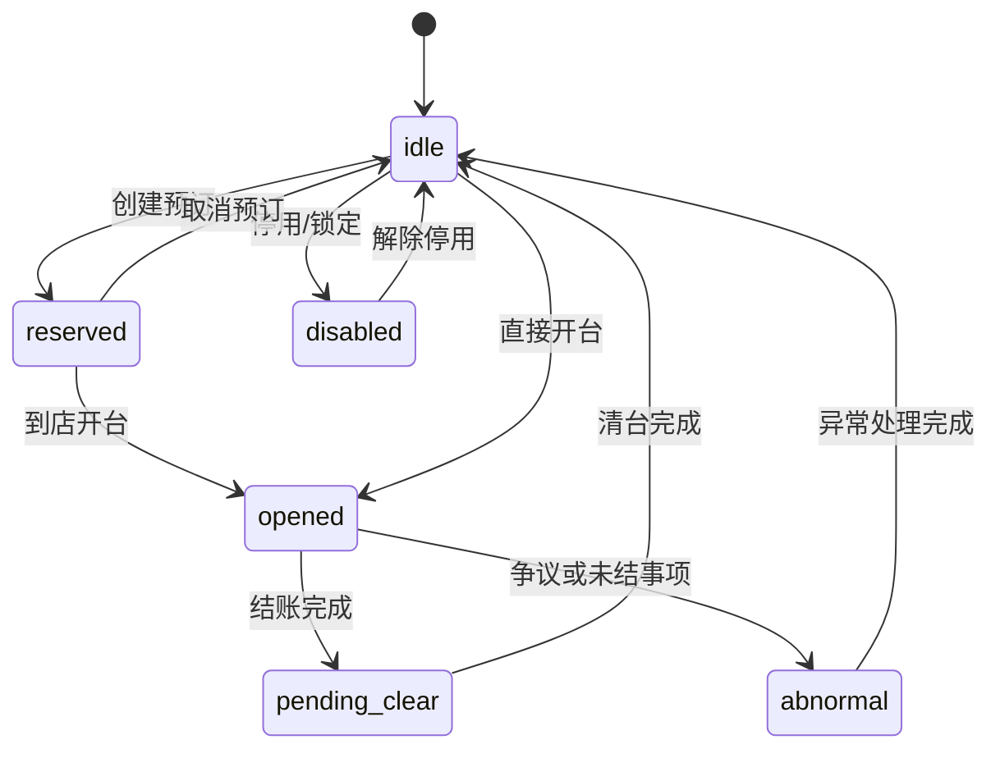
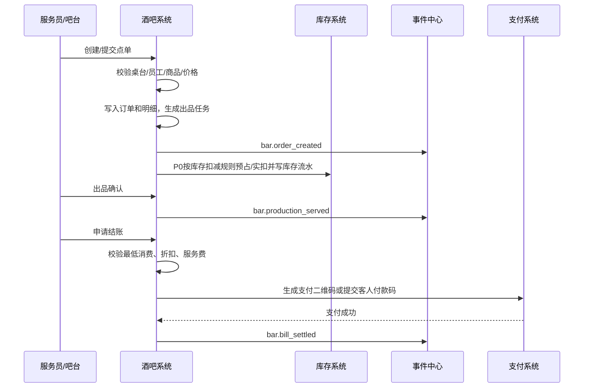

# 酒吧经营：桌台、点单、库存、存酒开发设计

> 版本：V0.x ｜ 最后更新：2026-06-20 ｜ 覆盖迁移基线：见各小节迁移号（最新 V124）｜ 状态：现行
> 新功能承接见 docs/v099-v124-feature-implementation-and-acceptance-spec-v0.1.md
> <!-- 文档goalP3(2026-06-20)：补版本/日期/覆盖迁移头，未改正文 -->

> **✅ R7 复审上修标注（2026-06-19，只读核验真实迁移/代码后回填）**
> R5 横幅原标注的订台定金/赠饮扣库存缺口已在本会话 P0 实现并落库（V072/V073/V079），以下逐条上修；存酒转赠/争议入口与按杯损耗强制采集保持开放。
> - **订台定金闭环已落地（V073）**：新建 `bar_deposit_rules`（固定额 `fixed` / 按最低消费比例 `min_consumption_ratio`，scope=bar/table_type/time_slot，取消免没收时限 `cancel_free_before_minutes` 后台可配）+ `bar_reservations` 定金结算字段，定金按规则计算入库、到店抵扣、取消按时限退/没收，不再硬编码 `deposit=0/not_required`。下方 R5-D11 小节的"现状空转"描述已被本次实现取代，仅"目标/验收"口径仍有效。
> - **赠饮核销→扣库存已落地（V072）**：链路 ticketing 核销 `entitlement_type='gift_drink'` 成功 → 发 Spring 事件 `ticket.gift_verified` → `BarGiftConsumer` 监听 → 生成 0 元 `bar_order(order_type='gift')` + 出品 ticket → `deliver` 调 `atomicDecreaseStock(redeem_consume)` 扣库存 → 回填 `inventory_movement_id` 到出品事件与桥表 `bar_gift_redemptions`（`verification_id` 唯一键保证幂等，冲正联动 `status=reversed` + 回补库存）。赠饮→吧台 SKU 映射来源 `entitlement_templates.bar_item_ref`(V076)；0 元赠饮单不计商户收入但进账单/留痕。**通票免费酒水平台↔酒吧结算（F-TXN-03 piece③b，2026-06-22）**：核销发放免费酒水后，平台按该酒水**内部结算价**（`bar_products.internal_settlement_price_cent`，V152；经 itemRef[库存物料]→bar_product 桥接 `findProductByInventoryItem`）向酒吧(merchant)挂应付（`ar_ap_items` direction=`payable`、source_type=`pass_drink_settlement`、source_id/幂等=verificationId）；赠饮冲正 → 对冲 `receivable`（同 source_id、净额归零）。仅商户吧(merchantId 非空) + 内部价>0 时结算；平台自营吧 / 无内部价跳过（向后兼容）。`BarGiftConsumer` 经 `BarReceivableLedgerService.createPayableForGiftSettlement`/`reverseGiftSettlementPayable` 实现，与核销主链同事务。
> - **酒吧账单免单/退款已落地（V079）**：`chk_bar_bill_adjustment_type` 扩 `{waiver, refund}`，`refunded_at` 仅 refund 落值用于经营日聚合冲减当日 net（与 finance/analytics 退款口径联动）。
> - **仍开放（P2 未做）**：退菜/退酒、反结、沽清 86、小费；存酒转赠(transfer) 无方法、争议仅枚举无入口；按杯损耗 pour cost **强制采集已落地（2026-06-30 回写，原标注过期）**：BarOrderService.resolvePourCost——strict 模式缺量抛 POUR_VOLUME_REQUIRED，兜底模式按 standard_pour_volume 计且落 inventory.loss_exception 标 needs_review（绝不静默 loss=0）；退菜退酒(voidOrderItem)/反结(reopenBill)均已实现且有验收测试；存酒侧高价值作废主管复核见供应链域 `inventory_high_value_reviews`。
> - **验收口径（已正式）**：订台付定金可回查、到店抵扣、取消按规则退/没收；赠饮权益核销后吧台库存相应减少且可对账。

#### R5-D11 订台定金现状与收口（2026-06-18 回填，未改代码）

R5 横幅已点出"订台定金闭环断裂"，此处把订台定金一条按"现状→目标→验收"三段式收敛，供开发期落地参照（设计目标仍以 §5.1.2、§6.3 订金规则为准，本小节不新增字段，仅明确收口口径与待补验收用例）。

| 维度 | 内容 |
|---|---|
| 现状（代码实况） | `createReservation` 硬编码 `deposit_amount_cent=0` / `deposit_status=not_required`，**定金金额不入库**；§6.3 设计的 `deposit_amount`/`deposit_rule`/`deposit_status` 字段后端未真实写值；§13.1 第 11 项、§5.1.2 的到店抵扣与取消退/没收逻辑因定金恒为 0 **形同空转**，前端订台页即便展示定金也无后端承接。 |
| 目标（P0） | **真实记录定金 + 到店抵扣 + 取消退/没收**：①创建订台时按 `deposit_rule`（固定额 / 按最低消费比例，二者后台可配）计算并落 `deposit_amount`，支付后 `deposit_status=paid`；②到店开台时订金转入账单抵扣项，`deposit_status=deducted`，写 `reservation.deposit_settled`；③主动取消按后台可配时限退（`refunded`）或没收（`forfeited`），写 `reservation.deposit_settled`（含原因/审批人）。退/没收时限作为后台可配项（2026-06-18 二轮业务裁决）。 |
| 候选验收（粗） | 创建订台可付定金且 `deposit_amount`>0 可回查；到店开台定金按抵扣项进账单、`deposit_status=deducted` 可查；规则时限内取消可退、超时限/爽约没收，退没收均有 `reservation.deposit_settled` 事件可对账。 |
| UI 验收用例需补 | 订台页定金展示与支付入口、到店抵扣在账单上的可视呈现、取消时退/没收提示与时限提示、定金状态（待付/已付/已抵扣/已退/已没收）在订台详情的可视回查——上述前端/一体机 UI 验收用例当前未编写，需在开发期补齐 UI 验收脚本。 |

> 说明：本小节只收敛 R5 审计裁决与验收口径，不修改 §5.1.2/§6.3 既有设计；若与 §6.3 订金规则文字有出入，以 §6.3 字段定义 + 本小节"目标/验收"为准。

本文档用于指导【酒吧经营：桌台、点单、库存、存酒】子系统进入后端、前端、安卓端和数据分析开发。

关联文档：

- `docs/system-development-spec.md`
- `docs/project-progress-dashboard.md`
- `docs/business-systems-breakdown.md`
- `docs/ticketing-pass-entitlement-development-design.md`
- `docs/foundation-systems-breakdown.md`

执行口径：本文负责酒吧桌台、点单、库存、存酒和卡座业务设计，不直接冻结正式后端路径。酒吧 P0 Controller、前端/平板 API client、SDK/mock 和接口自动化必须以 `docs/openapi/openapi-p0.yaml/json`、`p0-openapi-operation-acceptance-matrix-v0.1.md` 和 `p0-openapi-contract-closure-appendix-v0.1.md` 为准；未进入追溯附录并通过 `verify:openapi-closure` 的历史能力，不得作为正式联调或验收依据。

## 1. 模块定位

酒吧经营系统负责综合体内酒吧业态的独立运营管理。酒吧可以由平台自营，也可以出租给第三方酒吧公司运营。

本系统必须坚持以下原则：

| 原则 | 说明 |
|---|---|
| 酒吧和游乐独立 | 酒吧与游乐设施是不同经营主体，必须按 `merchant_id` 隔离 |
| 票务只提供权益 | 酒吧入场、酒水兑换来自票务权益；卡座预约入场名额由酒吧预约/卡座系统控制；桌台、点单、库存、存酒由酒吧系统负责 |
| 账单和库存分离 | 点单产生账单，账单完成后触发库存消耗；库存不直接依赖票务订单 |
| 存酒独立建模 | 存酒属于已售未取客户资产，不等同于可售库存 |
| 留痕优先自动化 | 订单来源、销售归属、开台服务、点单、出品、送达、结账、存取酒、出入库、报损、人工调整、异常首响、库房到后厨到客人的交接都必须写入事件中心 |
| 支持第三方运营 | 商户后台只允许查看和操作本酒吧商户数据 |

## 2. 业务边界

### 2.1 本模块负责

| 范围 | 说明 |
|---|---|
| 酒吧入场 | 酒吧通票、活动票、酒吧入场权益核销结果承接（年龄由综合体统一入场刷脸闸核验，售酒豁免逐单验龄/拒售，2026-06-24 改写，详见合规 §2） |
| 桌台卡座 | 桌台档案、预订、开台、转台、并台、低消、清台 |
| 点单 | 服务员点单、吧台点单、扫码点单入口预留、退单、赠送、折扣 |
| 账单 | 桌台挂账、吧台即时结账、低消校验、服务费、支付记录 |
| 商品 | 酒水、套餐、杯卖、瓶卖、简餐、服务费、活动商品 |
| 吧台出品 | 接单、制作、出品、取消、异常 |
| 存酒 | 存酒登记、取酒、剩余量、有效期、转赠、作废 |
| 库存 | 入库、出库、调拨、盘点、报损、库存余额 |
| 物料 | 酒水、果料、冰块、杯具、耗材、简餐原料 |
| 配方 BOM | 鸡尾酒、杯卖酒、简餐的物料消耗规则 |
| 报表 | 桌台收入、酒水销量、低消达成、库存损耗、存酒余额 |

### 2.2 本模块不直接负责

| 范围 | 边界 |
|---|---|
| 售票和通票配置 | 由票务通票系统负责 |
| 权益实例生成 | 由票务系统在支付出票后生成 |
| 酒吧入场权益扣次 | 由票务核销服务负责，酒吧系统接收入场结果 |
| 微信/支付宝清算 | 由支付结算系统负责，酒吧只记录账单支付结果 |
| 机器人调度算法 | 由第三方机器人系统负责，酒吧系统只创建配送需求和接收状态 |
| 视频原始存储 | 由第三方监控系统负责，酒吧系统只关联视频证据索引 |
| 完整会员体系 | 由会员系统负责，酒吧只引用客户和会员摘要 |

## 3. 领域模型

### 3.1 聚合划分

| 聚合 | 核心对象 | 职责 |
|---|---|---|
| 酒吧场地聚合 | `BarVenue`, `BarArea`, `BarTable` | 管理门店、区域、桌台卡座 |
| 桌台会话聚合 | `BarTableSession`, `BarReservation` | 管理预订、开台、转台、并台、清台 |
| 服务责任聚合 | `BarServiceResponsibility`, `BarServiceAction` | 管理销售归属、主责服务员、协助服务员、加单人、送达人和换人记录 |
| 卡座提成聚合 | `BarTableCommission` | 管理卡座销售归属、消费额基数、提成率、提成金额、复核和冲正 |
| 商品聚合 | `BarProduct`, `BarProductCategory`, `BarProductPrice` | 管理酒水、简餐、套餐、服务费 |
| 点单聚合 | `BarOrder`, `BarOrderItem`, `BarProductionTicket` | 管理点单、出品、取消、赠送、退单 |
| 账单聚合 | `BarBill`, `BarBillItem`, `BarBillPayment` | 管理挂账、低消、折扣、服务费、结账 |
| 存酒聚合 | `SavedBottle`, `SavedBottleMovement` | 管理客户存酒资产和取用记录 |
| 库存聚合 | `BarInventoryItem`, `BarStockBatch`, `BarStockMovement` | 管理入库、出库、调拨、盘点、报损 |
| 配方聚合 | `BarRecipe`, `BarRecipeItem` | 管理 BOM 和自动扣料 |
| 履约聚合 | `BarDeliveryTask`, `BarGoodsHandover` | 管理机器人或人工配送任务引用、后厨接收、服务员取走和送达确认 |

### 3.2 核心对象说明

| 对象 | 中文名 | 关键字段 | 说明 |
|---|---|---|---|
| `BarVenue` | 酒吧门店 | `merchant_id`, `venue_id`, `capacity`, `status` | 绑定多商户系统中的酒吧场地 |
| `BarArea` | 酒吧区域 | `bar_venue_id`, `area_id`, `area_type` | 大厅、卡座区、吧台区、库房 |
| `BarTable` | 桌台/卡座 | `table_no`, `table_type`, `min_spend_amount`, `status` | 管理可开台点位 |
| `BarReservation` | 桌台预订 | `customer_id`, `reserved_at`, `deposit_amount`, `deposit_status`, `order_source`, `status` | P0 必做一体机/线上订台+订金（见 §6.3、§13.1，finding kiosk-1） |
| `BarTableSession` | 开台会话 | `table_id`, `opened_by`, `customer_id`, `status` | 一次开台到结账清台的完整周期 |
| `BarServiceResponsibility` | 服务责任 | `session_id`, `order_id`, `sales_staff_id`, `primary_service_staff_id`, `assist_staff_ids`, `status` | 一桌客人或一笔订单的销售和服务责任链 |
| `BarServiceAction` | 服务动作 | `responsibility_id`, `action_type`, `staff_id`, `device_id`, `location_point_id`, `event_id` | 加单、送达、换人、异常处理等动作 |
| `BarProduct` | 酒吧商品 | `product_type`, `sale_unit`, `price`, `stock_deduct_mode` | 酒水、简餐、套餐、服务费 |
| `BarOrder` | 点单 | `session_id`, `order_source`, `status`, `total_amount` | 一次点单动作 |
| `BarOrderItem` | 点单明细 | `product_id`, `quantity`, `item_status` | 商品明细，支持退单和赠送 |
| `BarBill` | 酒吧账单 | `session_id`, `payable_amount`, `paid_amount`, `status` | 桌台账单或吧台账单 |
| `SavedBottle` | 存酒 | `customer_id`, `product_id`, `remaining_volume`, `expire_at`, `status` | 已售未取的客户资产 |
| `BarInventoryItem` | 库存物料 | `item_type`, `unit`, `cost_price`, `status` | 酒水、食材、耗材、杯具 |
| `BarStockBatch` | 库存批次 | `inventory_item_id`, `batch_no`, `quantity`, `expire_at` | 批次、成本、保质期 |
| `BarStockMovement` | 库存流水 | `movement_type`, `quantity`, `reason`, `operator_id` | 所有库存变化的依据 |
| `BarRecipe` | 配方 | `product_id`, `version`, `status` | 商品到物料的消耗配置 |
| `BarDeliveryTask` | 配送任务 | `task_type`, `source_point_id`, `target_point_id`, `status` | 机器人或人工配送任务 |
| `BarGoodsHandover` | 酒水交接 | `trace_code_id`, `handover_node`, `from_holder`, `to_holder`, `scanned_by`, `device_id`, `event_id` | 关联平台物品追踪码和操作交接记录 |

## 4. 状态机

### 4.1 桌台状态

> 修订说明（2026-06-07）：依《统一口径基准》D7「桌台 6 态权威集合」对齐 PRD §5 与本表，消除两文档状态命名/取值不一致（finding bar-5）。权威集合 = 空闲/已预留/已开台/待清台/停用/异常 → idle/reserved/opened/pending_clear/disabled/abnormal。原 `pending_payment` 为开台会话态（见 §4.2），不再在桌台态重复；原 `cleaning` 统一为 `pending_clear`（待清台）；原 `locked`（锁定/维修）并入 `disabled`（停用）；新增 `abnormal`（异常：争议或未结事项）。

| 状态 | 中文 | 说明 |
|---|---|---|
| `idle` | 空闲 | 可开台 |
| `reserved` | 已预留 | 有预订但未到店 |
| `opened` | 已开台 | 客人已入座，可点单、加单、核销、结账 |
| `pending_clear` | 待清台 | 已结账但现场未完成清理，不可再次开台 |
| `disabled` | 停用 | 维修、包场、人工锁定等桌台暂不可用 |
| `abnormal` | 异常 | 存在争议或未结事项，需要处理 |



### 4.2 开台会话状态

| 状态 | 中文 | 说明 |
|---|---|---|
| `active` | 进行中 | 可点单、加单、转台 |
| `pending_payment` | 待结账 | 已申请结账 |
| `paid` | 已支付 | 账单已结清 |
| `closed` | 已关闭 | 清台完成 |
| `cancelled` | 已取消 | 误开台或异常取消 |

### 4.3 点单状态

| 状态 | 中文 | 说明 |
|---|---|---|
| `draft` | 草稿 | 未提交 |
| `submitted` | 已下单 | 已进入出品或待出品 |
| `producing` | 制作中 | 吧台或厨房制作 |
| `served` | 已出品 | 已交付 |
| `partially_cancelled` | 部分取消 | 部分明细取消 |
| `cancelled` | 已取消 | 整单取消 |

### 4.4 账单状态

> 修订说明（2026-06-07）：依《统一口径基准》D7「账单 6 态权威集合」对齐 PRD §6 与本表，消除退款/异常状态缺失与命名歧义（finding bar-5）。权威集合 = 待结/部分支付/已结/部分退款/已退款/异常 → unpaid/partial_paid/settled/partial_refunded/refunded/abnormal，**落 `bar_bills.business_status`**（业务 6 态承载列，见 §6.9）。原"进行中(open)/计算中(calculating)"属开台会话进行中阶段，不作为账单结算态：账单一经确认即处于 `unpaid`，低消/折扣/服务费计算为账单内部瞬态（计算完成仍为 `unpaid`），不单列状态；退款用 `partial_refunded/refunded` 表达，并与 `bar_bill_payments.status=refunded` 协同；原 `voided`（作废）并入 `abnormal`（异常）并以 `voided` 子原因标记。
>
> 修订说明（2026-06-07 收口）：原措辞"落 `bar_bills.status`"更正为"落 `bar_bills.business_status`"——依 D7「6 态承载列=business_status，记录级 status 仅表 active/void」原则，6 态状态机必须落业务态列而非记录级 status 列，避免与软删除/作废的记录级状态混淆（依据 finding dup-tables-3/4、D7）。

| 状态 | 中文 | 说明 |
|---|---|---|
| `unpaid` | 待结 | 已确认消费，等待支付或确认 |
| `partial_paid` | 部分支付 | 混合支付或分次支付，已收部分金额 |
| `settled` | 已结 | 账单结清完成 |
| `partial_refunded` | 部分退款 | 部分金额退款 |
| `refunded` | 已退款 | 全额退款或账单冲销 |
| `abnormal` | 异常 | 争议、免单、补录、支付差异或作废 |

### 4.5 存酒状态

| 状态 | 中文 | 说明 |
|---|---|---|
| `stored` | 已存 | 可取用 |
| `partially_used` | 部分取用 | 剩余量大于 0 |
| `finished` | 已取完 | 剩余量为 0 |
| `expired` | 已过期 | 超过有效期 |
| `transferred` | 已转赠 | 所有权转移 |
| `disputed` | 争议 | 归属/数量争议冻结，待人工或主管处置后流转 <!-- 修正(2026-06-19 R5业务HTML缺口审计 F4/F7)：补争议态 --> |
| `voided` | 已作废 | 丢失、破损、异常处理 |

### 4.6 库存流水状态

| 状态 | 中文 | 说明 |
|---|---|---|
| `draft` | 草稿 | 未确认 |
| `pending_approval` | 待审批 | 高价值或异常操作需审批 |
| `confirmed` | 已确认 | 已影响库存余额 |
| `reversed` | 已冲正 | 原流水被反向冲正 |
| `rejected` | 已驳回 | 审批不通过 |

## 5. 核心业务流程

### 5.1 桌台流程

#### 5.1.1 直接开台

1. 员工在安卓端或后台选择空闲桌台。
2. 系统校验员工当班、设备绑定、桌台归属商户和区域权限。
3. 录入人数、客户手机号或会员、服务员、低消规则。
4. 创建 `bar_table_sessions`。
5. 创建或打开 `bar_bills`。
6. 桌台状态改为 `opened`。
7. 写入 `bar.table.opened` 事件。

#### 5.1.2 预订后开台

1. 创建预订（记录来源/终端/责任人/设备/点位，见 §6.3），桌台状态变为 `reserved`；订金按 `deposit_rule` 计算并支付，`deposit_status = paid`。
2. 到店后由员工执行开台，记录 `arrived_at`。
3. 如果有订金，订金进入账单抵扣项，`deposit_status = deducted`，写入 `reservation.deposit_settled`。
4. 预订状态变为 `arrived`。
5. 进入直接开台后续流程。

> 修订说明（2026-06-07）：依 finding kiosk-2，补订金支付、到店抵扣、`deposit_status` 流转与结算事件。取消/爽约退没收规则见 §6.3"订金规则"。

#### 5.1.3 转台

1. 员工选择当前会话和目标空闲桌台。
2. 校验目标桌台可用、同一酒吧商户、同一门店。
3. 原桌台状态改为 `pending_clear` 或 `idle`。<!-- 改（2026-06-07）：finding bar-5，cleaning 统一为 D7 的 pending_clear -->
4. 目标桌台状态改为 `opened`。
5. 会话 `table_id` 更新为目标桌台。
6. 写入 `bar.table.transferred` 事件。

#### 5.1.4 清台

1. 账单支付完成。
2. 桌台进入 `pending_clear`。<!-- 改（2026-06-07）：finding bar-5，cleaning 统一为 D7 的 pending_clear -->
3. 员工确认清洁完成。
4. 桌台变为 `idle`，会话变为 `closed`。
5. 写入 `bar.table.cleared` 事件。

### 5.2 点单与账单流程



> 修订说明（2026-06-07 收口）：上图事件名同步对齐权威字典命名（finding baseline-conf-5、D4）：`bar.order.created`/`bar.order.submitted` 合并为 `bar.order_created`（创建即提交为同一登记动作），`bar.order.served` → `bar.production_served`，`bar.bill.paid` → `bar.bill_settled`。

#### 5.2.1 点单规则

| 规则 | 说明 |
|---|---|
| 桌台/卡座点酒必须绑定 `bar_table_session_id` | 否则不能提交点酒订单 |
| 平板必须绑定酒吧和卡座/桌台/吧台位 | 用于确认消费位置、服务员责任和最低消费规则 |
| 商品价格以下单快照为准 | 后续改价不影响历史订单 |
| 提交前必须校验最低消费 | 当前点酒金额未达到最低消费时不能提交订单 |
| 取消点单必须填写原因 | 高价值商品取消需主管权限 |
| 赠送必须有权限 | 赠饮、免单、折扣都要留痕 |
| 酒水兑换权益不直接等于点单 | 先核销票务权益，再生成兑换类订单或账单抵扣 |
| 售酒年龄继承入场闸（售酒豁免） | 全部售酒点在综合体统一入场刷脸闸内 → 入场闸核验年龄（满 18 岁），售酒环节继承入场结论、**不逐单验龄、不醉酒拒售**（2026-06-24 售酒豁免收口）。入场闸开关 `face.verification.enabled` 关时靠制度管控兜底（人工证件/巡查），开真实接入后 fail-closed 判龄。原 bar 侧 `BarAgeVerificationService`/`createAgeVerification`/`bar_age_verifications`/`refuse_*` 已移除，bar 不再独立验龄/拒售/记录（详见合规 §2） |

#### 5.2.2 低消计算

最低消费按开台会话和本次点酒草稿计算：

```text
是否可提交 = 可计入最低消费金额 >= 桌台/卡座最低消费
最低消费差额 = max(桌台/卡座最低消费 - 可计入最低消费金额, 0)
```

P0 规则：

- 酒水、套餐、简餐默认计入低消。
- 服务费、赠送、已取消项不计入低消。
- **票务权益、通票、卡座预约入场名额一律不抵扣最低消费**：低消只按酒吧点酒/套餐/简餐等实际消费金额计算；票务与卡座预定只解决入场或预定资格，不参与低消金额抵扣。
- **P0 低消一律不按人数计算**：最低消费只取桌台/卡座按时间/位置配置的 `min_spend_amount` 快照，`bar_table_sessions.guest_count` 仅作开台人数记录，不参与上述任一公式。<!-- 增（2026-06-07）：finding bar-6，明确 P0 不按人数、guest_count 仅记录，消除"原则上"歧义 -->
- 未达到最低消费时，平板显示差额提示，不能提交点酒订单。
- P0 不做“结账时自动补低消差额”；如运营需要补差，后续按 P1 账单规则单独设计。

P1/P2 扩展：

- 不同商品配置是否计入低消。
- 不同时段、活动、卡座类型配置不同低消。
- **~~按人数低消例外（后置）~~（2026-07-22 定案废弃）**：用户 2026-07-22 拍板最低消费**绝对不按人数计**、取消"原则上"活口，`by_headcount` 扩展点**不再预留**；低消计算固定 `by_position`。<!-- 改（2026-07-22）：CONF-02 定案取消按人数例外，原 finding bar-6 预留作废 -->

#### 5.2.3 卡座预约入场名额

卡座预约可以附带入场名额，但它不是通票抵扣，也不是低消抵扣。

P0 规则：

1. 不同卡座/桌台可配置不同 `included_entry_guest_count`。
2. 卡座预定者可带不超过该名额的客人免除通票进入酒吧。
3. 免通票入场只允许进入预定卡座所在酒吧，不允许进入其他酒吧、其他区域或其他游乐项目。
4. 入场仍必须通过年龄核验、容量卡控、黑名单/风险规则和现场责任留痕。
5. 超出名额的客人必须按正常票务/入场规则购买或核销对应权益。
6. 该入场名额不计入最低消费金额，不生成票务通票权益，不参与票务分账。

并发与幂等要求：

1. `/api/v1/bar/reservations/{id}/entry-allowance/verify` 请求必须携带 `idempotencyKey`、`reservation_id`、`bar_venue_id`、`device_id`、`staff_id`、本次入场人数；如能识别具体客人，还应携带不可逆哈希后的 `entry_guest_identifier_hash`。
2. 服务端必须以预约入场额度为准做事务校验，可采用行锁（如 `SELECT ... FOR UPDATE`）或乐观锁版本号，已提交的 `bar_table_guest_checkins` 才计入已用额度。
3. 同一 `reservation_id + idempotencyKey` 重试必须返回第一次处理结果，不得重复扣占名额；同一可识别客人不得在同一预约下重复免通票入场。
4. 成功写入 `bar.table_guest.checked_in`，拒绝写入 `bar.table_guest.rejected`，两者都要记录剩余额度、拒绝原因、设备、员工和点位。

### 5.3 存酒流程

#### 5.3.1 存酒登记

1. 客人购买整瓶酒或使用套餐中的整瓶酒。
2. 员工选择“存酒”。
3. 系统校验订单已支付或权益已核销。
4. 录入客户手机号/会员、酒品、规格、剩余量、有效期、存放位置。
5. **必填采集取酒核身与举证三项：姓名/昵称（`customer_name_or_nickname`）、瓶底标签数值（`bottle_label_value`）、登记照片（`registration_photo_refs`）**；可选填人工备注（`manual_note`）。缺任一必填项不允许提交登记。<!-- 增（2026-06-07）：finding bar-4/supply-2，登记强制采集三项必填字段 -->
   - **散客存酒**：`customer_id` 可空，散客（无会员）允许存酒；核身落 `customer_phone` + `customer_name_or_nickname` + `bottle_label_value`。登记必填字段与契约口径以票务设计 `ticketing-pass-entitlement-development-design.md` §10.4.1 为权威，本文不重复长篇。<!-- 修正(2026-06-19 R5业务HTML缺口审计 F4/F7)：customer_id 可空（散客存酒）、customer_phone 核身、口径指向文件1 -->
6. 生成存酒编号和二维码。
7. 库存从可售库存转为已售未取库存。
8. 写入 `bar.saved_bottle.created` 和库存流水事件。

#### 5.3.2 取酒

1. 客人提供手机号、会员码、存酒二维码或企业微信客户身份。
2. 员工查询存酒记录。
3. 系统校验状态、有效期、客户身份、当前酒吧门店；**核身必须比对登记的瓶底标签数值（`bottle_label_value`）且比对姓名/昵称（`customer_name_or_nickname`）同时通过方可放行，不止手机号 + 验证码**；任一不一致进入人工复核或可登记为 `disputed` 争议态。<!-- 增（2026-06-07）：finding bar-4，取酒核身纳入姓名/昵称与瓶底标签数值比对；修正(2026-06-19 R5业务HTML缺口审计 F4/F7)：强表述"标签+昵称必须比对通过，不止手机号+验证码"，补争议入口，口径以文件1 §10.4.1 为权威 -->
4. 录入本次取用量。
5. 更新剩余量。
6. 如果剩余量为 0，状态变为 `finished`；否则为 `partially_used`。
7. 写入 `bar.saved_bottle_picked_up` 事件。

#### 5.3.3 转赠（`transferSavedBottle`）——已下线（2026-06-24）

> 2026-06-24：存酒对他人转赠已下线（同积分转赠，HTML 未授权存酒对外转赠）。`transferSavedBottle` 领域方法、`POST /api/v1/inventory/saved-bottles/{id}/transfer` 端点及测试已移除；`saved_bottle_transfers` 表、`SavedBottleTransferRecord`/`SavedBottleTransferRequest`、repo `saveSavedBottleTransfer` 保留为孤儿待清理迁移统一删。**散客存酒登记（`createSavedBottle`，customer_id 可空）、取酒核身、争议处置（§5.3.3a）、作废均保留不变。**

#### 5.3.3a 争议处置（`disputed`）<!-- 修正(2026-06-19 R5业务HTML缺口审计 F4/F7)：补 disputed 争议态入口 -->

存酒归属/数量发生争议（核身不通过、客户异议等）时，提供争议登记入口将记录置为 `disputed`（§4.5），冻结取酒/转赠，待人工或主管处置后流转回 `stored`/`partially_used` 或转 `voided`。口径以 `ticketing-pass-entitlement-development-design.md` §10.4.1 为权威。

#### 5.3.4 作废

适用场景：

- 已过期。
- 破损。
- 丢失。
- 客户确认放弃。
- 风控或纠纷冻结后处理。

作废必须填写原因、上传证据，必要时主管审批。**高价值存酒作废必须同时上传照片和视频双证据**（`evidence_ref` 区分 `photo_refs` 与 `video_refs`，高价值场景二者均必填）并主管复核。<!-- 增（2026-06-07）：finding supply-3，高价值作废双证据强制，消除"证据"泛化与"拍照/视频"二选一歧义 -->

> **业务确认(2026-06-19)** `R6 业务确认回填(2026-06-19)`：散客（无 `customer_id`）存酒风控口径确认为**不限瓶数**（取消原 R6 默认"单手机号≤3 瓶"上限），仅按**存期默认 90 天（后台可配）+ 到期提醒 + 作废须主管复核**管控；口径与 `ticketing-pass-entitlement-development-design.md` §10.4.1 权威小节一致。

### 5.4 库存出入库流程

#### 5.4.1 采购入库

1. 库管创建入库单。
2. 录入供应商、批次、成本、数量、保质期。
3. 可上传票据照片。
4. 确认后生成 `inbound` 库存流水。
5. 增加总库库存。
6. 写入 `inventory.inbound_confirmed` 事件。

#### 5.4.2 总库调拨到吧台

1. 吧台或店长发起领料申请。
2. 库管确认出库。
3. 总库减少，吧台库存增加。
4. 生成一条 `transfer_out` 和一条 `transfer_in` 流水。
5. 可创建机器人补货任务。
6. 写入 `inventory.transferred` 事件。

#### 5.4.3 销售扣减

P0：

- 必须对明确物品、明确数量、明确库存位置、明确责任人的场景做库存扣减或库存状态转移，不能只记录销售数量。
- 整瓶酒销售、吧台买酒、酒水兑换、积分兑换礼物/酒水、客人存酒登记/取酒、审批后的报损/盘点差异必须形成库存流水。
- 杯卖按后台配置的标准出酒量/容量扣减；实际超出标准容量的部分记为损耗。

P1：

- 复杂批次成本、保质期预警、安全库存和更细库位策略。

P2：

- 鸡尾酒和简餐按 BOM 自动扣物料。
- 支持损耗率和成本核算。

#### 5.4.3.1 P0 库存扣减审计结论

本轮对票务、酒吧、供应链、积分兑换和终端文档回扫后，P0 库存扣减结论如下：

| 库存动作 | P0 结论 | 说明 |
|---|---|---|
| 票务库存锁定/释放/售出 | 必须做 | 票务库存由 `ticket_inventories` 承载，支付、取消、退款必须影响库存桶 |
| 权益核销次数扣减 | 必须做 | 权益 `remaining_times` 与核销记录必须事务一致 |
| 整瓶酒销售/吧台买酒 | 必须扣减 | 明确 SKU、数量和库存位置，必须形成 `inventory stock movement（movement_type=redeem_consume/order_consume）` |
| 按杯销售 | 必须按标准容量扣减 | 按 `standard_pour_volume` 扣减，实际超量记损耗 |
| 赠饮/酒水兑换权益 | 必须扣减 | 核销后生成 0 元兑换点单，出品时扣减吧台库存 |
| 积分兑换礼物/酒水 | 必须扣减 | 兑换成功并领取时扣减礼物或酒水库存 |
| 客人存酒登记 | 必须做状态转移 | 从可售/吧台库存转为已售未取或客户存酒状态 |
| 客人取酒 | 必须扣减存酒剩余量 | 按取用量更新剩余量，归零后关闭存酒 |
| 报损/作废 | 审批后必须扣减 | 高价值场景必须照片+视频双证据和主管复核 |
| 盘点差异 | 审批后必须调整 | 盘亏扣减、盘盈/报溢增加，均需留痕 |

审计结论：P0 强制库存扣减适用于“可明确物品、数量、位置、责任人”的场景；复杂配方 BOM、鸡尾酒/简餐多物料自动扣料、批次成本精算和自动补货预测进入 P1/P2。P0 不允许用“只发事件、后续再扣”替代上述必扣场景，但允许通过同步事件驱动酒吧库存模块在同一业务闭环内落账。

#### 5.4.4 盘点

1. 库管创建盘点单。
2. 系统记录账面库存。
3. 员工录入实际库存。
4. 系统计算盘盈盘亏。
5. 差异超过阈值时需要审批；**高价值物料的盘点差异必须同时上传照片和视频双证据**（`photo_refs` 与 `video_refs` 均必填）。<!-- 增（2026-06-07）：finding supply-3，盘点差异高价值双证据强制（原文未提证据） -->
6. 审批通过后生成盘点调整库存流水（盘亏走 `count_adjust`，盘盈/报溢走 `surplus`，见 §6.16）。<!-- 改（2026-06-07）：finding supply-5，盘盈/报溢独立为 surplus 类型 -->
7. 写入 `inventory.counted` 和风险事件。

#### 5.4.5 报损

1. 员工提交报损。
2. 选择物料、数量、原因。
3. 高价值酒水必须**同时上传照片和视频双证据**（`photo_refs` 与 `video_refs` 均必填）并经主管审批。<!-- 改（2026-06-07）：finding supply-3，报损高价值由"仅照片"升为"照片和视频"双证据 -->
4. 审批通过后扣减库存。
5. 写入 `inventory.damaged` 事件。

## 6. 数据库表结构

字段命名建议使用 PostgreSQL snake_case。所有表默认包含：

```text
id, created_at, updated_at, deleted_at, created_by, updated_by, status, remark
```

### 6.1 bar_venues 酒吧门店扩展表

| 字段 | 类型 | 说明 |
|---|---|---|
| `id` | uuid | 主键 |
| `merchant_id` | uuid | 酒吧商户 |
| `venue_id` | uuid | 多商户系统场地 |
| `name` | varchar | 酒吧名称 |
| `business_hours` | jsonb | 营业时间 |
| `capacity` | int | 最大容量 |
| `current_guest_count` | int | 当前在场人数 |
| `status` | varchar | `preparing/open/paused/closed` |

索引：

- `idx_bar_venues_merchant_id`
- `idx_bar_venues_venue_id`

### 6.2 bar_tables 桌台表

> 修订说明（2026-06-07 收口）：本表为 `bar_tables` 的**唯一权威定义**（承载酒吧实现），foundation-database §6A.1 不再重复建表、仅保留 6 态核对指针（依据 finding dup-tables-3/7）。本次补两项：(1) 新增 `business_status` 业务 6 态承载列，落 D7「桌台 6 态权威集合」（idle/reserved/opened/pending_clear/disabled/abnormal），与点位级 `status`（记录级 active/void/inactive，表桌台档案是否启用，**不承载业务流转态**）严格分离，消除"单一 status 顶替业务态"问题（finding dup-tables-3、D7）；(2) 预留 `project_id`（综合体归属，原始需求），与 foundation 其余主表对齐。

| 字段 | 类型 | 说明 |
|---|---|---|
| `id` | uuid | 主键 |
| `project_id` | uuid | 所属综合体（项目）归属，预留多综合体隔离（原始需求） |
| `bar_venue_id` | uuid | 酒吧门店 |
| `merchant_id` | uuid | 商户 |
| `location_point_id` | uuid | 点位 |
| `table_no` | varchar | 桌台编号 |
| `table_name` | varchar | 桌台名称 |
| `table_type` | varchar | `normal/booth/private_room/bar_seat` |
| `capacity` | int | 可坐人数 |
| `min_spend_amount` | bigint | 低消金额，单位分 |
| `service_fee_rate` | numeric | 服务费比例 |
| `business_status` | varchar | **业务桌台 6 态（D7 权威承载列）**：`idle`(空闲)/`reserved`(已预留)/`opened`(已开台)/`pending_clear`(待清台)/`disabled`(停用)/`abnormal`(异常)；CHECK 取值与 §4.1 逐项对应，不得用 `status` 顶替 |
| `status` | varchar | **记录级状态**（非业务态）：`active`(启用)/`void`(已删除/作废)；表桌台档案是否启用，配合软删除/审计字段 |

约束：

- 同一 `bar_venue_id + table_no` 唯一。
- `business_status` 承载业务流转（见 §4.1 状态机），`status` 仅承载记录级启用/作废；二者分离，不得混用。

### 6.3 bar_reservations 预订表

> 修订说明（2026-06-07）：依 finding kiosk-2/kiosk-3 补订金规则字段（金额/比例/可配置、`deposit_status`、退没收规则）与来源/创建终端/责任人/设备/点位/到店取消时间等留痕字段，使一体机订台+定金可编码、可区分来源、可满足设备/点位留痕（与基准 D5 终端枚举、PRD §4 订台订单/§9 验收一致）。

| 字段 | 类型 | 说明 |
|---|---|---|
| `id` | uuid | 主键 |
| `bar_venue_id` | uuid | 酒吧 |
| `table_id` | uuid | 桌台，可为空 |
| `customer_id` | uuid | 客户；外键指向 foundation `customers.id`（散客无会员时可空，核身用 `customer_phone`/`customer_name_or_nickname`） |
| `contact_name` | varchar | 联系人 |
| `contact_phone` | varchar | 联系电话 |
| `reserved_at` | timestamptz | 预订时间 |
| `guest_count` | int | 人数 |
| `order_source` | varchar | 来源渠道：`app/miniapp/kiosk/sales_staff` |
| `created_terminal` | varchar | 创建终端类型，取基准 D5 十端枚举（如 `kiosk/app/miniapp/staff_work_phone`） |
| `created_by` | uuid | 创建人（客户自助或员工账号） |
| `sales_staff_id` | uuid | 销售归属员工，可为空 |
| `sales_staff_position_type_snapshot` | varchar | 销售归属员工岗位快照；`sales_person` 按销售人员提成率，其他岗位按非销售人员提成率 |
| `sales_commission_rate_snapshot` | numeric | 销售提成率快照：销售人员默认 `0.15`，非销售人员默认 `0.10` |
| `device_id` | uuid | 创建设备 |
| `location_point_id` | uuid | 点位，可为空 |
| `deposit_amount` | bigint | 订金金额，单位分；按 `deposit_rule` 计算落定值 |
| `deposit_rule` | jsonb | 订金计算规则快照：`{mode: fixed/percent, value, configurable}`，平台/商户可配置 |
| `deposit_status` | varchar | `unpaid/paid/deducted/refunded/forfeited` |
| `arrived_at` | timestamptz | 到店时间，可为空 |
| `cancelled_at` | timestamptz | 取消时间，可为空 |
| `cancel_reason` | text | 取消原因，可为空 |
| `status` | varchar | `pending/confirmed/arrived/cancelled/no_show` |

订金（定金）规则（P0，finding kiosk-2）：

- 订金金额支持**固定金额**或**按桌台低消比例**两种计算方式（`deposit_rule.mode = fixed/percent`），由平台配置默认、商户可申请调整（`deposit_rule.configurable`）。金额一律落整数分（基准 D1）。
- 到店开台：订金转入账单抵扣项（见 §5.1.2），`deposit_status = deducted`。
- 主动取消：按取消时点与营业规则决定退还或没收——到店前规定时限内取消可退（`refunded`），超时限或 `no_show` 爽约则没收（`forfeited`）；退款走 §7.3 退款审批与外部支付冲正。
- 退/没收结果写入事件（见 §9.1 `reservation.deposit_settled`），便于对账与争议举证。
- 卡座销售归属在创建订台或到店开台前确定；如后续变更 `sales_staff_id`，必须填写原因并写 `order.sales_attributed`，保留变更前后岗位和提成率快照。

### 6.3a 订卡邀请函（V155，扩展卡座预订，不另起独立实体）

> 新增（2026-06-23，业主 2026-06-22 口述 + 2026-06-23 拍板「两步确认」+「连客人端全链」）：**订卡客人无需买通票、只进定卡酒吧**；持函人可把邀请函（二维码，注明酒吧/卡座/卡座可进人数）转发给朋友，朋友在客人端**确认接受**先占一个名额，到店再扫码核验入场；**「已确认 + 已入场」总人数 ≤ 卡座可进人数（capacity）**。本特性以预订列 + 子表承载，复用 `bar_tables.capacity`（V013）与既有入场核验机理，不另起独立实体。

`bar_reservations` 增邀请函列（V155）：`invitation_token`（不可猜随机串，唯一索引，供 confirm/entry 反查）、`invitation_signature`（HMAC-SHA256 防伪，范式同门票 `TicketCredentialSigner`，绑定预订/酒吧/卡座/容量/token）、`invitation_capacity`（签发时 `bar_tables.capacity` 快照，作总人数上限）、`invitation_status`（`none`/`active`/`revoked`）、`invitation_issued_at`。

新子表 `bar_reservation_invitation_members`（预订子记录）：

| 字段 | 类型 | 说明 |
|---|---|---|
| `id` | varchar | 主键 |
| `reservation_id` | varchar | 所属预订（FK→bar_reservations） |
| `bar_id` | varchar | 酒吧 |
| `member_identifier` | varchar | 成员标识：朋友的 `customer_id`（持函人散客无则 `holder:<reservation_id>`） |
| `member_customer_id` | varchar | 关联客人 ID，可空 |
| `is_holder` | boolean | 是否持函人（签发时自动占一名额） |
| `status` | varchar | `confirmed`（已确认占位）/`entered`（已入场）/`revoked` |
| `confirmed_at` / `entered_at` | timestamptz | 确认 / 入场时点 |
| `device_id` | varchar | 入场核验设备，可空 |

`UNIQUE(reservation_id, member_identifier)` 保证同一朋友确认幂等、不重复占名额。

**两步流程**：
1. **签发（staff，`bar.reservation.invitation.manage`）** `POST /bar/reservations/{id}/invitation`：capacity≤0 拒 `BAR_INVITATION_CAPACITY_REQUIRED`；生成 token+签名、`status=active`、持函人自动入一条 `is_holder=true` 成员（占一名额）；已 active 幂等返回（不重置 token，避免已转发二维码失效）。`GET .../invitation` 查视图（含容量/已确认/已入场计数与成员明细）；`POST .../invitation/revoke` 吊销。
2. **朋友确认（客人端自助，两步之第一步）** `POST /customer/bar-invitations/confirm`（X-Customer-Token 鉴权，能力 `not_applicable`，不经 requirePermission，对齐 `createBarReservation`）：按 token 反查预订→`active` 校验→`confirmed < capacity` 否则 `BAR_INVITATION_CAPACITY_EXHAUSTED`→落 `confirmed` 成员（`member_customer_id` = 确认人）；同一朋友重复确认幂等返回原成员。
3. **入场核验（门口 staff/设备，复用 `bar.table.guest_checkin`）** `POST /bar/reservations/{id}/invitation/entry-verify`：先按权威预订字段（预订/酒吧/卡座/容量/token）重算规范串、常量时间比对 `invitation_signature`，失配（绕过签发改库篡改绑定）拒 `BAR_INVITATION_SIGNATURE_INVALID`；`credential_payload` = 成员标识；成员须 `confirmed`（否则 `BAR_INVITATION_MEMBER_NOT_CONFIRMED`），标 `entered`，**已入场 ≤ capacity**（否则 `BAR_INVITATION_CAPACITY_EXHAUSTED`），跨吧 `BAR_SCOPE_MISMATCH`。**持函免通票**：此入场路径仅校验「防伪签名 + 是否已确认成员 + 容量 + 同吧」，不校验通票——确认成员即可进定卡吧。

**提成**：订卡客人消费走正常账单（有 `sales_staff_id` 即计销售提成），与通票相反（通票免费酒水才排除提成，见 §6.9A.2）。

### 6.4 bar_table_sessions 开台会话表

| 字段 | 类型 | 说明 |
|---|---|---|
| `id` | uuid | 主键 |
| `bar_venue_id` | uuid | 酒吧 |
| `merchant_id` | uuid | 商户 |
| `table_id` | uuid | 当前桌台 |
| `reservation_id` | uuid | 预订，可为空 |
| `customer_id` | uuid | 主客户，可为空；外键指向 foundation `customers.id`（散客无会员时可空，核身用 `customer_phone`/`customer_name_or_nickname`） |
| `guest_count` | int | 人数 |
| `opened_by` | uuid | 开台员工 |
| `opened_device_id` | uuid | 开台设备 |
| `opened_at` | timestamptz | 开台时间 |
| `closed_at` | timestamptz | 关闭时间 |
| `min_spend_amount` | bigint | 本次低消快照 |
| `status` | varchar | 会话状态 |

索引：

- `idx_bar_table_sessions_table_status`
- `idx_bar_table_sessions_merchant_opened_at`

### 6.5 bar_product_categories 商品分类表

| 字段 | 类型 | 说明 |
|---|---|---|
| `id` | uuid | 主键 |
| `merchant_id` | uuid | 商户 |
| `bar_venue_id` | uuid | 酒吧 |
| `name` | varchar | 分类名 |
| `sort_order` | int | 排序 |
| `status` | varchar | 状态 |

### 6.6 bar_products 商品表

| 字段 | 类型 | 说明 |
|---|---|---|
| `id` | uuid | 主键 |
| `merchant_id` | uuid | 商户 |
| `bar_venue_id` | uuid | 酒吧 |
| `category_id` | uuid | 分类 |
| `product_code` | varchar | 商品编码 |
| `name` | varchar | 商品名 |
| `product_type` | varchar | `bottle/cup/cocktail/package/snack/material/service` |
| `sale_unit` | varchar | 销售单位 |
| `price` | bigint | 售价，分 |
| `cost_price` | bigint | 成本价，分 |
| `stock_deduct_mode` | varchar | `none/direct/recipe/manual` |
| `counts_for_min_spend` | boolean | 是否计入低消 |
| `standard_pour_volume` | numeric | 按杯销售每杯标准出酒量/容量，`product_type=cup` 时配置，可为空 |
| `pour_volume_unit` | varchar | 出酒量单位：`ml/oz`，与 `standard_pour_volume` 配套 |
| `loss_threshold` | numeric | 单次出酒损耗超标阈值（损耗严重阈值），超过则生成损耗异常事件，可为空 |
| `status` | varchar | `active/inactive/sold_out` |

约束：

- 同一商户下 `product_code` 唯一。

> 修订说明（2026-06-07）：依 finding bar-2，新增 `standard_pour_volume/pour_volume_unit/loss_threshold` 三字段承接 PRD §11 第 6 条"每杯标准出酒量/超标记损耗/损耗严重核查"已拍板规则。`loss_threshold` 区别于配方层 `bar_recipe_items.loss_rate`（后者为固定损耗率，无法表达"本次实际出量 vs 标准容量"的差异损耗）。单次实际出酒量与损耗量记录在出品扣减流水（见 §6.16）。

> 物理列与内部结算价（2026-06-23，回写实现事实）：本节为逻辑设计，物理列以迁移为准——售价物理列为 `price_cent`（分），逻辑 `cost_price` 未单独落地。**V152 新增 `internal_settlement_price_cent BIGINT`（内部结算价，分；可空=未录入则不参与结算/提成扣减；非空 CHECK ≥0）**：作为 ① 通票免费酒水「平台↔酒吧结算」与 ② 吧台随单赠送项「按内部价 × 数量从销售提成基数扣除」（F-TXN-05，见 §6.9A.2）的统一成本价基。
>
> 权限与录入页（2026-06-23）：内部结算价属敏感成本数据（业主 2026-06-23 确认独立授权）。**V154 新增权限 `bar.product.view`（medium，查看商品目录含内部价）与 `bar.product.manage`（high，录入/修改商品含内部价）**；`GET /api/v1/bar/products` 改用 `bar.product.view`、`POST /api/v1/bar/products` 改用 `bar.product.manage`（不再搭便车 `bar.order.create`）。运营在后台「商品管理」页（**ADM-BAR-005**，`/admin/bar/products`，page-permission 矩阵 UI-ADM-BAR-005）录入售价与内部结算价。

### 6.7 bar_orders 点单表

| 字段 | 类型 | 说明 |
|---|---|---|
| `id` | uuid | 主键 |
| `order_no` | varchar | 点单号 |
| `merchant_id` | uuid | 商户 |
| `bar_venue_id` | uuid | 酒吧 |
| `session_id` | uuid | 开台会话，吧台散客可为空 |
| `table_id` | uuid | 桌台，可为空 |
| `bill_id` | uuid | 账单 |
| `order_source` | varchar | `waiter/bar_counter/customer_qr/entitlement_redeem` |
| `ordered_by` | uuid | 员工或客户 |
| `device_id` | uuid | 设备 |
| `total_amount` | bigint | 原价合计 |
| `discount_amount` | bigint | 优惠 |
| `payable_amount` | bigint | 应付 |
| ~~`age_verified`/`age_verify_method`/`age_verify_by`/`age_verified_at`/`age_verify_point`/`refuse_reason`/`refuse_by`/`refuse_at`~~ | — | **已下线（2026-06-24 售酒豁免）**：点酒环节年龄二次复核/拒售整体移除，售酒继承统一入场闸结论、不逐单验龄/拒售。这些 V013 列保留为孤儿、待清理迁移统一删，新流程不再写入 |
| `status` | varchar | 点单状态 |
| `cancel_reason` | text | 取消原因 |

> 修订说明（2026-06-07 补字段；**2026-06-24 售酒豁免下线**）：原依合规 C1 补的点酒表年龄核验/拒售字段（`age_verified`/`age_verify_*`/`refuse_*`）已整体下线——售酒年龄核验由综合体统一入场刷脸闸 18+ 承接、售酒继承入场结论不逐单验龄/拒售（合规 §2 2026-06-24 改写）；`BarAgeVerificationService`、`bar_age_verifications` 表、`/api/v1/bar/age-verifications` 端点已移除，上述 V013 列保留为孤儿待清理迁移。

索引：

- `idx_bar_orders_session_id`
- `idx_bar_orders_bill_id`
- `idx_bar_orders_order_no`

### 6.8 bar_order_items 点单明细表

| 字段 | 类型 | 说明 |
|---|---|---|
| `id` | uuid | 主键 |
| `order_id` | uuid | 点单 |
| `product_id` | uuid | 商品 |
| `product_name_snapshot` | varchar | 商品名快照 |
| `unit_price` | bigint | 单价 |
| `quantity` | numeric | 数量 |
| `total_amount` | bigint | 合计 |
| `discount_amount` | bigint | 优惠 |
| `is_gift` | boolean | 是否赠送 |
| `production_department` | varchar | `bar/kitchen/external` |
| `item_status` | varchar | `submitted/producing/served/cancelled/refunded` |
| `cancel_reason` | text | 取消原因 |

### 6.9 bar_bills 账单表

> 修订说明（2026-06-07 收口）：本表为 `bar_bills` 的**唯一权威定义**（承载酒吧账单实现），foundation-database §6A.2 不再重复建表、仅保留 6 态核对指针（依据 finding dup-tables-4/7）。本次补三项：(1) 新增 `business_status` 业务 6 态承载列，落 D7「账单 6 态权威集合」（unpaid/partial_paid/settled/partial_refunded/refunded/abnormal），与点位级 `status`（记录级 active/void）严格分离，使部分退款/已退款态有承载（finding dup-tables-4、D7）；(2) 新增 `refunded_amount`（已退金额，单位分）承载退款态金额，与 `bar_bill_payments.status=refunded` 协同；(3) 预留 `project_id`（综合体归属，原始需求）。金额字段命名统一：本表沿用 `payable_amount`（应付）为权威口径，并补 `currency`（D1 口径：金额一律整数分，currency 默认 `CNY`）。

| 字段 | 类型 | 说明 |
|---|---|---|
| `id` | uuid | 主键 |
| `bill_no` | varchar | 账单号 |
| `project_id` | uuid | 所属综合体（项目）归属，预留多综合体隔离（原始需求） |
| `merchant_id` | uuid | 商户 |
| `bar_venue_id` | uuid | 酒吧 |
| `session_id` | uuid | 开台会话 |
| `table_id` | uuid | 桌台 |
| `original_amount` | bigint | 原始消费，单位分 |
| `discount_amount` | bigint | 优惠，单位分 |
| `service_fee_amount` | bigint | 服务费，单位分 |
| `min_spend_gap_amount` | bigint | 最低消费差额提示金额，单位分 |
| `payable_amount` | bigint | 应付（权威金额口径），单位分 |
| `paid_amount` | bigint | 已付，单位分 |
| `refunded_amount` | bigint | 已退金额，单位分；承载部分退款/已退款态金额，与 `bar_bill_payments.status=refunded` 协同 |
| `currency` | varchar | 币种，默认 `CNY`；金额一律整数分（基准 D1） |
| `business_status` | varchar | **业务账单 6 态（D7 权威承载列）**：`unpaid`(待结)/`partial_paid`(部分支付)/`settled`(已结)/`partial_refunded`(部分退款)/`refunded`(已退款)/`abnormal`(异常)；CHECK 取值与 §4.4 逐项对应，不得用 `status` 顶替 |
| `status` | varchar | **记录级状态**（非业务态）：`active`(有效)/`void`(已删除/作废)；配合软删除/审计字段 |
| `closed_at` | timestamptz | 结账时间 |

### 6.9A bar_table_commissions 卡座提成记录表

> 新增说明（2026-06-10）：卡座销售提成是酒吧经营事实的一部分，但不等同票务通票分账，也不应直接写入账单金额。本表承接“销售人员售卖卡座按消费额 15%，非销售人员按 10%”的 P0 可复核台账。

| 字段 | 类型 | 说明 |
|---|---|---|
| `id` | uuid | 主键 |
| `project_id` | uuid | 综合体项目 |
| `merchant_id` | uuid | 商户 |
| `bar_venue_id` | uuid | 酒吧 |
| `reservation_id` | uuid | 订台记录，可为空 |
| `session_id` | uuid | 开台会话 |
| `bill_id` | uuid | 酒吧账单 |
| `table_id` | uuid | 桌台/卡座 |
| `sales_staff_id` | uuid | 销售归属员工 |
| `sales_staff_position_type_snapshot` | varchar | 岗位快照：`sales_person` 或其他岗位 |
| `commission_base_amount` | bigint | 可计提消费额，单位分 |
| `commission_rate` | numeric | 提成率：销售人员 `0.15`，非销售人员 `0.10`（**出厂默认**；实际取值来自 V340 `bar_commission_rate_configs`，按项目公司 × 商户 × 角色档后台可配，见下方「提成率取数」）|
| `commission_amount` | bigint | 提成金额，单位分；= 四舍五入到分(提成基数 × 档位费率)，走公共入口 `MoneyRounding.bpsOf`（R-7/D15.1；原整除截断使员工恒少拿已修） |
| `excluded_amount_snapshot` | jsonb | 排除金额快照：通票、票务权益、赠酒、退款、免单、抹零、不可计提调整等 |
| `status` | varchar | `pending_review/confirmed/adjusted/reversed/cancelled` |
| `reviewed_by` | uuid | 复核人 |
| `reviewed_at` | timestamptz | 复核时间 |
| `source_day_close_id` | uuid | 来源日结，可为空 |
| `ar_ap_item_id` | uuid | 生成应付/内部薪酬台账后的关联 ID，可为空 |

计算规则：

1. `commission_base_amount = 卡座账单实收可计提消费额 - excluded_amount_snapshot 合计`。
2. 通票、票务权益、卡座预约入场名额、赠酒成本、退款、免单、抹零和不可计提调整不得进入提成基数。
3. 销售归属员工岗位快照为 `sales_person` 时 `commission_rate = 0.15`；其他岗位归属销售时 `commission_rate = 0.10`。**这两个数字自 2026-07-28（P0-D/CFG-01，V340）起为「出厂默认」而非写死常量**——见下方「提成率取数」。
4. 同一 `bill_id` 在同一结算周期只能生成一条主提成记录；复杂多人分摊、阶梯提成、活动倍率进入 P1。
5. 日结锁定后提成基数或销售归属变更，只能追加调整/冲正记录，不得覆盖原记录。

> 已实现修复（finding F-TXN-05，2026-06-22，已在 160 编译通过）：`calculateCommission` 的提成基数 `commission_base` 此前仅按 `subtotal − discount` 计算，未扣除免单（waiver）与退款（refund），导致已免/已退金额仍被计提。现已改为在 `subtotal − discount` 基础上**额外扣除免单与退款净额**——按 `bar_bill_adjustments` 中处于 applied 态的调整净额计算，并对 `waiver_reversal`/`refund_reversal` 反向回加，使提成基数与账单实际可计提消费额一致。这与本表"通票、票务权益、卡座预约入场名额、赠酒成本、退款、免单、抹零和不可计提调整不得进入提成基数"的口径对齐。
>
> 已实现（finding F-TXN-05，赠菜扣提成，2026-06-23，已在 160 编译通过）：**赠品（gift）按内部价从提成扣除**。新增 `bar_order_items.is_gift`（V153，§6.8 已登记的逻辑列之物理落地）承载随单赠送标记：下单/加菜时 `is_gift=true` 的明细对客 `amount_cent=0`（不计入账单 `subtotal`）、单价保留售价；出品/退菜撤单/撤单回滚等明细重建均透传该标记。`calculateCommission` 在 `subtotal − discount − 免退净额` 基础上**再按赠送项商品内部结算价（V152 `internal_settlement_price_cent`）× 数量扣除 `giftDeduction`**，即赠送项成本不计提成。商品未录内部价时该项不扣（`orElse 0`，向后兼容既有商品）。
>
> **提成率取数（P0-D/CFG-01，2026-07-28 实现）**：`calculateCommission` 不再写死 `rateBp = "sales".equals(roleType) ? 1500 : 1000`，
> 改经 `BarCommissionRateConfigPort`（实现 `JdbcCommissionPointsConfigRepository`，结算配置中心侧）按
> **项目公司 × 商户 × 角色档（sales/non_sales）** 读 **V340 `bar_commission_rate_configs`** 的正式生效行（`status='active' AND is_draft=FALSE`）。
> - **作用域优先级**：项目 × 商户特例 > 项目通用 > 全平台默认；出厂种子 `bcrc_default_sales=1500` / `bcrc_default_non_sales=1000`
>   **逐值等于改造前写死值**，故默认部署上改造前后逐笔提成金额严格相等（零行为改变）。
> - **`projectId` 取数**：操作者的综合体 scope（`currentProjectScopeQuietly()`，平台管理员为空 = 全平台默认口径），
>   与本域退款分级授权 AUD-008「由调用方从原账单/操作者 scope 推导」同源；`merchantId` 取**账单归属商户**（权威，不信任请求体）。
> - **fail-closed**：配置端口不可用或配置行缺失一律响亮报错（`COMMISSION_RATE_CONFIG_UNAVAILABLE` / `SETTLEMENT_CONFIG_MISSING`），
>   **绝不回落硬编码常量**——回落常量正是本批要根除的东西（母铁律「业务策略一律可配」+ `DEC-CFG-ALL-NUMERIC-001`）。
> - **维护入口**：后台「结算配置中心 → 提成与积分 → 卡座销售提成费率」，改动落草案、差人复核转正后生效；
>   商户级特例可「下线」回落默认，全平台默认种子禁下线。
>
> 口径澄清（经业主确认，无需代码处理）：
> - **抹零**：经业主确认**无抹零业务**，提成基数无需处理抹零项。
> - **低消补差**：低消是开台前提而非提成排除项，不从提成基数中扣除。
> - **通票/票务权益赠饮**：在核销环节即为 0 元平台赠饮单、不进 `subtotal`（见 §7.2 赠饮核销闭环），无需在提成计算中额外扣除。

### 6.10 bar_bill_payments 账单支付表

> 修订说明（2026-06-07）：依 finding bar-3，现金/POS 为 P0 必须支持（PRD §2/§9/§11 与原始需求援引法律不可后置），故 `payment_method` 枚举把 `cash`、`pos`（银行卡，原 `bank_card`）纳入 P0，并补现金/POS 进账所需的收款人(`cashier_staff_id`)与 POS 流水号(`pos_transaction_no`)字段，使其进入账单、日结、对账可编码。

| 字段 | 类型 | 说明 |
|---|---|---|
| `id` | uuid | 主键 |
| `bill_id` | uuid | 账单 |
| `payment_method` | varchar | P0 全部支持：`customer_scan_qr/staff_scan_pay_code/cash/pos`（`pos` 即银行卡刷卡）；`manual`（手工记账）后置 |
| `amount` | bigint | 金额，单位分 |
| `external_payment_no` | varchar | 外部流水（线上支付） |
| `pos_transaction_no` | varchar | POS 机交易流水号，`payment_method=pos` 时必填 |
| `cashier_staff_id` | uuid | 收款人（员工），现金/POS 收款时必填，用于进账归责与对账 |
| `paid_at` | timestamptz | 支付时间 |
| `status` | varchar | `pending/success/failed/refunded` |

现金/POS 进账规则（P0，finding bar-3）：

- 现金与 POS 支付必须由授权员工在平板上记录，进账单写入收款人 `cashier_staff_id`；POS 还须录入 `pos_transaction_no`。
- 现金/POS 支付结果与扫码支付一并进入账单结算、当日**日结**与**对账**：日结按 `payment_method` 分项汇总，对账时现金/POS 进账与员工交班、POS 机流水核对。
- 现金/POS 支付完成写入 `payment.cash_received` / `payment.pos_received` 事件（见 §9.2、基准 D4），不得使用不存在的 `payment.success`。
- 班结现金交接持有人校验（F-OPS-06，`BarShiftService.closeShift`）：班结如指定交接下一班（`handover_to_user_id`），接班持有人必须是「另一个人」，禁止把现金钱箱「交接」给本班收银员自己（伪交接规避对账责任）→ `BAR_SHIFT_HANDOVER_TO_SELF`；接班人是否在册由其下一班 `openShift`（按 `cashier_user_id` 开班）自然建立。班结另由现金差异阈值（`needs_review` 进复核）+ 商户归属（`CROSS_MERCHANT_FORBIDDEN`）双控。

### 6.11 saved_bottles 存酒表

| 字段 | 类型 | 说明 |
|---|---|---|
| `id` | uuid | 主键 |
| `saved_bottle_no` | varchar | 存酒编号 |
| `merchant_id` | uuid | 商户 |
| `bar_venue_id` | uuid | 酒吧 |
| `customer_id` | uuid | 客户，散客可为空；外键指向 foundation `customers.id`（散客无会员时可空，核身用 `customer_phone`/`customer_name_or_nickname`） |
| `customer_phone` | varchar | 客户手机号脱敏或加密 |
| `customer_name_or_nickname` | varchar | 客户姓名或昵称，登记必填（散客无会员时取酒核身依据） |
| `product_id` | uuid | 酒品 |
| `product_name_snapshot` | varchar | 商品名快照 |
| `bottle_label_value` | varchar | 瓶底标签数值（按标签显示数值记录剩余量，取酒核对依据），登记必填 |
| `registration_photo_refs` | jsonb | 登记照片证据索引（拍照强制项），登记必填 |
| `manual_note` | text | 人工备注（明确区别于通用 `remark` 基础列） |
| `source_order_id` | uuid | 来源点单 |
| `source_bill_id` | uuid | 来源账单 |
| `total_volume` | numeric | 总量 |
| `remaining_volume` | numeric | 剩余量 |
| `volume_unit` | varchar | `ml/bottle/percent` |
| `storage_location_point_id` | uuid | 存放点位 |
| `qr_code_hash` | varchar | 存酒二维码哈希 |
| `stored_at` | timestamptz | 存酒时间 |
| `expire_at` | timestamptz | 到期时间 |
| `status` | varchar | 存酒状态 |

> 修订说明（2026-06-07）：依 finding bar-4 / supply-2，补 PRD §4/§9/§11 列为存酒登记必填的字段：`bottle_label_value`（瓶底标签数值）、`customer_name_or_nickname`（姓名/昵称，散客无 member 时落此）、`registration_photo_refs`（登记时刻照片证据，区别于 `saved_bottle_movements.evidence_ref` 仅记取酒/作废流水证据）、`manual_note`（人工备注，区别于通用 `remark`）。登记接口与 §5.3.1 设为必填，取酒核身（§5.3.2）纳入姓名/昵称与瓶底标签数值比对。
>
> 修订说明（2026-06-08 三轮收口）：依 finding newtable-fk-5，为 §6.3 `bar_reservations`、§6.4 `bar_table_sessions`、§6.11 `saved_bottles` 三表的 `customer_id` 就地补「外键指向 foundation `customers.id`（散客无会员时可空，核身用 `customer_phone`/`customer_name_or_nickname`）」注释——foundation §6B.1 `customers` 主表建立后该指向已可解析，此前注释仅写「客户」未显式声明 FK 目标，给编码者留歧义；现与 amusement `maintenance_vendor_id` 显式标注 FK 目标的做法一致。

索引：

- `idx_saved_bottles_customer_id`
- `idx_saved_bottles_customer_phone`
- `idx_saved_bottles_saved_bottle_no`

### 6.12 saved_bottle_movements 存酒流水表

| 字段 | 类型 | 说明 |
|---|---|---|
| `id` | uuid | 主键 |
| `saved_bottle_id` | uuid | 存酒 |
| `movement_type` | varchar | `store/pickup/transfer/expire/void/adjust` |
| `before_volume` | numeric | 操作前 |
| `change_volume` | numeric | 变化量 |
| `after_volume` | numeric | 操作后 |
| `operator_id` | uuid | 操作员工 |
| `device_id` | uuid | 设备 |
| `reason` | text | 原因 |
| `evidence_ref` | jsonb | 证据，结构区分 `{photo_refs:[], video_refs:[]}`；高价值存酒作废 `photo_refs` 与 `video_refs` 均必填 |

### 6.13 bar_inventory_items 物料表

| 字段 | 类型 | 说明 |
|---|---|---|
| `id` | uuid | 主键 |
| `merchant_id` | uuid | 商户 |
| `bar_venue_id` | uuid | 酒吧 |
| `item_code` | varchar | 物料编码 |
| `name` | varchar | 物料名 |
| `item_type` | varchar | `alcohol/food/material/consumable/tool` |
| `unit` | varchar | 基础单位 |
| `cost_price` | bigint | 成本价 |
| `safety_stock` | numeric | 安全库存 |
| `manual_high_value` | boolean | 物品档案**手工标记**为高价值；标了就恒为高价值（不看进货价），触发报损/盘点差异/作废/退酒的"照片+视频双证据+主管复核" |
| ~~`high_value_threshold`~~ | ~~bigint~~ | **V350 已删**：按物料各设阈值与「全平台一个固定金额阈值」冲突。阈值统一落 `high_value_thresholds`，进货价取 `inventory_item_cost_state.avg_unit_cost_cent` |
| `status` | varchar | 状态 |

> 修订说明（2026-06-07）：依 finding supply-4，补 `is_high_value`（物品档案手工标记）与 `high_value_threshold` 字段，配合平台默认金额阈值，使"高价值→双证据+复核"规则（finding supply-3）可在报损/盘点/作废流程自动判定；高价值判定已按平台默认阈值 + `is_high_value` 手工标记双口径收口（见 §15.1）。

### 6.14 bar_inventory_locations 库存位置表

| 字段 | 类型 | 说明 |
|---|---|---|
| `id` | uuid | 主键 |
| `merchant_id` | uuid | 商户 |
| `bar_venue_id` | uuid | 酒吧 |
| `location_point_id` | uuid | 点位 |
| `location_type` | varchar | `warehouse/bar_counter/saved_bottle_cabinet/kitchen` |
| `name` | varchar | 名称 |
| `status` | varchar | 状态 |

### 6.15 bar_stock_batches 库存批次表

| 字段 | 类型 | 说明 |
|---|---|---|
| `id` | uuid | 主键 |
| `inventory_item_id` | uuid | 物料 |
| `location_id` | uuid | 库存位置 |
| `batch_no` | varchar | 批次号 |
| `quantity` | numeric | 当前数量 |
| `cost_price` | bigint | 批次成本 |
| `supplier_id` | uuid | 供应商，可为空 |
| `production_date` | date | 生产日期 |
| `expire_at` | date | 保质期 |
| `status` | varchar | `active/depleted/expired/locked` |

### 6.16 bar_stock_movements 库存流水表

| 字段 | 类型 | 说明 |
|---|---|---|
| `id` | uuid | 主键 |
| `movement_no` | varchar | 流水号 |
| `merchant_id` | uuid | 商户 |
| `bar_venue_id` | uuid | 酒吧 |
| `inventory_item_id` | uuid | 物料 |
| `batch_id` | uuid | 批次，可为空 |
| `from_location_id` | uuid | 来源位置 |
| `to_location_id` | uuid | 目标位置 |
| `movement_type` | varchar | `inbound/outbound/transfer/consume/count_adjust/surplus/damage/saved_bottle_store/saved_bottle_pickup/reverse/return_to_stock/lend_out/lend_return`（后三类见下方新增枚举表） |
| `quantity` | numeric | 数量 |
| `unit` | varchar | 单位 |
| `actual_pour_volume` | numeric | 杯卖出品本次实际出酒量，`movement_type=consume` 且按杯出品时记录，可为空 |
| `loss_volume` | numeric | 本次损耗量 = 实际出酒量 - 标准出酒量（`actual_pour_volume - standard_pour_volume`），可为空 |
| `reason` | text | 原因 |
| `source_type` | varchar | `order/saved_bottle/manual/robot/purchase/count` |
| `source_id` | uuid | 来源对象 |
| `operator_id` | uuid | 操作人 |
| `approved_by` | uuid | 审批人 |
| `confirmed_at` | timestamptz | 确认时间 |
| `status` | varchar | 库存流水状态 |

> 修订说明（2026-06-07）：
> - 依 finding bar-2，新增 `actual_pour_volume`、`loss_volume` 记录按杯出品的单次实际出量与差异损耗。扣减规则：`loss_volume = actual_pour_volume - standard_pour_volume`（取自 §6.6 `bar_products`）；当 `loss_volume > loss_threshold` 时生成**损耗异常事件**（`inventory.loss_exception`，见 §9.4）进入异常核查。
> - 依 finding supply-5，`movement_type` 新增 `surplus`（报溢/盘盈/异常增加）独立枚举，与 `count_adjust`（盘点调整）区分，使报溢可单独走审批+证据流程，并便于数据分析区分报损/报溢数量与金额。
> - 新增（2026-08-05 DEC-R7-04）：`movement_type` 追加**回库／借出／归还**三类，命名与 `docs/supply-chain-inventory-development-design-v0.1.md` §6.13 **统一**，见下方新增枚举表。

`movement_type` 新增枚举（2026-08-05 DEC-R7-04 文档层补齐；既有 code 一个未改名）：

| code | 中文 | 语义 | 方向 | 备注 |
|---|---|---|---|---|
| `return_to_stock` | 回库 | 客人退品回到库房、客人存酒到期转为酒吧自有库存 | 增 | 2026-08-05 DEC-R7-04 扩入 ENUM「库存流水类型」条；代码实现待 GAP-38 改造；与 `inbound`（采购入库）、`surplus`（盘盈）必须分开记 |
| `lend_out` | 借出 | 跨主体借调中**不可消费物品**交付给借入方 | 减（保管责任转移，**所有权不转移**） | 2026-08-05 DEC-R7-04 扩入 ENUM「库存流水类型」条；代码实现待 GAP-38 改造；不得用 `transfer` 代记，否则会错误地转移库存归属 |
| `lend_return` | 归还 | 借入方将借用物品归还借出方 | 增（保管责任回转） | 2026-08-05 DEC-R7-04 扩入 ENUM「库存流水类型」条；代码实现待 GAP-38 改造；`lend_out` 的反向动作 |

> 同名提示：`bar_order_item_voids.return_to_stock`（§17.1 退菜退酒「是否回库」**布尔字段**）与本表 `movement_type=return_to_stock`（**流水类型取值**）同名但不同层，不得混用；退酒 `return_to_stock=true` 触发的库存回补流水，按本表取 `movement_type=return_to_stock`（GAP-38 代码改造时一并落地）。
> 冲正口径（DEC-R7-04）：**冲正不新增 `movement_type`**，按流水 `status=reversed` 标记并按相反方向的调整类型落账；ENUM 十二类中不含「冲正」，**不得自行新增第十三类**。本表既有 `reverse` code 为历史取值，本轮**不改名**，其与「按 `status` 处理」口径的分歧一并归 **GAP-38** 代码改造。
> 命名口径登记（GAP-38）：既有命名体系两表不一致（`transfer` vs `transfer_in`/`transfer_out`、`count_adjust` vs `count_correction` 等），统一命名属 **GAP-38 代码改造范畴**，落库前须先定统一口径。
> 上述三类**代码与迁移尚未实现**，补齐前不得据本表认为已实现。

### 6.17 bar_recipes 配方表

| 字段 | 类型 | 说明 |
|---|---|---|
| `id` | uuid | 主键 |
| `merchant_id` | uuid | 商户 |
| `bar_venue_id` | uuid | 酒吧 |
| `product_id` | uuid | 对应商品 |
| `version` | int | 版本 |
| `yield_quantity` | numeric | 产出数量 |
| `status` | varchar | `draft/active/archived` |

### 6.18 bar_recipe_items 配方明细表

| 字段 | 类型 | 说明 |
|---|---|---|
| `id` | uuid | 主键 |
| `recipe_id` | uuid | 配方 |
| `inventory_item_id` | uuid | 消耗物料 |
| `quantity` | numeric | 消耗数量 |
| `unit` | varchar | 单位 |
| `loss_rate` | numeric | 损耗率 |

### 6.19 bar_delivery_tasks 配送任务引用表

| 字段 | 类型 | 说明 |
|---|---|---|
| `id` | uuid | 主键 |
| `merchant_id` | uuid | 商户 |
| `bar_venue_id` | uuid | 酒吧 |
| `task_type` | varchar | `deliver_order/replenish_stock/pickup_saved_bottle` |
| `source_type` | varchar | `order/stock_movement/saved_bottle` |
| `source_id` | uuid | 来源对象 |
| `from_location_point_id` | uuid | 起点 |
| `to_location_point_id` | uuid | 终点 |
| `robot_task_id` | uuid | 第三方机器人任务ID |
| `status` | varchar | `created/dispatched/picked/delivering/delivered/failed/cancelled` |

## 7. API 接口设计

内部接口统一放在 `/api/v1/bar/**`。开放给第三方的接口必须经过开放平台，放在 `/api/open/d/{endpoint_key}/bar/**` 或由第三方集成系统适配。

> 执行口径：本章 API 表含 P0 基础闭环和 P1 酒吧 SaaS 增强能力。P0 编码必须以 `docs/openapi/openapi-p0.yaml`、`docs/openapi/openapi-p0.json`、`p0-openapi-operation-acceptance-matrix-v0.1.md` 和 `p0-operation-permission-matrix-v0.1.md` 为准；表格中尚未进入权限矩阵和 OpenAPI 的拆单、合单、转台、挂账、服务费、低消差额补齐、配方成本、员工提成细项，作为 P1 细化项，开发前必须补精确 operation、字段 schema、权限码、事件和验收标准。

### 7.1 桌台与开台

| 方法 | 路径 | 说明 | 权限 |
|---|---|---|---|
| `GET` | `/api/v1/bar/tables` | 查询桌台 | `bar.table.read` |
| `POST` | `/api/v1/bar/tables` | 创建桌台 | `bar.table.create` |
| `PUT` | `/api/v1/bar/tables/{id}` | 修改桌台 | `bar.table.update` |
| `POST` | `/api/v1/bar/tables/{id}/lock` | 锁定桌台 | `bar.table.lock` |
| `POST` | `/api/v1/bar/tables/{id}/unlock` | 解锁桌台 | `bar.table.unlock` |
| `POST` | `/api/v1/bar/table-sessions` | 开台 | `bar.session.open` |
| `POST` | `/api/v1/bar/table-sessions/{id}/transfer` | 转台 | `bar.session.transfer` |
| `POST` | `/api/v1/bar/table-sessions/{id}/request-payment` | 申请结账 | `bar.bill.checkout` |
| `POST` | `/api/v1/bar/table-sessions/{id}/clear` | 清台 | `bar.session.clear` |

开台请求核心字段：

| 字段 | 说明 |
|---|---|
| `barVenueId` | 酒吧门店 |
| `tableId` | 桌台 |
| `customerId` | 客户，可为空 |
| `guestCount` | 人数 |
| `staffId` | 员工 |
| `deviceId` | 管理手机或平板 |
| `idempotencyKey` | 幂等键 |

### 7.2 点单与出品

| 方法 | 路径 | 说明 | 权限 |
|---|---|---|---|
| `POST` | `/api/v1/bar/orders` | 创建点单 | `bar.order.create` |
| `POST` | `/api/v1/bar/orders/{id}/submit` | 提交点单 | `bar.order.submit` |
| `POST` | `/api/v1/bar/orders/{id}/cancel` | 取消点单 | `bar.order.cancel` |
| `POST` | `/api/v1/bar/order-items/{id}/cancel` | 取消明细 | `bar.order.cancel_item` |
| `POST` | `/api/v1/bar/order-items/{id}/gift` | 赠送明细 | `bar.order.gift` |
| `POST` | `/api/v1/bar/production-tickets/{id}/start` | 开始制作 | `bar.production.update` |
| `POST` | `/api/v1/bar/production-tickets/{id}/serve` | 确认出品 | `bar.production.serve` |
| `GET` | `/api/v1/bar/orders` | 查询点单 | `bar.order.read` |

### 7.3 账单与支付

| 方法 | 路径 | 说明 | 权限 |
|---|---|---|---|
| `GET` | `/api/v1/bar/bills/{id}` | 查询账单 | `bar.bill.read` |
| `POST` | `/api/v1/bar/bills/{id}/recalculate` | 重算账单 | `bar.bill.calculate` |
| `POST` | `/api/v1/bar/bills/{id}/discount` | 人工折扣 | `bar.bill.discount` |
| `POST` | `/api/v1/bar/bills/{id}/payment-qr` | 生成客人扫码支付二维码 | `bar.bill.pay` |
| `POST` | `/api/v1/bar/bills/{id}/scan-pay` | 平板扫描客人付款码支付 | `bar.bill.pay` |
| `POST` | `/api/v1/bar/bills/{id}/pay` | 支付结果记录，P0 仅接收统一支付回调或扫码支付结果 | `bar.bill.pay` |
| `POST` | `/api/v1/bar/bills/{id}/void` | 作废账单 | `bar.bill.void` |

### 7.4 商品与配方

| 方法 | 路径 | 说明 | 权限 |
|---|---|---|---|
| `GET` | `/api/v1/bar/products` | 查询商品 | `bar.product.read` |
| `POST` | `/api/v1/bar/products` | 创建商品 | `bar.product.create` |
| `PUT` | `/api/v1/bar/products/{id}` | 修改商品 | `bar.product.update` |
| `POST` | `/api/v1/bar/products/{id}/activate` | 上架 | `bar.product.update` |
| `POST` | `/api/v1/bar/products/{id}/deactivate` | 下架 | `bar.product.update` |
| `POST` | `/api/v1/bar/recipes` | 创建配方 | `bar.recipe.create` |
| `PUT` | `/api/v1/bar/recipes/{id}` | 修改配方 | `bar.recipe.update` |
| `POST` | `/api/v1/bar/recipes/{id}/publish` | 发布配方 | `bar.recipe.publish` |

### 7.5 存酒

| 方法 | 路径 | 说明 | 权限 |
|---|---|---|---|
| `GET` | `/api/v1/bar/saved-bottles` | 查询存酒 | `bar.saved_bottle.read` |
| `POST` | `/api/v1/bar/saved-bottles` | 存酒登记 | `bar.saved_bottle.create` |
| `POST` | `/api/v1/bar/saved-bottles/{id}/pickup` | 取酒 | `bar.saved_bottle.pickup` |
| `POST` | `/api/v1/bar/saved-bottles/{id}/transfer` | 转赠 | `bar.saved_bottle.transfer` |
| `POST` | `/api/v1/bar/saved-bottles/{id}/void` | 作废 | `bar.saved_bottle.void` |
| `GET` | `/api/v1/bar/saved-bottles/{id}/movements` | 查询存酒流水 | `bar.saved_bottle.read` |

### 7.6 库存

| 方法 | 路径 | 说明 | 权限 |
|---|---|---|---|
| `GET` | `/api/v1/bar/inventory-items` | 查询物料 | `bar.inventory.read` |
| `POST` | `/api/v1/bar/inventory-items` | 创建物料 | `bar.inventory.create` |
| `GET` | `/api/v1/bar/stock-balances` | 查询库存余额 | `bar.stock.read` |
| `POST` | `/api/v1/bar/stock-movements/inbound` | 入库 | `bar.stock.inbound` |
| `POST` | `/api/v1/bar/stock-movements/transfer` | 调拨 | `bar.stock.transfer` |
| `POST` | `/api/v1/bar/stock-movements/damage` | 报损 | `bar.stock.damage` |
| `POST` | `/api/v1/bar/stock-counts` | 创建盘点 | `bar.stock.count` |
| `POST` | `/api/v1/bar/stock-movements/{id}/approve` | 审批库存流水 | `bar.stock.approve` |
| `POST` | `/api/v1/bar/stock-movements/{id}/reverse` | 冲正库存流水 | `bar.stock.reverse` |
| `POST` | `/api/v1/bar/goods-handover/scan` | 扫追踪码记录后厨接收、服务员取走或送达 | `bar.goods_handover.scan` |
| `GET` | `/api/v1/bar/goods-handover/timeline` | 查询酒水或订单交接时间线 | `bar.goods_handover.view` |

### 7.7 服务责任

| 方法 | 路径 | 说明 | 权限 |
|---|---|---|---|
| `POST` | `/api/v1/bar/service-responsibilities` | 创建销售归属和服务责任记录 | `bar.service_responsibility.manage` |
| `PUT` | `/api/v1/bar/service-responsibilities/{id}` | 调整主责服务员、协助人员或销售归属 | `bar.service_responsibility.manage` |
| `POST` | `/api/v1/bar/service-responsibilities/{id}/actions` | 记录加单、送达、换人、异常处理等服务动作 | `bar.service_action.create` |
| `GET` | `/api/v1/bar/service-responsibilities` | 查询订单、卡座或客户责任链 | `bar.service_responsibility.view` |
| `GET` | `/api/v1/bar/service-responsibilities/{id}/timeline` | 查询服务责任时间线 | `bar.service_responsibility.view` |

### 7.8 票务权益承接

| 方法 | 路径 | 说明 | 权限 |
|---|---|---|---|
| `POST` | `/api/v1/bar/entitlement-redemptions/drink` | 酒水权益兑换承接 | `bar.entitlement.redeem` |
| `POST` | `/api/v1/bar/reservations/{id}/entry-allowance/verify` | 卡座预约入场名额校验，必须幂等并处理并发额度锁 | `bar.reservation.entry_verify` |
| `GET` | `/api/v1/bar/entitlement-redemptions` | 查询酒吧权益兑换记录 | `bar.entitlement.read` |

说明：

- 真正的权益扣次仍由票务系统 `/api/verifications` 完成。
- 酒吧系统在票务核销成功后生成兑换类订单；卡座预约入场名额由酒吧预约系统校验，不作为票务低消抵扣权益。
- **赠饮/兑换核销扣库存为 P0 确定规则（finding bar-7）**：酒水权益核销成功后，统一生成 **0 元兑换点单**（`bar_orders.order_source = entitlement_redeem`，明细 `is_gift = true`），出品时按该点单触发对应**吧台库存位置**扣减，写入 `inventory stock movement（movement_type=redeem_consume/order_consume）`（`source_type = order`，`source_id` 为兑换点单），库存相应减少。不再停留在"建议生成 0 元点单"的待决层面。<!-- 改（2026-06-07）：finding bar-7，赠饮核销→0元兑换点单→库存扣减定为 P0 确定闭环 -->

## 8. 权限边界

### 8.1 角色权限

| 角色 | 可做事项 | 不可做事项 |
|---|---|---|
| 平台管理员 | 查看全局、配置规则、处理重大异常 | 不直接参与日常库存操作 |
| 平台财务 | 查看账单、支付、报表、结算摘要 | 不可改商品、库存、桌台 |
| 酒吧商户管理员 | 管理本商户酒吧、员工、商品、报表 | 不可查看其他商户 |
| 酒吧店长 | 桌台、点单、折扣、库存审批、存酒异常处理 | 不可修改平台结算规则 |
| 服务员 | 开台、点单、申请结账、取酒申请 | 不可报损高价值库存、作废账单 |
| 吧台员工 | 吧台点单、出品、酒水兑换、吧台库存查看 | 不可审批库存差异 |
| 库管 | 入库、出库、调拨、盘点、报损提交 | 不可操作客户账单折扣 |
| 收银员 | 账单收款、退款申请、支付确认 | 不可修改商品和库存 |
| 风控/审计 | 查看事件、视频索引、异常记录 | 不可直接改业务数据 |

### 8.2 数据权限

| 数据 | 平台 | 酒吧商户 | 门店员工 | 第三方应用 |
|---|---|---|---|---|
| 桌台 | 全部 | 本商户 | 本门店/本区域 | 默认不可见 |
| 点单 | 全部 | 本商户 | 本门店/本人当班 | 授权后可写入配送状态 |
| 账单金额 | 全部 | 本商户 | 按岗位查看 | 默认不可见 |
| 存酒 | 全部 | 本商户 | 本门店，敏感字段脱敏 | 默认不可见 |
| 库存成本 | 平台/授权财务 | 商户管理员/库管 | 普通员工不可见 | 默认不可见 |
| 报损/盘亏 | 全部 | 本商户 | 仅提交人和审批人 | 默认不可见 |

强约束：

- 所有酒吧表必须带 `merchant_id` 或可通过 `bar_venue_id` 追溯到 `merchant_id`。
- 员工现场操作必须校验当班状态和设备绑定。
- 高价值酒水报损、盘点差异、存酒作废、账单作废必须主管审批，且高价值场景必须**同时**采集照片和视频双证据（`photo_refs` + `video_refs`）。<!-- 改（2026-06-07）：finding supply-3，强约束补"盘点差异"并明确高价值双证据 -->
- 管理者查看视频、聊天、敏感手机号也要写事件。

## 9. 事件留痕点

> 事件命名统一说明（2026-06-07）：依《统一口径基准》D4，唯一权威事件字典 = `operation-traceability-and-terminal-switch-prd §4.1`，酒吧不得另起 `bar.sales.attributed` 等命名。下表把销售归属/服务责任/订单送达/支付等事件改为平台标准命名（点 + 下划线）：`order.sales_attributed`、`table.service_assigned`、`table.service_changed`、`bar.order_delivered`、`exception.first_handled`、`payment.cash_received`/`payment.pos_received`。
>
> 修订说明（2026-06-08 三轮收口）：依 finding event-consumers-6 与主控权威 R 条（统一订台命名），把 §9.1 桌台事件表的 `bar.reservation.created`（三段写法）改为权威字典 §4.1.2 已登记并明确「替代 `bar.reservation.created` 三段写法」的统一命名 **`reservation.created`**，消除同表残留三段名与权威名一字冲突（原 §9.1 已用 `reservation.deposit_settled` 对齐，唯订台创建漏改）。

### 9.1 桌台事件

| 事件编码 | 触发点 | 关键载荷 |
|---|---|---|
| `bar.table.created` | 创建桌台 | `merchant_id`, `bar_venue_id`, `table_id` |
| `bar.table.status_changed` | 状态变化 | 原状态、新状态、操作人 |
| `bar.table.opened` | 开台 | 桌台、会话、员工、设备、人数 |
| `order.sales_attributed` | 销售归属确认或变更 | 订单、销售人员、来源、变更原因 |
| `bar.table_commission.calculated` | 卡座提成计算 | 账单、卡座、销售人员、岗位快照、提成基数、提成率、提成金额 |
| `bar.table_commission.adjusted` | 卡座提成调整或冲正 | 原提成记录、调整原因、调整前后金额、复核人 |
| `table.service_assigned` | 服务责任分配 | 桌台、会话、主责服务员、协助人员、班次 |
| `table.service_changed` | 服务责任变更 | 原服务员、新服务员、原因 |
| `bar.table.transferred` | 转台 | 原桌台、目标桌台、原因 |
| `bar.table.cleared` | 清台 | 桌台、会话、员工 |
| `reservation.created` | 创建订台 | 预订、来源、终端、订金、设备、点位 |
| `reservation.deposit_settled` | 订金结算（抵扣/退还/没收） | 预订、订金、`deposit_status`、原因、审批人 |

### 9.2 点单账单事件

| 事件编码 | 触发点 | 关键载荷 |
|---|---|---|
| `bar.order_created` | 创建/提交点单 | 点单号、桌台、员工、金额、商品明细、出品部门 |
| `bar.order_delivered` | 订单送达 | 点单、桌台、送达人、设备、点位 |
| `bar.order_cancelled` | 取消点单 | 原因、审批人 |
| `bar.gift_redeemed` | 赠送/赠饮核销 | 商品、金额、授权人 |
| `bar.production_served` | 出品 | 商品、出品人、时间 |
| `bar.bill_settled` | 账单结清（扫码/线上支付） | 支付方式、金额、流水 |
| `payment.cash_received` | 现金进账 | 账单、金额、收款人、设备、点位 |
| `payment.pos_received` | POS（银行卡）进账 | 账单、金额、POS 流水号、收款人 |
| `bar.bill_voided` | 作废账单 | 原因、审批人 |
| `exception.first_handled` | 异常第一处理人留痕 | 异常对象、首响人、处理动作、时间 |

> 修订说明（2026-06-07）：依基准 D4 把 `bar.order.delivered` 改为权威命名 `bar.order_delivered`；现金/POS 进账用 `payment.cash_received`/`payment.pos_received`（finding bar-3、D4），禁止使用不存在的 `payment.success`；异常首响用 `exception.first_handled`。
>
> 修订说明（2026-06-07 收口）：依 finding baseline-conf-5、基准 D4，把本表残留的"点 + 三段"命名统一为权威字典（`operation-traceability §4.1.2`）的点 + 下划线命名，消除同表两套命名风格与 `bar.order.created` ↔ 权威 `bar.order_created` 的一字冲突：
> - `bar.order.created` → **`bar.order_created`**（权威字典 §4.1.2 已登记）。
> - `bar.order.submitted`（提交点单）**并入 `bar.order_created`**：P0 草稿→提交为同一登记动作的子阶段，不单列事件名（权威字典未登记 submitted），提交时机随 `bar_orders.status=submitted` 体现，载荷合并商品明细/出品部门；如后续确需独立提交事件，需先在 §4.1 权威字典登记再使用。
> - `bar.order.cancelled` → **`bar.order_cancelled`**；`bar.bill.voided` → **`bar.bill_voided`**；`bar.production.served` → **`bar.production_served`**（统一点 + 下划线本地命名，分析/风控如需消费须先登记入 §4.1 权威字典）。
> - `bar.order.item_gifted`（赠送）→ **`bar.gift_redeemed`**（权威字典 §4.1.2 已登记的赠饮/赠送核销标准名，与 §7.2 赠饮核销闭环一致）。
> - `bar.bill.calculated`（账单计算）**取消独立事件**：依 §4.4，低消/折扣/服务费计算为账单内部瞬态而非状态变更，不写独立事件（权威字典亦未登记），如需审计计算过程随账单快照留痕。
> - `bar.bill.paid` → **`bar.bill_settled`**（权威字典 §4.1.2「账单结清」标准名，对齐 data-risk §7.1）。

### 9.3 存酒事件

| 事件编码 | 触发点 | 关键载荷 |
|---|---|---|
| `bar.saved_bottle.created` | 存酒登记 | 客户、酒品、数量、位置 |
| `bar.saved_bottle_picked_up` | 取酒 | 取用量、剩余量、员工 |
| `bar.saved_bottle.transferred` | 转赠 | 原客户、新客户、审批人 |
| `bar.saved_bottle.expired` | 到期 | 存酒编号、到期时间 |
| `bar.saved_bottle.voided` | 作废 | 原因、证据 |

### 9.4 库存事件

| 事件编码 | 触发点 | 关键载荷 |
|---|---|---|
| `inventory.inbound_confirmed` | 入库确认 | 物料、批次、数量、成本 |
| `inventory.transferred` | 调拨 | 来源、目标、数量 |
| `inventory stock movement（movement_type=redeem_consume/order_consume）` | 销售或出品消耗 | 商品、物料、数量 |
| `inventory.loss_exception` | 杯卖出品损耗超阈值 | 商品、标准出量、实际出量、损耗量、阈值、出品人 |
| `inventory.counted` | 盘点 | 账面、实盘、差异 |
| `inventory.surplus_recorded` | 报溢/盘盈 | 物料、数量、原因、证据、审批人 |
| `inventory.damaged` | 报损 | 物料、数量、原因、证据（高价值含 photo_refs+video_refs） |
| `inventory.reversed` | 冲正 | 原流水、原因 |
| `bar.goods.received_by_kitchen` | 后厨扫码接收 | 追踪码、订单、后厨员工、设备、点位 |
| `bar.goods.picked_up_by_service` | 服务员从后厨取走 | 追踪码、订单、服务员、设备、点位 |
| `bar.goods.delivered_to_customer` | 送达客人或卡座 | 追踪码、订单、服务员、桌台或卡座 |
| `bar.goods.handover_exception` | 交接异常 | 追踪码、异常原因、责任节点、证据 |

事件标准字段必须包含：

```text
merchant_id, venue_id, location_point_id, staff_id, device_id,
customer_id, order_id, bill_id, saved_bottle_id, stock_movement_id, trace_code_id, handover_record_id,
source_system, result, risk_level, evidence_ref, trace_id, idempotency_key
```

## 10. 与其他系统关系

### 10.1 与票务权益系统

| 酒吧业务 | 票务关系 |
|---|---|
| 酒吧入场 | 票务核销 `bar_entry` 权益，酒吧系统接收入场成功事件 |
| 酒水兑换 | 票务核销 `drink_redeem` 权益，酒吧生成兑换点单 |
| 卡座预约入场名额 | 酒吧预约系统按卡座配置名额校验，仅限预定卡座所在酒吧；不抵扣低消、不参与票务分账 |
| 套餐票 | 票务拆出酒吧权益，酒吧只消费本商户权益 |
| 结算 | 票务按权益生成结算明细；酒吧点单收入由酒吧账单生成经营报表 |

关键边界：

- 酒吧系统不直接修改 `IssuedEntitlement`。
- 酒吧系统调用票务核销服务或订阅票务核销成功事件。
- 酒水兑换导致的库存消耗由酒吧系统记录。

> 入场年龄核验（2026-06-24 售酒豁免收口）：售酒年龄核验由综合体**统一入场刷脸闸**承接（满 18 岁），酒吧承接票务入场核销时**不再独立做门口年龄核验/点酒二次复核/醉酒拒售**；原 `age_verified`/`age_verify_*`/`refuse_*` 字段与 `BAR_UNDERAGE_BLOCKED`/`BAR_INTOXICATED_REFUSED` 规则码已下线（V013 列留孤儿待清理）。刷脸开关关闭期间靠制度管控兜底（人工证件/巡查）。酒类经营资质有效期在售酒前由平台级校验（保留）。
>
> 生产阻断口径（2026-06-10 收口）：酒吧正式生产入场/售酒年龄核验必须接入第三方人脸/年龄核验接口或等效设备，供应商未确定前只实现适配器接口和 mock；测试环境可模拟通过，生产环境在未配置供应商/设备时不得把 `age_verified` 标记为正式通过。

### 10.2 与安卓端

安卓端负责现场作业：

| 作业 | 安卓能力 |
|---|---|
| 员工登录 | 企业设备、岗位、班次校验 |
| 桌台开台 | 扫桌台二维码或选择桌台 |
| 服务员点单 | 商品列表、购物车、挂账 |
| 吧台出品 | 出品列表、确认制作、确认交付 |
| 存酒取酒 | 扫存酒码、客户手机号查询 |
| 库存操作 | 入库、调拨、盘点、报损拍照 |
| 离线能力 | P1 支持离线点单缓存，P2 支持离线库存盘点 |

安卓请求必须携带：

```text
staff_id, device_id, shift_id, merchant_id, venue_id, location_point_id, idempotency_key
```

### 10.3 与第三方机器人

| 场景 | 关系 |
|---|---|
| 吧台到卡座送酒 | 酒吧创建配送需求，机器人系统执行 |
| 厨房到桌台送简餐 | 酒吧订单生成配送任务 |
| 库房到吧台补货 | 库存调拨生成机器人任务 |
| 取存酒 | 存酒取用可生成取酒配送任务 |

机器人系统负责：

- 路径规划。
- 机器人调度。
- 设备运行状态。

酒吧系统负责：

- 创建业务任务。
- 验证取货和签收。
- 接收状态回传。
- 关联订单、库存、存酒、视频证据。

### 10.4 与数据分析

酒吧系统需要向数据分析提供以下事实数据：

| 数据 | 指标 |
|---|---|
| 开台会话 | 开台数、翻台率、桌台利用率、人均停留 |
| 点单明细 | 商品销量、客单价、赠送率、退单率 |
| 账单 | 营收、折扣、低消达成、支付方式 |
| 存酒 | 存酒余额、取酒频率、到期风险 |
| 库存流水 | 损耗率、盘亏率、毛利、周转天数 |
| 员工操作 | 服务效率、异常操作、权限风险 |

## 11. 后台页面清单

| 页面 | P级 | 说明 |
|---|---|---|
| 酒吧门店配置 | P0 | 门店、容量、营业状态 |
| 酒吧入场/年龄核验 | P0 | 门口年龄核验（人工+人脸识别）、入场记录、拒售/拒入场原因码、留痕 |
| 订台管理 | P0 | 一体机/App/小程序/销售订台、订金支付与抵扣、取消爽约退没收、来源/终端/责任人/设备/点位 |
| 桌台管理 | P0 | 桌台列表、状态、低消 |
| 桌台实时看板 | P0 | 空闲、已开台、待清台、停用、异常 |
| 开台/账单详情 | P0 | 会话、点单、账单、支付（含现金/POS 收款人与流水号） |
| 商品管理 | P0 | 酒水、套餐、简餐基础档案 |
| 点单记录 | P0 | 点单查询、取消、赠送 |
| 账单记录 | P0 | 支付、作废、折扣 |
| 存酒管理 | P0/P1 | P0 做基础登记、取酒、作废留痕；到期、转赠和复杂运营 P1 |
| 库存物料 | P1 | 物料档案、批次、余额；P0 先做追踪码和交接留痕 |
| 出入库流水 | P1 | 入库、调拨、盘点、报损；P0 先记录出库核验和交接事件 |
| 配方 BOM | P2 | 配方版本和消耗明细 |
| 机器人配送 | P0/P2 | P0 做人工或机器人交接留痕；真实机器人调度和状态联动 P2 |
| 服务责任链 | P0 | 销售归属、主责服务员、协助服务员、送达、换人、异常首响 |
| 酒吧报表 | P2 | 销售、库存、存酒、桌台分析 |

> 修订说明（2026-06-07）：新增"酒吧入场/年龄核验"（finding bar-1）与"订台管理"（finding kiosk-1/2/3）两个 P0 页面；桌台看板状态文案改为 D7 权威集合（空闲/已开台/待清台/停用/异常，finding bar-5）；开台/账单详情补现金/POS 收款人与流水号（finding bar-3）。

## 12. Java 后端包结构建议

```text
com.complex.bar
  venue
  table
  session
  product
  order
  bill
  savedbottle
  inventory
  recipe
  delivery
  entitlement
  report
  event
  policy
```

服务拆分原则：

- `BarTableSessionService` 负责开台、转台、清台。
- `BarOrderService` 负责点单，不直接处理支付。
- `BarBillService` 负责账单计算和结账。
- `SavedBottleService` 负责存酒资产。
- `BarStockService` 负责库存流水和余额。
- `BarEntitlementFacade` 只负责对接票务核销结果。
- `BarEventPublisher` 统一写事件中心。

## 13. P0/P1/P2 开发顺序

### 13.1 P0：可营业闭环

目标：能建桌台、开台、点单、挂账、结账、销售归属、服务责任链、酒水追踪码交接和基础留痕。

1. 酒吧门店和桌台基础表。
2. 商品分类和商品表。
3. 开台会话。
4. 服务员点单和吧台点单。
5. 销售归属、主责服务员、协助服务员、送达确认和服务责任变更留痕。
6. 桌台账单和支付记录（扫码 + **现金/POS**，含收款人/POS 流水号，进日结对账）。<!-- 改（2026-06-07）：finding bar-3，现金/POS 纳入 P0 -->
7. 最低消费提交前校验规则。
8. 订单取消、赠送、折扣基础权限。
9. 票务酒吧入场/酒水兑换结果承接；**赠饮/兑换核销→0 元兑换点单→吧台库存扣减**闭环。<!-- 改（2026-06-07）：finding bar-7 -->
10. 酒水追踪码扫码交接：后厨接收、服务员取走、送达客人或卡座。
11. **一体机订台 + 订金**：`bar_reservations`、订金计算/可配置、`deposit_status`、取消爽约退没收规则与来源/终端/设备/点位留痕。<!-- 增（2026-06-07）：finding kiosk-1/2/3，一体机订台+订金为 P0，与终端侧对齐 -->
12. **门口年龄核验**（人工核验 + 人脸识别）与拒售/拒入场原因码留痕。<!-- 增（2026-06-07）：finding bar-1 + 合规 C1，售酒年龄核验 P0 -->
13. 事件留痕。
14. 后台基础页面和安卓现场作业接口。

P0 暂缓：

- 完整扫码点单。
- BOM 自动扣料。
- 复杂库存批次。
- 真实机器人调度。
- 视频自动绑定（高价值场景的照片+视频双证据仍为 P0 人工上传）。

> 修订说明（2026-06-07）：原 P0 暂缓项"线上预订订金"上移为 P0 第 11 项（finding kiosk-1，与终端/安卓侧"一体机订台+定金 P0"对齐，避免前端 P0 调接口而后端 P0 不建的断链）。

### 13.2 P1：实际经营增强

目标：支持真实酒吧管理中的存酒、库存、盘点、出品。

1. 存酒登记、取酒、剩余量、到期。
2. 入库、出库、调拨、盘点、报损。
3. 吧台出品任务。
4. 简餐商品和厨房出品。
5. 库存余额查询。
6. 高价值酒水审批。
7. 安卓库存盘点和拍照留痕。
8. 酒吧基础报表。

> 修订说明（2026-06-07）：原 P1 第 7 项"预订和订金"上移至 P0（见 §13.1 第 11 项，finding kiosk-1），此处删除以免重复与优先级冲突。

### 13.3 P2：智能化和精细化

目标：提升成本核算、自动配送、风控和经营分析。

1. 配方 BOM 自动扣料。
2. 批次、保质期、安全库存预警。
3. 机器人配送任务。
4. 视频证据自动关联。
5. 企业微信客户需求关联。
6. 复杂套餐、会员价、动态低消。
7. 毛利、损耗、桌台利用率分析。
8. 存酒到期自动提醒。

## 14. 验收标准

P0 完成时必须能演示：

1. 平台创建酒吧商户和酒吧门店。
2. 酒吧商户创建桌台和商品。
3. 员工用安卓端或后台开台。
4. 服务员给桌台点酒水。
5. 后台可查该订单销售是谁、主责服务员是谁、谁加单、谁送达、是否发生服务责任变更。
6. 吧台确认出品。
7. 桌台账单自动累计点单金额。
8. 未达最低消费时平板不能提交点酒订单，并显示差额提示。
9. 客人扫平板二维码或平板扫客人付款码完成支付；**现金/POS 支付可记录收款人与 POS 流水号并进入账单、日结、对账**。<!-- 改（2026-06-07）：finding bar-3 -->
10. 桌台进入待清台，清台后恢复空闲。
11. 酒吧入场权益和酒水兑换权益可从票务核销结果承接；**赠饮/兑换核销后生成 0 元兑换点单并相应扣减吧台库存（可演示库存减少）**。<!-- 改（2026-06-07）：finding bar-7 -->
12. 酒水或可追责物品从后厨接收、服务员取走到送达客人能扫码留痕。
13. **售酒年龄核验由综合体统一入场刷脸闸 18+ 承接，售酒环节继承入场结论、不逐单验龄、不醉酒拒售（2026-06-24 售酒豁免，详见合规 §2）；刷脸关时制度兜底。**<!-- 2026-06-24 售酒豁免：原 finding bar-1 + 合规 C1 门口验龄/拒售口径已下线 -->
14. **一体机订台 + 订金可演示：创建预订、支付订金、到店抵扣、取消/爽约退或没收，并记录来源/终端/责任人/设备/点位。**<!-- 增（2026-06-07）：finding kiosk-1/2/3 -->
15. **存酒登记强制采集姓名/昵称、瓶底标签数值、登记照片；取酒核身比对该三项。**<!-- 增（2026-06-07）：finding bar-4/supply-2 -->
16. **高价值报损、盘点差异、存酒作废可演示同时上传照片和视频双证据并主管复核。**<!-- 增（2026-06-07）：finding supply-3 -->
17. 全流程写入事件中心（事件命名遵循基准 D4 权威命名）。
18. 商户只能看自己的桌台、点单、账单。

## 15. 已确认规则和后续排期

> 修订说明（2026-06-07）：依用户已拍板与 round2 findings，将原属待决但已有确定口径的项升为"已确认"，避免编码时再次发散。

### 15.1 已确认

| 问题 | 已确认结论 | 依据 |
|---|---|---|
| 酒吧账单支付方式 | **P0 支持**客人扫码、平板扫客人付款码、**现金、POS（银行卡）**，均进入账单/日结/对账；现金/POS 记收款人，POS 记流水号（见 §6.10） | finding bar-3、PRD §2/§9/§11 |
| 酒水兑换权益是否自动生成 0 元点单 | **生成** 0 元兑换点单（`order_source=entitlement_redeem`）并触发 `inventory stock movement（movement_type=redeem_consume/order_consume）` 扣减吧台库存（见 §7.8） | finding bar-7 |
| 视频证据是否强制 | **高价值**报损、盘点差异、存酒作废、账单作废**强制同时上传照片和视频**双证据（`photo_refs`+`video_refs`）；普通点单可选（见 §5.4.4/§5.4.5/§5.3.4/§8） | finding supply-3 |
| 一体机订台 + 订金是否 P0 | **P0**：`bar_reservations` 与订金规则、`deposit_status`、来源/终端/责任人/设备/点位字段、退没收规则在 P0 落地（见 §6.3、§13.1） | finding kiosk-1/2/3 |
| 低消是否允许用票务卡座权益抵扣 | **不允许**：票务、通票和卡座预约入场名额不抵扣低消；低消只按酒吧实际点单/套餐/简餐等消费金额计算 | 2026-06-10 总控拍板 |
| 卡座预约是否可免通票入场 | **允许但限范围**：卡座预定者可按卡座配置名额带客免通票进入预定卡座所在酒吧，不得进入其他酒吧；不参与低消抵扣和票务分账 | 2026-06-10 总控拍板 |
| 卡座销售提成 | **P0 记录和复核**：新增销售人员岗位；销售人员售卖卡座按卡座消费额 15% 计提，非销售人员按 10% 计提；不含通票、票务权益、卡座预约入场名额、赠酒成本、退款、免单和不可计提调整；实际薪资发放/个税后置 | 2026-06-10 用户新增规则 |
| 酒吧年龄/人脸核验供应商 | **生产必须配置**：P0 先保留第三方人脸/年龄核验适配器和 mock，正式生产需采购/接入供应商或等效设备后才能标记正式通过 | 2026-06-10 总控拍板 |
| P0 是否强制库存扣减 | **强制但限定范围**：整瓶、按杯标准量、赠饮/酒水兑换、积分兑换、存酒、报损、盘点差异等明确数量场景必须扣减或状态转移；复杂 BOM 后置 | 2026-06-10 库存扣减审计 |
| 高价值酒水阈值由谁配置 | **已确认（2026-07-28 归一）**：全平台**一个固定金额阈值**在结算配置中心维护（`high_value_thresholds`，项目公司 × 商户），与**物品进货价**比较；物品档案支持 `manual_high_value` 手工标记；阈值或进货价缺失一律按高价值拦下走审批 | supply-chain-inventory PRD §10 / 业务HTML「高价值物品」 |

### 15.2 已确认执行口径

| 问题 | 已确认口径 |
|---|---|
| P0 是否做存酒 | P0 做基础存酒登记、查询、取酒和作废留痕；复杂存酒营销、跨店存取和精细运营后置 |
| 存酒剩余量按 ml、比例还是瓶数 | P0 支持 `ml/bottle/percent` 三种记录单位；默认优先使用 `bottle` 和 `percent`，高价值或散装场景可用 `ml` |
| 机器人配送是否进入 P1 | P0 做机器人或人工配送的交接留痕；真实机器人调度和厂家联动进入 P1/P2，取决于厂商 API |
| 扫码点单是否 P0 | 扫码点单进入 P1；P0 先做服务员点单、吧台点单和一体机/平板辅助下单 |

## 17. 出品后异常／沽清／pour cost 强制采集／卡座责任链接线（开发设计）`R6 全闭环(2026-06-19)`

> 说明（2026-06-19 新增，R6 全闭环）：本章承接 PRD §10.2 与 `business-decision-log-v0.1.md` R6-D14（退菜/退酒、反结、沽清 86 三项全升 P0；业务确认 2026-06-19 覆盖原"沽清 86 保持 P1"）、R6-D09（现金差异阈值），把"出品后异常/沽清/pour cost 强制采集/卡座责任链接线"四组能力收口为开发设计。
>
> **据实标注（核迁移+代码后回填，不重构既有内容）**：经核 `V091__bar_pos_depth.sql`、`BarController`、`BarService`，退菜退酒（`void-item`/`bar_order_item_voids`）、反结（`reopen`/`bar_bills.reopened*`）、沽清 86（`sold-out`/`bar_products`）已先行落库并暴露端点；故 17.1~17.3 为**优先级与状态/事件/验收口径正式收口**，并据实指出仍缺的验收用例与强制项。pour cost 强制采集（17.4）与卡座责任链接线（17.5）为**当前真实开放缺口**：字段/建表已存在但未形成强制/接线，本章给出落地设计。

### 17.1 退菜退酒（void/return item）`R6-D14`

- **API**：`POST /bars/{bar_id}/orders/{order_id}/void-item`（已暴露，权限 `bar.order_item.void`），对已出品/未出品明细发起撤单。请求含 `void_type`（cancel/return）、`reason`、`return_to_stock`、`idempotency_key`、证据附件。
- **状态流转**：明细 `served`→`returned`（出品后退酒）；`pending`→`cancelled`（出品前撤单，不计损耗）。落 `bar_order_items.voided` + 流水表 `bar_order_item_voids`（`void_type`/`was_delivered`/`return_to_stock`/`inventory_movement_id`/`reason`/`requested_by_user_id`/`approval_required`）。
- **库存回写规则**：
  - 出品前撤单（`pending`/cancel）：不产生出酒消耗、不回写库存损耗；
  - 出品后退酒（`served`/return）且**未动可回库**（`return_to_stock=true`）：调库存回补，记 `inventory_movement_id`；
  - 出品后退酒且**已出品损耗**（`return_to_stock=false`）：记损耗，不回补，按损耗/责任归属处理。
- **权限**：`bar.order_item.void`（GuardedAction）；高价值退酒须主管审批，`approval_required=true`。
- **事件**：`bar.order.item_returned`（出品后退酒）/ 出品前撤单可复用撤单流水；退酒资金回退联动 §6 退款/冲正事件。
- **R6-D14 默认值**：`served/delivered` 默认 `return_to_stock=false`（计损耗，需显式勾选回库）；`approval_required` 默认 `true`。
- **验收**：可对单项明细发起退菜/退酒并记录原因/责任人/是否已出品/是否回库；出品前撤单不计损耗、账单回退；出品后回库则库存回补、否则记损耗；退酒资金回退进账单/日结/对账。**仍缺：端到端 G/W/T 验收用例待补。**

### 17.2 反结（reopenBarBill）`R6-D14`

- **API**：`POST /bars/{bar_id}/bills/{bill_id}/reopen`（已暴露，权限 `bar.bill.reopen`），请求体 `BarBillReopenRequest`（`reason` 等）。
- **状态流转**：账单 `settled`→`reopened`（→重结回 `unpaid`/`partial_paid` 或整单作废）。落 `bar_bills.reopened`/`reopened_by_user_id`/`reopened_at`/`reopen_reason`。
- **审批**：反结需**主管审批**（高危），强制审批节点 + 留痕。
- **事件**：`bar.bill_reopened`；财务联动原支付**冲正**（与 `FinanceService`/`BarReceivableLedgerService` 退款冲正联动），日结与对账同步冲正；与 T7 日结锁定协同（已锁定期走冲正，不改写已锁定日结）。
- **权限**：`bar.bill.reopen`（GuardedAction），主管级。
- **R6-D14 默认值**：`approval_required=true`（强制主管审批，不可免审批）；默认回退至 `unpaid`/`partial_paid`，整单作废须显式选择+单独审批。
- **验收**：已结账单在授权+主管审批下可反结并重结/作废；原支付冲正、日结对账同步；全程留痕可举证。**仍缺：端到端 G/W/T 验收用例待补。**

### 17.3 沽清 86（out_of_stock_86）`R6-D14`

- **API**：`POST /bars/{bar_id}/products/{product_id}/sold-out`（已暴露，权限 `bar.product.sold_out`）标记沽清；恢复供应解除。
- **状态流转**：商品 `on_sale`→`out_of_stock_86`（沽清）→可恢复 `on_sale`。落 `bar_products` 沽清字段。
- **下单拦截**：沽清后下单服务层拒 `PRODUCT_SOLD_OUT`，平板/下单端即时隐藏或禁选。
- **事件**：沽清/解除留痕（操作人/时点/触发方式：手工 or 库存阈值）。
- **权限**：`bar.product.sold_out`（GuardedAction）。
- **优先级**：~~保持 **P1**（非资金回退）~~ → **升 P0**（见下方业务确认）；手工标记优先，库存阈值自动沽清为配置项（阈值后台可配）。
- **业务确认(2026-06-19)** `R6 业务确认回填(2026-06-19)`：沽清 86 **升 P0**（业务确认 R6-D14 三项全升 P0），与退菜退酒/反结同批 P0 交付，需补 G/W/T 验收（标记/解除/下单拦截/恢复全链路）。
- **验收**：商品标记沽清→下单端禁选/隐藏（下单被 `PRODUCT_SOLD_OUT` 拒）→恢复可解除；标记/解除留痕。

### 17.4 pour cost 强制采集（消除"不传则 loss=0"）`R6-D14`

> ✅ **已落地（2026-06-30 回写）**：`BarOrderService.resolvePourCost` 已实现——按杯出品缺 `actual_pour_volume` 时：strict 模式（功能标志）抛 `POUR_VOLUME_REQUIRED`；默认兜底模式按 `standard_pour_volume` 计、`loss=0` 但落 `inventory.loss_exception`（`reason=pour_volume_fallback`、`needs_review=true`）进异常核查，**绝不静默**。下方"真实开放缺口"措辞已失效。

> **真实开放缺口**：`bar_products.standard_pour_volume`、`bar_order_items.actual_pour_volume`/`loss_volume` 字段均已存在（V091/§6.6/§6.16），但按杯出品当前**依赖请求传入 `actual_pour_volume`，不传则 `loss_volume=0`**（见本文 R7 横幅"仍开放"项与 `JdbcBarRepository`），等于按杯损耗可被静默绕过。R6-D14 要求按杯 pour cost **强制采集**。

- **状态/流转**：按杯出品明细（商品类型=杯卖 `cup`/by_glass）在**出品/送达确认**节点必须携带 `actual_pour_volume`。
- **强制采集规则（二选一，后台可配）**：
  - **拒绝模式**：按杯单未传 `actual_pour_volume` → 出品/送达接口直接拒绝（`POUR_VOLUME_REQUIRED`），不允许放行；
  - **标准量兜底+异常标记模式**：缺采集时按 `standard_pour_volume` 兜底记账，但**标记 `pour_volume_pending=true`（待补）并生成补采集异常事件**，进入异常核查，禁止静默 `loss=0`。
- **损耗计算**：`loss_volume = actual_pour_volume − standard_pour_volume`（超标准记损耗），超 `loss_threshold` 生成损耗异常事件（沿用 §6.6/§9 既有损耗异常口径）。
- **权限**：兜底/待补补采集为受控动作，补采集修订须留痕操作人。
- **事件**：按杯缺采集 → `bar.pour_volume_missing`（待补/兜底标记）；补采集完成 → 损耗重算并沿用既有损耗异常事件。
- **R6-D14 默认值**：默认采用**拒绝模式**（从严，强制采集）；门店可配置切换为"标准量兜底+异常标记"，但不得回到"不传则 loss=0"的静默口径。
- **验收**：按杯单缺 `actual_pour_volume` 被拒绝（`POUR_VOLUME_REQUIRED`）**或**强制走标准量兜底并打 `pour_volume_pending` 异常标记（二者其一，依配置）；任一路径都不得出现按杯单 `loss_volume=0` 且无标记的静默放行。

### 17.5 卡座责任链接线（service_responsibility_records V059）`R6-D14`

> **真实开放缺口**：`service_responsibility_records`（V059）**建表已存在**（字段含 `primary_service_staff_id`/`assist_staff_ids`/`sales_staff_id`/`first_handler_staff_id`/`assigned_by`/`shift_assignment_id`/`assigned_event_id`/`status`），但当前仅被 evidence 域 `JdbcTraceabilityRepository` 引用，**bar 域无 Controller/Service 写入接入点**——开台绑定主责、加单人、送达人、换人等责任链动作未落表。本节补接线设计。

- **接入点（补 Controller/Service 写入）**：
  - **主责指派**：开台/卡座指派主责服务员 → 写 `primary_service_staff_id`，`status=active`；
  - **协助**：追加协助服务员 → 追加 `assist_staff_ids`；
  - **加单**：加单动作记加单人（归入责任链留痕，可复用 `assist_staff_ids`/扩展字段）；
  - **送达**：送达确认记送达人（与 §7.5 履约留痕/`bar.order_delivered` 衔接）；
  - **换人**：服务责任变更 → 旧记录 `status=changed`、新建责任记录，记 `assigned_by`。
- **状态流转**：`active`→`changed`（换人）/`completed`（关台结束服务，落 `service_end_at`）/`cancelled`。
- **权限**：责任指派/变更为受控动作（指派权限），换人须记 `assigned_by`/审批留痕。
- **事件**：`table.service_assigned`（指派/主责绑定）、`table.service_transferred`（换人，与既有 §9.1 `table.service_changed` 口径对齐/衔接），与 F2 统一异常链（`first_handler_staff_id`/`exception_id`）衔接，异常首响落同一责任链。
- **R6-D14 默认值**：开台默认必须绑定主责服务员（无主责不允许进入服务态）；换人默认留旧记录 `changed` 不物理删除（留痕优先）。
- **验收**：开台绑定主责写入 `service_responsibility_records` 可回查；加单/送达/换人在责任链留痕；换人后旧记录 `changed`、新记录 `active`；异常首响 `first_handler_staff_id` 与责任链/异常 `exception_id` 关联可查。

## 16. 变更日志

| 日期 | 类型 | 位置 | 内容 | 原因/依据 |
|---|---|---|---|---|
| 2026-06-07 | 改 | §2.1 | 酒吧入场补门口年龄核验与未成年/醉酒拒售拒入场 | finding bar-1、合规 C1 |
| 2026-06-07 | 改 | §4.1 桌台状态 | 对齐 D7 权威 6 态（idle/reserved/opened/pending_clear/disabled/abnormal） | finding bar-5、基准 D7 |
| 2026-06-07 | 改 | §4.4 账单状态 | 对齐 D7 权威 6 态（unpaid/partial_paid/settled/partial_refunded/refunded/abnormal） | finding bar-5、基准 D7 |
| 2026-06-07 | 改 | §5.1.2 预订后开台 | 补订金支付/到店抵扣/deposit_status 流转与结算事件 | finding kiosk-2 |
| 2026-06-07 | 增 | §5.2.1 点单规则 | 增"售酒前必须通过年龄核验"规则 | finding bar-1、合规 C1 |
| 2026-06-07 | 改 | §5.2.2 低消计算 | 明确 P0 不按人数、guest_count 仅记录，按人数例外后置预留 | finding bar-6 |
| 2026-06-07 | 改 | §5.3.1 存酒登记 | 强制采集姓名/昵称、瓶底标签数值、登记照片 | finding bar-4/supply-2 |
| 2026-06-07 | 改 | §5.3.2 取酒 | 核身比对姓名/昵称与瓶底标签数值 | finding bar-4 |
| 2026-06-07 | 改 | §5.3.4 作废、§5.4.4 盘点、§5.4.5 报损、§8 | 高价值统一"照片+视频"双证据强制 | finding supply-3 |
| 2026-06-07 | 改 | §6.3 bar_reservations | 补订金规则/deposit_status/来源/终端/责任人/设备/点位/到店取消时间字段与退没收规则 | finding kiosk-2/3 |
| 2026-06-07 | 改 | §6.6 bar_products | 增 standard_pour_volume/pour_volume_unit/loss_threshold | finding bar-2 |
| 2026-06-07 | 改 | §6.7 bar_orders | 增 age_verified/age_verify_method/age_verify_point/refuse_reason | finding bar-1、合规 C1 |
| 2026-06-07 | 改 | §6.10 bar_bill_payments | cash/pos 纳入 P0，补 cashier_staff_id/pos_transaction_no 与日结对账规则 | finding bar-3 |
| 2026-06-07 | 改 | §6.11 saved_bottles | 增 bottle_label_value/customer_name_or_nickname/registration_photo_refs/manual_note | finding bar-4/supply-2 |
| 2026-06-07 | 改 | §6.12 saved_bottle_movements | evidence_ref 区分 photo_refs/video_refs | finding supply-3 |
| 2026-06-07 | 改 | §6.13 bar_inventory_items | 增 is_high_value/high_value_threshold 支撑高价值自动判定 | finding supply-4（配合 supply-3 双证据落地） |
| 2026-06-07 | 改 | §6.16 bar_stock_movements | 增 actual_pour_volume/loss_volume；movement_type 增 surplus | finding bar-2、supply-5 |
| 2026-06-07 | 改 | §7.8 票务权益承接 | 赠饮/兑换核销→0 元兑换点单→inventory stock movement（movement_type=redeem_consume/order_consume） 定为 P0 闭环 | finding bar-7 |
| 2026-06-07 | 改 | §9.1/§9.2/§9.4 事件 | 事件命名对齐 D4（order.sales_attributed/table.service_assigned/table.service_changed/bar.order_delivered/payment.cash_received·pos_received/exception.first_handled）；增损耗异常/报溢/订金结算/订台事件 | finding 事件命名、基准 D4、bar-2/supply-5/kiosk-2 |
| 2026-06-07 | 改 | §10.1 与票务 | 补入场年龄核验留痕字段（对齐合规 C1） | finding bar-1、合规 C1 |
| 2026-06-07 | 改 | §11 页面清单 | 增"酒吧入场/年龄核验""订台管理"P0 页面；看板状态改 D7 集合 | finding bar-1/kiosk-1/bar-5 |
| 2026-06-07 | 改 | §13.1/§13.2 开发顺序 | 一体机订台+订金、年龄核验、现金/POS、赠饮扣库存纳入 P0；P1 去重 | finding kiosk-1/bar-1/bar-3/bar-7 |
| 2026-06-07 | 增/改 | §14 验收标准 | 增年龄核验、订台订金、存酒必填、双证据、现金/POS、赠饮扣库存演示项；修复重复编号 | finding bar-1/2/3/4/7、kiosk-1、supply-3 |
| 2026-06-10 | 增/改 | §10.1 / §15 | 补酒吧人脸/年龄核验生产阻断：供应商未确定前只做接口和 mock，生产不得标记正式通过 | 用户确认酒吧年龄强制人脸且需第三方接口采购 |
| 2026-06-10 | 增 | §4.2 / §6.3 / §6.9A / §9.1 / §15 | 新增销售人员岗位与卡座提成记录：销售人员按卡座消费额 15%，非销售人员 10%，不含通票和票务权益 | 用户新增卡座销售提成规则 |
| 2026-06-07 | 改 | §15 已确认规则和后续排期 | 拆分为"已确认/后续排期"，把支付方式/0元兑换点单/视频强制/一体机订台升为已确认 | finding bar-3/7、supply-3、kiosk-1 |
| 2026-06-07 收口 | 改 | §6.2 bar_tables | 确立本表为 `bar_tables` 唯一权威；补 `business_status` 6 态承载列（与记录级 status 分离）；预留 `project_id` | finding dup-tables-3/7、基准 D7 |
| 2026-06-07 收口 | 改 | §6.9 bar_bills | 确立本表为 `bar_bills` 唯一权威；补 `business_status` 6 态承载列与 `refunded_amount`/`currency`；统一金额口径=payable_amount；预留 `project_id` | finding dup-tables-4/7、基准 D7/D1 |
| 2026-06-07 收口 | 改 | §4.4 账单状态 | "落 bar_bills.status"更正为"落 bar_bills.business_status"（6 态承载列=business_status，status=记录级 active/void） | finding dup-tables-3/4、基准 D7 |
| 2026-06-07 收口 | 改 | §6.7 bar_orders | 补 `age_verify_by`/`age_verified_at`/`refuse_by`/`refuse_at` 留痕字段 | finding compliance-land-12、合规 C1 |
| 2026-06-07 收口 | 改 | §5.2/§9.2 事件 | `bar.order.created`→`bar.order_created`，其余 bar.order.*/bar.bill.* 统一点+下划线并对齐权威字典（submitted 并入 created、paid→bill_settled、item_gifted→gift_redeemed、calculated 取消） | finding baseline-conf-5、基准 D4 |
| 2026-06-08 三轮收口 | 改 | §9.1 桌台事件 | `bar.reservation.created`（三段）改为权威名 `reservation.created`（§4.1.2 已登记替代三段写法），并在 §9 命名统一说明补登该改名 | finding event-consumers-6、基准 D4 |
| 2026-06-08 三轮收口 | 改 | §6.3/§6.4/§6.11 `customer_id` | 补"外键指向 foundation `customers.id`（散客无会员时可空，核身用 `customer_phone`/`customer_name_or_nickname`）"注释，显式声明 FK 目标 | finding newtable-fk-5 |
| 2026-06-18 R5 回填 | 增 | R5 横幅后「R5-D11 订台定金现状与收口」 | 把订台定金按"现状（createReservation 硬编码 deposit=0/not_required，到店抵扣/退没收空转）→目标（P0 真实记录定金+到店抵扣+取消退没收，退没收时限后台可配）→候选验收"三段式收敛，并标注订台/定金 UI 验收用例需补 | R5-D11、2026-06-18 二轮业务裁决 |
| 2026-06-19 `R6 全闭环` | 增 | §17 出品后异常/沽清/pour cost 强制采集/卡座责任链接线 | 承接 R6-D14/R6-D09：17.1 退菜退酒（served→returned、库存回库/损耗规则、bar.order.item_returned）、17.2 反结（settled→reopened、bar.bill_reopened、财务冲正联动）、17.3 沽清 86、17.4 pour cost 强制采集（缺 actual_pour_volume 拒绝或标准量兜底+异常标记，消除"不传则 loss=0"）、17.5 卡座责任链接线（service_responsibility_records V059 补 Controller/接入点，table.service_assigned/transferred，与 F2 异常链衔接）；据实标注 V091 退菜退酒/反结/沽清已先行落库，pour cost/责任链为真实开放缺口 | R6-D14、R6-D09（business-decision-log）、V059、V091 |
| 2026-06-19 R5业务HTML缺口审计 F4 | 增/改 | §4.5 / §5.3.1 / §5.3.2 / §5.3.3 / §5.3.3a | §4.5 状态表补 `disputed` 争议态；§5.3.1 补散客 `customer_id` 可空+`customer_phone` 核身；§5.3.2 取酒核身强表述"瓶底标签数值+姓名/昵称必须比对通过，不止手机号+验证码"；§5.3.3 补 `transferSavedBottle` 方法名；新增 §5.3.3a 争议处置入口；口径以 ticketing §10.4.1 为权威 | F4 存酒核身契约对齐，与文件1口径一致 |
| 2026-06-23 F-TXN-05 赠菜扣提成 | 增/改 | §6.8 bar_order_items / §6.9A.2 提成计算 | `bar_order_items` 增 `is_gift`（V153，§6.8 既有逻辑列之物理落地）承载随单赠送标记：下单/加菜 `is_gift=true` 明细对客 `amount_cent=0`（不计 `subtotal`）、单价保留售价，出品/撤单/回滚等明细重建均透传；`calculateCommission` 在 `subtotal − discount − 免退净额` 基础上再按赠送项商品内部结算价（V152 `internal_settlement_price_cent`）× 数量扣除 `giftDeduction`，赠送项成本不计提成；未录内部价不扣（向后兼容）。解除 §6.9A.2 旧 BLOCKED 标注 | F-TXN-05（赠品按内部价从提成扣除；业主 2026-06-22 确认口径）；V152 内部结算价基 + V153 赠送标记 |
| 2026-06-23 订卡邀请函 | 增 | §6.3a 订卡邀请函 / §6.3 bar_reservations / 新子表 bar_reservation_invitation_members | 扩展卡座预订（不另起独立实体）：`bar_reservations` 增 invitation_token/signature/capacity/status/issued_at（V155），新子表承载持函人 + 确认朋友成员（confirmed→entered，UNIQUE(reservation,identifier)）；两步=朋友客人端确认占名额（`POST /customer/bar-invitations/confirm`，token 鉴权）→门口扫码入场（`POST /bar/reservations/{id}/invitation/entry-verify`，复用 bar.table.guest_checkin），已确认+已入场≤卡座 capacity；签发/吊销 staff `bar.reservation.invitation.manage`；持函免通票仅进定卡吧；订卡消费正常计提成 | 业主 2026-06-22 口述 + 2026-06-23 拍板（两步确认 + 连客人端全链）；V155 |
