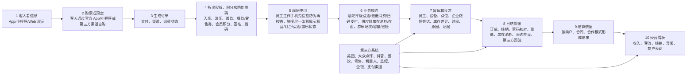
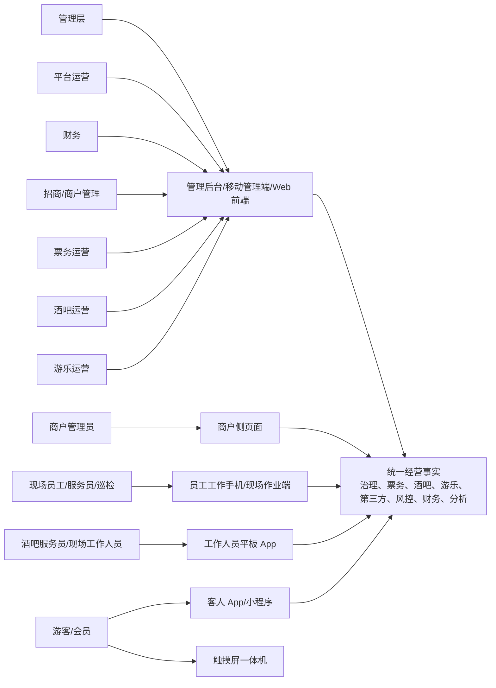
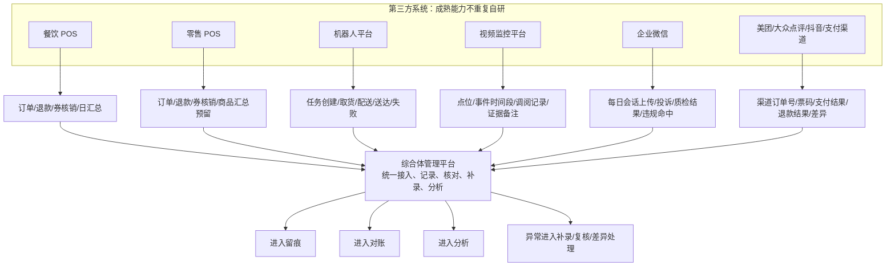

# 综合体管理系统业务功能拓扑图 V0.1

## 1. 文档定位

本文档把当前产品总纲、平台治理、业务经营、第三方接入、证据风控、数据分析（含财务/对账子域）和终端展示层文档合并成一张业务人员可读的功能拓扑图。

> 修订说明（2026-06-07）：能力层以总纲第 8 节 **6 层**模型为准——平台治理 / 业务经营 / 第三方接入 / 证据留痕与风控 / 数据分析 / 终端展示。**"财务经营层"不是独立能力层，而是数据分析层下的"财务/对账子域"**；本文第 2 节总拓扑中的 subgraph F 仅作可视化分组，渲染上单列只为业务人员易读，归属上属数据分析层子域。原"财务结算层/财务经营层"措辞统一为"财务/对账子域"。依据《统一口径基准》D2、finding caplayer-1。

它不是技术架构图，也不是数据库设计图。它主要回答四个问题：

- 系统包含哪些业务模块。
- 每个模块主要管什么。
- 模块之间如何连接。
- 经营动作从客人、员工、商户到财务和管理看板如何形成闭环。

阅读方式：

- 先看第 2 节总拓扑，理解全局。
- 再看第 3 节经营主链路，理解业务怎么跑。
- 再看第 4 节模块功能展开，理解每个模块做什么。
- 最后看第 5 节连接关系表，理解模块之间为什么要连。

## 2. 业务功能总拓扑

```mermaid
flowchart TB
  subgraph U["使用入口：不同人从不同入口进入系统"]
    U1["客人 App/小程序<br/>官方购票、预定、查订单、会员积分、出示二维码"]
    U2["工作人员平板 App<br/>酒吧点酒下单、绑定酒吧和卡座、最低消费校验"]
    U3["员工工作手机/现场作业端<br/>上岗、领设备、门票核销、权益核销、企业微信沟通、巡检"]
    U4["商户侧页面<br/>看本商户经营、核对差异、处理本商户事项"]
    U5["Web 前端<br/>只读查看经营、票务、酒吧、供应链、游乐、异常"]
    U6["管理后台<br/>配置、审核、复核、对账、看总览"]
    U7["移动管理端<br/>主管看指标、处理待办、异常审批"]
    U8["员工私人手机 App<br/>注册、通知、状态查看、设备凭证绑定，不做现场操作"]
  end

  subgraph G["平台治理层：先把人、地方、商户、合同和权限管清楚"]
    G1["综合体项目/空间/楼层/区域/点位<br/>当前一个，未来多个"]
    G2["业态/商户/运营主体"]
    G3["合同/合作模式/结算口径摘要<br/>准入阻断/升级审批"]
    G4["员工/岗位/班次/职级<br/>私人手机注册、NFC、审核"]
    G5["设备/领用归还/责任链<br/>私人手机与工作手机对应"]
    G6["角色权限/数据范围/操作留痕"]
  end

  subgraph B["业务经营层：记录真实经营动作"]
    B1["票务策略<br/>平日/周末/节假日基础价<br/>人群/渠道/多人派生价或固定价"]
    B2["票种/通票/套餐<br/>定义卖什么、包含什么"]
    B3["订单/支付/退款<br/>记录卖给谁、多少钱、什么状态"]
    B4["权益台账<br/>入场、游乐、赠饮、餐饮/零售券、积分兑换、防伪票码"]
    B5["现场核销<br/>防伪验签、成功、拒绝、人工放行、撤销"]
    B6["酒吧经营<br/>酒吧、卡座、点酒、最低消费、支付、赠饮、账单"]
    B7["供应链库存<br/>供应商、供应合同、采购、库房、酒水、消耗品、存酒、吧台消耗"]
    B8["游乐运营<br/>项目、开放计划、场次、容量、巡检、暂停"]
  end

  subgraph T["第三方接入层：外部系统不替代平台，只把关键结果回流"]
    T1["餐饮 POS<br/>订单、退款、券核销、日汇总"]
    T2["零售 POS<br/>订单、退款、券核销、商品汇总预留"]
    T3["机器人<br/>任务创建、取货、配送、送达、失败"]
    T4["视频监控<br/>点位、事件时间段、证据索引"]
    T5["企业微信<br/>每日会话上传、员工、客户、投诉、质检、违规命中"]
    T6["第三方售票/支付渠道<br/>美团、大众点评、抖音、支付结果、退款结果、渠道订单号"]
  end

  subgraph R["证据留痕与风控层：重要动作留得住，异常追得回"]
    R1["事件中心<br/>经营动作统一留痕"]
    R2["业务过程时间线<br/>订单、销售、服务、异常、履约"]
    R3["人工补录<br/>自动记录失败后的受控补充"]
    R4["复核队列<br/>人工放行、退款、免单、调账等复核"]
    R6["风险提示<br/>票码变造、重复核销、服务缺失、首响超时、第三方差异、企微违规"]
    R5["证据索引<br/>视频、会话、附件、备注、调阅记录"]
  end

  subgraph F["财务/对账子域（数据分析层下，非独立能力层）：把经营结果整理成财务可复核口径"]
    F1["经营流水<br/>订单、权益、账单、退款、调整"]
    F2["日结批次<br/>按日期/班次汇总经营结果"]
    F3["对账管理<br/>平台、渠道、商户、第三方结果核对"]
    F4["差异处理<br/>金额、数量、状态、缺失差异"]
    F5["结算依据<br/>按商户、合同、周期形成应收应付/分成依据"]
  end

  subgraph A["数据分析层：让管理层和运营看得懂、能判断、能追问"]
    A1["综合经营看板<br/>收入、客流、核销、异常、待办"]
    A2["票务和会员分析<br/>票种、渠道、策略、退款、核销率、积分、等级"]
    A3["酒吧分析<br/>入场、开台、收入、赠饮、账单异常"]
    A4["供应链分析<br/>采购、库存、吧台消耗、盘点差异、存酒余额"]
    A5["游乐分析<br/>项目、场次、容量、核销、暂停、巡检"]
    A6["商户表现<br/>收入、核销、退款、异常、差异"]
    A7["异常风险看板<br/>补录、复核、风险事件趋势"]
    A8["对账结果看板<br/>日结、差异、结算确认"]
  end

  G --> B
  G --> T
  G --> R
  G --> F
  G --> A

  U1 --> B1
  U1 --> B3
  U1 --> B4
  U1 --> B5
  U2 --> B6
  U3 --> B5
  U3 --> B6
  U3 --> B7
  U3 --> B8
  U3 --> R1
  U4 --> B6
  U4 --> B7
  U4 --> T
  U4 --> F3
  U5 --> A
  U5 --> B
  U5 --> R
  U6 --> G
  U6 --> B
  U6 --> T
  U6 --> R
  U6 --> F
  U6 --> A
  U7 --> R3
  U7 --> A1
  U8 --> G4
  U8 --> G5

  B1 --> B2
  B2 --> B3
  B3 --> B4
  B4 --> B5
  B4 --> B6
  B4 --> B7
  B4 --> B8
  B5 --> R1
  B6 --> R1
  B7 --> R1
  B8 --> R1
  B3 --> F1
  B5 --> F1
  B6 --> F1
  B7 --> F1
  B8 --> F1

  T --> R1
  T --> F3
  T --> A

  R1 --> R3
  R1 --> R4
  R2 --> R3
  R3 --> F4
  R4 --> A6
  R5 --> R3

  F1 --> F2
  F2 --> F3
  F3 --> F4
  F4 --> F5
  F --> A
```

## 3. 经营主链路拓扑

这条链路用于解释一笔业务如何从“客人想玩/消费”变成“平台能结算、能分析、能追责”的经营事实。

## 4. 模块功能展开拓扑

```mermaid
flowchart TB
  M["综合体管理系统"]

  M --> G["平台治理模块"]
  G --> G1["项目和空间<br/>综合体、楼层、区域、点位、容量、负责人；当前一个，未来多个"]
  G --> G2["商户和合同<br/>商户档案、合作模式、租赁/联营/自营/代运营、合同期限、准入规则"]
  G --> G3["人员和设备<br/>员工注册审批、私人手机、NFC、职级、工作手机、平板、扫码设备、领还记录"]
  G --> G4["权限和留痕<br/>角色、数据范围、临时授权、关键配置变更记录"]
  G --> G5["独立业务系统<br/>票务、酒吧、游乐可分开建设，但共用商户、合同、空间、人员、设备和权限"]

  M --> P["票务权益模块"]
  P --> P1["票务策略<br/>日期、人群、多人、新人、渠道、折扣、组合策略、积分规则"]
  P --> P2["票种和通票<br/>平日票、周末票、节假日票、学生票、套餐"]
  P --> P3["订单和支付<br/>下单、支付、退款、渠道订单、订单状态"]
  P --> P4["权益台账<br/>入场权益、游乐权益、赠饮权益、餐饮/零售券、积分兑换、防伪票码"]
  P --> P5["核销和异常<br/>扫码、验签、防伪串码、哈希核对、成功、拒绝、人工放行、撤销、待复核"]

  M --> BAR["酒吧经营模块"]
  BAR --> BAR1["酒吧入场<br/>入场资格、入场记录、拒绝原因"]
  BAR --> BAR2["酒吧和卡座管理<br/>不同酒吧、卡座、桌台、吧台位、状态"]
  BAR --> BAR3["点酒和账单<br/>酒水明细、最低消费、支付二维码、付款码、结账状态"]
  BAR --> BAR4["赠饮核销<br/>票务赠饮权益识别、核销、回写权益状态"]
  BAR --> BAR5["吧台售卖和出品<br/>按杯、按瓶、按套餐或其他形式售卖，形成消耗记录"]
  BAR --> BAR6["关台和异常<br/>关台确认、免单、退款、争议、补录、待复核"]

  M --> SUP["供应链库存模块"]
  SUP --> SUP1["供应商和供应合同<br/>供应商档案、供货范围、价格口径、账期、有效期"]
  SUP --> SUP2["采购周期<br/>采购申请、审批、下单、预计到货、实际入库"]
  SUP --> SUP3["库房和物品<br/>总库、吧台库、消耗品库、礼品库、存酒区；酒类、消耗品、其他物品"]
  SUP --> SUP4["库存流水<br/>入库、出库、调拨、盘点、报损、报溢、库存调整"]
  SUP --> SUP5["吧台消耗<br/>按杯、按瓶、按套餐、赠饮、兑换、出品消耗"]
  SUP --> SUP6["客人存酒<br/>存酒登记、取酒、剩余量、有效期、作废和异常"]

  M --> AM["游乐运营模块"]
  AM --> AM1["游乐项目<br/>项目名称、空间、入口、适用权益、限制条件"]
  AM --> AM2["开放计划<br/>开放日期、时间、状态、暂停、关闭"]
  AM --> AM3["场次容量<br/>场次、容量、已核销、剩余、满员状态"]
  AM --> AM4["游乐核销<br/>权益识别、容量判断、放行、拒绝"]
  AM --> AM5["巡检和异常<br/>开放前检查、运营巡检、故障、超容、争议"]

  M --> TP["第三方接入模块"]
  TP --> TP1["餐饮/零售<br/>订单、退款、券核销、营业日汇总"]
  TP --> TP2["机器人<br/>任务状态、取货、配送、送达、失败原因"]
  TP --> TP3["视频监控<br/>摄像头点位、事件时间段、证据索引"]
  TP --> TP4["企业微信<br/>会话归属、投诉、质检结果"]
  TP --> TP5["支付/渠道<br/>支付结果、退款结果、渠道订单号、差异"]

  M --> R["证据风控模块"]
  R --> R1["事件中心<br/>核销、退款、放行、调账、暂停、权限变更"]
  R --> R2["业务过程时间线<br/>订单获取、销售归属、服务责任、异常首响"]
  R --> R3["人工补录<br/>原因、责任人、时间、对象、证据"]
  R --> R4["复核队列<br/>主管确认、驳回、退回补充"]
  R --> R6["风险规则<br/>重复核销、高频退款、服务缺失、首响超时、第三方差异"]
  R --> R5["证据索引<br/>视频、会话、附件、备注、调阅记录"]

  M --> F["财务经营模块"]
  F --> F1["经营流水<br/>订单、权益、账单、退款、调整"]
  F --> F2["日结管理<br/>待生成、待确认、有差异、已确认、已锁定"]
  F --> F3["对账管理<br/>平台、支付、渠道、商户、第三方"]
  F --> F4["差异处理<br/>金额、数量、状态、缺失差异"]
  F --> F5["结算依据<br/>商户、合同、周期、金额、合作模式"]

  M --> D["数据分析模块"]
  D --> D1["综合经营看板<br/>收入、客流、核销、异常、待办"]
  D --> D2["票务分析<br/>售票、渠道、策略、退款、核销率"]
  D --> D3["酒吧分析<br/>入场、开台、赠饮、收入、账单异常"]
  D --> D4["供应链分析<br/>采购周期、库存余额、吧台消耗、盘点差异、存酒余额"]
  D --> D5["游乐分析<br/>项目、场次、容量、暂停、巡检异常"]
  D --> D6["商户和财务分析<br/>商户表现、对账差异、结算确认"]

  M --> E["终端展示模块"]
  E --> E1["管理后台<br/>配置、查询、复核、对账、看板"]
  E --> E2["Web 前端<br/>非编辑状态查看信息，含供应链库存只读"]
  E --> E3["商户侧页面<br/>本商户经营、供应/库存相关记录和对账"]
  E --> E4["员工工作手机/现场作业端<br/>门票核销、权益核销、库存操作、企业微信、巡检、补录"]
  E --> E5["工作人员平板 App<br/>酒吧点酒、最低消费、扫码支付"]
  E --> E6["移动管理端<br/>待办、异常、审批"]
  E --> E7["客人 App/小程序<br/>官方购票、预定、查询、二维码、会员积分、兑换"]
  E --> E8["触摸屏一体机<br/>权益领取、订台、吧台买酒、游乐状态"]
  E --> E9["员工私人手机 App<br/>注册、通知、状态查看、设备凭证绑定；现场禁用"]
```

## 5. 模块连接关系说明

| 从哪里来 | 连到哪里 | 连接内容 | 业务意义 |
|---|---|---|---|
| 平台治理层 | 所有业务模块 | 项目、空间、商户、合同、员工、设备、权限 | 先确定谁能经营、在哪里经营、谁能操作、谁负责 |
| 平台治理层 | 票务/酒吧/游乐/结算/第三方 | 合同准入、经营范围、空间范围、有效期、资质状态 | 如果业务超出合同或基础定义，系统要先卡住，或进入更高级别审批 |
| 平台治理层 | 独立业务系统 | 票务、酒吧、游乐可以拆成不同系统，但共用同一套基础档案和准入规则 | 拆系统不等于各自为政，后续对账、权限和责任仍然统一 |
| 平台治理层 | 供应链库存模块 | 供应商、供应合同、库房、库位、采购人员、库管、审批权限 | 先确定谁能采购、谁能入库、谁能出库、谁负责差异 |
| 客人 App/小程序 | 票务权益模块 | 票种查询、下单、支付结果、订单、权益、二维码、积分 | 客人通过官方入口自助购票、预定、出示凭证和查看会员积分 |
| 第三方售票渠道 | 票务权益模块 | 美团、大众点评、抖音等渠道订单、票码、支付、退款 | 外部渠道售票结果回到平台统一核销和对账 |
| 工作人员平板 App | 酒吧经营模块 | 酒吧、卡座/桌台、点酒明细、最低消费、支付二维码、付款码 | 现场工作人员只帮助客人完成酒吧点酒下单 |
| 员工工作手机 | 票务权益模块 | 门票二维码、权益二维码、核销结果 | 员工扫码核销门票和附赠权益 |
| 员工私人手机 App | 平台治理层 | 员工注册资料、设备凭证、设备指纹、Root检测、审批状态 | 私人手机只负责注册和通知；审核通过后才生成员工账号、职级和权限，现场仍只用公司工作手机 |
| 员工工作手机 | 企业微信/设备管控模块 | 每日会话上传状态、企业微信绑定、应用白名单、网站白名单、违规访问 | 管住员工沟通和工作手机使用边界 |
| 触摸屏一体机 | 票务权益/酒吧经营/游乐运营模块 | 可领取权益、订台订单、吧台买酒订单、游乐设施状态和检查记录 | 客人可自助领取、订台、买酒、查看游乐状态；授权员工可做状态检查 |
| 票务权益模块 | 酒吧经营模块 | 赠饮权益、入场资格、核销状态 | 门票中赠送的酒水能在酒吧被正确识别和核销 |
| 票务权益模块 | 供应链库存模块 | 赠饮、积分兑换礼物、权益领取结果 | 赠饮或礼物领取后要扣减库存或形成领取消耗记录 |
| 酒吧经营模块 | 供应链库存模块 | 吧台买酒、按杯/按瓶/套餐售卖、出品、赠饮、报损、存酒 | 酒水销售和消耗必须改变库存数量或存酒状态 |
| 票务权益模块 | 游乐运营模块 | 游乐权益、场次资格、核销状态 | 游客能凭票使用对应游乐项目 |
| 票务权益模块 | 证据风控模块 | 防伪串码、二维码签名、哈希、核销、退款、人工放行、撤销、异常 | 高风险动作能被追踪和复核，票码是否被变造也能事后核对 |
| 酒吧经营模块 | 证据风控模块 | 入场、开台、账单调整、赠饮核销、免单、关台异常 | 酒吧现场经营动作有责任链 |
| 供应链库存模块 | 证据风控模块 | 高价值酒水报损、盘点差异、存酒作废、异常调拨 | 库存异常有原因、责任人、证据和复核结果 |
| 游乐运营模块 | 证据风控模块 | 项目开放、容量、核销、暂停、关闭、巡检异常 | 游乐项目安全和容量变化可追溯 |
| 第三方接入模块 | 证据风控模块 | 回流失败、重复、延迟、缺字段、冲突、证据索引 | 外部系统问题不会脱离平台管理 |
| 第三方接入模块 | 财务经营模块 | 餐饮/零售订单、退款、券核销、支付渠道结果 | 第三方经营结果进入统一对账 |
| 业务经营层 | 财务经营模块 | 订单、退款、核销、酒吧账单、游乐核销 | 财务能按真实经营结果做日结和结算 |
| 供应链库存模块 | 财务经营模块 | 采购入库、成本、库存消耗、报损、盘点差异、存酒余额 | 财务能判断采购、成本、损耗和库存差异 |
| 证据风控模块 | 财务经营模块 | 差异处理、复核结果、调整记录 | 财务差异必须有原因、责任人和处理结论 |
| 财务经营模块 | 数据分析模块 | 收入、退款、差异、结算状态 | 管理层能看到经营结果是否已被财务确认 |
| 业务经营层 | 数据分析模块 | 票务、酒吧、游乐、核销、客流、异常 | 看板能反映真实经营情况 |
| 供应链库存模块 | 数据分析模块 | 采购周期、库存余额、吧台消耗、缺货预警、盘点差异、存酒余额 | 管理层能判断库存周转、损耗和采购效率 |
| 第三方接入模块 | 数据分析模块 | 回流成功率、第三方收入、异常回流、延迟 | 管理层能判断外部系统运行质量 |
| 数据分析模块 | Web 前端/移动管理端/管理后台 | 指标、趋势、异常、待办 | 不同角色用不同入口看同一套经营事实 |
| 商户侧页面 | 财务经营模块 | 本商户对账、差异、结算依据 | 商户只能看本商户范围，不能看平台全局 |

## 6. 按业务人员理解的模块清单

| 模块 | 一句话解释 | 主要功能 | 输出结果 |
|---|---|---|---|
| 平台治理 | 先把综合体的基础盘子管清楚 | 项目、空间、商户、合同、合同准入、人员、NFC、设备、权限 | 经营边界、责任边界、数据边界、准入边界 |
| 票务权益 | 管客人从哪里买票、包含什么权益、怎么核销、怎么积分 | 策略、票种、通票、订单、权益、防伪票码、核销、退款、积分、兑换 | 订单、权益台账、积分记录、核销记录、票码核对记录 |
| 酒吧经营 | 管酒吧点酒、最低消费和账单 | 酒吧、卡座、桌台、点酒、支付、赠饮、账单、关台、异常 | 酒吧流水、赠饮核销、服务留痕 |
| 供应链库存 | 管供应商、采购、库房、消耗和存酒 | 供应商、供应合同、采购周期、库房、酒类、消耗品、其他物品、吧台消耗、存酒、盘点、报损 | 库存余额、消耗流水、存酒台账、采购差异、报损复核 |
| 游乐运营 | 管游乐项目开放、容量和安全 | 项目、开放计划、场次、容量、核销、巡检、暂停 | 游乐核销、容量结果、异常留痕 |
| 第三方接入 | 外部系统继续做专业系统，平台拿回关键结果 | 餐饮、零售、机器人、视频、企微、支付渠道接入 | 回流记录、差异、证据索引 |
| 证据风控 | 让重要动作有记录，异常能复核 | 事件中心、人工补录、复核队列、风险提示、证据索引 | 事件记录、复核结果、风险待办 |
| 财务经营 | 把经营结果整理成财务能确认的口径 | 经营流水、日结、对账、差异、结算依据 | 日结结果、对账结论、结算依据 |
| 数据分析 | 把经营事实变成看板和判断依据 | 收入、客流、核销、退款、异常、商户表现、对账结果 | 管理看板、分析视图、异常趋势 |
| 终端展示 | 不同角色通过不同界面使用系统 | 后台、Web、商户侧、员工工作手机、平板、移动端、客人 App/小程序、触摸屏一体机 | 各角色可看的页面和可做的动作 |

## 7. 角色入口拓扑

## 8. 第三方边界拓扑

## 9. P0 闭环判断

P0 阶段只要以下闭环能跑通，就说明系统骨架成立：

1. 综合体项目、商户、空间、合同、合同准入规则、员工、设备凭证、设备、权限能先建好。
2. 票务策略、票种、通票、权益、会员积分和兑换规则能配置。
3. 客人能通过官方 App/小程序或第三方渠道购买门票。
4. 订单能生成权益、防伪二维码、防伪串码、哈希核对记录和积分记录。
5. 员工工作手机能先校验二维码签名、防伪串码、有效期和哈希，再完成门票核销、权益核销、拒绝、人工放行或异常处理。
6. 平板能在绑定酒吧和卡座后完成点酒下单、最低消费校验和扫码支付。
7. 供应链能管理供应商、供应合同、采购周期、库房、酒类、消耗品、其他物品、吧台消耗和客人存酒。
8. 触摸屏一体机能展示/领取权益，并支持订台下单、吧台买酒下单、游乐设施状态查看和授权状态检查。
9. 企业微信会话能每日上传，后台能做基础违规检查和服务分析。
10. 工作手机能限制非预装软件和非白名单网站访问。
11. 员工私人手机 App 能完成注册、设备凭证绑定、Root/设备异常检测和审批状态查看，但不能用于现场业务操作。
12. 餐饮、零售、机器人、视频等第三方能预留接入并回流关键结果。
13. 重要动作、合同准入检查、票码防伪核对、库存差异和员工设备异常能进入事件留痕、人工补录、复核和风险提示。
14. 经营结果、库存消耗、采购差异能进入日结、对账、差异处理和结算依据。
15. 管理层、运营、财务、商户和现场人员能通过各自入口看到自己该看的信息。

## 10. 已确认规则和后续排期事项

| 已确认规则 | 影响范围 |
|---|---|
| 官方购票入口 App 和小程序同步建设；美团、大众点评、抖音先做团购购票回流 | 影响游客端、票务、第三方售票回流和对账 |
| 积分兑换礼物需要扣减库存 | 影响会员中心、兑换和库存管理 |
| 通票支持酒吧通票、游乐通票、酒吧 + 游乐通票，以及含餐饮/零售优惠折扣的组合通票 | 影响权益拆分和结算 |
| 订台入口包括 App、小程序、一体机和销售人员，订台需要定金；吧台买酒允许现金和 POS 机 | 影响酒吧、终端、支付和对账 |
| 供应合同分平台自用、商户自采、平台统一采购分销三种模式 | 影响供应链、采购审批和财务对账 |
| 客人存酒按瓶底标签数值、拍照、人工备注、手机号和姓名/昵称管理 | 影响存酒页面、取酒流程和争议处理 |
| 游乐容量按具体项目 + 具体场次/时段 + 点位/设备控制 | 影响游乐核销和场次页面 |
| 餐饮/零售第三方同时支持订单级和券核销级，并支持日、半日、小时和单店实时汇总 | 影响第三方接入、看板和对账 |
| 票务二维码 30 秒或 60 秒刷新，截图无效，必须在线核验 | 影响现场核销、风险控制和事后核对 |
| 员工私人手机 App 安装期在设备 Keystore 生成设备公钥/不可逆设备指纹（device_key_fingerprint）作为可信标识，换机解绑重绑，Root/异常失效复核，寄存柜流动使用；工作手机通过摄像头扫码读取外部客人二维码，NFC 仅读取外部 NFC 腕带/标签/卡<!-- 修订说明（2026-06-10 收口）：原"读取手机 NFC 唯一标识"为 D8/A6 已废止口径；同时纠正"NFC 读二维码"混写，二维码=摄像头扫码，NFC=外部 NFC 介质。依据 finding residual-scan-7、D8/A6 与技术可行性复核 --> | 影响员工注册、设备可信和现场合规 |
| 工作手机预装软件清单和网站白名单由后台维护，并通过 Android Enterprise / Android Management API + 商业 MDM 执行系统级管控 | 影响设备管控和违规处置 |
| 会员积分、等级成长和兑换规则由后台定义 | 影响会员中心和积分结算口径 |
| Web 前端 P0 允许少量业务确认动作 | 影响业务人员在 Web 的操作边界 |
| 新人优惠、学生票、多人票由后台配置规则；价格基于平日/周末/节假日基础价派生或固定价覆盖，资格按规则自动/人工审核 | 影响票务规则复杂度和游客购票体验 |
| 酒吧最低消费按时间、卡座和位置配置，不按人数 | 影响平板点酒和账单校验 |
| 供应链 P0 从酒类、吧台消耗、客人存酒和常用消耗品开始 | 影响供应链页面范围和上线工作量 |
| 吧台按杯销售按标准出酒量/容量扣减，超出部分记损耗并可触发核查 | 影响库存准确度和损耗风控 |
| 高价值酒水报损、盘点差异、存酒作废必须拍照/视频留证并主管复核 | 影响风控、证据留痕和现场效率 |
| 企业微信工作会话留存期限可配置（非永久），到期归档/销毁/匿名化（按 A7/合规C3、data-risk §11.5）；不脱敏原文仅限最小授权 + 审批的取证/质检场景，普通展示按权限脱敏，查看写审计<!-- 修订说明（2026-06-08 三轮收口）：原"永久保存"为 §6 影响表正文断言，与 A7/C3 可配置留存相反，就地改正；2026-06-08 复核补充不脱敏原文的最小授权边界。依据 finding residual-scan-3、A7/C3 --> | 影响服务质检、违规复核和合规边界  **【已作废（2026-08-03 L-19 裁决 `DEC-CFG-2026-08-03-10`）】企微会话永久保存、不自动到期删除；本行销毁／留存期规格不得实施；确需清理仅限最高权限 U 盘密钥手动路径** |
| 人工放行、免单、退款、调账按可配置层级主管复核 | 影响风控和现场效率 |
| 合同或基础定义违规全部先卡住流程，允许更高级审核后放行 | 影响现场效率、招商/财务风控和审批层级 |
| 未来需要集团视图和跨项目汇总视图，但优先级低于 P0 单综合体闭环 | 影响项目数据模型和管理层看板 |
| 商户侧在授权业务范围内全开放，酒吧和游乐/乐园可演进为独立 SaaS | 影响商户端范围和系统边界 |
| 日结锁定后不允许直接补录影响金额，必须上级审批通过后补录 | 影响财务稳定性和补录规则 |
| 员工权限按单一功能最小颗粒度配置，支持角色和员工级完全自定义 | 影响权限模板、审批层级和后续 HR/薪资系统对接 |
| 第三方先通过平台开放 API / Webhook / SDK 示例接入，供应商 SDK/API 后续再接 | 影响开放平台和第三方接入顺序 |
| 所有有过程的业务动作必须留痕，订单获取、销售归属、卡座服务、异常第一处理人和酒水可追责物品全过程都要追溯 | 影响供应链、酒吧、机器人、风控、数据分析和事件中心 |
| 所有终端必须有开关接口，支持按项目、商户、业务系统、模块、设备和版本控制 | 影响终端展示层、平台治理和后续 SaaS 化 |
| 员工权限点首批由平台统一预置，实施阶段允许边配置边补充 | 影响初始化工作量、角色模板和权限审计 |

| 已确认后续排期 | 影响范围 |
|---|---|
| 集团视图默认 P2，P0 只预留 `project_id` 和跨项目汇总口径 | 已确认，不阻塞单综合体 P0 闭环 |

## 11. 本版结论

综合体管理系统的业务拓扑可以概括为：

平台治理先定义“哪个综合体、谁、在哪、凭什么、谁负责、能不能做”；票务权益定义“客人从哪里买票、给什么权益、怎么生成防伪票码、怎么核销、怎么积分”；酒吧承接平板点酒、最低消费、销售归属、服务责任和支付；供应链承接供应商、采购、库房、吧台消耗和客人存酒；游乐承接项目核销和容量；第三方系统把美团、大众点评、抖音、餐饮、零售等关键结果回流；证据风控把订单来源、销售归属、服务责任、异常首响、重要动作、票码核对、合同准入、库存差异和设备异常留住；财务经营把流水、采购和库存差异整理成日结、对账和结算依据；数据分析把经营事实变成看板；终端展示让不同角色通过合适入口使用系统。

这张拓扑图适合后续给运营、财务、招商、现场管理和商户管理人员沟通系统范围，也可以作为继续拆页面、流程和编码任务的上层地图。

> 说明（2026-06-07）：上文及第 2/4/5 节中的"财务经营模块"是数据分析层下"财务/对账子域"的可视化模块表达，**不构成独立能力层**；能力层数以总纲 6 层为准（D2）。

## 变更日志

| 日期 | 类型 | 位置 | 内容 | 原因/依据 |
|---|---|---|---|---|
| 2026-06-07 | 改 | §1 文档定位 | 层级口径统一为 6 层，财务标注为数据分析层下子域 | 《统一口径基准》D2；finding caplayer-1 |
| 2026-06-07 | 改 | §2 总拓扑 subgraph F | 标注"财务/对账子域（数据分析层下，非独立能力层）" | finding caplayer-1；D2 |
| 2026-06-07 | 增 | §11 本版结论后 | 补说明"财务经营模块"为子域可视化表达，非独立层 | finding caplayer-1 |
| 2026-06-08 三轮收口 | 改 | §6 业务规则影响表 | "员工私人手机读取手机 NFC 唯一标识"改为"安装期 Keystore 设备公钥/不可逆设备指纹（device_key_fingerprint）" | residual-scan-7、D8/A6 |
| 2026-06-08 三轮收口 | 改 | §6 业务规则影响表 | "企业微信工作会话永久保存"改为"留存期限可配置（非永久），到期归档/销毁/匿名化（按 A7/合规C3、data-risk §11.5）" | residual-scan-3、A7/C3 |
