# 业务经营层规格 V0.03
> 2026-07-04 逻辑一致性修订：补名词四层脚注；补结算口径交叉引用（日结/对账/结算依据以 finance-settlement PRD 为权威，本层不重复定义）

> **口径修订（2026-08-05 R8）：「人工放行」已废止**——ENUM「核销记录状态」条 明确「**系统不提供人工放行：核销要么成功、要么拒绝或失败，任何岗位、任何权限都不能以人工方式让一笔不满足规则的核销通过**」（DEC-CFG-2026-08-03-12）。本文原有的「人工放行」取值、按钮、指标与复核类型**已从各处取值清单中移除**，移除处标注「原含『人工放行』，已废止·见文首口径」。

> **口径修订（2026-08-05 R8）：「场次容量」已废止**——BSM「容量控制」条、PGM「游乐容量只按单个项目的实时在玩人数控制」条 明确「**只按单个游乐项目的实时在玩人数控制容量，不再按场次/时段或点位/设备另设容量；排队人数不占用容量**」（DEC-R5-2026-08-04-04；R8 用户裁决 D-02）。本文原「场次容量」一律改称「**项目容量（实时在玩人数）**」；文中仍按场次/时段维度罗列的低保真页面字段只作历史结构参考，容量口径一律以本条为准。

> 合并说明：本文按 2026-06-10 全量文档收口与合并归档审计执行，用于替代下列分散源文件。源文件已移入 `_archive/20260610-retention-audit/merged-layer-spec-sources/`，后续开发、审计和交接以本文为入口。

| 原文件 | 归档位置 |
|---|---|
| `business-operations-product-breakdown-v0.1.md` | `_archive/20260610-retention-audit/merged-layer-spec-sources/business-operations-product-breakdown-v0.1.md` |
| `business-operations-page-list-v0.1.md` | `_archive/20260610-retention-audit/merged-layer-spec-sources/business-operations-page-list-v0.1.md` |
| `business-operations-field-dictionary-v0.1.md` | `_archive/20260610-retention-audit/merged-layer-spec-sources/business-operations-field-dictionary-v0.1.md` |
| `business-operations-flow-diagrams-v0.1.md` | `_archive/20260610-retention-audit/merged-layer-spec-sources/business-operations-flow-diagrams-v0.1.md` |
| `business-operations-low-fi-prototype-v0.1.md` | `_archive/20260610-retention-audit/merged-layer-spec-sources/business-operations-low-fi-prototype-v0.1.md` |
| `business-operations-acceptance-checklist-v0.1.md` | `_archive/20260610-retention-audit/merged-layer-spec-sources/business-operations-acceptance-checklist-v0.1.md` |

> 历史来源不可覆盖声明：本文中的“原文件”和合并来源内容仅保留审计证据和历史上下文，不得覆盖 `00-current-effective-document-entry-v0.1.md`、`unified-standards-baseline-v0.1.md`、`openapi/openapi-p0.yaml`、`p0-openapi-operation-acceptance-matrix-v0.1.md`、`p0-openapi-contract-closure-appendix-v0.1.md`、`p0-operation-permission-matrix-v0.1.md`、`p0-action-event-evidence-matrix-v0.1.md`、`p0-end-to-end-acceptance-and-edge-cases-v0.1.md` 和 `p0-user-story-map-and-sprint-slices-v0.1.md`。若历史段落与当前事实源冲突，以当前 S0/S1 文档为准。

## 2A. AI-ready 四件套执行入口

本文是业务经营层产品规格入口，不直接替代正式接口、数据库迁移或测试用例。开发、测试和运营验收使用本文时，必须按下表回到当前有效事实源。

| 四件套 | 本文执行要求 | 权威引用 |
|---|---|---|
| 反模式 | 不得只按页面或经营动作自行推断接口、表结构、权限和事件；不得把归档源文件中的旧待确认项重新作为未决策项 | `00-current-effective-document-entry-v0.1.md`、`code-contract-difference-and-migration-audit-v0.1.md` |
| 测试用例 | 业务经营 P0 必须能映射到用户故事、端到端验收、operation 验收矩阵、OpenAPI 追溯附录和权限矩阵 | `p0-user-story-map-and-sprint-slices-v0.1.md`、`p0-end-to-end-acceptance-and-edge-cases-v0.1.md`、`p0-openapi-operation-acceptance-matrix-v0.1.md`、`p0-openapi-contract-closure-appendix-v0.1.md` |
| 错误处理 | 核销、支付、库存、退款、补录、日结、对账和第三方回流失败必须有状态、事件、人工复核和补偿路径 | `p0-api-contract-pack-v0.1.md`、`p0-action-event-evidence-matrix-v0.1.md`、`third-party-supplier-integration-kit-v0.1.md` |
| 精确引用 | 进入开发任务时必须引用正式文件名、OpenAPI exact path、operationId 或追溯附录条目；本文的产品页面/字段/流程只作为业务语义来源 | `docs/openapi/openapi-p0.yaml`、`p0-openapi-contract-closure-appendix-v0.1.md`、`p0-task-api-permission-event-acceptance-map-v0.1.md` |

## 2B. 顶层变更记录

| 日期 | 类型 | 内容 | 原因/依据 |
|---|---|---|---|
| 2026-06-12 | 增 | 新增 AI-ready 四件套执行入口，声明本文不替代正式接口、数据库迁移和测试用例 | 防止合并后的产品规格被直接当作接口/表结构开发依据 |
| 2026-06-13 | 改 | AI-ready 四件套补入 `p0-openapi-contract-closure-appendix-v0.1.md` 和追溯附录条目要求 | 防止业务经营层页面/字段/流程绕过 operation 到权限、事件、终端和样例准入追溯 |

---

## 原文件：`business-operations-product-breakdown-v0.1.md`

# 业务经营层产品拆解 V0.1

## 1. 文档定位

本文档承接《综合体管理系统产品需求总纲 V0.1》和平台治理层产品文档，专门按“综合体真实经营动作”拆解业务经营层。

> **名词四层（业务口径）**：文中「综合体项目 / 商户（运营主体）/ SPV（项目公司）/ 组织主体」是业务分层称谓；底层数据库以 `business_entities` 一表多角色承载全部主体角色，并无独立 `organizations` 表，`projects` 表也不等同于「项目公司/SPV」。权威实体关系以 `merchant-space-contract-model-v0.1.md` 为准。

本文件不是技术方案，不是数据库设计，不是接口设计，也不是实现任务书。它的作用是把经营过程拆成清晰的产品能力、业务对象、页面入口和 P0/P1/P2 优先级，后续再交给对应会话继续细化页面、字段、流程和实现任务。

平台治理层回答“谁、在哪、凭什么经营、谁能操作”；业务经营层回答“卖什么、怎么用、怎么服务、怎么核销、怎么处理异常、怎么形成经营结果”。

## 2. 经营拆分原则

业务经营层不按技术模块拆，也不按前端/后端拆，而按经营动作拆：

| 经营动作 | 业务含义 | 涉及主线 |
|---|---|---|
| 配置可售产品 | 定义卖给游客的票、套餐、通票、权益和规则 | 票务/权益 |
| 产生交易结果 | 游客通过官方 App/小程序或第三方渠道购票，酒吧通过平板点酒下单，平台或第三方形成销售结果 | 票务/酒吧/第三方 |
| 识别游客资格 | 判断游客是否能入场、能领赠品、能使用某个项目 | 票务/酒吧/游乐 |
| 现场核销履约 | 员工在点位执行核销、放行、领用、服务、拒绝 | 票务/酒吧/游乐 |
| 现场经营服务 | 桌台、点单、游乐场次、项目容量（实时在玩人数）、服务动作持续变化 | 酒吧/游乐 |
| 供应链库存 | 供应商、供应合同、采购周期、库房、库存消耗、客人存酒持续变化 | 供应链/酒吧/财务 |
| 会员积分运营 | 消费产生积分、等级成长、积分兑换礼物或权益 | 会员/票务/酒吧 |
| 异常补录处理 | 自动记录失败或现场特殊情况时受控补齐事实 | 全业务 |
| 日结对账结算 | 把订单、退款、核销、合同规则汇总为经营结果 | 财务经营 |
| 经营复盘分析 | 看收入、客流、核销、异常、商户表现和风险趋势 | 数据分析 |

## 3. 业务经营层总范围

| 业务主线 | P0 定位 | P0 结果 |
|---|---|---|
| 票务/通票/权益/核销 | 平台必须掌握的统一售卖和使用规则 | 能配置基础票种、承接官方和第三方购票结果、生成权益、现场核销、处理退款和异常 |
| 会员积分 | 与消费、等级和兑换相关的后台会员运营 | 后台/底层能按规则记录积分、等级成长、积分明细和兑换记录；客人端 P0 仅展示积分摘要 |
| 酒吧基础经营 | 与票务赠饮、入场、桌台、平板点酒、最低消费、结账相关的现场经营 | 能记录入场、开台、平板点酒、最低消费校验、赠饮核销、关台和经营流水 |
| 供应链库存 | 与供应商、采购、库房、酒水消耗、消耗品、礼品和客人存酒相关的经营保障 | 能记录供应商、供应合同、采购周期、入库、出库、调拨、物品追踪码、交接留痕、吧台消耗、盘点差异、报损和客人存酒 |
| 游乐基础运营 | 主题游乐项目的开放、场次编排、项目容量（实时在玩人数）、核销、安全异常 | 能管理项目开放、项目容量（实时在玩人数）、核销放行、暂停关闭和异常留痕 |
| 餐饮/零售经营回流 | 第三方 POS 为主，平台统一接收关键结果 | 能建立接入关系、回流订单/核销/退款结果并参与对账 |
| 机器人履约回流 | 第三方机器人为主，平台关注任务状态和异常 | 能记录任务、状态、责任点位和异常 |
| 视频证据关联 | 第三方监控为主，平台关注事件证据索引 | 能把事件与视频点位、时间段、调阅记录关联 |
| 企业微信服务质检 | 企业微信为主，平台关注会话归属、投诉、服务质量 | 能关联会话、员工、游客、投诉和质检结果 |

## 4. 业务经营主闭环

## 5. 业务对象总表

| 对象 | 定义 | 归属主线 |
|---|---|---|
| 票种 | 可销售的门票类型，如平日票、周末票、节假日票、学生票 | 票务 |
| 票务策略 | 决定票价、适用人群、渠道、日期、折扣和限制的规则 | 票务 |
| 通票 | 一个销售包装中包含多个业务权益 | 票务/跨业务 |
| 权益 | 游客实际可使用的权利单位，如入场、游乐一次、赠饮一杯 | 票务/酒吧/游乐 |
| 订单 | 销售或消费形成的交易记录 | 票务/酒吧/第三方 |
| 会员积分 | 客人消费后形成的积分余额、后台积分明细和等级成长记录；客人端 P0 只展示摘要 | 会员/票务 |
| 积分兑换 | 后台/底层记录会员使用积分兑换礼物、酒水或其他权益；客人端兑换入口进入 P1 | 会员/权益 |
| 核销记录 | 权益被使用、拒绝或撤销的事实记录（原含「人工放行」，已废止·见文首口径） | 全业务 |
| 入场记录 | 游客进入某业务场景的记录 | 票务/酒吧/游乐 |
| 桌台/卡座/吧台位 | 酒吧经营空间单元 | 酒吧 |
| 酒水赠送权益 | 票务或活动赠送的可在酒吧核销的权益 | 票务/酒吧 |
| 酒吧账单 | 酒吧开台后形成的消费和调整记录 | 酒吧 |
| 酒吧点酒订单 | 工作人员平板在指定酒吧和卡座下创建的酒水订单 | 酒吧 |
| 订台订单 | 通过 App/小程序/一体机/销售工作台预订卡座并含定金、到店、转台的订单 | 酒吧/销售 |
| 服务责任链 | 卡座主责服务员、协助服务员、销售归属、送达人和换人的责任记录 | 酒吧/风控 |
| 最低消费 | 酒吧、卡座、人数或时段对应的最低消费要求 | 酒吧 |
| 供应商 | 提供酒水、消耗品、礼品或其他物品的主体 | 供应链 |
| 供应合同 | 与供应商之间的供货范围、价格口径、账期和有效期依据 | 供应链/平台治理 |
| 采购周期 | 从采购申请、审批、下单、到货、入库到差异处理的过程 | 供应链 |
| 库房/库位 | 存放酒类、消耗品、礼品和其他物品的空间 | 供应链 |
| 库存物品 | 可采购、存放、售卖、消耗或兑换的东西 | 供应链 |
| 库存流水 | 入库、出库、调拨、销售消耗、赠饮、积分兑换/礼物领取、报损、盘点调整等记录 | 供应链/财务 |
| 物品追踪码 | 酒水、礼品、高价值物料和需追责耗材的平台唯一二维码 | 供应链/酒吧/风控 |
| 操作交接记录 | 物品在库管、机器人、后厨、服务员和客人之间的交接记录 | 供应链/酒吧/风控 |
| 吧台消耗 | 按杯、按瓶、按套餐或其他形式售卖/出品导致的消耗 | 酒吧/供应链 |
| 客人存酒 | 客人购买后未喝完或暂存在场内的酒 | 供应链/会员 |
| 游乐项目 | 可运营的主题游乐设施或项目 | 游乐 |
| 场次 | 游乐项目在某时间段的开放批次 | 游乐 |
| 容量 | 某项目或场次可接待人数或核销数量上限 | 游乐 |
| 第三方回流记录 | 外部系统回传的订单、退款、核销、任务或会话结果 | 第三方 |
| 人工补录 | 自动链路失败后的受控补充记录 | 全业务 |
| 对账差异 | 平台口径与支付、商户、第三方或核销口径不一致的记录 | 财务 |

## 6. P0 业务经营入口

| 一级入口 | 二级入口 | 主要用户 |
|---|---|---|
| 票务经营 | 票务策略、票种管理、通票配置、官方/第三方订单、权益台账、核销记录、退款异常 | 票务运营、财务、现场员工 |
| 会员积分 | 后台积分规则、会员等级、账户明细、兑换记录、兑换领取；客人端兑换入口进入 P1 | 会员运营、票务运营、管理层 |
| 酒吧经营 | 入场记录、桌台状态、平板点酒、最低消费、赠饮核销、关台记录、酒吧异常 | 酒吧运营、现场员工、财务 |
| 供应链库存 | 供应商、供应合同、采购周期、库房、物品、入库、出库、调拨、物品追踪码、交接留痕、库存余额、吧台消耗、盘点、报损、存酒 | 采购、库管、酒吧店长、吧台员工、财务 |
| 游乐运营 | 项目管理、开放状态、项目容量（实时在玩人数）、游乐核销、安全巡检、项目异常 | 游乐运营、现场员工、安保/巡检 |
| 第三方经营回流 | 接入关系、回流记录、失败重试、差异清单 | 运营、财务、系统管理员 |
| 经营留痕 | 事件中心、人工补录、复核队列、异常处理 | 运营、财务、管理层 |
| 财务经营 | 日结、对账、结算依据、差异处理、经营流水 | 财务、管理层 |
| 经营看板 | 收入、客流、核销、商户表现、项目表现、异常 | 管理层、运营 |

## 7. P0/P1/P2 总优先级

### 7.1 P0

P0 必须先把经营事实记录住：
- 票务策略、票种、通票和权益基础配置。
- 官方 App/小程序和第三方渠道购票结果承接。
- 后台/底层会员积分规则、会员等级、积分明细和兑换记录；客人端 P0 仅展示积分摘要。
- 权益生成、核销、撤销和异常记录（原含「人工放行」，已废止·见文首口径）。
- 酒吧入场、桌台、开台、平板点酒、最低消费校验、赠饮核销、基础账单、关台。
- 供应商、供应合同、采购周期、库房、物品、入库、出库、调拨、物品追踪码、扫码交接留痕、库存余额、吧台消耗、盘点差异、报损和客人存酒。
- 游乐项目、开放状态、场次编排、项目容量（实时在玩人数）、核销和暂停关闭。
- 第三方餐饮/零售关键结果回流占位。
- 人工补录、待复核、日结对账基础口径。
- 基础经营看板。

### 7.2 P1

P1 开始提升经营精细度：
- 预约排队、场次预约、动态容量。
- 安全库存、保质期预警、复杂杯卖扣减、供应商对账、套餐、复杂低消策略。
- 会员积分运营活动、兑换库存联动。
- 餐饮/零售券核销、退款和商品维度回流。
- 机器人任务闭环、视频证据绑定、企业微信会话质检。
- 结算规则细化和差异处理工作台。

### 7.3 P2

P2 做智能化和深度分析：
- 自动风控、异常识别、游客画像。
- 经营预测、跨业态推荐、服务质量诊断。
- 智能巡检辅助、AI 质检和自动复盘报告。

## 8. 进入子文档顺序

建议按以下顺序继续拆分：

0. 全链路操作留痕与终端开关 PRD（`operation-traceability-and-terminal-switch-prd`）——跨层底座，被以下各 PRD 共同承接（留痕规则、物品追踪码、交接、订台/服务责任链、终端开关），应先行或并行确立。
1. 票务/通票/权益/核销产品 PRD。
2. 酒吧基础经营产品 PRD。
3. 供应链与库存管理产品 PRD。
4. 游乐基础运营产品 PRD。
5. 第三方接入产品 PRD。
6. 证据留痕与风控产品 PRD。
7. 财务经营产品 PRD。
8. 终端与页面产品 PRD。

> 修订说明（2026-06-07）：子文档顺序原缺跨层底座 `operation-traceability-and-terminal-switch-prd`，而本拆解 §9 规则15/16、物品追踪码、交接留痕、订台、服务责任链均承接其规则。按 bizfam-9/5 finding 以「第 0 项跨层底座」补入并标注。

## 9. 已确认规则和后续细化事项

已确认：

1. 通票支持酒吧通票、游乐通票、酒吧 + 游乐通票，以及含餐饮/零售优惠折扣的组合通票。
2. 积分兑换礼物需要扣减库存。
3. 客人存酒按瓶底标签数值、拍照、人工备注、手机号和姓名/昵称管理。
4. 游乐 P0 容量按具体项目 + 具体场次/时段 + 点位/设备控制。
5. 餐饮/零售 P0 同时支持订单级和券核销级，并支持日、半日、小时和单店实时汇总。
6. 票务策略 P0 以平日/周末/节假日价为最高优先级基础价格；渠道、人群、新人、学生和多人票基于基础价派生，或由运营输入固定价格覆盖；动态定价进入 P2。
7. 会员积分、等级成长和兑换规则由后台定义。
8. 酒吧最低消费按时间、卡座和位置配置，不按人数。
9. 酒吧 P0 点酒必须录入每一项商品明细、数量、金额和订单状态。
10. 供应链 P0 从酒类、吧台消耗、客人存酒和常用消耗品开始。
11. 吧台按杯销售按标准出酒量/容量扣减库存，超出部分记损耗。
12. 高价值酒水报损、盘点差异、存酒作废必须拍照/视频留证并主管复核。
13. 日结锁定后不允许直接补录影响金额，必须上级审批通过后补录。
14. 商户侧在授权业务范围内全开放，酒吧和游乐/乐园保留独立 SaaS 能力。
15. 所有有过程的业务动作必须留痕，订单获取、销售归属、卡座服务、异常第一处理人，以及酒水和可追责物品从库房出库、机器人或人工配送、后厨接收、服务员送达客人都要可追溯。
16. 所有端都必须有开关接口，支持后续酒吧和乐园 SaaS 化。
17. 权限点首批由平台统一预置，实施阶段允许边配置边补充。

后续细化：

无方向性悬空事项。已确认：管理层第一版经营看板第一屏优先看收入、客流、核销；第二屏展示商户表现、供应链库存、异常风险、结算差异和应收应付逾期。

## 10. 本版结论

业务经营层的核心不是把每个业态都做成完整独立系统，而是先让“客人自助购票、第三方售票回流、会员积分、权益、核销、酒吧平板点酒、供应链库存、物品追踪码、扫码交接、吧台消耗、客人存酒、现场服务、异常、对账、分析”形成统一经营闭环。

> **结算口径交叉引用**：本层涉及的日结、对账、六源汇总与结算依据仅作业务语义引用，结算口径以 `finance-settlement-product-prd-v0.1.md` 为权威，本层不重复定义结算规则。

平台治理层是底座，业务经营层是经营事实来源。后续所有实现应先围绕 P0 经营事实闭环展开，再逐步做精细化和智能化。

## 11. 变更日志

| 日期 | 类型 | 位置 | 内容 | 原因/依据 |
|---|---|---|---|---|
| 2026-06-07 | 增 | §5 业务对象总表 | 新增「订台订单」「服务责任链」两对象 | breakdown §9、operation-traceability §2.3/2.4 列为 P0 留痕，对象总表缺失（bizfam-6） |
| 2026-06-07 | 改 | §5 库存流水 | 流水类型补「赠饮」「积分兑换/礼物领取」为独立类型 | 兑换与赠饮扣库存需可对账区分，并与字段字典 §6 统一（bizfam-10 pass-2） |
| 2026-06-07 | 增 | §8 子文档顺序 | 以第 0 项补入 `operation-traceability-and-terminal-switch-prd` 跨层底座 | 该底座被各 PRD 共同承接，原顺序遗漏（bizfam-9/5） |

---

## 原文件：`business-operations-page-list-v0.1.md`

# 业务经营层页面清单 V0.1

## 1. 文档定位

本文档用于定义业务经营层 P0 页面入口、页面职责、关键操作和页面之间的跳转关系。

本文档只做产品页面清单，不写视觉稿、不写前端实现、不写后端实现。它承接：
- `business-operations-product-breakdown-v0.1.md`
- `ticketing-entitlement-checkin-product-prd-v0.1.md`
- `bar-business-operations-product-prd-v0.1.md`
- `supply-chain-inventory-product-prd-v0.1.md`
- `amusement-business-operations-product-prd-v0.1.md`
- `third-party-business-access-product-prd-v0.1.md`
- `evidence-risk-control-product-prd-v0.1.md`
- `finance-settlement-product-prd-v0.1.md`
- `terminal-page-product-prd-v0.1.md`
- `operation-traceability-and-terminal-switch-prd-v0.1.md`（跨层底座：全链路操作留痕与终端开关，订台/服务责任链/物品追踪码/交接留痕/终端开关等本清单页面均承接其规则）

> 修订说明（2026-06-07）：承接清单原缺 `operation-traceability-and-terminal-switch-prd`。该 PRD 是被本清单多处页面（订台、服务责任链、物品追踪码、交接留痕、支付处理、检修、终端入口）直接承接的跨层底座，按 bizfam-9/5 finding 补入并标注为「跨层底座」。

## 2. 页面分组总览

| 页面组 | 页面 | P0 目的 |
|---|---|---|
| 经营总览 | 业务经营总览 | 看今日售卖、核销、入场、收入、异常和待办 |
| 票务经营 | 票务策略、票种/通票、权益台账、订单、核销、退款异常 | 管卖什么、怎么用、如何核销和退款 |
| 会员积分 | 积分规则、积分账户明细、积分兑换、兑换领取 | 管积分如何产生、查询、兑换和领取 |
| 酒吧经营 | 酒吧总览、入场、桌台、订台、账单、支付处理、服务责任链、赠饮核销、酒吧异常 | 管入场、订台、开台、消费、支付、服务留痕、赠饮和关台 |
| 供应链库存 | 供应链总览、供应商、供应合同、采购周期、库房、酒类、消耗品、其他物品、入库、出库、调拨、物品追踪码、交接留痕、库存余额、吧台消耗、盘点、报损、存酒 | 管供应商、采购、库房、追踪码、交接、消耗和客人存酒 |
| 游乐运营 | 游乐总览、项目、开放计划、项目容量（实时在玩人数）、核销、定期检修、巡检异常 | 管项目开放、容量、核销、检修和安全 |
| 第三方回流 | 接入关系、回流记录、批次、差异、接入异常 | 管外部结果如何纳入平台 |
| 证据风控 | 事件中心、人工补录、复核队列、风险提示、证据索引 | 管留痕、补录、复核和追责 |
| 财务经营 | 经营流水、日结、对账、差异处理、结算依据 | 管收入、退款、核销、差异和结算 |
| 终端入口 | 商户侧、现场作业端、移动管理端、游客端 | 定义不同角色如何使用系统 |

## 3. 全局页面规则

所有业务经营页面都需要支持：
- 按综合体项目、业态、商户、空间、日期、状态筛选。
- 关键状态用统一标签表达。
- 所有异常、人工补录、退款、撤销、免单、放行、调整都能跳转到事件中心。
- 所有订单、核销、账单、第三方回流结果都能跳转到财务经营相关页面。
- 商户侧只能看本商户数据。
- 现场作业端只显示当前员工、班次、设备和责任范围内的数据。

## 4. 业务经营总览

### 4.1 页面目的

给管理层和运营主管快速查看今日经营状态。

### 4.2 主信息区块

| 区块 | 内容 |
|---|---|
| 今日经营指标 | 售票收入、酒吧收入、游乐核销、供应链待办、退款、异常数量 |
| 客流与核销 | 入场人数、权益核销数、核销失败数（原含「人工放行数」，已废止·见文首口径） |
| 业务状态 | 酒吧开台数、库存缺货/待入库、游乐开放项目、第三方回流状态 |
| 待办风险 | 待复核、待处理差异、接入异常、超容或重复核销 |
| 快捷入口 | 票务、酒吧、供应链、游乐、财务、事件中心 |

### 4.3 关键操作

- 查看今日概览。
- 跳转到业务详情。
- 查看待办和异常。
- 按项目、业态、商户、日期筛选。

## 5. 票务经营页面组

### 5.1 票务策略管理

| 项 | 内容 |
|---|---|
| 页面目的 | 管理平日、周末、节假日、人群、渠道、折扣、新人等策略 |
| 关键字段 | 策略名称、适用日期、人群、渠道、折扣、状态、有效期 |
| 关键操作 | 新建、编辑、启用、暂停、结束、归档 |
| 跳转 | 票种/通票、订单、权益台账 |

### 5.2 票种/通票管理

| 项 | 内容 |
|---|---|
| 页面目的 | 定义卖给游客的产品和权益拆分 |
| 关键字段 | 票种名称、价格、适用策略、权益组成、可售状态 |
| 关键操作 | 新建票种、配置通票、配置权益、上下架 |
| 跳转 | 权益台账、核销记录 |

### 5.3 权益台账

| 项 | 内容 |
|---|---|
| 页面目的 | 查看游客实际可用权益 |
| 关键字段 | 权益编号、游客、订单、权益类型、有效期、剩余次数、状态 |
| 关键操作 | 查看详情、冻结、解冻、退款关联、异常处理 |
| 跳转 | 订单、核销记录、退款异常 |

### 5.4 订单列表

| 项 | 内容 |
|---|---|
| 页面目的 | 查看销售结果 |
| 关键字段 | 订单号、游客、渠道、金额、支付状态、退款状态、权益生成状态 |
| 关键操作 | 查看、退款申请、异常标记 |
| 跳转 | 权益台账、退款处理、财务流水 |

### 5.5 核销工作台

| 项 | 内容 |
|---|---|
| 页面目的 | 现场识别权益并核销 |
| 关键字段 | 凭证、权益状态、可用业务、有效期、剩余次数、核销点位 |
| 关键操作 | 核销成功、拒绝、提交异常（原含「人工放行」，已废止·见文首口径） |
| 跳转 | 核销记录、事件中心 |

### 5.6 退款/撤销处理

| 项 | 内容 |
|---|---|
| 页面目的 | 处理退款、撤销和权益状态调整 |
| 关键字段 | 订单、权益、退款金额、已核销情况、原因、复核状态 |
| 关键操作 | 发起、通过、驳回、关闭 |
| 跳转 | 财务经营、事件中心 |

## 5A. 会员积分页面组

> 修订说明（2026-06-07）：本节新增。breakdown §3「会员积分」已声明为 P0（能按规则记录积分、等级成长、积分明细和兑换记录），且 §6 列有「会员积分」一级入口，但原页面清单缺失对应页面，属 PRD 已声明 P0、下游缺失。依据 bizfam-1 finding 补齐积分规则/积分账户明细/积分兑换/兑换领取四页。

> 2026-06-12 收口说明：本页面组是后台运营/底层业务管理入口，用于配置规则、查看账户、管理兑换记录和领取状态；不代表客人端 P0 要开放礼物列表、兑换发起、兑换记录独立页面或接口。客人端 P0 仅展示积分摘要，客人端兑换能力进入 P1。

### 5A.1 积分规则管理

| 项 | 内容 |
|---|---|
| 页面目的 | 配置积分获取规则、等级规则和兑换规则（后台定义，对应 breakdown §9 已确认规则7） |
| 关键字段 | 规则名称、积分获取方式、计分系数、等级阈值、有效期、兑换规则、规则状态 |
| 关键操作 | 新建、编辑、启用、暂停、结束、归档 |
| 跳转 | 积分账户明细、积分兑换 |

### 5A.2 积分账户明细

| 项 | 内容 |
|---|---|
| 页面目的 | 查看会员积分账户、余额、明细流水和等级 |
| 关键字段 | 会员、积分账户编号、积分余额、会员等级、积分明细（来源/类型/变动值/业务单据）、明细发生时间 |
| 关键操作 | 查看明细、按来源/类型筛选、跳转关联订单或核销 |
| 跳转 | 订单、核销记录、积分兑换 |

### 5A.3 积分兑换

| 项 | 内容 |
|---|---|
| 页面目的 | 管理可兑换礼物/酒水/权益及会员兑换记录 |
| 关键字段 | 兑换品、所需积分、兑换库存、兑换记录编号、会员、消耗积分、兑换状态、关联库存物品 |
| 关键操作 | 配置兑换品、发起兑换、扣减积分、生成领取单 |
| 跳转 | 兑换领取、库存余额（兑换扣减库存，对应 breakdown §9 已确认规则2）、积分账户明细 |

### 5A.4 兑换领取

| 项 | 内容 |
|---|---|
| 页面目的 | 现场核销并完成礼物/权益领取 |
| 关键字段 | 兑换记录编号、会员、领取物品、领取点位、领取员工、领取状态、库存扣减关联 |
| 关键操作 | 确认领取、拒绝、提交异常（原含「人工放行」，已废止·见文首口径） |
| 跳转 | 事件中心、库存余额 |

## 6. 酒吧经营页面组

### 6.1 酒吧经营总览

| 项 | 内容 |
|---|---|
| 页面目的 | 查看酒吧当日经营状态 |
| 关键字段 | 入场人数、开台数、结账数、赠饮核销、收入、异常 |
| 关键操作 | 进入桌台看板、账单、赠饮核销 |

### 6.2 酒吧入场

| 项 | 内容 |
|---|---|
| 页面目的 | 记录游客进入酒吧 |
| 关键字段 | 游客凭证、入场资格、员工、时间、结果 |
| 关键操作 | 入场、拒绝、人工处理 |

### 6.3 桌台看板

| 项 | 内容 |
|---|---|
| 页面目的 | 查看桌台/卡座/吧台位状态 |
| 关键字段 | 桌台号、区域、状态、服务员、人数、账单 |
| 关键操作 | 开台、转台、关台、标记异常 |

### 6.3A 订台管理

> 修订说明（2026-06-07）：本节新增。breakdown §9 已确认规则6（一体机支持订台）、operation-traceability §2.3「订台和到店」与 §5.2 一体机「订台」模块均把订台列为 P0 留痕过程，原页面清单缺订台入口，按 bizfam-6 finding 补齐。

| 项 | 内容 |
|---|---|
| 页面目的 | 管理订台请求、定金、到店确认、取消和转台 |
| 关键字段 | 订台单号、卡座、订台来源（App/小程序/一体机/销售工作台）、创建终端、销售归属、定金（单位：分/整数）、到店状态、取消原因 |
| 关键操作 | 新建订台、收/退定金、到店确认、取消、转台 |
| 跳转 | 桌台看板、服务责任链、财务流水、事件中心 |

### 6.4 酒吧账单

| 项 | 内容 |
|---|---|
| 页面目的 | 记录消费、赠饮、调整和结账 |
| 关键字段 | 账单号、桌台、金额（单位：分/整数）、赠饮、调整、支付方式、状态 |
| 关键操作 | 加记录、调整、结账、退款、免单 |

### 6.4A 支付处理

> 修订说明（2026-06-07）：本节新增。bar PRD 与 operation-traceability §2.3「酒吧点单」「财务责任链」要求记录支付方式与收款人（payment_method、cashier_id），属 PRD 已声明 P0；原页面清单无支付入口，按 bizfam-7 finding 补齐。

| 项 | 内容 |
|---|---|
| 页面目的 | 处理账单收款，记录支付方式与收款人 |
| 关键字段 | 账单号、应收金额（单位：分/整数）、支付方式（线上扫码/客付款码/现金/POS）、收款人 cashier、收款时间、支付状态 |
| 关键操作 | 发起收款、确认到账、记现金/POS 收款、退款、提交支付异常 |
| 跳转 | 酒吧账单、财务流水、事件中心 |

### 6.4B 服务责任链

> 修订说明（2026-06-07）：本节新增。breakdown §9 已确认规则15、operation-traceability §2.4「服务责任链」与 §6.6 service_responsibility_records 把卡座服务责任（主责/协助/送达/换人）列为 P0 留痕；原页面清单缺查看入口，按 bizfam-6 finding 补齐。

| 项 | 内容 |
|---|---|
| 页面目的 | 查看卡座/订单的服务与销售责任时间线 |
| 关键字段 | 桌台/订单、主责服务员、协助服务员、销售归属、送达人、换人记录、服务开始/结束时间、责任状态 |
| 关键操作 | 查看责任时间线、换人、补登协助人、跳转事件 |
| 跳转 | 桌台看板、事件中心 |

### 6.5 赠饮核销

| 项 | 内容 |
|---|---|
| 页面目的 | 核销票务赠送的酒水权益 |
| 关键字段 | 权益编号、游客、酒水权益、可用状态、核销结果 |
| 关键操作 | 核销、拒绝（原含「人工放行」，已废止·见文首口径） |

## 7. 供应链库存页面组

### 7.1 供应链总览

| 项 | 内容 |
|---|---|
| 页面目的 | 查看供应链和库存当日状态 |
| 关键字段 | 待采购、待入库、缺货预警、库存余额、盘点差异、报损待复核、存酒到期 |
| 关键操作 | 跳转采购、入库、盘点、存酒和异常 |

### 7.2 供应商与供应合同

| 项 | 内容 |
|---|---|
| 页面目的 | 管理供货主体和供应合同依据 |
| 关键字段 | 供应商、联系人、资质、供货范围、价格口径、账期、有效期、合同状态 |
| 关键操作 | 新建、编辑、停用、提交审批、查看合同摘要 |

### 7.3 采购周期管理

| 项 | 内容 |
|---|---|
| 页面目的 | 跟踪采购申请到入库确认的周期 |
| 关键字段 | 采购申请、物品、数量、供应商、预计到货、实际到货、审批状态、差异 |
| 关键操作 | 发起采购、审批、确认到货、生成入库、标记差异 |

### 7.4 库房与物品管理

| 项 | 内容 |
|---|---|
| 页面目的 | 管理库房、库位和库存物品 |
| 关键字段 | 库房、库位、物品类型、酒类、消耗品、其他物品、计量单位、成本口径、安全库存、状态 |
| 关键操作 | 新建库房、配置库位、维护物品、启停物品 |

### 7.5 入库、出库与调拨

| 项 | 内容 |
|---|---|
| 页面目的 | 记录库存增减和位置变化 |
| 关键字段 | 流水类型、物品、批次、数量、来源库房、目标库房、操作员工、原因 |
| 关键操作 | 入库、出库、调拨、冲正、查看流水 |

### 7.5A 物品追踪码

> 修订说明（2026-06-07）：本节新增。breakdown §3/§5/§6/§7 已把「物品追踪码」列为供应链 P0 对象与入口，operation-traceability §3/§6.1 inventory_trace_codes 给出完整字段；原页面清单缺该页，按 bizfam-3 finding 补齐，字段与 operation-traceability §6.1 对齐。

| 项 | 内容 |
|---|---|
| 页面目的 | 查看酒水/礼品/高价值物料的平台唯一追踪码及其全过程时间线 |
| 关键字段 | 追踪码、二维码摘要、物品、入库批次、单瓶/单件编号、当前库房、当前点位、码状态、当前责任人/责任设备、创建事件、最近事件 |
| 关键操作 | 生成/补贴码、扫码查询、查看时间线、作废 |
| 跳转 | 交接留痕、库房与物品管理、事件中心 |

### 7.5B 交接留痕

> 修订说明（2026-06-07）：本节新增。breakdown §3「扫码交接留痕」P0，operation-traceability §3.3/§6.2 operation_handover_records 给出节点与字段；原页面清单缺该页，按 bizfam-3 finding 补齐，字段与 operation-traceability §6.2 对齐。

| 项 | 内容 |
|---|---|
| 页面目的 | 查看物品在库管/机器人/后厨/服务员/客人之间的交接节点与证据 |
| 关键字段 | 追踪码、关联订单/机器人任务、交接节点、交出方、接收方、扫码人、扫码设备、发生时间、交接结果、证据 |
| 关键操作 | 查看交接链、按节点筛选、查看证据、标记异常 |
| 跳转 | 物品追踪码、事件中心、复核队列 |

### 7.6 库存余额与盘点报损

| 项 | 内容 |
|---|---|
| 页面目的 | 查看库存余额并处理盘点差异 |
| 关键字段 | 账面数量、实盘数量、差异数量、报损原因、证据、复核状态 |
| 关键操作 | 发起盘点、提交差异、报损、报溢、主管复核 |

### 7.7 吧台消耗与客人存酒

| 项 | 内容 |
|---|---|
| 页面目的 | 管理吧台售卖消耗和客人存酒资产 |
| 关键字段 | 酒吧订单、售卖形式、按杯/按瓶/套餐、消耗数量、会员、存酒编号、剩余量、有效期 |
| 关键操作 | 查看消耗、登记存酒、取酒、转赠、作废、异常复核 |

## 8. 游乐运营页面组

### 8.1 游乐运营总览

| 项 | 内容 |
|---|---|
| 页面目的 | 查看项目开放、容量、核销和异常 |
| 关键字段 | 开放项目、场次数、已核销、剩余容量、异常 |

### 8.2 游乐项目管理

| 项 | 内容 |
|---|---|
| 页面目的 | 管理游乐项目和适用权益 |
| 关键字段 | 项目名称、入口点位、适用权益、限制条件、状态 |
| 关键操作 | 新建、启用、暂停、关闭 |

### 8.3 开放计划与项目容量（实时在玩人数）

| 项 | 内容 |
|---|---|
| 页面目的 | 配置开放时间、场次和容量 |
| 关键字段 | 日期、场次、开始结束时间、容量、已核销、状态 |
| 关键操作 | 新建场次、调整容量、暂停、取消 |

### 8.4 游乐核销工作台

| 项 | 内容 |
|---|---|
| 页面目的 | 现场核销游乐权益 |
| 关键字段 | 权益、项目、场次、项目容量（实时在玩人数）、游客、核销结果 |
| 关键操作 | 核销、拒绝、等待、人工处理 |

### 8.4A 定期检修

> 修订说明（2026-06-07）：本节新增。operation-traceability §2.3「游乐运营」把「检修」与开放/暂停/恢复并列为 P0 留痕过程，§5.2 一体机含「检修记录」、§5.3 模块开关含「检修记录」；amusement PRD 涉及检修-确认-恢复营业，原页面清单缺检修页，按 bizfam-8 finding 补齐。

| 项 | 内容 |
|---|---|
| 页面目的 | 管理游乐设施定期检修计划、检修执行与主管确认恢复营业 |
| 关键字段 | 项目、检修单号、检修计划日期、检修工程师、检修单位/供应商、检修结果、主管确认、恢复营业时间、状态 |
| 关键操作 | 创建检修计划、登记检修结果、上传证据、主管确认、恢复营业 |
| 跳转 | 游乐项目管理、巡检与项目异常、事件中心 |

### 8.5 巡检与项目异常

| 项 | 内容 |
|---|---|
| 页面目的 | 记录安全巡检、暂停关闭和异常 |
| 关键字段 | 项目、场次、巡检人、结果、异常原因、状态 |
| 关键操作 | 提交巡检、暂停、恢复、关闭异常 |

## 9. 第三方回流页面组

| 页面 | P0 内容 |
|---|---|
| 接入关系管理 | 第三方类型、商户、业态、空间、状态 |
| 回流记录 | 订单、退款、核销、任务、会话、证据索引 |
| 回流批次 | 批次时间、数量、成功、失败、差异 |
| 差异清单 | 差异类型、金额/数量、责任方、状态 |
| 接入异常 | 授权、延迟、重复、缺失、冲突 |

## 10. 证据风控页面组

| 页面 | P0 内容 |
|---|---|
| 事件中心 | 全部事件、业务类型、状态、责任人 |
| 人工补录 | 原因、对象、时间、证据、复核状态 |
| 复核队列 | 待复核、已确认、已驳回 |
| 风险提示 | 重复核销、高频退款、超容（原含「人工放行」，已废止·见文首口径） |
| 证据索引 | 视频点位、会话、附件、备注 |

## 11. 财务经营页面组

| 页面 | P0 内容 |
|---|---|
| 财务经营总览 | 收入、退款、核销、差异、待确认 |
| 经营流水 | 订单、权益、账单、退款、调整 |
| 日结管理 | 日结批次、状态、汇总、确认 |
| 对账管理 | 平台、渠道、商户、第三方结果核对 |
| 差异处理 | 差异分类、责任人、处理记录 |
| 结算依据 | 商户、合同、周期、金额、规则、状态 |

## 12. 终端页面组

| 终端 | 页面 | P0 内容 |
|---|---|---|
| 商户侧 | 商户首页、经营记录、对账差异、结算依据 | 本商户数据和待处理事项 |
| 现场作业端 | 上岗、设备领用、核销、酒吧作业、库存操作、游乐作业、补录、交接 | 现场高频动作 |
| 移动管理端 | 管理概览、待办中心、异常详情、复核 | 主管快速处理 |
| 游客触达端 | 我的票、我的权益、使用记录、入场凭证 | 游客查看和出示凭证 |

## 13. 页面验收标准

- 所有 P0 经营动作都有页面入口。
- 票务、酒吧、供应链、游乐都有独立入口。
- 第三方、风控、财务不是隐藏功能，必须有管理页面。
- 现场作业端不等同于后台缩小版，只保留现场动作。
- 所有异常都能跳到事件中心。
- 所有经营流水都能进入财务经营视图。

## 14. 本版结论

业务经营层页面清单已按真实经营动作拆成可评审页面入口。下一步可继续用字段字典、流程图、低保真说明和验收清单收口。

## 15. 变更日志

| 日期 | 类型 | 位置 | 内容 | 原因/依据 |
|---|---|---|---|---|
| 2026-06-07 | 增 | §1 承接清单 | 补 `operation-traceability-and-terminal-switch-prd` 并标注跨层底座 | 该 PRD 是本清单多处页面承接的底座，原清单遗漏（bizfam-9/5） |
| 2026-06-07 | 改 | §2 分组总览 | 新增「会员积分」组；酒吧组补订台/支付处理/服务责任链；供应链补物品追踪码/交接留痕；游乐补定期检修 | PRD 已声明 P0 但页面清单缺失（bizfam-1/3/6/7/8） |
| 2026-06-07 | 增 | §5A 会员积分页面组 | 新增后台积分规则/积分账户明细/积分兑换/兑换领取四页；2026-06-12 已说明其不代表客人端兑换页面/API 进入 P0 | breakdown 会员积分 P0 缺页面（bizfam-1） |
| 2026-06-07 | 增 | §6.3A/6.4A/6.4B | 新增订台管理、支付处理、服务责任链 | breakdown §9、operation-traceability §2.3/§2.4 列为 P0 留痕，原缺入口（bizfam-6/7） |
| 2026-06-07 | 改 | §6.4 酒吧账单 | 金额标注「单位：分/整数」，支付改为「支付方式」 | 金额单位=分（D1）；对齐支付方式枚举（bizfam-7） |
| 2026-06-07 | 增 | §7.5A/7.5B | 新增物品追踪码、交接留痕 | breakdown 列为供应链 P0，对齐 operation-traceability §6.1/6.2（bizfam-3） |
| 2026-06-07 | 增 | §8.4A 定期检修 | 新增定期检修页 | operation-traceability §2.3 把检修列为 P0，原缺页（bizfam-8） |

---

## 原文件：`business-operations-field-dictionary-v0.1.md`

# 业务经营层字段字典 V0.1

## 1. 文档定位

本文档用于统一业务经营层 P0 对象的产品字段口径，避免票务、酒吧、游乐、第三方、风控、财务各自定义对象导致后续判断混乱。

本文档不是数据库设计，不是接口字段说明。字段以页面展示、业务判断、流程流转和验收需要为主。

## 2. 字段规则

| 属性 | 说明 |
|---|---|
| 字段名 | 产品侧显示或理解的字段名称 |
| 含义 | 字段业务含义 |
| 必填 | P0 页面或流程是否必须具备 |
| 用途 | 展示、筛选、判断、留痕、复核或对账 |

## 3. 全局经营字段

| 字段名 | 含义 | 必填 | 用途 |
|---|---|---|---|
| 综合体项目 | 所属项目 | 是 | 数据归属 |
| 业态 | 票务、酒吧、游乐、餐饮、零售等 | 是 | 分类和筛选 |
| 商户/运营主体 | 经营或责任主体 | 是 | 数据边界和结算 |
| 空间/点位 | 经营动作发生位置 | 是 | 现场责任和统计 |
| 业务日期 | 经营归属日期 | 是 | 日结和看板 |
| 操作员工 | 执行动作的人 | 是 | 责任链 |
| 设备 | 执行动作使用的设备 | 视场景 | 现场留痕 |
| 状态 | 当前业务状态 | 是 | 流程控制 |
| 创建时间 | 记录生成时间 | 是 | 留痕 |
| 最后更新时间 | 最近变更时间 | 是 | 追溯 |

## 4. 票务字段

### 4.1 票务策略字段

| 字段名 | 含义 | 必填 | 用途 |
|---|---|---|---|
| 策略名称 | 平日票、周末票、新人优惠等 | 是 | 展示和配置 |
| 日期类型 | 平日、周末、节假日、指定日期 | 是 | 售卖和可用判断 |
| 适用人群 | 成人、学生、儿童、多人、会员等 | 是 | 资格判断 |
| 适用渠道 | 官方、现场、第三方平台等 | 是 | 售卖和对账 |
| 折扣方式 | 固定价、折扣、满减、赠送等 | 是 | 价格说明 |
| 生效时间 | 策略开始时间 | 是 | 状态判断 |
| 失效时间 | 策略结束时间 | 是 | 状态判断 |
| 策略状态 | 草稿、待启用、售卖中等 | 是 | 页面控制 |

### 4.2 票种/通票字段

| 字段名 | 含义 | 必填 | 用途 |
|---|---|---|---|
| 票种名称 | 售卖产品名称 | 是 | 展示 |
| 票种类型 | 单票、通票、多人票、赠票等 | 是 | 权益生成 |
| 标准价格 | 基准价格 | 是 | 售卖和对账 |
| 适用策略 | 可使用的票务策略 | 是 | 价格和资格 |
| 权益组成 | 售出后生成哪些权益 | 是 | 权益拆分 |
| 可售数量 | 可售库存或限量 | 否 | 控量 |
| 售卖状态 | 上架、下架、暂停等 | 是 | 页面控制 |

### 4.3 权益字段

| 字段名 | 含义 | 必填 | 用途 |
|---|---|---|---|
| 权益编号 | 权益唯一识别 | 是 | 核销和追溯 |
| 权益类型 | 入场、游乐、赠饮、餐饮、零售等 | 是 | 业务归属 |
| 所属订单 | 权益来源订单 | 是 | 财务关联 |
| 游客/会员 | 权益持有人 | 是 | 使用判断 |
| 有效期 | 可用时间范围 | 是 | 核销判断 |
| 可用次数 | 权益允许使用次数 | 是 | 核销判断 |
| 剩余次数 | 当前剩余可用次数 | 是 | 核销判断 |
| 权益状态 | 可使用、已使用、已退款等 | 是 | 页面控制 |

### 4.4 核销字段

| 字段名 | 含义 | 必填 | 用途 |
|---|---|---|---|
| 核销编号 | 核销记录识别 | 是 | 留痕 |
| 权益编号 | 被核销权益 | 是 | 权益扣减 |
| 核销业务 | 入场、游乐、酒吧赠饮等 | 是 | 分类 |
| 核销点位 | 发生地点 | 是 | 责任链 |
| 核销员工 | 执行员工 | 是 | 责任链 |
| 核销设备 | 使用设备 | 是 | 现场留痕 |
| 核销结果 | 成功、拒绝、异常（原含「人工放行」，已废止·见文首口径） | 是 | 状态 |
| 拒绝/异常原因 | 失败或异常说明 | 条件必填 | 复核 |

## 4A. 会员积分字段

> 修订说明（2026-06-07）：本章新增。breakdown §3「会员积分」P0 要求记录积分、等级、明细和兑换，但原字段字典缺会员积分字段，属 PRD 已声明 P0、下游缺失，按 bizfam-1 finding 补齐。金额无关；兑换扣减库存对应 breakdown §9 已确认规则2。

### 4A.1 积分账户与明细字段

| 字段名 | 含义 | 必填 | 用途 |
|---|---|---|---|
| 会员 | 积分归属会员（关联手机号/会员档案） | 是 | 归属和查询 |
| 积分账户编号 | 会员积分账户识别 | 是 | 账户查询 |
| 积分余额 | 当前可用积分 | 是 | 兑换判断 |
| 会员等级 | 当前等级 | 是 | 等级权益和成长 |
| 积分明细编号 | 单条积分变动识别 | 是 | 留痕和对账 |
| 明细类型 | 获取、扣减、兑换消耗、过期、调整 | 是 | 分类 |
| 变动积分 | 本次增减积分值（正负） | 是 | 计算余额 |
| 关联业务单据 | 触发积分变动的订单/核销/兑换单 | 条件必填 | 追溯 |
| 明细发生时间 | 积分变动时间 | 是 | 留痕 |

### 4A.2 积分规则字段

| 字段名 | 含义 | 必填 | 用途 |
|---|---|---|---|
| 规则名称 | 积分获取/等级/兑换规则名 | 是 | 展示和配置 |
| 积分获取方式 | 按消费金额、按核销、按活动等 | 是 | 计分判断 |
| 计分系数 | 获取积分的换算系数 | 是 | 计分 |
| 等级阈值 | 升级所需累计积分 | 条件必填 | 等级判断 |
| 有效期类型 | 积分有效期模式：永久、固定天数、按自然年（permanent/fixed_days/natural_year） | 是 | 过期判断 |
| 有效天数 | 有效期类型=固定天数时的天数；按自然年时为清零日口径 | 条件必填 | 过期计算 |
| 过期方式 | 到期清零方式：按获取批次先进先出、整账按年清零（fifo_batch/whole_account_yearly） | 条件必填 | 过期清零作业 |
| 规则状态 | 草稿、待启用、生效中、暂停、已结束、归档 | 是 | 页面控制 |

> 修订说明（2026-06-07 收口）：补「有效期类型/有效天数/过期方式」三字段。原积分规则字段已含过期明细类型（§4A.1 expire）却未定义"积分何时过期、按何规则清零"，过期作业无字段承载；按 D7 状态需中英 code 原则同列英文枚举（permanent/fixed_days/calendar_year、fifo_batch/whole_account）。配套过期清零定时作业（写 expire 明细）与会员积分后端 DDL（`points_*`，foundation-database）一并落地。依据 finding critic-10（pass-7）。
>
> 修订说明（2026-06-08 三轮收口）：有效期类型英文 code `calendar_year`→`natural_year`、过期方式 `whole_account`→`whole_account_yearly`，与 DDL 权威 foundation §6B.5.3 points_rules 的 `validity_type`(permanent/fixed_days/natural_year) / `expire_mode`(fifo_batch/whole_account_yearly) 逐项对齐。原 code 系本字段字典自拟，与 foundation 不一致（违 D7 逐项对应）。依据 finding struct-annot-4 / critic2-2（以 foundation 6B 为 DDL 权威统一积分规则枚举）。

### 4A.3 兑换与领取字段

| 字段名 | 含义 | 必填 | 用途 |
|---|---|---|---|
| 兑换品 | 可兑换的礼物/酒水/权益 | 是 | 展示 |
| 所需积分 | 兑换消耗积分 | 是 | 兑换判断 |
| 兑换库存 | 兑换品可兑数量 | 条件必填 | 控量 |
| 兑换记录编号 | 单次兑换识别 | 是 | 留痕 |
| 消耗积分 | 本次兑换扣减积分 | 是 | 账户扣减 |
| 关联库存物品 | 兑换扣减的库存物品 | 条件必填 | 库存扣减关联（breakdown §9 规则2） |
| 兑换状态 | 待发放、已发放、已取消、异常（pending/fulfilled/cancelled/abnormal，对齐 foundation §6B.5.5，见 §11.1） | 是 | 页面控制 |
| 领取点位 | 现场领取地点 | 条件必填 | 责任链 |
| 领取员工 | 执行领取员工 | 条件必填 | 责任链 |
| 领取状态 | 待领取、已领取、已拒绝、异常（原含「人工放行」，已废止·见文首口径） | 是 | 状态 |
| 库存扣减关联 | 领取时扣减的库存流水 | 条件必填 | 库存对账 |

## 5. 酒吧字段

> 修订说明（2026-06-07）：本章在原字段基础上补订台/支付/服务责任链字段。breakdown §9 已确认规则6/15、operation-traceability §2.3/§2.4 把定金、订台来源、创建终端、销售归属、主责/协助服务员、送达人、换人、支付方式、收款人列为 P0 留痕，原字段缺失，按 bizfam-6/7 finding 补齐；金额字段统一标注「单位：分/整数」（D1）。
>
> 修订说明（2026-06-07 收口）：「桌台状态」「账单状态」两行原为含「等」的旧枚举（桌台缺已预留/停用、账单用已被 D7 剔除的"进行中/已结账"且缺部分支付），现就地对齐 D7 权威 6 态并附英文 code（与 §11 状态总表、§11.1 中英映射逐项一致）。依据 finding dup-tables-8/structural-3（D7）。

| 字段名 | 含义 | 必填 | 用途 |
|---|---|---|---|
| 酒吧区域 | 酒吧经营空间 | 是 | 页面筛选 |
| 桌台编号 | 桌台/卡座/吧台位识别 | 是 | 开台 |
| 桌台状态 | 空闲、已预留、已开台、待清台、停用、异常（idle/reserved/opened/pending_clear/disabled/abnormal，见 §11.1） | 是 | 页面控制 |
| 开台时间 | 开始服务时间 | 是 | 经营记录 |
| 关台时间 | 结束服务时间 | 条件必填 | 经营记录 |
| 服务员 | 当前责任员工 | 是 | 责任链 |
| 到店人数 | 当前桌台人数 | 是 | 经营统计 |
| 账单编号 | 酒吧账单识别 | 是 | 财务 |
| 账单金额 | 应收金额（单位：分/整数） | 是 | 财务 |
| 赠饮权益 | 已核销赠饮 | 否 | 票务关联 |
| 调整金额 | 折扣、免单等（单位：分/整数） | 否 | 风控 |
| 调整原因 | 调整说明 | 条件必填 | 复核 |
| 账单状态 | 待结、部分支付、已结、部分退款、已退款、异常（unpaid/partial_paid/settled/partial_refunded/refunded/abnormal，见 §11.1） | 是 | 页面控制 |
| 定金 | 订台预收定金（单位：分/整数） | 条件必填 | 订台和财务 |
| 订台来源 | App、小程序、一体机、销售工作台 | 条件必填 | 订单责任链 |
| 创建终端 | 创建订台/订单的终端类型 | 条件必填 | 责任链和留痕 |
| 销售归属 | 促成订台/订单的销售员工 | 条件必填 | 业绩归属和责任链 |
| 主责服务员 | 卡座当前主责服务员 | 是 | 服务责任链 |
| 协助服务员 | 参与协助的其他服务员 | 否 | 服务责任链 |
| 送达人 | 实际送达客人/卡座的员工 | 条件必填 | 履约责任链 |
| 换人记录 | 服务责任人变更记录 | 条件必填 | 责任链追溯 |
| 支付方式 | 线上扫码、客付款码、现金、POS | 条件必填 | 收款和对账 |
| 收款人 cashier | 现金/POS 收款责任员工 | 条件必填 | 财务责任链 |

## 6. 供应链库存字段

> 修订说明（2026-06-07，bizfam-10 pass-2）：库存流水类型枚举统一确认。原 breakdown §5 列「入库/出库/调拨/销售消耗/报损/盘点调整」而本表多列「赠饮」，两处不一致。经确认：因会员积分兑换扣库存（breakdown §9 规则2）与赠饮核销扣库存均需可对账区分，统一将「赠饮」「积分兑换/礼物领取」**作为独立流水类型**保留，并与 breakdown §5 对象总表「库存流水」定义一字对齐。

| 字段名 | 含义 | 必填 | 用途 |
|---|---|---|---|
| 供应商 | 提供酒水、消耗品、礼品或其他物品的主体 | 是 | 采购和结算 |
| 供应合同 | 采购和结算依据 | 条件必填 | 合同准入和财务 |
| 供货范围 | 供应商允许供应的品类或物品 | 是 | 准入判断 |
| 采购申请编号 | 采购需求识别 | 是 | 采购周期 |
| 采购周期状态 | 申请、审批、下单、到货、入库、差异、关闭 | 是 | 流程控制 |
| 预计到货时间 | 计划到货时间 | 是 | 采购跟踪 |
| 实际到货时间 | 实际到货时间 | 条件必填 | 入库和差异 |
| 库房 | 总库、吧台库、消耗品库、礼品库、存酒区等 | 是 | 库存归属 |
| 库位 | 库房内具体位置 | 否 | 查找和盘点 |
| 物品类型 | 酒类、消耗品、礼品、设备耗材、其他物品 | 是 | 分类 |
| 物品名称 | 库存物品名称 | 是 | 展示 |
| 计量单位 | 瓶、杯、毫升、箱、个、包等 | 是 | 数量计算 |
| 批次号 | 入库批次识别 | 条件必填 | 追溯 |
| 成本口径 | 采购价、协议价或估算成本 | 条件必填 | 财务 |
| 库存数量 | 当前库存余额 | 是 | 库存判断 |
| 安全库存 | 最低备货参考 | 否 | 缺货提醒 |
| 库存流水类型 | 入库、出库、调拨、销售消耗、赠饮、积分兑换/礼物领取、报损、盘点调整 | 是 | 留痕 |
| 吧台售卖形式 | 按杯、按瓶、按套餐或其他形式 | 条件必填 | 消耗判断 |
| 消耗数量 | 本次消耗的数量或容量 | 条件必填 | 库存扣减 |
| 存酒编号 | 客人存酒识别 | 条件必填 | 存酒查询 |
| 存酒剩余量 | 客人仍可取用的剩余酒量 | 条件必填 | 取酒判断 |
| 存酒有效期 | 存酒可取用期限 | 条件必填 | 取酒判断 |
| 盘点差异 | 账面数与实盘数的差额 | 条件必填 | 复核 |
| 报损原因 | 损耗、破损、过期、异常等原因 | 条件必填 | 风控 |
| 复核状态 | 待复核、已通过、已驳回 | 条件必填 | 高风险控制 |
| 物品追踪码 | 酒水/礼品/高价值物料的平台唯一二维码 | 条件必填 | 全链路追溯 |
| 码状态 | 在库、已预留、出库、机器人运送、后厨、服务中、已送达、客人存酒、已作废、异常 | 条件必填 | 追踪码状态控制 |
| 当前责任人 | 追踪码当前责任主体（库房/员工/机器人/后厨/客人/系统） | 条件必填 | 责任链 |
| 交接节点 | 出库、交机器人、交后厨、交服务员、交客人 | 条件必填 | 交接留痕 |
| 交接出方 | 交出方类型与主体 | 条件必填 | 交接责任链 |
| 交接接收方 | 接收方类型与主体 | 条件必填 | 交接责任链 |
| 扫码人 | 执行交接扫码的员工 | 条件必填 | 责任链 |
| 扫码设备 | 交接扫码使用的设备 | 条件必填 | 现场留痕 |
| 交接结果 | 成功、失败、异常 | 条件必填 | 状态 |
| 交接证据 | 照片、视频或签名证据 | 条件必填 | 高风险复核 |

> 修订说明（2026-06-07）：上方 11 行为本次新增。breakdown §3/§5/§6/§7 已把物品追踪码、扫码交接留痕列为供应链 P0，但原字段字典缺失，按 bizfam-3 finding 补齐；字段口径与 operation-traceability §6.1 inventory_trace_codes、§6.2 operation_handover_records 对齐（code/status/current_holder/handover_node/from·to_holder/scanned_by/device_id/result/evidence）。

## 7. 游乐字段

| 字段名 | 含义 | 必填 | 用途 |
|---|---|---|---|
| 游乐项目 | 项目名称 | 是 | 展示 |
| 项目入口 | 核销或放行点位 | 是 | 现场操作 |
| 项目状态 | 未开放、开放中、暂停等 | 是 | 核销控制 |
| 开放日期 | 项目开放日期 | 是 | 排期 |
| 场次编号 | 场次识别 | 条件必填 | 容量 |
| 开始时间 | 场次或开放开始时间 | 是 | 核销判断 |
| 结束时间 | 场次或开放结束时间 | 是 | 核销判断 |
| 容量上限 | 可接待人数 | 是 | 控量 |
| 已核销人数 | 已使用数量 | 是 | 控量 |
| 剩余容量 | 可继续放行数量 | 是 | 控量 |
| 巡检结果 | 通过、不通过、异常 | 是 | 开放判断 |
| 异常原因 | 暂停或关闭原因 | 条件必填 | 追溯 |
| 检修单号 | 定期检修记录识别 | 条件必填 | 检修留痕 |
| 检修工程师 | 执行检修的工程师 | 条件必填 | 责任链 |
| 检修单位/供应商 | 承担检修的外部单位或供应商 | 条件必填 | 责任和结算 |
| 检修结果 | 合格、不合格、需复修、异常 | 条件必填 | 恢复营业判断 |
| 主管确认 | 检修后主管确认恢复营业 | 条件必填 | 高风险复核 |

> 修订说明（2026-06-07）：上方 5 行为本次新增。operation-traceability §2.3「游乐运营」把检修与开放/暂停/恢复并列为 P0 留痕过程，原游乐字段缺检修相关字段，按 bizfam-8 finding 补齐。

## 8. 第三方回流字段

| 字段名 | 含义 | 必填 | 用途 |
|---|---|---|---|
| 第三方类型 | 餐饮、零售、机器人、视频、企微等 | 是 | 分类 |
| 第三方名称 | 外部系统或服务商名称 | 是 | 展示 |
| 绑定商户 | 归属商户 | 是 | 数据边界 |
| 回流类型 | 订单、退款、核销、任务、会话、证据 | 是 | 分类 |
| 外部单号 | 第三方侧识别号 | 是 | 对账 |
| 平台关联对象 | 平台内对应订单/事件/权益 | 条件必填 | 匹配 |
| 回流状态 | 已接收、已匹配、异常等 | 是 | 处理 |
| 差异说明 | 不一致原因 | 条件必填 | 对账 |

## 9. 证据风控字段

| 字段名 | 含义 | 必填 | 用途 |
|---|---|---|---|
| 事件编号 | 留痕事件识别 | 是 | 追溯 |
| 事件类型 | 核销、退款、补录、异常、权限等 | 是 | 分类 |
| 关联业务对象 | 订单、权益、账单、场次等 | 是 | 追溯 |
| 责任人 | 事件责任员工 | 是 | 责任链 |
| 证据类型 | 视频、会话、图片、附件、备注 | 否 | 证据 |
| 证据索引 | 证据位置或说明 | 条件必填 | 复核 |
| 复核人 | 主管或财务 | 条件必填 | 高风险动作 |
| 复核结果 | 通过、驳回、待补充 | 条件必填 | 状态 |

## 10. 财务经营字段

| 字段名 | 含义 | 必填 | 用途 |
|---|---|---|---|
| 流水编号 | 经营流水识别 | 是 | 财务追溯 |
| 流水类型 | 订单、退款、核销、调整、第三方回流 | 是 | 分类 |
| 金额 | 影响经营的金额（单位：分/整数） | 是 | 对账 |
| 数量 | 影响核销或商品数量 | 视场景 | 对账 |
| 支付方式 | 线上扫码、客付款码、现金、POS | 条件必填 | 收款分类和对账 |
| 收款人 cashier | 现金/POS 收款责任员工 | 条件必填 | 财务责任链 |
| 商户 | 归属商户 | 是 | 结算 |
| 合同 | 适用合同 | 条件必填 | 结算 |
| 日结批次 | 所属日结 | 条件必填 | 日结 |
| 差异类型 | 金额、数量、状态、缺失 | 条件必填 | 差异处理 |
| 结算状态 | 草稿、待复核、已确认等 | 是 | 财务流程 |

> 修订说明（2026-06-07）：本次新增「支付方式」「收款人 cashier」两行，并将金额标注「单位：分/整数」。依据 operation-traceability §2.3「酒吧点单」与 §2.4「财务责任链」（payment_method、cashier_id）属 P0 留痕，原财务字段缺失（bizfam-7）；金额单位=分（D1）。

## 11. 状态字段总表

| 对象 | 状态 |
|---|---|
| 票务策略 | 草稿、待启用、售卖中、暂停售卖、已结束、归档 |
| 订单 | 待支付、已支付、部分退款、已退款、已关闭、异常 |
| 权益 | 待生效、可使用、已部分使用、已使用、已失效、已退款、已冻结 |
| 核销 | 成功、拒绝、已撤销、待复核、异常（原含「人工放行」，已废止·见文首口径） |
| 桌台 | 空闲、已预留、已开台、待清台、停用、异常 |
| 酒吧账单 | 待结、部分支付、已结、部分退款、已退款、异常 |
| 供应商 | 待审核、启用、暂停、黑名单、归档 |
| 供应合同 | 草稿、待审批、生效中、即将到期、已到期、终止 |
| 采购周期 | 申请中、待审批、已下单、待到货、部分到货、已入库、有差异、已关闭 |
| 库存流水 | 草稿、待审批、已确认、已冲正、已驳回 |
| 存酒 | 已登记、可取用、部分取用、已取完、已过期、已作废、异常 |
| 游乐项目 | 未开放、准备中、开放中、暂停、已关闭、异常 |
| 场次 | 未开始、入场中、已满员、进行中、已结束、取消、异常 |
| 第三方接入 | 待接入、联调中、已启用、暂停、异常、已停用、归档 |
| 回流记录 | 待接收、已接收、已匹配、待处理、已入账口径、异常（**六态**；原「已忽略」**已删除**，依据 DEC-R8-08——与本平台无关的回流记录一律进入「异常」，按异常状态的统一出口以「作废并冲正」处置，须填写原因并留痕，不设「忽略」类终态） |
| 事件 | 已记录、待补充、待复核、已确认、已驳回、已关闭、已归档 |
| 日结 | 待生成、待确认、有差异、已确认、已锁定、已归档 |
| 差异 | 待识别、待处理、待复核、已关闭（**四态**；原第五态「已忽略」**已删除**——账目均为电子数据、实时出账，留此终态等于承认可以把查不平的钱吃掉，任何差异都必须查清后关闭，依据 DEC-R4-2026-08-04-43） |
| 结算 | 草稿、待复核、已确认、已调整、已归档 |
| 会员等级 | 普通、银卡、金卡、白金、黑卡（示例，具体由后台规则定义） |
| 积分明细类型 | 获取、扣减、兑换消耗、过期、调整 |
| 积分兑换 | 待发放、已发放、已取消、异常 |
| 兑换领取 | 待领取、已领取、已拒绝、异常（原含「人工放行」，已废止·见文首口径） |
| 物品追踪码 | 在库、已预留、出库、机器人运送、后厨、服务中、已送达、客人存酒、已作废、异常 |
| 交接结果 | 成功、失败、异常 |
| 游乐检修 | 待检修、检修中、合格、不合格、需复修、已恢复营业、异常 |

> 修订说明（2026-06-07）：上方 7 行为本次新增。补齐会员积分（bizfam-1）、物品追踪码/交接（bizfam-3，对齐 operation-traceability §6.1/6.2）、游乐检修（bizfam-8）对象的状态枚举，使新增页面/字段有状态字段支撑。
>
> 修订说明（2026-06-07 收口）：按 D7 账单 6 态权威集合，「酒吧账单」行由旧值「进行中、待结账、已结账、部分退款、已退款、异常」改为 **待结、部分支付、已结、部分退款、已退款、异常**（unpaid/partial_paid/settled/partial_refunded/refunded/abnormal），剔除 D7 已排除的"进行中(open)/待结账/已结账"并补"部分支付"，与 foundation §6A.2 / bar-operations §4.4 一致；「库存流水」行由「待确认、已确认、待复核、已冲正、已关闭」改为 **草稿、待审批、已确认、已冲正、已驳回**，对齐 bar §4.6 / supply-chain §4.5；「桌台」行原已为完整 6 态（空闲/已预留/已开台/待清台/停用/异常），保留。三类对象的中英映射见 §11.1。依据 finding structural-3（D7）。

### 11.1 关键新增对象状态中英映射

> 修订说明（2026-06-07）：本小节新增。按统一口径基准 D7「每个状态表必须给中文↔英文 code 两列」，对本次新增对象给出中英映射，供数据库 CHECK 取值逐项对应；与 operation-traceability §6.1/6.2 既有英文 code 保持一致。
>
> 修订说明（2026-06-07 收口）：补「桌台」「酒吧账单」「库存流水」三类对象的中英映射（桌台/账单与基准 D7 权威 6 态集合逐项一致：idle/reserved/opened/pending_clear/disabled/abnormal 与 unpaid/partial_paid/settled/partial_refunded/refunded/abnormal；库存流水对齐 bar §4.6 / supply-chain §4.5 的 draft/pending_review/confirmed/reversed/rejected），使 §11 状态总表对应行有中英 code 承载。依据 finding structural-3（D7）。
>
> 修订说明（2026-06-08 三轮收口）：「积分兑换」行原为 pending_claim/claimed/cancelled/expired/abnormal（待领取/已领取/已取消/已过期/异常），系本字段字典自拟一套、与 DDL 权威 foundation §6B.5.5 point_redemptions.status 不一致；现改为权威集合 **pending/fulfilled/cancelled/abnormal**（待发放/已发放/已取消/异常），逐项对齐 foundation（兑换记录=发放态，无"过期/领取"子态）。注意「积分兑换」（point_redemptions 发放态）与「兑换领取」（领取/取酒 pickup 态：pending_claim/claimed/rejected/manual_override/abnormal）是两个不同对象——后者为现场领取作业视角，foundation 无对应表，保留原枚举不变。依据 finding struct-annot-4 / critic2-2（以 foundation 6B 为权威统一兑换状态枚举）。

| 对象 | 中文状态 | 英文 code |
|---|---|---|
| 桌台 | 空闲 | idle |
| 桌台 | 已预留 | reserved |
| 桌台 | 已开台 | opened |
| 桌台 | 待清台 | pending_clear |
| 桌台 | 停用 | disabled |
| 桌台 | 异常 | abnormal |
| 酒吧账单 | 待结 | unpaid |
| 酒吧账单 | 部分支付 | partial_paid |
| 酒吧账单 | 已结 | settled |
| 酒吧账单 | 部分退款 | partial_refunded |
| 酒吧账单 | 已退款 | refunded |
| 酒吧账单 | 异常 | abnormal |
| 库存流水 | 草稿 | draft |
| 库存流水 | 待审批 | pending_review |
| 库存流水 | 已确认 | confirmed |
| 库存流水 | 已冲正 | reversed |
| 库存流水 | 已驳回 | rejected |
| 积分兑换 | 待发放 | pending |
| 积分兑换 | 已发放 | fulfilled |
| 积分兑换 | 已取消 | cancelled |
| 积分兑换 | 异常 | abnormal |
| 兑换领取 | 待领取 | pending_claim |
| 兑换领取 | 已领取 | claimed |
| 兑换领取 | 已拒绝 | rejected |
| 兑换领取 | 人工放行（**已废止·见文首口径**，该取值停用、不得新写入） | `manual_override`（停用） |
| 兑换领取 | 异常 | abnormal |
| 积分明细类型 | 获取 | earn |
| 积分明细类型 | 扣减 | deduct |
| 积分明细类型 | 兑换消耗 | redeem_consume |
| 积分明细类型 | 过期 | expire |
| 积分明细类型 | 调整 | adjust |
| 物品追踪码 | 在库 | in_stock |
| 物品追踪码 | 已预留 | reserved |
| 物品追踪码 | 出库 | outbound |
| 物品追踪码 | 机器人运送 | in_robot |
| 物品追踪码 | 后厨 | bar_kitchen |
| 物品追踪码 | 服务中 | in_service |
| 物品追踪码 | 已送达 | delivered |
| 物品追踪码 | 客人存酒 | stored_by_customer |
| 物品追踪码 | 已作废 | voided |
| 物品追踪码 | 异常 | exception |
| 交接结果 | 成功 | success |
| 交接结果 | 失败 | failed |
| 交接结果 | 异常 | abnormal |
| 游乐检修 | 待检修 | pending |
| 游乐检修 | 检修中 | in_progress |
| 游乐检修 | 合格 | passed |
| 游乐检修 | 不合格 | failed |
| 游乐检修 | 需复修 | rework_needed |
| 游乐检修 | 已恢复营业 | resumed |
| 游乐检修 | 异常 | abnormal |

## 12. 字段验收标准

- 每个 P0 页面都有核心字段支撑。
- 每个关键经营动作都有状态字段。
- 涉及财务、退款、放行、补录、免单、超容的字段必须能关联留痕。
- 涉及采购、入库、出库、调拨、盘点、报损、吧台消耗和存酒的字段必须能关联责任人和留痕。
- 第三方回流必须保留外部单号和平台关联对象。
- 现场动作必须能关联员工、设备、点位和时间。

## 13. 本版结论

业务经营层字段已经覆盖 P0 经营事实记录所需的最小字段集合。后续进入实现前可以继续按具体子系统细化字段校验、枚举范围和页面展示优先级。

## 14. 变更日志

| 日期 | 类型 | 位置 | 内容 | 原因/依据 |
|---|---|---|---|---|
| 2026-06-07 | 增 | §4A 会员积分字段 | 新增积分账户/明细/规则/兑换/领取字段（含库存扣减关联） | breakdown 会员积分 P0 缺字段（bizfam-1） |
| 2026-06-07 | 改 | §5 酒吧字段 | 补定金/订台来源/创建终端/销售归属/主责/协助服务员/送达人/换人/支付方式/收款人；金额标注单位=分 | breakdown §9、operation-traceability §2.3/2.4 列为 P0（bizfam-6/7）；D1 |
| 2026-06-07 | 增 | §6 供应链字段 | 补追踪码/码状态/当前责任人/交接节点/出方接收方/扫码人/扫码设备/交接结果/证据 | 对齐 operation-traceability §6.1/6.2（bizfam-3） |
| 2026-06-07 | 增 | §7 游乐字段 | 补检修工程师/检修单位供应商/检修结果/主管确认 | operation-traceability §2.3 检修 P0（bizfam-8） |
| 2026-06-07 | 改 | §10 财务字段 | 补支付方式/收款人 cashier；金额标注单位=分 | operation-traceability §2.4 财务责任链（bizfam-7）；D1 |
| 2026-06-07 | 增 | §11 状态总表、§11.1 | 补会员/积分/兑换/追踪码/交接/检修状态，并按 D7 给中英映射表 | bizfam-1/3/8；状态枚举中英映射（D7） |
| 2026-06-07 | 改 | §11 状态总表 | 「酒吧账单」改为待结/部分支付/已结/部分退款/已退款/异常；「库存流水」改为草稿/待审批/已确认/已冲正/已驳回（桌台行原已完整 6 态保留） | §11 仍残留旧账单/库存流水口径，与 D7/§6A.2/bar §4.4/§4.6 自相矛盾（finding structural-3，D7） |
| 2026-06-07 | 增 | §11.1 中英映射 | 补「桌台」「酒吧账单」「库存流水」三类对象中英 code 映射 | §11 对应行缺中英两列，违反 D7「状态表须中英两列」（finding structural-3，D7） |
| 2026-06-07 | 改 | §5 酒吧字段 | 「桌台状态」「账单状态」两行旧含「等」枚举就地对齐 D7 6 态并附英文 code | 字段字典桌台/账单状态口径残留（finding dup-tables-8/structural-3，D7） |
| 2026-06-07 | 增 | §4A.2 积分规则字段 | 补「有效期类型(永久/固定天数/按自然年)/有效天数/过期方式(FIFO批次/整账清零)」 | 系统有过期明细类型却无积分过期/清零规则字段，过期作业无承载（finding critic-10，pass-7） |
| 2026-06-08 | 改 | §4A.2 积分规则字段 | 有效期类型 code `calendar_year`→`natural_year`、过期方式 `whole_account`→`whole_account_yearly`，对齐 foundation §6B.5.3 points_rules | 字段字典自拟枚举与 DDL 权威不一致，违 D7 逐项对应（finding struct-annot-4 / critic2-2） |
| 2026-06-08 | 改 | §4A.3 兑换字段 / §11 状态总表 / §11.1 中英映射 | 「积分兑换」状态由 pending_claim/claimed/cancelled/expired/abnormal 改为 pending/fulfilled/cancelled/abnormal（待发放/已发放/已取消/异常），对齐 foundation §6B.5.5 point_redemptions.status；「兑换领取」pickup 态保留不变 | 兑换记录状态与 DDL 权威不一致，以 foundation 6B 为权威统一（finding struct-annot-4 / critic2-2） |

---

## 原文件：`business-operations-flow-diagrams-v0.1.md`

# 业务经营层关键流程图 V0.1

## 1. 文档定位

本文档用于描述业务经营层 P0 的关键流程、状态变化和跨业务依赖。

本文档只写产品流程，不写技术实现。流程图用于帮助后续页面、字段、验收和实现任务理解业务路径。

## 2. P0 流程总览

| 编号 | 流程 | 目标 |
|---|---|---|
| F1 | 票务策略到权益生成 | 明确卖什么、生成什么权益 |
| F2 | 权益现场核销 | 明确资格判断、核销结果和责任链 |
| F3 | 酒吧入场到关台 | 明确入场、开台、账单、赠饮和关台 |
| F4 | 供应链采购、库存与存酒 | 明确供应商、采购、库房、消耗和存酒 |
| F5 | 游乐开放到核销 | 明确项目开放、项目容量（实时在玩人数）和核销 |
| F6 | 第三方回流到差异处理 | 明确外部结果如何进入平台 |
| F7 | 人工补录与复核 | 明确自动链路失败后的受控补救 |
| F8 | 日结、对账与结算 | 明确经营结果如何被财务确认 |
| F9 | 终端现场作业 | 明确员工上岗、设备、核销、交接 |
| F10 | 会员积分与兑换 | 明确积分如何产生、兑换扣减库存和现场领取 |

> 修订说明（2026-06-07）：新增 F10。breakdown §3「会员积分」P0 与 §9 已确认规则2（积分兑换扣减库存）已声明，但原流程图缺会员积分与兑换流程，按 bizfam-1 finding 补齐。

> 2026-06-12 收口说明：F10 表达后台/底层积分和库存闭环。客人端 P0 只做积分摘要；礼物列表、兑换发起、兑换记录查询和兑换页面进入 P1。

## 3. F1 票务策略到权益生成

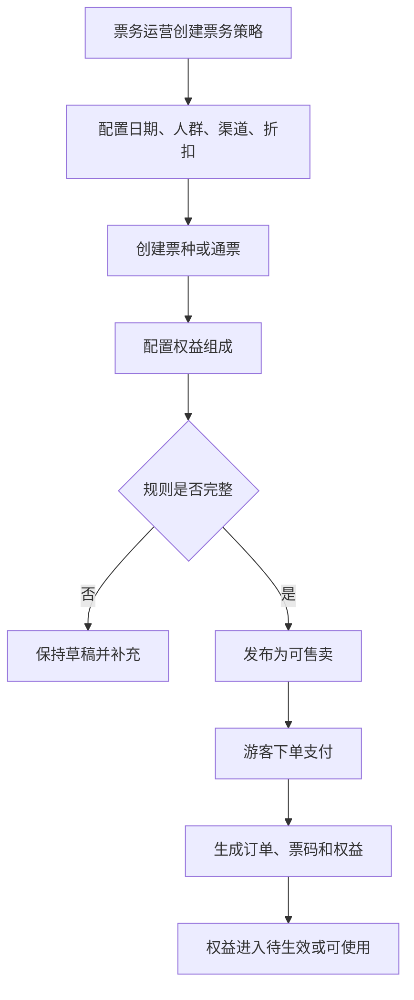

### 输出结果

- 票务策略。
- 票种/通票。
- 订单。
- 权益台账。

## 4. F2 权益现场核销

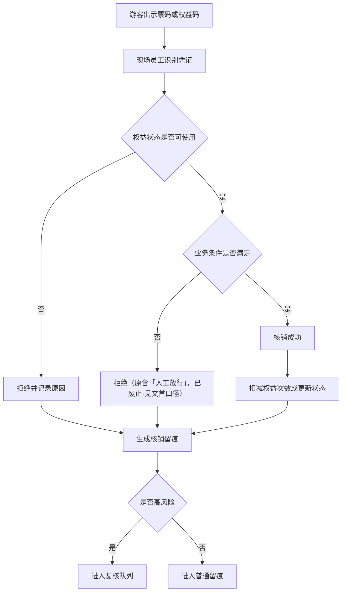

### 典型异常

- 权益已使用。
- 权益已退款。
- 权益过期。
- 不适用当前业务或点位。
- 重复核销。
- 员工人工放行（**已废止·见文首口径**，不再作为可选原因）。

## 5. F3 酒吧入场到关台

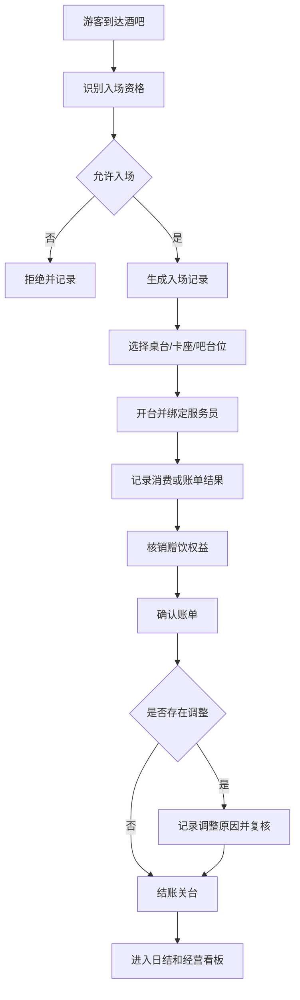

### 输出结果

- 入场记录。
- 桌台状态。
- 酒吧账单。
- 赠饮核销。
- 账单调整留痕。

## 6. F4 供应链采购、库存与存酒

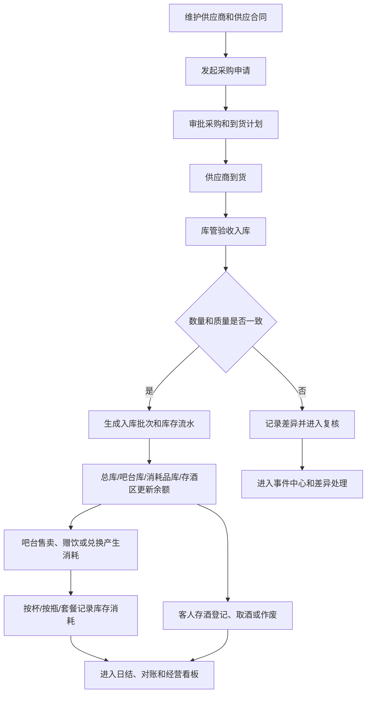

### 输出结果

- 供应商和供应合同。
- 采购周期和入库记录。
- 库存流水和库存余额。
- 吧台消耗记录。
- 客人存酒记录。
- 盘点差异、报损和复核记录。

## 7. F5 游乐开放到核销

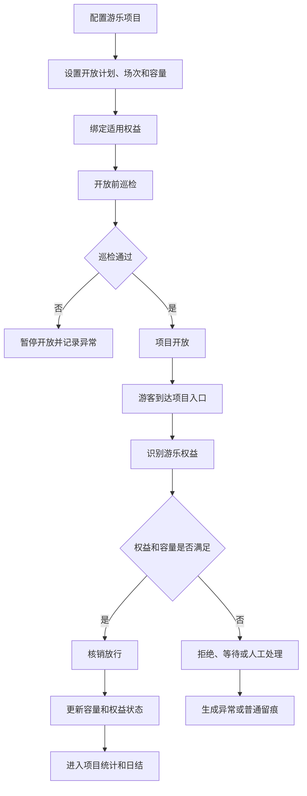

### 输出结果

- 项目开放状态。
- 项目容量（实时在玩人数）。
- 游乐核销记录。
- 巡检和项目异常。

### 7A. F5A 游乐定期检修与恢复营业

> 修订说明（2026-06-07）：本小节新增。operation-traceability §2.3「游乐运营」把检修与开放/暂停/恢复并列为 P0 留痕，原流程图无检修-确认-恢复营业分支，按 bizfam-8 finding 补齐。

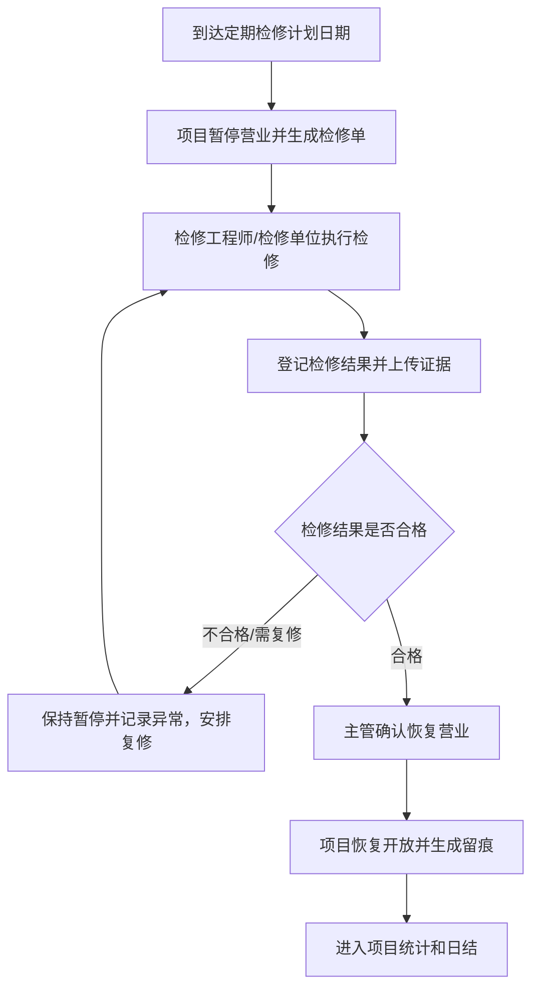

### 输出结果

- 检修单和检修结果。
- 主管确认记录。
- 恢复营业留痕。

## 8. F6 第三方回流到差异处理

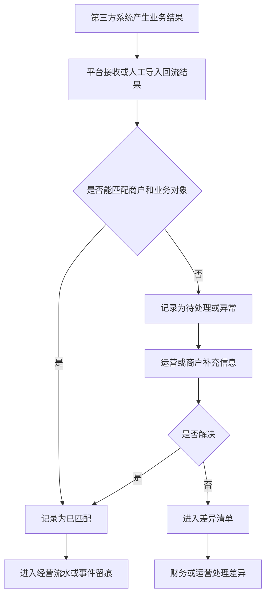

### 输出结果

- 第三方回流记录。
- 回流批次。
- 差异清单。
- 接入异常。

## 9. F7 人工补录与复核

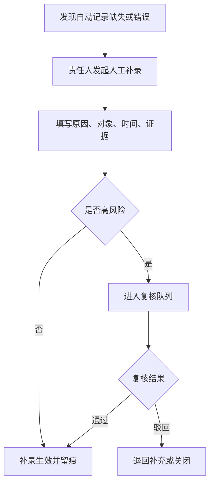

### 高风险补录

- 人工放行（**已废止·见文首口径**，不再作为高风险补录类型）。
- 退款或撤销。
- 酒吧免单和账单调整。
- 高价值酒水报损、盘点差异和存酒作废。
- 游乐超容或暂停。
- 第三方差异调整。

## 10. F8 日结、对账与结算

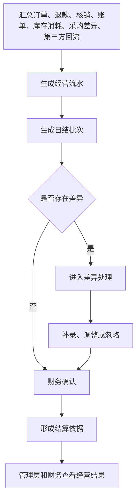

### 输出结果

- 经营流水。
- 日结批次。
- 差异记录。
- 结算依据。

## 11. F9 终端现场作业

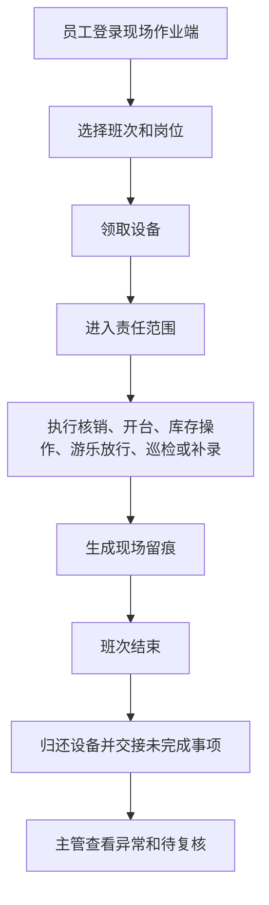

## 11A. F10 会员积分与兑换

> 修订说明（2026-06-07）：本节新增。breakdown §3 会员积分 P0、§9 已确认规则2（兑换扣减库存）与规则7（积分/等级/兑换规则后台定义）已声明，原流程图缺该流程，按 bizfam-1 finding 补齐。

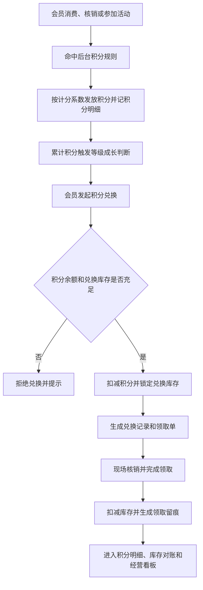

### 输出结果

- 会员积分明细和等级成长记录。
- 积分兑换记录。
- 兑换领取记录和库存扣减留痕。

## 12. 跨流程依赖

| 上游 | 下游 | 依赖关系 |
|---|---|---|
| 平台治理商户/空间/员工/设备 | 全部业务经营 | 没有基础治理，不能确定业务归属和责任链 |
| 票务权益 | 酒吧和游乐 | 赠饮和游乐使用都依赖权益 |
| 消费/核销 | 会员积分 | 消费和核销触发积分发放与等级成长（F10） |
| 会员积分兑换 | 供应链库存 | 积分兑换礼物/酒水需扣减库存（breakdown §9 规则2，F10） |
| 酒吧点酒和权益领取 | 供应链库存 | 吧台售卖、赠饮、兑换、酒类消耗和存酒会改变库存状态 |
| 供应链库存 | 财务日结 | 采购、消耗、报损和盘点差异会影响成本和经营判断 |
| 现场核销 | 财务日结 | 核销是对账和结算的重要口径 |
| 第三方回流 | 财务对账 | 外部结果必须进入统一差异处理 |
| 人工补录 | 风控和财务 | 补录会影响经营事实，必须留痕 |
| 事件中心 | 管理看板 | 异常和风险进入管理层判断 |

## 13. 流程验收标准

- 每条 P0 主流程都有起点、终点、异常分支和输出结果。
- 票务权益能连接酒吧赠饮和游乐核销。
- 第三方回流能进入差异处理和财务视图。
- 人工补录必须经过留痕或复核。
- 现场作业端所有动作能关联员工、设备、班次和点位。
- 供应链流程能覆盖酒类、消耗品、其他物品、吧台消耗和客人存酒。

## 14. 本版结论

业务经营层关键流程已经形成完整闭环：配置、售卖、核销、服务、供应链库存、回流、补录、对账、分析。后续可以按这些流程继续拆详细交互和实现任务。

## 15. 变更日志

| 日期 | 类型 | 位置 | 内容 | 原因/依据 |
|---|---|---|---|---|
| 2026-06-07 | 增 | §2 总览、§11A F10 | 新增「会员积分与兑换」流程图 | breakdown 会员积分 P0 缺流程（bizfam-1） |
| 2026-06-07 | 增 | §7A F5A | 新增「游乐定期检修与恢复营业」分支 | operation-traceability §2.3 检修 P0（bizfam-8） |
| 2026-06-07 | 改 | §12 跨流程依赖 | 补会员积分与库存兑换依赖 | 与 F10 对齐（bizfam-1） |

---

## 原文件：`business-operations-low-fi-prototype-v0.1.md`

# 业务经营层低保真原型说明 V0.1

## 1. 文档定位

本文档用低保真方式说明业务经营层主要页面结构和终端布局。它不是视觉稿，不定义颜色、字体和组件实现，只定义信息架构、页面区块和交互优先级。

## 2. 信息架构

业务经营层在管理后台建议使用以下一级导航：

| 一级导航 | 二级导航 |
|---|---|
| 经营总览 | 今日经营、待办风险、快捷入口 |
| 票务经营 | 策略、票种/通票、权益、订单、核销、退款 |
| 会员积分 | 积分规则、积分账户明细、积分兑换、兑换领取 |
| 酒吧经营 | 总览、入场、桌台、订台、账单、支付处理、服务责任链、赠饮、异常 |
| 供应链库存 | 总览、供应商、供应合同、采购周期、库房、酒类、消耗品、其他物品、入库出库、物品追踪码、交接留痕、吧台消耗、盘点报损、客人存酒 |
| 游乐运营 | 总览、项目、开放计划、项目容量（实时在玩人数）、核销、定期检修、巡检 |

> 修订说明（2026-06-07）：一级导航新增「会员积分」，并在酒吧补订台/支付处理/服务责任链、供应链补物品追踪码/交接留痕、游乐补定期检修。均为 PRD 已声明 P0 但原信息架构缺失（bizfam-1/3/6/7/8），与 page-list §2 分组保持一致。
| 第三方回流 | 接入关系、回流记录、批次、差异、异常 |
| 事件风控 | 事件中心、人工补录、复核、风险提示、证据 |
| 财务经营 | 流水、日结、对账、差异、结算 |
| 终端管理 | 商户侧、现场端、移动管理端、游客端配置 |

## 3. 全局页面结构

### 3.1 列表页

列表页统一结构：
- 顶部标题和当前业务说明。
- 快捷筛选：项目、业态、商户、日期、状态。
- 关键指标摘要：总数、异常数、待处理数。
- 主表格：核心字段、状态、责任人、时间。
- 行操作：查看、处理、复核、跳转事件或财务。

### 3.2 详情页

详情页统一结构：
- 左侧或顶部显示对象摘要和状态。
- 主体分区显示基础信息、关联对象、流程记录、留痕。
- 右侧或底部显示可执行操作和风险提示。
- 高风险动作必须要求填写原因。

### 3.3 工作台页

工作台页用于现场或高频业务：
- 当前员工/设备/班次。
- 输入或扫码区域。
- 结果判断区。
- 明确主操作按钮：核销、拒绝、提交异常（原含「人工放行」按钮，已废止·见文首口径，不得提供该按钮）。
- 最近操作记录。

## 4. 经营总览低保真

首屏区块：
- 今日收入卡片。
- 今日客流和核销卡片。
- 酒吧桌台状态卡片。
- 供应链库存卡片：待采购、待入库、缺货、盘点差异、存酒到期。
- 游乐开放和容量卡片。
- 待处理异常列表。
- 待复核列表。

关键交互：
- 点击收入进入财务经营。
- 点击核销进入核销记录。
- 点击异常进入事件中心。
- 点击业务卡片进入对应业务总览。

## 5. 票务经营低保真

### 5.1 票务策略页

结构：
- 左侧策略列表或筛选。
- 中间策略表格。
- 右侧策略详情或新建表单。

关键字段：
- 策略名称、日期类型、人群、渠道、折扣、有效期、状态。

### 5.2 票种/通票页

结构：
- 票种列表。
- 权益组成区域。
- 售卖状态和适用策略。

重点：
- 通票必须能清楚展示拆出的权益，如入场、游乐、赠饮。

### 5.3 核销工作台

结构：
- 顶部显示当前员工、设备、点位。
- 中间输入凭证。
- 下方显示权益判断结果。
- 底部显示核销、拒绝、提交异常（原含「人工放行」，已废止·见文首口径）。

## 5A. 会员积分低保真

> 修订说明（2026-06-07）：本节新增。会员积分为 breakdown §3 P0，原低保真无对应页面，按 bizfam-1 finding 补齐，与 page-list §5A 对应。

### 5A.1 积分规则页

结构：
- 规则列表：规则名称、获取方式、计分系数、等级阈值、状态。
- 右侧规则详情或新建表单。

> 修订说明（2026-06-07 收口）：规则详情/新建表单需展示并可配置**积分有效期类型（永久/固定天数/按自然年）、有效天数、过期方式（FIFO 批次/整账清零）**，与 `business-operations-field-dictionary §4A.2` 新增的积分有效期字段一致；积分账户明细页（§5A.2）的"过期"明细类型即由该规则触发的过期清零作业写入。依据 finding critic-10（pass-7）。

### 5A.2 积分账户明细页

结构：
- 顶部会员搜索（手机号/会员）。
- 账户摘要：积分余额、会员等级。
- 明细表格：类型、变动积分、关联业务单据、时间。

### 5A.3 积分兑换与领取页

结构：
- 兑换品列表：兑换品、所需积分、兑换库存、关联库存物品。
- 兑换记录列表：会员、消耗积分、兑换状态、领取状态。
- 操作区：发起兑换、确认领取、拒绝（原含「人工放行」，已废止·见文首口径）。

重点：
- 兑换扣减库存必须可见，领取必须显示库存扣减关联（breakdown §9 规则2）。

## 6. 酒吧经营低保真

### 6.1 桌台看板

结构：
- 顶部筛选区域：区域、状态、服务员。
- 主体为桌台网格或列表。
- 每个桌台显示编号、状态、人数、账单、服务员。

状态表达：
- 桌台 6 态（空闲、已预留、已开台、待清台、停用、异常）必须醒目区分。

> 修订说明（2026-06-07 收口）：原仅列「空闲、已开台、待清台、异常」4 态，缺「已预留/停用」，与 `business-operations-field-dictionary §11/§11.1` 已对齐的 D7 桌台 6 态（idle/reserved/opened/pending_clear/disabled/abnormal）不一致，故补全。依据 finding structural-3/dup-tables-8（D7）。

### 6.2 酒吧账单

结构：
- 账单摘要。
- 消费/赠饮/调整明细。
- 结账和异常操作。
- 留痕记录。

重点：
- 赠饮权益必须能看到来源票务权益。
- 免单和调整必须要求原因。

## 7. 供应链库存低保真

### 7.1 供应链总览页

结构：
- 顶部指标：待采购、待入库、缺货预警、盘点差异、报损待复核、存酒到期。
- 左侧快捷入口：供应商、供应合同、采购周期、库房、库存余额、存酒。
- 中间待办列表：采购待审批、到货待入库、报损待复核、盘点差异待处理。
- 右侧风险提示：高价值酒水异常、临期物品、存酒即将到期。

### 7.2 供应商与供应合同页

结构：
- 供应商列表：名称、联系人、供货范围、资质状态、启停状态。
- 合同摘要区：合同编号、供货品类、价格口径、账期、有效期、审批状态。
- 操作区：新建供应商、新建合同、提交审批、停用。

### 7.3 采购周期页

结构：
- 采购申请列表：物品、数量、供应商、预计到货、状态。
- 采购详情：审批记录、到货记录、差异说明。
- 操作区：发起采购、审批、确认到货、生成入库、标记差异。

### 7.4 库房与库存页

结构：
- 库房筛选：总库、酒吧库、吧台库存、消耗品库、礼品库、存酒区。
- 库存表格：物品、批次、单位、数量、成本口径、保质期、状态。
- 操作区：入库、出库、调拨、盘点、报损、报溢。

### 7.5 吧台消耗和存酒页

结构：
- 吧台消耗列表：酒吧订单、售卖形式、按杯/按瓶/套餐、消耗数量、员工、时间。
- 客人存酒列表：会员/手机号、存酒编号、酒品、剩余量、有效期、状态。
- 操作区：登记存酒、取酒、转赠、作废、异常复核。

重点：
- 供应链页面要让业务人员一眼知道“东西从哪里来、在哪里、怎么少了、谁负责”。
- 高价值酒水报损、盘点差异和存酒作废必须显示原因、责任人和复核状态。

## 8. 游乐运营低保真

### 8.1 项目容量页（实时在玩人数）

结构：
- 项目筛选。
- 日期和场次列表。
- 容量进度：上限、已核销、剩余。
- 场次状态。

### 8.2 游乐核销工作台

结构：
- 当前项目、入口点位、场次。
- 输入/扫码区。
- 权益和容量判断区。
- 核销、拒绝、等待、人工处理按钮。

### 8.2A 定期检修页

> 修订说明（2026-06-07）：本节新增。operation-traceability §2.3 把检修列为游乐 P0 留痕过程，原低保真无检修页，按 bizfam-8 finding 补齐，与 page-list §8.4A、flow §F5A 对应。

结构：
- 检修计划列表：项目、检修单号、计划日期、状态。
- 检修详情：检修工程师、检修单位/供应商、检修结果、证据。
- 操作区：登记检修结果、上传证据、主管确认、恢复营业。

重点：
- 检修不合格/需复修必须保持暂停，主管确认后才能恢复营业。

### 8.3 巡检异常页

结构：
- 巡检任务列表。
- 巡检项结果。
- 异常原因和证据。
- 暂停、恢复、关闭异常操作。

## 9. 第三方回流低保真

结构：
- 接入关系总览。
- 回流批次列表。
- 回流记录明细。
- 差异处理抽屉或详情页。

重点：
- 每条第三方记录必须显示外部单号、平台关联对象、匹配状态。
- 异常记录必须能转人工补录或差异处理。

## 10. 事件风控低保真

结构：
- 顶部风险概览：待复核、待补充、已驳回、已关闭。
- 左侧事件类型筛选。
- 中间事件列表。
- 右侧事件详情、证据、复核操作。

重点：
- 高风险动作不能只显示结果，必须显示原因、责任人和证据。

## 11. 财务经营低保真

结构：
- 财务经营总览。
- 经营流水列表，包含订单、账单、库存消耗、采购差异和报损。
- 日结批次列表。
- 差异清单。
- 结算依据详情。

重点：
- 财务页面优先支持筛选、核对和状态确认。
- 日结确认前必须显示未处理差异。

## 12. 现场作业端低保真

现场端优先适配安卓手机和平板。

### 12.1 首页

结构：
- 当前员工、班次、设备。
- 高频任务入口：核销、酒吧、库存操作、游乐、巡检、补录、交接。
- 当前异常提醒。

### 12.2 核销页

结构：
- 凭证输入/扫码。
- 资格判断。
- 主操作按钮。
- 最近核销记录。

### 12.3 班次交接页

结构：
- 未完成事项。
- 设备归还。
- 异常确认。
- 提交交接。

## 13. 商户侧低保真

结构：
- 本商户今日经营摘要。
- 本商户经营记录。
- 本商户供应、库存或存酒相关记录。
- 本商户对账差异。
- 本商户结算依据。
- 本商户事件记录。

重点：
- 页面上必须明确数据范围是“本商户”。

## 14. 移动管理端低保真

结构：
- 今日关键指标。
- 待办中心。
- 异常详情。
- 复核操作。

重点：
- 移动管理端不做复杂配置，只做查看、确认、驳回和补充说明。

## 15. 低保真验收标准

- 每个业务主线都有总览、列表、详情和处理入口，供应链库存必须有独立入口。
- 现场作业端能完成上岗后的核心动作。
- 管理后台能完成配置、查询、复核和财务确认。
- 商户侧、现场端、移动端和游客端职责边界清晰。
- 异常、补录、复核、差异在页面上有明确入口。

## 16. 本版结论

业务经营层低保真结构已经覆盖 P0 经营动作和主要角色入口。后续进入视觉设计或实现前，应先确认现场端优先设备、酒吧点单深度、供应链库存范围、吧台消耗口径、存酒管理方式、游乐容量口径和第三方回流深度。

## 17. 变更日志

| 日期 | 类型 | 位置 | 内容 | 原因/依据 |
|---|---|---|---|---|
| 2026-06-07 | 改 | §2 信息架构 | 一级导航新增会员积分；酒吧补订台/支付处理/服务责任链；供应链补追踪码/交接留痕；游乐补定期检修 | PRD 已声明 P0 但信息架构缺失（bizfam-1/3/6/7/8） |
| 2026-06-07 | 增 | §5A 会员积分低保真 | 新增积分规则/账户明细/兑换领取页结构 | breakdown 会员积分 P0 缺低保真（bizfam-1） |
| 2026-06-07 | 改 | §5A.1 积分规则页 | 加小注：规则需展示/配置积分有效期类型/有效天数/过期方式，与字段字典 §4A.2 一致 | 积分有效期/过期清零规则展示同步（finding critic-10，pass-7） |
| 2026-06-07 | 改 | §6.1 桌台看板 | 状态表达由 4 态补全为 D7 桌台 6 态（空闲/已预留/已开台/待清台/停用/异常） | 与字段字典 §11/§11.1 已对齐的 6 态保持一致（finding structural-3/dup-tables-8，D7） |
| 2026-06-07 | 增 | §8.2A 定期检修页 | 新增游乐检修页结构 | operation-traceability §2.3 检修 P0（bizfam-8） |

---

## 原文件：`business-operations-acceptance-checklist-v0.1.md`

# 业务经营层产品验收清单 V0.1

## 1. 文档定位

本文档用于验收业务经营层产品文档是否完整、一致、可进入后续细化或实现任务拆解。

本文档不是测试用例，不是技术验收，不是上线验收。它用于检查产品设计是否把 P0 经营事实讲清楚。

## 2. 验收范围

本次验收范围包括：
- 票务/通票/权益/核销。
- 酒吧基础经营。
- 供应链、采购、库房、库存消耗和客人存酒。
- 游乐基础运营。
- 第三方业务回流。
- 证据留痕与风控。
- 财务经营、日结、对账、结算。
- 管理后台、商户侧、现场作业端、移动管理端、游客触达端。

## 3. 文档完整度验收

| 文档 | 验收结果 |
|---|---|
| `business-operations-product-breakdown-v0.1.md` | 通过 |
| `ticketing-entitlement-checkin-product-prd-v0.1.md` | 通过 |
| `bar-business-operations-product-prd-v0.1.md` | 通过 |
| `supply-chain-inventory-product-prd-v0.1.md` | 通过 |
| `amusement-business-operations-product-prd-v0.1.md` | 通过 |
| `third-party-business-access-product-prd-v0.1.md` | 通过 |
| `evidence-risk-control-product-prd-v0.1.md` | 通过 |
| `finance-settlement-product-prd-v0.1.md` | 通过 |
| `terminal-page-product-prd-v0.1.md` | 通过 |
| `business-operations-page-list-v0.1.md` | 已补齐并复核通过（2026-06-07 已补会员积分页面组、订台/支付/服务责任链、物品追踪码/交接、定期检修；2026-06-08 产品流复核收口） |
| `business-operations-field-dictionary-v0.1.md` | 已补齐并复核通过（2026-06-07 已补会员积分字段、追踪码/交接字段、检修字段、支付方式/收款人，并按 D7 给中英映射；2026-06-08 产品流复核收口） |
| `business-operations-flow-diagrams-v0.1.md` | 已补齐并复核通过（2026-06-07 已补会员积分与兑换 F10、游乐检修 F5A；2026-06-08 产品流复核收口） |
| `business-operations-low-fi-prototype-v0.1.md` | 已补齐并复核通过（2026-06-07 已补会员积分一级导航与低保真、检修页；2026-06-08 产品流复核收口） |

> 修订说明（2026-06-07）：上述四份文档原标「通过」属虚标——会员积分（PRD 已声明 P0）整体缺失、酒吧订台/支付/服务责任链、供应链追踪码/交接、游乐检修均缺。按 bizfam-2 finding 据实下调为「本轮补齐，待复核」，并新增 §12「已知缺口」节登记。

## 4. 模块覆盖验收

| 模块 | P0 覆盖要求 | 结果 |
|---|---|---|
| 票务 | 策略、票种、通票、权益、订单、核销、退款异常 | 通过 |
| 会员 | 积分规则、会员等级、积分明细、积分账户、积分兑换、兑换领取、兑换扣减库存 | 已补齐并复核通过（2026-06-08 产品流复核确认闭环） |
| 酒吧 | 入场、桌台、订台、开台、账单、支付处理、服务责任链、赠饮、关台、异常 | 已补齐并复核通过（2026-06-08 产品流复核确认闭环） |
| 供应链 | 供应商、供应合同、采购周期、库房、酒类、消耗品、其他物品、库存物品、入库、出库、调拨、物品追踪码、交接留痕、吧台消耗、盘点、报损、客人存酒 | 已补齐并复核通过（2026-06-08 产品流复核确认闭环） |
| 游乐 | 项目、开放计划、场次、项目容量（实时在玩人数）、核销、定期检修、巡检、异常 | 已补齐并复核通过（2026-06-08 产品流复核确认闭环） |
| 第三方 | 接入关系、回流记录、批次、差异、异常 | 通过 |
| 风控 | 事件、补录、复核、风险提示、证据 | 通过 |
| 财务 | 流水、日结、对账、差异、结算依据 | 通过 |
| 终端 | 后台、商户侧、现场端、移动端、游客端 | 通过 |

## 5. 关键流程验收

| 流程 | 验收口径 | 结果 |
|---|---|---|
| 票务策略到权益生成 | 能从规则配置走到订单和权益 | 通过 |
| 权益现场核销 | 能判断可用、拒绝和异常（原含「人工放行」，已废止·见文首口径） | 通过 |
| 酒吧入场到关台 | 能覆盖入场、开台、账单、赠饮、关台 | 通过 |
| 供应链采购库存与存酒 | 能覆盖供应商、采购、入库、出库、调拨、物品追踪码、扫码交接、吧台消耗、盘点差异、报损和存酒 | 通过 |
| 游乐开放到核销 | 能覆盖巡检、开放、场次、项目容量（实时在玩人数）、核销 | 通过 |
| 第三方回流到差异 | 能覆盖匹配、异常、差异处理 | 通过 |
| 人工补录与复核 | 能覆盖补录原因、证据、复核结果 | 通过 |
| 日结对账结算 | 能覆盖流水、日结、差异、结算依据 | 通过 |
| 现场作业 | 能覆盖上岗、设备、作业、交接 | 通过 |

## 6. 页面验收

| 页面要求 | 结果 |
|---|---|
| 票务、酒吧、供应链、游乐都有独立入口 | 通过 |
| 会员积分有独立入口（积分规则、账户明细、兑换、领取） | 已补齐并复核通过 |
| 第三方、风控、财务都有独立管理入口 | 通过 |
| 商户侧只看本商户数据 | 通过 |
| 现场作业端不承担后台复杂配置 | 通过 |
| 移动管理端用于待办和复核 | 通过 |
| 游客端只展示票、权益和凭证 | 通过 |

## 7. 字段和状态验收

| 对象 | 必须具备状态 | 结果 |
|---|---|---|
| 票务策略 | 草稿、待启用、售卖中、暂停售卖、已结束、归档 | 通过 |
| 订单 | 待支付、已支付、部分退款、已退款、已关闭、异常 | 通过 |
| 权益 | 待生效、可使用、已部分使用、已使用、已失效、已退款、已冻结 | 通过 |
| 核销 | 成功、拒绝、已撤销、待复核、异常（原含「人工放行」，已废止·见文首口径） | 通过 |
| 桌台 | 空闲、已预留、已开台、待清台、停用、异常 | 通过 |
| 酒吧账单 | 进行中、待结账、已结账、部分退款、已退款、异常 | 通过 |
| 供应商/供应合同/采购周期/库存流水/存酒 | 待审核、启用、待审批、生效、入库、有差异、待复核、已关闭等 | 通过 |
| 游乐项目 | 未开放、准备中、开放中、暂停、已关闭、异常 | 通过 |
| 场次 | 未开始、入场中、已满员、进行中、已结束、取消、异常 | 通过 |
| 第三方接入 | 待接入、联调中、已启用、暂停、异常、已停用、归档 | 通过 |
| 事件 | 已记录、待补充、待复核、已确认、已驳回、已关闭、已归档 | 通过 |
| 日结和结算 | 待确认、有差异、已确认、已锁定、待复核、已归档等 | 通过 |
| 积分兑换/兑换领取 | 待领取、已领取、已取消/已拒绝、已过期、异常（原含「人工放行」，已废止·见文首口径） | 已补齐并复核通过 |
| 物品追踪码/交接 | 在库、出库、机器人运送、后厨、服务中、已送达、客人存酒、已作废、异常；交接成功/失败/异常 | 已补齐并复核通过 |
| 游乐检修 | 待检修、检修中、合格、不合格、需复修、已恢复营业、异常 | 已补齐并复核通过 |

> 修订说明（2026-06-07）：上方三行为本次新增。原状态验收缺会员积分/兑换、物品追踪码/交接、游乐检修对象状态，且全文未按统一口径基准 D7 要求给中英映射；现据实补行，状态中英映射见 field-dictionary §11.1（bizfam-1/3/8、D7）。

## 8. 边界验收

| 边界 | 结果 |
|---|---|
| 不自研完整餐饮 POS | 通过 |
| 不自研完整零售 POS | 通过 |
| 不自研完整机器人系统 | 通过 |
| 不自研完整视频监控平台 | 通过 |
| 不替代企业微信 | 通过 |
| 不替代完整 ERP/WMS，但 P0 必须有基础供应链和库存台账 | 通过 |
| 本轮只做产品文档，不编码，不部署 | 通过 |

## 9. 可进入下一阶段标准

业务经营层可进入下一阶段的标准：
- P0 主对象已清楚。
- P0 页面入口已清楚。
- P0 核心字段和状态已清楚。
- P0 关键流程已清楚。
- 低保真结构已清楚。
- 原开放问题已收口为已确认执行口径、实施配置或后续排期项，而不是技术未知项。

当前结论：已满足 P0 产品文档验收口径。§10A 保留为历史缺口与处置记录，其中“待复核项”已在 2026-06-08 产品流复核中收口，剩余内容转为实施配置或业务运营关注项。

> 修订说明（2026-06-07）：原结论「已满足」属虚标。会员积分（PRD 已声明 P0）整体缺失、酒吧订台/支付/服务责任链、供应链追踪码/交接、游乐检修等下游五件套缺失，本轮已补齐但需总控复核，故下调为「基本满足，待复核」并登记已知缺口（bizfam-2）。

## 10. 已确认规则和后续细化事项

已确认规则：

1. 酒吧 P0 包含基础点单、商品明细、吧台买酒、赠饮/权益核销和账单支付。
2. 通票支持酒吧通票、游乐通票、酒吧+游乐通票、酒吧+游乐+餐饮+零售折扣通票；餐饮/零售只做第三方优惠、折扣、券或权益。
3. 游乐容量 P0 按具体项目、具体场次/时段、点位/设备控制容量，项目总量只做汇总和安全上限。
4. 客人存酒按瓶底标签数值、拍照、人工备注、手机号、姓名/昵称管理。
5. 餐饮/零售第三方回流同时支持订单级和券核销级；看板支持日、半日、小时汇总，单店小数据量可实时汇总。
6. 现场作业端已拆分：工作手机负责票务/权益扫码核销，平板只负责酒吧点酒下单，一体机支持订台、吧台买酒和游乐状态查看。
7. 会员积分、等级成长和兑换规则由后台定义。
8. 酒吧最低消费按时间、卡座和位置配置，不按人数。
9. 供应链 P0 从酒类、吧台消耗、客人存酒和常用消耗品开始。
10. 吧台按杯销售按标准出酒量/容量扣减，超出部分记损耗。
11. 高价值酒水报损、盘点差异、存酒作废必须拍照/视频留证并主管复核。
12. 免单、退款、调账按可配置层级主管复核（原列「人工放行」，已废止·见文首口径）。
13. 日结锁定后不允许直接补录影响金额，必须上级审批通过后补录。
14. 商户侧在授权业务范围内全开放，酒吧和游乐/乐园保留独立 SaaS 能力。
15. 员工权限按单一功能最小颗粒度配置，支持角色和员工级完全自定义。
16. 所有有过程的业务动作必须留痕，订单获取、销售归属、卡座服务、异常第一处理人，以及酒水和可追责物品从库房出库、机器人或人工配送、后厨接收、服务员送达客人都要可追溯。
17. 所有端都必须有开关接口，支持按项目、商户、业务系统、模块、设备和版本控制。
18. 权限点首批由平台统一预置，实施阶段允许边配置边补充。

后续细化：

无方向性悬空事项。已确认：管理层第一版经营看板第一屏优先看收入、客流、核销；第二屏展示商户表现、供应链库存、异常风险、结算差异和应收应付逾期。

## 10A. 历史缺口与处置记录

> 修订说明（2026-06-07）：本节新增。按 bizfam-2 finding 据实登记两轮审查发现的「PRD 已声明 P0、下游五件套缺失」缺口及本轮处置状态，避免验收表以「通过」掩盖真实缺口。
>
> 修订说明（2026-06-08 产品流复核）：下列缺口已由页面清单、字段字典、流程图、低保真和需求追溯矩阵补齐并复核通过；表中“待复核项”改按后续实施配置或业务运营关注理解，不再作为产品文档缺口。

| 历史缺口 | 涉及文档 | 本轮处置 | 后续关注项 | 依据 |
|---|---|---|---|---|
| 会员积分整体缺失（积分规则/账户明细/兑换/领取） | page-list、field-dict、flow、low-fi | 已补页面组、字段章、F10 流程、低保真与一级导航 | 兑换库存联动口径、等级规则示例是否与后台一致 | bizfam-1 |
| 物品追踪码与交接留痕缺页/缺字段 | page-list、field-dict | 已补两页与字段，对齐 operation-traceability §6.1/6.2 | 与 supply-chain PRD 的码生命周期细节一致性 | bizfam-3 |
| 酒吧订台/服务责任链缺失 | page-list、field-dict、breakdown | 已补订台/服务责任链页与字段、对象总表；基础卡座提成已按“销售人员 15% / 非销售人员 10%”收口 | 复杂多人/阶梯提成、换人审批层级 | bizfam-6 |
| 酒吧支付方式/收款人缺失 | page-list、field-dict | 已补支付处理页与支付方式/收款人 cashier 字段 | 线上扫码与客付款码的对账拆分口径 | bizfam-7 |
| 游乐定期检修缺失 | page-list、field-dict、flow、low-fi | 已补检修页、字段、F5A 分支、低保真 | 检修单位/供应商与采购/合同的关联口径 | bizfam-8 |
| 子文档顺序缺跨层底座 | breakdown、page-list | 已补 operation-traceability 底座并标注 | 底座 PRD 与各业务 PRD 的承接边界 | bizfam-9/5 |
| 库存流水类型枚举不一致 | breakdown、field-dict | 已统一「赠饮」「积分兑换/礼物领取」为独立类型 | 财务对账时各类型的科目映射 | bizfam-10 |
| 状态枚举未给中英映射、金额未标单位 | field-dict | 已按 D7 给新增对象中英映射，金额标注单位=分 | 既有对象（订单/权益/桌台等）补全中英映射 | D1/D7 |

## 11. 本版结论

业务经营层产品文档在本轮补齐会员积分、订台/支付/服务责任链、物品追踪码/交接、定期检修并完成 2026-06-08 产品流复核后，已完成 P0 产品文档闭环。后续可以按“票务、会员、酒吧、供应链、游乐”经营主线继续拆实现任务、视觉/交互原型和初始化配置。

> 修订说明（2026-06-07）：结论由「已完成 P0 闭环」据实改为「本轮补齐后基本完成，待复核 §10A」，并把「会员」补入经营主线（bizfam-1/2）。

## 12. 变更日志

| 日期 | 类型 | 位置 | 内容 | 原因/依据 |
|---|---|---|---|---|
| 2026-06-07 | 改 | §3 文档完整度 | page-list/field-dict/flow/low-fi 由「通过」下调为「本轮补齐，待复核」 | 原虚标，会员等 P0 缺失（bizfam-2） |
| 2026-06-07 | 增 | §4 模块覆盖 | 新增「会员」行；酒吧/供应链/游乐据实下调 | 会员模块原整体缺失（bizfam-1/2/3/6/7/8） |
| 2026-06-07 | 增 | §6 页面验收 | 新增会员积分独立入口行 | bizfam-1 |
| 2026-06-07 | 增 | §7 状态验收 | 新增积分兑换/追踪码交接/检修状态行，提示 D7 中英映射 | bizfam-1/3/8、D7 |
| 2026-06-07 | 改 | §9 结论 | 「已满足」下调为「基本满足，待复核」 | 据实反映缺口（bizfam-2） |
| 2026-06-07 | 增 | §10A 已知缺口 | 新增已知缺口登记表 | 按 bizfam-2 据实登记缺口与处置 |
| 2026-06-08 | 改 | §3/§4/§6/§7/§9/§10A/§11 | 将已补齐项由“待复核”收口为“已补齐并复核通过”，§10A 改为历史缺口与处置记录 | 对齐产品流复核历史报告与追溯矩阵已收口结论；原报告已归档 |

## 继续合并补录（2026-08-28）

> 本节补齐此前未被目标逐字承接的代码相关原文。为避免把历史冲突重新升级为现行规则，以下内容按源文逐字保存；若与本文文首修订、S0/S1 事实源或 `docs/scope-wide-coding-rule-canonical-V0.01.md` 冲突，以后者为准。
> 本节只做载体收拢，不修改三份业务 HTML，也不改变已经裁定的现行/废止关系。

### 来源：`docs/_archive/20260610-retention-audit/merged-layer-spec-sources/business-operations-flow-diagrams-v0.1.md`

> 本次逐字补录 2 条；该源其余 161 条已在本目标，0 条已在范围规范唯一载体。

~~~~text
| F5 | 游乐开放到核销 | 明确项目开放、场次容量和核销 |

E -- 否 --> F["拒绝或人工放行"]
~~~~

### 来源：`docs/_archive/20260610-retention-audit/merged-layer-spec-sources/business-operations-field-dictionary-v0.1.md`

> 本次逐字补录 8 条；该源其余 262 条已在本目标，0 条已在范围规范唯一载体。

~~~~text
| 核销结果 | 成功、拒绝、人工放行、异常 | 是 | 状态 |

| 领取状态 | 待领取、已领取、已拒绝、人工放行、异常 | 是 | 状态 |

| 调整金额 | 折扣、抹零、免单等（单位：分/整数） | 否 | 风控 |

| 核销 | 成功、拒绝、人工放行、已撤销、待复核、异常 |

| 回流记录 | 待接收、已接收、已匹配、待处理、已入账口径、已忽略、异常 |

| 差异 | 待识别、待处理、待复核、已关闭、已忽略 |

| 兑换领取 | 待领取、已领取、已拒绝、人工放行、异常 |

| 兑换领取 | 人工放行 | manual_override |
~~~~

### 来源：`docs/_archive/20260610-retention-audit/merged-layer-spec-sources/business-operations-low-fi-prototype-v0.1.md`

> 本次逐字补录 4 条；该源其余 119 条已在本目标，0 条已在范围规范唯一载体。

~~~~text
| 游乐运营 | 总览、项目、开放计划、场次容量、核销、定期检修、巡检 |

- 明确主操作按钮：核销、拒绝、人工放行、提交异常。

- 底部显示核销、拒绝、人工放行、提交异常。

- 操作区：发起兑换、确认领取、拒绝、人工放行。
~~~~

### 来源：`docs/_archive/20260610-retention-audit/merged-layer-spec-sources/business-operations-page-list-v0.1.md`

> 本次逐字补录 7 条；该源其余 160 条已在本目标，0 条已在范围规范唯一载体。

~~~~text
| 游乐运营 | 游乐总览、项目、开放计划、场次容量、核销、定期检修、巡检异常 | 管项目开放、容量、核销、检修和安全 |

| 客流与核销 | 入场人数、权益核销数、核销失败数、人工放行数 |

| 关键操作 | 核销成功、拒绝、人工放行、提交异常 |

| 关键操作 | 确认领取、拒绝、人工放行、提交异常 |

| 关键操作 | 核销、拒绝、人工放行 |

| 关键字段 | 权益、项目、场次、容量、游客、核销结果 |

| 风险提示 | 重复核销、人工放行、高频退款、超容 |
~~~~

### 来源：`docs/_archive/20260610-retention-audit/merged-layer-spec-sources/business-operations-acceptance-checklist-v0.1.md`

> 本次逐字补录 6 条；该源其余 58 条已在本目标，0 条已在范围规范唯一载体。

~~~~text
| 权益现场核销 | 能判断可用、拒绝、人工放行和异常 | 通过 |

| 游乐开放到核销 | 能覆盖巡检、开放、场次、容量、核销 | 通过 |

| 核销 | 成功、拒绝、人工放行、已撤销、待复核、异常 | 通过 |

| 积分兑换/兑换领取 | 待领取、已领取、已取消/已拒绝、已过期、人工放行、异常 | 已补齐并复核通过 |

8. 酒吧最低消费按时间、卡座和位置配置，原则上不按人数。

12. 人工放行、免单、退款、调账按可配置层级主管复核。
~~~~

### 来源：`docs/_archive/20260610-retention-audit/merged-layer-spec-sources/business-operations-product-breakdown-v0.1.md`

> 本次逐字补录 11 条；该源其余 94 条已在本目标，0 条已在范围规范唯一载体。

~~~~text
| 会员积分 | 与消费、等级和兑换相关的会员运营 | 能按规则记录积分、等级成长、积分明细和兑换记录 |

| 游乐基础运营 | 主题游乐项目的开放、场次、容量、核销、安全异常 | 能管理项目开放、场次容量、核销放行、暂停关闭和异常留痕 |

| 会员积分 | 客人消费后形成的积分余额、积分明细和等级成长记录 | 会员/票务 |

| 积分兑换 | 会员使用积分兑换礼物、酒水或其他权益的记录 | 会员/权益 |

| 核销记录 | 权益被使用、拒绝、人工放行或撤销的事实记录 | 全业务 |

| 会员积分 | 积分规则、会员等级、积分明细、积分兑换、兑换领取 | 会员运营、票务运营、管理层 |

| 游乐运营 | 项目管理、开放状态、场次容量、游乐核销、安全巡检、项目异常 | 游乐运营、现场员工、安保/巡检 |

- 会员积分规则、会员等级、积分明细和兑换记录。

- 权益生成、核销、撤销、人工放行和异常记录。

- 游乐项目、开放状态、场次、容量、核销和暂停关闭。

8. 酒吧最低消费按时间、卡座和位置配置，原则上不按人数。
~~~~
