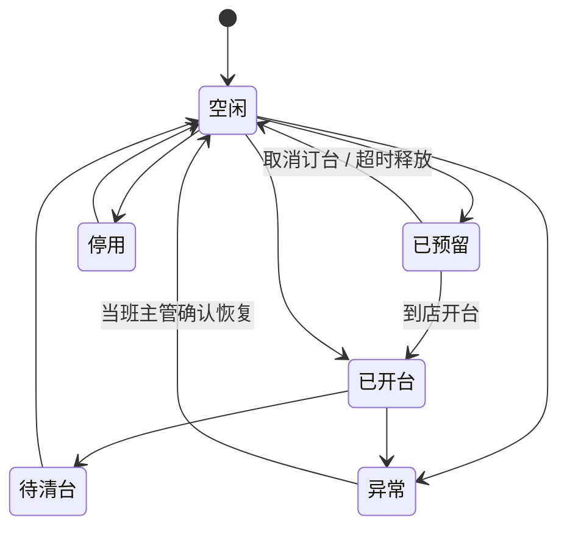
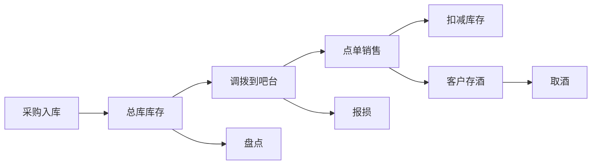

# 业务系统详细拆分：酒吧、游乐、第三方集成

> **口径修订（2026-08-06 R10）：「场次容量」已废止**——BSM「容量控制」条 明确「**只按单个游乐项目的实时在玩人数控制容量，不再按场次/时段或点位/设备另设容量；排队人数不占用容量**」（DEC-R5-2026-08-04-04；R8 用户裁决 D-02）。本文原「场次容量」一律改称「**项目容量（实时在玩人数）**」；双阈值不变（运营容量软上限告警放行、安全容量硬上限阻断并自动停运）。仍按场次/时段或点位/设备维度罗列的页面、接口、组件与字段只作历史结构参考，容量口径一律以本条为准，相关字段待代码轮下线，期间不得据以新增受控维度。

> **口径修订（2026-08-06 R10）：「人工放行」已废止**——ENUM「核销记录状态」条 明确「**系统不提供人工放行：核销要么成功、要么拒绝或失败，任何岗位、任何权限都不能以人工方式让一笔不满足规则的核销通过**」（DEC-CFG-2026-08-03-12 / DEC-R6-08）。本文原有的「人工放行」取值、端点、按钮、指标、权限点与复核类型**一律废止**，废止处就地标注「原含『人工放行』，已废止·见文首口径」；已实现的端点、权限点与状态取值待代码轮下线，期间不得新增调用、不得新写入。**注意**：合同或基础定义违规被卡住后「由更高级审核放行」的准入场景仍然存在，那是准入阻断的升级放行，与核销域无关，不得回读为「可以人工放行一笔核销」。

> 2026-07-04 逻辑一致性修订：补名词四层脚注。
> 经营主体关系：物理项目与运营公司是多对多关系，不是固定的「平台→项目公司→域主管公司→商户」隶属链。单一经营域的规则、定价和结算由对应域主管公司负责，跨域规则由项目之上的平台权限审批。「平台 → 项目公司 → 管理公司·SPV → 商户」【已废止/不得回灌】。DB 层不得覆盖三份 HTML。

本文档是【业务系统：酒吧、游乐、第三方集成】专项维护文档。

本线程负责以下范围：

- 酒吧经营管理
- 游乐设施运营
- 餐饮、零售、机器人、视频监控、企业微信等第三方集成

设计原则：

- 酒吧和游乐是不同经营主体，不能混账、混库存、混核销。
- 餐饮、零售、机器人优先使用第三方系统，本系统负责对接、留痕、核销、对账和分析。
- 所有关键业务动作都必须进入留痕。
- 自动留痕优先，自动失败后才进入人工补录。
- 每个模块都要支持商户隔离、门店隔离、岗位权限和数据权限。

## 1. 酒吧经营管理系统

### 1.1 系统定位

酒吧系统负责独立酒吧经营，不与游乐系统混淆。酒吧可以由第三方公司运营，也可以由平台自营。

酒吧系统需要覆盖：

- 酒吧入场
- 桌台卡座
- 点单收银
- 吧台出品
- 酒水商品
- 简餐商品
- 存酒
- 库存库房
- 物料BOM
- 机器人配送对接
- 视频证据留痕
- 经营报表

### 1.2 子模块总览

| 模块 | 业务范围 | MVP优先级 |
|---|---|---|
| 酒吧基础档案 | 酒吧门店、区域、吧台、卡座、营业时间 | P0 |
| 酒吧入场核销 | 酒吧通票、活动票、入场人数、容量 | P0 |
| 桌台/卡座管理 | 预订、开台、转台、并台、低消、服务费 | P0 |
| 点单与账单 | 桌台点单、吧台点单、扫码点单、挂账、结账 | P0 |
| 酒水商品 | 瓶卖、杯卖、套餐、赠饮、活动酒 | P0 |
| 简餐商品 | 小吃、果盘、冷食、热食 | P1 |
| 吧台出品 | 接单、制作、出品、取消、异常 | P1 |
| 存酒管理 | 基础存酒、取酒、作废留痕 P0；剩余量、有效期、转赠和复杂运营 P1 | P0/P1 |
| 库存库房 | 物品追踪码、出库核验和交接留痕 P0；入库、调拨、盘点、报损、批次 P1 | P0/P1 |
| 物料/BOM | 鸡尾酒配方、简餐配方、自动扣料、成本 | P2 |
| 机器人配送 | 交接留痕 P0；真实机器人调度、送酒、送餐、补货、取存酒联动 P2 | P0/P2 |
| 酒吧报表 | 销售、毛利、库存、低消、存酒 | P2 |

### 1.3 酒吧基础档案

#### 业务范围

| 功能 | 说明 |
|---|---|
| 酒吧门店 | 绑定商户主体、品牌、场地 |
| 酒吧区域 | 大厅、卡座区、吧台区、包厢区、库房 |
| 桌台卡座 | 桌号、卡座、包厢、吧台位 |
| 吧台点位 | 主吧、副吧、临时吧台 |
| 营业时间 | 日场、夜场、派对场、节假日特殊时间 |
| 容量配置 | 酒吧总容量、卡座人数 |

#### 留痕点

| 事件 | 说明 |
|---|---|
| bar.venue.created | 创建酒吧门店 |
| bar.area.updated | 修改区域 |
| bar.table.updated | 修改桌台或卡座 |
| bar.capacity.changed | 修改容量 |

#### MVP边界

P0先做：

- 酒吧门店基础信息
- 桌台/卡座基础档案
- 桌台状态
- 容量字段

暂缓：

- 可视化桌台平面图
- 多楼层复杂地图
- 自动消防容量联动

### 1.4 酒吧入场核销

#### 业务范围

| 功能 | 说明 |
|---|---|
| 酒吧票识别 | 识别酒吧票、派对票（与活动票等价）、通票内酒吧权益 |
| 入场核销 | 工作手机扫客人二维码核销；检票闸机是入场检票设备，动作仍是二维码刷票并核销；NFC 不是核销通道（NFC 仅领取工作手机上班打卡） |
| 人数统计 | 当前在场人数、入场人数、离场人数 |
| 容量控制 | 超过容量禁止入场 |
| 重复入场规则 | 多次进出、手环二次入场。有手环则当前场次内允许入场。 |
| 入场异常 | 过期票、重复票、无效票、越权票 |

#### 留痕点

| 事件 | 说明 |
|---|---|
| bar.entry.verified | 酒吧入场核销成功 |
| bar.entry.failed | 入场核销失败 |
| bar.capacity.warning | 酒吧容量预警 |
| bar.entry.manual_override | 人工放行（**已废止·见文首口径**，待代码轮下线，不得新增调用） |

#### MVP边界

P0先做：

- 二维码核销
- 酒吧权益识别
- 入场成功/失败记录
- 简单容量控制

暂缓：

- 闸机联动
- NFC 仅领取工作手机上班打卡，不是入场核销通道
- 离场自动统计

### 1.5 桌台/卡座管理

#### 业务范围

| 功能 | 说明 |
|---|---|
| 桌台状态 | 空闲、已预留、已开台、待清台、停用、异常。已预留只能经取消订台、超时释放、到店开台三条路径退出 |
| 预订 | 预订时间、人数、订金、联系人 |
| 开台 | 到店后开台，绑定客户、服务员、班次 |
| 低消 | 按桌台类型设置最低消费 |
| 服务费 | 固定服务费或按比例服务费 |
| 转台 | 客人换桌 |
| 并台 | 多桌合并账单 |
| 清台 | 结账后进入待清台，再恢复空闲 |

#### 桌台状态流转

#### 留痕点

| 事件 | 说明 |
|---|---|
| bar.table.reserved | 桌台预订 |
| bar.table.opened | 开台 |
| bar.table.transferred | 转台 |
| bar.table.merged | 并台 |
| bar.table.cleared | 清台 |
| bar.table.locked | 锁定桌台 |

#### MVP边界

P0先做：

- 桌台档案
- 桌台状态
- 开台
- 低消
- 桌台账单
- 结账后清台

暂缓：

- 在线预订
- 订金支付
- 可视化桌台平面图
- 多桌复杂并账

### 1.6 点单与账单

#### 业务范围

| 功能 | 说明 |
|---|---|
| 桌台点单 | 服务员给桌台点单 |
| 吧台点单 | 散客在吧台直接点单 |
| 扫码点单 | 客人扫码自助点单 |
| 挂账 | 点单挂到桌台账单 |
| 加单 | 已开台账单继续加单 |
| 退菜/退酒 | 需要权限和原因 |
| 赠送 | 经理或授权员工赠送 |
| 折扣 | 会员、活动、人工折扣 |
| 结账 | 支付、优惠、抹零、服务费 |

#### 订单状态

| 状态 | 说明 |
|---|---|
| draft | 草稿 |
| submitted | 已下单 |
| producing | 制作中 |
| served | 已出品 |
| cancelled | 已取消 |
| refunded | 已退款 |

#### 留痕点

| 事件 | 说明 |
|---|---|
| bar.order.created | 创建点单 |
| bar.order.submitted | 提交点单 |
| bar.order.cancelled | 取消点单 |
| bar.order.discounted | 折扣 |
| bar.order.gifted | 赠送 |
| bar.bill.paid | 结账 |

#### MVP边界

P0先做：

- 服务员点单
- 吧台点单
- 桌台挂账
- 账单结算
- 取消订单需原因

暂缓：

- 客人扫码点单
- 复杂优惠组合
- 多支付方式拆单
- 自动服务费复杂规则

### 1.7 酒水与简餐商品

#### 商品类型

| 类型 | 示例 |
|---|---|
| bottle | 整瓶酒 |
| cup | 单杯酒 |
| cocktail | 鸡尾酒 |
| package | 套餐 |
| snack | 简餐小吃 |
| material | 物料 |
| service | 服务费 |

#### 核心功能

| 功能 | 说明 |
|---|---|
| 商品档案 | 名称、分类、规格、单位、价格 |
| 销售规则 | 可售、停售、限时、活动价 |
| 出品部门 | 吧台、厨房、外部餐饮 |
| 库存关联 | 是否扣库存、扣哪个库存 |
| BOM关联 | 单杯酒或简餐关联配方 |
| 成本价 | 毛利分析使用 |

#### MVP边界

P0先做：

- 商品档案
- 分类
- 售价
- 是否可售

P1再做：

- 出品部门
- 库存扣减
- 存酒关联

P2再做：

- BOM自动扣料
- 成本毛利

### 1.8 存酒管理

#### 业务范围

| 功能 | 说明 |
|---|---|
| 存酒登记 | 客人购买整瓶后存酒 |
| 存酒标签 | 存酒编号、二维码、瓶身标签 |
| 存酒归属 | 绑定客户、手机号、会员、订单 |
| 存酒位置 | 库房、存酒柜、格口 |
| 剩余量 | 满瓶、半瓶、比例、ml |
| 取酒 | 客人取酒并核验身份 |
| 转赠 | 转给其他客户 |
| 到期 | 有效期和提醒 |
| 作废 | 到期、报损、丢失 |

#### 存酒状态

| 状态 | 说明 |
|---|---|
| stored | 已存 |
| partially_used | 部分取用 |
| finished | 已取完 |
| expired | 已过期 |
| transferred | 已转赠 |
| voided | 已作废 |

#### 留痕点

| 事件 | 说明 |
|---|---|
| bar.saved_bottle.created | 存酒登记 |
| bar.saved_bottle_picked_up | 取酒 |
| bar.saved_bottle.transferred | 转赠 |
| bar.saved_bottle.expired | 到期 |
| bar.saved_bottle.voided | 作废 |

#### MVP边界

P1先做：

- 存酒登记
- 存酒取用
- 剩余量
- 到期时间
- 客户绑定

暂缓：

- 自动短信/微信提醒
- 存酒柜硬件联动
- 机器人自动取存酒

### 1.9 库存、库房与物料BOM

#### 库存类型

| 类型 | 说明 |
|---|---|
| sellable | 可售库存 |
| bar_stock | 吧台库存 |
| warehouse_stock | 总库库存 |
| saved_bottle | 已售未取存酒 |
| damaged | 报损库存 |
| variance | 盘亏/盘盈 |

#### 业务流程

#### MVP边界

P1先做：

- 入库
- 出库
- 调拨
- 盘点
- 报损
- 简单库存余额

P2再做：

- BOM配方
- 自动扣料
- 批次保质期
- 安全库存预警
- 毛利核算

## 2. 游乐设施运营系统

### 2.1 系统定位

游乐系统负责主题游乐项目的运营管理，支持第三方游乐公司承租或联营。

游乐系统与酒吧系统独立：

- 独立商户主体
- 独立项目容量
- 独立核销规则
- 独立安全巡检
- 独立结算规则

### 2.2 子模块总览

| 模块 | 业务范围 | MVP优先级 |
|---|---|---|
| 游乐项目档案 | 项目名称、类型、位置、限制条件 | P0 |
| 开放时间/场次 | 营业日历、场次、临时关闭 | P0 |
| 项目核销 | 单项目票、通票权益扣次 | P0 |
| 容量控制 | 只按单个项目的实时在玩人数控制，不再按场次/时段或点位/设备另设；排队人数不占用容量 | P0 |
| 排队提示 | 排队人数不占用项目容量，排队本身不设人数上限；预计等待时间由现场大屏提示客人 | P2 |
| 设备状态 | 正常、暂停、维护、故障 | P1 |
| 安全巡检 | 开放前检查、营业中抽检、阻断项暂停、整改复检、主管恢复 | P0 |
| 事故/客诉 | 事故记录、投诉争议、处理闭环 | P1 |
| 道具耗材 | 手环、雨衣、3D眼镜、道具、备件 | P2 |
| 游乐报表 | 客流、核销、利用率、排队时长 | P2 |

### 2.3 游乐项目档案

| 功能 | 说明 |
|---|---|
| 项目基础信息 | 名称、编号、类型、简介 |
| 商户归属 | 绑定游乐商户或平台 |
| 场地区域 | 绑定楼层、区域、入口 |
| 限制条件 | 身高、年龄、健康、孕妇、酒后禁止等 |
| 项目容量 | 实时在玩人数；运营容量（软上限）告警放行、安全容量（硬上限）阻断并自动停运 |
| 游玩时长 | 单次体验分钟数 |
| 项目状态 | 筹备、开放、暂停、维护、关闭 |

#### MVP边界

P0先做：

- 项目档案
- 商户归属
- 容量
- 状态
- 基础限制条件

暂缓：

- 项目图片视频素材管理
- 复杂动态限制规则

### 2.4 开放时间与场次管理

| 功能 | 说明 |
|---|---|
| 营业日历 | 工作日、周末、节假日 |
| 开放时间 | 每日开放开始和结束 |
| 场次 | 固定场次、滚动场次 |
| 临时关闭 | 天气、维护、活动占用 |
| 项目容量（实时在玩人数）（原称「场次容量」，已废止·见文首口径） | 该项目同时在玩的最大人数；排队人数不占用容量 |
| 场次售罄【已废止/不得回灌】 | 容量只按该项目实时在玩人数作运营可见数据，不按场次/时段或点位/设备另设容量 |

#### 留痕点

| 事件 | 说明 |
|---|---|
| amusement.schedule.created | 创建开放计划 |
| amusement.session.created | 创建场次 |
| amusement.session.closed | 关闭场次 |
| amusement.capacity.changed | 修改容量 |

### 2.5 项目核销

| 功能 | 说明 |
|---|---|
| 票据识别 | 单项目票、通票权益。「快速通道权益」【已废止/不得回灌】 |
| 权益扣次 | 按项目扣一次或多次 |
| 入场核销 | 工作手机扫码核销；游乐出口闸机只做在玩人数扣减，不是项目核销通道；NFC 不是核销通道 |
| 重复核销控制 | 防止一票多刷 |
| 核销失败 | 无效票、过期、无权益、容量满 |
| 人工放行（**已废止·见文首口径**） | 该动作不再提供；核销只能成功、拒绝或失败 |

#### 留痕点

| 事件 | 说明 |
|---|---|
| amusement.verification_succeeded | 项目核销成功 |
| amusement.verification_failed | 项目核销失败 |
| amusement.verification_overridden | 人工放行（**已废止·见文首口径**，待代码轮下线，不得新增调用） |

#### MVP边界

P0先做：

- 二维码核销
- 项目权益识别
- 通票扣次
- 核销成功/失败记录

暂缓：

- 核销必须在线、不做离线核销（大楼检票损坏时的营业兜底是免票进入，不是离线核销队列）
- 游乐出口闸机只做在玩人数扣减，不是项目核销通道
- NFC 仅用于领取工作手机上班打卡，不是核销通道
「离线核销 / NFC·闸机作核销通道」【已废止/不得回灌】

### 2.6 排队

排队人数不占用项目容量，排队本身不设人数上限；排队的预计等待时间由现场大屏提示客人。不按场次/时段或点位/设备另设容量，不立法快速通道作为游乐子模块。「排队预约 / 预约容量」【已废止/不得回灌】。

| 功能 | 说明 |
|---|---|
| 排队提示 | 预计等待时间由现场大屏提示客人 |
| 容量关系 | 排队人数不占用项目容量，排队本身不设人数上限 |
- 大屏叫号

### 2.7 设备状态与安全巡检

| 功能 | 说明 |
|---|---|
| 设备状态 | 正常、暂停、维护、故障、关闭 |
| 状态变更 | 记录操作人、原因、时间 |
| 开园检查 | 每日开放前检查 |
| 闭园检查 | 每日关闭后检查 |
| 定时巡检 | 按项目和设备设置巡检项 |
| 故障上报 | 图片、视频、描述、责任人 |
| 恢复开放 | 维修确认后恢复 |

#### 留痕点

| 事件 | 说明 |
|---|---|
| amusement.device.status_changed | 设备状态变更 |
| amusement.safety_inspection.submitted | 提交安全巡检 |
| amusement.incident.created | 创建事故或异常 |
| amusement.device.reopened | 恢复开放 |

#### MVP边界

P1先做：

- 状态变更
- 巡检模板
- 巡检提交
- 故障记录

暂缓：

- 传感器自动采集
- 设备厂商接口
- AI视频识别

## 3. 第三方集成系统

### 3.1 系统定位

第三方集成系统负责连接餐饮、零售、机器人、视频监控、企业微信、设备厂商等外部系统。

本系统不替代第三方系统核心功能，而是负责：

- 标准接入
- 动态鉴权
- 数据同步
- 权益核销
- 状态回传
- 对账结算
- 事件留痕
- 异常处理

### 3.2 集成模块总览

| 模块 | 业务范围 | MVP优先级 |
|---|---|---|
| 第三方应用档案 | 应用、账号、密钥、权限、商户绑定 | P0 |
| 餐饮POS对接 | 餐饮订单、券核销、退款、对账 | P1 |
| 零售POS对接 | 零售订单、商品、券核销、对账 | P1 |
| 机器人对接 | 任务下发、状态回传、签收、异常 | P2 |
| 视频监控对接 | 摄像头点位、录像索引、截图、证据 | P2 |
| 企业微信对接 | 员工绑定、每日会话存档、基础敏感词/违规检查、上传状态 | P0/P2 |
| 设备对接 | 闸机、NFC、扫码枪、手持机 | P1/P2 |
| 对账与差异 | 第三方流水与平台流水比对 | P1 |
| 集成事件 | 所有第三方事件标准化 | P0 |

> 修订说明（2026-08-29）：原「NFC 基础读取（读取外部客人标签/手环/工卡等外部 NFC）= P1」「本文 NFC 均指读取外部 NFC 标签/手环/工卡，不受该废止影响」「改用设备公钥/不可逆设备指纹（Keystore）」【已废止/不得回灌】。现行：NFC 仅领取工作手机上班打卡，不是核销或入场通道；核销通道是工作手机扫客人二维码；员工私人手机绑定该手机专属的设备标识，不读取手机本机的硬件识别码。

### 3.3 第三方应用档案

| 功能 | 说明 |
|---|---|
| 应用创建 | 给第三方创建OpenApp |
| 商户绑定 | 绑定商户、门店、项目 |
| 接口权限 | 控制可访问API |
| 数据权限 | 控制可访问商户和门店 |
| 回调地址 | 配置Webhook |
| 动态鉴权 | Token、动态地址、签名 |
| 身份核验 | 第三方必须先通过身份核验；不立法连续三次失败锁定 |

#### MVP边界

P0已纳入地基系统：

- 开放应用
- 动态鉴权
- 身份核验与调用留痕
- 调用日志
- 事件写入

### 3.4 餐饮POS对接

> 修订说明（2026-06-07）：依据《统一口径基准》D1（devtech-3、fielddb-7），第三方餐饮/零售订单、退款等**金额在平台侧入库与对账一律按整数分（bigint）存储**，禁止 `numeric(18,2)` 元；若第三方接口传入元为单位的小数金额，接入层须换算为分后再落库。下方"订单/退款金额"同步项均按此口径。本文为业务拆分文档、不含建表 DDL，具体字段类型见各系统数据库设计文档（须遵循 D1）。

#### 对接范围

| 数据 | 方向 | 说明 |
|---|---|---|
| 餐饮商户 | 平台 -> 第三方/第三方 -> 平台 | 商户和门店档案 |
| 餐饮券 | 平台 -> 第三方 | 平台发放券 |
| 券核销 | 第三方 -> 平台 | 第三方核销后回传 |
| 餐饮订单 | 第三方 -> 平台 | 订单、金额、支付方式 |
| 退款 | 第三方 -> 平台 | 退款流水 |
| 对账 | 双向 | 平台流水和第三方流水比对 |

#### MVP边界

P1先做：

- 餐饮券核销回传
- 餐饮订单同步
- 基础对账
- 事件留痕

暂缓：

- 菜品同步
- 库存同步
- 后厨状态

### 3.5 零售POS对接

#### 对接范围

| 数据 | 方向 | 说明 |
|---|---|---|
| 零售门店 | 第三方 -> 平台 | 门店和收银点 |
| 商品SKU | 第三方 -> 平台 | 只读同步 |
| 零售券 | 平台 -> 第三方 | 券发放和校验 |
| 券核销 | 第三方 -> 平台 | 核销结果 |
| 销售订单 | 第三方 -> 平台 | 商品、金额、支付 |
| 退款订单 | 第三方 -> 平台 | 退款流水 |

#### MVP边界

P1先做：

- 零售券核销回传
- 销售订单同步
- 退款同步
- 基础对账

暂缓：

- 实时库存
- 商品主数据反向维护
- 会员积分双向同步

### 3.6 机器人对接

#### 对接范围

| 功能 | 说明 |
|---|---|
| 任务创建 | 平台创建送酒、送餐、补货、取存酒任务 |
| 任务下发 | 发送给机器人系统 |
| 状态回传 | 接单、取货、配送、到达、签收、异常 |
| 取货校验 | 货架二维码、员工确认 |
| 交付确认 | 员工或客人确认 |
| 异常工单 | 超时、故障、货损、无人接收 |
| 视频绑定 | 绑定取货点和交付点视频 |

#### MVP边界

P2先做：

- 机器人任务记录
- 第三方状态回传
- 签收确认
- 异常事件

暂缓：

- 路径规划
- 多机器人调度算法
- 高价值酒水自动审批

### 3.7 视频监控对接

#### 对接范围

| 功能 | 说明 |
|---|---|
| 摄像头点位 | 摄像头编号、位置、覆盖区域 |
| 视频索引 | 第三方录像ID、时间段 |
| 截图 | 关键节点截图 |
| 事件绑定 | 按时间、地点、设备绑定业务事件 |
| 调阅权限 | 控制谁能看 |
| 调阅留痕 | 查看视频也写事件 |

#### MVP边界

P2先做：

- 摄像头档案
- 视频证据索引
- 事件绑定
- 调阅留痕

暂缓：

- 自动AI识别
- 视频片段自动剪辑
- 大规模视频存储

### 3.8 企业微信对接

#### 对接范围

| 功能 | 说明 |
|---|---|
| 员工绑定 | 系统员工绑定企业微信UserID |
| 客户会话 | 基于企业微信官方会话存档能力，每天同步员工企业微信工作聊天内容 |
| 每日上传状态 | 记录每名员工每日会话同步成功、失败、补跑和异常原因 |
| 客户标签 | 需求、投诉、预订、存酒 |
| 敏感词 | 私单、私收款、诱导加私人微信、违规承诺、辱骂、非白名单链接 |
| 服务分析 | 响应速度、服务质量 |
| 工单生成 | 高风险会话生成客诉工单 |

#### MVP边界

P0先做：

- 员工企业微信绑定
- 每日会话同步、上传状态查询和失败补跑
- 基础敏感词、违规模式和非白名单链接检查
- 风险命中、人工复核和会话事件留痕
- 会话原文留存期限可配置（非永久），到期归档/销毁/匿名化（按 A7/合规C3、data-risk §11.5）；不脱敏原文仅限最小授权 + 审批的取证/质检场景，普通展示按权限脱敏，查看必须写入审计<!-- 修订说明（2026-06-08 三轮收口）：原"永久保存"为 MVP 转述，已按 A7/C3 改为可配置留存；2026-06-08 复核补充不脱敏原文的最小授权边界，不再作为现行 P0 规则。依据 finding residual-scan-3、A7/C3 -->　**【已作废（2026-08-03 L-19 裁决 `DEC-CFG-2026-08-03-10`）】企微会话原文永久保存、不自动到期删除；本处销毁／留存期／到期处置规格不得实施；确需清理仅限最高权限本人插授权 U 盘密钥手动执行（逐条填写理由、先试运行预览、清理动作本身另行留痕）。原文保留仅作历史留痕。**

暂缓：

- AI语义分析
- 全量服务质量评分
- 自动客户生命周期分析

## 4. 核心数据对象

### 4.1 酒吧数据对象

| 对象 | 说明 |
|---|---|
| BarVenue | 酒吧门店 |
| BarArea | 酒吧区域 |
| BarTable | 桌台/卡座 |
| BarReservation | 桌台预订 |
| BarSession | 开台记录 |
| BarOrder | 酒吧点单 |
| BarOrderItem | 点单明细 |
| BarBill | 桌台账单 |
| BarProduct | 酒水/简餐商品 |
| BarStockItem | 酒吧库存项 |
| BarStockMovement | 入库、出库、调拨、盘点、报损 |
| SavedBottle | 客人存酒 |
| Recipe | BOM配方 |
| RecipeItem | 配方明细 |

### 4.2 游乐数据对象

| 对象 | 说明 |
|---|---|
| AmusementProject | 游乐项目 |
| AmusementSchedule | 开放计划 |
| AmusementSession | 场次 |
| AmusementQueue | 排队记录 |
| AmusementVerification | 项目核销 |
| AmusementDeviceStatus | 设备状态 |
| SafetyCheckTemplate | 巡检模板 |
| SafetyCheckRecord | 巡检记录 |
| AmusementIncident | 事故/异常 |
| AmusementConsumable | 道具耗材 |

### 4.3 第三方集成数据对象

| 对象 | 说明 |
|---|---|
| IntegrationProvider | 第三方服务商 |
| IntegrationApp | 第三方应用 |
| IntegrationWebhook | Webhook订阅 |
| IntegrationEvent | 第三方事件 |
| CateringOrderSync | 餐饮订单同步 |
| RetailOrderSync | 零售订单同步 |
| VoucherVerificationSync | 券核销同步 |
| RobotTask | 机器人任务 |
| RobotTaskEvent | 机器人状态事件 |
| CameraDevice | 摄像头设备 |
| VideoEvidence | 视频证据索引 |
| WeComConversation | 企业微信会话 |
| WeComRiskHit | 企业微信风险命中 |

## 5. 第一阶段开发优先级

### 5.1 P0：先做可运营闭环

| 模块 | 目标 |
|---|---|
| 酒吧基础档案 | 能建酒吧门店、桌台、卡座 |
| 酒吧入场核销 | 能核销酒吧权益 |
| 桌台开台和点单 | 能开台、点单、挂账、结账 |
| 酒水商品 | 能维护基础商品 |
| 游乐项目档案 | 能建项目和容量 |
| 游乐项目核销 | 能核销项目权益 |
| 第三方应用档案 | 能创建对接应用和权限 |
| 集成事件 | 第三方事件能进入留痕 |

### 5.2 P1：增强实际经营

| 模块 | 目标 |
|---|---|
| 存酒 | 能存酒、取酒、管理剩余量 |
| 库存库房 | 能入库、出库、调拨、盘点 |
| 简餐 | 能维护简餐商品和出品 |
| 游乐排队提示 | 排队不设人数上限；预计等待时间由现场大屏提示 |
| 安全巡检 | 能提交巡检和故障 |
| 餐饮/零售对接 | 能同步订单和券核销 |

### 5.3 P2：智能化和高级留痕

| 模块 | 目标 |
|---|---|
| BOM配方 | 自动扣料和成本 |
| 机器人 | 任务下发、状态回传、签收 |
| 视频监控 | 事件绑定视频证据 |
| 企业微信 | 会话同步、敏感词、客户需求 |
| 报表 | 酒吧、游乐、第三方经营分析 |

## 6. 下一步

建议下一步继续拆：

1. 酒吧系统数据库表结构
2. 游乐系统数据库表结构
3. 第三方集成数据库表结构
4. P0接口清单
5. P0页面清单

## 7. 变更日志

| 日期 | 类型 | 内容 | 原因/依据 |
|---|---|---|---|
| 2026-06-07 | 改 | §3.2 集成模块总览"设备对接"优先级由 P2 改为 P1/P2，并注明"NFC 基础读取（外部标签/手环/工卡）=P1、闸机/NFC 厂商深度联动=P2" | 统一口径基准 D8 / phone-3、pboundary-2：NFC 不应整体后置 P2 |
| 2026-06-07 | 注 | §3.2 注明员工私人手机身份不采用"读手机本机 NFC 唯一标识"（Android 不可行），改用设备公钥/不可逆设备指纹（Keystore）；本文 NFC 均指读取外部标签，不受影响 | 统一口径基准 D8 / phone-3、phone-7、compliance-4 |
| 2026-06-07 | 注 | §1.4 酒吧入场核销、§2.5 游乐项目核销的 NFC 标注为"读取外部客人标签/手环/工卡"，明确保留 | 统一口径基准 D8 |
| 2026-06-07 | 注 | §3.4 第三方餐饮/零售订单、退款金额按整数分（bigint）入库与对账，禁止 numeric(18,2) 元 | 统一口径基准 D1 / devtech-3、fielddb-7 |
