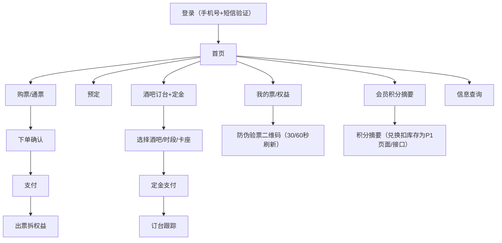

# 客人购票 App/小程序开发设计 V0.1

> **本文档为什么新增（定位）：** 指导实际编码的前端开发设计 `frontend-admin-development-design.md` 只覆盖管理后台/商户端/看板，**完全缺客人 App/小程序、会员积分摘要**的页面与 API 映射，产品需求悬空无编码落点（两轮审计 finding webmobile-3）。本文专门承载**客人端（App 与小程序）**的页面结构与页面→后端 API 映射，覆盖：购票、预定、酒吧订台+定金、我的票/权益、防伪二维码刷新、会员积分摘要。积分兑换扣库存保留为底层业务口径，客人端兑换独立接口和页面进入 P1。`frontend-admin-development-design.md §1.2` 已加边界声明"客人端由本文承载"。
>
> **依据与对齐：**
> - 产品需求：`terminal-page-product-prd-v0.1.md §8`、`web-mobile-app-terminal-extension-product-prd-v0.1.md §4`、`terminal-display-layer-spec-v0.2.md`。
> - 后端能力与接口口径：`ticketing-pass-entitlement-development-design.md §7.2/§7.3`（官方购票/游客侧/核销）、`bar-operations-development-design.md §6.3/§5.1.2/§9`（订台+订金）。
> - 跨文档单一权威：`unified-standards-baseline-v0.1.md`——金额=分(D1)、终端枚举=10 端(D5，本端为 `app`/`miniapp`)、事件命名(D4)、门票资格 P0(D9)、合规同意 P0(`compliance §3`)。
>
> 本文只做页面与 API 映射，**接口实现以 Java 后端最终 OpenAPI、operation 验收矩阵和 OpenAPI 追溯附录为准**；客人端不是配置端，不出现任何后台术语与现场作业动作。客人端 API client、mock、自动化和联调包必须能在 `p0-openapi-contract-closure-appendix-v0.1.md` 追溯权限、认证上下文、事件、终端和样例准入；未通过 `verify:openapi-closure` 不得标记可联调。

---

## 1. 文档定位

### 1.1 目标

客人 App 与小程序是游客侧主要入口，两端**共享同一套订单/票/权益/二维码/会员积分口径**。P0 必须打通：

1. 官方购票（票种、通票、学生票、多人票）与第三方团购回流票查询。
2. 预定（日期/场次/人数/项目或套餐）与**酒吧订台+定金支付**。
3. 我的票 / 我的权益 / 使用记录。
4. **防伪验票二维码**：签名、票种有效期、随机串、哈希、30/60 秒在线刷新、截图无效。
5. 会员积分摘要和会员等级。
6. 积分明细、积分兑换礼物和兑换记录进入 P1；兑换扣库存规则保留为底层业务口径。

> 修订说明（2026-06-07 收口；2026-06-08 本轮复核更新）：第 5/6 项依赖的会员积分账户/明细/等级/兑换的**后端承载表已在地基侧规划新增（`points_*`，见 foundation-database 会员积分 DDL，依据 critic-4/pass-1）**；对应客人侧接口已在 `p0-implementation-task-list.md` 补入 CUST-001~006、PTS-001~003、SUP-004/005 任务，编码排期以这些任务为准。

### 1.2 范围与非范围

| 范围 | 是否包含 | 说明 |
|---|---|---|
| 客人 App（原生壳/混合） | 包含 | 终端枚举 `app`（基准 D5） |
| 客人小程序 | 包含 | 终端枚举 `miniapp`（基准 D5）；与 App 共享口径 |
| 购票/预定/订台+定金 | 包含 | 见 §3、§4 |
| 我的票/权益/防伪二维码/会员积分摘要 | 包含 | 见 §3、§4；积分明细、兑换发起和兑换记录进入 P1 |
| 工作人员代客购票 | 不包含 | 门票只能客人本人购买（产品硬规则） |
| 核销执行 | 不包含 | 由员工工作手机/一体机/现场端执行；客人端只展示可被核销的二维码 |
| 管理后台/商户端/看板 | 不包含 | 由 `frontend-admin-development-design.md` 承载 |
| 后端接口实现 | 不包含 | 本文只做页面与 API 映射 |

### 1.3 技术基线（建议）

| 层级 | 方案 |
|---|---|
| App | 跨端容器（原生壳 + H5/RN，按团队选型），调用统一客人侧 API |
| 小程序 | 微信/抖音等小程序框架，调用同一套客人侧 API |
| 后端接口 | Java 21 + Spring Boot 4.x REST，OpenAPI 为准 |
| 鉴权 | 客人侧登录态（手机号 + 短信验证，对齐 D9 新人判定）；二维码刷新走在线接口 |
| 金额 | 一律整数分（基准 D1），前端展示时换算元 |

---

## 2. 信息架构

客人端"一个入口，多场景"，登录后按游客/会员身份进入。

---

## 3. 页面清单

页面与 `terminal-display-layer-spec-v0.2.md` 终端展示页面章节一致，并补订台+定金两页（finding webmobile-6）。

| 页面 | P0 内容 | 终端 |
|---|---|---|
| 登录 | 手机号 + 短信验证码（新人判定以手机号为准，D9）；首次收集前展示隐私政策同意（compliance §3） | app/miniapp |
| 首页 | 综合体介绍、票务入口、活动/公告、推荐票种 | app/miniapp |
| 票务列表 | 平日票、周末票、节假日票、学生票、多人票、通票 | app/miniapp |
| 票务详情 | 价格、适用日期、人群、权益组成、使用限制 | app/miniapp |
| 预定入口 | 日期、场次、人数、项目或套餐选择 | app/miniapp |
| 酒吧订台 | 选择酒吧、日期、时段、卡座/桌台/吧台位、人数、备注（订台需支付定金） | app/miniapp |
| 订台定金支付 | 订台位置、定金金额（分）、支付方式、到店/取消/退款状态 | app/miniapp |
| 下单确认 | 票种、数量、游客信息、金额、优惠；敏感个人信息单独同意（compliance §3） | app/miniapp |
| 支付结果 | 成功、失败、待支付、订单状态 | app/miniapp |
| 我的订单 | 订单状态、退款状态、权益生成状态 | app/miniapp |
| 我的票 | 票码、有效期、状态 | app/miniapp |
| 我的权益 | 入场、游乐、酒水、餐饮/零售券 | app/miniapp |
| 验票二维码 | 防伪二维码：签名、票种有效期、随机串、哈希、30/60 秒刷新、截图无效、在线核验 | app/miniapp |
| 使用记录 | 已核销、退款、失效、撤销 | app/miniapp |
| 会员积分 | P0：积分余额、会员等级、最近积分摘要；P1：积分明细、消费获得积分规则详情 | app/miniapp |
| 积分兑换 | P1：可兑换礼物、兑换条件、兑换记录；兑换礼物必须扣减库存 | app/miniapp |
| 信息查询 | 营业时间、游乐项目、酒吧规则、场地说明、常见问题 | app/miniapp |

---

## 4. 页面与后端 API 映射矩阵

> 接口路径以 Java 后端最终 OpenAPI 为准；本文先定义客人端依赖关系。所有金额字段单位为**分(整数)**（D1）。
>
> 2026-06-12 收口口径：本文不再保留 `/api/public/*`、`/api/customer/*`、`/api/bar/reservations*`、`/api/consent-records` 等历史路径作为当前开发依据。P0 客人端接口唯一以 `docs/openapi/openapi-p0.yaml` 为准，统一落到 `/api/v1/customer/*`；未进入 OpenAPI 的细分能力只能作为字段、页面状态或后续版本扩展，不得被前端、测试或后端按正式接口开发。
>
> 2026-06-11 执行口径：正式 P0 接口以 `docs/openapi/openapi-p0.yaml`、`docs/openapi/openapi-p0.json`、`p0-openapi-operation-acceptance-matrix-v0.1.md` 为准，客人端统一落到 `/api/v1/customer/*`；客人 Token 写入 `x-auth-context=customer-token`，不得写成员工权限码；酒吧订台由 `/api/v1/customer/bar-reservations` 承接，必要时再由后端内部调用 `/api/v1/bar/reservations`，不再直接新增 `/api/bar/*` 路径。

### 4.1 登录与会员身份（含 D9 新人判定、合规同意）

| 页面 | API | 用途 | 优先级 |
|---|---|---|---|
| 登录 | `POST /api/v1/customer/auth/phone-login` | 手机号 + 验证码登录，返回客人会话；新人资格按手机号在服务端同步判定 | P0 |
| 同意采集 | `POST /api/v1/customer/consents` | 记录隐私政策同意版本/时间/范围/是否敏感（compliance §3） | P0 |
| 会员摘要 | `GET /api/v1/customer/points` | 当前游客/会员、等级、积分余额摘要；积分明细后续按查询参数或 P1 明细接口扩展 | P0 |
| 学生资格 | `POST /api/v1/customer/ticket-orders` 字段/后台审核流程 | 学生票资格作为下单字段和后台人工审核状态处理，P0 不另设独立资格接口 | P0 |

### 4.2 购票与预定

| 页面 | API | 用途 | 优先级 |
|---|---|---|---|
| 票务列表 | `GET /api/v1/customer/ticket-products` | 查询可售票种/通票、平日/周末/节假日基础价及派生票价 | P0 |
| 票务详情 | `GET /api/v1/customer/ticket-products` | 通过列表结果或查询参数返回票种详情、权益组成、使用限制 | P0 |
| 下单确认 | `POST /api/v1/customer/ticket-orders` | 创建订单（含游客信息、新人/学生/多人资格校验，D9） | P0 |
| 支付 | `POST /api/v1/finance/payment-intents` | 发起聚合支付；客人端只展示支付结果，不直接处理通道细节 | P0 |
| 支付结果/我的订单 | `GET /api/v1/customer/orders` | 查询本人订单、出票、退款、第三方回流来源标识 | P0 |
| 改期 | OpenAPI 后续扩展字段/流程 | 申请改期，P1 不进入 MVP 接口开发 | P1 |

> 说明：第三方团购（美团/大众点评/抖音）票通过开放平台回流后，在"我的订单/我的票"以来源标识统一展示与查询，不在客人端提供第三方下单页（产品口径）。

### 4.3 酒吧订台 + 定金（finding webmobile-6，对齐 bar §6.3）

| 页面 | API | 用途 | 优先级 |
|---|---|---|---|
| 可订台资源 | `GET /api/v1/customer/bar-reservation-options` | 读取可订酒吧、卡座/桌台/吧台位、可选时段、人数额度和定金规则 | P0 |
| 酒吧订台 | `POST /api/v1/customer/bar-reservations` | 创建订台并写入来源、酒吧、卡座、人数、定金规则和幂等键 | P0 |
| 订台定金支付 | `POST /api/v1/finance/payment-intents` | 为订台定金发起聚合支付，支付对象关联订台单 | P0 |
| 订台跟踪 | `GET /api/v1/customer/orders` | 本人订台、定金、取消、退款状态统一从客人订单视图展示 | P0 |

> 字段口径：`reserved_at`、`deposit_amount`(分)、`deposit_rule`、`deposit_status`(unpaid/paid/deducted/refunded/forfeited)、`order_source`、`status` 与 `bar-operations-development-design §6.3` 一致；到店开台后定金转账单抵扣项（`deducted`）由酒吧端处理，客人端只展示状态。
>
> 修订说明（2026-06-08 三轮收口）：`operation-traceability §4.1.2` 已登记 `reservation.created`（订台创建）与 `reservation.deposit_settled`（定金抵扣/退还/没收），主表已登记 `reservation.deposit_paid`（客人支付定金完成）——订台-定金生命周期三事件均已就位（见 §4.1 三事件说明）。故：**客人端付定金事件用 `reservation.deposit_paid`**（仅资金到账动作），由后端写入；**订台创建写 `reservation.created`、定金最终结算写 `reservation.deposit_settled`**，均由后端按权威名写入。删除原"§4.1 现无 `reservation.created`/`reservation.deposit_settled`"的过时否定句（该断言现已不成立）。依据 finding event-consumers-9、critic2-5、R4（D4）。

### 4.4 我的票/权益与防伪二维码刷新

| 页面 | API | 用途 | 优先级 |
|---|---|---|---|
| 我的票/权益 | `GET /api/v1/customer/orders` | 本人订单、票、权益、使用记录和退款状态汇总 | P0 |
| 验票二维码 | `GET /api/v1/customer/tickets/{ticket_id}/qr` | 拉取当前可展示的动态二维码（签名、票种有效期、随机串、哈希、刷新窗口） | P0 |
| 验票二维码刷新 | `GET /api/v1/customer/tickets/{ticket_id}/qr` | 客人端按 30/60 秒窗口重新拉取；P0 不另设 `/refresh` 路径 | P0 |
| 退款 | `POST /api/v1/ticketing/refunds` | 按订单或票发起退款（D9 客人侧口径），审批和资金流按票务/财务域处理 | P0 |

> 防伪口径：二维码必须在线核验，过期/签名不匹配/随机串不匹配/刷新状态失效/凭证被替换或禁用时核销端拒绝（见 `ticketing §6/§7.3`）。客人端只负责展示与刷新，不参与核销判定。

### 4.5 会员积分与积分兑换（兑换扣库存，finding pass-2 联动）

> 2026-06-12 收口：P0 OpenAPI 当前只保留 `GET /api/v1/customer/points` 作为客人侧积分摘要入口。积分明细、礼物列表、兑换发起和兑换记录具备数据库落点与业务口径，但未进入 P0 OpenAPI 前不得按独立接口开发；兑换扣库存仍作为供应链和积分规则的 P0 业务约束保留。

| 页面 | API | 用途 | 优先级 |
|---|---|---|---|
| 会员积分 | `GET /api/v1/customer/points` | 积分余额、会员等级、最近积分摘要 | P0 |
| 会员积分明细 | OpenAPI 后续扩展字段/流程 | 积分明细（消费获得、后台调整、兑换扣减） | P1 |
| 积分兑换 | OpenAPI 后续扩展字段/流程 | 可兑换礼物、兑换发起、兑换记录；兑换成功必须扣减礼品库库存 | P1 |

> 扣库存口径（pass-2）：兑换成功须触发供应链礼品库库存扣减（库存流水类型含"积分兑换/礼物领取"），并保证幂等；库存不足时兑换失败、不扣积分。兑换的库存成本入账与对账口径见 `finance-settlement` / `supply-chain`（pass-3），客人端不展示成本。兑换得到的"可领取权益/礼物"在一体机或工作手机领取核销（票务 PRD 一体机领取流程）。

### 4.6 信息查询

| 页面 | API | 用途 | 优先级 |
|---|---|---|---|
| 信息查询 | 静态配置/内容接口后续扩展 | 营业时间、项目、酒吧规则、场地说明、FAQ；P0 不新增 `/api/public/info/*` | P1 |

---

## 5. 关键页面状态与字段口径

### 5.1 防伪验票二维码（P0 核心）

- 字段（对齐 `terminal-display-layer-spec-v0.2.md` 字段章节）：验票二维码、二维码签名版本、二维码有效期、防伪核对状态、随机串、凭证哈希。
- 刷新：按票种配置 30 秒或 60 秒在线刷新；每次刷新调用 §4.4 刷新接口、`refresh_count` 递增；离线、截图、重放一律不可核验。
- App 与小程序展示同一权益的二维码状态、签名版本、有效期、刷新频率、截图失效与核对状态**必须一致**（App/小程序打通口径）。

### 5.2 订台 + 定金

- 定金金额单位分（D1），按 `deposit_rule`（fixed/percent，可配置）计算。
- 状态机：`unpaid → paid →（到店）deducted` / `（取消/爽约）refunded|forfeited`，与 `bar_reservations.deposit_status` 一致。

### 5.3 积分兑换

- P0 只展示积分余额、等级和最近积分摘要，不提供客人端兑换发起、礼物列表和兑换记录独立接口。
- 兑换=扣积分 + 扣礼品库库存，二者同事务/同幂等键；库存不足拒绝。该规则作为底层领域服务和 P1 客人端兑换能力的前置口径保留。
- 兑换记录状态：待领取、已领取、已取消（领取在一体机/工作手机完成核销），客人端展示进入 P1。

### 5.4 App 与小程序打通口径

| 对象 | 打通要求 |
|---|---|
| 游客身份 | 同一手机号在 App 与小程序关联同一身份 |
| 订单/票/权益 | 两端可查同一对象 |
| 二维码 | 同一权益二维码两端状态、签名版本、有效期、刷新频率、截图失效、核对状态一致 |
| 订台/定金 | 任一端发起的订台在另一端可查，定金状态一致 |
| 会员积分 | 两端积分余额、等级和最近积分摘要一致；兑换记录展示进入 P1 |

---

## 6. 合规与个人信息保护（P0 前置）

- 购票、会员注册、订台、支付等收集个人信息前必须展示隐私政策并取得同意（compliance §3）；敏感个人信息（证件、人脸、支付账号、精确位置）单独同意。
- 每次同意记录版本/时间/范围（`POST /api/v1/customer/consents`，数据库表为 `consent_records`），可事后举证。
- 新人优惠以手机号为准并短信验证；学生票资格并入下单字段和后台人工审核状态，不另设 P0 独立接口，并保留人工审核 + 学信网核验留痕（D9）。
- 客人端仅展示，不持久化原始敏感标识；二维码原始值不落客户端，只在线核验。

---

## 7. 客人端开发顺序（建议）

1. 登录/会员身份/合规同意（短信验证、新人判定、consent）。
2. 购票闭环：票种列表/详情、下单、支付、出票、我的订单。
3. 我的票/权益 + 防伪二维码在线刷新。
4. 酒吧订台 + 定金支付/取消/状态跟踪。
5. 会员积分摘要；积分兑换独立接口和页面进入 P1。
6. 使用记录、退款、App 与小程序打通校验；信息查询内容接口进入 P1 或静态配置。

---

## 8. 验收标准

- 客人能用手机号 + 短信验证登录，新人资格按手机号自动判定（D9）。
- 客人能在 App/小程序同步购票、预定、查询订单/票/权益/使用记录。
- 客人能完成**酒吧订台并支付定金**，并查看到店/取消/退款状态（金额=分，D1）。
- 客人能展示 30/60 秒在线刷新的防伪验票二维码，截图无效、必须在线核验。
- 客人能查看积分余额/等级摘要；积分明细、礼物列表和积分兑换独立接口进入后续 OpenAPI 扩展。涉及兑换时，**兑换成功必须扣减礼品库存**，库存不足拒绝兑换且不扣积分。
- App 与小程序的订单、票、权益、二维码、订台/定金、积分摘要一致。
- 收集个人信息前取得并记录同意（依赖 `consent_records` 落表，见 compliance §3.2/critic-1）；客人端不出现后台术语与现场作业动作。
- 购票、订单、票码、订台、积分、同意采集均以 `docs/openapi/openapi-p0.yaml` 已定义的 `/api/v1/customer/*`、`/api/v1/finance/payment-intents`、`/api/v1/ticketing/refunds` 为当前开发依据；未进入 OpenAPI 的细分能力只能作为字段、页面状态或后续版本扩展。
> 修订说明（2026-06-07 收口；2026-06-08 本轮复核更新）：原末条"本文页面均能映射到既有客人侧/票务/酒吧后端接口口径，无悬空需求"为**自评过高**；后续已据实拆分既有接口与新增依赖。本轮复核已把新增依赖补入 P0 任务清单，不再作为追溯矩阵“部分覆盖”理解。

---

## 9. 已确认执行口径

1. 客人端登录复用统一会员账户体系，并与企业员工/商户账号体系隔离。
2. 积分兑换库存成本 P0 默认归平台或活动预算承担，进入财务经营应收应付/成本台账；客人端兑换独立接口和页面进入 P1，后续可按活动配置成本承担方。
3. 客人端预定 P0 支持通过 `GET /api/v1/customer/bar-reservation-options` 读取酒吧卡座、时段、人数额度和定金规则；游乐 P0 先支持员工现场排队/辅助入场，游客自助预约具体游乐场次进入 P2。

---

## 9A. 两端一致性 / 订台定金异常 / 第三方渠道查询 / 公开信息（补齐）（R6 全闭环(2026-06-19)）

> 背景（依据 R6 审计）：客人端两端一致性（App 与小程序）只在 §5.4 列了"打通要求"表，**缺可执行 E2E 用例口径**；订台定金（§4.3/§5.2）有状态机但**缺支付失败/重复支付/超时未支付/取消退定金的客人侧异常 AC**；第三方团购（美团/点评/抖音，§4.2 说明）**查询展示口径悬空**（C6）；公开信息（营业时间/活动公告，§4.6 信息查询）被降 P1 后**P0 落点不明**。本章补齐四项的客人侧验收口径，与 §4/§5/§8 对齐。

### 9A.1 App 与小程序一致性 E2E（落地 §5.4 打通要求）

> 把 §5.4 的"打通要求"表落成可执行 E2E：同一客人在 App 与小程序两端，订单/票/二维码/定金状态必须一致。两端共享同一套 `/api/v1/customer/*` 接口与同一身份（同一手机号），一致性由后端单一数据源保证、前端只读展示。

| E2E 用例 | Given / When / Then 口径 | 验收口径 |
|---|---|---|
| 订单一致 | Given 同一手机号在 App 下单并支付 / When 在小程序打开"我的订单" / Then 同一订单的状态、金额(分)、出票状态、退款状态、第三方来源标识两端一致 | 两端均调 `GET /api/v1/customer/orders` 返回同一订单视图，字段逐项相等 |
| 票/权益一致 | Given App 已出票 / When 小程序查"我的票/权益" / Then 同一票号、权益组成、有效期、使用记录两端一致 | 两端 `GET /api/v1/customer/orders` 票/权益子结构一致 |
| 二维码一致 | Given 同一权益二维码 / When 两端同时展示 / Then 签名版本、票种有效期、随机串、凭证哈希、刷新频率(30/60秒)、截图失效与核对状态一致 | 两端 `GET /api/v1/customer/tickets/{ticket_id}/qr` 返回同一权威凭证状态；二维码原始值不落任一客户端 |
| 定金状态一致 | Given 任一端发起酒吧订台并付定金 / When 另一端查"订台跟踪" / Then `deposit_status`(unpaid/paid/deducted/refunded/forfeited)与订台 `status` 两端一致 | 两端 `GET /api/v1/customer/orders` 订台视图 `deposit_status`/`status` 相等 |
| 积分摘要一致 | Given 客户积分变动 / When 两端查"会员积分" / Then 积分余额、会员等级、最近积分摘要一致（明细/兑换记录 P1） | 两端 `GET /api/v1/customer/points` 摘要字段相等 |

- 一致性底线：两端无独立缓存写权威态；任一端展示与后端单一数据源不一致即视为缺陷。
- 兜底：网络/缓存导致瞬时不一致时，以后端最新查询结果为准，前端必须支持手动刷新拉取最新态。

### 9A.2 订台定金异常 AC（客人侧，落地 §4.3/§5.2 状态机异常分支）

> §5.2 定金状态机 `unpaid → paid →（到店）deducted /（取消/爽约）refunded|forfeited` 的正常路径已有；本节补客人侧异常分支 AC。资金流由财务/酒吧域处理，客人端只发起与展示状态。

| AC 编号 | Given / When / Then |
|---|---|
| AC-CUST-DEP-01 支付失败 | Given 客人创建订台单（`deposit_status=unpaid`） / When 定金支付（`POST /api/v1/finance/payment-intents`）失败 / Then 订台单保持 `unpaid`、不占用卡座名额或仅在超时窗口内临时锁定，客人端提示支付失败可重试，不得展示为"已订台" |
| AC-CUST-DEP-02 重复支付 | Given 同一订台定金 / When 客人因网络重试重复发起支付 / Then 后端按订台单 + 幂等键去重，只认一笔有效定金，重复支付不重复扣款、不生成第二条定金，多扣需进退款补偿 |
| AC-CUST-DEP-03 超时未支付 | Given 订台单 `unpaid` 超过定金支付时限 / When 超时触发 / Then 订台单自动取消、释放临时锁定的卡座名额，客人端展示"订台已取消（超时未支付）"，不保留 `paid` 假象 |
| AC-CUST-DEP-04 取消退定金 | Given 订台已付定金（`paid`，未到店核销） / When 客人在可退规则内取消 / Then 按 `deposit_rule` 与取消规则生成退定金（`refunded`）或没收（`forfeited`），客人端展示对应状态与退款进度；到店开台后定金转抵扣（`deducted`）不可再退 |

- 共同口径：金额一律分(D1)；状态变更以后端 `bar_reservations.deposit_status` 为权威，客人端只读展示（§5.2）；定金最终结算写 `reservation.deposit_settled`、付定金写 `reservation.deposit_paid`（§4.3，后端按权威名写入）。
- 边界：`refunded` 与 `forfeited` 互斥，由取消时点与可退规则判定；客人端不自行判定，调后端取消接口由后端裁决。

### 9A.3 第三方渠道 C6：团购票/权益/核销状态查询（依赖 F12 渠道语义，未接入前置灰）

> §4.2 说明"第三方团购（美团/大众点评/抖音）通过开放平台回流后在'我的订单/我的票'统一展示"，但展示与来源标识口径悬空（C6）。本节补客人侧查询展示口径，并明确**前置灰**：真实回流依赖 F12 渠道语义解析与开放平台回流闭环（票务侧顶部 R7 横幅"第三方真实回流部分覆盖、归 P1 r5-spec-T14"），未接入前不得展示真实第三方数据。

| AC 编号 | Given / When / Then |
|---|---|
| AC-CUST-3RD-01 来源标识 | Given 客人在美团/点评/抖音购票后票经开放平台回流 / When 客人查"我的订单/我的票" / Then 该票/订单展示**渠道来源标识**（美团/点评/抖音），与自营票视觉/字段区分；来源标识取自回流映射（`channel_ticket_mappings.channel_id`，票务 §6.2.4） |
| AC-CUST-3RD-02 权益/核销状态展示 | Given 第三方回流票已拆权益 / When 客人查"我的权益/使用记录" / Then 展示权益组成与核销状态（未核销/已核销/已退），口径与自营票一致，核销由现场端执行、客人端只读 |
| AC-CUST-3RD-03 未接入前置灰 | Given F12 渠道语义/真实回流未接入（开关默认 off，票务 V071 骨架） / When 客人查第三方票 / Then 客人端对第三方购票入口与回流数据**置灰/隐藏或提示"渠道接入中"**，不得展示伪造的第三方票数据；不在客人端提供第三方下单页（产品口径，§4.2） |

- 数据来源：客人端统一调 `GET /api/v1/customer/orders` 展示，第三方来源字段由后端按回流映射回填；客人端不直连第三方。
- 灰度口径：真实第三方回流/对账实做归 P1（依赖 F12 渠道语义 + 后台开关开启），P0 客人端只承接自营票，第三方为前置灰。

### 9A.4 公开信息接口（营业时间/活动公告）：P0 静态配置、P1 补 /public/info API

> §4.6 信息查询整体降 P1 后，营业时间/活动公告的 P0 落点不明。本节明确：P0 用静态配置承载基础公开信息，避免 P0 首页"活动/公告""信息查询"空白；动态化 `/public/info` API 列 P1。

| 信息项 | P0 口径 | P1 口径 |
|---|---|---|
| 营业时间 | P0 用静态配置（前端内置或后台静态配置项）承载，首页/信息查询可展示 | P1 补 `GET /api/v1/public/info`（或 `/public/info`）动态返回，支持后台维护 |
| 活动公告 | P0 用静态配置承载首页"活动/公告"，无需动态接口 | P1 随公开信息 API 一并动态化 |
| 项目/酒吧规则/场地说明/FAQ | P0 静态配置或随版本发布；不新增 P0 `/api/public/info/*`（§4.6 现状） | P1 并入公开信息 API |

| AC 编号 | Given / When / Then |
|---|---|
| AC-CUST-INFO-01 P0 静态展示 | Given P0 未提供公开信息 API / When 客人打开首页/信息查询 / Then 营业时间与活动公告由静态配置展示，不出现空白或调用未上线接口报错 |
| AC-CUST-INFO-02 P1 动态切换 | Given P1 上线 `/public/info` API / When 后台更新营业时间/公告 / Then 客人端改调动态接口展示最新内容，静态配置作为兜底 |

- 口径：公开信息无需登录态、无敏感个人信息，P0 静态、P1 动态，切换不改客人端页面结构（§3 页面清单"首页""信息查询"不变）。

---

## 10. 变更日志

| 日期 | 类型 | 位置 | 内容 | 原因/依据 |
|---|---|---|---|---|
| 2026-06-07 | 增 | 新建本文档 | 新建《客人购票 App/小程序开发设计》，覆盖购票/预定/订台+定金/我的票权益/防伪二维码刷新/会员积分摘要页面与 API 映射；积分兑换扣库存作为底层业务规则保留 | 前端开发设计缺客人端落点致需求悬空（finding webmobile-3）；订台+定金缺页（webmobile-6）；对齐基准 D1/D4/D5/D9 与 compliance §3 |
| 2026-06-07 | 改 | §1.1、§4.5 | 就地标注会员积分账户/明细/等级/兑换的后端表已在地基规划新增（`points_*`），接口待 Java 后端 OpenAPI 落地；本节 P0 依赖后端先行建模 | 复核发现积分 P0 链路映射到尚未落地的后端表却隐含已就绪（finding newdocs-1/critic-4） |
| 2026-06-07 | 改 | §4 引言、§4.3、§4.5 表 | 区分"复用既有票务接口"与"本文新增待后端实现（`/api/customer/*`、二维码刷新、`/api/bar/reservations*`、`/api/consent-records`）"，相关行就地标"(新增,待后端)" | 复核发现多个客人侧端点为净新增而非声称的"既有口径复用"（finding newdocs-5） |
| 2026-06-07 | 改 | §4.3 末注 | 删除误标的 `bar.reservation.created` / `reservation.deposit_settled`（D4），改为复用权威字典既有事件 `reservation.deposit_paid`；另两事件待 `operation-traceability §4.1` 补登后方可用 | 该两事件不在唯一权威事件字典 §4.1，原 (D4) 标注不成立（finding broken-ref-2/newdocs-6，D4） |
| 2026-06-07 | 改 | §8 验收标准 | 将"无悬空需求"据实改为"购票/票/权益类映射既有票务接口；登录态/积分/二维码刷新/订台定金/同意采集为本文新增依赖，需后端补建" | 原末条自评过高，与矩阵 REQ-12/REQ-79"部分覆盖"口径不一致（finding newdocs-1/newdocs-5） |
| 2026-06-08 三轮收口 | 改 | §4.3 末注 | 删除"§4.1 现无 `reservation.created`/`reservation.deposit_settled`"过时否定句（§4.1.2 现已登记），改为：客人付定金用 `reservation.deposit_paid`，订台创建/最终结算由后端按权威名写入 `reservation.created`/`reservation.deposit_settled` | event-consumers-9、critic2-5、R4 |
| 2026-06-08 本轮复核 | 改 | §1.1/§4/§8 | 将“待后端/部分覆盖”类旧注释改为“新增接口，P0 任务承接”，引用 CUST-001~006、BAR-009、PTS-001~003、SUP-004/005、DB-011~015 | P0 任务清单已补客人端 API 和页面任务，避免外部读者误判为产品文档缺口 |
| 2026-06-12 默认方案收口 | 改 | §4/§8 | 删除当前开发口径中的 `/api/public/*`、`/api/customer/*`、`/api/bar/reservations*`、`/api/consent-records` 等旧路径，统一改为 `docs/openapi/openapi-p0.yaml` 已定义的 `/api/v1/customer/*`、`/api/v1/finance/payment-intents`、`/api/v1/ticketing/refunds`；未进 OpenAPI 的细分能力降为字段、页面状态或后续版本扩展；验收标准同步收窄为积分摘要 P0、积分明细和兑换独立接口后续扩展 | 执行“OpenAPI 为接口唯一事实源”的默认收口方案，避免前后端按旧路径开发 |
| 2026-06-12 默认方案执行 | 改 | §1/§3/§4/§5/§6/§7/§8/§9 | 按总控确认执行：D1 客人端积分兑换独立接口和页面降 P1；D2 新增 `GET /api/v1/customer/bar-reservation-options`；D3 学生资格并入下单字段和后台审核流程；D5 旧路径只作为历史废弃口径保留 | 修复审计报告 P0-01/P0-02/P0-03/P1-01，保证客人端文档与 OpenAPI、任务清单一致 |
| 2026-06-19 R6 全闭环 | 增 | §9A | 新增"两端一致性/订台定金异常/第三方渠道查询/公开信息(补齐)"章节：①App 与小程序一致性 E2E（订单/票/二维码/定金/积分摘要两端一致用例）；②订台定金异常 AC（支付失败/重复支付/超时未支付/取消退定金 AC-CUST-DEP-01~04）；③第三方渠道 C6（美团/点评/抖音回流票/权益/核销状态展示+来源标识，依赖 F12 渠道语义、未接入前置灰 AC-CUST-3RD-01~03）；④公开信息接口（营业时间/活动公告 P0 静态配置、P1 补 /public/info API，AC-CUST-INFO-01~02） | R6 审计：两端一致性无 E2E、订台定金异常 AC 缺、第三方 C6 查询悬空、公开信息接口降 P1 落点不明 |
