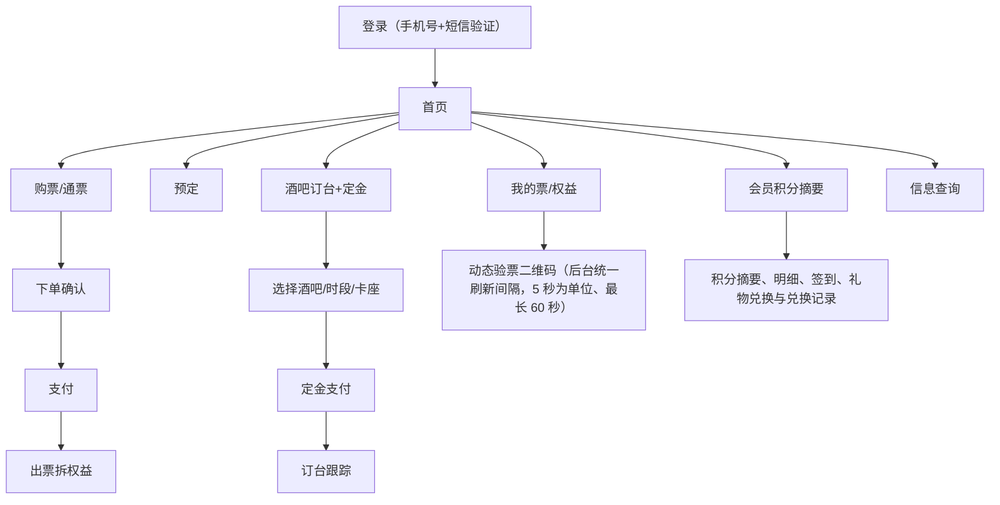

# 客人购票 App/小程序开发设计 V0.13

> 版本：V0.13 ｜ 最后更新：2026-10-25 ｜ 覆盖迁移基线：见各小节迁移号（最新 V124）｜ 状态：现行
> 新功能承接见 docs/v099-v124-feature-implementation-and-acceptance-spec-v0.1.md
> <!-- 文档goalP3(2026-06-20)：补版本/日期/覆盖迁移头，未改正文 -->

> **本文档为什么新增（定位）：** 指导实际编码的前端开发设计 `frontend-admin-development-design.md` 只覆盖管理后台/商户端/看板，**完全缺客人 App/小程序、会员积分摘要**的页面与 API 映射，产品需求悬空无编码落点（两轮审计 finding webmobile-3）。本文专门承载**客人端（App 与小程序）**的页面结构与页面→后端 API 映射，覆盖：购票、预定、酒吧订台+定金、我的票/权益、防伪二维码刷新、会员积分摘要。积分兑换扣库存保留为底层业务口径；积分明细、礼物列表、兑换发起和兑换记录按 BSM「查看会员积分摘要和会员等级」条已有客人接口与页面（第十三批，见 §4.5；原「客人端兑换独立接口和页面进入 P1」废止）。`frontend-admin-development-design.md §1.2` 已加边界声明"客人端由本文承载"。
>
> **依据与对齐：**
> - 产品需求：`terminal-page-product-prd-v0.1.md §8`、`web-mobile-app-terminal-extension-product-prd-v0.1.md §4`、`terminal-display-layer-spec-v0.2.md`。
> - 后端能力与接口口径：`ticketing-pass-entitlement-development-design.md §7.2/§7.3`（官方购票/游客侧/核销）、`bar-operations-development-design.md §6.3/§5.1.2/§9`（订台+订金）。
> - 跨文档单一权威：`unified-standards-baseline-v0.1.md`——金额=分(D1)、终端枚举=10 端(D5，本端为 `app`/`miniapp`)、事件命名(D4)、门票资格 P0(D9)、合规同意 P0(`compliance §3`)。
>
> 本文只做页面与 API 映射，**接口实现以 Java 后端最终 OpenAPI、operation 验收矩阵和 OpenAPI 追溯附录为准**；客人端不是配置端，不出现任何后台术语与现场作业动作。客人端 API client、mock、自动化和联调包必须能在 `p0-openapi-contract-closure-appendix-v0.1.md` 追溯权限、认证上下文、事件、终端和样例准入；未通过 `verify:openapi-closure` 不得标记可联调。

---

## 1. 文档定位

### 1.1 目标

客人 App 与小程序是游客侧主要入口，两端**共享同一套订单/票/权益/二维码/会员积分口径**。P0 必须打通：

1. 官方购票（票种、通票、学生票、多人票）与第三方团购回流票查询。
2. 预定（日期/场次/人数/项目或套餐）与**酒吧订台+定金支付**。
3. 我的票 / 我的权益 / 使用记录。
4. **防伪验票二维码**：签名、票种有效期、随机串、哈希、按后台统一刷新间隔（以 5 秒为单位可调、最长 60 秒）在线刷新、截图无效。
5. 会员积分摘要和会员等级。
6. 积分明细、礼物列表、兑换发起和兑换记录（BSM「查看会员积分摘要和会员等级」条；第十三批已接 `/api/v1/customer/points/*`，原「进入 P1」废止）；兑换扣库存规则保留为底层业务口径。

> 修订说明（2026-06-07 收口；2026-06-08 本轮复核更新）：第 5/6 项依赖的会员积分账户/明细/等级/兑换的**后端承载表已在地基侧规划新增（`points_*`，见 foundation-database 会员积分 DDL，依据 critic-4/pass-1）**；对应客人侧接口已在 `p0-implementation-task-list.md` 补入 CUST-001~006、PTS-001~003、SUP-004/005 任务，编码排期以这些任务为准。

### 1.2 范围与非范围

| 范围 | 是否包含 | 说明 |
|---|---|---|
| 客人 App（原生壳/混合） | 包含 | 终端枚举 `app`（基准 D5） |
| 客人小程序 | 包含 | 终端枚举 `miniapp`（基准 D5）；与 App 共享口径 |
| 购票/预定/订台+定金 | 包含 | 见 §3、§4 |
| 我的票/权益/防伪二维码/会员积分摘要 | 包含 | 见 §3、§4；积分明细、礼物列表、兑换发起和兑换记录见 §4.5 |
| 工作人员平板代客购票 | 不包含 | 主路径为客人本人通过 App/小程序或第三方自助购票；到店辅助购票只允许授权服务人员在售票一体机上完成，不属于客人端页面能力 |
| 核销执行 | 不包含 | 由员工工作手机/一体机/现场端执行；客人端只展示可被核销的二维码 |
| 管理后台/商户端/看板 | 不包含 | 由 `frontend-admin-development-design.md` 承载 |
| 后端接口实现 | 不包含 | 本文只做页面与 API 映射 |

### 1.3 技术基线（建议）

| 层级 | 方案 |
|---|---|
| App | 官方客人 App（Android、iPhone）：客人专用构建入口 `apps/customer-app`（Vite＋React，只含客人代码，页面资源本地打包、由原生壳本地加载，不加载远程网页）；原生能力（安全会话、扫码、分享深链、支付拉起与回前台查单、媒体选取、生命周期、深链与返回键）只经 `src/platform.ts` 适配层接入（第十三批 C 段） |
| 三端共用模块 | `packages/customer-core`：纯 TS 的接口路径与返回字段、请求协议、状态中文翻译、幂等键、深链解析、动态码到期与隐藏、支付拉起判定、开关隐藏；各端注入请求通道（App 用 fetch，小程序用 wx.request），不依赖浏览器（第十三批 C 段） |
| 小程序 | 微信小程序 `apps/customer-miniapp`：原生 WXML/WXSS/JS（不用 web-view），三端共用模块构建时编译进小程序包，调用同一套客人侧 API（第十三批 C 段） |
| 后端接口 | Java 21 + Spring Boot 4.x REST，OpenAPI 为准 |
| 鉴权 | 客人侧登录态（手机号 + 短信验证，对齐 D9 新人判定）；二维码刷新走在线接口 |
| 金额 | 一律整数分（基准 D1），前端展示时换算元 |

> 实现现状（第十三批 C 段 C4-android）：Android 原生壳 `apps/customer-app/android`（Capacitor 8.5.3，`cap add android` 生成）；`capacitor.config.ts`：`webDir` 为 dist、不设 `server.url`、`loggingBehavior: none`（原生桥不把插件参数与请求头打进系统日志）、`CapacitorHttp` 开（页面 fetch 走原生请求，后端不开跨域）。调试包：`npm run customer-android:apk`＝`vite build --mode android-debug`（取 `.env.android-debug`：`VITE_CUSTOMER_API_BASE_URL=https://192.168.88.160`、`VITE_CUSTOMER_LINK_HOST=192.168.88.160`）→ `cap sync android` → `gradle :app:assembleDebug`（160 上显式带 `ANDROID_HOME`/`ANDROID_SDK_ROOT`），产物 `android/app/build/outputs/apk/debug/app-debug.apk`，包名 `com.complex.customer.dev`、名称「综合体客人端（开发）」、minSdk 26（扫码库要求）。发行包：`app/build.gradle` 在任务图含本模块 release 任务时逐项核 `CUSTOMER_ANDROID_APPLICATION_ID`（不得为开发包名）、`CUSTOMER_ANDROID_APP_NAME`（不得带「开发」）、`COMPLEX_ANDROID_SIGNING_STORE_FILE`/`_STORE_PASSWORD`/`_KEY_ALIAS`/`_KEY_PASSWORD`（与员工端同一套，库文件须存在）、`VITE_CUSTOMER_API_BASE_URL`（https、非私网与本机，且安装包里的页面资源须按该地址打包）、`VITE_CUSTOMER_LINK_HOST`（非私网与本机，同时注入深链主机），缺任一项在执行任何任务前失败并列出中文原因。网络：`src/main/res/xml/network_security_config.xml` 只认系统证书、禁明文；debug 源集同名文件对 192.168.88.160 多信任 `@raw/complex160`（与员工端同一张公有证书）。清单申请 `INTERNET`、`CAMERA`（复核修复另加录音两项，见下文复核修复条）；深链 `https://${customerLinkHost}/c/…`（`autoVerify`；assetlinks.json 随正式域名部署前不验证，调试用 `am start` 带包名投递）。原生能力在 `src/platform.ts` 的 `createNativePlatform`（原生壳里自动选用，浏览器仍用内存实现）：令牌存 `@aparajita/capacitor-secure-storage`（Android Keystore 的 AES-GCM 密钥加密）；扫码 `@capacitor/barcode-scanner`（先经 `getUserMedia` 触发系统相机授权，未允许不进扫码界面——该库无权限时的提示写死英文；扫码模块按需加载、不进首屏包），原文交页面 `parseCustomerLink` 按路由校验（桌台、邀请函、门票领取、券领取；门票转赠页与券包新增「扫领取二维码」，只预览不领取）；分享 `@capacitor/share`（客人关掉面板记 `canceled` 不提示）；支付页 `@capacitor/browser`（Custom Tabs），回前台由 `App` 的 `resume` 触发查单；照片、视频先经 `@capacitor/action-sheet` 问「拍照（录像）／从相册选择」，拍摄走带 `capture` 的系统选择框，投诉语音在应用内现场录（见复核修复条）；`pause` 即清动态码、`resume` 先取新码；冷启动深链取 `getLaunchUrl`、运行中走 `appUrlOpen`；返回键 `backButton`。断言：`npm run verify:customer-android`（`tools/customer-android.test.mjs`：工程静态检查＋`gradle -m` 预演发行包拒绝）；`apps/customer-app/src/platform.native.test.tsx`。

> 实现现状（第十三批 C 段 C5-ios）：iPhone 原生壳 `apps/customer-app/ios`（Capacitor 8.5.3，`cap add ios` 生成，插件经 Swift Package Manager 引入、无 CocoaPods；`App/App/public`、`capacitor.config.json`、`config.xml` 由 `cap sync ios` 生成、不入库）。工程：共享 scheme `App`（`App.xcodeproj/xcshareddata/xcschemes/App.xcscheme`，运行用 Debug、归档用 Release）；开发区域与唯一本地化为简体中文（`developmentRegion`、`CFBundleDevelopmentRegion` 为 `zh-Hans`，`CFBundleLocalizations` 只含 `zh-Hans`，系统弹窗、选择框与按钮随之显示中文）；Bundle ID 开发值 `com.complex.customer.dev`，显示名取构建设置 `CUSTOMER_IOS_DISPLAY_NAME`（开发值「综合体客人端（开发）」）；`Info.plist` 只声明相机（扫码、拍照录像）、麦克风（投诉录语音、录像的声音）、相册（选照片视频）三项中文用途说明，不申请定位。发行包：目标的第一个构建阶段「发行包外部资料检查」在编译前跑 `ios/App/release-check.sh`（只在 Release 检查，Debug 不拦），逐项核正式 Bundle ID（不得为开发值）、`CUSTOMER_IOS_DISPLAY_NAME`（不得带「开发」）、`DEVELOPMENT_TEAM`、`VITE_CUSTOMER_API_BASE_URL`（https、非私网与本机，且 `App/public` 里的页面资源须按该地址打包）、`VITE_CUSTOMER_LINK_HOST`（非私网与本机），缺任一项以 `error:` 逐项列出中文原因并失败；正式值由 `xcodebuild … -configuration Release PRODUCT_BUNDLE_IDENTIFIER=… CUSTOMER_IOS_DISPLAY_NAME=… DEVELOPMENT_TEAM=… VITE_CUSTOMER_API_BASE_URL=… VITE_CUSTOMER_LINK_HOST=…` 传入（页面资源先带同样的 `VITE_*` 构建并 `cap sync ios`）。通用链接 `applinks:$(VITE_CUSTOMER_LINK_HOST)`（`App/App.entitlements`）只在 Release 引用：苹果通用链接不支持 IP 地址主机，调试包收不到系统转来的客人链接，只能在应用内扫码进入；apple-app-site-association 随正式域名部署。调试包连 160 须先让模拟器或真机信任 160 的自签证书（模拟器用 `xcrun simctl keychain booted add-root-cert complex160.pem`），应用内不放宽证书校验。原生能力与 Android 同一套 `src/platform.ts`，iPhone 上：令牌存 `@aparajita/capacitor-secure-storage`（钥匙串）；扫码不先经 `getUserMedia`——iPhone 扫码库自己申请系统相机权限，未允许只返回失败、不弹英文提示；支付页 `@capacitor/browser` 是盖在应用之上的系统浏览器页、应用不进后台，客人关掉它时 `browserFinished` 按回到前台处理、即查单（与 Android 关掉 Custom Tabs 即 `resume` 同口径）；照片、视频走系统选择框（自带拍摄与相册），投诉语音在应用内现场录；进后台（`pause`）即清动态码、回前台（`resume`）先取新码；深链冷启动取 `getLaunchUrl`、运行中走 `appUrlOpen`；没有返回键，二级页用标题栏返回。构建：160 没有 Xcode，本地只做静态检查、不构建；GitHub Actions `.github/workflows/ios-customer-app.yml` 只在 `apps/customer-app/**`、`packages/customer-core/**` 或本工作流变化时触发（PR 与 push 到 main），`macos-26` 固定 Xcode 26.5：`npm ci --ignore-scripts` → `npm run build --workspace apps/customer-app` → `cap sync ios` → 冒烟包把 `loggingBehavior` 改为 production（交付的包仍为 none）→ `xcodebuild … -configuration Debug -destination id=<模拟器> CODE_SIGNING_ALLOWED=NO build` → 核安装包的 Bundle ID、显示名、开发区域、`public/index.html` 与不含后台和经销商门户代码 → `simctl` 启动，90 秒内应用输出须出现「WebView loaded」与「To Native ->」（页面已加载并调用原生能力）且应用仍在运行 → 上传截图、应用输出、系统日志与安装包文件 sha256 清单。仓库私有，macOS 运行分钟按 Linux 的 10 倍计入账户额度（单次约 15～25 分钟实耗），额度不足时作业失败或排队、iPhone 端结论为「未验证」；不产出 .ipa（Apple 开发者团队、发行证书与描述文件未到位）。本组交付时该工作流尚未在 GitHub 上运行，iPhone 包未构建验证。断言：`npm run verify:customer-ios`（`tools/customer-ios.test.mjs`：工程静态检查＋直接执行 release-check.sh 验发行包拒绝与放行＋工作流触发路径与步骤）；`apps/customer-app/src/platform.ios.test.tsx`。

> 实现现状（第十三批 C 段 C6-miniapp-a）：微信小程序 `apps/customer-miniapp`（原生 WXML/WXSS/JS，不用 web-view、不跳别的小程序）。工程：`project.config.json` 的 `appid` 为游客 `touristappid`（只能本地编译），`miniprogramRoot` 为 `miniprogram/`，`scripts` 在编译、预览前跑 `npm run build`、上传前再跑 `npm run check-release`；正式 AppID 只放不入库的 `project.private.config.json`。三端共用模块由 `scripts/build-core.mjs` 用 tsc（`tsconfig.core.json`：CommonJS、ES2017）编译到 `miniprogram/core/`，二维码编码库 `qrcode-generator` 2.0.4 拷到 `miniprogram/vendor/`（均为构建产物、不入库）。`miniprogram/config.js` 是唯一运行配置（开发值：接口 `https://192.168.88.160`、客人链接主机 `192.168.88.160`、本端版本 `0.1.0`）；`scripts/check-release.mjs` 在 AppID 仍为 `touristappid`、接口非 https 或为私网／本机地址、客人链接主机未配置或为私网／本机地址、本端版本与 `package.json` 不一致时逐项列中文原因并非零退出。请求与会话只在 `miniprogram/lib/api.js`：`wx.request`（`dataType: text`，响应原文交 core 解包）包成 core 的请求通道，每个请求带 `X-Terminal-Type: miniapp`、`X-Client-Version`、`X-Module-Code`，有会话带 `X-Customer-Token`；令牌只存本地存储 `customer_token` 一项，任何请求 401 即删令牌并 `reLaunch` 到登录页（403 不登出），登出先 `POST /api/v1/customer/auth/logout` 再删；`app.js` 启动恢复会话，启动与回前台读 `GET /api/v1/customer/terminal-switches/effective`，本端总开关、本版本被关或拉取失败转 `pages/paused`，模块被关只隐藏该模块入口；已登录时拉 `GET /api/v1/customer/ticket-expiry-reminders` 用 `wx.showModal` 弹出（同一张票本次运行只弹一次）。页面一律用 `Component()` 构造（json 含 `usingComponents`）：底部「首页／票与订单／我的」三标签（酒吧标签随后续页面接入）；首页匿名读 `GET /api/v1/customer/projects` 与票种；登录注册（取码、409 `CUSTOMER_REGISTRATION_REQUIRED` 转注册、生日与两份条款逐份同意后 `register`）；购票（门票守则、我的价格、单店票带 `bar_id`，专属入口 `?bar_id=` 只拉该酒吧票）与组合支付组件 `components/order-payment`（储值不足待付只扣卡内余额并带 `amount_cent`，余下 `POST /api/v1/customer/orders/{order_id}/payments` 在线补足）；在线付款 `lib/pay.js` 按 `launchDecision(view, "miniapp", [])` 只认 `launch.kind=miniapp_wechat`，把 `launch.params` 原样交 `wx.requestPayment`，其余（无 `launch`、`RESERVED`/`NOT_CONFIGURED`、H5、App 支付）显示「支付暂不可用，未扣款」，拉起后不论成功、失败还是取消都调 `…/confirm` 查单，`pay_status=paid` 才显示支付成功；票与订单（渠道 `enabled=false` 置灰并注明「渠道未接入」、按父票聚合、补偿行单列、`GET /api/v1/customer/tickets/{ticket_id}/usages`、动态验票码、本人可退整票 `POST /api/v1/customer/ticket-refunds` 与申请列表）；动态码组件 `components/dynamic-code`（core `createDynamicCode`，`pageLifetimes.hide` 清码停计时、`show` 先取新码；码值由 `qrcode-generator` 画成图片数据交 `image` 显示，不写存储、不以文字出现）；门票转赠（手机号或微信分享：`onShareAppMessage` 的路径只带领取码 `/pages/transfer/index?claim_code=`，客人链接主机已配置时另出 `/c/ticket-claim` 领取二维码；`wx.scanCode` 只认门票领取链接；带码进来只预览，`session_ended` 时「确认领取」不可点）；停车缴费（支付与查单同上）；客人链接入口 `pages/link/index`（微信「扫普通链接二维码打开小程序」的 `q` 参数经 `parseCustomerLink` 白名单，本组接 parking、bar、ticket-claim）。断言：`apps/customer-miniapp/test/*.test.js`（miniprogram-simulate 1.6.2＋vitest、jsdom，`wx` 用测试替身；`npm test --workspace apps/customer-miniapp` 先构建 core 再跑），`test/structure.test.js` 检查页面与组件四件套、无 web-view、只有 `lib/api.js` 发请求与读写存储、界面文字全中文、包内不含后台与经销商门户代码。单测与结构检查通过只表示源码逻辑与模板可执行，不等于微信开发者工具编译通过或真机预览：160 没有微信开发者工具，本次未在开发者工具编译、未真机预览、未上传；`image` 显示二维码图片数据、`scripts` 预处理命令须在开发者工具里核。

> 实现现状（第十三批 C 段 C7-miniapp-b）：小程序其余页面（`apps/customer-miniapp/miniprogram/pages/`，一律 `Component()` 构造）：`app.json` 页面清单补到 22 页，底部「首页／票与订单／酒吧／我的」四标签（酒吧标签页 `pages/bar` 列订台、我的订台、接受邀请、扫码点单，酒吧模块被关即只提示暂停服务；「我的」列积分与签到、储值与会员、券包、存酒、投诉与反馈、学生认证、账户与条款、注销账号，按所属模块的终端开关隐藏）。各页进入先取 `lib/api.js` 的 `pageState(模块)`：未登录给登录入口、不发本人请求，模块被关只提示暂停服务；请求头 `X-Module-Code` 取该页所属模块（bar／points／wallet／vouchers／saved_bottles／complaints／account）。订台 `pages/reserve`（`GET /api/v1/customer/bar-reservation-options`：`reserved=true` 或 `deposit_amount_cent=0` 不可选并注明原因；到店与最晚到店时间各用日期、时间选择器，按本机时区拼成 ISO 后 `POST /api/v1/customer/bar-reservations`，缺最晚到店时间不提交）；我的订台 `pages/reservations`（`GET /api/v1/customer/bar-reservations`，`invitation_status=none` 注明待签发、`active` 可看 `GET /api/v1/customer/bar-invitations/{reservation_id}`，`POST …/members/{member_id}/remove` 只对非开卡人且 `confirmed` 的显示；`onShareAppMessage` 路径为 `/pages/invitation/index?token=&sig=&table_id=&capacity=`，客人链接主机已配置时另画 `/c/invitation` 二维码）；接受邀请 `pages/invitation`（带四项码载荷进来只调 `GET /api/v1/customer/bar-invitations/preview`，点「确认接受」才 `POST /api/v1/customer/bar-invitations/confirm`；`wx.scanCode` 只认 invitation 路由）；扫码点单 `pages/scan`（不要求登录；`wx.scanCode` 只认 table 路由，`GET …/bar-tables/{table_id}/menu` 与 `current-bill`，`sold_out` 的不能加，下单 `POST …/scan-orders`）。定金、扫码点单与储值充值共用 `lib/pay.js` 新增的 `payAndConfirm(发起, 查单)`／`recheck`：发起后按 `launchDecision` 只拉起 `miniapp_wechat`，拉起后一律查单（定金 `deposit_status=paid`、扫码点单 `status=paid`、充值 `POST /api/v1/customer/stored-value/settle` 成功才算付成），未确认留付款编号给「我已完成支付」再查。积分 `pages/points`（摘要决定页面级错误，明细、门票与消费奖励、规则公告、签到、目录、兑换记录各自降级；`pending_recovery>0` 时兑换不可点）；储值 `pages/wallet`（分卡、退出公告 `GET /api/v1/customer/merchant-card-exit-notices`、选卡即读 `topup-rules` 与逐笔记录分页，读不到规则不许充值；充值 `channel` 固定 `wechat`）；券包 `pages/vouchers`（四组、失效原因与退回积分、`transferable` 才显示转赠；领取码 `onShareAppMessage` 路径 `/pages/vouchers/index?claim_code=`，客人链接主机已配置时另画 `/c/voucher-claim` 二维码，`wx.scanCode` 只认 voucher-claim 路由，带码进来只预览）；存酒 `pages/bottles`（所属酒吧、门店退出的指定领取地点、转存先 `renewal-code` 再 `renew`）；投诉 `pages/complaints` 与学生认证 `pages/student`：照片、视频经 `lib/media.js` 的 `wx.chooseMedia`（拍摄或相册，文件名取临时路径末段、保留扩展名供服务端判类型），语音用 `wx.getRecorderManager` 录 mp3（时长取小程序上限 10 分钟；`onStop`、`onError` 只在页面加载时登记一次，录音失败即退出录音状态并提示）；带文件的提交由 `lib/api.js` 的请求通道把 core `postForm` 交来的字段与全部文件组成一个 multipart 请求体（`wx.getFileSystemManager().readFileSync` 读临时文件，文字按 UTF-8 编码），以 `wx.request` 一次发出，`Idempotency-Key` 头与 `idempotency_key` 字段同值——不用 `wx.uploadFile`，因其一次只能传一个文件，而接口要求文字与 0～9 个附件同一请求、同一请求编号；学生认证先 `POST /api/v1/customer/consents`（`student_certificate`，同意版本与 App 同一份）才显示选照片；注销 `pages/deregister`（`refundable_tickets` 非空或有存酒未勾选放弃时不提交并说明原因，可退票在本页 `POST /api/v1/customer/ticket-refunds`；注销成功先 `logout` 再回首页）；账户与条款 `pages/account`（`GET /api/v1/customer/terms`）。动态码组件 `components/dynamic-code` 的 `kind` 新增 bottle（`GET /api/v1/customer/saved-bottles/{saved_bottle_id}/pickup-code`）、entry（`GET /api/v1/customer/bar-invitations/{reservation_id}/entry-code`）、voucher（`GET /api/v1/customer/vouchers/{voucher_instance_id}/redeem-code`），行为同门票码。客人链接入口 `pages/link` 的白名单补 table、voucher-claim、invitation。`wx.chooseMedia`、`wx.getRecorderManager`、`wx.scanCode` 须在小程序后台按正式 AppID 填写用户隐私保护指引后才可调用（外部资料，未到）。断言：`test/bar.test.js`、`scan.test.js`、`points.test.js`、`vouchers.test.js`、`wallet.test.js`、`bottles.test.js`、`complaints.test.js`、`account.test.js`；`test/structure.test.js` 新增页面清单与每页中文标题检查、四标签，读本地文件也只许在 `lib/api.js`。单测与结构检查通过只表示源码逻辑与模板可执行，不等于微信开发者工具编译通过或真机预览；multipart 请求体、录音格式与隐私授权弹窗须在开发者工具与真机上核。

> 实现现状（第十三批 C 段复核修复）：① `packages/customer-core` 新增 `listAmusementProjects(projectId)`（`GET /api/v1/customer/amusement/projects?project_id=`，类型 `AmusementProject`／`AmusementSession`）；App `HomePage` 与小程序 `pages/home` 在每个综合体下只读列出游乐项目与场次（起止时间、`formatBusinessStatus` 状态、余量＝capacity−used_capacity），读不到不显示。② `restoreSession` 只在 401（会话失效）或 204（匿名）返回空，断网、超时与非 401 错误原样抛出；App 外壳此时保留 `platform.session` 里的令牌与 `tokenRef`、按未恢复显示登录页，`platform.onResume` 时再恢复；小程序 `lib/api.js` 的 `restoreSession` 吞掉该异常、不删 `customer_token`。③ 当前综合体：App 外壳的请求上下文 `projectId`＝页面报上来的所选综合体（`ParkingPage`、`ComplaintsPage` 的 `onProject`）→ 深链参数 `project_id` → 启动时 `GET /api/v1/customer/projects` 只有一个综合体时的那个；`customerSwitchState(rows, {version, projectId: 唯一综合体})` 判本端暂停服务，深链 `project_id` 被关时该页内容只显示「该综合体本端暂停服务」，选综合体的页面经 `projectOpen` 不列被关的综合体。小程序 `lib/api.js` 同口径：`service(模块, 综合体)` 设 `X-Project-Id`（不传即唯一综合体），`loadSwitches` 首次读综合体列表，唯一综合体被关即 `pages/paused`，`projectOpen` 供停车与投诉页过滤；停车页链接带的综合体被关只提示暂停服务。④ 停车缴费不带 `project_id` 进入时读综合体列表：只有一个直接用，多个由客人选（App `Select`、小程序 `picker`）。⑤ 「申请退票」入口改读 `GET /api/v1/customer/deregister/preview` 的 `refundable_tickets`（按 `parent_ticket_id`），再除去在途转赠与本人 requested／approved 的申请，不再按票名对 `GET /api/v1/customer/ticket-products`（该接口只返回已上架票种）；注意每次打开「我的票」会记一条 `customer.account.deregister_previewed` 审计。⑥ 订台表单的定金条款：App `BarReservationPage`（`reservation-deposit-rules`）与小程序 `pages/reserve`（`#deposit-rules`）同一句。⑦ 小程序到期提醒抽到 `lib/reminders.js` 的 `remindExpiring()`：`app.js` 的 `onShow` 与登录页 `saveSession` 之后各调一次，已弹过的票本次运行不再弹。⑧ App 投诉语音：`platform.startRecording()` 经 `getUserMedia({audio:true})`＋`ScriptProcessor` 收采样，停止时写成 16 位单声道 wav（服务端语音收 m4a/aac/mp3/amr/wav，网页录音器默认的 webm 会被判成视频；文件名只用数字，原生请求通道按单字节写表单文件名）；`pickMedia` 只剩照片与视频；Android 清单加 `RECORD_AUDIO`、`MODIFY_AUDIO_SETTINGS`（Capacitor 把网页录音的权限请求转成这两项系统权限），iPhone 麦克风用途改为「投诉时录语音、录像需要使用麦克风」。⑨ Android `versionName` 与 iPhone `MARKETING_VERSION` 改为 `apps/customer-app/package.json` 的 version（0.1.0，即请求头 `X-Client-Version`），`tools/customer-android.test.mjs`、`tools/customer-ios.test.mjs` 断言两边一致。

> 实现现状（第十三批 C 段复核修复二）：① 「申请退票」入口改读 `GET /api/v1/customer/my-tickets` 每条的 `refundable`（取代上条改读注销预览）：服务端 `TicketingService.listCustomerHeldTickets` 按注销预检 `listRefundableUnusedHeldTickets` 同一口径判定（每个人份都归本人、票种允许退款、整张未用；第十三批裁决第 12 条只持有部分人份的不算），另除去有在途转赠或父票已因退票申请冻结（`refund_pending`）的票；其余接口里同一投影的 `refundable` 为空。App `MyOrdersPage` 与小程序 `pages/orders` 只看该字段，不再调 `GET /api/v1/customer/deregister/preview`，打开我的票不再多记 `customer.account.deregister_previewed`。② `GET /api/v1/customer/ticket-products` 每个票种带 `project_id`（与下单确定订单综合体同一口径 `TicketOrderService.resolveSaleProjectId`，关联多个或无法确定时为空），`GET /api/v1/customer/bar-reservation-options` 每个台位带 `project_id`（所属酒吧商户的综合体）；购票、订台请求带所选票种／台位的 `X-Project-Id`，使 PGM 第 736 行「可以按全局、综合体、商户、业务系统、模块、版本/设备、灰度开关」的按综合体终端开关对这两类操作生效（App：`BuyTicketPage` 选票种、`BarReservationPage` 选台位时经 `onProject` 报给外壳；小程序：`api.service(模块, projectId)`）。断言：`CustomerTicketRefundJdbcIntegrationTests`、`CustomerProjectTerminalSwitchJdbcIntegrationTests`（两个综合体关掉其一，该综合体购票、订台 403 `TERMINAL_DISABLED`，另一个照常），App `MyOrdersPage.tickets.test.tsx`、`CustomerApp.test.tsx`，小程序 `test/orders.test.js`、`buy-payment.test.js`、`bar.test.js`。③ 小程序登录凭证存小程序沙箱本地存储（`customer_token` 一项），只经请求头发出、任何请求 401 即删；小程序没有 Keystore／Keychain，这是与 App（系统安全存储）的平台差异；「令牌不进 localStorage」指浏览器 localStorage。

> 实现现状（2026-10-25 操作员更正撤回第十三批第 8、11、12 条）：`packages/customer-core` 删去 `requestTicketRefund`、`listTicketRefunds`（`/api/v1/customer/ticket-refunds` 已从契约删除）与类型 `CustomerTicketRefund`，`CustomerTicket.refundable`、`DeregisterPreview.refundableTickets` 去掉；App `MyOrdersPage` 与小程序 `pages/orders` 去掉「申请退票」确认与「我的退票申请」；App `DeregisterPage` 与小程序 `pages/deregister` 去掉可退整票清单与就地退票，只有名下存酒未勾选放弃才不可注销。取代本文各实现现状条中「申请退票」「先退票才能注销」的做法（复核修复二 ① 作废，其断言 `CustomerTicketRefundJdbcIntegrationTests` 已随服务端撤回删除）。断言：App `CustomerApp.test.tsx`（`myTicketsHaveNoRefundEntry`），小程序 `test/orders.test.js`（`myTicketsHaveNoRefundEntry`），`npm run verify:client-openapi`。

> 实现现状（第十三批 C 段复核修复三）：购票 `POST /api/v1/customer/ticket-orders`、订台 `POST /api/v1/customer/bar-reservations` 的按综合体终端开关改在服务端按票种所属综合体（`TicketingService.saleProjectIdOf`，与下单定订单综合体同一口径）、台位所属酒吧的 `merchants.project_id` 判（`TerminalSwitchGuard.checkTerminalEnabledAtProject`），不取客户端自报的 `X-Project-Id`：不带该头或写成别的综合体，被关综合体的购票、订台照样 403 `TERMINAL_DISABLED`、不建单（PGM 第 744 行「前端隐藏只是辅助，后端接口必须独立校验」）；客户端仍按复核修复二 ② 带 `X-Project-Id`。断言：`CustomerProjectTerminalSwitchJdbcIntegrationTests`（`closedProjectPurchaseRejectedWithoutOrWithForgedProjectHeader`、`closedProjectReservationRejectedWithoutOrWithForgedProjectHeader`）。

> 实现现状（第十三批 C 段复核修复四）：停车缴费 `POST /api/v1/customer/parking/payments`、投诉提交 `POST /api/v1/customer/complaints` 的按综合体终端开关同复核修复三，改在服务端按停车记录所属项目（`parking_sessions.project_id`）、客人所选综合体（表单 `project_id`，即工单所属综合体）判（`TerminalSwitchGuard.checkTerminalEnabledAtProject`，先于幂等），不取客户端自报的 `X-Project-Id`：不带该头或写成别的综合体，被关综合体的缴费、投诉照样 403 `TERMINAL_DISABLED`、不建缴费单与工单（PGM 第 744 行「前端隐藏只是辅助，后端接口必须独立校验」）。断言：`ParkingPaymentJdbcIntegrationTests.closedProjectParkingPaymentRejectedWithoutOrWithForgedProjectHeader`、`CustomerComplaintJdbcIntegrationTests.closedProjectComplaintRejectedWithoutOrWithForgedProjectHeader`（两条另断言开关开着时成功过的同一幂等键，关掉后重放也 403）。复核修复（2026-10-25）：满意度评分 `POST /api/v1/customer/complaints/{work_order_id}/satisfaction` 按本人投诉工单所属综合体（`facility_work_orders.project_id`，先于幂等）、缴费确认 `POST /api/v1/customer/parking/payments/{payment_id}/confirm` 按缴费单所属项目（`parking_payments.project_id`，先于重复确认返回原结果）、按车牌查费 `GET /api/v1/customer/parking/sessions` 按 `project_id` 参数所指项目，同样以 `TerminalSwitchGuard.checkTerminalEnabledAtProject` 判，被关综合体 403 `TERMINAL_DISABLED`（不记评分、不记已缴）。断言：`CustomerComplaintJdbcIntegrationTests.closedProjectComplaintRatingRejectedWithoutOrWithForgedProjectHeader`、`ParkingPaymentJdbcIntegrationTests.closedProjectParkingLookupAndConfirmRejectedWithoutOrWithForgedProjectHeader`。

> 实现现状（第十三批 D 段）：其余指向某一综合体的客人接口同复核修复三、四，一律在客人专用入口按业务对象在服务端所属的综合体判（新增 `CustomerProjectSwitch` 把对象标识与 `project_id` 先去首尾空格（与业务层查对象同口径）、按对象查 `project_id` 后调 `TerminalSwitchGuard.checkTerminalEnabledAtProject`，不取客户端自报的 `X-Project-Id`；写操作在幂等、`@GuardedAction` 切面与扣款之前判，开关开着时成功过的同一幂等键关掉后重放也 403 `TERMINAL_DISABLED`）：`GET /api/v1/customer/orders/{order_id}/tickets`、`POST …/orders/{order_id}/payments`、`…/payments/{payment_intent_id}/confirm`、`POST …/orders/{order_id}/stored-value/pay` 按本人订单 `ticket_orders.project_id`；`GET …/tickets/{ticket_id}/qr`、`…/usages` 按权益所属订单；`POST …/ticket-transfers` 按 `parent_ticket_id` 所属订单，`…/{transfer_id}/claim`、`…/revoke` 与 `GET …/ticket-transfers/preview`（按领取码）按转赠票所属订单；`GET …/ticket-products` 带 `bar_id` 时按该酒吧 `merchants.project_id`（不带不判）；`GET …/ticket-reward-rules` 带 `project_id` 时按它（即公告查询的过滤条件），只带 `ticket_type_id` 时按 `TicketingService.saleProjectIdOf`（都不带不判）；`POST …/bar-invitations/confirm`、`GET …/bar-invitations/preview`（按 `invitation_token`）与 `GET …/bar-invitations/{reservation_id}`、`…/entry-code`、`POST …/members/{member_id}/remove`、`POST …/bar-reservations/{reservation_id}/deposit-payments` 及其 `…/confirm` 按订台所属酒吧；`GET …/bar-tables/{table_id}/menu`、`…/current-bill`、`POST …/scan-orders` 及其 `…/confirm` 按台位所属酒吧（匿名调用，终端类型自报）；`POST …/points/redemptions` 按 `customer_redemption_catalog_items.project_id`（为空＝全局可见，不判）；`GET …/saved-bottles/{saved_bottle_id}/pickup-code`、`POST …/renewal-code`、`…/renew` 按存酒 `bar_project_id` 所指酒吧（与转存额度同口径）；`POST …/stored-value/topup`、`GET …/stored-value/account`、`…/topup-rules` 按卡范围（`merchant_id` 非空取该商户的综合体，否则取 `project_id`；都为空不判），`POST …/stored-value/settle` 按 `stored_value_topup_intents` 绑定的卡范围，`GET …/accounts/{account_id}/transactions` 按本人卡（商户卡取发卡商户的综合体，否则取卡的 `project_id`）；储值充值、入账与 `POST …/orders/{order_id}/stored-value/pay` 另按该动作的模块能力码（`customer.stored_value.topup`／`customer.stored_value.consume`，经 `TerminalSwitchGuard.checkAtProject`）在同一综合体判，按综合体单独停储值模块时同样不认 `X-Project-Id`；`GET …/vouchers/{voucher_instance_id}/redeem-code`、`POST …/voucher-transfers`、`…/{transfer_id}/claim`、`…/revoke`、`GET …/voucher-transfers/preview` 按发券商户 `voucher_definitions.merchant_id` 的综合体，无发券商户的积分兑换券（目录项未挂券模板时派生的 `vdef_cat_` 模板）取兑换来源目录项 `customer_redemption_catalog_items.project_id`（经 `voucher_instances.source_ref`→`customer_points_redemptions.catalog_item_id`；两者都为空的平台通用券不判）；`GET …/amusement/projects`、`…/parking/credits` 按 `project_id`。判在 `CustomerService`、`CustomerPaymentService`、`CustomerBarScanOrderService`、`MemberWalletController`、`TicketRewardController`、`CustomerShowcaseController`、`ParkingCustomerService` 的客人入口；`GateRequestContext`、`ActionGateAspect` 与 `StoredValueService`、`InventoryService`、`TicketingService`、`VoucherService` 等共用方法不改（`TerminalSwitchGuard` 只加按指定能力码判的 `checkAtProject`），员工端与后台结算作业（`CustomerOnlinePaymentSettlementJob`、`settleTopupFromGateway`、`settleDeposit(customerId=null)`）不经这些入口。跨综合体的本人汇总列表不判。断言：`CustomerTicketProjectSwitchJdbcIntegrationTests`、`BarCustomerProjectSwitchJdbcIntegrationTests`、`CustomerWalletProjectSwitchJdbcIntegrationTests`（两个综合体关掉其一，不带或伪造 `X-Project-Id` 都 403、另一综合体照常，写操作另断言同键重放；另断言对象标识带首尾空格、按综合体单独停储值模块、积分兑换兑出的券、无独立 project 的商户卡）。

### 1.4 三端构建与验证（第十三批 C 段 C8-docs）

> 外部资料（正式包名与 Bundle ID、中文名称、发行签名、Apple 开发者团队、小程序 AppID、正式接口域名与客人链接域名、支付与短信供应商）到位前三端只有开发值；开发值在发行构建或上传前检查里一律被拒（见 §1.3 各端实现现状），不出假的正式包，支付与短信未配置时如实显示不可用。

| 端 | 构建 | 自动化验证 | 已验证到 | 未验证（须另行执行） |
|---|---|---|---|---|
| 三端共用模块 `packages/customer-core` | 无单独产物，随各端构建 | `npm test --workspace packages/customer-core`、`npm run typecheck` | 单测、类型检查 | — |
| Android 官方客人 App | 160 上在工作树根执行 `ANDROID_HOME=/home/james/android-sdk ANDROID_SDK_ROOT=/home/james/android-sdk npm run customer-android:apk`（页面按 `.env.android-debug` 打包 → `cap sync android` → `gradle :app:assembleDebug`），产物 `apps/customer-app/android/app/build/outputs/apk/debug/app-debug.apk`；发行包 `:app:assembleRelease` 须先带齐发行环境变量、按同一正式接口地址重新构建页面并 `cap sync android` | `npm test --workspace apps/customer-app`、`npm run verify:customer-android` | 160 实际构建调试包 | 发行签名包、正式域名的 assetlinks.json、真机安装 |
| iPhone 官方客人 App | 只由 GitHub Actions `.github/workflows/ios-customer-app.yml` 构建（`macos-26`、Xcode 26.5，模拟器调试构建 `CODE_SIGNING_ALLOWED=NO` 并启动冒烟）；`apps/customer-app/**`、`packages/customer-core/**` 或该工作流变化的 PR 与 main 推送触发 | `npm run verify:customer-ios`、该工作流的运行结果 | 静态检查与发行检查脚本；工作流尚未在 GitHub 上运行 | 模拟器构建与启动（以工作流成功运行为准）、.ipa、真机、通用链接 |
| 微信小程序 | `npm run build --workspace apps/customer-miniapp`（生成不入库的 `miniprogram/core/` 与 `miniprogram/vendor/`） | `npm test --workspace apps/customer-miniapp`（miniprogram-simulate 单测与工程结构检查）、`npm run check-release --workspace apps/customer-miniapp`（仍为开发值即非零退出） | 单测与结构检查 | 开发者工具编译、真机预览、上传 |

已知例外与说明（第十三批 C 段复核修复二）：
- `apps/customer-app/android/gradlew.bat` 为 Capacitor 模板生成的 Windows 批处理，按惯例保留 CRLF 行尾（仓库其余文件为 LF）；三端构建脚本不使用它（160 用 `gradle`）。
- Android 模拟器冒烟（160 无头模拟器：安装调试包、冷启动进首页、带包名投递深链）只证明安装、冷启动、深链送达与无崩溃，不验证业务流程；160 测试服务停用期间页面显示「本端暂停服务」（开关拉取失败按兜底关闭）属预期。

小程序导入微信开发者工具（须 Windows 或 Mac 桌面，160 没有该工具）：
1. 仓库根 `npm ci` 后执行 `npm run build --workspace apps/customer-miniapp`；开发者工具编译、预览前也会经 `project.config.json` 的 `scripts` 自动执行，该预处理是否生效须在开发者工具里核。
2. 开发者工具「导入项目」选 `apps/customer-miniapp` 目录（小程序根 `miniprogram/`）；AppID 用游客 `touristappid` 只能本地编译，正式 AppID 只填在不入库的 `project.private.config.json`。
3. 开发值接口 `https://192.168.88.160` 是 IP 加 160 自签证书，不能配成合法域名：本机调试在「详情 → 本地设置」勾选不校验合法域名与 HTTPS 证书（只落 `project.private.config.json`，不入库）；真机预览须等正式域名与证书配进小程序后台。
4. 上传前 `npm run check-release --workspace apps/customer-miniapp`（开发者工具上传前也会执行），游客 AppID、http 或私网接口、未配客人链接主机、版本不一致即拒绝上传。

统一安装包（`npm run release:package`，`tools/release/build-release-package.mjs`）：按登记表 `ops/release/environments.json` 中每个登记齐的环境，员工 App 之外同出客人安卓 App——测试环境出调试包（页面按该环境的服务地址与对外地址打包；调试包只额外信任 160 自签证书），生产环境须出包机另给 `CUSTOMER_ANDROID_APPLICATION_ID`、`CUSTOMER_ANDROID_APP_NAME` 与员工端同一套发行签名才出发行包（其余发行资料由客人 App 的发行包检查把关，不齐即整包停止），未给则不出。包内位置 `clients/guest-android/complex-customer-<环境>.apk`，`manifest.json` 的 `clients.guest_android` 与教程「各端入口」表同步登记，客人安卓 App 不在服务器上安装。客人 iPhone App 与微信小程序在登记表 `guest_entries` 填入发布入口前，教程写「尚未发布」、manifest 记 null。断言：`npm run verify:release-package`。

---

## 2. 信息架构

客人端"一个入口，多场景"，登录后按游客/会员身份进入。

---

## 3. 页面清单

页面与 `terminal-display-layer-spec-v0.2.md` 终端展示页面章节一致，并补订台+定金两页（finding webmobile-6）。

| 页面 | P0 内容 | 终端 |
|---|---|---|
| 登录 | 手机号 + 短信验证码（新人判定以手机号为准，D9）；首次收集前展示隐私政策同意（compliance §3） | app/miniapp |
| 首页 | 综合体介绍、票务入口、活动/公告、推荐票种 | app/miniapp |
| 票务列表 | 平日票、周末票、节假日票、学生票、多人票、通票 | app/miniapp |
| 票务详情 | 价格、适用日期、人群、权益组成、使用限制 | app/miniapp |
| 预定入口 | 日期、场次、人数、项目或套餐选择 | app/miniapp |
| 酒吧订台 | 选择酒吧、日期、时段、卡座/桌台/吧台位、人数、备注（订台需支付定金） | app/miniapp |
| 订台定金支付 | 订台位置、定金金额（分）、支付方式、到店/取消/退款状态 | app/miniapp |
| 下单确认 | 票种、数量、游客信息、金额、优惠；敏感个人信息单独同意（compliance §3） | app/miniapp |
| 支付结果 | 成功、失败、待支付、订单状态 | app/miniapp |
| 我的订单 | 订单状态、退款状态、权益生成状态 | app/miniapp |
| 我的票 | 票码、有效期、状态 | app/miniapp |
| 我的权益 | 入场、游乐、酒水、餐饮/零售券 | app/miniapp |
| 验票二维码 | 防伪二维码：签名、票种有效期、随机串、哈希、按后台统一刷新间隔（以 5 秒为单位可调、最长 60 秒）刷新、截图无效、在线核验 | app/miniapp |
| 使用记录 | 已核销、退款、失效、撤销 | app/miniapp |
| 会员积分 | 积分余额、会员等级、最近积分摘要、积分明细、签到（第十三批，原「积分明细 P1」废止） | app/miniapp |
| 积分兑换 | 可兑换礼物、兑换条件、兑换记录；兑换礼物必须扣减库存（第十三批，原「P1」废止） | app/miniapp |
| 信息查询 | 营业时间、游乐项目、酒吧规则、场地说明、常见问题 | app/miniapp |

> 实现现状（第十三批 C 段 C3-app-bar-account）：App 底部「酒吧」标签含 订台、我的订台、接受邀请、扫码点单；「我的」标签含 积分／签到、储值／会员、我的券包、我的存酒、投诉与反馈、学生认证、账户与条款、注销账号。页面在 `apps/customer-app/src/pages/`：BarReservationPage、MyReservationsPage、InvitationAcceptPage、BarScanOrderPage、PointsPage、VoucherWalletPage、WalletPage、SavedBottlesPage、ComplaintsPage、StudentCertificationPage、AccountPage、DeregisterPage；原「订卡邀请函」页（手填订台编号与邀请函码）撤销，由「我的订台」与「接受邀请」取代。深链 `table`→扫码点单（带桌台）、`invitation`→接受邀请（带码载荷）、`voucher-claim`→券包（带领取码，只预览）。未登录时桌台码深链与登录页「不登录，扫桌台码点单」直接进扫码点单（只有标题栏，返回回登录页）。

---

## 4. 页面与后端 API 映射矩阵

> 接口路径以 Java 后端最终 OpenAPI 为准；本文先定义客人端依赖关系。所有金额字段单位为**分(整数)**（D1）。
>
> 2026-06-12 收口口径：本文不再保留 `/api/public/*`、`/api/customer/*`、`/api/bar/reservations*`、`/api/consent-records` 等历史路径作为当前开发依据。P0 客人端接口唯一以 `docs/openapi/openapi-p0.yaml` 为准，统一落到 `/api/v1/customer/*`；未进入 OpenAPI 的细分能力只能作为字段、页面状态或后续版本扩展，不得被前端、测试或后端按正式接口开发。
>
> 2026-06-11 执行口径：正式 P0 接口以 `docs/openapi/openapi-p0.yaml`、`docs/openapi/openapi-p0.json`、`p0-openapi-operation-acceptance-matrix-v0.1.md` 为准，客人端统一落到 `/api/v1/customer/*`；客人 Token 写入 `x-auth-context=customer-token`，不得写成员工权限码；酒吧订台由 `/api/v1/customer/bar-reservations` 承接，必要时再由后端内部调用 `/api/v1/bar/reservations`，不再直接新增 `/api/bar/*` 路径。

### 4.1 登录与会员身份（含 D9 新人判定、合规同意）

| 页面 | API | 用途 | 优先级 |
|---|---|---|---|
| 登录 | `POST /api/v1/customer/auth/phone-login` | 手机号 + 验证码登录，返回客人会话；新人资格按手机号在服务端同步判定。第十三批 ROOT-03：只认官方 App、小程序（请求头 `X-Terminal-Type` 为 app 或 miniapp），会话锁定登录端，此后该凭证只能在同一端使用；手机号未注册返回 409 `CUSTOMER_REGISTRATION_REQUIRED`，转注册页 | P0 |
| 注册 | `POST /api/v1/customer/auth/register` | 第十三批 ROOT-03：手机号 + 验证码（与登录同一取码接口）+ 生日 + 两份条款版本；满 18 周岁、同意当前会员条款与隐私条款才建有效会员并返回会话；失败不落库 | P0 |
| 条款 | `GET /api/v1/customer/terms` | 当前会员条款与隐私条款正文及版本（匿名可读），注册页展示并回传版本 | P0 |
| 开关 | `GET /api/v1/customer/terminal-switches/effective` | 本端（app 或 miniapp）已关闭的开关行（匿名可读），按模块等维度隐藏入口；拉取失败按兜底关闭只显示「本端暂停服务」 | P0 |
| 同意采集 | `POST /api/v1/customer/consents` | 记录隐私政策同意版本/时间/范围/是否敏感（compliance §3） | P0 |
| 会员摘要 | `GET /api/v1/customer/points` | 当前游客/会员、等级、积分余额摘要；积分明细见 §4.5 `GET /api/v1/customer/points/ledger` | P0 |
| 学生认证 | `POST /api/v1/customer/consents`（`consent_type=student_certificate`）→ `POST /api/v1/customer/student-certifications`（multipart）、`GET /api/v1/customer/student-certifications/current` | 第十三批 ROOT-03-R28：先单独同意证件采集，再上传学生证件照片与学信网验证码申请；票务运营岗后台人工审核，通过后学生资格有效到预计毕业日期，下单时系统自动判定 | P0 |
| 投诉 | `POST /api/v1/customer/complaints`（multipart）、`GET /api/v1/customer/complaints`、`POST /api/v1/customer/complaints/{work_order_id}/satisfaction` | 第十三批 ROOT-03 clients-R8/R26：文字＋照片、视频、语音（录音可用 MediaRecorder）提交；本人投诉列表含处理结论与满意度；处理结论写出后评满意度 1～5、只评一次 | P0 |
| 注销 | `GET /api/v1/customer/deregister/preview`、`POST /api/v1/customer/deregister` | 第十三批 ROOT-03-R21：预览为 `{stored_value_cards, saved_bottles}`，逐条提醒存酒与储值余额；请求体 `{waive_balance, abandon_saved_bottles}`，名下有存酒须确认放弃，否则 409 `CUSTOMER_SAVED_BOTTLES_HELD`；名下未核销的票注销时一律作废、不退款，不拦注销（2026-10-25 操作员更正，取代第十三批第 8 条） | P0 |

> 实现现状（第十三批 C 段 C2-app-tickets）：App 登录页先 `POST /api/v1/customer/auth/sms-codes` 取码（短信未配置 409 如实报错），再 `phone-login`；收到 409 `CUSTOMER_REGISTRATION_REQUIRED` 即转注册：取 `GET /api/v1/customer/terms` 展示两份正文、逐份勾选同意，同一验证码＋生日（`YYYY-MM-DD`）＋两份当前版本提交 `register`，成功即登录；年龄、条款版本与手机号状态由服务端判定。

> 实现现状（第十三批 C 段 C3-app-bar-account）：带文件的提交（投诉、学生认证）走 `packages/customer-core` 的 `CustomerApi.postForm`：字段蛇形、文件原样交给本端组表单（App 的 `fetchTransport` 组 `FormData`，不手写 content-type），幂等键同时放 `Idempotency-Key` 头与表单字段 `idempotency_key`，结果未明再提交沿用原键；小程序端由 `lib/api.js` 把字段与全部文件组成一个 multipart 请求体经 `wx.request` 一次发出（不用 `wx.uploadFile`，见 §1.3 C7-miniapp-b）。学生认证页先 `POST /api/v1/customer/consents`（`consent_type=student_certificate`、`accepted=true`、`version=学生证件采集同意 V0.01`）拿到同意编号，才可选证件照片并带同意编号与学信网验证码提交；投诉经 `platform.pickMedia` 选照片、视频，经 `platform.startRecording` 现场录语音（合计 ≤ 9，见 §1.3 复核修复条）。注销页按预览的 `refundable_tickets` 就地 `POST /api/v1/customer/ticket-refunds`，列表清空前不许注销；名下有 `saved_bottles` 须勾选放弃，请求体 `{waive_balance, abandon_saved_bottles}`。「账户与条款」页读 `GET /api/v1/customer/terms` 显示当前两份条款与版本。

### 4.2 购票与预定

| 页面 | API | 用途 | 优先级 |
|---|---|---|---|
| 票务列表 | `GET /api/v1/customer/ticket-products` | 查询可售票种/通票、平日/周末/节假日基础价及派生票价。第十三批 ROOT-03-R27：带客人会话时另返回 `my_price_cent`（今日按本人资格系统判定的最低价）与 `my_price_basis`（会员价／新人价／学生价；公开价最低时为空）。第十三批 C 段复核修复二：每个票种带 `project_id`（所属综合体，与下单同一口径，不唯一为空），购票请求带 `X-Project-Id` 取该值 | P0 |
| 票务详情 | `GET /api/v1/customer/ticket-products` | 通过列表结果或查询参数返回票种详情、权益组成、使用限制 | P0 |
| 下单确认 | `POST /api/v1/customer/ticket-orders` | 创建订单（含游客信息、新人/学生/多人资格校验，D9）。第十三批 ROOT-03-R27：不收 `price_rule_id`（带即 400），价格由服务端按本人资格自动取最低（会员价对全部会员、新人价仅首单且非注销后一年内重新注册、学生价须学生资格、团体与渠道价不对客人开放），订单另存全部命中资格价 | P0 |
| 支付 | `POST /api/v1/customer/orders/{order_id}/payments`、`POST /api/v1/customer/orders/{order_id}/payments/{payment_intent_id}/confirm` | 第十三批 ROOT-03 clients-R4／R18：客人本人订单发起在线付款（金额＝服务端算的待付金额；小程序只能 wechat，App 可选 wechat、alipay），响应带渠道按付款端签发的 `launch` 拉起参数（`h5_url`／`app_wechat`／`app_alipay`／`miniapp_wechat`，参数原样交给 SDK）；回前台调确认接口，服务端向渠道查单成功才记已付并自动出票（R17）；渠道未启用 409 `PAYMENT_GATEWAY_UNAVAILABLE`、出票失败 409 `TICKET_ISSUE_FAILED_REFUNDING`（款项原路退回）。不回前台也由服务端结算作业查单入账出票 | P0 |
| 储值付款 | `POST /api/v1/customer/orders/{order_id}/stored-value/pay` | 本人卡＋手机号短信验证码付款；第十三批 ROOT-03-R20：可带 `amount_cent` 只付一部分、其余在线补足，合计足额才完成并出票；付足同事务出票，出票失败整笔回滚不扣款 | P0 |
| 支付结果/我的订单 | `GET /api/v1/customer/orders` | 查询本人订单、出票、退款、第三方回流来源标识。第十三批：每单另带 `paid_amount_cent`、`remaining_cent`、`payments`（已收各笔）与 `price_hits`（命中资格价） | P0 |
| 改期 | OpenAPI 后续扩展字段/流程 | 申请改期，P1 不进入 MVP 接口开发 | P1 |

> 说明：第三方团购（美团/大众点评/抖音）票通过开放平台回流后，在"我的订单/我的票"以来源标识统一展示与查询，不在客人端提供第三方下单页（产品口径）。

> 实现现状（第十三批 C 段 C2-app-tickets）：App 购票页选定票种先展示门票守则与 `my_price_cent`/`my_price_basis`；下单后（及「我的订单」未付清的订单）走同一组合支付组件 `apps/customer-app/src/components/OrderPayment.tsx`：储值付款按卡内余额不足待付时只传 `amount_cent`＝卡内余额、够付不传，余下 `POST …/payments` 在线补足，`launchDecision` 判为不可用即显示「支付暂不可用，未扣款」，H5 付款页交 `platform.openPayment` 系统打开、回前台即 `…/confirm` 查单；按订单视图 `remaining_cent` 显示还需支付，`pay_status=paid` 才显示支付成功。H5 支付主机白名单取构建变量 `VITE_CUSTOMER_PAY_HOSTS`（未配置＝H5 一律不可用）。停车缴费同一判定，拉起参数为空即不可用、不给「我已完成支付」。原 `POST /api/v1/finance/payment-intents` 购票页不再调用。

### 4.3 酒吧订台 + 定金（finding webmobile-6，对齐 bar §6.3）

| 页面 | API | 用途 | 优先级 |
|---|---|---|---|
| 可订台资源 | `GET /api/v1/customer/bar-reservation-options` | 读取可订酒吧、卡座/桌台/吧台位、可选时段、人数额度和定金规则；第十三批 C 段复核修复二：每个台位带 `project_id`（所属酒吧的综合体），订台请求带 `X-Project-Id` 取该值 | P0 |
| 酒吧订台 | `POST /api/v1/customer/bar-reservations` | 创建订台并写入来源、酒吧、卡座、人数、定金规则和幂等键；第十三批 ROOT-03-R19：最晚到店时间 `latest_arrival_at` 必填，台位已被有效预留或正在使用 409 `BAR_TABLE_ALREADY_RESERVED`；本酒吧未配定金规则时 409 `BAR_SELF_RESERVATION_UNAVAILABLE`（BSM「客人自助订台必须支付定金」，员工代订不受影响） | P0 |
| 订台定金支付 | `POST /api/v1/customer/bar-reservations/{reservation_id}/deposit-payments`、`…/deposit-payments/{payment_intent_id}/confirm` | 第十三批 ROOT-03 clients-R4：本人订台定金在线付款（金额＝该订台定金，响应带 `launch`），回前台查单确认成功才置定金已支付并记付款渠道；不回前台由服务端结算作业查单入账 | P0 |
| 订台跟踪 | `GET /api/v1/customer/bar-reservations` | 本人订台、定金、取消状态从「我的订台」展示（第十三批更正：客人订单视图 `GET /api/v1/customer/orders` 不含订台） | P0 |
| 我的订台 | `GET /api/v1/customer/bar-reservations` | 第十三批 ROOT-03 clients-R6：本人订台列表（酒吧、卡座、预订时间、最晚到店时间、定金与订台状态、邀请函状态），由此进入邀请函 | P0 |
| 订卡邀请函 | `GET /api/v1/customer/bar-invitations/preview`、`POST /api/v1/customer/bar-invitations/confirm`、`POST …/{reservation_id}/members/{member_id}/remove`、`GET …/{reservation_id}/entry-code` | 扫码预览（不占名额）；接受时回传二维码里的口令、防伪标记、卡座、可进人数（backend-R25 核验）；开卡人移出未入场者；本人动态入场码（窗口＝全场统一刷新间隔，过期即废）。邀请函二维码载荷＝口令＋防伪标记＋卡座＋可进人数 | P0 |
| 扫码点单 | `GET /api/v1/customer/bar-tables/{table_id}/menu`、`POST …/scan-orders`、`POST …/scan-orders/{scan_order_id}/confirm`、`GET …/current-bill` | 第十三批 ROOT-03 clients-R7：散台固定桌台码定位当前开台会话，匿名可用；下单即在线付款（响应带 `launch`），查单成功才成单；本桌当前账单逐项标已上菜／未上菜 | P0 |

> 实现现状（第十三批 C 段 C3-app-bar-account）：订台、订台定金、扫码点单与储值充值共用在线付款组件 `apps/customer-app/src/components/OnlinePayment.tsx`（`launchDecision` 判定：不可用即「支付暂不可用，未扣款」；H5 付款页交 `platform.openPayment`，回前台即查单；查单确认收款才算付成）。订台页不可选：`reserved=true`，或 `deposit_amount_cent` 为 0（本酒吧未配定金规则，服务端 409 `BAR_SELF_RESERVATION_UNAVAILABLE`）。邀请函转发深链 `/c/invitation?token=&sig=&table_id=&capacity=` 只带邀请函码载荷；被邀请人预览走 `GET …/bar-invitations/preview`，接受后与开卡人一样经 `GET …/{reservation_id}/entry-code` 取本人动态入场码（`DynamicCode` 组件）；开卡人移出只对 `status=confirmed` 的非开卡人成员显示。本桌账单响应 `{table_id, items, total_cent}` 经统一信封解包只剩 `items`（`unwrap` 对带 `items` 数组的对象拆箱），合计由页面按行加总。原 `POST /api/v1/finance/payment-intents` 已从客人端服务层删除，客人包构建断言（`tools/verify-customer-shell-separation.mjs`）不得含该路径。

> 字段口径：`reserved_at`、`deposit_amount_cent`(分)、`deposit_rule`、`deposit_status`、`order_source`、`status` 与 `bar-operations-development-design §6.3` 一致；客人订台视图的 `deposit_status` 为 `pending`（未支付）／`paid`（已支付）／`settled`（已处置：达标已原路退回、已退还或已没收，由酒吧端处置）／`not_required`（免收，员工代订）／`timeout_released`（已超时释放）。按 ENUM「订台定金状态」条与 BSM「定金不抵扣消费、不计入最低消费累计」，定金不转账单抵扣（第十三批更正：原「到店开台后定金转账单抵扣项（`deducted`）」与 unpaid/deducted 取值废止，`deducted` 只是历史数据的只读结算值）；客人端只展示状态。
>
> 修订说明（2026-06-08 三轮收口）：`operation-traceability §4.1.2` 已登记 `reservation.created`（订台创建）与 `reservation.deposit_settled`（定金抵扣/退还/没收），主表已登记 `reservation.deposit_paid`（客人支付定金完成）——订台-定金生命周期三事件均已就位（见 §4.1 三事件说明）。故：**客人端付定金事件用 `reservation.deposit_paid`**（仅资金到账动作），由后端写入；**订台创建写 `reservation.created`、定金最终结算写 `reservation.deposit_settled`**，均由后端按权威名写入。删除原"§4.1 现无 `reservation.created`/`reservation.deposit_settled`"的过时否定句（该断言现已不成立）。依据 finding event-consumers-9、critic2-5、R4（D4）。

### 4.4 我的票/权益与防伪二维码刷新

| 页面 | API | 用途 | 优先级 |
|---|---|---|---|
| 我的票/权益 | `GET /api/v1/customer/orders` | 本人订单、票、权益、使用记录和退款状态汇总 | P0 |
| 使用记录 | `GET /api/v1/customer/tickets/{ticket_id}/usages` | 第十三批 ROOT-03-R29：本人持有的票的核销记录（成功/已冲正、时间、核销商户） | P0 |
| 第三方渠道 | `GET /api/v1/customer/ticket-channels` | 第十三批 ROOT-03-R29：美团、大众点评、抖音接入状态（匿名可读），`enabled=false` 即入口置灰，不展示样例；渠道票按已验证手机号归到本人后在「我的订单」按 `sales_channel` 展示来源 | P0 |
| 验票二维码 | `GET /api/v1/customer/tickets/{ticket_id}/qr` | 拉取当前可展示的动态二维码（签名、票种有效期、随机串、哈希、刷新窗口） | P0 |
| 验票二维码刷新 | `GET /api/v1/customer/tickets/{ticket_id}/qr` | 到期即重新拉取：显示时长取服务端到期信息（到期时刻减签发时刻），不吸附档位、不设缺省；P0 不另设 `/refresh` 路径 | P0 |
| 退款 | — | 客人端不调用员工退款接口 `POST /api/v1/ticketing/refunds`（第十三批更正），也不设退票入口（2026-10-25 操作员更正「即使注销，门票是不可以退的，除非碰上特殊安全情况」）；安全例外与票种规则允许的退款由员工在后台办理，审批和资金流按票务/财务域处理 | P0 |
| 我的票（持有） | `GET /api/v1/customer/my-tickets` | 第十三批 C 段 C2-app-tickets：本人当前持有的票（含转赠领取来的），按父票聚合、逐人份出码与看使用记录；`transfer_state=transferring` 只是「转赠待领取」标注，不冻结 | P0 |
| 到期提醒 | `GET /api/v1/customer/ticket-expiry-reminders` | 第十三批 C 段 C2-app-tickets：登录（含恢复会话）与回前台拉取并弹出；点「知道了」后本次运行不再重复弹该票；小程序回前台与登录成功后各拉一次（复核修复） | P0 |
| 门票转赠 | `POST /api/v1/customer/ticket-transfers`、`GET …/preview`、`POST …/{transfer_id}/claim`、`POST …/{transfer_id}/revoke`、`GET …/incoming`、`GET …/outgoing` | 第十三批 C 段 C2-app-tickets：发起不冻结、可改转他人；按 `session_restricted`、`session_label`、`session_ended` 向双方明示场次限制，场次已结束「确认领取」不可点；领取深链 `/c/ticket-claim?claim_code=` 打开只预览 | P0 |

> 防伪口径：二维码必须在线核验，过期/签名不匹配/随机串不匹配/刷新状态失效/凭证被替换或禁用时核销端拒绝（见 `ticketing §6/§7.3`）。客人端只负责展示与刷新，不参与核销判定。

### 4.5 会员积分与积分兑换（兑换扣库存，finding pass-2 联动）

> 2026-06-12 收口：P0 OpenAPI 当前只保留 `GET /api/v1/customer/points` 作为客人侧积分摘要入口。积分明细、礼物列表、兑换发起和兑换记录具备数据库落点与业务口径，但未进入 P0 OpenAPI 前不得按独立接口开发；兑换扣库存仍作为供应链和积分规则的 P0 业务约束保留。
>
> 第十三批更正：积分明细、礼物列表、兑换发起和兑换记录已进 OpenAPI 并由三端接入（BSM「查看会员积分摘要和会员等级」条），上段「只保留积分摘要」与下表原「OpenAPI 后续扩展／P1」废止。

| 页面 | API | 用途 | 优先级 |
|---|---|---|---|
| 会员积分 | `GET /api/v1/customer/points` | 积分余额、会员等级、最近积分摘要 | P0 |
| 会员积分明细 | `GET /api/v1/customer/points/ledger` | 积分明细（消费获得、后台调整、兑换扣减） | P0 |
| 积分兑换 | `GET /api/v1/customer/points/redemption-items`、`POST /api/v1/customer/points/redemptions`、`GET /api/v1/customer/points/redemptions` | 可兑换礼物、兑换发起、兑换记录；兑换成功必须扣减礼品库库存 | P0 |

> 实现现状（第十三批 C 段 C3-app-bar-account）：App 积分页已接 `GET /api/v1/customer/points/ledger`（积分明细）、`GET /api/v1/customer/points/redemption-items`、`POST`/`GET /api/v1/customer/points/redemptions`；明细按 `source_type`／`change_type` 显示中文来源，不显示后端 `description`。券包接 `GET /api/v1/customer/vouchers`（四组、`invalid_reason`、`points_refunded`、`transferable`）、`GET /api/v1/customer/vouchers/{voucher_instance_id}/redeem-code`（动态核销码）与券转赠全套（领取深链 `/c/voucher-claim?claim_code=` 只预览）。储值页接 `GET /api/v1/customer/stored-value/topup-rules`（选卡即读，读不到不许充值）、`GET /api/v1/customer/merchant-card-exit-notices`、逐笔记录的 `payment_channel`／`merchant_name`，充值 `POST …/stored-value/topup` 后回前台 `POST …/stored-value/settle`；不再用浏览器存储记待查充值单（未回前台的由服务端结算作业入账）。存酒页接 `GET /api/v1/customer/my-saved-bottles`、`GET …/saved-bottles/{id}/pickup-code`（动态码）、`POST …/renewal-code` 与 `POST …/renew`（`{sms_code}`）。

> 扣库存口径（pass-2）：兑换成功须触发供应链礼品库库存扣减（库存流水类型含"积分兑换/礼物领取"），并保证幂等；库存不足时兑换失败、不扣积分。兑换的库存成本入账与对账口径见 `finance-settlement` / `supply-chain`（pass-3），客人端不展示成本。兑换得到的"可领取权益/礼物"在一体机或工作手机领取核销（票务 PRD 一体机领取流程）。

### 4.6 信息查询

| 页面 | API | 用途 | 优先级 |
|---|---|---|---|
| 信息查询 | 静态配置/内容接口后续扩展 | 营业时间、项目、酒吧规则、场地说明、FAQ；P0 不新增 `/api/public/info/*` | P1 |
| 首页 | `GET /api/v1/customer/projects` | 第十三批 C 段 C2-app-tickets：App 首页展示综合体、营业时间与经审批发布的介绍、活动公告（未发布不展示） | P0 |

---

## 5. 关键页面状态与字段口径

### 5.1 防伪验票二维码（P0 核心）

- 字段（对齐 `terminal-display-layer-spec-v0.2.md` 字段章节）：验票二维码、二维码签名版本、二维码有效期、防伪核对状态、随机串、凭证哈希。
- 刷新：按后台统一刷新间隔（以 5 秒为单位可调、最长 60 秒）在线刷新，全场同一套统一设置；每次刷新调用 §4.4 刷新接口、`refresh_count` 递增；离线、截图、重放一律不可核验。
- 实现现状（第十三批 C 段 C1-core）：三端共用 `packages/customer-core` 的动态码控制（`codeWindowMs`、`createDynamicCode`）——显示时长取 `refresh_interval_seconds`，缺则到期时刻减签发时刻，自收到响应起倒计时；到点即隐藏旧码并取新码，取码失败、切到后台即隐藏，回前台先取新码再显示；码值只在内存、不写任何存储、不提供复制。App 组件 `apps/customer-app/src/components/DynamicCode.tsx`（门票验票码、取酒码、入场码、券核销码共用同一组件）；小程序组件 `components/dynamic-code`（见 §1.3 C6-miniapp-a、C7-miniapp-b）。
- App 与小程序展示同一权益的二维码状态、签名版本、有效期、刷新频率、截图失效与核对状态**必须一致**（App/小程序打通口径）。

### 5.2 订台 + 定金

- 定金金额单位分（D1），按 `deposit_rule`（fixed/percent，可配置）计算。
- 状态（与 `bar_reservations.deposit_status` 一致）：`pending`（未支付）→ `paid`（已支付）→ `settled`（已处置：消费达该台位适用最低消费后达标已原路退回、按取消时限已退还，或到店未达最低消费、爽约、超时取消已没收）；员工代订为 `not_required`（免收）；超过最晚到店时间未付定金的记 `timeout_released`（已超时释放）。定金不抵扣消费（ENUM「订台定金状态」条；第十三批更正：原 `unpaid → paid →（到店）deducted` 废止）。

### 5.3 积分兑换

- 客人端展示积分余额、等级、最近积分摘要与积分明细，并提供礼物列表、兑换发起和兑换记录（§4.5；第十三批更正：原「P0 不提供兑换独立接口」废止）。
- 兑换=扣积分 + 扣礼品库库存，二者同事务/同幂等键；库存不足拒绝。该规则作为底层领域服务和客人端兑换的前置口径。
- 兑换记录状态：待领取、已领取、已取消（领取在一体机/工作手机完成核销），客人端兑换记录展示。

### 5.4 App 与小程序打通口径

| 对象 | 打通要求 |
|---|---|
| 游客身份 | 同一手机号在 App 与小程序关联同一身份 |
| 订单/票/权益 | 两端可查同一对象 |
| 二维码 | 同一权益二维码两端状态、签名版本、有效期、刷新频率、截图失效、核对状态一致 |
| 订台/定金 | 任一端发起的订台在另一端可查，定金状态一致 |
| 会员积分 | 两端积分余额、等级、最近积分摘要、积分明细与兑换记录一致 |

> 实现现状（第十三批 C 段 C1-core）：两端接口路径、返回字段、请求协议、状态翻译与动态码行为同出 `packages/customer-core`；每个请求带 `X-Terminal-Type`（app／miniapp）、`X-Client-Version`，有当前综合体、当前页面所属模块时带 `X-Project-Id`、`X-Module-Code`（模块键：ticketing、bar、points、wallet、vouchers、transfer、saved_bottles、parking、complaints、account）；客人端读 `GET /api/v1/customer/terminal-switches/effective`，本端总开关、本端版本或当前综合体被关及拉取失败显示「本端暂停服务」，模块被关隐藏该模块入口（拉开关本身不带模块头）。客人深链格式 `https://<客人链接主机>/c/<路由>?参数`，路由白名单 parking、bar、table、ticket-claim、voucher-claim、invitation，链接里不放令牌；客人链接主机待正式域名到位后配置，未配置时深链一律不认。网页端 apps/web 已无客人壳，根路径与原客人入口只显示引导页；客人端 e2e（tests/e2e/customer-journey.spec.ts）改在客人专用构建的开发服务（5174）上跑。

---

## 6. 合规与个人信息保护（P0 前置）

- 购票、会员注册、订台、支付等收集个人信息前必须展示隐私政策并取得同意（compliance §3）；敏感个人信息（证件、人脸、支付账号、精确位置）单独同意。
- 每次同意记录版本/时间/范围（`POST /api/v1/customer/consents`，数据库表为 `consent_records`），可事后举证。
- 新人优惠以手机号为准并短信验证；学生资格由本人单独申请的学生认证承接（先单独同意证件采集，票务运营岗后台人工审核＋学信网网页核验，留审核人与时间；第十三批 ROOT-03-R28），下单时系统自动判定（D9）。
- 客人端仅展示，不持久化原始敏感标识；二维码原始值不落客户端，只在线核验。

---

## 7. 客人端开发顺序（建议）

1. 登录/会员身份/合规同意（短信验证、新人判定、consent）。
2. 购票闭环：票种列表/详情、下单、支付、出票、我的订单。
3. 我的票/权益 + 防伪二维码在线刷新。
4. 酒吧订台 + 定金支付/取消/状态跟踪。
5. 会员积分摘要、明细、签到与积分兑换（第十三批更正：原「兑换进入 P1」废止）。
6. 使用记录、退款、App 与小程序打通校验；首页综合体介绍与活动公告取 `GET /api/v1/customer/projects`（第十三批更正，见 §9A.4）。

---

## 8. 验收标准

- 客人能用手机号 + 短信验证登录，新人资格按手机号自动判定（D9）。
- 客人能在 App/小程序同步购票、预定、查询订单/票/权益/使用记录。
- 客人能完成**酒吧订台并支付定金**，并查看到店/取消/退款状态（金额=分，D1）。
- 客人能展示按后台统一刷新间隔（以 5 秒为单位可调、最长 60 秒）在线刷新的动态验票二维码，到期即隐藏换新，截图无效、必须在线核验。
- 客人能查看积分余额/等级摘要与积分明细，能查看礼物列表、自助兑换并查看兑换记录（第十三批更正：原「进入后续 OpenAPI 扩展」废止）。涉及兑换时，**兑换成功必须扣减礼品库存**，库存不足拒绝兑换且不扣积分。
- App 与小程序的订单、票、权益、二维码、订台/定金、积分摘要一致。
- 收集个人信息前取得并记录同意（依赖 `consent_records` 落表，见 compliance §3.2/critic-1）；客人端不出现后台术语与现场作业动作。
- 购票、订单、票码、订台、积分、同意采集均以 `docs/openapi/openapi-p0.yaml` 已定义的 `/api/v1/customer/*` 为当前开发依据（第十三批更正：客人端不再调用 `/api/v1/finance/payment-intents` 与员工退款接口 `/api/v1/ticketing/refunds`）；未进入 OpenAPI 的细分能力只能作为字段、页面状态或后续版本扩展。
> 修订说明（2026-06-07 收口；2026-06-08 本轮复核更新）：原末条"本文页面均能映射到既有客人侧/票务/酒吧后端接口口径，无悬空需求"为**自评过高**；后续已据实拆分既有接口与新增依赖。本轮复核已把新增依赖补入 P0 任务清单，不再作为追溯矩阵“部分覆盖”理解。

---

## 9. 已确认执行口径

1. 客人端登录复用统一会员账户体系，并与企业员工/商户账号体系隔离。
2. 积分兑换库存成本 P0 默认归平台或活动预算承担，进入财务经营应收应付/成本台账；客人端兑换接口与页面已在第十三批接入（原「进入 P1」废止），后续可按活动配置成本承担方。
3. 客人端预定 P0 支持通过 `GET /api/v1/customer/bar-reservation-options` 读取酒吧卡座、时段、人数额度和定金规则；游乐 P0 先支持员工现场排队/辅助入场，游客自助预约具体游乐场次进入 P2。

---

## 9A. 两端一致性 / 订台定金异常 / 第三方渠道查询 / 公开信息（补齐）（R6 全闭环(2026-06-19)）

> 背景（依据 R6 审计）：客人端两端一致性（App 与小程序）只在 §5.4 列了"打通要求"表，**缺可执行 E2E 用例口径**；订台定金（§4.3/§5.2）有状态机但**缺支付失败/重复支付/超时未支付/取消退定金的客人侧异常 AC**；第三方团购（美团/点评/抖音，§4.2 说明）**查询展示口径悬空**（C6）；公开信息（营业时间/活动公告，§4.6 信息查询）被降 P1 后**P0 落点不明**。本章补齐四项的客人侧验收口径，与 §4/§5/§8 对齐。

### 9A.1 App 与小程序一致性 E2E（落地 §5.4 打通要求）

> 把 §5.4 的"打通要求"表落成可执行 E2E：同一客人在 App 与小程序两端，订单/票/二维码/定金状态必须一致。两端共享同一套 `/api/v1/customer/*` 接口与同一身份（同一手机号），一致性由后端单一数据源保证、前端只读展示。

| E2E 用例 | Given / When / Then 口径 | 验收口径 |
|---|---|---|
| 订单一致 | Given 同一手机号在 App 下单并支付 / When 在小程序打开"我的订单" / Then 同一订单的状态、金额(分)、出票状态、退款状态、第三方来源标识两端一致 | 两端均调 `GET /api/v1/customer/orders` 返回同一订单视图，字段逐项相等 |
| 票/权益一致 | Given App 已出票 / When 小程序查"我的票/权益" / Then 同一票号、权益组成、有效期、使用记录两端一致 | 两端 `GET /api/v1/customer/orders` 票/权益子结构一致 |
| 二维码一致 | Given 同一权益二维码 / When 两端同时展示 / Then 签名版本、票种有效期、随机串、凭证哈希、刷新频率（后台统一刷新间隔）、截图失效与核对状态一致 | 两端 `GET /api/v1/customer/tickets/{ticket_id}/qr` 返回同一权威凭证状态；二维码原始值不落任一客户端 |
| 定金状态一致 | Given 任一端发起酒吧订台并付定金 / When 另一端查"订台跟踪" / Then `deposit_status`（取值见 §5.2）与订台 `status` 两端一致 | 两端 `GET /api/v1/customer/bar-reservations` 订台视图 `deposit_status`/`status` 相等 |
| 积分摘要一致 | Given 客户积分变动 / When 两端查"会员积分" / Then 积分余额、会员等级、最近积分摘要、积分明细与兑换记录一致 | 两端 `GET /api/v1/customer/points`、`…/points/ledger`、`…/points/redemptions` 字段相等 |

- 一致性底线：两端无独立缓存写权威态；任一端展示与后端单一数据源不一致即视为缺陷。
- 兜底：网络/缓存导致瞬时不一致时，以后端最新查询结果为准，前端必须支持手动刷新拉取最新态。

### 9A.2 订台定金异常 AC（客人侧，落地 §4.3/§5.2 状态机异常分支）

> §5.2 定金状态的正常路径已有；本节补客人侧异常分支 AC。资金流由财务/酒吧域处理，客人端只发起与展示状态。第十三批更正：状态名按 §5.2 现行取值（未支付 `pending`、已处置 `settled` 下的已退还 `refunded`／已没收 `forfeited`），定金不抵扣消费，原 `unpaid`、`deducted` 与经 `POST /api/v1/finance/payment-intents` 付定金的写法废止。

| AC 编号 | Given / When / Then |
|---|---|
| AC-CUST-DEP-01 支付失败 | Given 客人创建订台单（`deposit_status=pending`） / When 定金支付（`POST /api/v1/customer/bar-reservations/{reservation_id}/deposit-payments`）失败 / Then 订台单保持 `pending`、不占用卡座名额，客人端提示支付失败可重试，不得展示为"已订台" |
| AC-CUST-DEP-02 重复支付 | Given 同一订台定金 / When 客人因网络重试重复发起支付 / Then 后端按订台单 + 幂等键去重，只认一笔有效定金，重复支付不重复扣款、不生成第二条定金，多扣需进退款补偿 |
| AC-CUST-DEP-03 超时未支付 | Given 订台单定金 `pending` 超过最晚到店时间 / When 超时触发 / Then 系统自动释放，定金记 `timeout_released`（已超时释放），客人端如实展示，不保留 `paid` 假象 |
| AC-CUST-DEP-04 取消退定金 | Given 订台已付定金（`paid`，未到店核销） / When 客人在可退规则内取消 / Then 按 `deposit_rule` 与取消规则生成退定金（`refunded`）或没收（`forfeited`），客人端展示对应状态与退款进度；定金不抵扣消费，到店后消费达该台位适用最低消费即原路退回，未达最低消费按规则没收 |

- 共同口径：金额一律分(D1)；状态变更以后端 `bar_reservations.deposit_status` 为权威，客人端只读展示（§5.2）；定金最终结算写 `reservation.deposit_settled`、付定金写 `reservation.deposit_paid`（§4.3，后端按权威名写入）。
- 边界：`refunded` 与 `forfeited` 互斥，由取消时点与可退规则判定；客人端不自行判定，调后端取消接口由后端裁决。

### 9A.3 第三方渠道 C6：团购票/权益/核销状态查询（依赖 F12 渠道语义，未接入前置灰）

> §4.2 说明"第三方团购（美团/大众点评/抖音）通过开放平台回流后在'我的订单/我的票'统一展示"，但展示与来源标识口径悬空（C6）。本节补客人侧查询展示口径，并明确**前置灰**：真实回流依赖 F12 渠道语义解析与开放平台回流闭环（票务侧顶部 R7 横幅"第三方真实回流部分覆盖、归 P1 r5-spec-T14"），未接入前不得展示真实第三方数据。

| AC 编号 | Given / When / Then |
|---|---|
| AC-CUST-3RD-01 来源标识 | Given 客人在美团/点评/抖音购票后票经开放平台回流 / When 客人查"我的订单/我的票" / Then 该票/订单展示**渠道来源标识**（美团/点评/抖音），与自营票视觉/字段区分；来源标识取自回流映射（`channel_ticket_mappings.channel_id`，票务 §6.2.4） |
| AC-CUST-3RD-02 权益/核销状态展示 | Given 第三方回流票已拆权益 / When 客人查"我的权益/使用记录" / Then 展示权益组成与核销状态（未核销/已核销/已退），口径与自营票一致，核销由现场端执行、客人端只读 |
| AC-CUST-3RD-03 未接入前置灰 | Given F12 渠道语义/真实回流未接入（开关默认 off，票务 V071 骨架） / When 客人查第三方票 / Then 客人端对第三方购票入口与回流数据**置灰/隐藏或提示"渠道接入中"**，不得展示伪造的第三方票数据；不在客人端提供第三方下单页（产品口径，§4.2） |

- 数据来源：客人端统一调 `GET /api/v1/customer/orders` 展示，第三方来源字段由后端按回流映射回填；客人端不直连第三方。
- 灰度口径：真实第三方回流/对账实做归 P1（依赖 F12 渠道语义 + 后台开关开启），P0 客人端只承接自营票，第三方为前置灰。

### 9A.4 公开信息接口（营业时间/活动公告）：P0 静态配置、P1 补 /public/info API

> §4.6 信息查询整体降 P1 后，营业时间/活动公告的 P0 落点不明。本节明确：P0 用静态配置承载基础公开信息，避免 P0 首页"活动/公告""信息查询"空白；动态化 `/public/info` API 列 P1。
>
> 第十三批更正：营业时间、综合体介绍与活动公告改由 `GET /api/v1/customer/projects`（匿名可读）返回，介绍与公告由运营编辑后走审批、批准才对客人展示，未发布为空、客人端不放任何内置内容（操作员裁决第十三批第 5 条「上级审批后发布」）。下表营业时间、活动公告两行的「P0 静态配置／P1 `/public/info`」口径与 AC-CUST-INFO-01、AC-CUST-INFO-02 废止，不另设 `/api/v1/public/info`；项目、酒吧规则、场地说明、FAQ 一行不变。

| 信息项 | P0 口径 | P1 口径 |
|---|---|---|
| 营业时间 | P0 用静态配置（前端内置或后台静态配置项）承载，首页/信息查询可展示 | P1 补 `GET /api/v1/public/info`（或 `/public/info`）动态返回，支持后台维护 |
| 活动公告 | P0 用静态配置承载首页"活动/公告"，无需动态接口 | P1 随公开信息 API 一并动态化 |
| 项目/酒吧规则/场地说明/FAQ | P0 静态配置或随版本发布；不新增 P0 `/api/public/info/*`（§4.6 现状） | P1 并入公开信息 API |

| AC 编号 | Given / When / Then |
|---|---|
| AC-CUST-INFO-01 P0 静态展示 | Given P0 未提供公开信息 API / When 客人打开首页/信息查询 / Then 营业时间与活动公告由静态配置展示，不出现空白或调用未上线接口报错 |
| AC-CUST-INFO-02 P1 动态切换 | Given P1 上线 `/public/info` API / When 后台更新营业时间/公告 / Then 客人端改调动态接口展示最新内容，静态配置作为兜底 |

- 口径：公开信息无需登录态、无敏感个人信息，P0 静态、P1 动态，切换不改客人端页面结构（§3 页面清单"首页""信息查询"不变）。

---

## 10. 变更日志

| 日期 | 类型 | 位置 | 内容 | 原因/依据 |
|---|---|---|---|---|
| 2026-06-07 | 增 | 新建本文档 | 新建《客人购票 App/小程序开发设计》，覆盖购票/预定/订台+定金/我的票权益/防伪二维码刷新/会员积分摘要页面与 API 映射；积分兑换扣库存作为底层业务规则保留 | 前端开发设计缺客人端落点致需求悬空（finding webmobile-3）；订台+定金缺页（webmobile-6）；对齐基准 D1/D4/D5/D9 与 compliance §3 |
| 2026-06-07 | 改 | §1.1、§4.5 | 就地标注会员积分账户/明细/等级/兑换的后端表已在地基规划新增（`points_*`），接口待 Java 后端 OpenAPI 落地；本节 P0 依赖后端先行建模 | 复核发现积分 P0 链路映射到尚未落地的后端表却隐含已就绪（finding newdocs-1/critic-4） |
| 2026-06-07 | 改 | §4 引言、§4.3、§4.5 表 | 区分"复用既有票务接口"与"本文新增待后端实现（`/api/customer/*`、二维码刷新、`/api/bar/reservations*`、`/api/consent-records`）"，相关行就地标"(新增,待后端)" | 复核发现多个客人侧端点为净新增而非声称的"既有口径复用"（finding newdocs-5） |
| 2026-06-07 | 改 | §4.3 末注 | 删除误标的 `bar.reservation.created` / `reservation.deposit_settled`（D4），改为复用权威字典既有事件 `reservation.deposit_paid`；另两事件待 `operation-traceability §4.1` 补登后方可用 | 该两事件不在唯一权威事件字典 §4.1，原 (D4) 标注不成立（finding broken-ref-2/newdocs-6，D4） |
| 2026-06-07 | 改 | §8 验收标准 | 将"无悬空需求"据实改为"购票/票/权益类映射既有票务接口；登录态/积分/二维码刷新/订台定金/同意采集为本文新增依赖，需后端补建" | 原末条自评过高，与矩阵 REQ-12/REQ-79"部分覆盖"口径不一致（finding newdocs-1/newdocs-5） |
| 2026-06-08 三轮收口 | 改 | §4.3 末注 | 删除"§4.1 现无 `reservation.created`/`reservation.deposit_settled`"过时否定句（§4.1.2 现已登记），改为：客人付定金用 `reservation.deposit_paid`，订台创建/最终结算由后端按权威名写入 `reservation.created`/`reservation.deposit_settled` | event-consumers-9、critic2-5、R4 |
| 2026-06-08 本轮复核 | 改 | §1.1/§4/§8 | 将“待后端/部分覆盖”类旧注释改为“新增接口，P0 任务承接”，引用 CUST-001~006、BAR-009、PTS-001~003、SUP-004/005、DB-011~015 | P0 任务清单已补客人端 API 和页面任务，避免外部读者误判为产品文档缺口 |
| 2026-06-12 默认方案收口 | 改 | §4/§8 | 删除当前开发口径中的 `/api/public/*`、`/api/customer/*`、`/api/bar/reservations*`、`/api/consent-records` 等旧路径，统一改为 `docs/openapi/openapi-p0.yaml` 已定义的 `/api/v1/customer/*`、`/api/v1/finance/payment-intents`、`/api/v1/ticketing/refunds`；未进 OpenAPI 的细分能力降为字段、页面状态或后续版本扩展；验收标准同步收窄为积分摘要 P0、积分明细和兑换独立接口后续扩展 | 执行“OpenAPI 为接口唯一事实源”的默认收口方案，避免前后端按旧路径开发 |
| 2026-06-12 默认方案执行 | 改 | §1/§3/§4/§5/§6/§7/§8/§9 | 按总控确认执行：D1 客人端积分兑换独立接口和页面降 P1；D2 新增 `GET /api/v1/customer/bar-reservation-options`；D3 学生资格并入下单字段和后台审核流程；D5 旧路径只作为历史废弃口径保留 | 修复审计报告 P0-01/P0-02/P0-03/P1-01，保证客人端文档与 OpenAPI、任务清单一致 |
| 2026-06-19 R6 全闭环 | 增 | §9A | 新增"两端一致性/订台定金异常/第三方渠道查询/公开信息(补齐)"章节：①App 与小程序一致性 E2E（订单/票/二维码/定金/积分摘要两端一致用例）；②订台定金异常 AC（支付失败/重复支付/超时未支付/取消退定金 AC-CUST-DEP-01~04）；③第三方渠道 C6（美团/点评/抖音回流票/权益/核销状态展示+来源标识，依赖 F12 渠道语义、未接入前置灰 AC-CUST-3RD-01~03）；④公开信息接口（营业时间/活动公告 P0 静态配置、P1 补 /public/info API，AC-CUST-INFO-01~02） | R6 审计：两端一致性无 E2E、订台定金异常 AC 缺、第三方 C6 查询悬空、公开信息接口降 P1 落点不明 |
| 2026-10-21 第十三批 B 段 | 增/改 | 版本、§4.1 | V0.11：ROOT-03-R2/R3 服务端实现——登录不再自动建号、注册接口与条款接口、客人会话锁定登录端（只认 App/小程序）、客人端读本端已关闭开关；签到、兑换、同意不再上送来源终端（服务端取会话登录端） | BSM「登录可支持手机号短信验证码和微信」；ENUM「会员注册」；PGM「受控的十类终端」；PGM「关闭后菜单不可见或不可点，接口也要拒绝业务动作」 |
| 2026-10-21 第十三批 B 段支付组 | 改 | §4.2、§4.3 | 客人端支付改走客人本人接口：在线付款发起与查单确认（订单、定金）、拉起参数 `launch`、服务端自动结算；储值可只付一部分、在线补足；付款即出票、出票失败原路退回；下单不收价格规则、资格价系统自动取最低；我的订单带已付、待付、已收各笔与命中资格价；票种列表登录后带「我的价格」 | BSM「客人付款成功后必须出票」；BSM「混合支付的退款按收款相反顺序逐笔原路退回」；BSM「多种资格价不叠加，选择最终价格最低的一项」；操作员原话「一个订单可分多个渠道支付，但最终必须完成一次支付才算完成」 |
| 2026-10-22 | 增 | §4.3 酒吧订台 + 定金 | 第十三批 ROOT-03 B 段 B-bar：订台最晚到店时间与台位排他预留、我的订台、订卡邀请函预览/接受核防伪标记/移出/本人动态入场码、扫码点单四个接口 | BSM「订台定金与到店时限」条；ENUM「桌台/卡座/吧台位状态」条；操作员裁决第十三批第 4、7 条 |
| 2026-10-22 | 增/改 | §4.1、§4.4、§6 | 第十三批 ROOT-03 B 段 B-account：学生认证申请与查询、投诉提交与列表与满意度、注销预览与请求体新形状、我的票使用记录、第三方渠道接入状态；学生资格口径由「下单字段」改为独立认证 | ENUM「资格判定」；BSM「投诉与反馈：客人可在官方 App、小程序提交投诉，支持文字留言、照片、视频与语音」；BSM「客人可以选择不取存酒、放弃余额，径行注销」；BSM「核销后客人能看到使用记录」；BSM「渠道未接入前相关入口置灰、不展示伪造数据」 |
| 2026-10-24 | 改 | §4.1 注销、§4.3 酒吧订台 | 第十三批 ROOT-03 B 段复核后裁决与直接修（V0.11 同版续记）：注销预览加 `refundable_tickets`、名下有可退款的未用票 409 `CUSTOMER_REFUNDABLE_TICKETS_HELD`；未配定金规则的酒吧客人自助订台 409 `BAR_SELF_RESERVATION_UNAVAILABLE` | 操作员裁决第十三批第 8 条「先退票才能注销」；BSM「客人自助订台必须支付定金」 |
| 2026-10-24 | 增/改 | 版本、§1、§1.3、§2、§3、§4.4、§5.1、§5.4、§8、§9A.1 | V0.12：第十三批 C 段 C1-core——三端共用客人业务模块、官方 App 客人专用构建入口与原生能力适配层、三端统一动态码（显示时长取服务端到期信息，废止 10/15/30/60 秒吸附与缺省 15 秒）、网页端客人入口改为引导页、请求头带本端版本与模块供终端开关判关、深链格式与白名单 | BSM「客人端包括 App 和小程序，两者同步建设」；BSM「以 5 秒为单位可调、最长 60 秒」；BSM「二维码原始值不存在手机本地，只在线核验」；PGM「Web 前端（业务人员，客人无网页端）」；PGM「可以按全局、综合体、商户、业务系统、模块、版本/设备、灰度开关」 |
| 2026-10-24 | 增/改 | §4.1、§4.2、§4.4、§4.6 | V0.12 同版续记：第十三批 C 段 C2-app-tickets——App 登录取码与转注册、购票页门票守则与我的价格、储值＋在线补足的组合支付与「支付暂不可用，未扣款」、我的票改为本人持有的票并补使用记录、到期提醒弹窗、门票转赠场次限制与深链只预览、客人自助退票、首页综合体与公告 | BSM「多种资格价不叠加，选择最终价格最低的一项」；BSM「发起转赠后不冻结该权益」；操作员原话「一个订单可分多个渠道支付，但最终必须完成一次支付才算完成」；第十三批裁决第 3、5、11、12 条 |
| 2026-10-24 | 增/改 | §3、§4.1、§4.3、§4.5 | V0.12 同版续记：第十三批 C 段 C3-app-bar-account——App 订台（订卡规则、不可自助订台、付定金）、我的订台与邀请函、接受邀请、扫码点单（扫桌台码、非会员可用、即时付款、本桌账单）、积分明细、券包四组与动态券码、我的余额（充值前规则、商户卡退出公告）、我的存酒、投诉、学生认证（单独同意）、注销（存酒、先退票）、账户与条款；带文件提交的 `postForm`；客人端服务层删去通用支付意向接口 | BSM「订台页面须写明该卡座适用的最低消费金额与服务费比例」；ENUM 扫码点单身份条（非会员可以浏览、点单和付款）；BSM「已失效详情显示原因以及是否退回积分」；第十三批裁决第 1、2、4、8、9、12 条 |
| 2026-10-24 | 增 | §1.3 | V0.12 同版续记：第十三批 C 段 C4-android——Android 原生壳工程与调试包构建、发行包外部资料缺失或为开发值即拒绝构建、原生能力实现（安全存储、扫码与相机授权、系统分享、支付回前台查单、拍摄与相册、生命周期、深链、返回键）、调试包只信任 160 证书、门票转赠与券包扫领取二维码 | PGM「受控的十一类终端：客人手机应用」；PGM「客人手机端、现场平板与设备端、安卓终端」；BSM「二维码原始值不存在手机本地，只在线核验」 |
| 2026-10-24 | 增 | §1.3 | V0.12 同版续记：第十三批 C 段 C5-ios——iPhone 原生壳工程（共享 scheme、简体中文开发区域与本地化、中文用途说明、开发 Bundle ID 与显示名）、发行构建外部资料缺失或为开发值即在编译前失败、通用链接只在发行构建、iPhone 原生能力差异（扫码库自行申请相机权限、关掉支付页即查单）、GitHub Actions macOS 模拟器构建与启动冒烟工作流（尚未运行） | PGM「受控的十一类终端：客人手机应用」；PGM「客人手机端、现场平板与设备端、安卓终端」 |
| 2026-10-24 | 增 | §1.3 | V0.12 同版续记：第十三批 C 段 C6-miniapp-a——微信小程序原生工程（游客 AppID、构建时编译三端共用模块、上传前检查）、请求与会话适配、终端开关、登录注册、首页、购票与组合支付（只认小程序微信支付参数）、票与订单、到期提醒、动态码组件、门票转赠原生分享、停车缴费、客人链接入口与单测 | BSM「客人端包括 App 和小程序，两者同步建设」；BSM「二维码原始值不存在手机本地，只在线核验」；PGM「关闭后菜单不可见或不可点，接口也要拒绝业务动作」 |
| 2026-10-24 | 增/改 | §1.3、§4.4 | V0.12 同版续记：第十三批 C 段复核修复——首页游乐项目与场次、恢复会话断网不删令牌、请求带当前综合体与按综合体暂停服务、停车缴费按综合体查费、申请退票入口改读注销预览的本人可退整票、订台定金条款、小程序登录后即拉到期提醒、App 投诉现场录语音（wav）与 Android 录音权限、两端显示版本号与 X-Client-Version 一致；动态码与小程序组件等「随后续交付」说法改为现状 | 第十三批 C 段复核问题单（BSM、PGM 各条见 §1.3 复核修复条） |
| 2026-10-24 | 增 | §1.3 | V0.12 同版续记：第十三批 C 段 C7-miniapp-b——小程序其余页面（底部四标签、订台、我的订台与邀请函、接受邀请、扫码点单与本桌账单、积分签到兑换、储值与商户卡退出公告、券包与动态券码与券转赠、存酒与取酒码、投诉与满意度、学生认证、注销、账户与条款）、共用在线付款与查单、动态码新增取酒码／入场码／券码、带文件提交组 multipart 一次发出、客人链接入口补桌台码／券领取／邀请函与单测 | BSM「订台页面须写明该卡座适用的最低消费金额与服务费比例」；ENUM 扫码点单身份条（非会员可以浏览、点单和付款）；BSM「投诉与反馈：客人可在官方 App、小程序提交投诉，支持文字留言、照片、视频与语音」；第十三批裁决第 1、2、4、8、9、12 条 |
| 2026-10-24 | 增/改 | §1.1、§1.2、§1.3、§1.4、§2、§3、§4.1、§4.3、§4.4、§4.5、§5.2、§5.3、§5.4、§7、§8、§9、§9A.1、§9A.2、§9A.4 | V0.12 同版续记：第十三批 C 段 C8-docs——新增 §1.4 三端构建与验证（160 Android 调试包构建命令、iPhone GitHub Actions 模拟器构建、小程序开发者工具导入步骤、各端已验证与未验证项、统一安装包登记客人安卓 App 而客人 iPhone App 与小程序写「尚未发布」）；按现行 HTML 更正过时内容：积分明细、礼物列表、兑换发起和兑换记录不再是 P1，定金不抵扣消费（废止 unpaid/deducted 状态与「到店转账单抵扣」），订台跟踪改读「我的订台」，客人端不再调用通用支付意向与员工退款接口，首页介绍与公告改由审批发布的综合体信息返回（废止静态配置／`/public/info` 口径），小程序技术方案改为原生 WXML/WXSS/JS，小程序带文件提交不用 `wx.uploadFile` | BSM「查看会员积分摘要和会员等级」；ENUM「订台定金状态」；BSM「定金不抵扣消费、不计入最低消费累计」；BSM「官方 App 和小程序同步建设」；第十三批裁决第 5 条 |
| 2026-10-25 | 增/改 | §1.3、§1.4、§4.2、§4.3、§4.4 | V0.12 同版续记：第十三批 C 段复核修复二——「申请退票」入口改读我的票 `refundable`（不再调注销预览）、票种与订台选项带 `project_id` 且购票订台带 `X-Project-Id`、小程序登录凭证存储的平台差异、`gradlew.bat` 保留 CRLF 与 Android 冒烟范围 | 第十三批裁决第 11、12 条；PGM 第 736 行「可以按全局、综合体……开关」；控制席技术处理（非新业务规则） |
| 2026-10-25 | 删/改 | §1.3、§4.1、§4.4 | V0.12 同版续记：按 2026-10-25 操作员更正撤回第十三批第 8、11、12 条的客人端——三端共用模块删去客人退票两个调用与相关类型，App 与小程序去掉「申请退票」与「我的退票申请」，注销页去掉可退清单；接口表注销行与退款行改写、客人自助退票行删除 | 操作员原话「即使注销，门票是不可以退的，除非碰上特殊安全情况」；BSM「退款」条「未到场、忘记使用或主动放弃均不构成退款理由」 |
| 2026-10-25 | 改 | §1.3 | V0.12 同版续记：第十三批 C 段复核修复三——购票、订台的按综合体终端开关改在服务端按票种／台位所属综合体判，不取客户端自报的 `X-Project-Id` | PGM 第 744 行「前端隐藏只是辅助，后端接口必须独立校验」 |
| 2026-10-25 | 改 | §1.3 | V0.12 同版续记：第十三批 C 段复核修复四——停车缴费、投诉提交的按综合体终端开关改在服务端按停车记录所属项目、客人所选综合体判，不取客户端自报的 `X-Project-Id`；复核修复：满意度评分、缴费确认、按车牌查费同样按工单、缴费单、所查项目判 | PGM 第 744 行「前端隐藏只是辅助，后端接口必须独立校验」 |
| 2026-10-25 | 改 | 版本、§1.3 | V0.13：第十三批 D 段——其余指向某一综合体的客人接口（票与订单、转赠、在线付款与储值付票、邀请函与定金、扫码点单、积分兑换、存酒、储值、券、奖励规则、游乐项目、停车消费抵免）一律在客人入口按业务对象在服务端所属综合体判按综合体终端开关，写操作先于幂等，不属单一综合体的不判 | PGM 第 736 行「可以按全局、综合体、商户、业务系统、模块、版本/设备、灰度开关」、第 744 行「前端隐藏只是辅助，后端接口必须独立校验」 |
