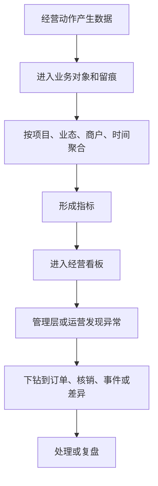
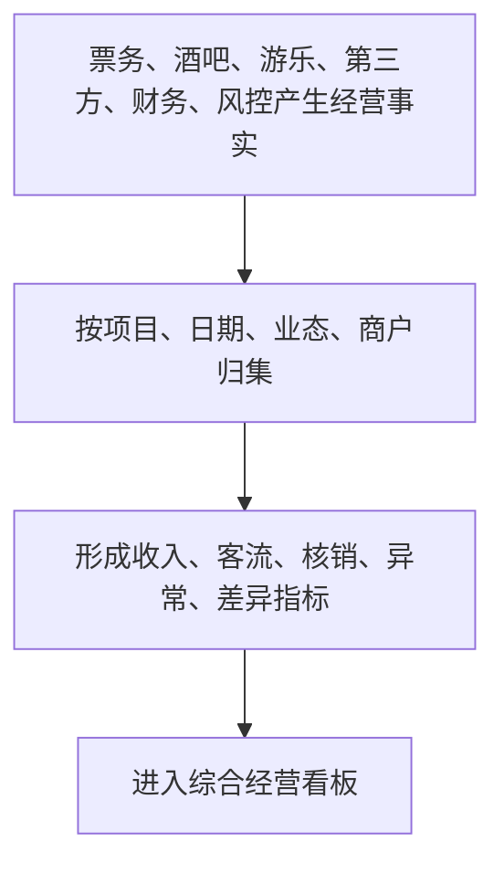
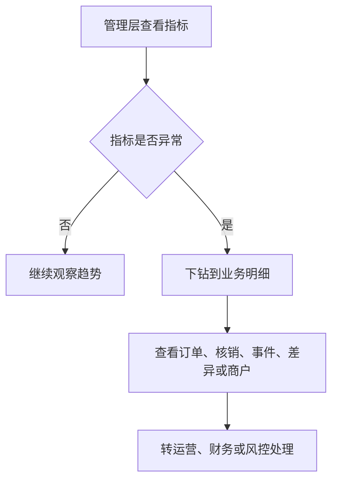
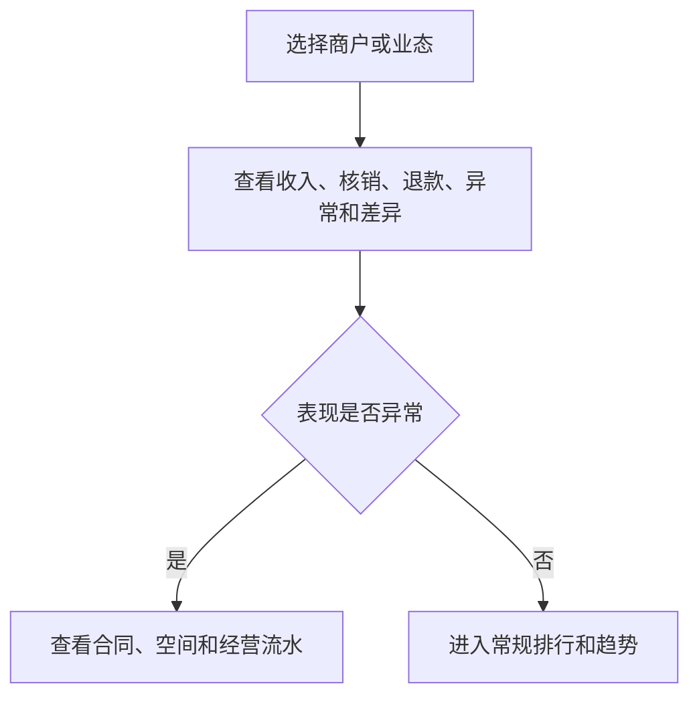
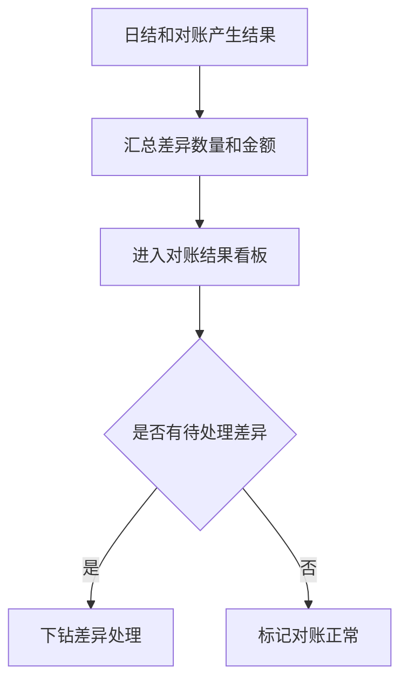

# 数据分析层产品规格 V0.2

## 1. 文档定位

本文由归档前的同层 PRD/页面清单/字段字典/流程图/低保真说明/验收清单机械合并而来，作为该能力层后续开发、业务审计和验收的统一入口。原拆分文件已移入 `_archive/20260610-retention-audit/merged-layer-spec-sources/`，仅作历史追溯。

## 2. 合并来源

| 原文件 | 归档位置 |
|---|---|
| `data-analysis-layer-product-prd-v0.1.md` | `_archive/20260610-retention-audit/merged-layer-spec-sources/data-analysis-layer-product-prd-v0.1.md` |
| `data-analysis-layer-page-list-v0.1.md` | `_archive/20260610-retention-audit/merged-layer-spec-sources/data-analysis-layer-page-list-v0.1.md` |
| `data-analysis-layer-field-dictionary-v0.1.md` | `_archive/20260610-retention-audit/merged-layer-spec-sources/data-analysis-layer-field-dictionary-v0.1.md` |
| `data-analysis-layer-flow-diagrams-v0.1.md` | `_archive/20260610-retention-audit/merged-layer-spec-sources/data-analysis-layer-flow-diagrams-v0.1.md` |
| `data-analysis-layer-low-fi-prototype-v0.1.md` | `_archive/20260610-retention-audit/merged-layer-spec-sources/data-analysis-layer-low-fi-prototype-v0.1.md` |
| `data-analysis-layer-acceptance-checklist-v0.1.md` | `_archive/20260610-retention-audit/merged-layer-spec-sources/data-analysis-layer-acceptance-checklist-v0.1.md` |

> 历史来源不可覆盖声明：本文中的“来源”和合并来源内容仅保留审计证据和历史上下文，不得覆盖 `00-current-effective-document-entry-v0.1.md`、`unified-standards-baseline-v0.1.md`、`openapi/openapi-p0.yaml`、`p0-openapi-operation-acceptance-matrix-v0.1.md`、`p0-openapi-contract-closure-appendix-v0.1.md`、`p0-operation-permission-matrix-v0.1.md`、`p0-action-event-evidence-matrix-v0.1.md`、`p0-end-to-end-acceptance-and-edge-cases-v0.1.md` 和 `p0-user-story-map-and-sprint-slices-v0.1.md`。若历史段落与当前事实源冲突，以当前 S0/S1 文档为准。

## 2A. AI-ready 执行入口

本文是数据分析层产品规格入口，不直接定义正式接口、权限、事件或报表查询实现。任何数据分析 P0 开发任务必须先映射到 `openapi/openapi-p0.yaml/json`、`p0-openapi-operation-acceptance-matrix-v0.1.md` 和 `p0-openapi-contract-closure-appendix-v0.1.md`；未进入追溯附录的查询、导出、看板或风控说明不得生成 Controller、SDK/mock、接口自动化或验收通过结论。

---

## 3. 来源：数据分析层产品 PRD V0.1

> 原文件：`data-analysis-layer-product-prd-v0.1.md`

### 数据分析层产品 PRD V0.1

### 1. 文档定位

本文档按《综合体管理系统产品需求总纲 V0.1》的“数据分析层”拆解产品需求。数据分析层负责回答“经营结果和趋势怎么看”，包括经营看板、客流、核销、收入、供应链库存、异常、商户表现和对账结果。

本文档不做算法设计，不写数据处理方案，不写报表实现。P0 聚焦管理层和运营能看懂、能判断、能追问的基础经营分析。

### 2. P0 目标

P0 数据分析层目标：
- 提供综合体经营总览。
- 能按项目、业态、商户、时间、空间查看经营结果。
- 能看收入、客流、核销、退款、异常、差异等核心指标。
- 能比较票务、酒吧、游乐、第三方回流之间的经营表现。
- 能查看供应链采购、库存余额、吧台消耗、盘点差异、报损、客人存酒、物品追踪码和交接异常。
- 能查看订单来源、销售归属、卡座服务责任、异常第一处理人和异常首响时效。
- 能查看会员积分、会员等级、积分兑换和第三方售票渠道表现。
- 能从看板下钻到订单、券核销、事件、差异和商户详情。
- 餐饮/零售第三方数据按订单级和券核销级承接，并支持日、半日、小时汇总；单店小数据量场景支持实时汇总。

### 3. 角色

| 角色 | 关注重点 |
|---|---|
| 管理层 | 总收入、客流、业务趋势、风险和商户表现 |
| 平台运营 | 今日运行状态、核销、异常、第三方回流 |
| 财务 | 对账差异、退款、结算依据、收入口径 |
| 招商/商户管理 | 商户表现、业态表现、合同关联经营结果 |
| 票务运营 | 售票、权益、核销率、退款异常 |
| 酒吧运营 | 入场、开台、账单、赠饮、收入 |
| 采购/库管 | 采购周期、库存余额、吧台消耗、盘点差异、报损、客人存酒 |
| 游乐运营 | 项目开放、场次容量、核销、异常 |
| 会员运营 | 积分发放、等级成长、兑换结果、会员消费 |

### 4. P0 指标体系

| 指标组 | 指标 | 用途 |
|---|---|---|
| 收入 | 售票收入、酒吧收入、第三方回流收入、退款金额、净收入 | 看经营结果 |
| 客流 | 入场人数、酒吧入场、游乐核销人数、渠道客流 | 看人流变化 |
| 核销 | 权益发放数、核销数、核销率、拒绝数、人工放行数 | 看权益使用 |
| 酒吧 | 开台数、关台数、桌台利用、赠饮核销、账单调整 | 看酒吧经营 |
| 酒吧点酒 | 点酒订单数、最低消费达成率、扫码支付成功率、卡座消费 | 看平板点酒经营 |
| 销售服务 | 销售归属率、卡座服务责任完整率、送达确认率、服务责任变更次数、异常首响时长 | 看销售和现场服务责任链 |
| 供应链库存 | 采购申请数、到货及时率、库存余额、缺货预警、吧台消耗、盘点差异、报损金额、存酒余额、存酒到期、交接缺失、交接超时 | 看采购、库房、损耗、客人存酒和履约责任链 |
| 游乐 | 开放项目数、场次数、容量利用率、暂停次数、巡检异常 | 看项目运营 |
| 会员 | 新增会员、积分发放、积分消耗、兑换数量、会员等级分布 | 看会员运营 |
| 商户 | 商户收入、核销、退款、异常、差异 | 看商户表现 |
| 第三方 | 美团/大众点评/抖音等渠道订单、回流成功率、异常回流、差异数量、延迟数量 | 看外部接入质量 |
| 企业微信 | 每日上传状态、会话量、违规命中、投诉倾向、服务质量 | 看员工服务与沟通风险 |
| 设备管控 | 非预装软件、非白名单网站访问、设备锁定、策略违规 | 看工作手机使用风险 |
| 风险 | 待复核、异常事件、高风险命中、补录数量 | 看风险 |
| 财务 | 日结状态、对账差异、结算待确认 | 看财务确认 |

### 5. 数据来源产品口径

| 来源 | 提供内容 |
|---|---|
| 平台治理层 | 项目、空间、业态、商户、合同、员工、设备 |
| 业务经营层 | 票务、权益、订单、核销、会员积分、酒吧点酒、酒吧账单、供应链库存、采购周期、吧台消耗、客人存酒、游乐场次 |
| 第三方接入层 | 餐饮零售订单级回流、券核销级回流、日/半日/小时/实时汇总、机器人任务、视频证据、企业微信每日会话上传 |
| 设备管控层 | 工作手机应用白名单、网站白名单、设备策略违规 |
| 证据风控层 | 事件、补录、复核、风险提示 |
| 财务经营 | 流水、日结、差异、结算依据 |

### 6. 页面范围

| 页面 | P0 作用 |
|---|---|
| 综合经营看板 | 管理层第一入口，看整体经营和异常 |
| 收入分析 | 看收入、退款、净收入和渠道贡献 |
| 客流分析 | 看入场、核销和空间/业态客流 |
| 核销分析 | 看权益发放、使用、拒绝和人工放行 |
| 票务分析 | 看票种、渠道、策略和退款表现 |
| 会员积分分析 | 看积分发放、积分消耗、兑换、等级和会员消费表现 |
| 酒吧分析 | 看入场、开台、收入、赠饮、账单异常 |
| 酒吧点酒分析 | 看卡座消费、最低消费达成、平板点酒和支付成功率 |
| 销售服务分析 | 看订单来源、销售人员、卡座服务、送达确认和异常首响 |
| 供应链库存分析 | 看供应商、供应合同、采购周期、库存余额、吧台消耗、盘点差异、报损和客人存酒 |
| 企业微信质检 | 看会话上传状态、基础违规命中、投诉倾向和复核状态 |
| 工作手机管控 | 看非预装软件、非白名单网站访问和设备策略违规 |
| 游乐分析 | 看项目、场次、容量、核销、暂停和巡检 |
| 商户表现 | 看商户经营、异常和对账差异 |
| 异常风险看板 | 看风险事件、补录、复核和趋势 |
| 对账结果看板 | 看日结、差异、结算确认情况 |

> 2026-06-12 收口口径：本章保留供应链库存分析、销售服务分析等产品方向，但 P0 可编码范围以 `openapi/openapi-p0.yaml`、`p0-implementation-task-list.md` 和 `data-risk-ai-development-design.md` 为准。P0 只要求经营总览摘要、风险预警只读和必要下钻线索；供应链库存、销售服务、商户经营等独立专题页/API、复杂报表导出和完整处理动作进入 P1。本章所有金额相关展示单位为分（整数，D1）。

### 7. P0 业务流程

### 8. P0 验收标准

- 综合经营看板能看收入、客流、核销、异常、待办。
- 所有指标能按项目、业态、商户、日期筛选。
- 看板指标能下钻到业务明细。
- 异常风险和对账差异不能只显示数字，P0 至少能进入只读明细或复核入口；完整处理页面进入 P1。
- 票务、酒吧、供应链、游乐四条主线 P0 先进入经营总览摘要；独立分析视图进入 P1。
- 会员积分、等级和兑换 P0 先在积分摘要/票务摘要中体现；独立会员积分分析进入 P1。
- 第三方售票渠道能区分美团、大众点评、抖音等来源。
- 餐饮/零售第三方看板下钻到订单级和券核销级进入 P1；P0 只保留第三方同步健康和风险摘要。
- 酒吧点酒能查看最低消费达成和支付结果。
- 销售服务分析进入 P1；P0 只在经营总览中展示销售归属和服务责任摘要指标。
- 供应链库存分析进入 P1；P0 只在经营总览中展示库存风险、报损和盘点差异摘要。
- 企业微信质检能查看每日上传状态、基础违规命中和复核状态。
- 企业微信工作会话留存期限可配置（非永久），到期归档/销毁/匿名化（按 A7/合规C3、data-risk §11.5）；不脱敏原文仅限最小授权 + 审批的取证/质检场景，普通展示按权限脱敏，查看原文必须写入审计。<!-- 修订说明（2026-06-08 三轮收口）：原"永久保存"与本层 page-list/low-fi/acceptance 及 data-risk §11.5 可配置留存口径打架，就地统一；2026-06-08 复核补充不脱敏原文的最小授权边界。依据 finding residual-scan-2、A7/C3 -->

- 商户侧在授权业务范围内可查看自己的分析看板，不看平台全局和其他商户。
- 工作手机管控能查看非预装软件、非白名单网站访问和设备违规。

### 9. P1/P2

| 阶段 | 能力 |
|---|---|
| P1 | 周报/月报、同比环比、商户排行、渠道分析、会员积分活动分析、安全库存预警、库存周转、容量效率、复核趋势、企业微信服务分析 |
| P2 | 经营预测、异常自动解释、AI 分析、企业微信深度语义质检、游客画像、智能建议 |

### 10. 已确认规则和后续细化事项

已确认：

1. 餐饮/零售第三方回流同时支持订单级和券核销级。
2. 数据看板支持日、半日、小时汇总；单店小数据量场景可实时汇总。
3. 美团、大众点评、抖音团购渠道需要独立区分来源。
4. 酒吧点酒看板 P0 展示最低消费达成率。
5. 供应链库存看板进入 P1；P0 仅在经营总览展示酒类、吧台消耗、客人存酒、常用消耗品、追踪码状态和交接异常的摘要/风险数。
6. 库存差异和报损按金额、数量、责任人、库房和证据状态展示。
7. 销售服务分析进入 P1；P0 仅在经营总览展示订单来源、销售归属率、卡座服务责任完整率、送达确认率和异常首响时长摘要。
8. 企业微信工作会话留存期限可配置（非永久），到期归档/销毁/匿名化（按 A7/合规C3、data-risk §11.5）；不脱敏原文仅限最小授权 + 审批的取证/质检场景，普通展示按权限脱敏。<!-- 修订说明（2026-06-08 三轮收口）：原"永久保存"为收口前固化规则，与 A7/C3 可配置留存相反，就地改正；2026-06-08 复核补充不脱敏原文的最小授权边界。依据 finding residual-scan-2、A7/C3 -->

9. 商户侧在授权业务范围内可查看自己的分析看板。
10. 管理层第一版看板按“收入、客流、核销”为第一屏，“商户表现、异常风险、结算差异”为第二屏。
11. P0 不单独承诺数据分析导出接口；CSV/Excel 日报导出和复杂报表排版进入 P1。
12. 游客/会员分析 P0 先打通游客识别和票务权益，会员分层分析进入 P1。
13. 会员积分看板 P0 归入票务分析，独立会员分析进入 P1。

后续细化：

无。后续仅根据真实经营数据和管理层偏好调整指标顺序。

### 11. 本版结论

数据分析层 P0 的核心是让经营事实变成可判断的管理视图。它不追求一开始智能化，但必须做到指标清晰、来源清楚、可下钻、能发现异常。

### 12. 变更日志

| 日期 | 类型 | 位置 | 内容 | 原因/依据 |
|---|---|---|---|---|
| 2026-06-07 | 改 | §4 | 销售服务指标组指标名统一为"卡座服务责任完整率" | tracewire-5 |
| 2026-06-07 | 增 | §6 | 历史补充供应链库存分析、销售服务分析页面对齐说明；金额单位为分（整数，D1） | analytics-3/D1 |
| 2026-06-12 | 改 | §6/§8/§10 | 按 D4 默认方案收口：P0 数据分析只要求经营总览摘要和风险预警只读；供应链库存、销售服务、商户经营等独立专题页/API、复杂导出和完整处理动作进入 P1 | 避免产品口径 P0 反向覆盖 OpenAPI 和 P0 任务清单 |
| 2026-06-08 三轮收口 | 改 | §8/§10 | 两处"企业微信工作会话永久保存"改为"留存期限可配置（非永久），到期归档/销毁/匿名化（按 A7/合规C3、data-risk §11.5）"，与本层 page-list/low-fi/acceptance 统一 | residual-scan-2、A7/C3 |

---

## 4. 来源：数据分析层页面清单 V0.1

> 原文件：`data-analysis-layer-page-list-v0.1.md`

### 数据分析层页面清单 V0.1

> 2026-06-12 收口说明：以下为历史页面池原文，用于保留产品规划线索；P0/P1 执行范围不得以本历史清单反向覆盖前文 §6/§8/§10、`data-risk-ai-development-design.md`、`p0-implementation-task-list.md` 和 OpenAPI。P0 仅承诺经营总览摘要、风险预警只读和必要下钻线索；独立专题页/API、复杂报表导出和完整处理动作进入 P1。

### 1. 文档定位

本历史清单曾用于定义数据分析层页面入口和页面职责；当前 P0/P1 以 2026-06-12 收口说明和 S1 文档为准。

### 2. 页面总览

> 修订说明（2026-06-07，依据 analytics-2/analytics-9/tracewire-3）：本清单此前缺 PRD 第6章已列的"会员积分分析、酒吧点酒分析、销售服务分析、企业微信质检、工作手机管控"五页，且第12节直接判"已闭环"。现以 PRD 第6章为基准补齐这五页的页面职责（见第3.x 各页），并在第13节补"已知缺口"，不在缺页时自评闭环。

| 页面 | P0 目的 |
|---|---|
| 综合经营看板 | 看整体经营结果和风险 |
| 收入分析 | 看收入、退款、净收入和渠道贡献 |
| 客流分析 | 看入场、核销、空间和业态客流 |
| 核销分析 | 看权益发放、使用、拒绝和人工放行 |
| 票务分析 | 看票种、渠道、策略和退款 |
| 会员积分分析 | 看积分发放、积分消耗、兑换、等级和会员消费表现 |
| 酒吧分析 | 看入场、桌台、账单、赠饮和异常 |
| 酒吧点酒分析 | 看卡座消费、最低消费达成、平板点酒和支付成功率 |
| 销售服务分析 | 看订单来源、销售归属、卡座服务责任、送达确认和异常首响 |
| 供应链库存分析 | 看供应商、供应合同、采购周期、库房、库存余额、吧台消耗、盘点差异、报损和客人存酒 |
| 企业微信质检 | 看会话上传状态、基础违规命中、投诉倾向和复核状态 |
| 工作手机管控 | 看非预装软件、非白名单网站访问和设备策略违规 |
| 游乐分析 | 看项目、场次、容量、核销和巡检 |
| 餐饮零售回流分析 | 看订单级、券核销级、退款、日汇总、半日汇总、小时汇总和单店实时汇总 |
| 商户表现 | 看商户收入、核销、异常和差异 |
| 异常风险看板 | 看事件、补录、复核、风险趋势 |
| 对账结果看板 | 看日结、差异和结算确认 |

### 3. 综合经营看板

| 项 | 内容 |
|---|---|
| 主要用户 | 管理层、运营主管 |
| 关键指标 | 今日收入、今日客流、核销数、退款金额、异常数、待复核数 |
| 关键操作 | 筛选、下钻、查看异常、进入日结 |
| 下钻 | 收入分析、核销记录、事件中心、差异处理 |

### 4. 收入分析

| 项 | 内容 |
|---|---|
| 关键指标 | 售票收入、酒吧收入、第三方收入、退款、净收入 |
| 维度 | 时间、业态、商户、渠道、空间 |
| 下钻 | 经营流水、订单、账单、退款记录 |

### 5. 客流分析

| 项 | 内容 |
|---|---|
| 关键指标 | 入场人数、酒吧入场、游乐核销人数、渠道客流 |
| 维度 | 日期、时段、空间、业态、项目 |
| 下钻 | 入场记录、核销记录 |

### 6. 核销分析

| 项 | 内容 |
|---|---|
| 关键指标 | 权益发放、核销数、核销率、拒绝数、人工放行 |
| 维度 | 权益类型、业务、点位、员工、渠道 |
| 下钻 | 权益台账、核销记录、事件中心 |

### 7. 业务专项分析

| 页面 | 关键指标 |
|---|---|
| 票务分析 | 票种销量、策略效果、渠道订单、退款率 |
| 酒吧分析 | 入场、开台、桌台利用、赠饮、收入、调整 |
| 供应链库存分析 | 采购到货、酒类/消耗品/其他物品库存、吧台消耗、盘点差异、报损、存酒余额 |
| 游乐分析 | 项目开放、场次数、容量利用、暂停、巡检异常 |
| 餐饮零售回流分析 | 订单级回流、券核销级回流、退款、日/半日/小时汇总、单店实时汇总 |

#### 7.1 会员积分分析（依据 analytics-2，PRD 第6章）

| 项 | 内容 |
|---|---|
| 主要用户 | 会员运营、管理层 |
| 关键指标 | 新增会员数、积分发放数、积分消耗数、兑换数量、会员等级分布、会员消费表现 |
| 维度 | 会员等级、时间、业态、商户 |
| 下钻 | 积分明细、兑换记录、会员消费订单 |
| 验收项 | 能查看积分发放/消耗/兑换/等级分布；能下钻到积分明细与兑换记录 |

#### 7.2 酒吧点酒分析（依据 analytics-2，PRD 第6章）

| 项 | 内容 |
|---|---|
| 主要用户 | 酒吧运营、管理层 |
| 关键指标 | 点酒订单数、最低消费达成率、客人扫码支付数、平板扫付款码支付数、卡座消费 |
| 维度 | 酒吧、卡座、支付方式、时段 |
| 下钻 | 点酒订单、账单、支付记录 |
| 验收项 | 能区分酒吧、卡座、支付方式与最低消费达成情况 |

#### 7.3 销售服务分析（依据 analytics-2/tracewire-2/tracewire-4/tracewire-5，PRD 第6章）

| 项 | 内容 |
|---|---|
| 主要用户 | 管理层、运营主管、风控 |
| 关键指标 | 销售归属率、卡座服务责任完整率、送达确认率（订单级）、服务责任变更次数、异常首响时长（均值与 P90） |
| 维度 | 销售人员、服务员、卡座、订单来源、时间 |
| 下钻 | 订单、卡座开台会话、服务责任记录、异常事件时间线 |
| 数据来源 | service_responsibility_records、bar_table_sessions、订单、异常事件 |
| 验收项 | 能查看订单来源、销售归属、卡座服务责任、服务送达确认和异常第一处理人；指标口径与 data-risk-ai §5.9 一致 |

#### 7.4 企业微信质检（依据 analytics-2/tracewire-3，PRD 第6章）

| 项 | 内容 |
|---|---|
| 主要用户 | 平台客服主管、风控、管理层 |
| 关键指标 | 会话上传成功率、会话量、违规命中数、投诉倾向数、服务质量分 |
| 维度 | 员工、商户、时间、违规类型 |
| 下钻 | 会话上传明细、违规命中记录、复核任务 |
| 合规要求 | 会话留存按可配置期限；不脱敏原文仅限最小授权 + 审批的取证/质检场景，普通展示按权限脱敏，查看写入审计（见 compliance §4、data-risk-ai §11.5） |
| 验收项 | 能查看每日上传状态、基础违规命中、投诉倾向和复核状态 |

#### 7.5 工作手机管控（依据 analytics-2/tracewire-3，PRD 第6章）

| 项 | 内容 |
|---|---|
| 主要用户 | 平台风控、设备管理、管理层 |
| 关键指标 | 私装命中数、非白名单访问数、设备锁定数、策略违规数 |
| 维度 | 员工、设备、终端类型（staff_work_phone，D5）、时间 |
| 下钻 | 策略违规记录、设备锁定事件、设备绑定凭证 |
| 验收项 | 能查看非预装软件、非白名单网站访问和设备策略违规；设备身份以设备指纹/Keystore 凭证为准（D8） |

### 8. 商户表现

| 项 | 内容 |
|---|---|
| 关键指标 | 商户收入、订单、核销、退款、异常、差异 |
| 维度 | 商户、业态、合同、空间、时间 |
| 下钻 | 商户档案、经营流水、对账差异 |

### 9. 异常风险看板

| 项 | 内容 |
|---|---|
| 关键指标 | 待复核、补录、风险命中、高风险事件、关闭率 |
| 维度 | 业务、风险类型、责任人、时间 |
| 下钻 | 事件中心、复核队列、风险提示 |

### 10. 对账结果看板

| 项 | 内容 |
|---|---|
| 关键指标 | 日结状态、差异数量、差异金额、待确认结算 |
| 维度 | 商户、渠道、第三方、日期 |
| 下钻 | 日结管理、差异处理、结算依据 |

### 11. 页面验收标准

- 页面必须能按项目、业态、商户、日期筛选。
- 指标必须可下钻到来源页面。
- 票务、酒吧、供应链、游乐必须有专项分析。
- 餐饮/零售第三方数据必须支持订单级和券核销级下钻，并支持日、半日、小时和单店实时汇总。
- 异常和差异必须能进入处理页面。
- 会员积分分析、酒吧点酒分析、销售服务分析、企业微信质检、工作手机管控五页必须有独立入口与职责，且与 PRD 第6章一致。
- 销售服务分析的指标口径必须与 data-risk-ai §5.9 一字一致（卡座服务责任完整率、送达确认率按订单级）。

### 12. 本版结论

数据分析层页面清单已覆盖 PRD 第6章 P0 管理视图和运营追问路径，并补齐会员积分分析、酒吧点酒分析、销售服务分析、企业微信质检、工作手机管控五页职责与验收项。

### 13. 实施依赖与后续关注（依据 analytics-9）

> 修订说明（2026-06-07）：原结论在缺页情况下直接判"已闭环"。现据 analytics-9 改为先列已知缺口，不在依赖项未落地时自评闭环。

| 关注项 | 说明 | 依赖/出处 |
|---|---|---|
| 会员积分分析数据源 | 已在 foundation §6B.5.2 points_ledger / §6B.5.5 point_redemptions 建模，待 Java 后端落库/OpenAPI | foundation §6B.5.2/§6B.5.5 |
| 销售服务分析来源表 | 服务责任链和财务责任段口径已补齐，待 Java 后端落库/OpenAPI 后完整下钻 | trace-7、operation-traceability、foundation §6.12 |
| 企业微信质检合规 | 会话留存期限与查看授权须按 compliance §4（C3）落地后方可上线 | C3 |

### 14. 变更日志

| 日期 | 类型 | 位置 | 内容 | 原因/依据 |
|---|---|---|---|---|
| 2026-06-07 | 增 | §2、§7.1-7.5 | 补会员积分分析、酒吧点酒分析、销售服务分析、企业微信质检、工作手机管控五页及其职责/验收项 | analytics-2/analytics-9/tracewire-3，以 PRD 第6章为基准 |
| 2026-06-07 | 改 | §11/§12 | 补五页验收项与销售服务指标口径对齐要求 | analytics-2 |
| 2026-06-07 | 增 | §13 | 新增"已知缺口"，不在缺页/依赖未落地时自评已闭环 | analytics-9 |
| 2026-06-08 | 改 | §13 | 将已建模的数据源项从"页面清单缺口"调整为"实施依赖与后续关注" | 对齐产品流复核和地基/留痕建模结果 |

---

## 5. 来源：数据分析层字段与指标字典 V0.1

> 原文件：`data-analysis-layer-field-dictionary-v0.1.md`

### 数据分析层字段与指标字典 V0.1

### 1. 文档定位

本文档定义数据分析层 P0 指标、维度和筛选字段。它是产品口径，不是统计实现方案。

### 2. 通用维度

| 维度 | 含义 | 用途 |
|---|---|---|
| 项目 | 综合体项目 | 全局归属 |
| 日期 | 经营日期 | 趋势和日结 |
| 时段 | 小时、半日、班次或实时窗口 | 客流峰值和第三方回流汇总 |
| 业态 | 票务、酒吧、游乐、餐饮、零售 | 分类 |
| 商户 | 经营主体 | 商户表现和结算 |
| 空间/点位 | 经营发生位置 | 空间分析 |
| 库房/库位 | 库存发生或存放位置 | 供应链库存分析 |
| 渠道 | 售票或订单来源 | 渠道分析 |
| 员工 | 现场责任人 | 作业和风险分析 |
| 会员等级 | 当前会员等级 | 会员分析 |
| 支付方式 | 客人扫码、平板扫付款码、第三方支付等 | 支付分析 |

### 3. 收入指标

| 指标 | 含义 | 业务来源 |
|---|---|---|
| 售票收入 | 已支付票务订单金额 | 票务订单 |
| 酒吧收入 | 酒吧已结账金额 | 酒吧账单 |
| 酒吧点酒收入 | 平板点酒形成的已支付酒水订单金额 | 酒吧点酒订单 |
| 第三方收入 | 第三方回流经营金额 | 第三方回流 |
| 退款金额 | 已退款金额 | 订单/账单/第三方退款 |
| 净收入 | 收入减退款 | 财务经营 |
| 调整金额 | 免单、抹零、调账等金额 | 酒吧/财务/风控 |

### 4. 客流指标

| 指标 | 含义 | 业务来源 |
|---|---|---|
| 入场人数 | 综合体或业务入口入场数量 | 入场/核销 |
| 酒吧入场人数 | 酒吧入场记录人数 | 酒吧入场 |
| 游乐核销人数 | 游乐项目核销放行人数 | 游乐核销 |
| 渠道客流 | 不同售票渠道带来的客流 | 票务渠道 |
| 高峰时段 | 客流最高的时间段 | 入场和核销记录 |

### 5. 核销指标

| 指标 | 含义 | 业务来源 |
|---|---|---|
| 权益发放数 | 已生成权益数量 | 权益台账 |
| 权益核销数 | 已成功核销数量 | 核销记录 |
| 核销率 | 已核销权益数 / 已发放权益数 | 权益和核销 |
| 拒绝数 | 被拒绝核销数量 | 核销记录 |
| 人工放行数 | 人工确认放行数量 | 核销和风控 |
| 撤销数 | 已撤销核销数量 | 核销记录 |

> 修订说明（2026-06-07，依据 analytics-4）：核销率分母统一为"已发放权益数"（原"可用权益数"口径不明），即**核销率 = 已核销权益数 / 已发放权益数**。它与第6节票务"权益使用率"（已核销权益实例 / 已发放权益实例）是同口径两命名：分母都用"已发放/已生成"而非"已售"；核销率用于全口径，权益使用率用于按权益类型下钻。

### 6. 业务专项指标

| 业务 | 指标 |
|---|---|
| 票务 | 票种销量、策略销量、官方渠道销量、第三方渠道销量、退款率、权益生成失败数 |
| 会员 | 新增会员数、积分发放数、积分消耗数、积分兑换数、会员等级分布 |
| 酒吧 | 开台数、关台数、桌台利用率、赠饮核销数、账单调整数 |
| 酒吧点酒 | 点酒订单数、最低消费达成率、客人扫码支付数、平板扫付款码支付数 |
| 供应链库存 | 采购申请数、到货及时率、酒类库存、消耗品库存、其他物品库存、吧台消耗、盘点差异、报损数量、报损金额、客人存酒余额、存酒到期数 |
| 游乐 | 开放项目数、场次数、容量利用率、暂停次数、巡检异常数 |
| 第三方 | 美团/大众点评/抖音团购订单数、餐饮/零售订单级回流数、券核销级回流数、日/半日/小时/实时汇总数、回流成功率、异常回流数、差异数、延迟数 |
| 企业微信质检 | 会话上传成功率、会话量、违规命中数、投诉倾向数、服务质量分 |
| 设备管控 | 私装命中数、非白名单访问数、设备锁定数、策略违规数 |

> 修订说明（2026-06-07，依据 analytics-6）：补企业微信质检与工作手机设备管控两组业务专项指标，使 PRD 第6章"企业微信质检""工作手机管控"页有对应字段口径。企微质检指标来源 wecom_conversations/wecom_risk_hits/ai_quality_results；设备管控指标来源 device_policy_violations/device_lock_events/staff_device_credentials（设备身份以设备指纹/Keystore 凭证为准，D8）。详细口径见 data-risk-ai §5.10/§5.11。

#### 6.1 销售服务责任链指标

> 修订说明（2026-06-07，依据 analytics-1/analytics-7/tracewire-2/tracewire-4/tracewire-5/trace-5）：用户明确要求的销售与现场服务责任链分析指标此前在本字典缺失。本组给出明确口径与来源表，与 data-risk-ai §5.9 保持一字一致。指标名统一为"卡座服务责任完整率"（tracewire-5）；送达确认率按订单级口径（tracewire-4）。

| 指标 | 口径 | 来源表 |
|---|---|---|
| 销售归属率 | 有 sales_staff_id 的应归属订单 / 应归属订单总数（应归属订单=销售工作台/订台等业务要求登记销售归属的订单） | service_responsibility_records（销售归属段）+ 订单 |
| 卡座服务责任完整率 | 有主责服务员的开台会话 / 开台会话总数 | bar_table_sessions + service_responsibility_records |
| 送达确认率 | 有 bar.order_delivered 事件的应送达点单 / 应送达点单总数（订单级口径，每订单只计一次） | 订单（酒吧点单）+ 异常/事件中心（bar.order_delivered） |
| 异常首响时长 | exception.first_handled.occurred_at − exception.reported.occurred_at，输出均值与 P90 | 异常事件（exception.reported / exception.first_handled） |
| 服务责任变更次数 | 同一卡座/会话主责服务员变更次数累计 | service_responsibility_records + 事件（table.service_changed） |

来源表统一说明：销售归属与服务责任主来源为 `service_responsibility_records`；开台会话来源为 `bar_table_sessions`；应归属/应送达订单范围来源为各域订单表；异常首响两个时间戳来源为异常事件（audit_events 中 exception 类标准事件）。

### 7. 风险和财务指标

| 指标 | 含义 |
|---|---|
| 待复核数 | 尚未处理的复核任务 |
| 补录数 | 人工补录数量 |
| 高风险事件数 | 高(high)及以上风险事件数量，即 high+critical 合计；并单列严重(critical)事件数 |
| 严重事件数 | 严重(critical)等级事件数量，单列以便优先处置 |
| 差异数量 | 对账差异条数 |
| 差异金额 | 涉及金额差异（单位：分，整数） |
| 日结确认率 | 已确认日结 / 应确认日结 |
| 结算待确认数 | 待确认结算依据数量 |
| 库存差异数 | 盘点或系统记录产生的库存差异数量 |
| 报损金额 | 报损物品对应的成本或估算金额（单位：分，整数） |
| 存酒到期数 | 即将到期或已到期的客人存酒数量 |

> 修订说明（2026-06-07，依据 analytics-8/D6/D1）：(1) 风险等级统一中英映射为低=notice、中=suspicious、高=high、严重=critical；"高风险事件数"明确为 high+critical 合计（"高及以上"），并单列"严重事件数"(critical)，避免漏算最严重事件，与 data-risk-ai §10.2 一致。(2) 所有金额类指标（差异金额、报损金额，以及第3节收入指标、调整金额等）单位一律为分（整数，bigint），禁用元，依 D1。

### 8. 指标状态

| 状态 | 含义 |
|---|---|
| 正常 | 指标在预期范围 |
| 关注 | 指标有波动或异常迹象 |
| 异常 | 指标明显异常，需要处理 |
| 待确认 | 指标依赖日结或差异确认 |

### 9. 字段验收标准

- 每个指标必须有业务来源。
- 每个指标至少支持项目和日期筛选。
- 核销、收入、异常、差异必须可下钻。
- 商户表现必须能绑定商户和合同。
- 会员积分指标必须能下钻到积分明细和兑换记录。
- 酒吧点酒指标必须能区分酒吧、卡座、支付方式和最低消费达成情况。
- 供应链库存指标必须能区分供应商、供应合同、采购周期、库房、酒类、消耗品、其他物品、吧台消耗和客人存酒。
- 餐饮/零售第三方指标必须能区分订单级、券核销级、日汇总、半日汇总、小时汇总和单店实时汇总。
- 销售服务责任链指标必须能区分销售归属率、卡座服务责任完整率、送达确认率（订单级）、异常首响时长（均值与 P90）和服务责任变更次数，并能下钻到 service_responsibility_records、bar_table_sessions、订单和异常事件。
- 企业微信质检指标必须能查看会话上传成功率、会话量、违规命中、投诉倾向和服务质量分。
- 设备管控指标必须能查看私装命中、非白名单访问、设备锁定和策略违规。
- 高风险事件数必须按"high+critical 合计"口径统计，并单列严重(critical)事件数。
- 所有金额类指标单位一律为分（整数），与 D1 一致。

### 10. 本版结论

数据分析层字段和指标字典已覆盖 P0 经营判断需要，并补充会员积分、第三方售票渠道、酒吧平板点酒、供应链库存、销售服务责任链、企业微信质检和设备管控指标。

### 11. 变更日志

| 日期 | 类型 | 位置 | 内容 | 原因/依据 |
|---|---|---|---|---|
| 2026-06-07 | 改 | §5 | 核销率分母统一为"已发放权益数"，并说明与"权益使用率"为同口径两命名 | analytics-4 |
| 2026-06-07 | 增 | §6.1 | 新增"销售服务责任链指标"组（销售归属率/卡座服务责任完整率/送达确认率/异常首响时长/服务责任变更次数）及来源表 | analytics-1/analytics-7/tracewire-2/tracewire-4/tracewire-5/trace-5 |
| 2026-06-07 | 增 | §6 | 补企业微信质检、设备管控两组业务专项指标 | analytics-6 |
| 2026-06-07 | 改 | §7 | "高风险事件数"明确为 high+critical 合计并单列 critical；金额指标标注单位为分 | analytics-8/D6/D1 |
| 2026-06-07 | 增 | §9 | 补销售服务/企微/设备管控/高风险口径/金额单位验收项 | analytics-1/6/8、D1 |

---

## 6. 来源：数据分析层关键流程图 V0.1

> 原文件：`data-analysis-layer-flow-diagrams-v0.1.md`

### 数据分析层关键流程图 V0.1

### 1. 文档定位

本文档描述数据分析层 P0 流程：数据来源如何进入指标、指标如何进入看板、看板如何下钻和处理。

### 2. F1 经营数据形成指标

### 3. F2 看板下钻

### 4. F3 商户表现分析

### 5. F4 对账结果分析

### 6. 流程验收标准

- 指标必须能追溯到业务来源。
- 看板发现异常必须能下钻。
- 对账差异必须能进入处理页面。
- 商户表现必须能关联合同和经营流水。

### 7. 销售服务责任链指标取数说明（依据 trace-5/tracewire-2）

> 修订说明（2026-06-07）：销售服务分析的责任链指标（销售归属率、卡座服务责任完整率、送达确认率、异常首响时长）走 F1 的"经营事实→归集→指标"通用路径，但其事实来源为责任链留痕：service_responsibility_records、bar_table_sessions、各域订单、异常事件（exception.reported/first_handled）。口径与 data-risk-ai §5.9、字段字典 §6.1 一字一致；送达确认率按订单级口径（每应送达点单只计一次）。

### 8. 本版结论

数据分析层流程已覆盖 P0 从经营事实到管理判断的路径，并明确销售服务责任链指标的事实来源与口径。

### 9. 变更日志

| 日期 | 类型 | 位置 | 内容 | 原因/依据 |
|---|---|---|---|---|
| 2026-06-07 | 增 | §7 | 新增销售服务责任链指标取数说明，明确事实来源表与订单级送达口径 | trace-5/tracewire-2/tracewire-4 |

---

## 7. 来源：数据分析层低保真原型说明 V0.1

> 原文件：`data-analysis-layer-low-fi-prototype-v0.1.md`

### 数据分析层低保真原型说明 V0.1

### 1. 文档定位

本文档说明数据分析层页面低保真结构，不定义视觉样式。

### 2. 信息架构

> 修订说明（2026-06-07，依据 analytics-2/analytics-9/tracewire-3）：二级入口此前缺 PRD 第6章已列的会员积分、酒吧点酒、销售服务、企业微信质检、工作手机管控五页。现补入，并在第4.x 补对应低保真结构。

| 一级入口 | 二级入口 |
|---|---|
| 数据分析 | 综合经营看板、收入、客流、核销、票务、会员积分、酒吧、酒吧点酒、销售服务、供应链库存、企业微信质检、工作手机管控、游乐、商户、异常风险、对账结果 |

### 3. 综合经营看板低保真

首屏区块：
- 今日收入、客流、核销、退款、异常、待复核。
- 业务卡片：票务、酒吧、游乐、第三方。
- 趋势区：收入趋势、客流趋势。
- 待办区：异常、差异、复核。

交互：
- 点击指标下钻到对应明细。
- 点击业务卡片进入专项分析。
- 点击异常进入事件中心。

### 4. 专项分析页低保真

通用结构：
- 顶部筛选：项目、日期、业态、商户、空间、渠道。
- 指标卡片。
- 趋势区。
- 明细排行。
- 下钻入口。

适用页面：
- 收入分析。
- 客流分析。
- 核销分析。
- 票务分析。
- 会员积分分析。
- 酒吧分析。
- 酒吧点酒分析。
- 供应链库存分析。
- 游乐分析。
- 餐饮零售回流分析。

#### 4.1 销售服务分析低保真（依据 analytics-2/tracewire-2）

结构：
- 顶部筛选：项目、日期、销售人员、服务员、卡座、订单来源。
- 指标卡片：销售归属率、卡座服务责任完整率、送达确认率、服务责任变更次数、异常首响时长（均值/P90）。
- 责任链明细：订单来源、销售归属、主责/协助服务员、送达确认、异常第一处理人。
- 下钻：订单、卡座开台会话、服务责任记录、异常事件时间线。

#### 4.2 企业微信质检低保真（依据 analytics-2/tracewire-3）

结构：
- 顶部筛选：员工、商户、日期、违规类型。
- 指标卡片：会话上传成功率、会话量、违规命中数、投诉倾向数、服务质量分。
- 上传状态区：每日上传成功/失败与失败原因。
- 违规命中列表：命中规则、关联会话、复核状态。
- 下钻：不脱敏原文仅限最小授权 + 审批的取证/质检场景，普通展示按权限脱敏，查看写入审计（合规见 compliance §4）。

#### 4.3 工作手机管控低保真（依据 analytics-2/tracewire-3）

结构：
- 顶部筛选：员工、设备、终端类型（staff_work_phone）、日期。
- 指标卡片：私装命中数、非白名单访问数、设备锁定数、策略违规数。
- 违规列表：违规类型、设备、员工、处理状态。
- 下钻：策略违规记录、设备锁定事件、设备绑定凭证（设备身份=设备指纹/Keystore，D8）。

### 5. 商户表现低保真

结构：
- 商户筛选。
- 商户排行。
- 商户详情：收入、核销、退款、异常、差异。
- 合同和空间摘要。

### 6. 异常风险看板低保真

结构：
- 风险指标。
- 风险趋势。
- 高风险事件列表。
- 待复核列表。
- 下钻事件详情。

### 7. 对账结果看板低保真

结构：
- 日结确认状态。
- 差异数量和金额。
- 差异类型分布。
- 待处理差异列表。
- 结算待确认列表。

### 8. 验收标准

- 首屏能回答今天经营好不好。
- 每个指标有筛选和下钻。
- 业务专项页面结构一致。
- 异常和对账结果能进入处理页面。
- 销售服务分析、企业微信质检、工作手机管控三页有独立低保真结构，且与 PRD 第6章、page-list §7.3-7.5 一致。

### 9. 本版结论

数据分析层低保真已覆盖 P0 管理看板和专项分析入口，并补齐会员积分、酒吧点酒、销售服务、企业微信质检、工作手机管控五页低保真结构。

### 10. 变更日志

| 日期 | 类型 | 位置 | 内容 | 原因/依据 |
|---|---|---|---|---|
| 2026-06-07 | 增 | §2 | 信息架构二级入口补会员积分、酒吧点酒、销售服务、企业微信质检、工作手机管控五页 | analytics-2/analytics-9/tracewire-3 |
| 2026-06-07 | 增 | §4/§4.1-4.3 | 补销售服务分析、企业微信质检、工作手机管控低保真结构，专项页适用列表补齐 | analytics-2/tracewire-2/tracewire-3 |
| 2026-06-07 | 改 | §8 | 补三页低保真一致性验收项 | analytics-2 |

---

## 8. 来源：数据分析层产品验收清单 V0.1

> 历史来源不可覆盖声明：本节及其后续来源内容仅保留审计证据和历史上下文，不作为当前开发、测试、验收或供应商联调的执行事实源。若本节与 `00-current-effective-document-entry-v0.1.md`、`unified-standards-baseline-v0.1.md`、`openapi/openapi-p0.yaml`、`p0-openapi-operation-acceptance-matrix-v0.1.md` 或本文当前执行章节冲突，以当前 S0/S1 事实源和本文前文执行口径为准。
>
> 原文件：`data-analysis-layer-acceptance-checklist-v0.1.md`

### 数据分析层产品验收清单 V0.1

### 1. 文档定位

本文档用于验收数据分析层产品文档是否完整。

### 2. 文档完整度

| 文档 | 状态 |
|---|---|
| `data-analysis-layer-product-prd-v0.1.md` | 已完成 |
| `data-analysis-layer-page-list-v0.1.md` | 已完成 |
| `data-analysis-layer-field-dictionary-v0.1.md` | 已完成 |
| `data-analysis-layer-flow-diagrams-v0.1.md` | 已完成 |
| `data-analysis-layer-low-fi-prototype-v0.1.md` | 已完成 |

### 3. 指标覆盖验收

> 修订说明（2026-06-07，依据 analytics-2/analytics-9/tracewire-3）：本表此前缺 PRD 第6章已列的会员积分、酒吧点酒、销售服务责任链、企业微信质检、设备管控五个指标域，且全判"通过"。现补齐这五个域并据实标注；依赖底层数据源未落地的下钻能力标"待依赖"，不在缺页/缺源时虚判通过。

| 指标域 | 结果 |
|---|---|
| 收入 | 通过 |
| 客流 | 通过 |
| 核销 | 通过 |
| 票务 | 通过 |
| 酒吧 | 通过 |
| 酒吧点酒 | 通过 |
| 销售服务责任链 | 通过（口径与 data-risk-ai §5.9 一致；退款人/免单人下钻待 trace-7 落地） |
| 会员积分 | 通过（指标口径已定；积分明细/兑换记录底层表已在 foundation §6B.5.2 points_ledger / §6B.5.5 point_redemptions 建模，下钻数据源已具备，待 Java 后端落库/OpenAPI）<!-- 修订说明（2026-06-08 三轮收口）：原"积分明细/兑换记录底层表未建模"与已落地的 §6B.5.2/§6B.5.5 矛盾，措辞滞后，就地更正。依据 finding newtable-fk-3 --> |
| 企业微信质检 | 通过（合规留存须按 compliance §4 C3 落地后上线） |
| 设备管控 | 通过 |
| 游乐 | 通过 |
| 商户表现 | 通过 |
| 第三方回流 | 通过 |
| 异常风险 | 通过 |
| 对账结果 | 通过 |

### 4. 页面验收

- 综合经营看板已覆盖。
- 收入、客流、核销已覆盖。
- 票务、酒吧、游乐专项分析已覆盖。
- 会员积分分析、酒吧点酒分析、销售服务分析、企业微信质检、工作手机管控五页已覆盖（页面职责见 page-list §7.1-7.5，对应 PRD 第6章）。
- 销售服务分析必须能查看销售归属率、卡座服务责任完整率、送达确认率（订单级）、服务责任变更次数与异常首响时长（均值与 P90）。
- 企业微信质检必须能查看会话上传成功率、违规命中、投诉倾向、服务质量分；不脱敏原文仅限最小授权 + 审批的取证/质检场景，普通展示按权限脱敏，查看写入审计。
- 工作手机管控必须能查看私装命中、非白名单访问、设备锁定与策略违规。
- 商户表现已覆盖。
- 异常风险和对账结果已覆盖。
- 高风险事件数按 high+critical 合计口径，并单列严重(critical)（D6）。
- 指标支持下钻到业务明细。

### 5. 已确认验收口径

1. 管理层首屏指标优先级：第一屏收入、客流、核销；第二屏商户表现、供应链库存、异常风险、结算差异和应收应付逾期。
2. 旧导出口径已被当前执行口径覆盖；P0 不单独承诺数据分析导出接口，CSV/Excel 日报导出和复杂排版报表进入 P1。
3. 数据刷新频率：P0 接口查询/手动刷新 + 短周期缓存；实时推送进入 P1/P2。
4. 商户侧在授权业务范围内开放自己的分析看板，不看平台全局和其他商户。

### 6. 实施依赖与后续关注（依据 analytics-9）

> 修订说明（2026-06-07）：原结论在依赖项未落地时直接判"已闭环"。现据 analytics-9 先列已知缺口，缺口闭合前不判全量闭环。
>
> 修订说明（2026-06-08 产品流复核）：会员积分明细、兑换记录和服务责任链关键数据源已在地基/留痕文档建模；本节从"产品文档缺口"调整为"实施依赖与后续关注"。数据分析层 P0 产品文档可判闭环，Java 后端落库/OpenAPI 与企业微信合规配置仍是实施前置。

| 关注项 | 状态 | 依赖/出处 |
|---|---|---|
| 会员积分明细/兑换记录数据源 | 已在 foundation §6B.5.2 points_ledger / §6B.5.5 point_redemptions 建模（待 Java 后端落库/OpenAPI）<!-- 修订说明（2026-06-08 三轮收口）：底层表已落地，原"未建模"措辞滞后，就地更正。依据 finding newtable-fk-3 --> | foundation §6B.5.2/§6B.5.5 |
| 退款人/免单人服务责任下钻 | 已在服务责任链/财务责任字段口径补齐，待 Java 后端落库/OpenAPI | trace-7、operation-traceability、foundation §6.12 |
| 企业微信会话留存合规 | 留存期限与查看授权须按 compliance §4（C3）落地后上线 | C3 |

### 7. 本版结论

数据分析层 P0 产品文档已闭环（综合看板、收入、客流、核销、票务、酒吧、酒吧点酒、销售服务、企微质检、设备管控、游乐、商户、第三方、异常、对账均覆盖）。第6节为实施依赖和后续关注，不再作为产品文档缺口；可同步进入后续看板交互设计或实现任务拆解。

### 8. 变更日志

| 日期 | 类型 | 位置 | 内容 | 原因/依据 |
|---|---|---|---|---|
| 2026-06-07 | 增 | §3/§4 | 补会员积分、酒吧点酒、销售服务责任链、企业微信质检、设备管控五个指标域与五页验收项，并据实标注（含待依赖） | analytics-2/analytics-9/tracewire-3 |
| 2026-06-07 | 改 | §4 | 高风险事件数按 high+critical 合计并单列 critical | D6 |
| 2026-06-07 | 增 | §6 | 新增"已知缺口"，缺页/缺源时不虚判已闭环 | analytics-9 |
| 2026-06-08 | 改 | §6/§7 | 将已建模的数据源项从"产品文档缺口"调整为"实施依赖与后续关注"，结论收口为 P0 产品文档已闭环 | 对齐产品流复核和地基/留痕建模结果 |

