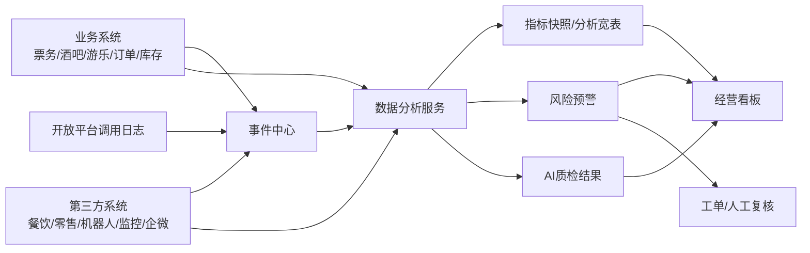
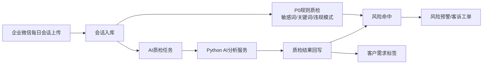

# 数据分析、风控与 AI 质检开发设计

本文档是【数据分析、风控与 AI 质检】专项开发设计文档，目标是把经营分析、风险识别、企业微信质检和 AI 分析服务拆到可以直接进入编码设计的颗粒度。

本文档只做开发设计，不进入编码。

## 1. 模块定位

数据分析、风控与 AI 质检系统负责把综合体内的人、货、票、钱、设备、服务、沟通和第三方履约数据转化为：

- 平台经营看板
- 商户经营分析
- 票务、酒吧、游乐、餐饮零售、机器人履约专题分析
- 员工服务质量分析
- 企业微信客户需求识别与会话质检
- 票务、库存、财务、设备、员工、第三方接口风险预警
- 面向 Python 分析服务和 AI 模型的标准数据集

该系统不是交易主系统，不直接创建票、订单、库存或机器人任务。它依赖各业务系统和事件中心提供数据，负责计算、标记、预警、展示、导出和分析结果回写。

## 2. 业务边界

### 2.1 负责范围

| 范围 | 说明 |
|---|---|
| 指标体系 | 定义平台、商户、票务、酒吧、游乐、餐饮零售、机器人、员工、风控指标 |
| 数据采集 | 从事件中心、业务表、第三方同步表、企业微信会话表读取数据 |
| 数据建模 | 建事实表、指标快照、宽表、风险结果表、AI质检结果表 |
| 经营看板 | 给平台、商户、财务、运营、风控提供看板 |
| 风控规则 | 规则配置、规则执行、风险命中、风险工单 |
| 异常核销 | 重复核销、异常失败、跨区域、非当班设备核销 |
| 库存风控 | 盘亏、报损、高价值酒水异常、存酒异常 |
| 财务差异 | 订单、支付、退款、核销、第三方流水、结算单差异 |
| 会话质检 | 企业微信敏感词、投诉、客户需求、违规承诺、服务质量 |
| AI分析服务 | Python 服务执行文本分析、指标诊断、异常解释、聚类和预测 |

### 2.2 不负责范围

| 不负责 | 归属系统 |
|---|---|
| 售票、出票、核销写入 | 票务通票与权益系统 |
| 酒吧点单、库存出入库、存酒操作 | 酒吧经营系统 |
| 游乐排队、预约、设备状态变更 | 游乐设施运营系统 |
| 餐饮、零售、机器人原始业务执行 | 第三方系统 |
| 第三方API鉴权 | 开放平台与安全鉴权系统 |
| 原始事件写入标准化 | 全链路事件留痕中心 |
| 支付、退款、分账执行 | 订单支付与结算系统 |

## 3. 角色与权限

| 角色 | 数据范围 | 能力 |
|---|---|---|
| 平台老板/高管 | 全平台 | 查看经营总览、风险总览、商户排行、趋势 |
| 平台运营 | 授权业态/商户/门店 | 查看运营看板、分析票务和活动效果 |
| 平台财务 | 全平台或指定商户 | 查看收入、退款、结算、差异和对账 |
| 平台风控 | 全平台 | 查看风险规则、风险事件、证据链、处置结果 |
| 平台客服主管 | 授权客户和会话范围 | 查看会话质检、客诉、服务质量 |
| 商户管理员 | 本商户 | 查看本商户经营、核销、库存、服务质量 |
| 酒吧店长 | 本酒吧门店 | 查看酒吧销售、桌台、库存、员工服务 |
| 游乐项目主管 | 本项目/区域 | 查看项目客流、核销、排队、设备风险 |
| 数据分析师 | 授权数据范围 | 创建指标口径、分析任务、导出报表 |

敏感数据原则：

- 手机号、证件、支付账号按权限和场景控制展示。
- 企业微信工作会话原文**按可配置留存期限保存（非永久，见 §11.5）**，按权限查看；查看时**不做脱敏的范围限定为有最小授权+审批的取证/质检场景**，敏感内容（手机号/证件/支付账号等）按合规要求处置。
  > 修订说明（2026-06-07，A7/C3 收口）：原文"永久保存…不做脱敏"与 §11.5 可配置留存合规小节自相矛盾，就地改为可配置留存+敏感内容合规处置，消除文档内部"前永久、后可配置"的冲突（依据 annotation-4/critic-7、合规 §4-C3）。
- 查看聊天原文、视频证据、财务明细必须写入 `audit_events`。
- 商户只能查看自己的数据，不得跨商户查看。
- 员工绩效和违规分析只允许平台授权角色查看。

## 4. 总体架构



### 4.1 服务划分

| 服务 | 技术建议 | 职责 |
|---|---|---|
| Java 后端分析模块 | Java 21 + Spring Boot 4.x | P0 经营总览 API、风险预警查询 API、内置规则处理器、权限控制；规则配置和商户专题 API 进入 P1 |
| Python 分析服务 | Python + FastAPI/任务队列 | AI文本分析、异常解释、批量指标诊断、模型推理 |
| PostgreSQL | 主库 | 保存指标快照、规则、风险结果、质检结果 |
| Redis | 缓存 | 热门指标缓存、风控规则缓存、任务锁 |
| NATS | 异步事件 | 接收事件、触发指标刷新、触发风控和AI任务 |
| MinIO | 对象存储 | 导出报表、AI分析附件、证据包引用 |

## 5. 指标体系

### 5.1 指标分层

| 层级 | 说明 | 示例 |
|---|---|---|
| 原子指标 | 直接从事实数据计算 | 订单金额、核销次数、退款金额 |
| 派生指标 | 基于原子指标计算 | 核销率、退款率、客单价、毛利率 |
| 复合指标 | 多个业务域组合 | 商户健康分、员工服务分、风险指数 |
| 预警指标 | 有阈值和规则 | 异常核销率、库存盘亏率、财务差异率 |

### 5.2 平台经营指标

| 指标 | 口径 | 数据来源 | 更新频率 |
|---|---|---|---|
| GMV | 已支付订单总额，不含已全额退款 | orders/payments | 5分钟/日终 |
| 净收入 | GMV - 退款 - 平台补贴 | orders/payments/refunds | 5分钟/日终 |
| 入园人数 | 入园权益核销成功人数 | audit_events/verification | 实时 |
| 场内人数 | 入场成功 - 出场/离场记录 | entry_events | 实时 |
| 总订单数 | 已创建订单数 | orders | 5分钟 |
| 支付订单数 | 支付成功订单数 | payments | 5分钟 |
| 核销率 | 已核销权益数 / 已发放权益数（统一分母，见下注） | entitlement_instances/verification | 5分钟 |
| 退款率 | 退款订单数 / 支付订单数 | refunds/orders | 15分钟 |
| 客单价 | 净收入 / 支付人数或支付订单数 | orders/payments | 15分钟 |
| 复购率 | 指定周期内有2次及以上消费客户 / 消费客户 | customer/order | 日 |
| 商户销售排行 | 按商户净收入排序 | orders/settlement | 15分钟 |
| 风险事件数 | 指定周期风险预警数量 | risk_alerts | 实时 |

> 修订说明（2026-06-07，依据 analytics-4）：核销率分母统一为"已发放权益数"（不再用口径不明的"已售权益数"），即**核销率 = 已核销权益数 / 已发放权益数**。它与 §5.3 票务指标的"权益使用率"是同一口径的两个命名：权益使用率 = 已核销权益实例 / 已发放权益实例。两者分母一致（均为"已发放/已生成"，而非"已售"），区别仅在统计范围（核销率多用于平台层全口径，权益使用率多用于票务专题按权益类型下钻）。涉及金额的相关指标单位一律为分（整数，D1）。

### 5.3 票务指标

| 指标 | 口径 | 数据来源 |
|---|---|---|
| 票种销量 | 按票种统计支付成功数量 | ticket_orders |
| 票种销售额 | 票种支付金额 - 退款 | ticket_orders/payments |
| 权益使用率 | 已核销权益实例 / 已发放权益实例 | entitlement_instances |
| 渠道贡献 | 按销售渠道统计GMV和订单数 | orders/channel_code |
| 改期率 | 改期票数 / 已售票数 | ticket_change_records |
| 退票率 | 退票订单数 / 已支付票务订单数 | refunds |
| 异常核销率 | 异常核销次数 / 总核销尝试次数 | verification_events |
| 黄牛风险订单数 | 命中黄牛规则的订单数 | risk_alerts |

### 5.4 酒吧指标

> 修订说明（2026-06-08 三轮收口，依据 finding event-consumers-3）：原"酒吧入场人数"数据来源写为 `bar.entry_verified` 并断言"标准事件名,D4"，但 operation-traceability §4.1 全文无此事件，指标 SQL 会匹配不到真实事件而空跑（属 D4 要消除的根因，且断言"标准事件名"为 overclaim）。本轮改用 §4.1.3 已登记的核销成功事件 `verification.succeeded`（按点位/场景过滤酒吧入场承载），删除"标准事件名,D4"断言；如确需独立入场事件须先在 §4.1 登记再引用。

| 指标 | 口径 | 数据来源 |
|---|---|---|
| 酒吧入场人数 | 酒吧入场核销成功人数 | `verification.succeeded`（§4.1.3 已登记的核销成功事件，按点位/场景过滤酒吧入场，载荷含点位/场景/商户） |
| 桌台开台数 | 开台记录数量 | bar_sessions |
| 桌台翻台率 | 开台数 / 桌台数 | bar_sessions/bar_tables |
| 低消达成率 | 达成低消桌台数 / 已开台桌台数 | bar_bills |
| 酒水销售额 | 酒水订单实付金额 | bar_order_items |
| 简餐销售额 | 简餐订单实付金额 | bar_order_items |
| 赠饮金额 | 赠送商品按售价折算 | bar_order_items |
| 存酒余额 | 未取完存酒数量和估算金额 | saved_bottles |
| 库存报损率 | 报损金额 / 入库金额或销售成本 | stock_movements |
| 毛利率 | 销售额 - 成本 / 销售额 | product_cost/bar_sales |

### 5.5 游乐指标

| 指标 | 口径 | 数据来源 |
|---|---|---|
| 项目核销人数 | 项目权益核销成功人数 | `amusement.verification_succeeded`（标准事件名，D4） |
| 项目利用率 | 实际核销人数 / 项目容量 | amusement_sessions |
| 平均排队时长 | 入队到入场平均时间 | amusement_queue |
| 预约到场率 | 已到场预约 / 总预约 | amusement_reservations |
| 快速通道使用率 | 快速通道核销 / 总核销 | verification_events |
| 设备停机时长 | 故障或维护状态累计时长 | device_status_events |
| 巡检完成率 | 已提交巡检 / 应提交巡检 | amusement_safety_inspections |
| 事故事件数 | 事故、投诉、故障事件数 | amusement_incidents |

### 5.6 餐饮零售指标

| 指标 | 口径 | 数据来源 |
|---|---|---|
| 餐饮销售额 | 第三方餐饮订单净额 | catering_order_sync |
| 零售销售额 | 第三方零售订单净额 | retail_order_sync |
| 券核销金额 | 餐饮/零售券抵扣金额 | voucher_verification_sync |
| 第三方订单同步成功率 | 成功同步订单 / 应同步订单 | integration_events |
| 第三方退款金额 | 同步退款流水金额 | third_party_refunds |
| 对账差异金额 | 平台流水与第三方流水差额 | reconciliation_differences |
| 商户坪效 | 销售额 / 面积 | merchant/venue/order_sync |

### 5.7 机器人履约指标

| 指标 | 口径 | 数据来源 |
|---|---|---|
| 任务量 | 机器人任务创建数量 | robot_tasks |
| 准时率 | 按承诺时间完成任务 / 完成任务 | robot_task_events |
| 平均配送时长 | 任务创建到签收平均时长 | robot_task_events |
| 异常率 | 异常任务 / 总任务 | robot_tasks |
| 无人签收率 | 无人签收任务 / 总任务 | robot_task_events |
| 取货校验失败数 | 取货不匹配或缺失记录数 | robot_task_events |
| 高价值任务人工确认率 | 高价值酒水任务人工确认比例 | robot_tasks/manual_confirm |

### 5.8 员工服务指标

| 指标 | 口径 | 数据来源 |
|---|---|---|
| 会话量 | 员工企业微信客户会话数 | wecom_conversations |
| 平均首次响应时长 | 客户首条消息到员工首回时间 | wecom_messages |
| 平均解决时长 | 客诉创建到关闭时间 | service_tickets |
| 敏感词命中数 | 命中敏感词次数 | wecom_risk_hits |
| 私单风险数 | 私收款、加私人微信等风险命中 | ai_quality_results/risk_hits |
| 投诉倾向数 | AI识别或关键词识别投诉倾向 | ai_quality_results |
| 销售机会数 | 订卡座、包场、生日等机会识别数 | ai_quality_results |
| 服务质量分 | 响应、违规、投诉、满意度综合分 | staff_metric_snapshots |

### 5.9 销售服务责任链指标

> 修订说明（2026-06-07，依据 trace-5/analytics-1/analytics-7/tracewire-2/tracewire-4/tracewire-5）：用户明确要求的"销售归属率、卡座服务责任完整率、送达确认率、异常首响时长"四个责任链分析指标，此前产品 PRD 已提出但本域开发设计的指标体系未落实，看板指标无 SQL 口径可依，留痕→分析闭环在开发设计层断裂。本节补齐口径、来源表与 metric_code，使其可编码。指标名统一为"卡座服务责任完整率"（tracewire-5），数据来源统一使用平台标准事件名（D4，详见 §7.1）。金额单位一律为分（整数，D1）。

| 指标 | metric_code | 口径 | 数据来源 |
|---|---|---|---|
| 销售归属率 | SALES_ATTRIBUTION_RATE | 有 `sales_staff_id` 的应归属订单 / 应归属订单总数。应归属订单 = 来自销售工作台、订台或其他业务规则要求登记销售归属的订单。 | service_responsibility_records（销售归属段）+ 订单（订台/酒吧/票务订单的 sales_staff_id） |
| 卡座服务责任完整率 | TABLE_SERVICE_OWNER_RATE | 有主责服务员的开台会话 / 开台会话总数。 | bar_table_sessions（开台会话）+ service_responsibility_records（主责服务员段） |
| 送达确认率 | DELIVERY_CONFIRM_RATE | 有 `bar.order_delivered` 事件的应送达点单 / 应送达点单总数。按订单级口径统计（tracewire-4），即每个应送达点单订单只计一次，不按行项或交接节点重复计数。应送达点单 = 已支付或已出库、业务上需要送达确认的酒吧点单订单。 | 订单（酒吧点单订单）+ audit_events（event_type=`bar.order_delivered`） |
| 异常首响时长 | EXCEPTION_FIRST_RESPONSE_TIME | `exception.first_handled.occurred_at` - `exception.reported.occurred_at`，输出均值与 P90 两个口径。 | 异常事件（audit_events，event_type=`exception.reported` 与 `exception.first_handled`），关联同一 exception 对象 |
| 服务责任变更次数 | SERVICE_OWNER_CHANGE_COUNT | 同一卡座/会话主责服务员变更次数累计，可下钻到 `table.service_changed` 明细。 | service_responsibility_records + audit_events（event_type=`table.service_changed`） |

来源表说明：

- `service_responsibility_records`（服务责任记录表，见 operation-traceability PRD §6.6）：承载销售归属、主责/协助服务员、异常第一处理人等责任段，是销售归属率与卡座服务责任完整率的主来源。
- `bar_table_sessions`（卡座开台会话表，酒吧域）：开台会话总数的分母来源。
- 订单（票务订单 / 订台订单 / 酒吧点单订单）：提供"应归属订单""应送达点单"的范围与 `sales_staff_id`。
- 异常事件（audit_events 中 event_category=exception 的标准事件）：异常首响时长的两个时间戳来源。

> 注：本组指标对应 risk_rules 中的 `ORDER_SALES_MISSING`、`SERVICE_OWNER_MISSING`、`SERVICE_DELIVERY_MISSING`、`EXCEPTION_FIRST_HANDLE_TIMEOUT` 等责任链规则（见 §10.4），指标低于阈值时可联动生成风险预警。

### 5.10 企业微信质检指标

> 修订说明（2026-06-07，依据 analytics-6）：补齐企业微信质检指标组及来源表，使 data-analysis 层"企业微信质检"页（PRD 第6章）有可编码的指标口径。会话留存与查看须遵守合规要求（见 §11.5 会话留存合规、compliance §4 C3）。

| 指标 | metric_code | 口径 | 数据来源 |
|---|---|---|---|
| 会话上传成功率 | WECOM_UPLOAD_SUCCESS_RATE | 成功上传会话数 / 应上传会话数（按日） | wecom_sync_logs / wecom_conversations |
| 会话量 | WECOM_CONVERSATION_COUNT | 员工企业微信客户会话数 | wecom_conversations |
| 违规命中数 | WECOM_RISK_HIT_COUNT | 命中私单/私收款/诱导私聊/违规承诺/非白名单链接等规则的次数 | wecom_risk_hits |
| 投诉倾向数 | WECOM_COMPLAINT_TENDENCY_COUNT | 关键词或 AI 识别为投诉倾向的会话数 | ai_quality_results / wecom_risk_hits |
| 服务质量分 | WECOM_SERVICE_SCORE | 响应、违规、投诉、满意度综合分（员工/商户维度均值） | ai_quality_results / staff_metric_snapshots |

> 注：投诉倾向数与服务质量分中依赖 AI 语义识别的部分属 P2（见 §16.3）；P0 先做规则与关键词口径。

### 5.11 设备管控指标

> 修订说明（2026-06-07，依据 analytics-6/D5）：补齐工作手机设备管控指标组及来源表，使 data-analysis 层"工作手机管控"页（PRD 第6章）有可编码的指标口径。终端类型以 D5 十端权威表为准（工作手机=staff_work_phone）。设备身份以设备指纹/Keystore 凭证为准（D8），非"读取手机 NFC 唯一标识"。

| 指标 | metric_code | 口径 | 数据来源 |
|---|---|---|---|
| 私装命中数 | DEVICE_UNAUTHORIZED_APP_COUNT | 检测到安装非预装/非白名单软件的命中次数 | device_policy_violations（type=unauthorized_app） |
| 非白名单访问数 | DEVICE_NON_WHITELIST_ACCESS_COUNT | 访问非白名单网站/链接的命中次数 | device_policy_violations（type=non_whitelist_access） |
| 设备锁定数 | DEVICE_LOCKED_COUNT | 触发远程锁定的设备数/次数 | device_lock_events / staff_device_credentials |
| 策略违规数 | DEVICE_POLICY_VIOLATION_COUNT | 设备策略违规命中总数（含私装、非白名单、越区、未归还等） | device_policy_violations |

> 注：上述设备管控指标与 §10.7 的 `STAFF_DEVICE_ABNORMAL` 等规则联动；私人手机相关检测须遵守个人信息保护合规（compliance §5 C4、§11 C10）。

## 6. 数据来源

### 6.1 核心来源表/事件

| 来源 | 类型 | 用途 |
|---|---|---|
| audit_events | 事件中心 | 所有关键行为、风险触发、时间线 |
| event_raw_payloads | 原始事件 | 第三方原始数据追溯 |
| orders/payments/refunds | 交易系统 | 销售、退款、支付差异 |
| ticket_products/ticket_orders | 票务系统 | 票务销售、渠道、退改 |
| entitlement_instances | 权益系统 | 权益发放、归属、核销率 |
| verification_records | 核销系统 | 入园、酒吧、游乐、券核销 |
| bar_orders/bar_bills | 酒吧系统 | 点单、桌台、低消、酒水销售 |
| stock_movements | 库存系统 | 入库、出库、盘点、报损 |
| saved_bottles | 存酒系统 | 存酒余额、取酒异常 |
| amusement_sessions | 游乐系统 | 项目场次、容量、利用率 |
| amusement_queue/reservations | 游乐系统 | 排队、预约、到场 |
| catering_order_sync | 第三方集成 | 餐饮订单分析和对账 |
| retail_order_sync | 第三方集成 | 零售订单分析和对账 |
| robot_tasks/robot_task_events | 机器人集成 | 履约时效、异常 |
| video_evidences | 视频证据 | 高风险事件证据完整性 |
| wecom_conversations/messages | 企业微信 | 会话质检、需求识别 |
| api_call_logs | 开放平台 | 第三方调用分析、接口风险 |
| manual_records | 人工补录 | 自动留痕失败、异常处理 |

### 6.2 数据进入分析域的方式

| 方式 | 场景 | 说明 |
|---|---|---|
| 实时事件消费 | 核销、风险、机器人状态、企微消息 | NATS 订阅事件，写入分析事实表或触发规则 |
| 定时批处理 | 日报、商户排行、毛利、财务差异 | 每5分钟/15分钟/日终计算 |
| 手动重算 | 规则调整、历史修正 | 管理员触发指定时间范围重算 |
| 第三方批量导入 | 餐饮零售日终文件 | 导入后生成标准事件和分析事实 |
| AI异步任务 | 会话分析、异常解释 | 任务入队，Python服务处理后回写结果 |

## 7. 事件数据模型

数据分析系统不重写事件中心标准，而是在 `audit_events` 之上建立分析事实。

### 7.1 事件分类到分析域映射

> 修订说明（2026-06-07，依据 trace-2/trace-6/D4）：本表此前引用的 event_type 字面值（如 `payment.success`、`ticket.paid`、`bar.order.submitted`）与事件中心实际写入的标准事件类型对不上，分析 SQL 与风控规则会匹配不到真实事件而空跑。现统一以 `operation-traceability-and-terminal-switch-prd §4.1` 的**唯一权威事件字典**为基准做**映射**（D4：分析域只消费平台标准事件名，禁止自造命名）。同时补齐此前漏掉的 service / finance / customer / contract 等大类，使映射覆盖 `audit_events.event_category` 全部分类，否则卡座服务类（service）与财务责任链类（finance）事件无分析域落点。
>
> 修订说明（2026-06-07，依据 annotation-1/D4 收口）：经复核，本表当时存在一批事件名与 §4.1 权威字典未完全对齐的问题，原表头"取自 §4.1 权威字典"措辞与事实不符。本轮据实把表头与本表定位改为"**映射自** §4.1"，并把 §4.1 已确有的事件（`order.*`/`payment.*`/`table.service_*`/`bar.order_*`/`inventory.item_labeled`/`inventory.inbound_verified`/`inventory.exception_*`/`exception.*`/`member.points_changed`/`contract.*`/`video.candidate_matched`）就地对齐为字典实名；其余当时作为语义占位名处理。2026-06-10 已由 operation-traceability §4.1 补登并收口，分析 SQL/风控规则以本表最新映射和 §4.1 为准。
>
> 修订说明（2026-06-08 三轮收口，依据 finding event-consumers-1/2/4、critic2-4、R3）：第二轮收口已把 ticket（`ticket.issued`/`ticket.refunded`/`ticket.changed`/`verification.succeeded`/`verification.failed`，§4.1.3）、bar（`bar.bill_settled`/`bar.saved_bottle_picked_up`/`bar.gift_redeemed`，§4.1.2）、service（`bar.table.opened`，§4.1.2）等事件正式登记进 §4.1。本轮据实去掉这些行的占位括注，改注"已在 §4.1.x 登记"；service 行的占位名 `table.opened` 对齐为权威实名 `bar.table.opened`。另按 R3，customer 行由聚合占位名 `member.points_changed` 改为消费 §4.1.4 已登记的细粒度 `points.earned`/`points.deducted`/`points.redeemed`/`points.expired`。当时未登记的游乐/企微/第三方/设备/权限敏感/风控闭环等域，已在 2026-06-10 事件收口中补入 §4.1。
>
> 修订说明（2026-06-10 一体机/事件收口）：operation-traceability §4.1 已补登游乐、支付轮询/回调、财务调整、机器人、企微、第三方同步、设备策略、权限敏感查看和风控闭环事件。本表不再保留历史占位；分析 SQL 和风控规则可直接消费下列标准事件名，但仍以 §4.1 权威字典为唯一准绳。

| event_category | 分析域 | 典型标准事件（**映射自** operation-traceability §4.1 权威字典） |
|---|---|---|
| ticket | 票务分析/异常核销 | `ticket.issued`、`ticket.refunded`、`ticket.changed`、`verification.succeeded`、`verification.failed`（已在 §4.1.3 登记） |
| order | 经营/财务分析 | `order.acquired`、`order.sales_attributed`、`payment.cash_received`、`payment.pos_received`、`refund.succeeded`（均已在 §4.1 登记；`refund.succeeded` 见 §4.1.3A） |
| service | 服务/责任链分析 | `bar.table.opened`、`table.service_assigned`、`table.service_changed`、`bar.order_created`、`bar.order_delivered`（均已在 §4.1：`bar.table.opened` 见 §4.1.2，余 4 个已登记） |
| bar | 酒吧分析/库存风控 | `bar.order_created`、`bar.bill_settled`、`bar.saved_bottle_picked_up`、`bar.gift_redeemed`（均已在 §4.1：`bar.order_created` 见 §4.1.2，其余 3 个亦在 §4.1.2 登记） |
| inventory | 库存风控 | `inventory.item_labeled`、`inventory.inbound_verified`、`inventory.exception_reported`、`inventory.exception_resolved`（已对齐 §4.1 实际事件名） |
| amusement | 游乐分析/安全风控 | `amusement.verification_succeeded`、`amusement.verification_failed`、`amusement.device_status_changed`、`amusement.safety_inspection.submitted`（已在 §4.1.3A 登记） |
| robot | 机器人履约 | `robot.pickup_arrived`、`robot.delivery_arrived`、`robot.task_created`、`robot.task_signed`（均已在 §4.1 登记；后 2 个见 §4.1.5） |
| exception | 异常责任链分析 | `exception.reported`、`exception.first_handled`、`exception.escalated`、`exception.resolved`、`exception.reviewed`（已对齐 §4.1 实际事件名，`exception.closed`→`exception.resolved`） |
| finance | 财务分析/财务责任链 | `payment.cash_received`、`payment.pos_received`、`payment.gateway_notified`、`payment.poll_checked`、`refund.succeeded`、`bill.adjusted`、`bill.waived`、`settlement.confirmed`（均已在 §4.1 登记；支付/财务补充见 §4.1.3A） |
| customer | 客户/会员分析 | `points.earned`、`points.deducted`、`points.redeemed`、`points.expired`（已在 §4.1.4 登记，细粒度承载积分入账/扣减/兑换/过期；原聚合占位名 `member.points_changed` 已废止，§4.1 主表不再保留） |
| contract | 合同准入分析 | `contract.blocked`、`contract.released`（已在 §4.1，trace-3 新增） |
| conversation | AI质检/服务分析 | `wecom.message_received`、`wecom.risk_hit`、`wecom.conversation_synced`（已在 §4.1.5 登记） |
| third_party | 餐饮零售/接口风险 | `catering.order_synced`、`retail.order_synced`、`voucher.verified_synced`、`reconciliation.diff_found`（已在 §4.1.5 登记） |
| facility | 设备/视频证据分析 | `device.policy_violation`、`device.locked`、`video.candidate_matched`（已在 §4.1 登记；设备策略补充见 §4.1.5） |
| personnel | 员工/审计风险 | `permission.granted`、`permission.revoked`、`sensitive.viewed`、`evidence.exported`（已在 §4.1.5 登记） |
| risk | 风控闭环 | `risk.alert_created`、`risk.alert_resolved`（已在 §4.1.5 登记）；P0 查询事件按 OpenAPI 使用 `risk_alert.viewed` |

> 注：上表 event_type 字面值以 operation-traceability §4.1 为单一权威。若本表与 §4.1 出现差异，一律以该权威字典为准，本表只映射不另起命名。`audit_events.event_category` 的全部分类（见 foundation-database §6.1）都应在本表有对应分析域，不得遗漏 service/finance。

### 7.2 分析事实模型原则

- 所有事实表必须包含 `merchant_id`，可为空的平台级事件除外。
- 可关联场地的事实必须包含 `venue_id`。
- 可关联员工的事实必须包含 `staff_id` 或 `actor_id`。
- 可关联设备的事实必须包含 `device_id`。
- 第三方来源必须包含 `open_app_id` 或 `source_system`。
- 事实表的业务时间使用 `occurred_at`，入库时间使用 `created_at`。
- 允许根据事实表生成指标快照，但指标快照必须能追溯到计算窗口和来源口径。

## 8. 经营看板设计

### 8.1 平台总览看板

| 区块 | 内容 |
|---|---|
| 今日核心指标 | GMV、净收入、入园人数、场内人数、支付订单、核销率、退款率 |
| 业态贡献 | 票务、酒吧、游乐、餐饮、零售销售额占比 |
| 商户排行 | 销售额、核销量、客流、风险数排行 |
| 客流趋势 | 分小时入园、酒吧入场、游乐核销趋势 |
| 风险总览 | 高风险预警、待处理工单、财务差异、库存异常 |
| 第三方健康 | 餐饮/零售同步状态、机器人异常、企微同步状态 |

### 8.2 商户看板（P1专题）

P0 平台总览可以展示商户排行和风险摘要，但不单独开放商户经营专题 API；商户维度钻取、商户独立看板和专题分析进入 P1。

| 区块 | 内容 |
|---|---|
| 商户销售 | 销售额、订单数、退款、客单价 |
| 核销表现 | 权益核销数、核销率、异常核销 |
| 运营表现 | 桌台/项目/订单/库存/配送等业态指标 |
| 风险事件 | 本商户风险数、待处理、已关闭 |
| 趋势对比 | 今日 vs 昨日、上周同日、近7日 |

### 8.3 风控看板（P0只读，P1处置）

P0 只提供风险预警列表、摘要证据和复核入口；分派、确认、忽略、关闭、处置效率和规则效果分析进入 P1。

| 区块 | 内容 |
|---|---|
| 风险漏斗 | 预警生成、待复核、已确认、误报、已关闭 |
| 风险分布 | 按商户、业态、规则、等级分布 |
| 高风险列表 | 异常核销、财务差异、库存异常、私单风险 |
| 处置效率 | 平均响应时长、平均关闭时长、超时工单 |
| 规则效果 | 命中量、确认率、误报率、关闭率 |

## 9. 专题分析设计

### 9.1 票务分析

| 分析项 | 维度 | 指标 |
|---|---|---|
| 票种表现 | 票种、日期、渠道、商户权益 | 销量、销售额、退款率、核销率 |
| 权益使用 | 权益类型、归属商户、项目/门店 | 发放数、核销数、使用率、过期数 |
| 渠道效果 | 渠道、活动、KOL码 | GMV、转化、退款、客单价 |
| 异常核销 | 票码、设备、员工、区域 | 失败次数、重复尝试、人工放行 |

### 9.2 酒吧分析

| 分析项 | 维度 | 指标 |
|---|---|---|
| 入场分析 | 日期、时段、票种、渠道 | 入场人数、峰值、容量利用率 |
| 桌台分析 | 桌台类型、区域、服务员 | 开台数、翻台率、低消达成率 |
| 商品分析 | 商品分类、酒水品牌、套餐 | 销量、销售额、赠送、毛利 |
| 存酒分析 | 客户、酒品、有效期 | 存酒量、取酒量、到期风险 |
| 库存分析 | 库房、吧台、商品 | 入库、出库、报损、盘亏 |

### 9.3 游乐分析

| 分析项 | 维度 | 指标 |
|---|---|---|
| 项目热度 | 项目、日期、时段 | 核销人数、利用率、复玩率 |
| 排队预约 | 项目、场次、通道类型 | 预约数、到场率、排队时长 |
| 设备运营 | 设备、项目、状态 | 停机时长、故障次数、恢复时长 |
| 安全巡检 | 项目、员工、巡检项 | 完成率、异常项、超时率 |

### 9.4 餐饮零售分析

| 分析项 | 维度 | 指标 |
|---|---|---|
| 商户销售 | 商户、门店、时段 | 销售额、订单数、退款 |
| 券使用 | 券类型、活动、商户 | 领取、核销、抵扣金额 |
| 商品/SKU | 商品分类、SKU | 销量、销售额、动销率 |
| 对账分析 | 商户、日期、差异类型(diff_type)、第三方来源(source_system) | 平台金额、第三方金额、差异金额、差异条数 |

> 修订说明（2026-06-07，依据 analytics-5）：对账分析维度补"差异类型(diff_type=支付/退款/第三方订单/结算/补贴)"与"第三方来源(source_system)"，指标补"差异条数"，使对账差异可按差异类型分布与按第三方平台分别统计，对齐 §13.7 reconciliation_differences。金额单位为分（整数，D1）。

### 9.5 机器人履约分析

| 分析项 | 维度 | 指标 |
|---|---|---|
| 任务效率 | 机器人、任务类型、路线 | 任务数、平均时长、准时率 |
| 异常分析 | 异常类型、点位、商户 | 超时、故障、无人签收、货损 |
| 证据完整性 | 任务、点位、视频 | 取货记录、交付记录、视频证据缺失率 |

## 10. 风控规则设计

### 10.1 规则模型

规则分为四类：

| 类型 | 说明 | 示例 |
|---|---|---|
| 阈值规则 | 单指标超过阈值 | 单票码5分钟失败3次 |
| 组合规则 | 多条件组合 | 非当班员工 + 管理手机未绑定 + 核销成功 |
| 对账规则 | 两方或多方数据不一致 | 平台支付金额 != 第三方订单金额 |
| AI规则 | 模型或语义判断 | 会话中疑似私单或违规承诺 |

### 10.2 风险等级

> 修订说明（2026-06-07，依据 analytics-8/D6）：统一四级风险等级的中英映射，作为跨文档唯一口径（与《统一口径基准》D6 一致）：**低=notice，中=suspicious，高=high，严重=critical**。数据分析层"高风险事件数"的口径需明确是否含 critical，见下方说明，避免各看板各算一套。

| 中文等级 | 英文 code | 含义 | 处置 |
|---|---|---|---|
| 低 | notice | 提醒 | 进入列表，运营关注 |
| 中 | suspicious | 可疑 | 生成待复核预警 |
| 高 | high | 高风险 | 生成工单，通知主管 |
| 严重 | critical | 严重 | 可触发冻结、停用、强制审批 |

"高风险事件数"口径（D6）：

- 看板/字典中的"高风险事件数"统一指 **high + critical 合计**（即"高及以上"），因为 critical 在业务上比 high 更严重，统计高风险时不应被排除。
- 同时**单列 critical（严重）事件数**，便于优先处置最严重事件。
- 各文档（data-analysis 字段字典、page-list、acceptance）引用"高风险事件数"时一律按此口径，不得只取 high 而漏 critical。

### 10.3 异常核销规则

| 规则编码 | 场景 | 条件 | 等级 |
|---|---|---|---|
| VERIF_REPEAT_FAIL | 同票码多次失败 | 同票码5分钟失败>=3次 | suspicious |
| VERIF_DUP_SUCCESS | 重复成功核销 | 同权益实例成功核销>1次 | high |
| VERIF_WRONG_MERCHANT | 跨商户核销 | 权益归属商户与核销商户不一致 | high |
| VERIF_OFF_SHIFT | 非当班核销 | 员工无有效班次却核销 | high |
| VERIF_DEVICE_UNBOUND | 未绑定设备核销 | device_id无有效绑定 | high |
| VERIF_MANUAL_HIGH | 人工放行过多 | 员工当日人工放行超过阈值 | suspicious |
| VERIF_LOCATION_MISMATCH | 点位异常 | 核销点位不在权益允许区域 | high |

### 10.4 订单、服务和异常责任链规则

| 规则编码 | 场景 | 条件 | 等级 |
|---|---|---|---|
| ORDER_SALES_MISSING | 销售归属缺失 | 销售工作台、订台或需归属订单缺少 sales_staff_id | notice |
| ORDER_SOURCE_UNKNOWN | 订单来源不清 | 订单缺少渠道、终端、第三方来源或创建人 | suspicious |
| SERVICE_OWNER_MISSING | 服务责任缺失 | 开台、点单或送达后缺少主责服务员 | suspicious |
| SERVICE_OWNER_CHANGED_FREQUENT | 服务责任频繁变更 | 同一卡座短时间多次更换主责服务员 | notice |
| SERVICE_DELIVERY_MISSING | 服务送达缺失 | 酒吧订单已支付或已出库但缺少送达确认 | suspicious |
| EXCEPTION_FIRST_HANDLE_TIMEOUT | 异常首响超时 | 异常上报后超过配置时限无人接单 | high |
| EXCEPTION_ESCALATION_MISSING | 异常升级缺失 | 高风险异常未在时限内升级或复核 | high |
| VIDEO_CANDIDATE_MISSING | 视频候选缺失 | 高风险事件缺少点位、时间或候选摄像头 | notice |

### 10.5 库存风控规则

| 规则编码 | 场景 | 条件 | 等级 |
|---|---|---|---|
| INV_HIGH_VALUE_DAMAGE | 高价值报损 | 高价值酒水报损金额超过阈值 | high |
| INV_VARIANCE_HIGH | 盘亏异常 | 盘亏金额/账面金额超过阈值 | suspicious |
| INV_SAVED_BOTTLE_NO_CONFIRM | 存酒取酒无确认 | 取酒缺客户确认或视频证据 | suspicious |
| INV_BAR_STOCK_NEGATIVE | 负库存 | 商品库存余额<0 | high |
| INV_ADJUST_FREQUENT | 频繁库存调整 | 同员工/商品当日调整次数超过阈值 | suspicious |
| INV_BOM_COST_ABNORMAL | 配方成本异常 | BOM成本超过售价比例阈值 | notice |
| INV_TRACE_MISSING | 追踪码缺失 | 高价值酒水或需追责物品出库无平台唯一二维码 | high |
| INV_HANDOVER_MISSING | 交接节点缺失 | 出库后缺少后厨接收、服务员取走或送达确认 | suspicious |
| INV_HANDOVER_MISMATCH | 交接不匹配 | 扫码物品与订单、库位、机器人任务或责任人不匹配 | high |
| INV_HANDOVER_TIMEOUT | 交接超时 | 从出库到后厨接收或送达超过配置时限 | suspicious |

### 10.6 财务差异规则

| 规则编码 | 场景 | 条件 | 等级 |
|---|---|---|---|
| FIN_PAY_ORDER_DIFF | 支付订单差异 | 支付流水金额 != 订单应付金额 | high |
| FIN_REFUND_ABNORMAL | 退款异常 | 高频退款或非原路退款 | suspicious |
| FIN_THIRD_PARTY_DIFF | 第三方对账差异 | 第三方订单金额与平台记录不一致 | high |
| FIN_SETTLEMENT_NEGATIVE | 结算异常 | 商户结算金额为负或超出合理范围 | high |
| FIN_MANUAL_ADJUST | 人工调账 | 人工调账金额超过阈值 | suspicious |
| FIN_SUBSIDY_OVER | 补贴超限 | 活动补贴超过预算 | notice |

### 10.7 员工与沟通风控规则

| 规则编码 | 场景 | 条件 | 等级 |
|---|---|---|---|
| STAFF_PRIVATE_PAYMENT | 私收款 | 会话命中个人收款、转账等意图 | high |
| STAFF_PRIVATE_CONTACT | 诱导私聊 | 命中加私人微信/手机号等 | high |
| STAFF_BAD_ATTITUDE | 服务态度风险 | 辱骂、威胁、推诿等语义命中 | suspicious |
| STAFF_ILLEGAL_PROMISE | 违规承诺 | 承诺无法履约或违规折扣 | suspicious |
| STAFF_SENSITIVE_VIEW | 敏感查看频繁 | 频繁查看聊天/视频/财务明细 | notice |
| STAFF_DEVICE_ABNORMAL | 设备异常 | 未归还、离线、越区 | suspicious |

### 10.8 第三方接口风险规则

| 规则编码 | 场景 | 条件 | 等级 |
|---|---|---|---|
| API_AUTH_FAIL_LOCK | 鉴权失败锁定 | 连续3次鉴权失败 | high |
| API_HIGH_ERROR_RATE | 接口错误率高 | 5分钟错误率超过阈值 | suspicious |
| API_REPLAY_NONCE | 重放攻击 | nonce重复使用 | high |
| API_SCOPE_DENIED | 越权访问 | 访问未授权商户/接口 | high |
| WEBHOOK_RETRY_OVER | 回调失败过多 | Webhook连续失败超过阈值 | suspicious |

### 10.9 合规与场所安全风控规则

> 修订说明（2026-06-07，依据 compliance-land-6/C1 + compliance-land-5/critic-8/C8 收口）：合规 §2.3（C1）要求回填 evidence-risk-control / data-risk-ai 第 10 章未成年售酒拦截与醉酒拒售两条风控规则；合规 §9（C8）要求风控补"场所超容"规则。此前 §10 风控全表无这三条，规则码只在合规文档本身出现，data-risk-ai/evidence-risk-control 都解析不到，属"合规要求未真正落到风控规则"。现新增本组三条规则并给等级。三条规则的 `domain` 归 `safety`（已在 §13.4 risk_rules.domain 枚举内），命中后生成风险预警入 risk_alerts，并写入 `audit_events` 留痕。

| 规则编码 | 场景 | 条件 | 等级 |
|---|---|---|---|
| BAR_UNDERAGE_BLOCKED | 未成年售酒拦截 | 酒吧门口/点酒年龄核验判定未成年（`age_verified=false` 或 `refuse_reason=underage`），拦截进入售酒区/拒售；命中做统计与告警 | high |
| BAR_INTOXICATED_REFUSED | 醉酒拒售 | 工作人员对明显醉酒客人执行醉酒拒售人工标记（`refuse_reason=intoxicated`），记录留痕并统计 | suspicious |
| VENUE_OVER_CAPACITY | 场所超容（酒吧/全场实时在场超消防容量） | 按 venue/area 聚合的实时在场人数 `current_guest_count`（酒吧场地级，bar-operations `bar_venues.current_guest_count`）≥ 核定/消防容量（`max_occupancy`/`fire_capacity`）时触发超员预警；入场/开台校验若强行放行也命中 | critical |

> 口径说明：
> 1. C1 两条规则的字段依据在 bar 入场/点酒表（`age_verified`/`age_verify_method`/`age_verify_by`/`age_verified_at`/`age_verify_point`/`refuse_reason`/`refuse_by`/`refuse_at`，见合规 §2.2），本规则只做命中统计与告警，不替代门口/点酒环节的硬卡控（硬卡控在 bar PRD 入场流程）。
> 2. VENUE_OVER_CAPACITY 依赖"全场/酒吧实时在场计数机制"（入场+1/离场-1，按 venue/area 聚合），消防容量字段 `fire_capacity`/`max_occupancy` 已落 foundation venues/areas；该规则与入场卡控流程互补——卡控在入场口阻断，本规则做超员监测与预警，达阈值即 critical 级触发超员预警。
> 3. 三条规则同步登记到 evidence-risk-control 风控规则清单（见 evidence-risk-control PRD），两侧规则码一字一致。
>
> 修订说明（2026-06-08 三轮收口，依据 finding compliance-wired-3）：VENUE_OVER_CAPACITY 触发条件原引用不存在的字段 `current_occupancy`，规则会读不到数据。全库唯一的实时在场计数字段是酒吧场地级 `bar_venues.current_guest_count`（bar-operations §6），foundation venues/areas 仅有静态阈值 `max_occupancy`/`fire_capacity`。本轮把 `current_occupancy` 统一为权威字段 `current_guest_count`。area/全场级实时在场聚合的数据承载（是否在平台治理空间容量补区域级计数）见 compliance-wired-4，P0 先做酒吧场地级卡控。

## 11. 企业微信会话质检

### 11.1 数据对象

| 对象 | 说明 |
|---|---|
| WeComConversation | 会话，会绑定客户、员工、商户 |
| WeComMessage | 消息明细，文本、图片、语音转写 |
| ConversationQualityTask | 会话质检任务 |
| AiQualityResult | AI质检结果 |
| WeComRiskHit | 风险命中 |
| CustomerIntent | 客户需求识别结果 |

### 11.2 质检流程



P0 处理口径：

- 工作手机只能使用企业微信进行工作沟通。
- 每天自动同步所有员工企业微信工作聊天内容到后台。
- 企业微信工作会话原文**按可配置留存期限保存（非永久，见 §11.5），到期归档/销毁/匿名化；敏感内容按合规处置**。
  > 修订说明（2026-06-07，A7/C3 收口）：原"永久保存"绝对口径与 §11.5 矛盾，就地改为可配置留存并指向 §11.5（依据 annotation-4/critic-7、合规 §4-C3）。
- P0 先做规则质检和敏感词/违规模式检查，命中后生成风险预警。
- AI 语义理解、服务评分、客户意图深度分析放入 P2。
- 会话原文查看必须按权限控制；**不脱敏展示仅限有最小授权+审批的取证/质检场景，并写入审计事件**，敏感字段在一般展示场景按权限脱敏。
  > 修订说明（2026-06-07，A7/C3 收口）：原"不脱敏展示"绝对表述无人限定，就地改为"不脱敏仅限最小授权+审批的取证/质检场景"，与 §11.5 第 5 条查看授权与审计一致（依据 annotation-4/critic-7）。

### 11.3 质检维度

| 维度 | 识别内容 | 结果 |
|---|---|---|
| 客户需求 | 卡座预订、包场、生日、团建、存酒、游乐咨询、投诉 | 需求标签、销售机会 |
| 违规风险 | 私单、私收款、诱导私人微信、违规承诺、虚假宣传 | 风险命中 |
| 服务质量 | 响应慢、态度差、未解决、反复追问 | 服务评分 |
| 客诉倾向 | 退款、投诉、曝光、报警、监管投诉 | 客诉工单 |
| 消费意向 | 预算、人数、时间、偏好 | 客户画像 |
| 设备沟通违规 | 使用私人微信、绕过企业微信、发送非白名单链接 | 设备/会话风险 |

### 11.4 AI输出结构

```json
{
  "conversation_id": "conv_xxx",
  "risk_level": "suspicious",
  "intents": ["booth_booking", "birthday_party"],
  "risk_hits": [
    {
      "rule_code": "STAFF_PRIVATE_PAYMENT",
      "confidence": 0.92,
      "evidence_message_ids": ["msg_1", "msg_3"]
    }
  ],
  "service_score": 82,
  "summary": "客户询问生日卡座预订，员工响应较快，无明显违规。",
  "suggested_action": "sales_follow_up"
}
```

### 11.5 企业微信会话留存合规

> 修订说明（2026-06-07，依据 C3 / compliance §4 / phone-2 / business-decision-log §22）：现状口径"永久保存 + 不脱敏 + 管理者可查"只解决了"谁能看、看了留痕"，未解决"凭什么合法收集与无限期保存"。PIPL 要求存储期限为实现处理目的所必要的**最短**时间。本节把企微会话留存的合规要求落为可编码口径，作为 P0 合规阻断项，详细法律口径见《合规与个人信息保护要求》§4（C3）。

合规要求（P0）：

1. **合法性基础与告知同意**：明确处理的合法性基础（人力资源管理必要性 / 规章制度 / 必要同意），对员工入职时监控告知并签署、对客户侧服务场景告知；告知/同意记录入库可举证（关联 `employee_notice_id`）。
2. **采集范围限定**：仅采集企业微信**工作号工作会话**，不及员工私人沟通。
3. **可配置留存期限**：把"永久保存"改为**可配置留存期限**，区分"质检/取证所需最短留存"与"长期归档"；到期归档或销毁/匿名化。若业务确需长期保存，须补充其合法性论证。
4. **范围与到期处置**：定义离职/合同终止后、争议关闭后的会话处置策略（降级/销毁/匿名化），与 system-breakdown 事件归档周期一致，二者取严。
5. **查看授权与审计**：管理者查看不脱敏原文须最小授权 + 审批 + 访问审计（写入 `audit_events` 的 `conversation.sensitive.viewed`）。

留存策略字段（建议落 `wecom_retention_policy` 或会话表扩展段）：

| 字段 | 类型 | 说明 |
|---|---|---|
| retention_policy_code | varchar | 留存策略编码 |
| retention_days | int nullable | 留存天数；为空表示按 `permanent_with_basis`（长期保存且有合法性论证） |
| disposal_action | varchar | 到期处置：archive / delete / anonymize |
| legal_basis | varchar | 合法性基础说明 |
| employee_notice_id | uuid nullable | 关联员工监控告知/同意记录 |
| scope | varchar | 采集范围：work_conversation（限定工作会话） |

> 注：本节与 §11.2"永久保存"口径的关系——"永久保存"应理解为"业务存续期内按策略保存且可配置到期处置"，而非无限期硬保存；编码以本节可配置留存字段为准。§11.2 原文已就地改为可配置留存（A7/C3 收口），两处口径已统一。

### 11.6 个人信息留存与销毁作业（C5）

> 修订说明（2026-06-07，依据 critic-5/C5 + 合规 §6 收口）：合规 C5 要求"个人信息分类留存→到期自动删除或匿名化→与软删除/归档对齐"，并要求 PIPL 删除权/撤回同意可级联生效。此前只有 §11.5 企微会话单类留存与 foundation 的 `deleted_at` 软删除字段，覆盖手机号/证件/支付/消费/视频的**统一分类留存策略表**与**到期销毁定时作业**在任何开发设计/DB 中均无落点（third-party-integration §1194 却已把它当已存在对象引用）。本节把 C5 落为可编码的 P0 表与作业契约（P0 给表与作业接口契约，P1 实现批处理）。本节与企微会话留存（§11.5）的关系：企微会话是分类留存表中的一个数据类别（`wecom_conversation`），其策略在 §11.5 细化，本表为统一调度入口。

#### 11.6.1 分类留存策略表 `pii_retention_policies`（P0 主数据）

> 该表为可编码主数据，使 C5 与 third-party-integration §1194 的引用有落点。金额无关；状态给中英（D7）；预留 `project_id`（综合体归属，原始需求）；含软删除/审计字段。
>
> 修订说明（2026-06-08 收口）：表名由 `personal_data_retention_policies` 统一为 `pii_retention_policies`，与 `foundation-database-design §6B.4` **为同一张表**——schema 落点以 foundation §6B.4 为权威，本节给"留存/销毁作业视角"的完整字段与作业设计（到期扫描、撤回同意级联、作业留痕表 `data_retention_job_logs`）。二者字段口径须保持一致。依据 finding（修订后复核新引入的留存表重名冲突）、C5。
>
> 修订说明（2026-06-08 三轮收口，依据 finding compliance-wired-2/project-id-2/struct-annot-5/critic2-2、R5/R7）：① 修正上一条修订说明的自指错误——原写"由 `pii_retention_policies` 统一为 `pii_retention_policies`"（前后同名、无法看出实际改名），现改回真实旧名"由 `personal_data_retention_policies` 统一为 `pii_retention_policies`"（R7）。② 字段对齐 foundation §6B.4 权威 schema（R5）：`data_category` 改为 `phone_name`/`id_credential`/`payment`/`consumption`/`wecom_session`/`video_evidence`（原 `id_document`+`biometric_face` 合并为 `id_credential`、`payment_account`→`payment`、`consumption_record`→`consumption`、`wecom_conversation`→`wecom_session`）；`retention_basis` 改为 `legal`/`business`/`evidence`/`consent_based`/`permanent_with_basis`（foundation §6B.4 须补 `consent_based`）；状态列名由 `policy_status` 统一为 `status`。③ `relation_based`/`min_necessary_note`/`legal_basis` 为本节"留存/销毁作业视角"附加字段，foundation §6B.4 schema 不含，保留并注明，不影响"同一张表"声明（权威字段集以 foundation 为准）。

| 字段 | 类型 | 说明 |
|---|---|---|
| id | uuid | 主键 |
| data_category | varchar | 数据类别（对齐 foundation §6B.4 权威枚举）：`phone_name`(手机号/姓名)、`id_credential`(身份证件/人脸，原 id_document+biometric_face 合并)、`payment`(支付/对账)、`consumption`(消费记录)、`wecom_session`(企微会话)、`video_evidence`(视频证据) |
| retention_basis | varchar | 留存依据（对齐 foundation §6B.4）：`legal`(法定追溯/税务会计)、`business`(业务关系存续)、`evidence`(取证期)、`consent_based`(基于同意)、`permanent_with_basis`(长期保存需附合法性论证) |
| retention_days | int nullable | 留存天数；为空表示"业务关系存续期"（需配 `relation_based=true`），到期以关系终止+追溯期计算 |
| relation_based | boolean | （作业视角附加字段，foundation §6B.4 schema 不含）是否按业务关系存续期计算（true 时 retention_days 作为关系终止后的附加追溯天数） |
| disposal_action | varchar | 到期处置：`archive`(归档)、`delete`(物理擦除)、`anonymize`(匿名化) |
| min_necessary_note | text | （作业视角附加字段，foundation §6B.4 schema 不含）"最短必要"口径说明（PIPL 与成本/审计口径取严，合规 §6） |
| legal_basis | varchar | （作业视角附加字段，foundation §6B.4 schema 不含）法律依据说明（税务/会计法定期、取证期等） |
| status | varchar | 状态：生效 `active` / 草稿 `draft` / 停用 `disabled`（中英，D7，对齐 foundation §6B.4） |
| project_id | uuid nullable | 综合体归属（预留，平台统一策略可空、按综合体定制必填） |
| created_at | timestamptz | 创建时间 |
| updated_at | timestamptz | 更新时间 |
| created_by | uuid nullable | 创建人（审计） |
| deleted_at | timestamptz nullable | 软删除 |

初始分类留存口径（已按推荐默认执行，对齐合规 §6 表；实施时仅对国家法令强制要求、合同模板或监管口径变化做法务复核）：

| data_category | 建议留存口径 | disposal_action |
|---|---|---|
| phone_name | 业务关系存续期 + 法定追溯期 | anonymize |
| id_credential | 实现核验目的后最短期 | delete |
| payment | 税务/会计法定保存期 | archive→delete |
| consumption | 业务关系存续期 + 法定追溯期 | anonymize |
| wecom_session | 见 §11.5 可配置留存 | archive/delete/anonymize |
| video_evidence | 事件关联期 + 取证期 | delete |

#### 11.6.2 留存销毁定时作业 `data_retention_purge_job`（作业契约）

| 项 | 契约 |
|---|---|
| 触发 | 定时（建议每日凌晨低峰）+ 支持手动触发 `POST /api/compliance/retention/purge-run` |
| 输入 | `pii_retention_policies` 全部 `active` 策略 |
| 扫描 | 逐 `data_category` 扫描各承载表中"到期记录"（按 `retention_days`/`relation_based` + 关系终止时间计算到期，命中已过期且未处置的记录） |
| 处置 | 按 `disposal_action`：`delete`=物理擦除原始字段并保留不可逆占位；`anonymize`=对敏感字段做不可逆匿名化（手机号/姓名/证件置为脱敏占位、保留聚合分析所需非身份维度）；`archive`=移入归档存储后再按二级期删除 |
| 与软删除对齐 | 处置在 `deleted_at` 软删除之上叠加"原始个人信息字段物理擦除/匿名化"，确保软删除记录中的个人信息也被销毁（软删除≠个人信息已销毁） |
| 留痕 | 每条处置写入 §11.6.3 作业留痕表，并写 `audit_events`（事件 `personal_data.purged`/`personal_data.anonymized`，域=合规，载荷 `data_category`/`target_table`/`affected_count`/`disposal_action`/`job_log_id`；已在 operation-traceability §4.1.4 登记，同步 java-backend §14） |
| 幂等 | 已处置记录打标 `disposed_at`，重跑不重复擦除 |

#### 11.6.3 撤回同意级联与作业留痕

- **撤回同意级联**：当主体在 `consent_records`（C2，地基侧已补）发起撤回（`withdrawn_at` 置位）时，触发 `consent_withdraw_cascade` 作业：对该主体在"基于同意（`consent_based`）"留存的数据类别执行级联软删 + 匿名化/物理擦除（法定必留 `legal` 类别不随撤回删除，仅停止非必要使用并记录），与 §11.6.2 同一处置引擎。撤回入口面向 C2"撤回同意响应入口"（P0 预留数据结构、P1 完善界面）。
- **作业留痕表 `data_retention_job_logs`**（P0）：

| 字段 | 类型 | 说明 |
|---|---|---|
| id | uuid | 主键 |
| job_type | varchar | `retention_purge`(到期销毁) / `consent_withdraw_cascade`(撤回级联) |
| data_category | varchar | 处置的数据类别 |
| subject_id | uuid nullable | 涉及的个人信息主体（撤回级联时必填） |
| target_table | varchar | 承载表名 |
| affected_count | int | 处置记录数 |
| disposal_action | varchar | delete / anonymize / archive |
| trigger_source | varchar | `scheduled` / `manual` / `consent_withdraw` |
| operated_by | uuid nullable | 触发人（手动/撤回时） |
| run_status | varchar | 运行状态：成功 `success` / 部分失败 `partial_failed` / 失败 `failed`（中英，D7） |
| error_detail | text nullable | 失败明细 |
| project_id | uuid nullable | 综合体归属（预留） |
| started_at | timestamptz | 开始时间 |
| finished_at | timestamptz nullable | 完成时间 |
| created_at | timestamptz | 创建时间 |
| deleted_at | timestamptz nullable | 软删除 |

> 备份介质口径（与 critic-9 衔接）：本作业处置应用层数据；备份/灾备介质中个人信息的处置（备份保留期、删除请求对历史备份的影响）属运维侧，待运维设计补"备份与个人信息保护"一节，本节不重复定义。

## 12. AI 分析服务

### 12.1 服务职责

| 能力 | 说明 |
|---|---|
| 会话质检 | 识别需求、投诉、违规、服务质量 |
| 风险解释 | 对规则命中的风险事件生成原因摘要 |
| 指标诊断 | 解释某指标异常波动可能原因 |
| 商户健康评分 | 基于经营、风险、服务、对账生成评分 |
| 员工服务评分 | 响应速度、违规、投诉、销售机会综合评分 |
| 异常聚类 | 将大量风险事件按原因聚类 |

### 12.2 Java 与 Python 边界

| Java 后端 | Python 分析服务 |
|---|---|
| 权限控制、任务创建、结果查询 | 模型推理、文本分析、批量计算 |
| 指标API、报表API、规则配置 | 复杂诊断、聚类、自然语言摘要 |
| 风险预警入库和处置流 | 返回置信度、标签、解释 |
| 调用审计和事件留痕 | 不直接对外暴露给前端 |

### 12.3 AI任务状态

| 状态 | 说明 |
|---|---|
| pending | 待处理 |
| running | 处理中 |
| succeeded | 成功 |
| failed | 失败 |
| cancelled | 已取消 |

## 13. 数据库表设计

以下表为数据分析、风控与 AI 质检专项新增建议。字段命名按 PostgreSQL snake_case，正式实现时使用 Flyway 管理。

### 13.1 metric_definitions 指标定义表

| 字段 | 类型 | 说明 |
|---|---|---|
| id | uuid | 主键 |
| metric_code | varchar | 指标编码，唯一 |
| metric_name | varchar | 指标名称 |
| domain | varchar | platform、ticketing、bar、amusement、retail、robot、staff、risk、finance |
| metric_type | varchar | atomic、derived、composite、alert |
| unit | varchar | yuan、count、percent、minute |
| formula | text | 计算公式说明 |
| source_desc | text | 数据来源说明 |
| refresh_frequency | varchar | realtime、5m、15m、daily |
| owner_role | varchar | 指标负责人角色 |
| status | varchar | active、inactive |
| created_at | timestamptz | 创建时间 |
| updated_at | timestamptz | 更新时间 |

### 13.2 metric_snapshots 指标快照表

| 字段 | 类型 | 说明 |
|---|---|---|
| id | uuid | 主键 |
| metric_code | varchar | 指标编码 |
| stat_time | timestamptz | 统计时间点 |
| stat_date | date | 统计日期 |
| time_grain | varchar | minute、hour、day、month |
| merchant_id | uuid nullable | 商户 |
| venue_id | uuid nullable | 门店 |
| project_id | uuid nullable | 项目 |
| dimension_key | varchar nullable | 维度键 |
| dimension_value | varchar nullable | 维度值 |
| metric_value | numeric | 指标值 |
| compare_value | numeric nullable | 对比值 |
| payload | jsonb | 扩展信息 |
| created_at | timestamptz | 创建时间 |

建议索引：

- `(metric_code, stat_date)`
- `(merchant_id, stat_date)`
- `(venue_id, stat_date)`
- `(time_grain, stat_time)`

### 13.3 analytics_fact_events 分析事实事件表

| 字段 | 类型 | 说明 |
|---|---|---|
| id | uuid | 主键 |
| audit_event_id | uuid | 来源事件 |
| event_type | varchar | 事件类型 |
| domain | varchar | 分析域 |
| occurred_at | timestamptz | 业务时间 |
| merchant_id | uuid nullable | 商户 |
| venue_id | uuid nullable | 门店 |
| area_id | uuid nullable | 区域 |
| actor_type | varchar nullable | 操作主体类型 |
| actor_id | uuid nullable | 操作主体 |
| customer_id | uuid nullable | 客户 |
| order_id | uuid nullable | 订单 |
| amount | numeric nullable | 金额 |
| quantity | numeric nullable | 数量 |
| result | varchar | success、failed、abnormal |
| risk_level | varchar | normal、notice、suspicious、high |
| payload | jsonb | 扩展数据 |
| created_at | timestamptz | 创建时间 |

### 13.4 risk_rules 风控规则表

> 修订说明（2026-06-07，依据 trace-4）：`domain` 枚举此前缺 order/service/exception，导致本域核心的订单与服务责任链风控规则（§10.4 的 ORDER_*、SERVICE_*、EXCEPTION_* 整批规则）无 domain 可归属、无法入库或按域分组查询。现补入 `order`、`service`、`exception` 三个枚举值，与 §10.4 规则分组及 §13.5 `risk_alerts.object_type` 对齐。

| 字段 | 类型 | 说明 |
|---|---|---|
| id | uuid | 主键 |
| rule_code | varchar | 规则编码，唯一 |
| rule_name | varchar | 规则名称 |
| domain | varchar | verification、inventory、finance、staff、api、robot、safety、order、service、exception |
| rule_type | varchar | threshold、composite、reconciliation、ai |
| risk_level | varchar | notice、suspicious、high、critical |
| condition_json | jsonb | 规则条件 |
| action_json | jsonb | 命中动作 |
| enabled | boolean | 是否启用 |
| owner_role | varchar | 责任角色 |
| description | text | 说明 |
| created_at | timestamptz | 创建时间 |
| updated_at | timestamptz | 更新时间 |

### 13.5 risk_alerts 风险预警表

> 修订说明（2026-06-07，依据 trace-4/tracewire-8）：`object_type` 此前缺 `table_session`（卡座开台会话）与 `service_responsibility`（服务责任记录）两类，导致卡座服务责任缺失、服务责任频繁变更等责任链预警无法挂到正确的风险对象上。现补入这两个取值，与 §10.4 责任链规则及 §5.9 销售服务责任链指标对齐。

| 字段 | 类型 | 说明 |
|---|---|---|
| id | uuid | 主键 |
| alert_no | varchar | 预警编号 |
| rule_id | uuid | 规则ID |
| rule_code | varchar | 规则编码 |
| domain | varchar | 风险域 |
| risk_level | varchar | 风险等级 |
| merchant_id | uuid nullable | 商户 |
| venue_id | uuid nullable | 门店 |
| object_type | varchar | ticket、order、staff、inventory、conversation、robot_task、table_session、service_responsibility |
| object_id | uuid | 风险对象 |
| title | varchar | 标题 |
| description | text | 描述 |
| evidence_event_ids | jsonb | 证据事件ID列表 |
| status | varchar | pending、reviewing、confirmed、ignored、resolved |
| assigned_to | uuid nullable | 处理人 |
| created_at | timestamptz | 创建时间 |
| resolved_at | timestamptz nullable | 关闭时间 |

### 13.6 risk_alert_actions 风险处置记录表

| 字段 | 类型 | 说明 |
|---|---|---|
| id | uuid | 主键 |
| alert_id | uuid | 风险预警ID |
| action_type | varchar | assign、comment、confirm、ignore、resolve、freeze、unfreeze |
| action_by | uuid | 操作人 |
| action_at | timestamptz | 操作时间 |
| content | text | 处理说明 |
| attachment_urls | jsonb | 附件 |

### 13.7 reconciliation_differences 财务/第三方对账差异表

> 修订说明（2026-06-07，依据 analytics-5）：对账差异类型枚举统一为 **支付/退款/第三方订单/结算/补贴**（对齐 `diff_type` = payment / refund / third_party_order / settlement / subsidy），作为对账差异分类的唯一口径；data-analysis 层"对账结果看板""差异类型分布"等指标按此枚举展示，并支持按差异类型与第三方（source_system）维度聚合（见 §9.4）。金额字段单位为分（整数，D1）。

| 字段 | 类型 | 说明 |
|---|---|---|
| id | uuid | 主键 |
| diff_no | varchar | 差异编号 |
| diff_type | varchar | payment、refund、third_party_order、settlement、subsidy |
| merchant_id | uuid nullable | 商户 |
| venue_id | uuid nullable | 门店 |
| business_date | date | 业务日期 |
| platform_amount | numeric | 平台金额 |
| external_amount | numeric | 外部金额 |
| diff_amount | numeric | 差异金额 |
| object_type | varchar | order、payment、refund、settlement |
| object_id | uuid nullable | 对象ID |
| source_system | varchar | 来源系统 |
| status | varchar | pending、confirmed、adjusted、ignored、resolved |
| created_at | timestamptz | 创建时间 |
| resolved_at | timestamptz nullable | 解决时间 |

### 13.8 ai_analysis_tasks AI分析任务表

| 字段 | 类型 | 说明 |
|---|---|---|
| id | uuid | 主键 |
| task_type | varchar | conversation_quality、risk_explain、metric_diagnosis、merchant_score |
| object_type | varchar | conversation、risk_alert、metric、merchant、staff |
| object_id | uuid | 分析对象 |
| priority | int | 优先级 |
| status | varchar | pending、running、succeeded、failed、cancelled |
| request_payload | jsonb | 请求参数 |
| result_id | uuid nullable | 结果ID |
| error_message | text nullable | 错误 |
| created_at | timestamptz | 创建时间 |
| started_at | timestamptz nullable | 开始时间 |
| finished_at | timestamptz nullable | 完成时间 |

### 13.9 ai_quality_results AI质检结果表

| 字段 | 类型 | 说明 |
|---|---|---|
| id | uuid | 主键 |
| task_id | uuid | 任务ID |
| conversation_id | uuid nullable | 会话ID |
| staff_id | uuid nullable | 员工ID |
| customer_id | uuid nullable | 客户ID |
| merchant_id | uuid nullable | 商户ID |
| risk_level | varchar | normal、notice、suspicious、high |
| service_score | numeric nullable | 服务评分 |
| intents | jsonb | 客户需求标签 |
| risk_hits | jsonb | 风险命中 |
| summary | text | 摘要 |
| suggested_action | varchar | 建议动作 |
| model_name | varchar | 模型名称 |
| confidence | numeric nullable | 置信度 |
| created_at | timestamptz | 创建时间 |

### 13.10 customer_intent_tags 客户需求标签表

| 字段 | 类型 | 说明 |
|---|---|---|
| id | uuid | 主键 |
| customer_id | uuid nullable | 客户ID |
| conversation_id | uuid nullable | 会话ID |
| intent_code | varchar | booth_booking、birthday_party、complaint、saved_bottle 等 |
| intent_name | varchar | 需求名称 |
| confidence | numeric | 置信度 |
| source | varchar | rule、ai、manual |
| status | varchar | active、closed、ignored |
| created_at | timestamptz | 创建时间 |

### 13.11 report_exports 报表导出表

| 字段 | 类型 | 说明 |
|---|---|---|
| id | uuid | 主键 |
| report_code | varchar | 报表编码 |
| requested_by | uuid | 申请人 |
| data_scope | jsonb | 数据范围 |
| file_url | varchar nullable | MinIO文件地址 |
| status | varchar | pending、running、succeeded、failed |
| created_at | timestamptz | 创建时间 |
| finished_at | timestamptz nullable | 完成时间 |

## 14. API 清单

2026-06-12 收口口径，2026-06-13 追溯闸口补强：本章接口清单不再以 `/api/analytics/*`、`/api/risk/*`、`/api/ai/*`、`/api/reconciliation/*` 等历史路径作为当前开发依据。P0 正式接口唯一以 `docs/openapi/openapi-p0.yaml/json`、`p0-openapi-operation-acceptance-matrix-v0.1.md` 和 `p0-openapi-contract-closure-appendix-v0.1.md` 为准；数据、风控与 AI 在 MVP 中只开放经营总览和风险预警两个入口。AI 深度质检、客户意图、员工评分、复杂报表导出和独立规则管理进入后续独立 Python AI 服务或 P1/P2；未进入追溯附录的分析/风控/AI 能力不得生成 Controller、SDK/mock 或接口自动化。

### 14.1 指标与看板 API

| 方法 | 路径 | 说明 | 权限 |
|---|---|---|---|
| GET | `/api/v1/analytics/dashboards/p0-overview` | P0 平台经营总览，聚合票务、酒吧、库存、游乐、财务和风险摘要 | analytics.overview.view |
| 后续扩展 | OpenAPI 后续扩展字段/流程 | 指标查询、商户看板、票务/酒吧/游乐专题分析、机器人履约分析、报表导出 | analytics.* |

### 14.2 风控 API

| 方法 | 路径 | 说明 | 权限 |
|---|---|---|---|
| GET | `/api/v1/analytics/risk-alerts` | P0 风险预警列表和摘要证据链 | analytics.risk_alert.view |
| 后续扩展 | OpenAPI 后续扩展字段/流程 | 风控规则 CRUD、启停、分派、确认、忽略、关闭、手动评估 | risk.* |

### 14.3 AI质检 API

| 方法 | 路径 | 说明 | 权限 |
|---|---|---|---|
| 后续独立服务 | OpenAPI 后续扩展字段/流程 | AI 质检结果、AI 分析任务、客户意图、员工服务评分；P0 只保留规则处理器状态和风险摘要 | ai.* |

### 14.4 对账差异 API

| 方法 | 路径 | 说明 | 权限 |
|---|---|---|---|
| P0 复用财务域 | `/api/v1/finance/*` | 对账差异进入财务应收应付、支付、退款和日结口径，不在数据风控域另起 `/api/reconciliation/*` | finance.diff.* |

## 15. 报表页面清单

> 2026-06-12 收口口径：产品层面仍保留供应链库存、销售服务等专题分析方向，但 P0 可编码入口以 OpenAPI 为准，只开放经营总览和风险预警两个入口；供应链库存、销售服务、商户经营等独立专题页/API 进入 P1，在 P0 经营总览中只展示摘要指标和风险摘要。

| 页面 | 路由建议 | P级别 |
|---|---|---|
| 经营总览 | `/analytics/overview` | P0 |
| 商户经营看板 | `/analytics/merchants` | P1 |
| 风险预警中心 | `/risk/alerts` | P0 |
| 风险规则配置 | `/risk/rules` | P1 |
| 销售服务分析 | `/analytics/sales-service` | P1（P0仅入经营总览摘要） |
| 供应链库存分析 | `/analytics/supply-inventory` | P1（P0仅入经营总览摘要） |
| 票务分析 | `/analytics/ticketing` | P1 |
| 酒吧分析 | `/analytics/bar` | P1 |
| 酒吧点酒分析 | `/analytics/bar-ordering` | P1 |
| 游乐分析 | `/analytics/amusement` | P1 |
| 餐饮零售分析 | `/analytics/catering-retail` | P1 |
| 会员积分分析 | `/analytics/member-points` | P1 |
| 财务差异 | `/finance/reconciliation-differences` | P1 |
| 企业微信质检 | `/ai/wecom-quality` | P0/P2 |
| 企业微信上传状态 | `/risk/wecom-sync-status` | P0 |
| 工作手机管控 | `/risk/device-control` | P0 |
| 员工服务分析 | `/analytics/staff-service` | P2 |
| 机器人履约分析 | `/analytics/robot` | P2 |
| AI任务中心 | `/ai/tasks` | P2 |
| 指标字典 | `/analytics/metric-definitions` | P2 |

## 16. P0/P1/P2 开发顺序

### 16.1 P0：可运营、可预警、可看总览

目标：先让平台能看到基本经营状况和高风险事件。

| 任务 | 说明 |
|---|---|
| 指标定义表 | 建立核心指标字典 |
| 分析事实事件表 | 从 audit_events 落分析事实 |
| 指标快照 | 计算平台GMV、订单、核销、退款、风险数 |
| 经营总览API | 输出平台总览看板数据 |
| 商户专题API | P1 输出商户维度经营指标；P0 平台总览仅展示商户排行和风险摘要 |
| 风险规则基础 | 建异常核销、接口鉴权、财务差异基础规则 |
| 企业微信每日同步 | 承接员工企业微信会话每日上传、同步状态和失败原因 |
| 企业微信基础质检 | 规则检查私单、私收款、辱骂、违规承诺、诱导私人微信和非白名单链接 |
| 风险预警表 | 生成风险预警并支持查询 |
| 风险预警页面 | P0 列表、详情和证据事件只读；处理动作进入 P1 |
| 事件联动 | 高风险预警写入 audit_events |

### 16.2 P1：业务专题分析和对账风控

目标：支撑运营、财务和商户管理的日常分析。

| 任务 | 说明 |
|---|---|
| 票务分析 | 票种、权益、渠道、退改、异常核销 |
| 酒吧分析 | 入场、桌台、商品、低消、库存 |
| 游乐分析 | 项目、场次、排队、设备、巡检 |
| 餐饮零售分析 | 第三方订单、券核销、退款 |
| 财务差异 | 平台、支付、第三方、结算差异 |
| 库存风控 | 报损、盘亏、负库存、存酒异常 |
| 报表导出 | 导出 CSV/XLSX 到 MinIO |

### 16.3 P2：AI质检、智能诊断和高级分析

目标：用 AI 和更复杂的模型提升管理效率。

| 任务 | 说明 |
|---|---|
| 企业微信 AI 会话质检 | 深度需求识别、投诉倾向、服务质量、违规语义判断 |
| Python AI服务 | 文本分析、风险解释、指标诊断 |
| 员工服务评分 | 响应速度、投诉、违规、机会 |
| 机器人履约分析 | 准时率、异常、路线、证据完整性 |
| 商户健康评分 | 经营、风险、服务、财务综合评分 |
| 指标异常解释 | 指标波动原因自动摘要 |
| 风险规则效果评估 | 命中率、确认率、误报率 |

## 17. 事件留痕要求

| 操作 | 事件类型 |
|---|---|
| 创建/修改风险规则 | risk.rule.created、risk.rule.updated |
| 规则命中 | risk.alert_created |
| 风险预警查看 | risk_alert.viewed |
| 风险处理（P1） | P1 处置接口冻结后统一登记 assigned、confirmed、ignored、closed、resolved 类事件 |
| 查看敏感会话 | conversation.sensitive.viewed |
| 查看视频证据 | video.evidence.viewed |
| 导出报表 | analytics.report.exported |
| 创建AI任务 | ai.task.created |
| AI质检完成 | ai.quality.completed |
| 手动重算指标 | analytics.metric.recomputed |

## 18. 验收标准

### P0验收

- 能查询平台经营总览、商户排行摘要和风险预警；商户经营专题看板进入 P1。
- 能从 `audit_events` 生成分析事实。
- 能生成并查询异常核销和接口鉴权风险。
- 能查询风险预警只读列表和详情，并可进入人工复核入口；分派、确认、忽略、关闭等处理动作进入 P1，不作为 P0 验收项。
- 查看敏感数据和导出报表有事件留痕。

### P1验收

- 票务、酒吧、游乐、餐饮零售专题分析可用。
- 财务差异能按日、商户、来源系统生成。
- 库存风控能命中高价值报损、盘亏、负库存。
- 报表导出可生成文件并保存到 MinIO。

### P0验收补充

- 企业微信会话每日上传状态可查询。
- 会话基础规则质检能命中私单、私收款、诱导私人微信、违规承诺、辱骂和非白名单链接。
- 企业微信风险命中能进入风险预警中心，并可复核。
- 不脱敏原文仅限最小授权 + 审批的取证/质检场景，普通展示按权限脱敏，查看写入审计事件。

### P2验收

- 企业微信会话可进行 AI 深度质检。
- AI质检结果能生成需求标签、风险命中和服务评分。
- Python AI服务能异步处理任务并回写结果。
- 机器人履约分析和商户健康评分可用于运营看板。

## 19. 已确认执行口径与后续外部依赖

| 事项 | 已确认口径 / 后续依赖 |
|---|---|
| 数据分析服务是否第一阶段即独立 Python 服务，还是 P0 先全部由 Java 后端完成 | 已确认：P0 先由 Java 后端完成指标、风控和规则质检；P2 再引入独立 Python AI 服务 |
| 企业微信会话原文查看权限、审计留痕和管理层级如何分级 | 已确认：普通展示脱敏；原文仅限质检/取证最小授权 + 审批 + 审计；管理层仅看汇总和命中片段，不默认看全量原文 |
| 企业微信最低管理成本方案 | 已确认：管理员一次性完成企业微信后台授权和密钥配置，系统自动做员工映射、同步、失败告警、基础规则质检和留存策略 |
| 指标刷新频率标准 | 已确认：P0 以接口查询/手动刷新 + 短周期缓存为主；日结/财务类按日终确认，实时推送 P1/P2 |
| 风险预警是否需要短信/企业微信通知 | 已确认：P0 使用系统待办 + 企业微信通知；短信仅用于严重故障或安全/财务高风险，可作为 P1/配置项 |
| 财务差异的容忍阈值由平台统一配置还是按商户配置 | 已确认：P0 平台统一默认阈值，合同/商户可覆盖；所有覆盖值留痕并进入审计 |
| AI模型使用外部API、本地模型还是混合方案 | 已确认：合同日期颗粒度和敏感文本优先本地 AI 大模型辅助判断，结果必须人工确认；通用低敏分析可后续评估外部 API |
| 餐饮零售第三方数据是否要求日终全量文件 | 已确认：优先 Webhook 实时回流 + 定时轮询校验；供应商支持时增加日终全量文件作为对账兜底 |

## 20. 变更日志

| 日期 | 类型 | 位置 | 内容 | 原因/依据 |
|---|---|---|---|---|
| 2026-06-07 | 增 | §5.9 | 新增"销售服务责任链指标"组（销售归属率/卡座服务责任完整率/送达确认率/异常首响时长/服务责任变更次数）并给口径、来源表、metric_code | trace-5/analytics-1/analytics-7/tracewire-2/tracewire-4/tracewire-5：责任链指标产品 PRD 已定义但本域开发设计未落实，看板无 SQL 口径；统一指标名"卡座服务责任完整率"，送达确认率按订单级口径 |
| 2026-06-07 | 改 | §5.2/§5.3 | 核销率分母统一为"已发放权益数"，并说明与"权益使用率"为同口径两命名 | analytics-4：核销率分母此前用口径不明的"已售权益数" |
| 2026-06-07 | 增 | §5.10/§5.11 | 新增企业微信质检指标组（上传成功率/会话量/违规命中/投诉倾向/服务质量分）与设备管控指标组（私装命中/非白名单访问/设备锁定/策略违规）及来源表 | analytics-6：PRD 第6章企微质检/工作手机管控页缺可编码指标口径 |
| 2026-06-07 | 改 | §7.1 | 事件分类映射改用 operation-traceability §4.1 平台标准事件名，补 service/finance/exception/customer/contract/facility/personnel 等大类 | trace-2/trace-6/D4：原映射用 payment.success 等不存在事件名，分析 SQL 空跑；漏 service/finance 大类 |
| 2026-06-07 | 改 | §5.4/§5.5 | 酒吧入场、游乐核销指标数据来源改用标准事件名 | trace-2/D4 |
| 2026-06-07 | 改 | §10.2 | 风险等级补中英映射（低=notice/中=suspicious/高=high/严重=critical），明确"高风险事件数"=high+critical 合计且单列 critical | analytics-8/D6 |
| 2026-06-07 | 改 | §13.4 | risk_rules.domain 枚举补 order/service/exception | trace-4：§10.4 订单与服务责任链规则无 domain 可归属 |
| 2026-06-07 | 改 | §13.5 | risk_alerts.object_type 枚举补 table_session/service_responsibility | trace-4/tracewire-8：卡座服务责任链预警无正确风险对象 |
| 2026-06-07 | 改 | §9.4/§13.7 | 对账差异类型统一枚举（支付/退款/第三方订单/结算/补贴，对齐 diff_type），对账分析补按差异类型/第三方维度指标 | analytics-5 |
| 2026-06-07 | 增 | §11.5 | 新增"企业微信会话留存合规"小节（可配置留存期限/合法性/范围/到期处置/查看审计）及留存策略字段 | C3/compliance §4/phone-2 |
| 2026-06-07 | 改 | §7.1 | 表头与定位由"取自 §4.1 权威字典"据实改为"映射自 §4.1"；§4.1 已有事件就地对齐字典实名（inventory.item_labeled/exception_resolved/member.points_changed/video.candidate_matched 等），其余当时作为语义占位名处理；2026-06-10 已补登记收口 | annotation-1/D4 收口：原措辞与事实不符，多数事件名不在 §4.1 字典致分析 SQL 空跑 |
| 2026-06-07 | 改 | §3 敏感数据原则/§11.2 | "企业微信工作会话原文永久保存…不做脱敏"就地改为"按可配置留存期限保存（见 §11.5）、敏感内容按合规处置、不脱敏仅限最小授权+审批的取证质检场景"，消除与 §11.5 自相矛盾 | annotation-4/critic-7、A7/C3 收口 |
| 2026-06-07 | 增 | §10.9 | 新增"合规与场所安全风控规则"组：BAR_UNDERAGE_BLOCKED(high)、BAR_INTOXICATED_REFUSED(suspicious)、VENUE_OVER_CAPACITY(critical) 三条规则及等级与口径 | compliance-land-6/C1 + compliance-land-5/critic-8/C8 收口：合规要求的风控规则此前未落到第10章 |
| 2026-06-07 | 增 | §11.6 | 新增"个人信息留存与销毁作业（C5）"：分类留存策略表 pii_retention_policies + 到期销毁定时作业 data_retention_purge_job + 撤回同意级联 + 作业留痕表 data_retention_job_logs（均含 project_id/软删除/审计字段、状态中英） | critic-5/C5 + 合规 §6 收口：PIPL 分类留存/到期销毁/撤回级联此前无表与作业落点 |
| 2026-06-08 | 改 | §7.1 | ticket/bar/service 行去掉已在 §4.1.2/4.1.3 登记事件的占位括注，改注"已在 §4.1.x 登记"；service 行 `table.opened`→权威实名 `bar.table.opened`；2026-06-10 已将当时未登记的游乐/企微/第三方/设备等域补入 §4.1 | event-consumers-1/2/4、critic2-4：第二轮已登记的事件本表仍标占位，致分析/风控误判仍不可消费（D4 根因只修一半） |
| 2026-06-08 | 改 | §7.1 customer 行 | 由聚合占位名 `member.points_changed` 改为消费 §4.1.4 已登记的细粒度 `points.earned`/`points.deducted`/`points.redeemed`/`points.expired`，与权威字典一致 | R3：删除 §4.1 主表 `member.points_changed` 后，分析域改消费 points.* 四事件 |
| 2026-06-08 | 改 | §5.4 | 酒吧入场人数数据来源由不存在的 `bar.entry_verified`（"标准事件名,D4"断言）改用 §4.1.3 已登记的 `verification.succeeded`（按点位/场景过滤酒吧入场），删除 overclaim 断言 | event-consumers-3：原事件名 §4.1 不存在，指标 SQL 空跑 |
| 2026-06-08 | 改 | §10.9 | VENUE_OVER_CAPACITY 触发字段由不存在的 `current_occupancy` 改为权威字段 `current_guest_count`（酒吧场地级 bar_venues），补口径修订说明 | compliance-wired-3：规则读不到字段，area/全场聚合承载见 compliance-wired-4 |
| 2026-06-08 | 改 | §11.6.1 | 字段对齐 foundation §6B.4 权威 schema（R5）：data_category→phone_name/id_credential/payment/consumption/wecom_session/video_evidence；retention_basis→legal/business/evidence/consent_based/permanent_with_basis；状态列名 policy_status→status；relation_based/min_necessary_note/legal_basis 注为"作业视角附加字段"；初始口径表 data_category 同步对齐 | compliance-wired-2/project-id-2/struct-annot-5/critic2-2、R5：同一张表两处字段/枚举/状态列名分叉，销毁作业按该键扫描会打断 C5 接线 |
| 2026-06-08 | 改 | §11.6.1 修订说明 | 自指错误"由 pii_retention_policies 统一为 pii_retention_policies"改回"由 personal_data_retention_policies 统一为 pii_retention_policies"，使修订说明可追溯 | R7 / struct-annot-6 |
| 2026-06-08 | 改 | §11.6.2 | 删除 personal_data.purged/anonymized 的历史占位标记，改注"已在 operation-traceability §4.1.4 登记，同步 java-backend §14"并列载荷字段 | R6 后续 / compliance-wired-5、struct-annot-7：事件已由 event-auth 在 §4.1.4 登记 |
| 2026-06-12 | 改 | §14 | 删除 `/api/analytics/*`、`/api/risk/*`、`/api/ai/*`、`/api/reconciliation/*` 作为当前开发依据；P0 只保留 `/api/v1/analytics/dashboards/p0-overview` 和 `/api/v1/analytics/risk-alerts`，AI 深度质检、客户意图、员工评分、规则管理和复杂报表进入后续独立 Python AI 服务或 P1/P2 | 执行默认方案收口，避免数据风控 AI 域把未来能力误写成 MVP 接口承诺 |
| 2026-06-13 | 改 | §14 | 数据、风控与 AI P0 接口必须同时对齐 OpenAPI、operation 验收矩阵和 `p0-openapi-contract-closure-appendix-v0.1.md`；未进入追溯附录不得生成 Controller、SDK/mock 或接口自动化 | 防止经营总览、风险预警和未来 AI 能力混淆，遗漏权限、事件、终端或样例准入追溯 |
| 2026-06-12 | 改 | §3/§14 | 按总控确认继续执行默认方案：P0 不做风控规则 CRUD、分派、关闭、忽略、商户经营专题 API；P0 只实现内置规则处理器、经营总览和风险预警只读查询 | 修复审计报告 P0-04，避免 DATA 任务把 P1 能力反向塞进 MVP |
