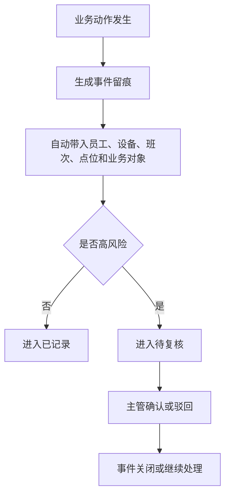
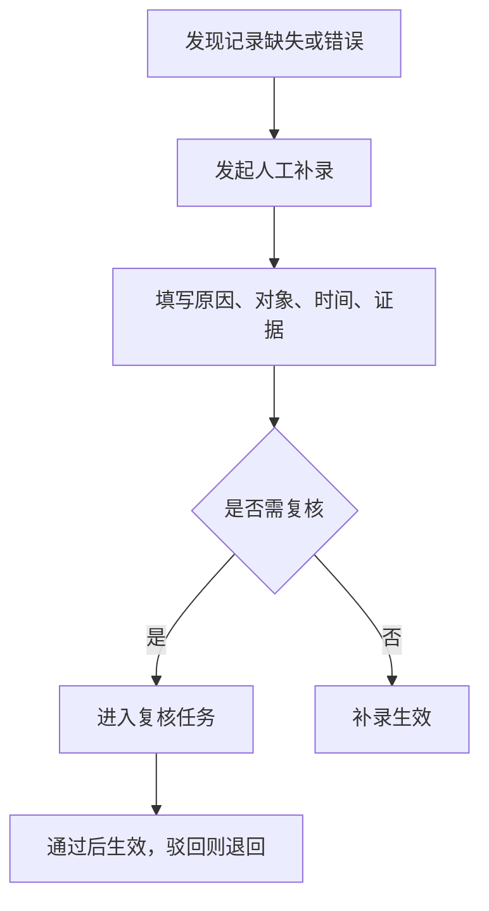
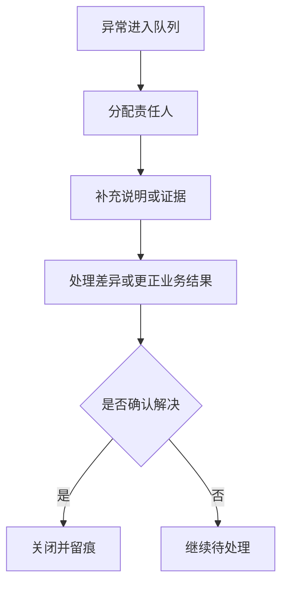
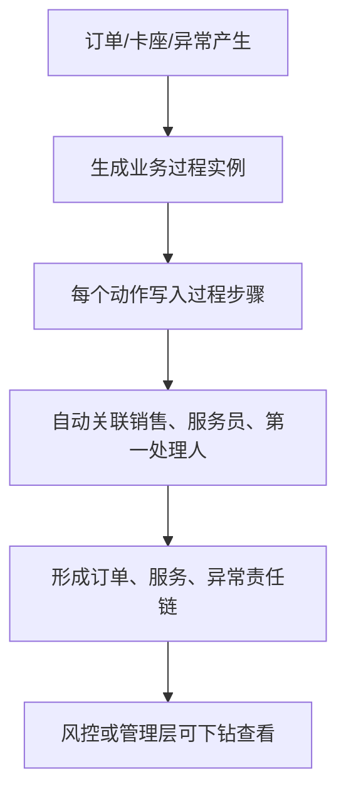

# 证据留痕与风控产品 PRD V0.1

## 1. 文档定位

本文档按经营风险和责任追溯拆解证据留痕与风控能力。它回答“哪些动作必须留痕、异常如何补录和复核、风险如何进入待办、如何为后续对账和管理判断提供证据”。

本文档不写技术方案，不做安全系统实现，不做 AI 算法实现。P0 聚焦业务留痕、人工补录、异常队列和基础风控规则。

## 2. P0 目标

P0 目标：
- 关键经营动作有统一留痕入口。
- 自动记录失败时允许受控人工补录。
- 人工放行、退款、免单、核销撤销、对账调整等高风险动作可进入复核。
- 异常事件能关联业务对象、员工、设备、点位、时间和证据。
- 酒水和可追责物品从库房到客人的交接过程能追溯。
- 订单获取、销售归属、卡座服务、异常第一处理人和责任变更能追溯。
- 留痕尽量由业务动作自动生成，人工只补原因、证据和复核意见。
- 管理层和运营能看到待处理风险。

## 3. 必须留痕的经营动作

| 动作 | 留痕原因 |
|---|---|
| 票务核销成功/失败/拒绝 | 影响权益使用和客流统计 |
| 订单获取和销售归属 | 影响业绩、提成、客户归属和责任判断 |
| 订台、开台和卡座服务 | 影响服务质量、最低消费、账单和客诉追溯 |
| 人工放行 | 可能绕过正常规则 |
| 退款、撤销、免单 | 影响收入和结算 |
| 酒吧账单调整 | 影响营业收入 |
| 现金/POS 收款确认 | 影响日结、对账和收款责任 |
| 酒水出库、后厨接收和送达 | 影响库存、客户履约和员工责任 |
| 游乐项目暂停/关闭 | 影响服务履约和安全 |
| 异常发现、第一处理、转派、升级和关闭 | 影响响应时效和责任判断 |
| 设备领用归还异常 | 影响责任链 |
| 第三方回流差异 | 影响对账口径 |
| 人工补录 | 可能改变经营事实 |
| 权限变更 | 影响谁能操作什么 |
| 主管复核 | 形成责任确认 |

## 4. 业务对象

| 对象 | 定义 | 关键关系 |
|---|---|---|
| 事件留痕 | 关键动作的事实记录 | 关联业务对象、人员、设备、点位 |
| 异常事件 | 对经营结果、现场安全或财务口径有影响的问题 | 关联补录、复核、证据 |
| 人工补录 | 对缺失或错误事实的受控补充 | 关联原业务、责任人、原因 |
| 复核任务 | 主管或责任人确认某个高风险动作 | 关联留痕、异常、结果 |
| 证据索引 | 视频、图片、会话、文件或备注的证据入口 | 关联事件、时间段、点位 |
| 风控规则 | 用于识别异常的业务规则 | 关联业务动作和待办 |
| 业务过程实例 | 一条订单、服务、异常或履约过程 | 关联过程步骤和时间线 |
| 业务过程步骤 | 过程中的单个动作 | 关联执行人、设备、点位和事件 |
| 服务责任记录 | 销售、服务员、异常第一处理人等责任归属；含财务责任段（退款人、免单人、审批人，trace-7） | 关联订单、卡座、客户和异常 |
| 企业微信风险命中 | 企业微信会话中的违规或服务风险 | 关联员工、客户、消息、复核任务 |
| 设备策略违规 | 工作手机私装软件或访问非白名单网站 | 关联员工、设备、策略和事件 |
| 物品追踪码 | 酒水或物料的平台唯一二维码 | 关联库存、订单、机器人任务和交接事件 |
| 交接记录 | 库管、机器人、后厨、服务员和客人之间的交接事实 | 关联追踪码、员工、设备、点位和证据 |

## 5. 事件状态

| 状态 | 含义 |
|---|---|
| 已记录 | 事件已生成 |
| 待补充 | 信息不完整 |
| 待复核 | 需要主管确认 |
| 已确认 | 复核通过 |
| 已驳回 | 复核不通过 |
| 已关闭 | 事件处理结束 |
| 已归档 | 历史只读 |

## 6. 风控规则 P0

| 规则 | 触发示例 | 处理方式 |
|---|---|---|
| 重复核销 | 同一权益短时间内多次使用 | 进入异常队列 |
| 人工放行 | 员工绕过正常核销 | 进入待复核 |
| 高频退款 | 同一渠道或员工异常退款 | 进入风险提示 |
| 销售归属缺失 | 订台或销售工作台订单没有销售归属 | 进入待补充 |
| 服务责任缺失 | 开台或点单后没有主责服务员 | 进入待补充 |
| 服务责任频繁变更 | 同一桌台短时间多次换服务责任人 | 进入服务复核 |
| 异常首响超时 | 异常上报后超过阈值无人接单处理 | 进入升级队列 |
| 酒吧免单/调账 | 超出普通权限或频次 | 进入待复核 |
| 酒水交接缺失 | 出库后缺少后厨接收、服务员取走或送达确认 | 进入待复核 |
| 酒水扫码不匹配 | 物品码与订单、库位或责任人不匹配 | 立即异常 |
| 游乐超容 | 核销数量超过容量 | 立即异常 |
| 场所超容（酒吧/全场入场超消防容量） | 按 venue/area 聚合的实时在场人数 ≥ 核定/消防容量（max_occupancy/fire_capacity） | 立即异常 + 超员预警 |
| 第三方差异 | 回流结果与平台结果不一致 | 进入差异处理 |
| 设备异常 | 未归还、挂失、跨班次使用 | 进入责任链异常 |

> 修订说明（2026-06-07 补"场所超容"；2026-06-24 售酒豁免收口）：合规 §9（C8）的"场所超容"规则 `VENUE_OVER_CAPACITY` 保留。原依 C1 补的"未成年售酒拦截/醉酒拒售"两条（`BAR_UNDERAGE_BLOCKED`/`BAR_INTOXICATED_REFUSED`）已于 2026-06-24 下线——售酒豁免：未成年人售酒法定义务由统一入场刷脸闸 18+ 核验承接，售酒环节不独立验龄/拒售（详见合规 §2、data-risk-ai §10.9）。

### 6.2 合规与场所安全规则码及等级（依据 C1/C8）

> 修订说明（2026-06-07，C1/C8 收口）：把上表新增的三条合规/安全规则与 data-risk-ai §10.9 的规则码、风险等级（§6.1 中英映射）对齐，作为本层与数据分析层共用口径，避免规则码两侧不一致。

| 规则码（与 data-risk-ai §10.9 一致） | 中文 | 风险等级 | 超员预警/处置 |
|---|---|---|---|
| `VENUE_OVER_CAPACITY` | 场所超容（酒吧/全场实时在场超消防容量） | critical | 实时在场（入场+1/离场-1，按 venue/area 聚合）≥ max_occupancy/fire_capacity 即触发**超员预警**；与入场卡控互补（卡控在入场口阻断、本规则做超员监测） |

> 说明：C1 未成年人售酒法定义务由统一入场闸 18+ 核验承接（2026-06-24 售酒豁免，bar 不独立验龄/拒售；原 `BAR_UNDERAGE_BLOCKED`/`BAR_INTOXICATED_REFUSED` 已下线）；C8 容量字段 fire_capacity/max_occupancy 已落 foundation venues/areas。本层只做命中、留痕、超员预警，不替代入场口硬卡控。

### 6.1 风险等级映射（依据 D6/analytics-8）

> 修订说明（2026-06-07）：统一风险等级中英映射，作为本层与数据分析层共用口径，避免各页各算。

| 中文 | 英文 code | 处置强度 |
|---|---|---|
| 低 | notice | 进入列表，关注 |
| 中 | suspicious | 进入待复核 |
| 高 | high | 生成工单，通知主管 |
| 严重 | critical | 可触发冻结、停用、强制审批 |

下游统计"高风险事件数"时按 **high+critical 合计**（高及以上），并单列 critical（严重），与 data-risk-ai §10.2 一致。

## 7. P0 流程

### 7.1 事件留痕

### 7.2 人工补录

### 7.3 异常关闭

### 7.4 责任链追溯

## 8. 页面清单

| 页面 | P0 内容 |
|---|---|
| 事件中心 | 全部事件、业务类型、状态、责任人 |
| 业务过程时间线 | 订单、服务、异常、履约全过程 |
| 服务责任链 | 销售归属、服务员、异常第一处理人、责任变更 |
| 人工补录 | 发起补录、补录记录、原因和证据 |
| 复核队列 | 待复核、已确认、已驳回 |
| 风险提示 | 重复核销、人工放行、高频退款、超容 |
| 企业微信质检 | 每日上传状态、基础违规命中、复核状态 |
| 设备策略违规 | 非预装软件、非白名单网站访问、设备锁定 |
| 证据索引 | 视频点位、会话、附件、备注、调阅记录 |
| 异常处理 | 异常分配、处理过程、关闭结果 |

### 8.1 企业微信会话留存合规（依据 C3 / compliance §4 / phone-2）

> 修订说明（2026-06-07）：企微质检页涉及会话原文留存与查看，现状"永久保存 + 不脱敏 + 管理者可查"未解决"凭什么合法收集与无限期保存"。PIPL 要求存储期限为实现目的所必要的最短时间。本节把留存合规落为本层 P0 产品口径，详细法律口径见《合规与个人信息保护要求》§4（C3），数据来源与字段见 data-risk-ai §11.5。

1. **合法性基础与告知同意**：明确处理合法性基础（人力资源管理必要性/规章制度/必要同意），员工入职监控告知并签署、客户侧服务场景告知；告知/同意记录可留痕举证。
2. **采集范围**：仅采集企业微信工作号工作会话，不及员工私人沟通。
3. **可配置留存期限**：把"永久保存"改为可配置留存期限，区分"质检/取证最短留存"与"长期归档"；到期归档或销毁/匿名化；长期保存须有合法性论证。
4. **离职/争议处置**：离职、合同终止或争议关闭后给出降级/销毁/匿名化处置策略。
5. **查看授权与审计**：普通展示按权限脱敏；管理者查看不脱敏原文须最小授权 + 审批 + 访问审计（写入 `conversation.sensitive.viewed`）。

## 9. P0 验收标准

- 所有核销、退款、人工放行、账单调整、项目暂停必须有留痕。
- 订单获取、销售归属、订台、卡座服务、异常第一处理人必须有留痕。
- 人工补录必须填写原因、责任人、时间和关联对象。
- 高风险动作能进入待复核队列。
- 事件能关联员工、设备、点位和业务对象。
- 异常关闭必须有处理结果。
- 风控 P0 先支持规则触发和人工处理，不要求自动判责。
- 企业微信会话能每日上传并进行基础违规检查。
- 企业微信会话留存须按可配置期限管理；普通展示按权限脱敏；查看不脱敏原文须鉴权、审批并写入审计（见 §8.1，C3）。
- 工作手机私装软件和非白名单网站访问能进入风险提示。
- 退款人、免单人有专门责任字段并可按责任人聚合，供退款/免单频次风控使用（trace-7）。
- 风险等级按 §6.1 中英映射统一；"高风险事件数"按 high+critical 合计（D6）。
- 事件能保留点位、设备和发生时间，为后续视频候选片段匹配预留条件。

## 10. P1/P2

| 阶段 | 能力 |
|---|---|
| P1 | 视频证据绑定、企微质检流程优化、规则配置化、风险分级、复核流细化、服务质量复盘 |
| P2 | AI 异常识别、企微深度语义质检、自动证据推荐、智能风控评分、自动复盘 |

## 11. 已确认规则和后续外部依赖

已确认：

1. 人工放行、免单、退款、调账、高价值报损/盘点差异/存酒作废、敏感视频/企微原文查看必须主管复核；普通操作留痕即可。
2. 人工补录不允许直接修改已结算数据；确需影响金额时必须发起上级权限申请，审批通过后形成冲正/调整留痕。
3. P0 视频证据保存索引和受控跳转/短期取证链接，必须能绑定到异常事件；平台内播放进入 P1，取决于视频平台 API 和授权能力。
4. 风控提示按责任类型分派：经营服务类由运营处理，金额/结算类由财务处理，高风险/严重风险由主管复核。
5. 风险事件关闭后允许再次打开，但必须记录重开原因、责任人和关联新证据。

后续外部依赖：

1. 真实视频平台 API 到位后确认播放、截图、取证链接和留存字段。
2. 法务/HR 确认敏感证据查看审批模板和留存周期。

## 11A. 统一异常责任链、企微违规命中与 SLA 升级口径澄清 `文档goalP1(2026-06-20)`

> 本节为产品语言的能力描述 + 业务规则 + 验收口径要点；可开发 + 可验收的权威细节（迁移号、operationId、`x-permission`、事件常量、DB CHECK、G/W/T）以 `docs/v099-v124-feature-implementation-and-acceptance-spec-v0.1.md` 为准（本节对应该文第 6 项「统一异常责任链」、第 9 项「企微违规命中」、第 15 项「工单 SLA 自动升级」）。先经 grep 后端/迁移核实功能真实存在再写。

### 11A.1 统一异常责任链 risk_alerts（权威：spec §6，V103）

能力描述：把 §3「异常发现、第一处理、转派、升级和关闭」与 §7.3 异常关闭流程落到**跨域统一异常汇聚层**，把各业务域（票务/酒吧/游乐/库存/财务/企微/设备/三方/分析/平台共 10 域）的异常统一汇聚为一条可追责的责任链，append-only 留痕每一步动作。经 grep 实证落于 `RiskAlertService`（report/claim/transfer/escalate/resolve/dismiss）+ 迁移 `V103__unified_risk_alerts.sql`（`risk_alerts` + `risk_alert_actions` 两表）。

业务规则（5 态责任链）：
- **状态机 5 态**：`open`（已上报）→ `handling`（已认领处理中）→ `escalated`（已升级）→ `resolved`（已解决）/ `dismissed`（已驳回/误报关闭）。
- **6 动作 append-only 留痕**：上报 report / 认领 claim / 转派 transfer / 升级 escalate / 解决 resolve / 驳回 dismiss——每个动作写一条不可改的责任链流水（含执行人、from/to 状态、原因、证据引用）。
- **resolved 必须有结论（DB 强约束）**：异常关闭为 resolved 时**必须携带处置结论**，否则被数据库 CHECK 拒绝，保证"异常关闭可审计、不可空关"。
- 上报幂等：带幂等键重放不重复建告警。

> 与本 PRD 既有口径的关系：本节是 §5「事件状态」（已记录/待复核/已确认/已驳回/已关闭…）在**跨域异常汇聚维度**的责任链落地，二者互补——§5 为单事件留痕态，本节为异常责任链流转态（5 态）。

验收口径要点（细化 G/W/T 见 spec §6）：
- 任一域产生异常 → report（带幂等键）→ 建 open 告警 + 写 report 责任链流水；同幂等键重放不重复建。
- escalated 告警 resolve 不传结论 → 被 DB CHECK 拒绝、无法置 resolved。
- open → claim → transfer → escalate → resolve（带结论）→ 5 态依次流转、4 条 append-only 留痕对应。

### 11A.2 企微违规命中 wecom_risk_hits（权威：spec §9，V106）

能力描述：把 §6「风控规则」与 §8.1「企业微信会话留存合规」中的"基础违规命中"落到**可配置规则码命中 + 复核队列衔接**，消除"命中无表承载"。经 grep 实证落于 `WecomConversationService`（同步会话 → 规则码命中 → 写命中 + 发事件）+ `ComplianceController`（命中查询 / 复核端点）+ 迁移 `V106__wecom_risk_hits_and_rules.sql`（`wecom_risk_hits` 表 + 5 条规则码 seed）。

业务规则：
- **规则码命中**：企微工作会话同步后，按可配置规则码（如 `STAFF_PRIVATE_PAYMENT` 员工私收款=critical、`STAFF_PRIVATE_DEAL` 私单、`LURE_PRIVATE_WECHAT` 诱导加私微等）匹配，命中即建 `open` 命中记录，命中片段脱敏存储。
- **进复核队列**：命中关联到复核队列（统一异常/分析告警，`source_domain=wecom`）；命中状态机 `open → reviewing → confirmed`（确认违规）/ `dismissed`（误报）。
- 规则可配：关键词由后台可配（启停生效），由原硬编码升级为规则配置。
- 幂等：同一消息同一规则码不重复命中。

> 字段依据：与本 PRD §6.2 合规规则码（`BAR_UNDERAGE_BLOCKED`/`VENUE_OVER_CAPACITY` 等）一致采用规则码 + 风险等级口径；企微规则码 seed 在 V106。

验收口径要点（细化 G/W/T 见 spec §9）：
- 启用 STAFF_PRIVATE_PAYMENT，同步拉到含"私收款"消息 → 建 open 命中（critical）、片段脱敏、写复核队列。
- 同消息同规则码重复同步 → 不重复命中。
- open 命中复核确认违规 → confirmed、回填复核人/意见；对已处置命中再复核报已处置错误码。

### 11A.3 「SLA 自动升级」口径澄清：人工 escalate（异常域）vs 工单域 V120 定时升级 `文档goalP1(2026-06-20)`

口径澄清：本 PRD §6「异常首响超时 → 进入升级队列」一处易被误读为"系统自动升级"。经 grep 实证，需区分**两套不同机制**，本 PRD 异常域为**人工升级**，工单域 V120 才是定时自动升级：

| 机制 | 触发方式 | 落地 | 状态/留痕 |
|---|---|---|---|
| 异常域升级（本 PRD §3/§6/§7.3） | **人工 escalate**（主管/责任人手动触发） | `RiskAlertService.escalateRiskAlert`（事件 `exception.escalated`），见 §11A.1 责任链 | handling → escalated，写 escalate 责任链流水 |
| 工单域 SLA 升级（merchant_service 工单，非本 PRD 直管） | **定时任务自动升级**（默认关，需显式开启） | `MerchantWorkOrderSlaEscalationJob`（`@Scheduled`，开关 `merchant.service.sla-escalation.scheduled.enabled=true` 才注册），迁移 `V120`（`sla_breached` + `escalated_at`） | 不改 status，仅打标 sla_breached + escalated_at + 写 escalated 动作；命中后移出待扫描索引防重复升级 |

业务规则：
- 本 PRD「异常首响超时进入升级队列」= 把超时异常**呈现到升级队列**供人工 escalate，升级动作本身是人工触发（异常域无定时自动升级）；权威见 spec §6。
- 工单域 V120 的 SLA 定时自动升级是 merchant_service 工单的独立机制（默认关），升级只打标 + 留痕、不改工单状态；权威见 spec §15。
- 两者不可混淆：异常域 escalate 与工单域 SLA 升级是不同对象、不同触发方式、不同留痕。

验收口径要点（细化 G/W/T 见 spec §6/§15）：
- 异常域：超时异常进升级队列 → 人工 escalate → handling→escalated、写责任链流水。
- 工单域：工单 due_at 已过、未关闭、未升级 + SLA 扫描任务运行（开关开启）→ 打标 sla_breached + escalated_at + 写 escalated 动作、status 不变；已升级工单不重复升级；开关未开则任务不注册。

> 待业务确认（evidence-risk）：本 PRD §6「异常首响超时」是否需要补充"超时呈现到升级队列"的明确呈现口径与超时阈值默认值；以及是否需要在 §6 风控规则表显式标注"升级=人工 escalate（异常域）"以与工单域 V120 定时升级区分，避免后续误实现为异常域自动升级。

## 12. 本版结论

证据留痕与风控 P0 的核心是“重要动作留得住、异常找得到、责任追得回、补录有边界”。它不追求一次性智能化，但必须先把经营事实、订单来源、销售归属、服务责任、异常首响和物品履约责任链放进统一队列。

## 13. 变更日志

| 日期 | 类型 | 位置 | 内容 | 原因/依据 |
|---|---|---|---|---|
| 2026-06-07 | 改 | §4 | 服务责任记录补财务责任段（退款人、免单人、审批人） | trace-7 |
| 2026-06-07 | 增 | §6.1 | 新增风险等级中英映射（低=notice/中=suspicious/高=high/严重=critical），高风险=high+critical | D6/analytics-8 |
| 2026-06-07 | 增 | §8.1 | 新增企业微信会话留存合规小节（合法性/告知同意/可配置留存/到期处置/查看审计） | C3/compliance §4/phone-2 |
| 2026-06-07 | 增 | §9 | 补企微留存、退款人/免单人责任、风险等级验收项 | C3/trace-7/D6 |
| 2026-06-07 | 增 | §6/§6.2 | 风控规则补"未成年售酒拦截/醉酒拒售/场所超容"三条及规则码与等级（BAR_UNDERAGE_BLOCKED=high、BAR_INTOXICATED_REFUSED=suspicious、VENUE_OVER_CAPACITY=critical），与 data-risk-ai §10.9 一字一致，并补超员预警口径 | compliance-land-6/C1 + compliance-land-5/critic-8/C8：合规要求的风控规则此前未落到本层第6章 |
| 2026-06-20 `文档goalP1` | 增 | §11A | 新增「统一异常责任链、企微违规命中与 SLA 升级口径澄清」：①统一异常责任链 risk_alerts（V103，发现→第一处理→转派→升级→关闭 5 态，resolved 必须有结论 DB CHECK）②企微违规命中 wecom_risk_hits（V106，规则码命中→复核队列）③澄清「SLA 自动升级」实为人工 escalate（异常域）/工单域 V120 定时升级，区分两者。权威指向 v099-v124-feature-implementation-and-acceptance-spec-v0.1.md §6/§9/§15 | 文档goalP1；grep 实证 RiskAlertService+V103、WecomConversationService+V106、MerchantWorkOrderSlaEscalationJob+V120 |
