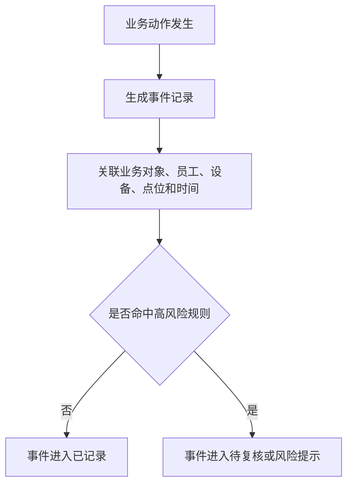
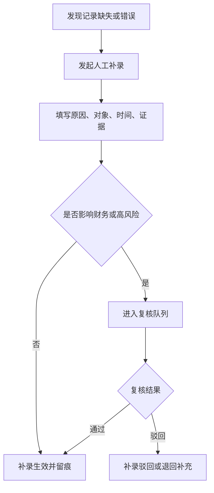
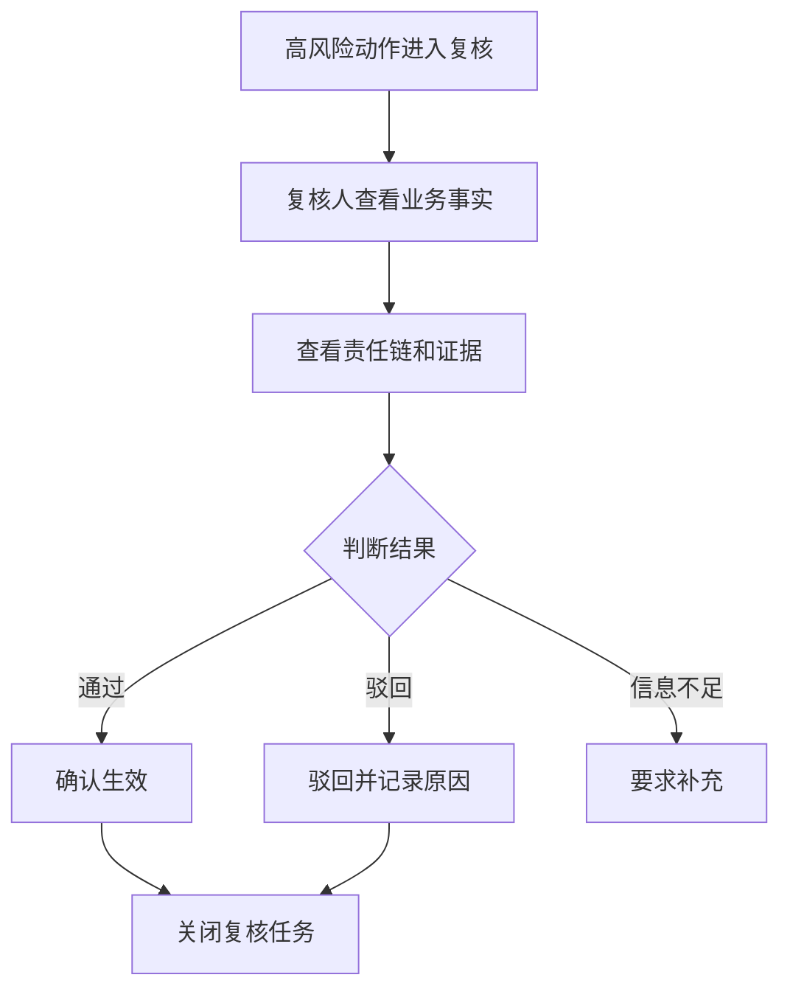
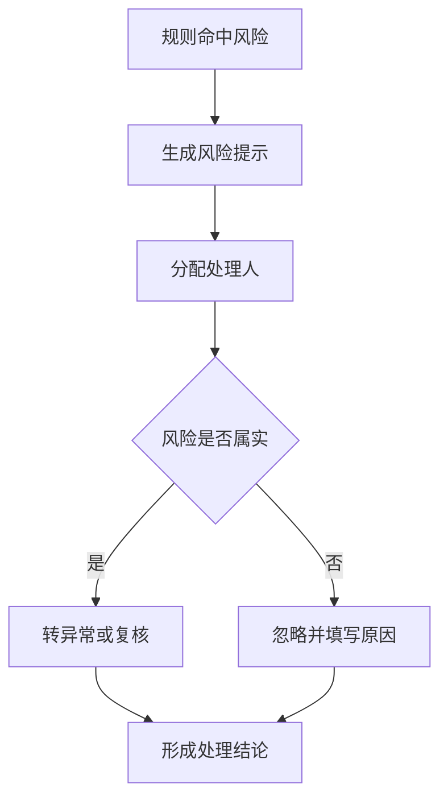
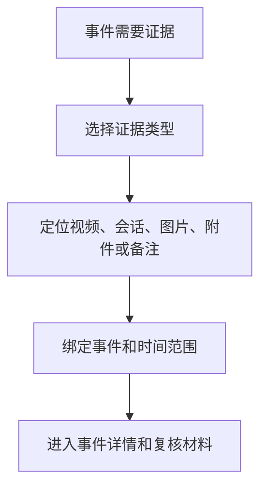
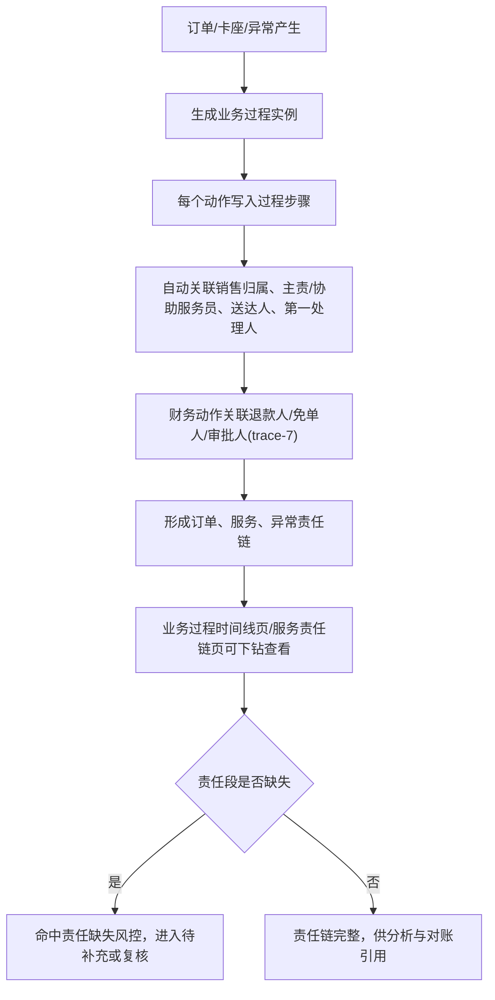

# 证据留痕与风控层产品规格 V0.2

## 1. 文档定位

本文由归档前的同层 PRD/页面清单/字段字典/流程图/低保真说明/验收清单机械合并而来，作为该能力层后续开发、业务审计和验收的统一入口。原拆分文件已移入 `_archive/20260610-retention-audit/merged-layer-spec-sources/`，仅作历史追溯。

## 2. 合并来源

| 原文件 | 归档位置 |
|---|---|
| `evidence-risk-layer-page-list-v0.1.md` | `_archive/20260610-retention-audit/merged-layer-spec-sources/evidence-risk-layer-page-list-v0.1.md` |
| `evidence-risk-layer-field-dictionary-v0.1.md` | `_archive/20260610-retention-audit/merged-layer-spec-sources/evidence-risk-layer-field-dictionary-v0.1.md` |
| `evidence-risk-layer-flow-diagrams-v0.1.md` | `_archive/20260610-retention-audit/merged-layer-spec-sources/evidence-risk-layer-flow-diagrams-v0.1.md` |
| `evidence-risk-layer-low-fi-prototype-v0.1.md` | `_archive/20260610-retention-audit/merged-layer-spec-sources/evidence-risk-layer-low-fi-prototype-v0.1.md` |
| `evidence-risk-layer-acceptance-checklist-v0.1.md` | `_archive/20260610-retention-audit/merged-layer-spec-sources/evidence-risk-layer-acceptance-checklist-v0.1.md` |

> 历史来源不可覆盖声明：本文中的“来源”和合并来源内容仅保留审计证据和历史上下文，不得覆盖 `00-current-effective-document-entry-v0.1.md`、`unified-standards-baseline-v0.1.md`、`openapi/openapi-p0.yaml`、`p0-openapi-operation-acceptance-matrix-v0.1.md`、`p0-openapi-contract-closure-appendix-v0.1.md`、`p0-operation-permission-matrix-v0.1.md`、`p0-action-event-evidence-matrix-v0.1.md`、`p0-end-to-end-acceptance-and-edge-cases-v0.1.md` 和 `p0-user-story-map-and-sprint-slices-v0.1.md`。若历史段落与当前事实源冲突，以当前 S0/S1 文档为准。

## 2A. AI-ready 四件套执行入口

本文是证据留痕与风控层产品规格入口。任何开发任务都必须把本文的页面、字段和流程映射到正式事件、权限、接口和验收矩阵后再实施。

| 四件套 | 本文执行要求 | 权威引用 |
|---|---|---|
| 反模式 | 不得只在页面显示风险但不写事件；不得允许高风险补录、调阅视频、退款免单、核销冲正无权限、无证据、无复核留痕 | `p0-action-event-evidence-matrix-v0.1.md`、`p0-operation-permission-matrix-v0.1.md` |
| 测试用例 | 必须覆盖事件生成、事件查询、证据绑定、人工补录、复核队列、责任链追溯和风险处置的 Given/When/Then，并能映射到 OpenAPI 追溯附录 | `p0-end-to-end-acceptance-and-edge-cases-v0.1.md`、`p0-openapi-operation-acceptance-matrix-v0.1.md`、`p0-openapi-contract-closure-appendix-v0.1.md` |
| 错误处理 | 必须覆盖事件写入失败、证据缺失、权限不足、重复补录、状态冲突、视频/企微供应商不可用和人工复核拒绝 | `p0-api-contract-pack-v0.1.md`、`third-party-supplier-integration-kit-v0.1.md` |
| 精确引用 | 事件、权限、接口和验收不得使用“见相关文档”；必须引用正式事件名、权限点、OpenAPI exact path、operationId 或追溯附录条目 | `docs/openapi/openapi-p0.yaml`、`p0-openapi-contract-closure-appendix-v0.1.md`、`p0-task-api-permission-event-acceptance-map-v0.1.md` |

## 2B. 顶层变更记录

| 日期 | 类型 | 内容 | 原因/依据 |
|---|---|---|---|
| 2026-06-12 | 增 | 新增 AI-ready 四件套执行入口，要求页面、字段和流程映射到正式事件、权限、接口和验收矩阵后再开发 | 防止证据风控规格只停留在页面说明，缺事件、权限和错误处理闭环 |
| 2026-06-13 | 改 | AI-ready 四件套补入 `p0-openapi-contract-closure-appendix-v0.1.md` 和追溯附录条目要求 | 防止证据风控开发只看事件/权限矩阵，遗漏 operation 到终端、任务簇和样例准入追溯 |

---

## 3. 来源：证据留痕与风控层页面清单 V0.1

> 原文件：`evidence-risk-layer-page-list-v0.1.md`

### 证据留痕与风控层页面清单 V0.1

### 1. 文档定位

本文档定义证据留痕与风控层 P0 页面入口。该层负责回答“出了什么事、能否追溯、风险在哪里、谁来复核”。

### 2. 页面分组总览

> 修订说明（2026-06-07，依据 tracewire-6）：本清单此前缺 PRD §8 已列的"业务过程时间线"和"服务责任链"两页，导致责任链追溯页只在 PRD 有、page-list 无落点。现补入这两页并新增页面职责（见第10/11节），与 PRD §8 对齐。

| 页面组 | 页面 | P0 目的 |
|---|---|---|
| 事件管理 | 事件中心、事件详情 | 查看全平台关键事件和处理进度 |
| 责任链追溯 | 业务过程时间线、服务责任链 | 看订单/服务/异常/履约全过程与责任归属 |
| 补录管理 | 人工补录、补录详情 | 受控补齐缺失或错误经营事实 |
| 复核管理 | 复核队列、复核历史 | 处理人工放行、退款、免单等高风险动作 |
| 风险提示 | 风险总览、规则命中记录 | 看重复核销、超容、高频退款等风险 |
| 证据索引 | 视频证据、企微会话、附件备注 | 为事件和复核提供证据入口 |
| 企业微信质检 | 每日上传状态、违规命中、会话复核 | 看服务风险和违规沟通 |
| 设备策略违规 | 私装软件、非白名单网站访问、设备锁定 | 看工作手机管控风险 |

### 3. 事件中心页

| 项 | 内容 |
|---|---|
| 页面目的 | 查看所有业务层关键事件 |
| 关键字段 | 事件编号、事件类型、关联对象、责任人、点位、状态、发生时间 |
| 关键操作 | 查看详情、分配处理人、转复核、关闭 |
| 筛选 | 业务类型、风险等级、状态、责任人、日期 |

### 4. 事件详情页

| 项 | 内容 |
|---|---|
| 页面目的 | 查看单个事件的事实、证据和处理过程 |
| 信息区块 | 事件摘要、关联业务、责任链、证据、处理记录、复核结果 |
| 关键操作 | 补充说明、绑定证据、发起复核、关闭事件 |

### 5. 人工补录页

| 项 | 内容 |
|---|---|
| 页面目的 | 发起和管理人工补录 |
| 关键字段 | 补录类型、原业务对象、补录原因、责任人、证据、复核状态 |
| 关键操作 | 新建补录、提交复核、撤回、查看结果 |
| 页面要求 | 高风险补录必须提示影响范围 |

### 6. 复核队列页

| 项 | 内容 |
|---|---|
| 页面目的 | 给主管、财务或运营处理待复核事项 |
| 关键字段 | 复核类型、发起人、业务对象、风险原因、证据、超时时间 |
| 关键操作 | 通过、驳回、要求补充、转交 |
| 状态 | 待复核、已确认、已驳回、待补充、已关闭 |

### 7. 风险提示页

| 项 | 内容 |
|---|---|
| 页面目的 | 展示规则命中的风险事件 |
| 关键字段 | 风险类型、风险等级、命中规则、关联对象、责任人、处理状态 |
| 关键操作 | 查看事件、确认风险、转异常、忽略 |

### 8. 证据索引页

| 项 | 内容 |
|---|---|
| 页面目的 | 管理视频、企业微信会话、附件、备注等证据索引 |
| 关键字段 | 证据类型、来源、关联事件、时间范围、调阅人、说明 |
| 关键操作 | 绑定事件、解除绑定、补充说明、查看调阅记录 |

### 9. 业务过程时间线页（依据 tracewire-6，对齐 PRD §8）

| 项 | 内容 |
|---|---|
| 页面目的 | 按一条订单、服务、异常或履约过程，串起全过程步骤的时间线 |
| 关键字段 | 过程实例编号、过程类型、关联业务对象、步骤序列（动作、执行人、设备、点位、时间、关联事件）、当前状态 |
| 关键操作 | 查看过程时间线、定位某步骤事件、跳转事件详情、导出过程证据 |
| 数据来源 | business_process_instances、business_process_step_records、audit_events |
| 筛选 | 过程类型、业务对象、责任人、日期 |

### 10. 服务责任链页（依据 tracewire-6/trace-7，对齐 PRD §8）

| 项 | 内容 |
|---|---|
| 页面目的 | 查看销售归属、主责/协助服务员、异常第一处理人、责任变更以及退款人/免单人等责任归属 |
| 关键字段 | 订单/卡座/异常对象、销售归属人(sales_staff_id)、主责服务员、协助服务员、加单人、送达人、换人记录、第一处理人、退款人(refunded_by)、免单人(waived_by)、审批人 |
| 关键操作 | 查看责任链、下钻责任段事件、跳转业务过程时间线、发起服务复核 |
| 数据来源 | service_responsibility_records（财务责任段：退款人 refunded_by/免单人 waived_by/审批人 approved_by——**产品字段已定义，落库以 service_responsibility_records 财务责任段为准，地基已补；权威落点见 foundation-database §6.12**）、订单、bar_table_sessions、异常事件 |
| 筛选 | 责任类型、销售/服务员、退款人/免单人、卡座、日期 |

> 修订说明（2026-06-07，broken-ref-1/overclaim-2 收口）：原"数据来源"把退款人/免单人当作 service_responsibility_records **既有**字段引用，但 trace-7 时该两字段尚未在权威表落库。本轮地基侧已在 foundation-database §6.12 的 service_responsibility_records 补入 refunded_by/waived_by/approved_by 财务责任段字段（已核对落库），故此处统一标注为"产品字段已定义、落库以该表财务责任段为准（地基已补，权威落点 foundation-database §6.12）"，与 data-analysis 验收清单"待 trace-7 落地→已落地"口径一致，不再悬挂引用。（注：operation-traceability §6.6 PRD 字段表暂未同步列出该三段，落库以 foundation-database §6.12 为准。）

### 11. 页面验收标准

- 事件、补录、复核、风险、证据必须有独立入口。
- 业务过程时间线与服务责任链必须有独立入口，且与 PRD §8 一致。
- 服务责任链必须能查看销售归属、主责/协助服务员、送达人、换人记录、异常第一处理人，以及退款人和免单人（trace-7）。
- 高风险动作必须能进入复核队列。
- 事件详情必须显示责任人、设备、点位、时间和证据。
- 复核必须留下通过、驳回或补充说明。
- 风险提示可忽略，但必须填写原因。

### 12. 本版结论

证据留痕与风控层页面清单已覆盖 P0 责任追溯和风险处理所需入口，并补齐业务过程时间线与服务责任链两页。

### 13. 变更日志

| 日期 | 类型 | 位置 | 内容 | 原因/依据 |
|---|---|---|---|---|
| 2026-06-07 | 增 | §2、§9、§10 | 补"业务过程时间线"与"服务责任链"两页及职责，与 PRD §8 对齐 | tracewire-6 |
| 2026-06-07 | 增 | §10/§11 | 服务责任链页补退款人/免单人责任段与验收项 | trace-7 |
| 2026-06-07 | 改 | §10 | "数据来源"退款人/免单人由当作既有字段引用，统一标注"产品字段已定义、落库以 service_responsibility_records 财务责任段为准（地基已补，权威落点 foundation-database §6.12 已核对）"，不再悬挂引用 | broken-ref-1/overclaim-2 |

---

## 4. 来源：证据留痕与风控层字段字典 V0.1

> 原文件：`evidence-risk-layer-field-dictionary-v0.1.md`

### 证据留痕与风控层字段字典 V0.1

### 1. 文档定位

本文档定义证据留痕与风控层 P0 产品字段。字段用于追溯、复核、风险提示和证据关联。

### 2. 事件字段

| 字段名 | 含义 | 必填 | 用途 |
|---|---|---|---|
| 事件编号 | 事件识别 | 是 | 追溯 |
| 事件类型 | 核销、退款、补录、免单、超容、设备异常等 | 是 | 分类 |
| 业务来源 | 票务、酒吧、游乐、第三方、财务、平台治理 | 是 | 定位 |
| 关联对象 | 订单、权益、账单、场次、设备、合同等 | 是 | 追溯 |
| 责任人 | 事件责任员工或处理人 | 是 | 责任链 |
| 责任岗位 | 员工所在岗位 | 否 | 责任分析 |
| 发生点位 | 事件发生空间或点位 | 条件必填 | 现场定位 |
| 发生时间 | 事件发生时间 | 是 | 排查 |
| 事件状态 | 已记录、待补充、待复核等 | 是 | 流程 |
| 风险等级 | 低=notice、中=suspicious、高=high、严重=critical（D6） | 是 | 优先级 |

### 3. 人工补录字段

| 字段名 | 含义 | 必填 | 用途 |
|---|---|---|---|
| 补录编号 | 补录识别 | 是 | 追溯 |
| 补录类型 | 核销、退款、账单、第三方、设备、巡检等 | 是 | 分类 |
| 原业务对象 | 被补录的原对象 | 是 | 影响判断 |
| 补录原因 | 为什么需要补录 | 是 | 审计 |
| 补录内容 | 需要补齐的事实 | 是 | 业务修正 |
| 发起人 | 发起补录的人 | 是 | 责任链 |
| 证据索引 | 支撑补录的证据 | 条件必填 | 复核 |
| 是否影响财务 | 是否影响收入、退款、对账或结算 | 是 | 风险判断 |
| 补录状态 | 草稿、待复核、已生效、已驳回、已作废 | 是 | 流程 |

### 4. 复核字段

| 字段名 | 含义 | 必填 | 用途 |
|---|---|---|---|
| 复核编号 | 复核任务识别 | 是 | 追溯 |
| 复核类型 | 人工放行、退款、免单、补录、差异调整等 | 是 | 分类 |
| 发起对象 | 关联事件或补录 | 是 | 追溯 |
| 发起人 | 谁提交复核 | 是 | 责任 |
| 复核人 | 谁负责确认 | 是 | 权限和责任 |
| 复核意见 | 通过、驳回、要求补充的说明 | 条件必填 | 审计 |
| 复核结果 | 待复核、已确认、已驳回、待补充 | 是 | 流程 |
| 复核时间 | 处理时间 | 条件必填 | 追溯 |

### 5. 风险字段

| 字段名 | 含义 | 必填 | 用途 |
|---|---|---|---|
| 风险编号 | 风险提示识别 | 是 | 追溯 |
| 风险类型 | 重复核销、高频退款、超容、设备异常等 | 是 | 分类 |
| 命中规则 | 触发风险的规则说明 | 是 | 判断 |
| 风险等级 | 低=notice、中=suspicious、高=high、严重=critical（D6） | 是 | 优先级 |
| 关联事件 | 风险对应事件 | 是 | 处理 |
| 处理人 | 当前处理责任人 | 是 | 待办 |
| 处理结论 | 确认、忽略、转异常、转复核 | 条件必填 | 关闭依据 |
| 风险状态 | 待处理、处理中、待复核、已关闭、已忽略 | 是 | 流程 |

### 6. 证据字段

| 字段名 | 含义 | 必填 | 用途 |
|---|---|---|---|
| 证据编号 | 证据索引识别 | 是 | 追溯 |
| 证据类型 | 视频、会话、图片、附件、备注 | 是 | 分类 |
| 证据来源 | 第三方系统、人工上传、平台记录 | 是 | 来源 |
| 关联事件 | 证据绑定事件 | 是 | 追溯 |
| 时间范围 | 证据对应时间段 | 条件必填 | 查证 |
| 点位 | 证据对应空间或设备点位 | 条件必填 | 查证 |
| 调阅人 | 谁查看或使用过证据 | 否 | 审计 |
| 证据说明 | 证据摘要 | 是 | 复核 |

### 6.1 服务责任字段（依据 tracewire-6/trace-7）

> 修订说明（2026-06-07）：补"服务责任链"页（page-list §10）所需的责任归属字段。其中**退款人、免单人**为 trace-7 点名缺失的财务责任字段：退款和免单是高风险动作，须有专门责任字段并可按责任人聚合（供 FIN_REFUND_ABNORMAL、酒吧免单调账风控使用）。
>
> 修订说明（2026-06-07，broken-ref-1/overclaim-2 收口）：原措辞"落库以 `service_responsibility_records`（增财务责任段）**或**新增 `finance_responsibility_records` 承载"属落库表未定的乐观引用。本轮地基侧已明确落点：**产品字段已定义，落库以 `service_responsibility_records` 财务责任段为准（地基已补，权威落点 foundation-database §6.12 已含 refunded_by/waived_by/approved_by 三字段，已核对）**；不再保留 `finance_responsibility_records` 二选一表述。与 data-analysis 验收清单"待 trace-7 落地→已落地"口径一致，在落库表确定前不表述为"已闭环"。

| 字段名 | 含义 | 必填 | 用途 |
|---|---|---|---|
| 责任记录编号 | 服务/财务责任记录识别 | 是 | 追溯 |
| 关联对象 | 订单、卡座会话或异常 | 是 | 定位责任范围 |
| 销售归属人 | sales_staff_id，订单销售归属 | 条件必填 | 业绩与销售归属率 |
| 主责服务员 | 开台/服务的主责人 | 条件必填 | 卡座服务责任完整率 |
| 协助服务员 | 协助服务人员 | 否 | 责任分析 |
| 加单人 | 追加点单的操作人 | 否 | 责任分析 |
| 送达人 | 送达确认的责任人 | 条件必填 | 送达确认率 |
| 换人记录 | 主责服务员变更记录 | 否 | 服务责任变更次数 |
| 异常第一处理人 | 异常首响责任人 | 条件必填 | 异常首响时长 |
| 退款人 | refunded_by，执行退款的责任人（落库：service_responsibility_records 财务责任段，foundation-database §6.12，地基已补） | 条件必填 | 退款追责与频次风控（trace-7） |
| 免单人 | waived_by，执行免单的责任人（落库：service_responsibility_records 财务责任段，foundation-database §6.12，地基已补） | 条件必填 | 免单追责与频次风控（trace-7） |
| 审批人 | approved_by，退款/免单/调账的审批责任人（落库：service_responsibility_records 财务责任段，foundation-database §6.12，地基已补） | 条件必填 | 复核与责任确认 |

### 7. 状态字段

| 对象 | 状态 |
|---|---|
| 事件 | 已记录、待补充、待复核、已确认、已驳回、已关闭、已归档 |
| 补录 | 草稿、待复核、已生效、已驳回、已作废、已归档 |
| 复核 | 待复核、待补充、已确认、已驳回、已关闭 |
| 风险 | 待处理、处理中、待复核、已关闭、已忽略 |
| 证据 | 待绑定、已绑定、已调阅、已作废、已归档 |

### 8. 字段验收标准

- 每个事件必须能关联业务对象。
- 高风险动作必须有复核字段。
- 人工补录必须有原因和责任人。
- 证据必须说明来源和关联事件。
- 风险关闭必须有处理结论。
- 风险等级必须给中英映射（低=notice、中=suspicious、高=high、严重=critical），与 D6 一致。
- 服务责任字段必须能区分销售归属人、主责/协助服务员、送达人、异常第一处理人，以及退款人和免单人（trace-7）。

### 9. 本版结论

证据留痕与风控层字段已覆盖 P0 责任追溯、补录复核和风险处理，并补齐服务/财务责任字段（含退款人、免单人）与风险等级中英映射。

### 10. 变更日志

| 日期 | 类型 | 位置 | 内容 | 原因/依据 |
|---|---|---|---|---|
| 2026-06-07 | 改 | §2/§5 | 风险等级补中英映射（低=notice/中=suspicious/高=high/严重=critical） | analytics-8/D6 |
| 2026-06-07 | 增 | §6.1 | 新增"服务责任字段"小节，含退款人(refunded_by)、免单人(waived_by)等责任字段及落库表说明 | tracewire-6/trace-7 |
| 2026-06-07 | 增 | §8 | 补风险等级映射与服务责任字段验收项 | D6/trace-7 |
| 2026-06-07 | 改 | §6.1 | 退款人/免单人/审批人落库表由"service_responsibility_records 或 finance_responsibility_records"二选一统一为"以 service_responsibility_records 财务责任段为准（地基已补，权威落点 foundation-database §6.12，已核对）"，字段行就地标注落库源 | broken-ref-1/overclaim-2：原落库表未定属乐观引用，落库表确定前不标"已闭环" |

---

## 5. 来源：证据留痕与风控层关键流程图 V0.1

> 原文件：`evidence-risk-layer-flow-diagrams-v0.1.md`

### 证据留痕与风控层关键流程图 V0.1

### 1. 文档定位

本文档描述证据留痕与风控层 P0 关键流程，包括事件生成、人工补录、复核、风险提示和证据绑定。

### 2. F1 事件自动留痕

### 3. F2 人工补录

### 4. F3 复核处理

### 5. F4 风险提示处理

### 6. F5 证据绑定

### 6.1 F6 责任链追溯（依据 tracewire-6，对齐 PRD §7.4）

> 修订说明（2026-06-07）：补"业务过程时间线"与"服务责任链"两页对应的追溯流程，使 page-list §9/§10 两页有流程支撑。

### 7. 流程验收标准

- 每个高风险动作必须进入复核或风险提示。
- 人工补录不能绕过留痕。
- 复核驳回必须说明原因。
- 证据必须绑定事件才能作为复核依据。
- 风险忽略必须填写原因。
- 责任链追溯必须能形成订单/服务/异常责任链，并关联退款人/免单人等财务责任（trace-7）。
  > 修订说明（2026-06-07，broken-ref-1/overclaim-2 收口）：退款人(refunded_by)/免单人(waived_by)/审批人(approved_by)为产品字段已定义，落库以 `service_responsibility_records` 财务责任段为准（地基已补，权威落点 foundation-database §6.12，已核对），本流程图节点据此关联，不悬挂未建表。

### 8. 本版结论

证据留痕与风控层流程已覆盖 P0 追溯和风控闭环，并补责任链追溯流程（含财务责任段）。

### 9. 变更日志

| 日期 | 类型 | 位置 | 内容 | 原因/依据 |
|---|---|---|---|---|
| 2026-06-07 | 增 | §6.1 | 新增 F6 责任链追溯流程，含退款人/免单人财务责任段，对齐 PRD §7.4 与 page-list §9/§10 | tracewire-6/trace-7 |
| 2026-06-07 | 改 | §7 | 责任链财务责任段就地标注落库以 service_responsibility_records 财务责任段为准（地基已补，foundation-database §6.12），统一全链路落库口径 | broken-ref-1/overclaim-2 |

---

## 6. 来源：证据留痕与风控层低保真原型说明 V0.1

> 原文件：`evidence-risk-layer-low-fi-prototype-v0.1.md`

### 证据留痕与风控层低保真原型说明 V0.1

### 1. 文档定位

本文档说明证据留痕与风控层页面的低保真结构。它不定义视觉样式，只定义信息架构和页面区块。

### 2. 信息架构

> 修订说明（2026-06-07，依据 tracewire-6）：二级入口补"业务过程时间线"与"服务责任链"两页，对齐 PRD §8 与 page-list §9/§10。

| 一级入口 | 二级入口 |
|---|---|
| 事件风控 | 事件中心、业务过程时间线、服务责任链、人工补录、复核队列、风险提示、证据索引 |

### 3. 事件中心低保真

结构：
- 顶部指标：今日事件、待复核、待补充、高风险、已关闭。
- 筛选区：业务来源、事件类型、风险等级、责任人、状态、日期。
- 事件列表：事件编号、关联对象、责任人、点位、状态。
- 详情区：事件事实、责任链、证据、处理记录。

#### 3.1 业务过程时间线低保真（依据 tracewire-6）

结构：
- 顶部：过程实例编号、过程类型、关联业务对象、当前状态。
- 时间线区：按时间排列的过程步骤（动作、执行人、设备、点位、时间）。
- 步骤详情：点击步骤展开关联事件。
- 下钻：跳转事件详情、导出过程证据。

#### 3.2 服务责任链低保真（依据 tracewire-6/trace-7）

结构：
- 顶部筛选：责任类型、销售/服务员、退款人/免单人、卡座、日期。
- 责任卡片：销售归属人、主责/协助服务员、送达人、异常第一处理人、退款人、免单人、审批人。
  > 修订说明（2026-06-07，broken-ref-1/overclaim-2 收口）：退款人(refunded_by)/免单人(waived_by)/审批人(approved_by)为产品字段已定义，落库以 `service_responsibility_records` 财务责任段为准（地基已补，权威落点 foundation-database §6.12，已核对），原型据此展示，不悬挂未建表。
- 责任段明细：换人记录、各责任段对应事件。
- 缺失提示：责任段缺失时高亮，提示进入待补充或服务复核。
- 下钻：跳转业务过程时间线、责任段事件。

### 4. 人工补录低保真

结构：
- 补录类型选择。
- 关联原业务对象。
- 原因和说明。
- 证据上传或绑定。
- 是否影响财务提示。
- 提交或进入复核。

重点：
- 不能只填结果，必须填写原因和责任人。

### 5. 复核队列低保真

结构：
- 待复核列表。
- 风险原因和影响范围。
- 业务事实摘要。
- 证据区。
- 操作区：通过、驳回、要求补充。

### 6. 风险提示低保真

结构：
- 风险类型卡片。
- 命中规则列表。
- 关联事件和业务对象。
- 处理动作：确认、转异常、忽略。

### 7. 证据索引低保真

结构：
- 证据类型筛选。
- 关联事件搜索。
- 时间范围和点位。
- 已绑定证据列表。
- 调阅记录。

### 8. 验收标准

- 高风险事件在首屏有可见入口（高风险=high+critical 合计，并可单看 critical，D6）。
- 业务过程时间线与服务责任链两页有独立低保真结构，且与 PRD §8、page-list §9/§10 一致。
- 服务责任链能展示退款人、免单人等财务责任（trace-7）。
- 事件详情能看见事实、责任链和证据。
- 复核操作不能缺少意见。
- 人工补录必须有原因。
- 风险忽略必须有说明。

### 9. 本版结论

证据留痕与风控层低保真已满足 P0 风险处理和责任追溯页面结构，并补齐业务过程时间线与服务责任链两页。

### 10. 变更日志

| 日期 | 类型 | 位置 | 内容 | 原因/依据 |
|---|---|---|---|---|
| 2026-06-07 | 增 | §2、§3.1、§3.2 | 信息架构补两页，新增业务过程时间线与服务责任链低保真结构（含退款人/免单人责任段） | tracewire-6/trace-7 |
| 2026-06-07 | 改 | §3.2 | 责任卡片财务责任段就地标注落库以 service_responsibility_records 财务责任段为准（地基已补，foundation-database §6.12），统一全链路落库口径 | broken-ref-1/overclaim-2 |
| 2026-06-07 | 改 | §8 | 高风险口径按 high+critical 合计，补两页一致性与财务责任验收项 | D6/trace-7 |

---

## 7. 来源：证据留痕与风控层产品验收清单 V0.1

> 原文件：`evidence-risk-layer-acceptance-checklist-v0.1.md`

### 证据留痕与风控层产品验收清单 V0.1

### 1. 文档定位

本文档用于验收证据留痕与风控层产品文档是否完整。

### 2. 文档完整度

| 文档 | 状态 |
|---|---|
| `evidence-risk-control-product-prd-v0.1.md` | 已完成 |
| `evidence-risk-layer-page-list-v0.1.md` | 已完成 |
| `evidence-risk-layer-field-dictionary-v0.1.md` | 已完成 |
| `evidence-risk-layer-flow-diagrams-v0.1.md` | 已完成 |
| `evidence-risk-layer-low-fi-prototype-v0.1.md` | 已完成 |

### 3. 模块验收

> 修订说明（2026-06-07，依据 tracewire-6）：补 PRD §8 已列、page-list 此前缺的"业务过程时间线"与"服务责任链"两页验收，使责任链追溯页有验收落点。

| 模块 | 结果 |
|---|---|
| 事件中心 | 通过 |
| 业务过程时间线 | 通过（对齐 PRD §8、page-list §9） |
| 服务责任链 | 通过（产品字段已定义；退款人/免单人/审批人落库以 service_responsibility_records 财务责任段为准，地基已补，权威落点 foundation-database §6.12，trace-7/broken-ref-1） |
| 人工补录 | 通过 |
| 复核队列 | 通过 |
| 风险提示 | 通过 |
| 证据索引 | 通过 |

### 4. P0 规则验收

- 人工放行必须留痕。
- 退款、免单、账单调整必须可复核。
- 退款人、免单人必须有专门责任字段并可按责任人聚合（trace-7）。
- 游乐超容必须进入风险提示。
- 第三方差异必须能形成事件或差异记录。
- 人工补录必须有原因、责任人和证据。
- 订单获取、销售归属、卡座服务、异常第一处理人、责任变更必须能在服务责任链页追溯。
- 风险等级按中英映射统一：低=notice、中=suspicious、高=high、严重=critical；"高风险"统计为 high+critical 合计（D6）。

### 5. 已确认验收口径

1. 主管复核：人工放行、高风险事件关闭、设备解锁、敏感证据导出/查看、高价值库存差异、合同/权限/主体异常放行必须复核。
2. 财务复核：退款、免单、调账、库存差异入账、结算差异处理、应收应付调整必须复核。
3. 视频证据 P0 不强制平台内播放或自动绑定；P0 支持证据索引、附件/截图/片段链接、调阅审计和人工关联，平台内直看按视频供应商能力进入 P1/P2。
4. ~~风险等级是否先固定低、中、高~~ → 已按 D6 固定四级中英映射（低=notice/中=suspicious/高=high/严重=critical），不再悬置。

### 6. 本版结论

证据留痕与风控层 P0 **产品文档**已覆盖业务过程时间线、服务责任链两页与退款人/免单人责任字段；可进入后续详细交互或实现任务拆解。

> 修订说明（2026-06-07，overclaim-2/broken-ref-1 收口）：退款人/免单人/审批人为**产品字段已定义**，落库以 `service_responsibility_records` 财务责任段为准（地基已补，权威落点 foundation-database §6.12，已核对）；本结论限定为"产品文档闭环"，落库 DDL 以 foundation-database §6.12 为准，与 data-analysis 验收清单"待 trace-7 落地→已落地"口径一致，不在落库表未定时笼统表述为"全部已闭环"。

### 7. 变更日志

| 日期 | 类型 | 位置 | 内容 | 原因/依据 |
|---|---|---|---|---|
| 2026-06-07 | 增 | §3 | 补"业务过程时间线""服务责任链"两页模块验收 | tracewire-6 |
| 2026-06-07 | 增 | §4 | 补退款人/免单人责任字段、责任链追溯、风险等级映射验收项 | trace-7/D6 |
| 2026-06-07 | 改 | §5 | 风险等级待确认项按 D6 固定四级映射，撤销悬置 | D6 |
| 2026-06-07 | 改 | §3/§6 | 服务责任链验收与本版结论：退款人/免单人/审批人标"产品字段已定义、落库以 service_responsibility_records 财务责任段为准（地基已补，foundation-database §6.12）"，结论限定为"产品文档闭环"，与 data-analysis 验收清单口径一致，不在落库未定时笼统标"已闭环" | overclaim-2/broken-ref-1 |

