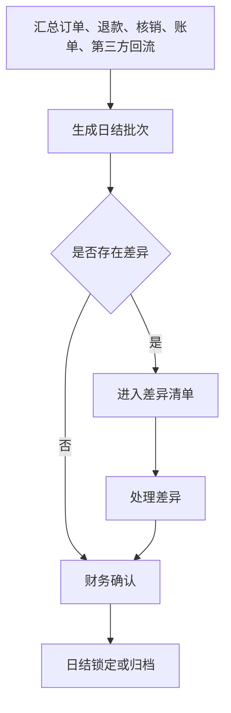
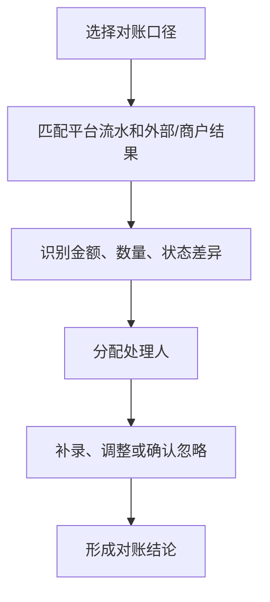
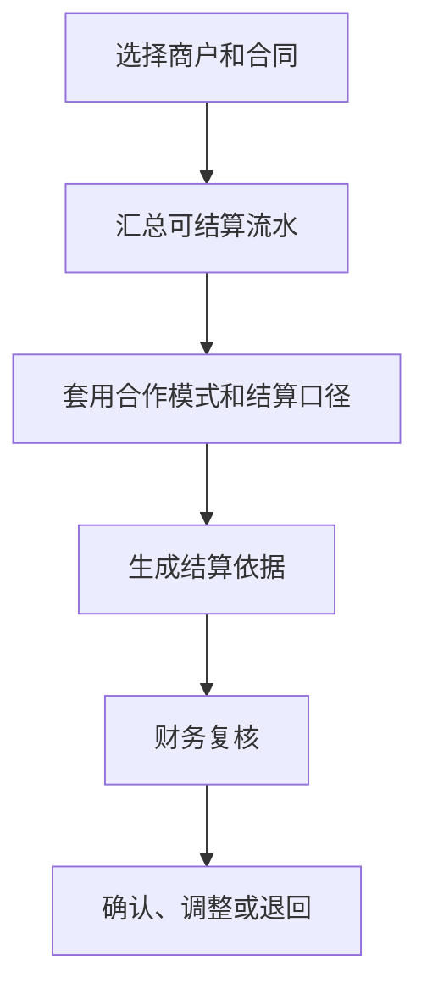

# 财务经营、日结与结算产品 PRD V0.1

> **⚠️ R5 业务HTML缺口审计修正标注（2026-06-18，只读审计后回填，未改代码）**
> 以业务说明地图 #finance 为基准：日结锁定→补录审批、日结多源汇总、对账自动匹配在后端**未落地或为手填**（详见 `finance-ar-ap-ledger-development-design-v0.1.md` R5 标注与追溯矩阵 REQ-81 R5）。对账 expected/actual 全来自请求体手工录入，`difference_type` 自由文本，PRD 要求的金额/数量/状态/缺失四类无数据层强制。**业务裁决（2026-06-18）**：锁定补录审批 + 多源汇总本期 P0（见 ar-ap-ledger R5）。日结聚合口径由本审计先起草草案待财务确认（二轮裁决）；仍待业务确认：对账自动匹配排期。**候选验收口径**：锁定后金额受控、日结来自真实汇总、对账差异按四类枚举自动识别。

## 1. 文档定位

本文档按财务经营动作拆解日结、对账、结算和经营流水。它回答“卖了多少、核了多少、退了多少、差异在哪里、按什么口径和谁结算”。

本文档不是财务软件实现，不写会计凭证和账务系统接口。P0 聚焦综合体经营口径下的基础对账和结算依据。

## 2. P0 目标

P0 目标：
- 汇总票务、酒吧、游乐、第三方回流的经营结果。
- 按订单、退款、核销、合同和商户形成基础对账。
- 识别差异并进入处理队列。
- 生成可供财务复核的日结和结算依据。
- 为管理看板提供收入、核销、退款、差异等基础指标。

## 3. 财务经营对象

| 对象 | 定义 | 关键关系 |
|---|---|---|
| 经营流水 | 所有影响收入、退款、核销和调整的业务结果 | 关联订单、权益、账单、商户 |
| 日结批次 | 某日期或班次的经营结果汇总 | 关联流水、差异、确认人 |
| 对账单 | 平台与支付、渠道、商户、第三方之间的核对结果 | 关联合同和差异 |
| 结算依据 | 按合同和经营结果形成的应收、应付或分成依据 | 关联商户、合同、流水 |
| 员工提成依据 | 按卡座销售归属和消费额生成的业务提成依据 | 关联员工、岗位快照、卡座账单、日结和复核 |
| 差异记录 | 不同口径之间的金额、数量或状态不一致 | 关联处理人、原因、结果 |
| 调整记录 | 经确认后对经营或结算口径的调整 | 关联复核和留痕 |

## 4. 对账口径

| 口径 | 适用场景 | P0 要求 |
|---|---|---|
| 按订单 | 售票、酒吧消费、第三方订单 | 能看到订单金额、状态、退款 |
| 按核销 | 通票、权益、游乐、赠饮 | 能看到权益是否被实际使用 |
| 按合同 | 商户租赁、联营、自营、代运营 | 能关联商户和合作模式 |
| 按渠道 | 第三方售票、支付、餐饮零售 POS | 能识别渠道差异 |
| 按日结 | 每日经营确认 | 能形成日汇总和待处理差异 |

## 5. 状态模型

### 5.1 日结状态

| 状态 | 含义 |
|---|---|
| 待生成 | 尚未汇总 |
| 待确认 | 已生成，等待财务确认 |
| 有差异 | 存在未处理差异 |
| 已确认 | 财务确认完成 |
| 已锁定 | 不允许普通修改 |
| 已归档 | 历史只读 |

### 5.2 差异状态

| 状态 | 含义 |
|---|---|
| 待识别 | 已发现但未分类 |
| 待处理 | 已分配责任人 |
| 待复核 | 处理结果等待确认 |
| 已关闭 | 差异处理完成 |
| 已忽略 | 经确认不影响结算 |

### 5.3 结算状态

| 状态 | 含义 |
|---|---|
| 草稿 | 结算依据未确认 |
| 待复核 | 等待财务或管理层复核 |
| 已确认 | 可作为结算依据 |
| 已调整 | 已因差异或补录调整 |
| 已归档 | 历史只读 |

## 6. P0 流程

### 6.1 日结

### 6.2 对账

### 6.3 结算

## 6A. 开票（发票）P0 产品口径（C6）

> 新增说明（2026-06-07 收口）：合规 C6 明确"面向消费者开票是法定义务，P0 至少落开票申请/状态/抬头/税号/税目/金额字段与对账衔接的产品口径"，原 PRD 仅 §9 一行"P1 税务口径预留"，无任何 P0 开票字段。本节补 P0 开票产品口径；实际开票平台对接仍可 P1。依据 finding compliance-land-3、C6、critic-6。

### 6A.1 开票申请对象（P0 字段）

| 字段 | 含义 | 取值/口径 |
|---|---|---|
| `invoice_request_no` | 开票申请编号 | 系统生成唯一 |
| `source_order_no` | 关联原始订单/账单号 | 关联票务订单/酒吧账单，作为对账衔接锚点 |
| `invoice_status` | 开票状态 | 见 §6A.2 状态机（中英映射，D7） |
| `invoice_title` | 发票抬头 | 个人/企业名称 |
| `taxpayer_no` | 税号（纳税人识别号） | 企业抬头必填；个人可空 |
| `invoice_type` | 发票类型 | 增值税普通发票 normal / 增值税专用发票 special |
| `tax_category` | 税目 | 按商品/服务税目分类码（如 *娱乐服务、餐饮服务） |
| `invoice_amount` | 开票金额 | 单位：分（整数，D1）；不得超过原订单可开票金额 |
| `tax_rate` | 税率 | 适用税率（如 6%/13%），P0 记录、P1 由开票平台核定 |
| `buyer_contact` | 接收邮箱/手机 | 电子发票投递用 |
| `applied_at` / `issued_at` | 申请时间 / 开票完成时间 | — |
| `project_id` | 综合体归属 | 预留（原始需求） |

> 留痕/审计：开票申请、状态流转、红冲/作废均写入操作留痕；含软删除字段（deleted_at）与审计字段（created_by/created_at/updated_by/updated_at）。

### 6A.2 开票状态机（P0，中英映射 D7）

| 状态 | code | 含义 |
|---|---|---|
| 待开票 | pending | 已申请，等待开票 |
| 开票中 | issuing | 已提交开票平台处理中（P1 对接后启用） |
| 已开票 | issued | 开票完成 |
| 已红冲 | reversed | 已红冲/冲销 |
| 已作废 | voided | 申请作废 |
| 开票失败 | failed | 开票平台返回失败 |

### 6A.3 与对账衔接口径

- 开票金额必须与原订单/账单的实收金额（扣除退款后）核对，开票金额 ≤ 可开票金额（已收 − 已退 − 已开）。
- 退款发生后已开票部分需红冲（reversed）后重开，红冲记录进入差异/调整队列对账。
- 日结/对账时按 `source_order_no` 关联开票记录，作为"已开票金额 vs 经营流水"的核对项。

---

## 6B. 退款资金流向 P0 口径（critic-6）

> 新增说明（2026-06-07 收口）：D9 与票务 §5.6 已把退款细化到"权益逐项冲正 + 金额拆分（分）+ 调用支付机构退款"，但"退款资金实际如何退回原渠道"全套文档无正向口径，而 data-risk-ai 已预设 `FIN_REFUND_ABNORMAL`（非原路退款）风控规则。本节补退款资金流向口径，并在当时显式暴露支付选型风险；2026-06-10 已收口为聚合支付优先、保留直连接口抽象。依据 finding critic-6、compliance-land-3。

### 6B.1 退款资金流向规则

| 原支付方式 `payment_channel` | 退款资金流向口径 | 留痕要求 |
|---|---|---|
| 微信/支付宝/银行卡（在线支付） | **按原 `payment_channel` 原路退回**：调用对应支付机构退款接口，资金退回原支付账户；金额单位：分（整数，D1） | 记录退款流水号、原支付流水号、退款时间、操作人 |
| 现金（线下支付） | **现金线下退**：由门店现场退现金，系统登记线下退款记录（退款人 refunded_by、金额、时间、客人确认凭据） | 现金退款需双人复核或上级审批留痕 |
| 第三方团购券（美团/抖音等） | **第三方券退款责任方走第三方**：退款资金由第三方平台/渠道按其规则处理，平台侧不直接垫付；如平台垫付需显式标记 `platform_advance`（待结算回收） | 记录第三方退款单据号与责任方 |
| 组合/跨渠道支付 | **按各支付通道金额拆分原路退回**：退款金额按原支付各通道实付比例/明细拆分，分别按对应通道规则退回（在线原路退、现金线下退、第三方走第三方） | 记录每个通道的退款拆分明细（通道、金额、流水号） |

> 与风控衔接：实际退款通道与原 `payment_channel` 不一致时（非原路退款），触发 data-risk-ai `FIN_REFUND_ABNORMAL` 风控规则，进入差异/责任链复核。

> 落库字段对应（2026-06-08 三轮收口，fix2-conflict-2/R2）：本节退款资金流向口径以票务权威退款表 `refund_orders`（ticketing settlement-breakdown §8.12，**唯一权威，不另建 refund_records**）承载，字段对应如下，p0-task-list DB-014 负责补建这些新字段：
>
> | §6B 口径项 | refund_orders 落库字段 | 说明 |
> |---|---|---|
> | 退款资金流向（在线原路退/现金线下退/第三方走第三方/组合拆分） | `refund_direction`（in_place/cash/third_party/split） | 本轮新补字段（DB-014/R2） |
> | 退款人（refunded_by） | `refunded_by` | 现金线下退、人工退款责任留痕，本轮新补字段（DB-014/R2） |
> | 原支付方式 `payment_channel` | `original_payment_channel`（或经 `payment_record_id` 关联 payment_records.payment_channel 取值） | 本轮新补字段（DB-014/R2） |
> | 退款类型 | `refund_type`（full/partial/entitlement） | refund_orders 既有 |
> | 退款金额（分，D1） | `refund_amount` | refund_orders 既有 |
> | 退款流水号 | `refund_no` | refund_orders 既有 |
> | 退款状态 | `status`（pending/processing/success/failed/cancelled） | refund_orders 既有 |
> | 综合体归属 | `project_id` | 本轮新补字段（DB-014/project-id-1） |
>
> 组合/跨渠道支付（refund_direction=split）的各通道退款拆分明细（通道、金额、流水号）按 refund_orders 子表/明细承载（DB-014 落地时细化），与 §6B.1 组合支付口径一致。

### 6B.2 支付通道选型（已确认）

> 已确认（2026-06-10）：P0 支付通道选型采用**聚合支付优先**，同时保留微信支付、支付宝、银行卡等直连支付接口抽象。退款资金流（§6B.1 在线原路退回）优先按聚合支付机构 API 执行；后续若因费率、资金归集、对账或商务谈判需要切直连，不改变上层订单、退款、对账和结算模型。

---

## 7. 页面清单

| 页面 | P0 内容 |
|---|---|
| 财务经营总览 | 今日收入、退款、核销、差异、待确认 |
| 经营流水 | 订单、权益、账单、退款、调整 |
| 日结管理 | 日结批次、状态、汇总、确认 |
| 对账管理 | 平台、渠道、商户、第三方结果核对 |
| 差异处理 | 差异分类、责任人、处理记录、关闭 |
| 结算依据 | 商户、合同、周期、金额、规则、状态 |
| 调整记录 | 调整原因、金额、责任人、复核 |

## 8. P0 验收标准

- 能汇总票务、核销、酒吧、游乐、第三方回流的基础经营流水。
- 能按日生成日结批次。
- 能识别至少金额差异、数量差异、状态差异和缺失差异。
- 差异必须有处理人、原因和处理结果。
- 结算依据必须能关联商户、合同和经营流水。
- 已确认日结和结算依据必须保留留痕。
- 日结锁定后不允许直接补录影响金额。
- 如确需补录影响金额，必须发起上级权限申请，审批通过后才允许补录。
- （2026-06-07 收口补，C6）开票申请须能记录开票申请/状态/抬头/税号/税目/金额（§6A），开票金额可与原订单按 `source_order_no` 核对、不超过可开票金额；退款后已开票部分可红冲。
- （2026-06-07 收口补，critic-6）退款资金流向按原 `payment_channel` 区分（在线原路退/现金线下退/第三方走第三方/组合拆分，§6B），退款流水可留痕并支撑非原路退款风控核对。

## 9. P1/P2

| 阶段 | 能力 |
|---|---|
| P1 | 复杂分成、商户账单门户、催缴、费用异议、渠道自动对账、结算单导出、税务口径增强 |
| P2 | 自动差异解释、经营预测、异常财务风险识别、智能结算建议 |

## 10. 已确认规则和后续细化事项

已确认：

1. 日结锁定后不允许直接补录影响金额。
2. 确需补录时，必须发起上级权限申请。
3. 上级权限审批通过后，才允许补录并影响金额。
4. 补录申请、审批、金额影响、责任人和原因必须留痕。
5. 支付通道 P0 采用聚合支付优先，保留直连接口抽象。
6. 财务主结算口径采用多口径并存：订单、核销、合同固定规则分别形成结算依据。
7. P0 必须支持完整应收应付台账，覆盖应收、应付、账龄、到期日、责任主体、合同/订单/核销来源、收付款状态、差异、附件和留痕。
8. 租金、物业费、能源费、公摊/CAM、保证金/押金、渠道应结、商户分成、供应商应付等已知款项均可进入 P0 应收应付台账；P1 再做商户账单门户、催缴、费用异议和复杂费用规则。
9. 卡座销售提成 P0 进入可复核应付或内部薪酬依据：销售人员按卡座消费额 15%，非销售人员按 10%；提成基数不含通票、票务权益、卡座预约入场名额、赠酒成本、退款、免单和不可计提调整。

后续细化：

无方向性悬空事项。已确认按以下口径执行：

1. P0 支持租赁、联营、自营、代运营、服务商接入均形成结算依据和应收应付台账；具体公式采用后台可配置模板，默认模板包括固定租金/物业费/能源费/CAM、销售分成、平台自营内部核算、代运营服务费、服务商应付。
2. 第三方餐饮/零售真实供应商回流后，具备合同结算规则、金额、主体和核销/订单来源的款项可自动生成应收应付；字段不完整或对账异常的款项先进入差异复核，不得自动入账。
3. 员工卡座销售提成 P0 只生成复核台账和应付/内部薪酬依据；正式工资发放、个税申报、复杂多人分摊、阶梯提成和活动倍率进入 P1/P2。

## 11. 本版结论

财务经营 P0 的核心是“经营流水可汇总、差异可处理、结算依据可追溯、应收应付可管理”。它不替代正式财务软件的凭证、总账和税务申报，但必须把综合体经营事实整理成财务能复核、管理层能判断、运营能追款和付款的台账。

---

## 12. 成熟财务/结算深度能力规划（规划级，非本期 P0）

> 新增说明（2026-06-18，D16）：本节为对标成熟财务/结算系统的深度能力规划，逐条标注优先级、能力、业务链价值、市场参考理由与粗验收口径。**全部为规划级，非本期 P0**；本期 P0 仍以前文 §2/§8/§10 与 `finance-ar-ap-ledger-development-design-v0.1.md` 为准（锁定补录审批、日结多源汇总等）。本节用于排期与商务沟通，不得据此直接生成 P0 接口、任务或验收结论；落地前须各项映射到 OpenAPI 与 P0/P1 任务清单。

### 12.1 P1 深度能力

| 能力 | 业务链价值 | 市场参考理由 | 验收口径（粗） |
|---|---|---|---|
| 三方对账自动匹配引擎（容差/规则） | 替代当前 expected/actual 手填，按金额/数量/状态/缺失四类自动识别差异，降低人工对账漏错，缩短日结闭环时长 | 成熟财务/支付对账（如 SAP、用友、各支付机构对账中心、Stripe/微信支付商户对账）均以规则+容差自动匹配为标配，手填仅作兜底 | 给定平台流水与外部/商户流水，引擎按可配置匹配键与容差自动配平，未配平项自动归入四类差异并进差异队列；匹配率与差异分类可统计 |
| 结算单生成 + 商户确认 + 打款回执 | 把"结算依据"升级为可走商户确认与打款闭环的结算单，形成"生成→商户确认→打款→回执核对"链路，减少分歧与垫付风险 | 联营/分成商业体、连锁与平台型结算（如 POS 收单分账、商场联营结算）普遍提供商户确认与回执核对 | 可按商户/合同/周期生成结算单，推送商户确认（同意/异议），打款后登记回执并与结算单/应付台账核对一致 |
| 应收应付账龄分桶 / 催缴 | 在 ar_ap_items 账龄基础上做 0-30/31-60/61-90/90+ 分桶与逾期催缴，提升回款时效，降低坏账 | 标准 AR/AP 模块（账龄分析表 Aging Report）与催缴工作流是财务软件通用能力 | 应收应付可按账龄分桶汇总与下钻；逾期项可生成催缴任务/提醒并记录催缴历史与结果 |
| 发票平台对接 | 把 §6A 的 P0 开票产品口径接入真实开票平台，实现自动开票/红冲/状态回写，闭合"开票-对账"链 | 电子发票为法定义务，主流财务/电商均对接税控或第三方开票平台（如航天信息、百望、各电子发票服务商） | 开票申请可提交开票平台并回写 issued/failed/reversed 状态；红冲后重开链路完整；开票金额与可开票金额、对账口径一致 |
| 退款冲正联动台账 | 退款/红冲自动联动应收应付与结算台账冲正，避免退款后台账与结算口径脱节 | 成熟系统退款均触发账务冲正与结算回收，避免"退了款台账没动" | 退款成功/红冲后，关联 ar_ap_items/结算依据自动生成冲正调整并留痕，金额与 refund_orders、对账口径一致 |

### 12.2 P2 深度能力

| 能力 | 业务链价值 | 市场参考理由 | 验收口径（粗） |
|---|---|---|---|
| 支付渠道手续费扣减 / 自动分账 | 按渠道费率自动扣减手续费并对多商户自动分账，净额入账，减少人工拆分误差 | 收单/聚合支付与平台型业务普遍提供费率扣减与自动分账（如微信/支付宝分账、各聚合支付分账） | 按渠道费率自动计算手续费与各商户分账金额，净额与分账明细可对账、可留痕，与结算依据一致 |
| 多主体联合结算 | 支持跨主体（平台、商户、渠道、服务商）联合结算与轧差，处理复杂资金归集与代收代付 | 集团化/平台化财务结算与资金池、轧差结算是大型商业体的进阶能力 | 可定义多主体结算关系并按规则轧差生成各主体应收应付与结算单，资金归集口径可追溯 |

## 变更日志

| 日期 | 类型 | 内容 | 原因/依据 |
|---|---|---|---|
| 2026-06-07 收口 | 增 | 新增 §6A "开票（发票）P0 产品口径"：开票申请/状态/抬头/税号/税目/金额字段、6 态开票状态机（中英映射、金额分）、与对账衔接口径 | 复核发现 finance-settlement 仅 §9 一行"P1 税务预留"，无任何 P0 开票字段，发票为法定义务。依据 finding compliance-land-3、C6 |
| 2026-06-07 收口 | 增 | 新增 §6B "退款资金流向 P0 口径"：按原 payment_channel 原路退回/现金线下退/第三方券退款责任方/组合支付拆分；当时同步暴露支付选型风险 | 复核发现退款资金流向无正向口径却已有 FIN_REFUND_ABNORMAL 风控，支付选型当时仍需上层收口。依据 finding critic-6 |
| 2026-06-07 收口 | 增 | §8 P0 验收标准补开票与退款资金流向两条验收项 | 与 §6A/§6B 新增口径呼应。依据 C6、critic-6 |
| 2026-06-08 三轮收口 | 增 | §6B.1 落库字段对应表 | 注明 §6B 退款资金流向口径以票务权威表 `refund_orders`（ticketing §8.12）承载，逐项对应 refund_direction/refunded_by/original_payment_channel（本轮新补，DB-014/R2）+ refund_type/refund_amount/refund_no/status（既有）+ project_id；明确不另建 refund_records | §6B 口径原无落库字段对应，退款资金流向字段在权威表无落点。依据 finding fix2-conflict-2、project-id-1、主控权威 R2 |
| 2026-06-10 总控拍板 | 改 | §6B.2、§10 | 支付通道改为聚合支付优先并保留直连接口抽象；财务主结算口径改为订单、核销、合同固定规则多口径并存 | 用户拍板采用推荐方案 |
| 2026-06-10 总控拍板 | 改 | §9、§10、§11 | P0 改为支持完整应收应付台账；商户账单门户、催缴、费用异议和复杂费用规则进入 P1 | 用户明确要求 P0 做完整应收应付台账 |
| 2026-06-18 D16 | 增 | §12 成熟财务/结算深度能力规划 | 新增规划级深度能力小节，逐条标优先级：P1（三方对账自动匹配引擎、结算单生成+商户确认+打款回执、应收应付账龄分桶/催缴、发票平台对接、退款冲正联动台账）、P2（支付渠道手续费扣减/自动分账、多主体联合结算），各给能力/业务链价值/市场参考理由/粗验收口径，注明规划级非本期 P0 | D16 财务市场深度规划补章 |
