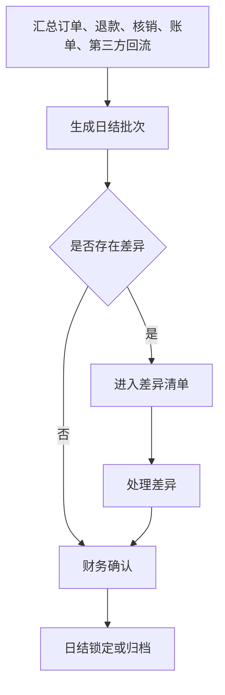
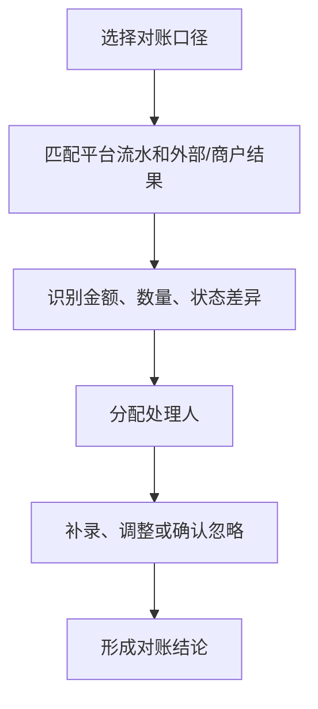
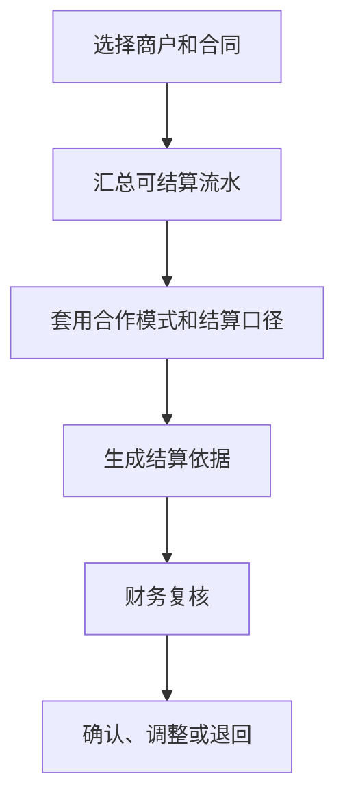

# 财务经营、日结与结算产品 PRD V0.1

> 2026-07-04 逻辑一致性修订：①§6C.2-4 第三方手填对账规则由「永久业务规则」改为**配置驱动（后台可配、默认取当前口径）**，避免硬编码；②§6A 开票新增**开票失败降级 + 重试 + 人工兜底**路径，补齐失败态处理；③§5-§6C 澄清**日结锁定后补录/修改的幂等性**——锁定后补录一律走补录审批、以幂等键防重复提交，且**不改已锁定日结，只生成冲正调整**。（不改「商户-铺位-合同数据模型」相关段落。）

> **⚠️ R5 业务HTML缺口审计修正标注（2026-06-18，只读审计后回填，未改代码）**
> 以业务说明地图 #finance 为基准：日结锁定→补录审批、日结多源汇总、对账自动匹配在后端**未落地或为手填**（详见 `finance-ar-ap-ledger-development-design-v0.1.md` R5 标注与追溯矩阵 REQ-81 R5）。对账 expected/actual 全来自请求体手工录入，`difference_type` 自由文本，PRD 要求的金额/数量/状态/缺失四类无数据层强制。**业务裁决（2026-06-18）**：锁定补录审批 + 多源汇总本期 P0（见 ar-ap-ledger R5）。日结聚合口径由本审计先起草草案待财务确认（二轮裁决）；仍待业务确认：对账自动匹配排期。**候选验收口径**：锁定后金额受控、日结来自真实汇总、对账差异按四类枚举自动识别。

## 1. 文档定位

本文档按财务经营动作拆解日结、对账、结算和经营流水。它回答“卖了多少、核了多少、退了多少、差异在哪里、按什么口径和谁结算”。

本文档不是财务软件实现，不写会计凭证和账务系统接口。P0 聚焦综合体经营口径下的基础对账和结算依据。

## 2. P0 目标

P0 目标：
- 汇总票务、酒吧、游乐、第三方回流的经营结果。
- 按订单、退款、核销、合同和商户形成基础对账。
- 识别差异并进入处理队列。
- 生成可供财务复核的日结和结算依据。
- 为管理看板提供收入、核销、退款、差异等基础指标。

## 3. 财务经营对象

| 对象 | 定义 | 关键关系 |
|---|---|---|
| 经营流水 | 所有影响收入、退款、核销和调整的业务结果 | 关联订单、权益、账单、商户 |
| 日结批次 | 某日期或班次的经营结果汇总 | 关联流水、差异、确认人 |
| 对账单 | 平台与支付、渠道、商户、第三方之间的核对结果 | 关联合同和差异 |
| 结算依据 | 按合同和经营结果形成的应收、应付或分成依据 | 关联商户、合同、流水 |
| 员工提成依据 | 按卡座销售归属和消费额生成的业务提成依据 | 关联员工、岗位快照、卡座账单、日结和复核 |
| 差异记录 | 不同口径之间的金额、数量或状态不一致 | 关联处理人、原因、结果 |
| 调整记录 | 经确认后对经营或结算口径的调整 | 关联复核和留痕 |

## 3A. 通票分账瀑布与收入归属（2026-07-28 口径，引用式）

> 本节只做**引用与对账锚点**。三个业务 HTML 拥有最终业务解释权；`settlement-rebuild-prd-v1.0.md` 只提供产品细化，术语表只提供名称映射，均不得覆盖 HTML。

**分账边界**：酒吧通票、纯游乐通票等域内通票不进行域间比例拆分，按对应域主管公司的域内规则结算。只有跨域组合通票在整单先扣一次第三方渠道费用后，按各收费权益有效价格在域间分配；零元权益不参与域间分配，进入各域后的份额不得再次扣除同一渠道费用。各域再按本域已批准的内部结算价、固定金额、固定单价、排名档位或其他规则与实际提供方结算。

**跨域组合通票分支**：整单第三方渠道费用只扣一次，渠道费用分摊尾差由该渠道费的实际结算责任主体承担并单列留痕。域份额不直接等于提供商户收入；进入经营域后由域主管公司执行域内结算。
- 拆份额**只按业态大分类**；**依附于某业态产生的加赠权益不作为业态层拆分对象**（其价值已含在所属业态价格内）。
- **定价构成**：售价 =（游乐价 + 酒吧价 + 收费的餐饮/零售价）× 票种折扣，**由系统自动算出**（V369 已落地）；**免费的（票面价 0）不计入价值**。
- **凑整与允许误差**（V369 已落地）：运营可在系统算出的售价上填一个**近似售价**凑整（整元、尾数 8/9/0，上调下调均可），但与算出售价的差额**不得超过后台配置的允许误差**（`ticket_combo_discount_configs.rounding_tolerance_cent`，出厂 5 元，与「套票折扣归属」同处维护），**超出即拒绝发布**。这道闸堵的是「运营想填 178 填成 160、票照卖、少收的钱被当成套票折扣默默由项目公司吃掉」——对账时再也不会见到一张售价和它的业态构成对不上的票。凑整差额**不新建口径**，按既有 `discount_bearer` 承担。
- **两个价不可混用**：**票面原价**用于定价与拆份额，**内部结算价**用于与提供商户结算成本。对账时这是两条不同的口径线，不得互相顶替。

**酒吧可分配池两段分配**：酒吧入场资格是目前唯一不设内部结算价的特殊权益。第一段由娱乐平台公司按已生效的固定金额或固定单价先分，第二段由未参加第一段的酒吧按排名档位分配余额。第一段合计超池时不自动缩减、不出账，进入超池待审批；只有娱乐平台公司可申请最长初始三个月的短期激励，由结算中心审批，超出部分由娱乐平台公司承担。无第一段参与者时全池进入第二段；无合格第二段参与者、权重为零或只有第一段时，剩余作为未分配池余额单列归娱乐平台公司。

**收费与免费权益**：商户让利型零元权益不结算；域主管公司出资型零元权益在核销后按锁定内部结算价与实际提供方结算，未核销不结算。豪华套票、小食或特殊权益等收费或由域主管公司承担的权益同样按本域已生效规则结算。采用内部结算价还是本域其他规则由域主管公司决定，商户无权决定；哪个域主管公司把对客价格或域内分配价定得低于内部结算价，哪个主体承担差额，高于成本的剩余也归该主体。

**收入归属（业态主体）**：

| 收入类型 | 归属主体 |
|---|---|
| 单一酒吧门票 | 对应酒吧商户；娱乐平台公司只另收可封顶的门票综合服务费，不取得门票收入 |
| 酒吧通票 / 跨域组合通票酒吧份额 | 娱乐平台公司按酒吧域规则负责；门票综合服务费不得封顶 |
| 订台低消 / 二次消费 / 额外酒水 | 各酒吧商户 |
| 非散台服务费（卡座等） | 各酒吧商户 |
| 向商户供货的货款 | 中央餐饮公司（供应链主体） |
| 纯游乐票 / 纯游乐通票 | 游乐公司；不向娱乐平台公司支付门票综合服务费 |
| 演出票 | 传媒公司；不向娱乐平台公司支付门票综合服务费 |
| 场地租金 | 对应城市项目公司；每个城市项目公司同时承担本城市资产公司职责 |

**对财务侧的影响**：
- 权益兑付在实际核销后由对应域主管公司与实际提供方结算；差额由作出定价或分配决定的域主管公司承担或留存，不默认归娱乐平台公司；
- 结算单与开票清单的开票主体按上表映射（见 `settlement-rebuild-prd-v1.0.md` 附录 D）；
- **实现状态**：内部结算 SKU 目录已于 2026-08-01 由 V379/V380 落地，具体见 §3B。S1—S11 等其他实现证据仍只用于定位当前代码；凡统一预扣赠送成本、统一归娱乐平台公司、域内通票按域比例拆分、酒吧份额重复扣渠道费或通票服务费可封顶的实现，均与现行 HTML 冲突，应作为待改造缺口，不能反向写成业务规则。本次只修订 PRD，不在本阶段修改实现。

## 3B. 内部结算 SKU 目录（2026-07-28 用户拍板 E）—— ✅ **2026-08-01 已落地（V379/V380）**

> 权威业务口径在业务 HTML「财务对账」章（提交 `88eba70c`，用户逐条批准）。本节是该需求的**产品承接**；结算侧承接指针见 `settlement-rebuild-prd-v1.0.md` §9.7，排期见 `pending-development-backlog-v0.1.md` 批 10（已消项）。
>
> **落地形态（2026-08-01）**：目录表 `internal_price_catalog`（V379，条目绑商家+品类，`item_code` 稳定业务键，草案/生效并存＝结算配置中心 Path 2 第 12 类）；四处存量**逐分收编**为目录条目 + 业务表 `catalog_item_code` 引用列（V380，原价格列转**快照语义只读**、由系统在设引用/目录转正时同步）；`InternalSettlementPriceResolver` 两支统一改读目录生效价（fail-closed 不回退票面价）；四处业务写入口**封写**（直填内部价一律 400），PR#274 模板改价端点随之下线；后台目录主页面 ADM-STL-003（三维筛选+草案队列+下线归档）。
>
> **项目隔离落法（DEC-MPS-2026-07-28-15「SKU 不得跨项目关联」）**：以「目录条目绑定商户 = 业务对象提供商户」的**商户级同源守卫**落地（写入校验 + 解析器双重校验）。商户唯一归属项目，商户级同源**强于**项目级同源，故不单存 project_id；目录页按商家/业态/品类三维筛选即得项目视图。

### 3B.1 为什么要做（业务人员视角）

今天财务要核一笔"平台该付这家商户多少成本"，得先问"这个价在哪儿看"——同一瓶酒在酒吧商品页有一个内部结算价、进了套餐又有一个、做成票里的赠饮权益还有一个、发成券又有一个。**四个页面四个人各改各的，改完谁也不知道另外三处还是旧价**，对账对不上时没人说得清应该以哪个为准，出了错也找不到该谁兜。每个项目集中成自己的一个目录之后：**同一项目内价格只有一处能改、改一次对本项目后续业务生效、谁改的谁复核的有痕、已经发生的账不会被后来改价改掉**；不同项目的目录和价格互不覆盖。

### 3B.2 现状：一价四存（实读迁移确认）

| 存放处 | 字段 | 迁移 | 谁在改 | 问题 |
|---|---|---|---|---|
| 酒吧商品 | `bar_products.internal_settlement_price_cent` | V152 | 酒吧商品目录页 | 与下面三处无任何关联，各改各的 |
| 酒吧套餐 | `bar_combos.internal_settlement_price_cent` | V257 | 酒吧套餐页 | 套餐价与其组成 SKU 价可各自漂移，无一致性约束 |
| 票务权益模板 | `entitlement_templates` / `issued_entitlements.agreement_price_cent` | V225 | 权益模板页 | 实物权益经 `bar_item_ref` 回退取酒吧商品价、虚拟权益取签约价，**两条取价路径**；模板级还可另填 |
| 券台账 | `voucher_definitions.internal_price_cent` | V301 | 券定义页 | 独立第四份 |

**共同缺口（V380 已闭合）**：~~无统一目录、无商家/业态/品类三维、无跨页引用与就地新建、改价无草案复核、无下线归档~~——V380 起四处全部收编为目录引用，上述缺口全部闭合；本表仅存史实。

**已有的一块地基（可复用，别重造）**：`ticket_verifications.settlement_price_cent`（V225）在核销时把当次判定的结算价**落到该次核销记录**上——这正是目标里「核销时把当时价固化到流水」的雏形，目录建成后把它的取价来源换成目录即可，固化机制本身不用重写。另有 `bar.internal_settlement_price.view`（V279）与 `voucher.internal_price.view`（V301）两个读脱敏权限点，目录的「仅授权后台可见」直接沿用同款铁律。**S5（2026-07-28，PR #270）又添一块**：`InternalSettlementPriceResolver` 已把全平台取价收敛为唯一解析入口（预扣与兑付同源、fail-closed 不回退票面价）——「一价四存」的存放现状未变，但目录建成后只需改这一处解析器的两支，所有调用方无感。

### 3B.3 目标：每个项目一个目录、项目内唯一真源

| # | 要求 | 说明 |
|---|---|---|
| 1 | **项目内集中唯一真源** | 每个项目拥有独立内部结算价目录；同一项目成本侧一切取价改读本项目目录，不同项目不得互相覆盖或跨项目引用 |
| 2 | **绑提供商家 + 归品类** | 每条目录条目必须绑定提供它的商家（**业态随商家带出**，不单独录）、并归入品类 |
| 3 | **三维可筛** | 商家 / 业态 / 品类三个维度都能查找与筛选 |
| 4 | **多处引用、就地新建、只进本项目目录** | 设置酒吧商品、酒吧套餐、票务权益模板、券等业务对象时都可引用本项目目录条目，也可**就地新建**；就地新建的条目一律进入**当前项目目录**，不另存一份 |
| 5 | **目录是唯一可编辑处** | 其它页面只能引用与就地新建，**不能改价**；改价一律回目录 |
| 6 | **改价走草案 → 他人复核转正** | 与结算配置中心同一范式（`settlement-rebuild-prd-v1.0.md` §9）：先存草案、须具备高敏权限的**他人**复核转正后才**对后续生效**；谁提交、谁审批、何时生效全程留痕 |
| 7 | **核销/结算固化当时价到流水** | 核销或结算发生时把当时的目录价**固化到该笔流水**上；此后目录价怎么变**都不影响已发生的账**；固化下来的价**只读**，任何人不得手工修改 |
| 8 | **下线归档不影响历史引用** | 条目可下线归档，历史引用照常可追溯（与软删除铁律一致） |
| 9 | **敏感、仅授权可见** | 内部结算价属敏感信息，仅授权后台人员可见（沿用 V279 / V301 读脱敏范式：无权限读端一律置 null） |
| 10 | **提供方提交、域主管审批** | 实际提供主体提交，对应域主管公司审批且提交人与审批人分离：酒吧→娱乐平台公司，游乐→游乐公司，传媒/演出→传媒公司，中央餐饮供应部分→中央餐饮公司内部差人审批，城市项目公司直接管理第三方→城市项目公司；独立餐饮由城市项目公司审批，中央餐饮供货部分除外 |
| 11 | **查看、导出、修改分权** | 普通用户、会员、前线员工及无价格权限的商户人员不得查看；系统自动使用价格不代表操作人获得查看或修改权 |
| 12 | **敏感范围与项目隔离** | 敏感经营数据还包括成本价、采购价、毛利、分账底价、域内补贴缺口和供应链价格；数据默认按项目隔离，只有项目之上的获授权岗位可跨项目查看 |

### 3B.4 落地对账（原迁移清单 → 实际落法，2026-08-01）

1. ✅ **目录表**（V379 `internal_price_catalog`）：条目绑 `merchant_id`（业态经 `merchants.merchant_type` 带出，不冗余存）+ `category` 独立标签（品类不建字典表——存量品类沿各域既有词表迁入：商品 8 词表/`combo`/权益类型/券种，筛选按值匹配即可，为一列标签建字典属过度设计）；`item_code` 稳定业务键（业务表引用它而非行 id，转正软替换旧生效行＝价格版本史留库）；
2. ✅ **四处存量收编**（V380）：四表各加 `catalog_item_code` 引用列，存量价**逐分**迁成目录生效条目（收编等价判据由 `InternalPriceCatalogJdbcIntegrationTests` 重放 V380 真源 SQL 证明）；原价格列转**快照语义只读**（COMMENT 落库），由系统在设引用/目录转正时同步，任何人不得手改；四处写入口封写（直填 400 fail-loud，不静默忽略）；
3. ✅ **草案闸**：`SingleRowConfig` 第 12 类 `INTERNAL_PRICE_ITEM`（scope=`item_code`），转正/软删复用泛化端点与差人守卫；**转正专案分支**追加「四表快照传播」且与软替换同一事务（不留「目录已新价、快照还旧价」窗口）；0 价转正若有券引用先验拒绝（券口径要求内部价>0）。新增端点仅 2 个：落草案（返回 `item_code` 供就地新建即引即用）+ 三维筛选列表；
4. ✅ **固化点**：核销侧沿用 `ticket_verifications.settlement_price_cent`（核销时固化**当时的目录生效价**——改价转正只影响此后核销，历史一分不动，见 `SettlementPriceResolutionJdbcIntegrationTests#catalogPriceChangeDoesNotMoveAlreadyVerifiedMoney` 四步资金证明）；结算侧预扣/兑付均经 `InternalSettlementPriceResolver` 同源取目录价；券核销固化沿用 `voucher_redemptions.settlement_amount_cent`；
5. ✅ **读脱敏**：目录读端权限闸＝`settlement.config.view` 或 V279/V301 两内部价读脱敏点任一（无权限 403），商户 scope 强制收窄本商户；四处业务页快照列沿用各域既有脱敏；
6. ✅ **前端**：目录主页面 ADM-STL-003（三维筛选+草案复核队列+下线归档）；四处业务页内部价直填输入全部下线、改为「目录条目编码」引用输入 + 快照只读展示（就地新建＝目录落草案返回编码后引用；条目须他人复核转正才有生效价）。

> 改价生效口径统一为**核销固化时点**（HTML「核销/结算发生时把当时的价固化到该笔流水」）：转正后的新价对**此后的核销/结算**生效——含已发放未核销的权益（原批 5「只对之后发放生效」口径被目录口径取代；已核销/已结算的历史仍然一分不动）。

## 4. 对账口径

| 口径 | 适用场景 | P0 要求 |
|---|---|---|
| 按订单 | 售票、酒吧消费、第三方订单 | 能看到订单金额、状态、退款 |
| 按核销 | 通票、权益、游乐、赠饮 | 能看到权益是否被实际使用 |
| 按合同 | 商户租赁、联营、自营、代运营 | 能关联商户和合作模式 |
| 按渠道 | 第三方售票、支付、餐饮零售 POS | 能识别渠道差异 |
| 按日结 | 每日经营确认 | 能形成日汇总和待处理差异 |


## 4A. 营业日与中国税法属期（双轨，2026-07-28 用户确认）

> 闭合审计 ADV-TX-008 / XD-006。
> **运营营业日**与**税法/开票属期**分开建模。
> 裁决：`DEC-BIZDAY-001`（运营）+ `DEC-TAX-CN-REFUND-001` / **T-INVOICE-LINK**（退款税会）。
> 本 PRD 不构成税务法律意见；落地以适用中国税法、主管税务机关及税控产品规则为准。

### 4A.1 运营营业日（DEC-BIZDAY-001）

用于：现场日结、班次、经营「今日」、低消/营收经营切片、商户经营对账默认视图（**非**税法定性）。

| 配置项 | 说明 | 可配 |
|---|---|---|
| 项目时区 | 如 `Asia/Shanghai` | 是 |
| 营业日切日时刻 | 项目本地时刻；默认建议 06:00，**禁止代码写死** | 是 |

- 订单/支付/关台等**运营事件**的 `biz_day`：按项目时区，落在切日点之后的营业日。
- 跨自然日 0 点但未过切日点：仍属上一营业日。
- 报表默认提供「按营业日」；「按自然日」为另一可选口径。

### 4A.2 退款税会归属（DEC-TAX-CN-REFUND-001 = **T-INVOICE-LINK**）

适用于：退款、撤销收款、已开票红冲/作废、需进入纳税申报的收入冲减等。

**总原则：中国税法与税局/税控现行规则优先；营业日切日不得替代法定/开票归属。**

#### T-INVOICE-LINK 规则（用户确认）

1. **有原发票（已开票订单/流水）**
   - 退款的税会/开票处理必须走合规 **红字发票 / 作废**（以票种与税控产品为准）链路；
   - 红冲与冲减归属 **跟随原票与红字确认/开具流程**（及税控回传状态），不得仅按酒吧 `biz_day` 改写；
   - 必须保留：原票号码、红字信息表/确认单号（若适用）、金额、购方信息、回传状态、操作人与时间。

2. **无发票（从未开票或明确无需开票）**
   - 税会归期按 **退款成功时点** 所适用的申报/入账规则处理（通常落入对应自然日/所属申报期）；
   - **不**用运营营业日切日点替代该归期。

3. **运营侧仍记 `biz_day`**
   - 退款事件照常写入运营营业日，供日结与经营分析；
   - 财务/结算界面必须能同时看到：`occurred_at`、`biz_day`、税会/开票属期或红冲状态；
   - 当 `biz_day` 所属自然月与税会属期不一致时，展示差异提示，禁止静默抹平。

4. **禁止**
   - 已开票退款只做负向营收、不走红冲/作废；
   - 用营业日切日把应属上期的红冲硬挪到下期（或反向）以「好看日结」。

5. **可配项**（结构不可回退）
   - 是否对接税控、红冲审批阈值、提示文案、无票退款的会计科目映射等可配；
   - **不可配掉** T-INVOICE-LINK 与「税法优先」。

### 4A.3 结算期

- 商户结算周期（T+N、月结等）可配，与 `biz_day`、税会属期在结算单上分列。
- 资金对账守恒以支付/分账流水为准；税会调整走调整凭证，不 silent 改写已锁日结资金事实。

### 4A.4 验收

- 跨切日点支付：运营 `biz_day` 正确。
- 有票跨月退款：红冲链路完整；`biz_day` 与税会/开票状态可分离查询。
- 无票退款：归期不跟营业日切日绑定。
- 已开票退款缺红冲链路：阻断完成或进入「待税务处理」队列，不得当普通退款关单。


## 5. 状态模型

### 5.1 日结状态

| 状态 | 含义 |
|---|---|
| 待生成 | 尚未汇总 |
| 待确认 | 已生成，等待财务确认 |
| 有差异 | 存在未处理差异 |
| 已确认 | 财务确认完成 |
| 已锁定 | 不允许普通修改 |
| 已归档 | 历史只读 |

### 5.2 差异状态

| 状态 | 含义 |
|---|---|
| 待识别 | 已发现但未分类 |
| 待处理 | 已分配责任人 |
| 待复核 | 处理结果等待确认 |
| 已关闭 | 差异处理完成 |
| 已忽略 | 经确认不影响结算 |

### 5.3 结算状态

| 状态 | 含义 |
|---|---|
| 草稿 | 结算依据未确认 |
| 待复核 | 等待财务或管理层复核 |
| 已确认 | 可作为结算依据 |
| 已调整 | 已因差异或补录调整 |
| 已归档 | 历史只读 |

### 5.4 日结锁定后补录/修改幂等口径（2026-07-04 澄清）

日结进入 **已锁定 / 已归档** 后，任何补录或修改遵循以下口径（与 §8「日结锁定后不允许直接补录影响金额、确需补录走上级审批」一致，本节补齐**幂等**与**不可回改已锁定日结**两点）：

- **不直接改已锁定日结**：已锁定/已归档的日结批次金额**只读、不可原地改写**；确需修正的，**只生成冲正/调整记录**（进 §5.2 差异 / 调整队列、结算侧记「已调整」），由后续期间的调整承接，锁定期本身数值不变。
- **补录走审批**：锁定后的补录一律先发起**上级权限申请**，审批通过后方可生成冲正调整；申请、审批、金额影响、责任人、原因全程留痕（同 §10 已确认规则 1-4）。
- **补录留痕页面直接显示(2026-07-04 用户)**:日结锁定后的每笔补录/冲正,在**日结页面直接展示**「补录人 + 补录原因 + 批准人(含时间)」,无需下钻审计日志,一眼可见谁补录、为什么、谁批准。
- **幂等防重**：补录/冲正提交以**幂等键**（如 `日结批次 + 业务来源单据 + 补录序号`）防重复提交——同一补录重复提交只生成一条冲正，后到的作幂等丢弃并留痕，避免重复冲账。
- **验收**：对已锁定日结直接改金额被拒绝；补录只落冲正、不改原日结；同一补录重复提交不产生第二条冲正；**日结页面每笔补录直接显示 补录人/原因/批准人/时间**。

## 6. P0 流程

### 6.1 日结



### 6.2 对账



### 6.3 结算



## 6C. 对账差异强制化（P0 收口）

> 修正(2026-06-19 R5业务HTML缺口审计 F5)：业务HTML #finance 要求"识别金额差异/数量差异/状态差异/缺失差异""核对采购入库、库存消耗、报损、盘点差异"。代码核验现状：对账表 `finance_reconciliation_differences`（V008）的 `difference_type` 原为 `VARCHAR(64) NOT NULL` 自由文本无枚举；V069 已补 CHECK 约束（取值 `amount/count/status/missing` ∪ 遗留 `amount_mismatch`），但该表**无 expected/actual 字段**（仅 `amount_cent`），且 expected/actual 实际由请求体/代码手填、无系统取数。本节把"四类差异强制枚举 + 平台侧系统取数"收口为 P0 硬要求。

### 6C.1 difference_type 枚举强制（P0）

- `difference_type` 限定枚举：`amount`（金额差异）/`count`（数量差异）/`status`（状态不一致）/`missing`（单边缺失），禁止自由文本。
- DB 层以 CHECK 约束强制（现状：V069 `chk_frd_difference_type` 已加约束，但仍含历史遗留值 `amount_mismatch`，语义=`amount`）。**P0 收口动作**：历史 `amount_mismatch` 归一为 `amount` 后收紧 CHECK 仅取四类枚举（V069 注释已预留为后续迁移）。
- 应用层与 OpenAPI 同步限定该字段为四枚举，拒绝任何枚举外取值。

### 6C.2 expected/actual 取数来源分级（P0）

| 取数侧 | P0 取数方式 | 标记/约束 |
|---|---|---|
| 平台侧（系统内可取） | **由系统取数，不可手填**：expected 必须来自平台流水/订单/核销/账单等系统汇总，不接受请求体直接写入 | `source=system`，手填即拒 |
| 第三方侧（真实接口未接入前） | 允许人工录入，但须标记 `source=manual` 并强制进复核队列，不得直接据此入账 | `source=manual` + 进复核 |

> 现状对账表无 expected/actual/source 字段，P0 收口需补建：`expected_amount_cent`、`actual_amount_cent`、`source`（system/manual）等字段（落地时由 DB 任务细化），承接业务HTML"采购入库/库存消耗/报损/盘点差异"核对口径。

> **配置驱动（2026-07-04）**：本节及 §6C.3/§6C.4 的第三方手填对账规则**不作为永久硬编码业务规则**，而是**后台可配**：
> - 「第三方侧是否允许人工录入」「录入是否强制进复核」为**后台开关，默认：允许人工录入 + 强制进复核**（真实第三方接口接入后可切换为「仅系统取数、关闭手填」）。
> - 「平台侧 expected 是否禁止手填」为**后台开关，默认：禁止手填（强制系统取数）**。
> - 上述规则改动本身须留操作人/时间/前后值留痕；默认值即当前 §6C 口径，配置不改动时行为与本节完全一致。

### 6C.3 四类差异判定规则（识别口径）

| 差异类型 | 识别口径 |
|---|---|
| `amount` 金额差 | 同一 `business_ref` 平台侧 expected 金额与外部/第三方 actual 金额不等（超**容差阈值**；容差为**后台可配，默认 0 分**即完全一致才不判差异） |
| `count` 数量差 | 同一口径下记录条数/件数不一致（如采购入库件数、库存消耗笔数、核销数量不符） |
| `status` 状态不一致 | 单据存在但状态不一致（如平台已核销、外部未核销；已退款、外部未冲正） |
| `missing` 单边缺失 | 一侧存在记录、另一侧无对应记录（平台有外部无，或外部有平台无） |

### 6C.4 P0 验收

- 纯手填全字段差异（expected/actual/difference_type 全部由请求体写入、无系统取数）被**拒绝**。
- 平台侧 expected **必须来自系统取数**，手填平台侧 expected 被拒。
- `difference_type` 写入枚举外取值被 CHECK 与应用层双重拒绝。
- 第三方侧人工录入差异须带 `source=manual` 且自动进复核队列，未复核不得入账。

### 6C.5 自动匹配引擎优先级

- 三方对账自动匹配引擎（容差/规则）维持 P1（见 §12.1）。**「三方」定义(2026-07-04 明确)= ① 平台侧系统流水(出票/核销记录) + ② 第三方渠道对账单(美团/抖音等渠道回传的订单/核销) + ③ 支付/资金到账流水(实际收款到账);引擎按可配置匹配键 + 容差让三方两两配平(系统记的 = 渠道回传的 = 实际到账的),未配平项归金额/数量/状态/缺失四类差异进复核队列。**
- 但 **P0 须先有强制枚举 + 平台侧系统取数**作为前置收口；自动匹配引擎是在该前置之上的增强，不得以"P1 再做引擎"为由继续保留 P0 纯手填对账。

> 待业务确认：P0 是否接受"平台侧系统取数 + 第三方侧人工录入（标记 source=manual 并进复核）"的半自动边界，作为真实第三方接口接入前的过渡形态。

---

## 6A. 开票（发票）口径：对接税务机关 / 电子发票平台（不自研开票引擎）（C6）

> 折叠说明（2026-06-30）：开票/税务接口同聚合支付、视频监控一类第三方接入——预留接口 + 后台开关默认关 + 不阻塞自研，真实第三方资料到位后再补 OpenAPI 契约；当前数据口径见下方 §6A.1/§6A.2。故 OpenAPI 无 `invoice` 路径属设计如此，非缺口。
> 审计澄清（2026-06-27）：业务枚举速查表 §六的「开票状态」与本节是**同一口径**——开票走税务/电子发票平台第三方对接（预留接口 + 后台开关默认关、不自研 invoice 表/引擎），与业务 HTML「税务/电子发票平台」一致；故「开票」既非超范围、也非与 HTML 冲突，待补的仅是该第三方对接的接口示例与字段映射。

> **口径收口（2026-06-24 用户拍板）：发票走税务机关 / 电子发票平台对接，本系统不自研开票引擎**。开票同聚合支付 / 视频监控那类第三方对接——预留接口 + 后台开关、不自建 invoice 表/状态机/发票号生成。本系统职责仅两项：① 向税务 / 电子发票对接接口**提供开票所需数据**（关联订单、抬头、税号、税目、可开票金额 = 已收 − 已退 − 已开）；② **接收回传**的开票结果与状态并与对账衔接。下方 §6A.1 / §6A.2 的字段与状态=**与税务对接交换的数据口径**（非本系统自建表），实际开票动作由税务机关 / 电子发票平台完成。合规 C6 法定开票义务由税务对接承接。
>
> 历史（2026-06-07，已被上口径取代）：曾按合规 C6 把"开票申请/状态/抬头/税号/税目/金额字段"列为本系统 P0 自建口径；现明确不自研、走税务对接。

> **✅ 清单侧已落地（批 4b·V362·2026-07-28，不改本节「不自研开票引擎」口径）**：结算侧现已把月度结算单拆成
> **开票清单条目**（`settlement_invoice_items`）交财务，粒度 = 开票主体 × 发票项目名称 × 税率 × 税额 × 文化事业建设费 × 凭证要件，
> 后台页 ADM-STL-002 按开票主体分组展示并可导出 CSV。**边界未变**：本系统只出清单与状态留痕，
> **不对接税控盘、不自建开票引擎、不生成发票号**；下方 §6A.1/§6A.2 的字段与状态仍是与第三方交换的数据口径。
> 落地对应：`invoice_amount`→`amount_cent`、`tax_rate`→`vat_rate_bps`、`invoice_status`→`status`（六态同名）、
> 第三方回传发票号落 `invoice_no`。可开票金额校验见 §6A.3。

### 6A.1 开票数据口径（提供给税务 / 电子发票平台对接）

| 字段 | 含义 | 取值/口径 |
|---|---|---|
| `invoice_request_no` | 开票申请编号 | 系统生成唯一 |
| `source_order_no` | 关联原始订单/账单号 | 关联票务订单/酒吧账单，作为对账衔接锚点 |
| `invoice_status` | 开票状态 | 见 §6A.2 状态机（中英映射，D7） |
| `invoice_title` | 发票抬头 | 个人/企业名称 |
| `taxpayer_no` | 税号（纳税人识别号） | 企业抬头必填；个人可空 |
| `invoice_type` | 发票类型 | 增值税普通发票 normal / 增值税专用发票 special |
| `tax_category` | 税目 | 按商品/服务税目分类码（如 *娱乐服务、餐饮服务） |
| `invoice_amount` | 开票金额 | 单位：分（整数，D1）；不得超过原订单可开票金额 |
| `tax_rate` | 税率 | 适用税率（如 6%/13%），P0 记录、P1 由开票平台核定 |
| `buyer_contact` | 接收邮箱/手机 | 电子发票投递用 |
| `applied_at` / `issued_at` | 申请时间 / 开票完成时间 | — |
| `project_id` | 综合体归属 | 预留（原始需求） |

> 留痕/审计：开票申请、状态流转、红冲/作废均写入操作留痕；含软删除字段（deleted_at）与审计字段（created_by/created_at/updated_by/updated_at）。

### 6A.2 开票状态（税务 / 电子发票平台回传，中英映射 D7）

| 状态 | code | 含义 |
|---|---|---|
| 待开票 | pending | 已申请，等待开票 |
| 开票中 | issuing | 已提交开票平台处理中（P1 对接后启用） |
| 已开票 | issued | 开票完成 |
| 已红冲 | reversed | 已红冲/冲销 |
| 已作废 | voided | 申请作废 |
| 开票失败 | failed | 开票平台返回失败 |

> **开票失败降级/重试/人工兜底路径（2026-07-04 补，呼应 §6A.4）**：状态机不止于停在 `failed`/`issuing`，须有明确后续路径，避免"失败即断头"：
> - **重试**：`issuing` 超时无回传时按 `invoice_request_no` 幂等**重试拉取结果**（只拉结果、不重复发起开票），重试次数/间隔为**后台可配，默认：3 次、间隔递增**；开满可开票金额即拒绝再开。
> - **降级**：超过重试上限仍无结果或平台返回 `failed`，自动**降级为人工跟进态**（不阻塞客人其它流程、不阻塞日结），记录失败原因码。
> - **人工兜底**：人工可修正抬头/税号/金额后**重新申请**；确实无法开票的允许**线下/事后补开并留痕**，全程进操作留痕与差异/调整队列。
> - 失败/降级不产生发票号，不影响可开票金额实时校验（已收 − 已退 − 已开）。

### 6A.3 与对账衔接口径

- 开票金额必须与原订单/账单的实收金额（扣除退款后）核对，开票金额 ≤ 可开票金额（已收 − 已退 − 已开）。
  - **结算侧实现（V362）**：可开额 = 应开额（结算单当期净额，月结重跑已扣退款/冲正）− 已开额（同来源 `pending`/`issuing`/`issued` 三态合计），≤0 不生成；
    红冲释放额度后再生成即「重开」；应开额下调到已开额之下时清单汇总报「已超开」并提示先红冲。
- 退款发生后已开票部分需红冲（reversed）后重开，红冲记录进入差异/调整队列对账。
- 日结/对账时按 `source_order_no` 关联开票记录，作为"已开票金额 vs 经营流水"的核对项。

### 6A.4 第三方开票异常与失败场景（P1 对接落地）

| 场景 | 处理口径 |
|---|---|
| 开票平台超时/无回传 | 状态停留 `issuing`，按幂等键重试拉取结果、不重复发起开票；超约定时限转人工跟进并留痕 |
| 平台返回失败 `failed` | 记录失败原因码，允许修正抬头/税号/金额后重新申请；失败不产生发票号 |
| 重复开票防护 | 同一 `invoice_request_no` 幂等；可开票金额（已收 − 已退 − 已开）实时校验，开满即拒绝再开 |
| 红冲/作废回传 | 平台回传 `reversed`/`voided` 后同步本地状态并进入差异/调整队列对账 |
| 数据不一致（金额/抬头与订单不符） | 提交前本地校验阻断；回传与本地不一致写差异留痕、转人工核对 |

> 全部失败/重试/红冲动作进操作留痕；本系统不自建发票号与开票引擎，实际开票与失败判定由税务/电子发票平台完成（见 §6A 引言）。

---

## 6B. 退款资金流向 P0 口径（critic-6）

> 新增说明（2026-06-07 收口）：D9 与票务 §5.6 已把退款细化到"权益逐项冲正 + 金额拆分（分）+ 调用支付机构退款"，但"退款资金实际如何退回原渠道"全套文档无正向口径，而 data-risk-ai 已预设 `FIN_REFUND_ABNORMAL`（非原路退款）风控规则。本节补退款资金流向口径，并在当时显式暴露支付选型风险；2026-06-10 已收口为聚合支付优先、保留直连接口抽象。依据 finding critic-6、compliance-land-3。

### 6B.1 退款资金流向规则

| 原支付方式 `payment_channel` | 退款资金流向口径 | 留痕要求 |
|---|---|---|
| 微信/支付宝/银行卡（在线支付） | **按原 `payment_channel` 原路退回**：调用对应支付机构退款接口，资金退回原支付账户；金额单位：分（整数，D1） | 记录退款流水号、原支付流水号、退款时间、操作人 |
| 现金（线下支付） | **现金线下退**：由门店现场退现金，系统登记线下退款记录（退款人 refunded_by、金额、时间、客人确认凭据） | 现金退款需双人复核或上级审批留痕 |
| 第三方团购券（美团/抖音等） | **第三方券退款责任方走第三方**：退款资金由第三方平台/渠道按其规则处理，平台侧不直接垫付；如平台垫付需显式标记 `platform_advance`（待结算回收） | 记录第三方退款单据号与责任方 |
| 组合/跨渠道支付 | **按各支付通道金额拆分原路退回**：退款金额按原支付各通道实付比例/明细拆分，分别按对应通道规则退回（在线原路退、现金线下退、第三方走第三方） | 记录每个通道的退款拆分明细（通道、金额、流水号） |

> 与风控衔接：实际退款通道与原 `payment_channel` 不一致时（非原路退款），触发 data-risk-ai `FIN_REFUND_ABNORMAL` 风控规则，进入差异/责任链复核。

> 落库字段对应（2026-06-08 三轮收口，fix2-conflict-2/R2）：退款业务事实当前由 `refund_orders` 表承载，不另建 `refund_records`；该表只是当前实现载体，不能覆盖三个业务 HTML 的退款原则。字段对应如下：
>
> | §6B 口径项 | refund_orders 落库字段 | 说明 |
> |---|---|---|
> | 退款资金流向（在线原路退/现金线下退/第三方走第三方/组合拆分） | `refund_direction`（in_place/cash/third_party/split） | 本轮新补字段（DB-014/R2） |
> | 退款人（refunded_by） | `refunded_by` | 现金线下退、人工退款责任留痕，本轮新补字段（DB-014/R2） |
> | 原支付方式 `payment_channel` | `original_payment_channel`（或经 `payment_record_id` 关联 payment_records.payment_channel 取值） | 本轮新补字段（DB-014/R2） |
> | 退款类型 | `refund_type`（full/partial/entitlement） | refund_orders 既有 |
> | 退款金额（分，D1） | `refund_amount` | refund_orders 既有 |
> | 退款流水号 | `refund_no` | refund_orders 既有 |
> | 退款状态 | `status`（pending/processing/success/failed/cancelled） | refund_orders 既有 |
> | 综合体归属 | `project_id` | 本轮新补字段（DB-014/project-id-1） |
>
> 组合/跨渠道支付（refund_direction=split）的各通道退款拆分明细（通道、金额、流水号）按 refund_orders 子表/明细承载（DB-014 落地时细化），与 §6B.1 组合支付口径一致。

### 6B.2 支付通道选型（已确认）

> 已确认（2026-06-10）：P0 支付通道选型采用**聚合支付优先**，同时保留微信支付、支付宝、银行卡等直连支付接口抽象。退款资金流（§6B.1 在线原路退回）优先按聚合支付机构 API 执行；后续若因费率、资金归集、对账或商务谈判需要切直连，不改变上层订单、退款、对账和结算模型。

### 6B.3 退款分级授权（fail-closed + 综合体隔离，AUD-007/008 收口 2026-07-20）

三档退款授权（既定规则自动退 / 员工额度内自助 / 超额或无额度进复核）统一适用于票务、酒吧、财务三域，口径以业务系统总图为准。工程实现要点：

- **fail-closed（AUD-007）**：额度闸常在，不由任何功能标志控制、不对平台管理员隐式旁路；分级授权引擎缺失即拒（不放行）。酒吧/财务无独立复核状态机，超额/无额度退款直接拒（`REFUND_REVIEW_REQUIRED`）、须由额度内授权人办理；票务超额进真实二人复核。发起人/审批人/复核人一律真实留痕，审批人≠发起人（SoD），不再退化为字面量 `staff`。管理员如需更高额度，走同一 `(subject, refund_domain, project_id)` 显式额度配置 + 审计，不设隐性例外。
- **综合体隔离（AUD-008）**：员工自助额度 `refund_authority_limits`、自动退规则 `refund_auto_rules` 均含 `project_id`。运行时使用由原订单、账单、支付单据或操作者授权范围推导的可信 `projectId`，绝不取自请求体；不得跨项目串用额度或规则。
- **生产交付门禁**：`refund.tiered_authorization.enabled` 在 prod profile 必须显式为 true（`RefundTieredAuthorizationProductionGuard` 启动断言），并须先按综合体配好额度/规则，杜绝生产无声落到最保守默认态。

---

## 7. 页面清单

| 页面 | P0 内容 |
|---|---|
| 财务经营总览 | 今日收入、退款、核销、差异、待确认 |
| 经营流水 | 订单、权益、账单、退款、调整 |
| 日结管理 | 日结批次、状态、汇总、确认 |
| 对账管理 | 平台、渠道、商户、第三方结果核对 |
| 差异处理 | 差异分类、责任人、处理记录、关闭 |
| 结算依据 | 商户、合同、周期、金额、规则、状态 |
| 调整记录 | 调整原因、金额、责任人、复核 |

## 8. P0 验收标准

- 能汇总票务、核销、酒吧、游乐、第三方回流的基础经营流水。
- 能按日生成日结批次。
- 能识别至少金额差异、数量差异、状态差异和缺失差异。
- 差异必须有处理人、原因和处理结果。
- 结算依据必须能关联商户、合同和经营流水。
- 已确认日结和结算依据必须保留留痕。
- 日结锁定后不允许直接补录影响金额。
- 如确需补录影响金额，必须发起上级权限申请，审批通过后才允许补录。
- （2026-06-07 收口补，C6）开票申请须能记录开票申请/状态/抬头/税号/税目/金额（§6A），开票金额可与原订单按 `source_order_no` 核对、不超过可开票金额；退款后已开票部分可红冲。
- （2026-06-07 收口补，critic-6）退款资金流向按原 `payment_channel` 区分（在线原路退/现金线下退/第三方走第三方/组合拆分，§6B），退款流水可留痕并支撑非原路退款风控核对。
- （2026-07-20 收口，AUD-007/008）退款分级授权 fail-closed 且按综合体隔离：超额/无额度或引擎缺失时拒绝而非放行、无平台管理员隐性旁路、发起人≠审批人真实留痕；额度/规则按 `project_id` 精确命中「本综合体→全局回退」不跨综合体（§6B.3）。

## 9. P1/P2

| 阶段 | 能力 |
|---|---|
| P1 | 复杂分成、商户账单门户、催缴、费用异议、渠道自动对账、结算单导出、税务口径增强 |
| P2 | 自动差异解释、经营预测、异常财务风险识别、智能结算建议 |

## 10. 已确认规则和后续细化事项

已确认：

1. 日结锁定后不允许直接补录影响金额。
2. 确需补录时，必须发起上级权限申请。
3. 上级权限审批通过后，才允许补录并影响金额。
4. 补录申请、审批、金额影响、责任人和原因必须留痕。
5. 支付通道 P0 采用聚合支付优先，保留直连接口抽象。
6. 财务主结算口径采用多口径并存：订单、核销、合同固定规则分别形成结算依据。
7. P0 必须支持完整应收应付台账，覆盖应收、应付、账龄、到期日、责任主体、合同/订单/核销来源、收付款状态、差异、附件和留痕。
8. 租金、物业费（每平米固定单价×商户面积，F-OPS-08 已废止公摊/CAM 分摊）、能源费、保证金/押金、渠道应结、商户分成、供应商应付等已知款项均可进入 P0 应收应付台账；P1 再做商户账单门户、催缴、费用异议和复杂费用规则。
9. 卡座销售提成 P0 进入可复核应付或内部薪酬依据：销售人员按卡座消费额 15%，非销售人员按 10%；提成基数不含通票、票务权益、卡座预约入场名额、赠酒成本、退款、免单和不可计提调整。

后续细化：

无方向性悬空事项。已确认按以下口径执行：

1. P0 支持租赁、联营、自营、代运营、服务商接入均形成结算依据和应收应付台账；具体公式采用后台可配置模板，默认模板包括固定租金/物业费（固定单价×面积，不退不补）/能源费、销售分成、平台自营内部核算、代运营服务费、服务商应付。
2. 第三方餐饮/零售真实供应商回流后，具备合同结算规则、金额、主体和核销/订单来源的款项可自动生成应收应付；字段不完整或对账异常的款项先进入差异复核，不得自动入账。
3. 员工卡座销售提成 P0 只生成复核台账和应付/内部薪酬依据；正式工资发放、个税申报、复杂多人分摊、阶梯提成和活动倍率进入 P1/P2。

## 11. 本版结论

财务经营 P0 的核心是“经营流水可汇总、差异可处理、结算依据可追溯、应收应付可管理”。它不替代正式财务软件的凭证、总账和税务申报，但必须把综合体经营事实整理成财务能复核、管理层能判断、运营能追款和付款的台账。

---

## 12. 成熟财务/结算深度能力规划（规划级，非本期 P0）

> 新增说明（2026-06-18，D16）：本节为对标成熟财务/结算系统的深度能力规划，逐条标注优先级、能力、业务链价值、市场参考理由与粗验收口径。**全部为规划级，非本期 P0**；本期 P0 仍以前文 §2/§8/§10 与 `finance-ar-ap-ledger-development-design-v0.1.md` 为准（锁定补录审批、日结多源汇总等）。本节用于排期与商务沟通，不得据此直接生成 P0 接口、任务或验收结论；落地前须各项映射到 OpenAPI 与 P0/P1 任务清单。

### 12.1 P1 深度能力

| 能力 | 业务链价值 | 市场参考理由 | 验收口径（粗） |
|---|---|---|---|
| 三方对账自动匹配引擎（容差/规则） | 替代当前 expected/actual 手填，按金额/数量/状态/缺失四类自动识别差异，降低人工对账漏错，缩短日结闭环时长 | 成熟财务/支付对账（如 SAP、用友、各支付机构对账中心、Stripe/微信支付商户对账）均以规则+容差自动匹配为标配，手填仅作兜底 | 给定**平台侧系统流水、第三方渠道对账单、支付/资金到账流水三方**，引擎按可配置匹配键与容差自动两两配平，未配平项自动归入四类差异并进差异队列；匹配率与差异分类可统计 |
| 结算单生成 + 商户确认 + 打款回执 | 把"结算依据"升级为可走商户确认与打款闭环的结算单，形成"生成→商户确认→打款→回执核对"链路，减少分歧与垫付风险 | 联营/分成商业体、连锁与平台型结算（如 POS 收单分账、商场联营结算）普遍提供商户确认与回执核对 | 可按商户/合同/周期生成结算单，推送商户确认（同意/异议），打款后登记回执并与结算单/应付台账核对一致 |
| 应收应付账龄分桶 / 催缴 | 在 ar_ap_items 账龄基础上做 0-30/31-60/61-90/90+ 分桶与逾期催缴，提升回款时效，降低坏账 | 标准 AR/AP 模块（账龄分析表 Aging Report）与催缴工作流是财务软件通用能力 | 应收应付可按账龄分桶汇总与下钻；逾期项可生成催缴任务/提醒并记录催缴历史与结果 |
| 发票平台对接 | 把 §6A 的 P0 开票产品口径接入真实开票平台，实现自动开票/红冲/状态回写，闭合"开票-对账"链 | 电子发票为法定义务，主流财务/电商均对接税控或第三方开票平台（如航天信息、百望、各电子发票服务商） | 开票申请可提交开票平台并回写 issued/failed/reversed 状态；红冲后重开链路完整；开票金额与可开票金额、对账口径一致 |
| ~~退款冲正联动台账~~（已收口，见下方修正说明） | 退款/红冲自动联动应收应付与结算台账冲正，避免退款后台账与结算口径脱节 | 成熟系统退款均触发账务冲正与结算回收，避免"退了款台账没动" | **已收口：核销冲正在 finance 无独立财务冲销对象，仅留痕审计追溯，不自动退款、不联动冲正** |

> 文档goal修正(2026-06-20)：原文把"退款冲正联动台账"标为 P1 待做（退款/红冲自动联动 ar_ap_items/结算依据生成冲正调整）。审计发现与已落地代码决议相反——核销冲正场景已由 `VerificationReversedConsumer`（finance 侧消费 ticketing `VerificationReversedEvent`）正式收口：**核销冲正在 finance 侧无独立财务冲销对象，仅落审计留痕（`finance.verification_reversed_notified`），不自动发起退款、不写任何冲正金额**。理由（代码证据）：①收入源自订单支付——平台净收入由 ticket_orders.paid + bar_bill_settlements − 退款聚合派生，游乐核销 amusement_verifications 在日结里 `0 AS amount_cent` 不计收入，据 verificationId/orderId 无法定位唯一可冲销的财务行，无"一次核销→一条可冲正台账行"映射；②权益回补由 ticketing 域在核销冲正主链内处理；③退款另有 finance 独立审批链（`finance.refund.create` → 审批），自动发起退款会绕过审批并可能与既有退款重复打款。故"P1 待做联动台账"改为"已收口：无独立财务冲销对象，仅留痕审计追溯"。

### 12.2 P2 深度能力

| 能力 | 业务链价值 | 市场参考理由 | 验收口径（粗） |
|---|---|---|---|
| 支付渠道手续费扣减 / 自动分账 | 按渠道费率自动扣减手续费并对多商户自动分账，净额入账，减少人工拆分误差 | 收单/聚合支付与平台型业务普遍提供费率扣减与自动分账（如微信/支付宝分账、各聚合支付分账） | 按渠道费率自动计算手续费与各商户分账金额，净额与分账明细可对账、可留痕，与结算依据一致 |
| 多主体联合结算 | 支持跨主体（平台、商户、渠道、服务商）联合结算与轧差，处理复杂资金归集与代收代付 | 集团化/平台化财务结算与资金池、轧差结算是大型商业体的进阶能力 | 可定义多主体结算关系并按规则轧差生成各主体应收应付与结算单，资金归集口径可追溯 |

## 13. 综合体计费模型（P1 需求补齐）

> 新增说明（R6 全闭环(2026-06-19)，市场标杆审计后回填，只读核验真实迁移/代码后追加，未改代码）：相对成熟商场/综合体系统（Yardi Retail Manager、MRI ProLease、Yardi Smart Lease），本项目"营业额租金/扣点（turnover rent）、保证金专项台账、CAM 公摊分摊"在全库迁移/字段层**零命中**（仅 `business-module-mature-system-gap-analysis.md` 以市场标杆口径提及营业额租金、保证金管理、应收账龄，无对应表/字段），三类综合体标准计费能力在财务侧缺正向产品口径。本节按 D15（四项综合体要素升正式 P1）补齐"综合体计费模型"的 P1 产品口径，落库设计见 `finance-ar-ap-ledger-development-design-v0.1.md §14`。本节为 P1，非本期 P0；落地前须映射到 OpenAPI 与 P1 任务清单。科目方向引用决议 `business-decision-log` R6-D08（科目方向）。

### 13.1 营业额租金 / 扣点（turnover rent）

**业务规则**

- 计费 = 固定租金（base rent）+ 营业额抽成（turnover rent）。营业额抽成 = 商户营业额 × 扣率（turnover rate）。
- 封顶 / 保底取大口径：实际抽成租金 = `max(保底租金, min(营业额×扣率, 封顶租金))`；最终应收 = `固定租金 + 实际抽成租金`（按合同约定，亦支持"固定租金与营业额抽成二者取大"的纯抽成模式，由后台模式开关选择）。
- 数据来源 = 第三方回流营业额（商户 POS / 第三方渠道回流的营业额）。**真实回流接口未接入前前置灰**：本能力**默认开关 off**，与决议日志 §2"第三方一律预留接口 + 后台开关（默认 off）+ 不阻塞其它功能"一致；未接入前不据虚拟营业额生成应收。
- 规则项（扣率 / 保底 / 封顶 / 结算周期）全部**后台可配**，按合同 / 业态 / 商户维度配置。

**状态流转**

```
抽成规则录入（草案）→ 另一人复核转正（旧规则下线留档）→ 规则生效
```

```
营业额回流（开关 on 且接口接入）→ 抽成计费试算（草稿）
  → 财务确认（生成应收，进 ar_ap_items source_type=turnover_rent）
    → 结算周期内可随回流增量重算/调整（走 ar_ap_adjustments）
      → 周期结算锁定（并入日结/结算依据）
```

- 开关 off 或回流未接入时，状态停留在"未启用 / 待接入"，不进财务台账。

**验收口径**

- 给定固定租金、扣率、保底、封顶与一笔回流营业额，系统按 `固定租金 + max(保底, min(营业额×扣率, 封顶))` 试算并可生成应收，金额单位为分（整数，D1）。
- 抽成租金应收挂 `source_type=turnover_rent`，可关联合同 / 商户 / 铺位与结算周期，可对账。
- 开关 off 时不生成任何营业额抽成应收；扣率 / 保底 / 封顶 / 周期均来自后台配置，不接受请求体直接覆盖计费规则。
- **抽成规则改动须复核转正后才生效（2026-07-28 v7 审计 P0-E 补齐）**：新建 / 修改抽成规则（阶梯扣率、保底、生效期）在合同工作台提交后**只存为草案**，落库即刻**不影响任何进行中的结算**——抽成取数仍按原生效规则算。须由**另一位**持结算配置管理权限的同事，在「结算配置中心 → 待复核草案」里复核转正，转正后才对**后续**结算生效；同合同同商户的旧规则在转正时自动下线留档。**起草人不能自己转正**（同一人提交又批准会被拒）。未转正的草案规则不能出账（出账请求直接失败，不会静默按旧规则算）；已下线的规则同样不能出账。规则下线走软删（保留记录 + 必填下线原因），不物理删除。

**待业务确认项（已用 R6 建议默认值）**

| 待确认项 | R6 建议默认值 |
|---|---|
| 抽成模式（固定+抽成累加 vs 固定与抽成取大 vs 纯抽成） | 默认"固定租金 + 营业额抽成累加"，模式由合同摘要约定、后台开关切换 |
| 营业额口径（含税/不含税、是否扣退款） | 默认"不含税净营业额、扣除退款后"，与 `revenue.net` 口径对齐（R7 横幅） |
| 结算周期 | 默认按月（自然月）结算 |
| 扣率来源 | 默认按合同摘要约定扣率，未约定时不启用抽成（只收固定租金） |

### 13.2 保证金 / 押金专项台账

**业务规则**

- 保证金 / 押金独立于租金应收，维护**独立余额**，登记四类动作：收取（charge）、退还（refund）、抵扣（offset，抵扣租金欠费等）、没收（forfeit，违约没收）。
- 与租金欠费抵扣联动：当商户存在逾期租金应收时，可按约定从保证金余额发起抵扣（offset），抵扣后保证金余额减少、对应租金应收 `amount_paid` 增加 / `amount_unpaid` 减少，全程留痕。
- 没收（forfeit）按违约条款执行，没收金额转为平台收入 / 应收冲销，科目方向引用 R6-D08。
- **退还必须运营手动确认才落账（2026-07-19 现行）**：任何一笔押金退还都**不自动落账**，必须由运营在专门的确认入口手动确认后，才真正减少保证金余额并出账，避免误退、系统自动退款；退还动作的确认人、金额、时间、原因全程留痕。
- **合同到期的押金退还同样经确认入口（2026-07-19 现行）**：合同到期释放押金**不因到期就自动退回**，仍须运营在同一确认入口确认后才落账。
- **退租结算统一落账 + 按合同去重（2026-07-19 现行）**：退租、合同到期、提前终止三种情况**统一走结算并落财务台账**（押金处置 + 违约金 + 未结清清算一次算清）；同一份合同的退租结算**只生成一次、不重复出账**（以合同为幂等键，重复触发被幂等丢弃并留痕）。退租结算状态沿用「待结算 / 保证金抵扣中 / 欠费追缴中 / 已结清 / 有争议」（业务枚举速查表 §十）。
- **变更子合同押金同步（V314/#31，2026-07-19 拍板）**：合同经营位置/面积变更派生变更子合同时，按新旧押金差额（`newDepositCent − 原押金`）生成保证金台账调整——扩大面积/新增位置→**补收（charge）**，缩小→**退还（refund）差额**。子合同先记 `depositAdjustment` 待办（`{deltaCent, direction, status=pending, reason}`），**退押金遵循"运营手动确认才落账"口径**：实际落账由运营经保证金台账四动作（收取/退还）执行，不随变更审批自动落账（避免商户未实缴/未实退即入账）。

**状态流转**

```
收取（charge，余额↑）
  → 占用期内可：抵扣（offset，抵扣租金欠费）/ 没收（forfeit，违约）
    → 退还（refund，合同终止且无欠费/违约，余额→0）
```

- 每个动作独立流水，保证金余额 = Σ收取 − Σ退还 − Σ抵扣 − Σ没收。

**验收口径**

- 保证金余额独立可查，四类动作（收取 / 退还 / 抵扣 / 没收）均有独立流水与留痕。
- 抵扣动作与租金欠费联动：抵扣后租金应收未付额减少、保证金余额减少，二者金额一致可对账。
- 退还时若仍有欠费 / 未结抵扣，系统阻断或提示先抵扣，不得超额退还（退还 ≤ 当前余额）。

**待业务确认项（已用 R6 建议默认值）**

| 待确认项 | R6 建议默认值 |
|---|---|
| 抵扣触发方式（自动 vs 人工审批） | 默认"人工发起 + 财务审批"抵扣，不自动扣减 |
| 没收审批级别 | 默认上级 / 管理层审批后方可没收并留痕 |
| 保证金是否计息 | 默认不计息 |

### 13.3 物业费固定计费（替代 CAM 公摊，F-OPS-08）

> 修订说明（2026-06-22，F-OPS-08）：用户 2026-06 裁决——CAM「按面积/比例权重分摊 + 年度 true-up 多退少补」**整体废止**，改为**物业费「每平米固定单价 × 商户面积」按期计费、不退不补**。下为现行口径；旧 CAM 周期预收/年度 true-up 仅作历史保留（`cam_allocations`/`cam_trueup_*` 只读，应用层 `allocateCam`/`runCamTrueUp` 改抛 `CAM_*_ABOLISHED`）。落库见 `foundation §11.30`、`finance-ar-ap §14.4`、迁移 V150。

**业务规则**

- 物业费按**每平米固定单价 × 商户面积**按期收取，**不退不补**（取消年度 true-up 多退少补，三层口径矛盾随之消解）。费率项目级、可按期（精确期优先，未命中回退该项目默认费率）。
- 计费由运营按 项目 + 期 + 商户名单触发（商户面积取 `merchants.area_square_meter`；面积缺失的商户跳过）。一经计费即固定，费率事后调整不影响已计费期。

**状态流转**

```
项目设物业费费率（property_fee_rates，可按期 / 默认）
  → 按期计费 amount = round(单价 × 商户面积) → 生成应收（ar_ap_items, source_type=property_fee）
    →（不退不补：无年度 true-up、无多退少补差额）
```

**验收口径**

- 给定项目费率与商户面积，每户应收 = round(单价 × 面积)，挂 `source_type=property_fee`、按 (项目,期,商户) 幂等不重复挂账。
- 无生效费率时整批拒绝 `PROPERTY_FEE_RATE_NOT_FOUND`；面积缺失的商户跳过、不计费。
- 旧 CAM 分摊/true-up 端点调用返回 409 `CAM_ALLOCATION_ABOLISHED` / `CAM_TRUEUP_ABOLISHED`。

**待业务确认项（已用 R6 建议默认值）**

| 待确认项 | R6 建议默认值 |
|---|---|
| 分摊权重口径（建筑面积 vs 套内面积 vs 约定固定比例） | 默认"按租赁建筑面积占比"，合同另有约定比例时以合同为准 |
| 预收周期 | 默认按月预收 |
| true-up 周期 | 默认按年度（自然年）true-up，标 P2 |
| 取整 / 尾差处理 | 四舍五入到分（HALF_UP，走公共入口 `MoneyRounding`）；尾差单列留痕并由该笔业务实际承担结算责任的主体承担，不得默认由项目公司或平台兜底 |

---

## 14. 商户费用归集台账（分红净利润费用侧，V297）

把「这家店这个月花了多少钱」归集成一张台账，供持股分红净利润基数扣减（净利 = 毛利 − 费用）。台账仅追加：更正一律红字冲销新行（负金额 + 指向原行），不回改历史行。

- **来源四类**：自动挂接能耗费（能耗结算应收）、自动挂接物业费（**双路径均自动归集**：物业费按期出账账单 + 合同租约里约定的物业费计费，两路上游单据不同、互不重复计入）、自动挂接租金（**2026-07-18 拍板：租金计入费用台账并默认计入分红基数**——合同租金 contract_rent（单期与整租期批量预排同源）+ 营业额抽成 turnover_rent（出账起携带期间标记；历史无期间标记的旧账不自动挂接，需手工录入补齐））、手工录入（人工/摊销/其他，理由必填）。
- **上游改账处置 SOP**：已挂接的上游单据事后被更正（锁定后补录审批改金额）时，台账不自动追改；重跑「自动挂接」会返回**金额漂移清单**（台账净额 ≠ 上游当前金额的行），后台页面同步展示。处置＝对台账旧行做红字冲销，再手工录入修正金额。
- **越权与幂等**：带商户绑定的账号只能看/记/冲销自己商户的费用；同幂等键不同内容的重复提交会被拒绝（防止改了金额的重试静默返回旧结果）。
- **已知噪声留档（N-3）**：按 SOP 冲销后净额=0 的已挂接行仍满足「净额 ≠ 上游当前金额」而永久留在漂移清单里（噪声不可清）；下轮迭代漂移判定排除「净额=0 的已冲销行」。
- **期间关账锁（已实现，V302）**：某商户某月被非 preview 且 approved/paid 的分红计算单覆盖（季度单覆盖 3 个月）即「关账」——手工录入/红字冲销该期费用一律拒（响亮 409 `DIVIDEND_PERIOD_LOCKED`），自动挂接（能耗/物业/合同物业/租金四路）对已关账 (商户,月份) 跳过并在响应 `lockedMerchants` 列出跳过清单，避免已发放分红的基数被追改而静默漂移。判定纯函数 `DividendPeriodLock` + 部分索引 `ix_dividend_statements_lock`；解锁=作废该分红单（判定式不含 voided，天然解锁）。前端读 `GET /finance/merchant-expenses/period-locks` 对已关账月份禁用录入/冲销按钮并给锁定提示。详见 `dividend-engine-prd-v0.1.md` §9。

---

## 15. 持股分红引擎（V299，指针）

分红引擎本体（方案配置/期间作业/恒等式算式留痕/审阅审批/应付发放/主理人视图）另立独立 PRD：
`dividend-engine-prd-v0.1.md`（现行）。本文 §14 费用归集台账是其费用侧取数点；
审批通过后的发放走本文 §9 应收应付台账（payable，source_type=`dividend_payout`）。

---

## 变更日志

| 日期 | 类型 | 内容 | 原因/依据 |
|---|---|---|---|
| 2026-06-07 收口 | 增 | 新增 §6A "开票（发票）P0 产品口径"：开票申请/状态/抬头/税号/税目/金额字段、6 态开票状态机（中英映射、金额分）、与对账衔接口径 | 复核发现 finance-settlement 仅 §9 一行"P1 税务预留"，无任何 P0 开票字段，发票为法定义务。依据 finding compliance-land-3、C6 |
| 2026-06-07 收口 | 增 | 新增 §6B "退款资金流向 P0 口径"：按原 payment_channel 原路退回/现金线下退/第三方券退款责任方/组合支付拆分；当时同步暴露支付选型风险 | 复核发现退款资金流向无正向口径却已有 FIN_REFUND_ABNORMAL 风控，支付选型当时仍需上层收口。依据 finding critic-6 |
| 2026-06-07 收口 | 增 | §8 P0 验收标准补开票与退款资金流向两条验收项 | 与 §6A/§6B 新增口径呼应。依据 C6、critic-6 |
| 2026-06-08 三轮收口 | 增 | §6B.1 落库字段对应表 | 注明 §6B 退款资金流向当前由票务实现表 `refund_orders`（ticketing §8.12）承载，逐项对应 refund_direction/refunded_by/original_payment_channel（本轮新补，DB-014/R2）+ refund_type/refund_amount/refund_no/status（既有）+ project_id；明确不另建 refund_records | §6B 口径原无落库字段对应；当前实现字段缺少落点。依据 finding fix2-conflict-2、project-id-1 |
| 2026-06-10 总控拍板 | 改 | §6B.2、§10 | 支付通道改为聚合支付优先并保留直连接口抽象；财务主结算口径改为订单、核销、合同固定规则多口径并存 | 用户拍板采用推荐方案 |
| 2026-06-10 总控拍板 | 改 | §9、§10、§11 | P0 改为支持完整应收应付台账；商户账单门户、催缴、费用异议和复杂费用规则进入 P1 | 用户明确要求 P0 做完整应收应付台账 |
| 2026-06-18 D16 | 增 | §12 成熟财务/结算深度能力规划 | 新增规划级深度能力小节，逐条标优先级：P1（三方对账自动匹配引擎、结算单生成+商户确认+打款回执、应收应付账龄分桶/催缴、发票平台对接、退款冲正联动台账）、P2（支付渠道手续费扣减/自动分账、多主体联合结算），各给能力/业务链价值/市场参考理由/粗验收口径，注明规划级非本期 P0 | D16 财务市场深度规划补章 |
| R6 全闭环(2026-06-19) | 增 | §13 综合体计费模型（P1 需求补齐）：营业额租金/扣点（固定+抽成、封顶/保底取大、第三方回流来源、开关默认 off、规则后台配）、保证金/押金专项台账（收取/退还/抵扣/没收四动作+独立余额+租金欠费抵扣联动）、CAM 公摊（按面积/比例分摊、周期预收+年度 true-up 多退少补，true-up 标 P2），各给业务规则/状态流转/验收口径/待确认项及 R6 默认值 | 市场标杆审计：相对成熟商场系统（Yardi/MRI ProLease）营业额租金/保证金专项台账/CAM 公摊全库零命中；科目方向引用 business-decision-log R6-D08 |
| 2026-06-22 F-OPS-08 | 改 | §13.3 物业费固定计费（替代 CAM 公摊）：CAM「按面积/比例权重分摊 + 年度 true-up 多退少补」整体废止，改物业费「每平米固定单价 × 商户面积」按期计费、不退不补；旧 cam 表只读、`allocateCam`/`runCamTrueUp` 改抛 `CAM_*_ABOLISHED` | 用户 2026-06 拍板 CAM 改物业费固定不退不补（F-OPS-08）；落库 V150 `property_fee_rates`/`property_fee_bills`（应收 source_type=property_fee），详见 foundation §11.30、finance-ar-ap §14.4 |
| 2026-07-04 | 改 | §6C.2-4 第三方手填对账规则改配置驱动（手填/复核/平台侧禁手填/金额容差均后台可配、默认取现口径） | 逻辑一致性修订：原将第三方手填规则写成永久硬编码业务规则 |
| 2026-07-04 | 增 | §6A.2 开票失败降级 + 重试 + 人工兜底路径（重试次数后台可配默认3次、超限降级人工跟进、修正后重申请/线下补开、失败不产发票号） | 逻辑一致性修订：开票状态机原无失败降级/重试正向路径 |
| 2026-07-04 | 增 | §5.4 日结锁定后补录/修改幂等口径：不改已锁定日结只生成冲正、补录走审批、幂等键防重复提交 | 逻辑一致性修订：日结锁定后补录/修改的幂等性与「不可回改」此前不清 |
| 2026-07-18 复核修正 | 增 | §14 商户费用归集台账：物业费双路径均自动归集、上游改账金额漂移报告+红字冲销 SOP、商户 scope 越权收敛、幂等载荷指纹；留档分红期间关账锁 | 独立复核 6 项 Important 整改（I-3/I-4）；V297 |
| 2026-07-18 | 增 | §15 持股分红引擎指针（独立 PRD dividend-engine-prd-v0.1.md；费用台账为其费用侧取数点；发放挂应付 source_type=dividend_payout） | V299 分红引擎交付 |
| 2026-07-18 拍板 | 增 | §14 来源扩为四类：租金自动挂接 auto_rent（contract_rent+turnover_rent 全路径,expense_type=rent_allocation,幂等,漂移报告同覆盖）,计入分红净利润基数默认扣减 | 用户 2026-07-18 拍板租金计入分红基数 |
| 2026-07-18 二轮复核 I-2 | 改 | §14「设计留档·期间关账锁」由「本期不实现」改为「已实现（V302）」：费用台账三写路径挂锁（手工录入/冲销拒 DIVIDEND_PERIOD_LOCKED 409，自动挂接四路 NOT EXISTS 跳过 + lockedMerchants 清单），新增只读端点 GET /finance/merchant-expenses/period-locks | 二轮复核 I-2：封死已发放分红后费用基数被追改的敞口；配套 dividend-engine-prd §9 |
| 2026-07-19 文档同步 | 增 | §13.2 保证金/押金台账补三条现行口径：退还必须运营手动确认才落账（不自动退）、合同到期押金退还同样经确认入口、退租结算统一落账 + 按合同去重（以合同为幂等键） | 本轮退租结算已上线，业务 HTML 回写同步 PRD 口径 |

| 2026-07-28 | 增 | §4A | 营业日 + T-INVOICE-LINK 税法属期双轨（ADV-TX-008 用户确认） |
| 2026-08-01 | 改 | §3A/§3B/§13.3 | 按三个最高解释权 HTML 重写域内/跨域通票、责任主体、酒吧池、服务费封顶、项目内部结算价和尾差规则；原统一归娱乐平台公司、固定四层和统一项目兜底口径废止 | 用户逐项批准 A/B/C 审计结果；HTML 提交 `f4f323bb` |
