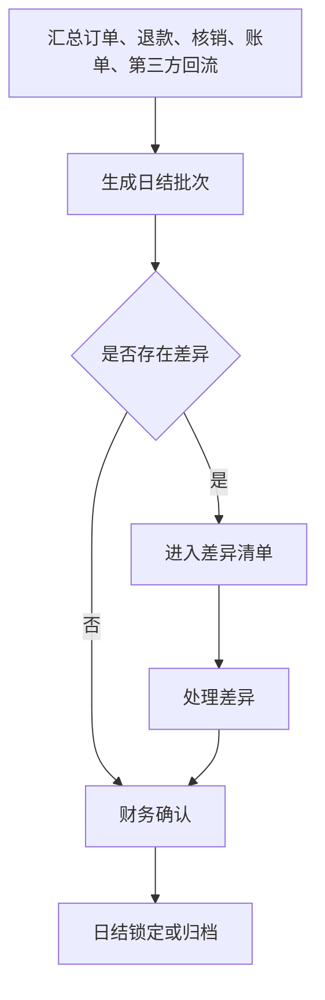
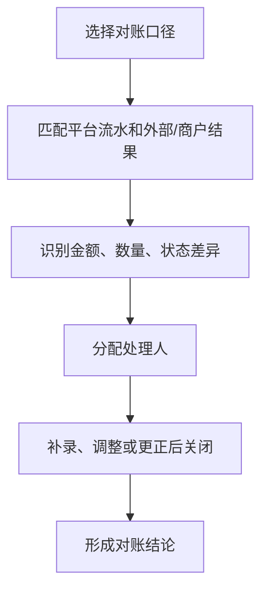
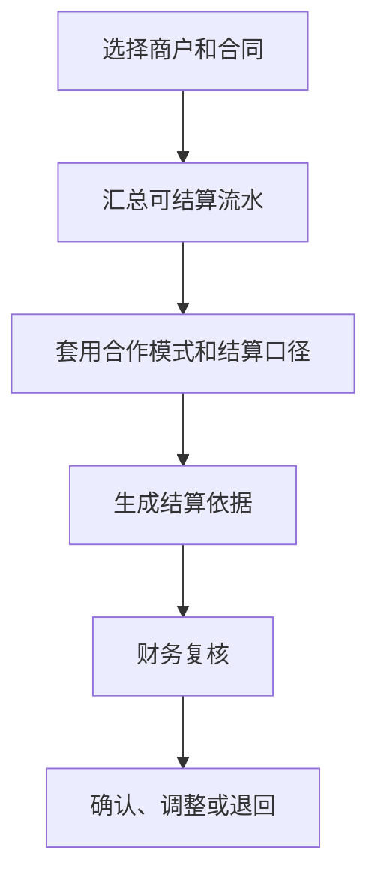

# 财务经营、日结与结算产品 PRD V0.27

> 2026-07-04 逻辑一致性修订：①§6C.2-4 第三方手填对账规则由「永久业务规则」改为**配置驱动（后台可配、默认取当前口径）**，避免硬编码；②§6A 开票新增**开票失败降级 + 重试 + 人工兜底**路径，补齐失败态处理；③§5-§6C 澄清**日结锁定后补录/修改的幂等性**——锁定后补录一律走补录审批、以幂等键防重复提交，且**不改已锁定日结，只生成冲正调整**。（不改「商户-铺位-合同数据模型」相关段落。）

> **权限边界**：本 PRD 只提供产品细化；三份业务 HTML 拥有最终业务解释权（同 §3A）。**三份 HTML 之间若出现冲突，按确认时间线判定：凡经用户确认过的内容，确认时间越晚的优先级越高，后确认的覆盖先确认的（以决策台账记录的裁决时间为准）；无法确定确认时间先后的，仍须逐项重新裁决**（2026-08-05 R7 补，依据 DIFF-A-051、PGM「解释权声明」条）。

> **⚠️ R5 业务HTML缺口审计修正标注（2026-06-18，只读审计后回填，未改代码）**
> 以业务说明地图 #finance 为基准：日结锁定→补录审批、日结多源汇总、对账自动匹配在后端**未落地或为手填**（详见 `finance-ar-ap-ledger-development-design-v0.1.md` R5 标注与追溯矩阵 REQ-81 R5）。对账 expected/actual 全来自请求体手工录入，`difference_type` 自由文本，PRD 要求的金额/数量/状态/缺失四类无数据层强制。**业务裁决（2026-06-18）**：锁定补录审批 + 多源汇总本期 P0（见 ar-ap-ledger R5）。日结聚合口径由本审计先起草草案待财务确认（二轮裁决）；仍待业务确认：对账自动匹配排期。**候选验收口径**：锁定后金额受控、日结来自真实汇总、对账差异按四类枚举自动识别。

## 1. 文档定位

本文档按财务经营动作拆解日结、对账、结算和经营流水。它回答“卖了多少、核了多少、退了多少、差异在哪里、按什么口径和谁结算”。

本文档不是财务软件实现，不写会计凭证和账务系统接口。P0 聚焦综合体经营口径下的基础对账和结算依据。

## 2. P0 目标

P0 目标：
- 汇总票务、酒吧、游乐、第三方回流的经营结果。
- 按订单、退款、核销、合同和商户形成基础对账。
- 识别差异并进入处理队列。
- 生成可供财务复核的日结和结算依据。
- 为管理看板提供收入、核销、退款、差异等基础指标。

## 3. 财务经营对象

| 对象 | 定义 | 关键关系 |
|---|---|---|
| 经营流水 | 所有影响收入、退款、核销和调整的业务结果 | 关联订单、权益、账单、商户 |
| 日结批次 | 某日期或班次的经营结果汇总 | 关联流水、差异、确认人 |
| 对账单 | 平台与支付、渠道、商户、第三方之间的核对结果 | 关联合同和差异 |
| 结算依据 | 按合同和经营结果形成的应收、应付或分成依据 | 关联商户、合同、流水 |
| 员工提成依据 | 按卡座销售归属和消费额生成的业务提成依据 | 关联员工、岗位快照、卡座账单、日结和复核 |
| 差异记录 | 不同口径之间的金额、数量或状态不一致 | 关联处理人、原因、结果 |
| 调整记录 | 经确认后对经营或结算口径的调整 | 关联复核和留痕 |

## 3A. 通票分账瀑布与收入归属（2026-07-28 口径，引用式）

> 本节只做**引用与对账锚点**。三个业务 HTML 拥有最终业务解释权；`settlement-rebuild-prd-v1.0.md` 只提供产品细化，术语表只提供名称映射，均不得覆盖 HTML。

**分账边界**：酒吧通票、纯游乐通票等域内通票不进行域间比例拆分，按对应域主管公司的域内规则结算。只有跨域组合通票在整单先扣一次第三方渠道费用后，按各收费权益有效价格在域间分配；零元权益不参与域间分配，进入各域后的份额不得再次扣除同一渠道费用。各域再按本域已批准的内部结算价、固定金额、固定单价、排名档位或其他规则与实际提供方结算。

**跨域组合通票分支**：整单第三方渠道费用只扣一次，渠道费用分摊尾差由该渠道费的实际结算责任主体承担并单列留痕。域份额不直接等于提供商户收入；进入经营域后由域主管公司执行域内结算。
- 拆份额**只按业态大分类**；**依附于某业态产生的加赠权益不作为业态层拆分对象**（其价值已含在所属业态价格内）。
- **定价构成**：售价 =（游乐价 + 酒吧价 + 收费的餐饮/零售价）× 票种折扣，**由系统自动算出**（V369 已落地）；**免费的（票面价 0）不计入价值**。
- **凑整与允许误差**（V369 已落地）：运营可在系统算出的售价上填一个**近似售价**凑整（整元、且**尾数落在后台配置的允许尾数集合内**——业务参数，全平台统一可配，**出厂默认 8、9、0**；上调下调均可），但与算出售价的差额**不得超过后台配置的允许误差**（`ticket_combo_discount_configs.rounding_tolerance_cent`，出厂 5 元，与「套票折扣归属」同处维护），**超出即拒绝发布**。这道闸堵的是「运营想填 178 填成 160、票照卖、少收的钱被当成套票折扣默默由项目公司吃掉」——对账时再也不会见到一张售价和它的业态构成对不上的票。
  - 【DEC-R7-P1】**2026-08-05 已获 HTML 授权（DEC-R7 第二批），原待批标注撤销**——ENUM「综合通票定价」条的「允许误差（业务参数，全平台统一可配**，出厂默认 5 元**）」与 BSM「综合／联合通票的定价构成」条的「允许误差可配（业务参数，全平台统一可配**，出厂默认 5 元**）」已写入该出厂值。
- **凑整差额与折扣的承担（2026-08-04 F5 改写，依据 ENUM「综合通票定价」条、BSM「综合／联合通票的定价构成」条）**：
  - **凑整产生的差额按各业态价格比例，与折扣一并分摊到各域**——凑整差额和票种折扣走**同一套分摊口径**，不分两套。
  - **由各域主管公司按份额各自承担或取得**：分到的是负数就各自承担，是正数就各自取得；**没有任何一个主体统一兜底**。
  - **每次发布时，把凑整差额金额及各域分摊数额记入票种规则版本，发布后不得再改**——分摊结果随票种规则版本固化，事后不可调整。
  - 原写法「凑整差额不新建口径，按既有 `discount_bearer` 承担」**作废**。

  > **【越权实现、待改造缺口（2026-08-04 F5 登记）】** `discount_bearer` 的三值口径属**越权实现**：其默认值 `platform_absorb`（平台兜底吸收）来自**已被推翻的「项目兜底」范式**，与 HTML 的「**各域主管公司按份额各自承担或取得**」直接冲突——HTML 里根本没有「某一方吸收全部折扣/凑整差额」这一选项。
  > - **不得**继续以 `discount_bearer` 决定凑整差额与折扣的承担方；该字段的三值在 HTML 中**无依据**。
  > - **改造方向**：承担方由**按各业态价格比例分摊**算出，不再由配置项选择；分摊结果与票种规则版本一并固化。
  > - **改造前边界**：本条只登记缺口与作废旧写法，**不改代码、不改数据**；改造前不得据 `platform_absorb` 反向定义业务规则，也不得新增依赖该字段的口径。
- **两个价不可混用**：**各业态价格**（原称「票面原价」，2026-08-05 DEC-R7-16 更名）用于定价与拆份额，**内部结算价**用于与提供商户结算成本。对账时这是两条不同的口径线，不得互相顶替。
- **内部结算价是唯一的成本结算基准（2026-08-04 F5 补，禁止性口径）**：与提供方结算权益成本时，**一律以内部结算价为准**——**不得使用进货成本（采购价 / 到货价 / 移动加权平均进货价）作为另一套结算基准**，也**不得**在内部结算价之外「按成本据实结算」「按进货价孰低结算」或以任何名目并行两套基准。
  - 进货成本只用于**成本核算与经营分析**（商品成本、经营净利润的成本扣减依据），**不进入分账与结算链路**。
  - 跨主体流转、赔偿、报损计价同样一律按**内部结算价**（见 `supply-chain-inventory-product-prd-v0.1.md` §7.6、§10 已确认第 6 条）。
  - **例外只有一个**：酒吧入场资格是目前唯一**不设内部结算价**的特殊权益，走可分配池规则（见下）。除此之外不得以「该权益没定结算价」为由改用进货成本。

**渠道费两层：通路费与销售渠道费（2026-08-04 补，依据 ENUM「跨域通票分配」条、DEC-R3-2026-08-04-08）**

渠道费用分两种，**性质不同、不可混用**：

| 层 | 是什么 | 什么时候产生 | 谁承担 | 扣在哪一步 |
|---|---|---|---|---|
| **通路费** | 银行、微信、支付宝等**支付通路**收取的费用 | **所有支付都会产生，官方渠道同样产生** | **各域按分配份额自然共担**，不由该笔业务的收款主体单独承担（DEC-R6-01） | **在拆分给各域之前，从整单扣除** |
| **销售渠道费** | 第三方售票平台收取的**佣金** | **只有经第三方渠道售出的才产生** | 取得该笔收入的**共同成本**，按默认方式分摊 | **在通路费之上再扣一层**，先从整单扣除且**只扣一次** |

- **官方渠道售出的票不扣销售渠道费，但仍扣通路费**——原「官方渠道不扣渠道费用」的笼统写法作废，否则官方渠道每一笔线上支付都过不了「分出去的每一分等于收进来的」守恒校验。
- 任何票种经第三方渠道售出时，**销售渠道费一律先从整单扣除且只扣一次**；**域内通票同样适用**，不因不做域间拆分而免扣。
- 第三方渠道合同由该票种的**法定收款主体**签约，渠道款回该主体账上；渠道合同**只能约定佣金费率、收付款方式和对账方式，不得改变佣金的承担方式与分摊口径**，每笔分摊结果与所用合同版本必须留痕。
- **门票积分发行费按积分实际转为可用的数量及当时有效的全国发行单价，由原票合同销售方单独承担。** 单店酒吧票由销售酒吧承担，公司票由合同销售公司承担；平台代收或第三方代售不改变责任。发行费另列销售方自身成本，不在域间拆分前的票款或酒吧分配池扣除，不减少其他参与方份额。未使用、补偿使用和仍待退款的对应积分不产生新发行费。此口径替代本节原 DEC-R8-87 的共同分摊算法，历史记录保留。

**通路费的支付方式切口（2026-08-04 F5 补，依据 ENUM「储值卡类型与收款主体」条、ENUM「跨域通票分配」条）**

「所有支付都会产生通路费」的「支付」指**实际经过支付通路的那一次收款**。按支付方式切分如下，**同一笔钱全程只计一次通路费**：

| 支付方式 | 是否计提通路费 | 计提时点与口径 |
|---|---|---|
| **银行卡 / 微信 / 支付宝等在线支付**（含官方渠道、第三方渠道） | **计** | 收款当笔按**实际使用的支付通路**记录金额与费率，在域间拆分之前从整单扣除 |
| **储值卡余额支付** | **消费环节不再计** | **通路费在储值卡充值时即已产生并计提**（按该笔充值实际使用的支付通路记录金额与费率）；消费时按该商户给客人的成交价格、**扣除该笔消费所对应的通路费**后结算，**不另扣任何比例**、不重复计提 |
| **现金** | **不计** | 现金未经过任何支付通路，不产生通路费 |

- **储值卡按通路占比分摊**：同一张卡由两个以上通路充值的，**分别记录各通路的充值金额与费率**，消费时按**各通路充值金额占该卡总充值额的比例**计算通路费。
- **计费基准是合同期，不是交易时点**：通道费以**平台与该支付渠道的现行合同期**为计费基准，**不以充值时点、也不以消费时点为基准**；合同换期后该卡尚未消耗的剩余余额改按新合同费率计算，**费率涨跌一律取高**（上调按新费率、下调仍按原费率）直至该卡余额消耗完毕，**已消耗部分不追溯重算**；因取高规则多计出的通道费差价**归城市项目公司收取**。
- **不得重复计提**：储值卡充值时已计一次、消费时再计一次，属重复计提，守恒校验必炸。

> **【已裁决（原 E-07，2026-08-04 第三轮用户裁决 UD-15 / DEC-R6-01）：通路费整单预扣、各域按份额共担】**
>
> - **定稿口径**：通路费在**拆分给各域之前从整单扣除**，由**各域按分配份额自然共担**，**不由该笔业务的收款主体单独承担**。原「由该笔业务的收款主体承担」表述**已作废**，ENUM「跨域通票分配」条与 BSM 票务权益章·域内通票分账 li 已同批改写。
> - **官方渠道同样产生通路费**（官方渠道免的是第二层销售渠道费，不免通路费）。销售渠道费（第三方售票平台佣金）仍为**第二层**，只有经第三方渠道售出才产生，**在通路费之上再扣一层**。
> - 跨域组合通票由娱乐平台公司统一收款：按本裁决，游乐、餐饮、零售各域按份额一起承担通路费，娱乐平台公司不单独吃。
> - **改造顺序仍然适用**：`settlement-rebuild-prd-v1.0.md` §5.0a 的恒等式改造顺序（先改恒等式与两道自检、再接扣项）**不因裁决而放宽**——反序仍会触发 `SETTLEMENT_CONSERVATION_VIOLATED` 拒绝出单。裁决只解除了「通路费层不得编码」的阻断，实现须同步修订本节、§5.0 恒等式与 `verifyFormatSplit`/`verifyConservation` 校验（缺口登记见修复台账 §7.4 GAP-05）。

> **实现状态**：门票积分发行费独立关联实际使用人份／次份、实际转可用时间、发行单价版本及合同销售主体，不再作为瀑布前扣项。自然月汇总按已审批全国账期出账，商户实际可查看后按工作日计算异议期，整日门户不可用不计入，未结异议阻止付款；到期日、原费用及账单保留，正式往来进入既有应收应付台账。缺账期、日历或主体事实时保留待处理，不以占位数据记完成。账期申请被驳回后保留原记录，允许补正后对同一生效月份重新申请；仅待审或已批准版本互斥。已入账后核实此前整日门户不可用的，原账单及成功收付款保留，另记尚未付款金额适用的原、新期限及故障依据，仅延长未付款到期日。出账及延期提醒复用实际商户联系人和短信发送日志，通知结果不改变可查看时点或异议期。通路费与销售渠道费的分层已于第十八批第 3 条落地（V555）：通路费按支付通路配比例，每笔付款成功时按实际支付通路固化（储值笔取该次消费在各充值批次分摊的通路费），核销与到期按金额占本单实付比例分摊、在拆分各业态前整单扣；销售渠道费只对第三方渠道售出的票扣，官方渠道不扣；结算单通路费、销售渠道费两列分列。积分账单开票（FS-022，2026-10-19，V509）：已形成正式应收的积分月账单按该账单已收额进入统一开票清单（收入类型「积分发行费」），开票主体为账单收款方，购方为合同销售方，只取本账单金额、不与兑换补偿相抵；可开额＝已收−已开，定时作业逐张补开新收部分、重跑不增行；开票结果仍由财务按第三方平台实际结果在开票清单登记。商户积分发行费（第十一批 TK-04-b，V528）：商户消费积分实际转为可用时按转可用积分数×释放时全国发行单价形成费用事实（承担方＝消费商户及其合同主体），同一积分月账单流程按 `fee_kind` 与门票积分发行费分开出账、分开挂账和开票，账单明细列来源消费单据；退款应付经统一回写点实付结清时同一事务通知来源域回写退款成功（`RefundPayableSettled`）。

**酒吧可分配池两段分配（2026-08-04 F5 改写为事前口径，依据 ENUM「酒吧通票可分配池」条）**：酒吧入场资格是目前唯一不设内部结算价的特殊权益。第一段由娱乐平台公司按已生效的固定金额或固定单价先分，第二段由未参加第一段的酒吧按排名档位分配余额。

- **超池判定与审批一律在事前完成（2026-08-06 R10 返工同步，依据 ENUM／BSM「酒吧通票可分配池」条，DEC-R8-48/66）**：**第一段的固定金额或固定单价在配置生效之前，必须先按该票种在当前各项配置下的最低可能可分配池金额试算（细则见枚举速查表同条），确认第一段应分合计不会超过该最低池金额；试算不通过的配置不得生效。**
- **结算环节不再设「超池待审批」**——超池的判定与审批**一律在事前**（配置生效前）完成，结算时只按已生效配置分配，不存在结算期挂起待审批的分支。
- **确需超池的走事前申请**：娱乐平台公司确需让第一段合计高于池金额的，须在**配置生效前**提交**短期经营激励申请**，并经**项目之上的平台权限**审批（**不是结算中心**）；**超出部分由娱乐平台公司承担**。
- **有效期**：初始有效期**不超过后台配置的上限**（**业务参数，按项目可配，出厂默认三个月**）、**到期重审**。
- 无第一段参与者时全池进入第二段；无合格第二段参与者时，余额**单列为未分配池余额并归娱乐平台公司**。

**未实际取得权益的票款一律按「域归属对照」归属（2026-08-06 R10 补，依据 ENUM「域归属对照」条、ENUM「主要收入归属」条，DEC-R8-27/29）**：

- **同一张对照表**：票款在客人未实际取得权益时的归属，一律按票种所属**经营域**确定，与该笔钱是「到期未用」还是「场次终结未核销」**无关**——**酒吧域 → 娱乐平台公司；游乐域 → 游乐公司；餐饮域与零售域 → 城市项目公司；演出传媒域 → 传媒公司**。该对照与 ENUM「商户业态」条确定的业态—主管公司关系一致，**不另设第二套口径**；跨域组合通票先按既定域份额拆分，再逐域归属；**顶层平台不因本条取得任何份额**。
- **两类钱各自单独立项留痕、不合并**：①**到期未核销票款**（从未完成检票环节的票，见 ENUM「到期未核销款」条）；②**通票未核销减除额**（已完成检票环节、但覆盖酒吧当期未被核销入场，按 ENUM「酒吧通票可分配池」条从池中减除的份额）。
- **分栏列示（四者不得合并）**：**通票未核销减除额**、**到期未核销票款**、**未分配池余额**、**金额尾差**四个名目在分账结果中**分栏列示**，各自单独立项留痕，不得并入任何一家酒吧的应分金额，也不得互相合并（ENUM「主要收入归属」条、「酒吧通票可分配池」条）。
- **通票未核销减除额的计费基数**：逐票按该票**第二段参与集合**的档位表所对应的百分比份额；第二段参与家数决定取哪一行，**与是否核销无关**；未核销酒吧对应的百分比按未核销减除规则减除并按域归属，**不重新换行取表、也不由其余酒吧分掉——核销才拿**。

> **旧口径作废**：原「第一段合计超池时不自动缩减、不出账，进入超池待审批」「由结算中心审批」「最长初始三个月」三处写法**已被上述事前口径取代**——超池不再是结算期的一个状态，而是**配置生效前的一道闸**；审批主体是**项目之上的平台权限**；三个月是**可配出厂默认值**、不是硬上限。对应的实现侧登记见 `settlement-rebuild-prd-v1.0.md` §5.0/§5.1。

**收费与免费权益**：商户让利型零元权益不结算；域主管公司出资型零元权益在核销后按锁定内部结算价与实际提供方结算，未核销不结算。豪华套票、小食或特殊权益等收费或由域主管公司承担的权益同样按本域已生效规则结算。采用内部结算价还是本域其他规则由域主管公司决定，商户无权决定；哪个域主管公司把对客价格或域内分配价定得低于内部结算价，哪个主体承担差额，高于成本的剩余也归该主体。

> **实现现状（第十八批 S 段第 156 条 156-R1，2026-11-05；BSM 第 751 行「商户让利的零元免费权益不结算；域主管公司出资的免费权益按锁定内部结算价核销后结算，未核销不结算。」，BSM 第 1689 行「商户让利的零元权益不结算，域主管公司出资的零元权益按锁定内部结算价核销后结算。」）**：专属直付的餐饮、零售权益在票种绑定上标为商户让利型的，核销结算价记 0、不查内部结算 SKU 目录、月结不产生应付，未挂目录条目也能核销；域主管公司出资（平台出资型）的照旧按目录生效价核销后直付，未核销不结算。详见 `settlement-rebuild-prd-v1.0.md` §6.6。

**门票综合服务费的计费基数（2026-08-04 补，依据 ENUM「门票综合服务费」条）**：

- 娱乐平台公司按每张门票的**比例或固定金额**收取综合服务费，**两种方式互斥**，并可设置月度封顶（封顶只对单一酒吧门票生效）。
- **按比例收取时，计费基数一律是该张票订单上保存的「最终选中价」（客人实付价）**——**不使用基础价，也不使用动态价，更不先扣第三方渠道费用**。
- **退款时**：**门票退款以单张门票为单位，不存在一张门票的部分退款**；该张票发生退款时，**已计收的综合服务费随票全额退回**（2026-08-05 R7 同步，依据 DEC-R7-07；ENUM「门票综合服务费」条现行文字。原「按实退金额同比例退回；全额退款则全额退回」表述已作废）。
- **单一酒吧门票的综合服务费按物理项目分别维护**，**初始为空、不自动继承酒吧通票的默认比例**；可按合同为不同酒吧设置不同数值与月度封顶。
- **票种发布前必须先选定「按比例」还是「按固定金额」并填入数值；未选定方式或未填写数值的票种不得发布上架。**
- **实装现状（FS-013，2026-10-19）**：单一酒吧门票的计费月按操作员裁决 2026-10-19 第 3 条（所选选项原文）：「售出月，只退款剔除」：按客人付款成功（售出）所在月计入；之后只有整张退款成功才从原月剔除重算；到期没用的票照常计费。出票即逐票锁定、计费月首张票锁定封顶；月结时按 min(Σ未退票逐票费, 锁定封顶) 单独挂酒吧应收、走三个付账日，与票款应付分别收付；整张退款成功回原计费月重算，只登记台账未覆盖的差额（先调减原应收未收部分，超出部分列应退）。详见 `settlement-rebuild-prd-v1.0.md` §7.2。

**收入归属（业态主体）**：

| 收入类型 | 归属主体 |
|---|---|
| 单一酒吧门票 | 对应酒吧商户；娱乐平台公司只另收可封顶的门票综合服务费，不取得门票收入 |
| 酒吧通票 / 跨域组合通票酒吧份额 | 娱乐平台公司按酒吧域规则负责；门票综合服务费不得封顶 |
| 订台低消 / 二次消费 / 额外酒水 | 各酒吧商户 |
| 非散台服务费（卡座等） | 各酒吧商户 |
| 向商户供货的货款 | 中央餐饮公司（供应链主体） |
| 纯游乐票 / 纯游乐通票 | 游乐公司；不向娱乐平台公司支付门票综合服务费 |
| 演出票 | 传媒公司；不向娱乐平台公司支付门票综合服务费 |
| 场地租金 | 对应城市项目公司；每个城市项目公司同时承担本城市资产公司职责 |

**对财务侧的影响**：
- 权益兑付在实际核销后由对应域主管公司与实际提供方结算；差额由作出定价或分配决定的域主管公司承担或留存，不默认归娱乐平台公司；
- 结算单与开票清单的开票主体按上表映射（见 `settlement-rebuild-prd-v1.0.md` 附录 D）；
- **实现状态**：内部结算 SKU 目录已于 2026-08-01 由 V379/V380 落地，具体见 §3B。S1—S11 等其他实现证据仍只用于定位当前代码；凡统一预扣赠送成本、统一归娱乐平台公司、域内通票按域比例拆分、酒吧份额重复扣渠道费或通票服务费可封顶的实现，均与现行 HTML 冲突，应作为待改造缺口，不能反向写成业务规则。本次只修订 PRD，不在本阶段修改实现。

## 3B. 内部结算 SKU 目录（2026-07-28 用户拍板 E）—— ✅ **2026-08-01 已落地（V379/V380）**

> 权威业务口径在业务 HTML「财务对账」章（提交 `88eba70c`，用户逐条批准）。本节是该需求的**产品承接**；结算侧承接指针见 `settlement-rebuild-prd-v1.0.md` §9.7，排期见 `pending-development-backlog-v0.1.md` 批 10（已消项）。
>
> **落地形态（2026-08-01）**：目录表 `internal_price_catalog`（V379，条目绑商家+品类，`item_code` 稳定业务键，草案/生效并存＝结算配置中心 Path 2 第 12 类）；四处存量**逐分收编**为目录条目 + 业务表 `catalog_item_code` 引用列（V380，原价格列转**快照语义只读**、由系统在设引用/目录转正时同步）；`InternalSettlementPriceResolver` 两支统一改读目录生效价（fail-closed 不回退票面价）；四处业务写入口**封写**（直填内部价一律 400），PR#274 模板改价端点随之下线；后台目录主页面 ADM-STL-003（三维筛选+草案队列+下线归档）。
>
> **项目隔离落法（DEC-MPS-2026-07-28-15「SKU 不得跨项目关联」）**：以「目录条目绑定商户 = 业务对象提供商户」的**商户级同源守卫**落地（写入校验 + 解析器双重校验）。商户唯一归属项目，商户级同源**强于**项目级同源，故不单存 project_id；目录页按商家/业态/品类三维筛选即得项目视图。

### 3B.1 为什么要做（业务人员视角）

今天财务要核一笔"平台该付这家商户多少成本"，得先问"这个价在哪儿看"——同一瓶酒在酒吧商品页有一个内部结算价、进了套餐又有一个、做成票里的赠饮权益还有一个、发成券又有一个。**四个页面四个人各改各的，改完谁也不知道另外三处还是旧价**，对账对不上时没人说得清应该以哪个为准，出了错也找不到该谁兜。每个项目集中成自己的一个目录之后：**同一项目内价格只有一处能改、改一次对本项目后续业务生效、谁改的谁复核的有痕、已经发生的账不会被后来改价改掉**；不同项目的目录和价格互不覆盖。

### 3B.2 现状：一价四存（实读迁移确认）

| 存放处 | 字段 | 迁移 | 谁在改 | 问题 |
|---|---|---|---|---|
| 酒吧商品 | `bar_products.internal_settlement_price_cent` | V152 | 酒吧商品目录页 | 与下面三处无任何关联，各改各的 |
| 酒吧套餐 | `bar_combos.internal_settlement_price_cent` | V257 | 酒吧套餐页 | 套餐价与其组成 SKU 价可各自漂移，无一致性约束 |
| 票务权益模板 | `entitlement_templates` / `issued_entitlements.agreement_price_cent` | V225 | 权益模板页 | 实物权益经 `bar_item_ref` 回退取酒吧商品价、虚拟权益取签约价，**两条取价路径**；模板级还可另填 |
| 券台账 | `voucher_definitions.internal_price_cent` | V301 | 券定义页 | 独立第四份 |

**共同缺口（V380 已闭合）**：~~无统一目录、无商家/业态/品类三维、无跨页引用与就地新建、改价无草案复核、无下线归档~~——V380 起四处全部收编为目录引用，上述缺口全部闭合；本表仅存史实。

**已有的一块地基（可复用，别重造）**：`ticket_verifications.settlement_price_cent`（V225）在核销时把当次判定的结算价**落到该次核销记录**上——这正是目标里「核销时把当时价固化到流水」的雏形，目录建成后把它的取价来源换成目录即可，固化机制本身不用重写。另有 `bar.internal_settlement_price.view`（V279）与 `voucher.internal_price.view`（V301）两个读脱敏权限点，目录的「仅授权后台可见」直接沿用同款铁律。**S5（2026-07-28，PR #270）又添一块**：`InternalSettlementPriceResolver` 已把全平台取价收敛为唯一解析入口（预扣与兑付同源、fail-closed 不回退票面价）——「一价四存」的存放现状未变，但目录建成后只需改这一处解析器的两支，所有调用方无感。

### 3B.3 目标：每个项目一个目录、项目内唯一真源

| # | 要求 | 说明 |
|---|---|---|
| 1 | **项目内集中唯一真源** | 每个项目拥有独立内部结算价目录；同一项目成本侧一切取价改读本项目目录，不同项目不得互相覆盖或跨项目引用 |
| 2 | **绑提供商家 + 归品类** | 每条目录条目必须绑定提供它的商家（**业态随商家带出**，不单独录）、并归入品类 |
| 3 | **三维可筛** | 商家 / 业态 / 品类三个维度都能查找与筛选 |
| 4 | **多处引用、就地新建、只进本项目目录** | 设置酒吧商品、酒吧套餐、票务权益模板、券等业务对象时都可引用本项目目录条目，也可**就地新建**；就地新建的条目一律进入**当前项目目录**，不另存一份 |
| 5 | **目录是唯一可编辑处** | 其它页面只能引用与就地新建，**不能改价**；改价一律回目录 |
| 6 | **改价走草案 → 他人复核转正** | 与结算配置中心同一范式（`settlement-rebuild-prd-v1.0.md` §9）：先存草案、须具备高敏权限的**他人**复核转正后才**对后续生效**；谁提交、谁审批、何时生效全程留痕 |
| 7 | **按各自业务固化点锁价并写入流水** | 普通商品、普通权益和其他券继续按各自业务规则指定的核销、结算或其他固化点读取届时生效的目录价并写入只读流水，后续改价不追改已发生的账。**在本 PRD 当前明确的内部结算价通则冲突范围内，会员积分兑换虚拟券第②类“店内实物／服务”适用发券锁价例外**：发券时锁定项目、该商品内部结算价、方案和成本承担版本；实际核销或完成履约后按发券快照形成商户补偿，不得重新读取核销时目录新价。该例外不得外推到第①类商户折扣券、第③类平台或外部合作伙伴券或普通业务。 |
| 8 | **下线归档不影响历史引用** | 条目可下线归档，历史引用照常可追溯（与软删除铁律一致） |
| 9 | **敏感、仅授权可见** | 内部结算价属敏感信息，仅授权后台人员可见（沿用 V279 / V301 读脱敏范式：无权限读端一律置 null） |
| 10 | **提供方提交、对应域主管公司审批** | 实际提供商品或服务的主体提交，提交人与审批人分离：酒吧由娱乐平台公司审批；游乐由游乐公司审批；演出传媒由传媒公司审批；餐饮与零售商户（含独立、联营、租赁各种合作模式）统一由城市项目公司审批，其中**中央餐饮公司供应的酒水或小食等中央餐饮供货部分**仍由中央餐饮公司内部差人审批；城市项目公司直接管理的第三方商户由城市项目公司审批；业态为“其他”的商户由其商户档案上指定的主管公司审批，不得编造默认主管，也不得由商户自批。任何商户在没有获批内部结算价之前，不得为其开通需要该价格结算的权益或券。 |
| 11 | **查看、导出、修改分权** | 普通用户、会员、前线员工及无价格权限的商户人员不得查看；系统自动使用价格不代表操作人获得查看或修改权 |
| 12 | **敏感范围与项目隔离** | 敏感经营数据还包括成本价、采购价、毛利、分账底价、域内补贴缺口和供应链价格；数据默认按项目隔离，只有项目之上的获授权岗位可跨项目查看 |

- **实现现状（HP-P01 第二组，2026-10-21）**：停车由城市项目公司经营而非商户（BSM「停车场」章），目录条目的提供方可为经营主体——`internal_price_catalog.provider_entity_id` 与 `merchant_id` 恰填其一（V534），落草案、他人复核转正、下线归档沿用本节流程，绑定的提供方不可改；停车消费抵免的每小时内部结算价即城市项目公司为提供主体、品类 `parking_credit`「停车抵免（每小时）」的生效条目，抵免首次使用时固化到该次抵免（第十二批操作员裁决补充第 4 条「实际抵掉小时数×每小时内部价」）。

**内部价闸与基础消费积分边界**：上述“未获批内部结算价不得开通”只约束需要该价格结算的权益或券；不得解释为基础消费积分的申请、批准或发放闸。凡纳入会员计划覆盖范围的在营商户，必须参加积分计划；**符合规则的有效消费在履约完成后**，积分和成长值按既有生效业态规则产生。商户不得以内部结算价尚未获批、未另行申请积分活动或自行关闭发分为由阻断。内部结算价是否获批，不改变积分冻结、退款冲减、转为可用及发行费形成的既有时点规则。

### 3B.4 落地对账（原迁移清单 → 实际落法，2026-08-01）

1. ✅ **目录表**（V379 `internal_price_catalog`）：条目绑 `merchant_id`（业态经 `merchants.merchant_type` 带出，不冗余存）+ `category` 独立标签（品类不建字典表——存量品类沿各域既有词表迁入：商品 8 词表/`combo`/权益类型/券种，筛选按值匹配即可，为一列标签建字典属过度设计）；`item_code` 稳定业务键（业务表引用它而非行 id，转正软替换旧生效行＝价格版本史留库）；
2. ✅ **四处存量收编**（V380）：四表各加 `catalog_item_code` 引用列，存量价**逐分**迁成目录生效条目（收编等价判据由 `InternalPriceCatalogJdbcIntegrationTests` 重放 V380 真源 SQL 证明）；原价格列转**快照语义只读**（COMMENT 落库），由系统在设引用/目录转正时同步，任何人不得手改；四处写入口封写（直填 400 fail-loud，不静默忽略）；
3. ✅ **草案闸**：`SingleRowConfig` 第 12 类 `INTERNAL_PRICE_ITEM`（scope=`item_code`），转正/软删复用泛化端点与差人守卫；**转正专案分支**追加「四表快照传播」且与软替换同一事务（不留「目录已新价、快照还旧价」窗口）；0 价转正若有券引用先验拒绝（券口径要求内部价>0）。新增端点仅 2 个：落草案（返回 `item_code` 供就地新建即引即用）+ 三维筛选列表；
4. **固化点及第②类边界**：普通核销侧继续沿用 `ticket_verifications.settlement_price_cent`，在该普通业务核销时固化届时生效的目录价；改价转正只影响该普通路径此后的核销，已核销历史一分不动，既有 `SettlementPriceResolutionJdbcIntegrationTests#catalogPriceChangeDoesNotMoveAlreadyVerifiedMoney` 继续作为该普通路径的四步资金证明。普通结算侧预扣／兑付继续经 `InternalSettlementPriceResolver` 同源读取目录生效价；普通券核销结果流水继续沿用 `voucher_redemptions.settlement_amount_cent`。**会员积分兑换虚拟券第②类“店内实物／服务”只在取价时点上例外**：发券时锁定项目、内部结算价、方案和成本承担版本，实际核销或完成履约后按该发券快照形成补偿，再把补偿结果写入券核销流水，不得在核销时重读目录新价。上述普通路径的实现与测试证据保持已核验；第②类发券快照及按快照补偿的当前实现状态本批未核验，不得标作已实现。
5. ✅ **读脱敏**：目录读端权限闸＝`settlement.config.view` 或 V279/V301 两内部价读脱敏点任一（无权限 403），商户 scope 强制收窄本商户；四处业务页快照列沿用各域既有脱敏；
6. ✅ **前端**：目录主页面 ADM-STL-003（三维筛选+草案复核队列+下线归档）；四处业务页内部价直填输入全部下线、改为「目录条目编码」引用输入 + 快照只读展示（就地新建＝目录落草案返回编码后引用；条目须他人复核转正才有生效价）。

> **改价与固化边界**：普通业务继续按各自规则指定的固化点锁定届时生效的目录价；已在其固化点写入流水的历史一分不动。**在本 PRD 当前明确的例外范围内**，会员积分兑换虚拟券第②类“店内实物／服务”在发券时锁定项目、内部结算价、方案和成本承担版本，发券后、核销前目录改价不改变该券快照，实际核销或完成履约后仍按发券快照补偿。第①类商户折扣券按抵扣处理，第③类平台或外部合作伙伴券按约定结算；不得用第②类例外改写普通业务或第①／③类的固化点。

## 4. 对账口径

| 口径 | 适用场景 | P0 要求 |
|---|---|---|
| 按订单 | 售票、酒吧消费、第三方订单 | 能看到订单金额、状态、退款 |
| 按核销 | 通票、权益、游乐、赠饮 | 能看到权益是否被实际使用 |
| 按合同 | 商户租赁、联营、自营、代运营 | 能关联商户和合作模式 |
| 按渠道 | 第三方售票、支付、餐饮零售 POS | 能识别渠道差异 |
| 按日结 | 每日经营确认 | 能形成日汇总和待处理差异 |


## 4A. 营业日与中国税法属期（双轨，2026-07-28 用户确认）

> 闭合审计 ADV-TX-008 / XD-006。
> **运营营业日**与**税法/开票属期**分开建模。
> 裁决：`DEC-BIZDAY-001`（运营）+ `DEC-TAX-CN-REFUND-001` / **T-INVOICE-LINK**（退款税会）。
> 本 PRD 不构成税务法律意见；落地以适用中国税法、主管税务机关及税控产品规则为准。

### 4A.1 运营营业日（DEC-BIZDAY-001）

用于：现场日结、班次、经营「今日」、低消/营收经营切片、商户经营对账默认视图（**非**税法定性）。

**营业日定义（现行口径，依据 ENUM「运营营业日」条 / BSM「按营业日生成日结批次」条）**：全系统的钱账统一按「营业日」归集——营业日**从当日上午 10:00 起算，至次日上午 10:00 止**；其中**次日凌晨 07:00 至上午 10:00 为非营业时段（已闭店）**，该时段内发生的记录**仍归属正在进行的这一个营业日**。

| 配置项 | 说明 | 可配 |
|---|---|---|
| 项目时区 | 如 `Asia/Shanghai` | 是 |
| 营业日起算时点 | 项目本地时刻；**安全阈值**，按每个项目、每家酒吧可配，调整须**最高权限审批并留痕**；**出厂默认上午 10:00**，须同时配置上下限；**禁止代码写死** | 是（安全阈值） |
| 闭店时点 | 项目本地时刻；**安全阈值**，可配范围与审批要求同上；**出厂默认次日 07:00**，须同时配置上下限 | 是（安全阈值） |

**其他已登记的安全阈值（2026-08-19 补，依据 ENUM「薪资单构成」条 / BSM「每位员工都有一个结构化的薪资配置」条现文；DEC-R8-97-04）**

| 配置项 | 说明 | 可配 |
|---|---|---|
| 普通现金扣除占该员工基础工资的上限 | **安全阈值**，**全平台统一可配**，调整须经**人力、财务、法务三审并由顶层平台公司最终确认**；**出厂默认 20%，须同时配置上下限**，该比例为已批准业务参数，不表示法定比例。上限仅按基础工资计算，绩效扣分造成的少发不占现金额度；超过部分不再扣减也不结转下月。例：基础5000元、绩效1000元扣为800元、现金处罚1200元、上限20%，现金最多扣1000元，税前4800元。赔偿与法定工资扣减校验仍按薪资专条。 | 是（安全阈值） |

> **别名警告（不得共用配置或审批链）**：本项的 20% 与 `dividend-engine-prd-v0.1.md` §2#2 股息红利个人所得税的 20% **是两个不同的配置项**——后者的三审组合是**财务、税务、法务**，前者是**人力、财务、法务**；两者的默认值恰好都是 20% 纯属巧合，**不得合并为同一参数，也不得互相援引审批链**。


**一律按营业日归属的适用清单**：日结批次、最低消费时段、票价的日期类型（平日/周末/节假日）、场次归属、巡检有效期、考勤日期（**班次跨月/跨周的，归属班次结束时点所在月/周，见 BSM 跨月班次归属条，DEC-R8-14**）、销售提成月份、**服务点单份额与管理费的归属月份**（2026-08-19 补：该两项按**服务完成时点所在营业日**确定，依据 BSM「服务完成后系统自动分账」条 / ENUM「管理费方式」条现文；DEC-R8-97-07），**一律以开台或下单时点所属的营业日为准，不按自然日切分**。

- 订单/支付/关台等**运营事件**的 `biz_day`：按项目时区，落在营业日起算时点之后、次日同一时点之前的那个营业日。
- 跨自然日 0 点但未过次日起算时点：仍属上一营业日；闭店后（次日 07:00—10:00）产生的记录同样归属该营业日。
- **第三方按自然日汇总的数据**：由系统**按营业日重新归集后再核对**，**归集差额单独列示**；不得直接用第三方的自然日汇总替代营业日口径。
- 报表默认提供「按营业日」；「按自然日」为另一可选口径。
- **营业日配置的变更只影响未来，不回改历史。**

> **【实现现状（2026-10-26 第十八批第 1 条，取代 2026-08-04 F5「实现待对齐」块）】**
>
> | 项 | 本节 HTML 口径（ENUM「运营营业日」条 / BSM「按营业日生成日结批次」条） | 现实现 |
> |---|---|---|
> | 配置维度 | **按每个项目、每家酒吧**可配；同一综合体的游乐统一一套 | 综合体级＝游乐已在用的 `amusement_business_day_configs`（V483，按综合体的所在地时区与版本）；酒吧逐家 `bar_business_day_configs`（V553，酒吧即业态为酒吧的商户）。V201 按业务域的 `business_day_cutoff_config` 与经营参数页「经营日切分」表、`/api/v1/analytics/business-day-cutoffs` 已删除 |
> | 起算时点默认 | **上午 10:00 起算** | 没有已批准版本的综合体与酒吧一律出厂起点 10:00（`BusinessDayResolver`）；酒吧没有自己的版本时不借所在综合体的版本。游乐核销与场次仍要求综合体有已批准版本（V483「无运营初值」不变） |
> | 闭店时点 | **次日 07:00**（07:00—10:00 为非营业时段，仍归属该营业日） | 两张版本表都存闭店小时及上下限（出厂 7 时、提交必填）；归日只看起点，闭店时点供页面展示 |
> | 变更管控 | **安全阈值**：调整须**最高权限审批并留痕**，**须同时配置上下限** | 后台「营业日配置」页（ADM-AMU-008，综合体／酒吧切换）提交即进最高权限审批（`top_authority`），只从未来的生效时点起用，批准迟于拟生效时点记 expired；版本切换当日窗口取前后两段之并，起点调晚、生效时点又落在当日新旧起点之间的，起用顺延到当日新起点（前后营业日首尾相接，一个时刻只属于一个营业日） |
>
> **钱账调用点**：日结七源中酒吧来源（收款、退款、酒吧账单异常拦截）与订台定金来源（第十八批 O 段第 126 条）逐家按各自酒吧窗口取数，其余来源按日结所属综合体窗口；看板 ETL 与指标明细按单综合体口径、取唯一启用综合体的营业日窗，酒吧收入逐商户按其酒吧窗口；分红与成本汇总按方案商户的营业日窗；销售提成月份（工资单、派驻提成月结、作废冲回所对的月结）按账单所在订单的开台营业日，没有开台会话的按该酒吧营业日解析下单时刻；积分账单入账判锁、内部核算与派生台账落账、储值商户应付、演出结算、营业额租金账期、酒吧挂账应收与退款、反结判锁、作废冲正行到期日、开台营业日（由服务端确定，开台请求不再收营业日）、酒吧报酬月结「本月尚未结束」、未带到访日时的票价日期、盘点经营日缺省、调拨应付、服务单归属月、停车抵免一律按所属综合体或酒吧的营业日；按商户落账的（储值商户应付与回冲、演出结算应付、派生台账、调拨应付）商户是酒吧时按该酒吧。
>
> **不回改**：本次未对任何业务表做回填——已落库的 `business_date`、已锁日结及其各源汇总、看板快照、台账 `due_date` 一律保持原值，只有上线后新发生的记录按新口径归日；之后的配置变更由版本生效时点只作用于未来。
>
> **未在本条内**：考勤日期与巡检有效期仍按所在地自然日（牵动排班与工资月份）；第三方渠道自然日汇总的重新归集与归集差额列示（无渠道日汇总对象）；五类数据最终标记及其期限；临时沽清营业日切换自动恢复。

### 4A.2 退款税会归属（DEC-TAX-CN-REFUND-001 = **T-INVOICE-LINK**）

适用于：退款、撤销收款、已开票红冲/作废、需进入纳税申报的收入冲减等。

**总原则：中国税法与税局/税控现行规则优先；营业日切日不得替代法定/开票归属。**

#### T-INVOICE-LINK 规则（用户确认）

1. **有原发票（已开票订单/流水）**
   - 退款的税会/开票处理必须走合规 **红字发票 / 作废**（以票种与税控产品为准）链路；
   - 红冲与冲减归属 **跟随原票与红字确认/开具流程**（及税控回传状态），不得仅按酒吧 `biz_day` 改写；
   - 必须保留：原票号码、红字信息表/确认单号（若适用）、金额、购方信息、回传状态、操作人与时间。

2. **无发票（从未开票或明确无需开票）**
   - 税会归期按 **退款成功时点** 所适用的申报/入账规则处理（通常落入对应自然日/所属申报期）；
   - **不**用运营营业日切日点替代该归期。

3. **运营侧仍记 `biz_day`**
   - 退款事件照常写入运营营业日，供日结与经营分析；
   - 财务/结算界面必须能同时看到：`occurred_at`、`biz_day`、税会/开票属期或红冲状态；
   - 当 `biz_day` 所属自然月与税会属期不一致时，展示差异提示，禁止静默抹平。

4. **禁止**
   - 已开票退款只做负向营收、不走红冲/作废；
   - 用营业日切日把应属上期的红冲硬挪到下期（或反向）以「好看日结」。

5. **可配项**（结构不可回退）
   - 是否对接税控、红冲审批阈值、提示文案、无票退款的会计科目映射等可配；
   - **不可配掉** T-INVOICE-LINK 与「税法优先」。

### 4A.3 结算期

- 商户结算周期（T+N、月结等）可配，与 `biz_day`、税会属期在结算单上分列。
- 资金对账守恒以支付/分账流水为准；税会调整走调整凭证，不 silent 改写已锁日结资金事实。

### 4A.4 验收

- 跨切日点支付：运营 `biz_day` 正确。
- 有票跨月退款：红冲链路完整；`biz_day` 与税会/开票状态可分离查询。
- 无票退款：归期不跟营业日切日绑定。
- 已开票退款缺红冲链路：阻断完成或进入「待税务处理」队列，不得当普通退款关单。

### 4A.5 全园故障拒收款原路待退（TK-07）

全园故障停售后，旧未付款订单停止付款；已经发起、之后才由平台确认收到的票款取消受理，订单保持“已收款、已取消、未出票”，按原支付意向生成 `ticket_payment_rejection` 待退款。尚未受理的第三方晚回流订单拒绝受理，即使渠道记载付款早于故障；按原回流单登记 `channel_ticket_rejection`。两种来源均进入现有财务退款台账；已受理订单重复回调保持原结果，拒收回调不重复退款，零金额拒收不生成退款金额。

新票订单的 `projectId` 在售票时锁定，拒收退款优先沿用原快照；没有快照的原订单／原回流，其关联商户或酒吧只有一个合法经营项目时可据此核实。旧单不回填，不按现在的票种模板反推历史；不能以付款当前操作人项目、当前唯一故障项目推断原款归属。归属不明的事项保持待核实，不能执行出款。原渠道与原收款参考保留；登记待退款、上传执行凭证均不表示到账。经办人登记真实原路退款凭证后保持处理中，由另一获授权人员核实实际结果，成功才结清；失败可沿原流程重新办理，结果未明禁止重复执行。本批两种来源不假定外部渠道已提供自动退款能力。

## 4B. 三个付账日与内部收付纪律（2026-08-04 新增，依据 BSM「平台内部各主体之间的应收应付，每月有三个付账日」条、BSM「影响结算的规则由各自责任主体在系统中配置、审批和版本化」条「付款时点一律后台配置 + 月结定格→账单出账→异议期届满→付账日顺序约束」、ENUM「积分结算账期」条（不得轧差））

### 4B.1 三个付账日

- 平台内部各主体之间的应收应付，**每月有三个付账日**（**业务参数，全平台统一可配，初始为 5 日、15 日、25 日**），遇**法定节假日或非银行工作日**顺延至**下一个银行工作日**（2026-08-06 按 BSM  同步，**DEC-R8-01 / DEC-R8-06**；**2026-08-06 矛盾16 统一口径**：全文「顺延」一律以「法定节假日或非银行工作日 → 下一个银行工作日」表述，不再写「工作日」）。
- **每一笔应付都必须指定落在哪一个付账日结清**；具体落哪一个，由**财务人员按其工作负荷统一制定规则**，**规则一经确定至少一年内不得变更**。
- **实现现状（CG-07，2026-10-17）**：三个付账日落配置表 `internal_settlement_pay_days` 出厂行（scope `global`：5／15／25，全平台统一）；派驻/营销人员提成月结拨付（应付来源 `dispatch_commission_transfer`，见服务点单 PRD §9/§10）的到期日取「该月月末之后的第一个付账日」。酒吧小费/服务费分配跨主体拨付（来源 `bar_payroll_transfer`，第六批）同取月末后第一个付账日。法定节假日／非银行工作日顺延、异议期与资金不足顺延、付账日后台配置端点本批**未实现**（见该 PR 待裁决）。
- **实现现状（第十八批 V 段第 159 条 159-R8，2026-11-06；ENUM 第 190 行「非最终快照的数据一律不得进入结算、分红、正式提成计算和对账关账」，第十八批裁决 35「酒吧逐店逐日查；游乐等按综合体逐日查」）**：提成月结拨付（`POST /api/v1/staff/commission-settlements/close`，`StaffService.doCloseCommissionSettlement`）在写入之前，对本次要结的各组（本人范围内、金额大于 0）所在商户调 `FinanceService.nonFinalDays`，判当月每个营业日的「当日订单与核销记录」「当日退款与冲正记录」两类最终标记（酒吧按该店，其他商户按所属综合体；当天没生成日结的也算未标，建档前的营业日不计）；有未标齐的整次拒 409 `COMMISSION_DATA_NOT_FINAL`（原文「以下营业日数据尚未标记为最终，不能办理提成月结拨付：」后列营业日、单位与类别，最多 10 行），一组都不写，不按组跳过；范围外的组与金额为 0 的组不判。后台「薪酬与请假」页「提成月结拨付(酒吧→所属主体)」被拒时显示「操作冲突：」加后端原文。无迁移、无新接口、操作数不变。
- **实现现状（FS-021，2026-10-19）**：通票分账（含追收）、平台激励补贴、单店门票综合服务费、补偿新增履约结算（FS-012）与补偿应付已付追收（`compensation_fulfillment_recovery`，操作员裁决 2026-10-19 第二轮第 5 条「已付部分另挂追收」）六条钱路改按本节执行——三个付账日与各钱路「次月出账日 + 指定第几个付账日」规则由财务提交、另一人审批、按生效起始日版本化（`/api/v1/settlement/internal-pay-days`），同一钱路的指定付账日一年内不得变更，保存时校验三个付账日至少一个满足顺序；非积分商户账单异议期按项目配置（出厂 10 个工作日，项目配置须同时填上下限）。每笔往来过账时固化可查看时刻（次月出账日，过账更晚则以过账时刻为准）、异议截止（次日起计工作日，商户专区整日不可用的自然日不计）、财务指定付账日与有效付款日（指定日早于异议届满则顺延至本账期下一个满足的付账日，均不满足取下一账期第一个满足的，再按已审批日历顺延到银行工作日）；规则按过账（形成往来）时刻取当时已生效的已批版本并固化，付款时点的项目（异议期、收款方专区可见、换账户审批范围）取往来对方所属项目（生产月结出平台单，明细取商户所属项目、服务费取计费月项目）；过账时没有已生效的规则或日历即拒绝过账、不填默认日期。内部应付执行状态（待付/银行在途、付款失败待处理、已结清）、资金不足顺延（逐次留痕、不通知）与收款方财务负责人审批换账户见 `/api/v1/finance/internal-payables` 与商户专区「门票分账」。暂缓的拨付（CG 第 18 条）仍按月末后第一个付账日，不在此列。
- **实现现状（HP-P01 第二组，2026-10-21）**：停车消费抵免成本（钱路 `parking_credit_cost`，BSM「停车场」章「消费抵免」条「按内部结算价与城市项目公司走平台内部各主体之间的普通内部结算应收应付，按月结算」）纳入本节：各次抵免按组成有效消费金额比例分担到承担商户（尾差单列由城市项目公司承担），每月合并为城市项目公司对各承担商户的一笔应收（`ar_ap_items.source_type=parking_credit_cost`「停车抵免成本」），到期日按该钱路「次月出账日＋指定付账日」规则、异议期与银行工作日推算并固化到 `internal_payable_schedules`，缺规则即不入账、次日重试；按总额收付，不与停车费轧差；商户应收变化短信通知。
- **可以提前付；除下列三种顺延外，不得晚于所指定的那个付账日**（2026-08-06 按 BSM  同步，**DEC-R8-06**；原「唯一例外＝账上资金不足」表述**作废**——同句本就并列了三个顺延，「唯一」与列举自相矛盾）：
  - **顺延一**：指定付账日**遇法定节假日或非银行工作日**的，顺延至**下一个银行工作日**（矛盾16，2026-08-06）。
  - **顺延二**：**异议期尚未届满**的账单不进入当期付款，顺延到下一个付账日。
  - **顺延三**：**账上资金不足**的，该笔付款顺延至下一个付账日。
  - **顺序顺延（矛盾17，2026-08-06 新增）**：**付账日归属仍由财务人员按上述规则指定**；所指定的付账日在某一账期**不满足「月结定格 → 账单出账 → 异议期届满 → 付账日」顺序**的，该笔款项**顺延至该账期内下一个满足顺序的付账日**；本账期三个付账日均不满足的，**顺延至下一账期的第一个满足顺序的付账日**。引擎只做「不满足顺序则顺延」，**不得改成自动选最早的付账日**。
- **上述顺延一律不另行通知收款方**，但该笔款项的**待付状态须在系统中对收款方可见**——以**状态可见代替逐笔通知**。
- **商户欠平台的款项**（租金、物业费、能源费等）按**合同签订时约定的付款时间**执行；**水电能源类按供水供电单位的要求**执行，同样可以提前、**不得超过最后一天**。

### 4B.2 总额收付、收支两条线、不得轧差

- **平台内部各主体之间的应收应付一律按各自总额分别记账、分别收付，不得轧差**（因涉及税务处理）；收支两条线。
- 同例适用于积分结算：商户应收的兑换补偿与平台应收的积分发行费**各自全额挂账、各自开票**，不得净额结清（ENUM「积分结算账期」条）。

### 4B.3 付款时点的顺序校验（硬约束）

- 工资在现有应付台账执行专用日期：按已批准的合法约定和适用规定确定，遇节假日或休息日提前至最近工作日；不套普通内部结算的异议期、三个付账日或资金不足自动顺延。离职工资依法单独结清，不等待交接结束或普通月结。工时、适用日历及应付日期依据一并固化。
- 其余内部结算的服务费发放日、账单出账日及付账日**一律后台可配，本 PRD 不写死具体日期**；三个付账日为业务参数（全平台统一可配，初始值见 §4B.1），普通内部应付**只在当前生效的三个配置付账日中选定**，不得把 5 / 15 / 25 的初始值写成唯一可选日期。
- 各时点虽可配，但**必须满足固定先后顺序**：

```
月结定格 → 账单出账 → 异议期届满 → 付账日
```

- **后一环不得早于前一环**。每笔应付先按 §4B.1 由财务人员指定归属付账日；指定日在本账期不满足顺序时逐笔顺延至下一个满足顺序的配置付账日，本账期三个日期均不满足时顺延至下一账期第一个满足顺序的配置付账日。系统保存整组配置时只校验三个候选日期中是否至少有一个能满足顺序，**只有三个日期一个都不能满足时才拒绝整组保存、不得生效**；不得因单个日期不满足就拒绝整组、不得静默改写配置，也不得自动选择最早付账日。上述配置变更须经审批、版本化并指定生效起始日期；常规变更原则上只适用于生效日之后发生的业务，已生成单据继续使用其已固化的配置版本。确需追溯的，只能按 BSM「业务策略一律可配置」的全局追溯例外另案申请，写明范围与理由，经最高权限审批；追溯影响须另行形成与原记录并存的逐笔可追溯记录，记录范围、理由与影响金额，不得直接或静默覆盖已固化单据、已经实际付款的记录或历史账务。

### 4B.3a 工资应付与银行事实

- 已批准方案、期间事实、完整税前原件及专业核税认定一致后定格工资，由原工资生成唯一应付；原工资金额、日期依据和计算明细不可覆盖。已发工资撤罚按实际差额另记补差，不能把名义处罚额直接当应退金额。
- 财务办理顺序为准备本次金额、登记银行实际发起、核实结果；准备或结果不明不算已付，结果未明不能再准备重复付款。明确失败保留原件，核实后另建付款；成功只按已准备金额及唯一银行单笔流水入账，支持分别登记的真实分次成功。
- 发起及结果须有实际上传且绑定本笔工资付款的银行凭证；成功事实同时更新应付余额和员工工资支付状态，人事不能自行标记已发。该接口登记已发生的银行事实，本身不代替银行出款。
- 工资查看、工资付款及工资导出分别要求专门授权，普通财务查看和导出不包含工资；项目、发薪主体及商户范围一并核验。看板明细与汇总在分页前使用同一工资可见范围。
- 工资付款界面同时列出同员工同应发日的其他工资与未结补差；待核项目继续跟进，不阻断已核实工资按期支付。后续银行事实追加记录，不回改原日结快照。

### 4B.4 出结果的时点纪律与账期沿用

- **凡属电子数据、且计算比例固定的，一律在月结定格时即出结果，不等待任何人工动作**；只有存在不确定性的（如积分、退款）与商户已提出异议的，才留出较长处理时间。
- **大部分账目应在当月内完全清理清楚**，只有**平台无法控制的（第三方相关）**才顺延至下个月。
- **通票分账、单店门票结付、游乐域内结算、餐饮与零售的券结算，一律沿用与积分结算相同的账期**：**自然月计费、次月出账**；**付款落在三个付账日上**。

### 4B.5 验收

- 每一笔内部应付都能查到其**指定付账日**；指派规则有版本与生效期，**一年内的变更被拒绝**。
- 提前付放行、晚于指定付账日的付款被拒绝或标记违规。
- **三种顺延（节假日顺延、异议期未届满顺延、资金不足顺延）** 的款项，**收款方在系统中能看到「待付」状态**，且**不产生逐笔通知**（DEC-R8-06）。
- 异议期未届满的账单**不出现在当期付款批次**中。
- 保存「月结定格 / 账单出账 / 异议期届满 / 付账日」四时点配置时，任一环早于前一环即**拒绝保存**并给出中文报错；**【矛盾17，2026-08-06】保存校验收窄为「三个付账日中至少须有一个能满足该顺序」，一个都不能满足的配置一律拒绝保存、不得生效**——**保留财务指定付账日**，指定日不满足顺序时按 §4B.1「顺序顺延」处理。
- 平台内部主体间的应收与应付**分别挂账、分别收付**，系统不提供轧差入口。

## 4C. 应收台账的项目范围（能源往来接入校验）

- 没有商户编号的项目公司财务人员，按其实际持有的查看或收付款权限及生效项目范围办理；不要求改成全平台管理员账号。商户人员仍须同时符合本商户和项目范围。
- 应收应付列表、分页总数及原收付款明细使用查看权限的生效项目范围；导出独立使用导出权限及其生效项目范围，不因查看范围较广而扩大导出范围，也不把查看权限作为已获导出授权的附加条件。列表筛选在数据库分页前完成，导出逐页获取完整授权结果，不因单页上限遗漏。原收付款明细先核验所关联台账的项目与商户归属。
- 登记收付款、关联应收的线下到账确认，须在幂等重放前与实际锁定台账后核验原台账归属。只有查看权限不能付款；查看范围扩大不自动扩大付款范围。普通项目人员不得操作缺少项目归属的台账；合法全平台来源保持原平台权限规则，不自动回填历史来源。
- 分红抵扣共用台账结算时沿用分红审批权限，不把它改为普通收款权限；原审批、锁定日及实际金额校验仍执行。
- 共享财务退款（创建、列表、详情、执行、核实）、退款凭证上传与查看、锁账补录申请与审批同样按各动作权限码的生效项目范围与商户交集办理（FS-021，2026-10-19）：项目财务没有商户编号也能办本项目的，他项目拒绝，商户人员仍只限本商户；补录不得自审、红冲链不变；经销退款与储值退款沿用原口径。
- **实现现状（第十六批第 7 条，2026-10-26；PGM「所有基础对象都要带“综合体项目归属”」「所有业务数据默认按项目隔离」）**：合同租金、物业费与车位月租出账（单期出账与生效时整租期预排同一路径）写入应收台账时带合同所属项目（`ar_ap_items.project_id`＝合同 `project_id`），按项目统计的欠费、逾期看板与项目财务的应收列表不再漏这些应收；存量行不回填。

## 5. 状态模型

### 5.1 日结状态

| 状态 | 含义 |
|---|---|
| 待生成 | 尚未汇总 |
| 待确认 | 已生成，等待财务确认 |
| 有差异 | 存在未处理差异 |
| 已确认 | 财务确认完成 |
| 已锁定 | 不允许普通修改 |
| 已归档 | 历史只读 |

> **实现现状（TK-14，2026-10-21）**：日结锁定（`POST /api/v1/finance/daily-closes`）在「同日同范围已锁」检查之后，若存在原核销落在该营业日、仍待主管处置的票务核销异常（ENUM「异常状态的统一出口」：异常单据未处置完毕，所属日结不得确认锁定），拒 409 `DAY_CLOSE_ANOMALY_PENDING`；merchant 范围只看本商户，其余范围按平台口径（与官方售票源汇总同口径）。本闸接票务核销异常与酒吧账单异常（第十六批第 16 条，2026-10-26：开单或收款落在该营业日、仍处于异常待主管处置的酒吧账单，同样拒 409 `DAY_CLOSE_ANOMALY_PENDING`）。第十八批 Q 段第 144 条（2026-11-04，BSM 第 1106 行「未结清订单阻止交班和日结。」、PGM 第 931 行「未结清时阻止交班和日结」）：开单落在该营业日（酒吧逐家按各自营业日窗）、仍未结清的酒吧账单（与关台闸同口径：已结清、被合单、主管「作废并冲正」之外都算未结清）存在时，日结锁定拒 409 `DAY_CLOSE_UNSETTLED_BILL`，原文列出账单号；merchant 范围只看本商户，其余范围按平台口径（与酒吧账单异常闸同口径）。交班闸未做：阻断对象是正式挂起订单，系统尚无正式挂起（决策台账「B-01 卡座待结不算挂起」）。

> **实现现状（第十八批 R 段第 143 条 143-R1、143-R7，2026-11-05；ENUM 第 190 行「待生成、待确认、有差异、已确认、已锁定、已归档」，BSM 第 1747 行同句，BSM 第 1682 行「按营业日生成日结批次。」，PGM 第 664 行「单店层面的财务工作——日结确认与锁定……由该酒吧对应的财务 BP 负责」）**：日结拆成生成、确认、锁定三步。生成（`POST /api/v1/finance/daily-closes`）入库为待确认（`pending_confirm`）并按七源汇总，同日同范围已生成拒 409 `DAILY_CLOSE_EXISTS`；确认（`POST /api/v1/finance/daily-closes/{id}/confirm`）只收待确认，按当前数据重算七源汇总并记确认时间，否则拒 409 `DAILY_CLOSE_NOT_PENDING`；锁定（`POST /api/v1/finance/daily-closes/{id}/lock`）只收已确认，记锁定时间并给该营业日到期的台账打锁，否则拒 409 `DAILY_CLOSE_NOT_CONFIRMED`。上段三道闸（票务核销异常、酒吧账单异常、未结清酒吧账单）改在确认与锁定时拦，两处都拦，生成时不拦。三步都用日结锁定权限 `finance.daily_close.lock`，并按日结范围判：商户账号只能办本商户的商户、酒吧范围日结（403 `CROSS_MERCHANT_FORBIDDEN`），其余账号按可触及的项目覆盖日结所属综合体（403 `CROSS_PROJECT_FORBIDDEN`）；按日结号查七源汇总按同一范围判（查看权限 `finance.daily_close.manage`）。「待生成」不入库：日结列表可按营业日、范围类型、范围编号过滤，后台「财务 → 对账差异」页日结区块选好营业日与范围后查不到即显示「待生成」。143-R7：商户、酒吧范围的日结锁定只锁该日结商户的当日台账，平台侧财务锁某家酒吧的日结不再把别家当日台账锁到这一张上；项目、票务、游乐范围照旧按操作人商户范围（待开发清单第 161 条另做）。

> **实现现状（第十八批 R 段第 143 条 143-R2，2026-11-05；ENUM 第 190 行「需要逐类标记为最终的数据集有五类：当日订单与核销记录、当日退款与冲正记录、当日出品与物品交接记录、当日考勤记录、当日异常处置记录。由各域主管公司的财务岗在该营业日闭店之后完成核对并逐类标记」「标记后不可撤销，事后发现错误只能走冲正，不得改回未最终。」「所属数据未标记为最终之前，日结不得确认、不得锁定。」）**：五类最终标记挂在日结上（表 `finance_daily_close_final_marks`，迁移 V596，每类一行）。标记（`POST /api/v1/finance/daily-closes/{id}/final-marks`，请求带 `category`，日结锁定权限 `finance.daily_close.lock`，范围同确认）只收待确认的日结，否则拒 409 `DAILY_CLOSE_NOT_PENDING`；该营业日尚未闭店拒 409 `FINAL_MARK_BEFORE_CLOSE`——闭店时刻＝营业日次日的闭店时点，取该营业日起点所在的营业日版本（酒吧按该酒吧，其余按日结所属综合体，出厂为次日 07:00）；该类已标记拒 409 `FINAL_MARK_EXISTS`，不提供撤销或修改接口；标记人由统一留痕记录（`finance_daily_close.final_marked`），不另存列。确认与锁定的日结闸加一道：五类未全部标记为最终拒 409 `DAY_CLOSE_NOT_FINAL`，原文列出缺的类别。日结列表与按日结号办理的返回带 `final_mark_categories`。后台「财务 → 对账差异」页日结区块列表显示五类已标数，展开某行列出五类原词，待确认（及有差异）的行对未标的类出「标记为最终」二次确认，文案为 ENUM 原句「标记后不可撤销，事后发现错误只能走冲正，不得改回未最终。」。「最迟不晚于该营业日闭店时点所在自然日的次日 24:00」的逾期待办见下段 143-R3。

> **实现现状（第十八批 R 段第 143 条 143-R3，2026-11-05；ENUM 第 190 行「最迟不晚于该营业日闭店时点所在自然日的次日 24:00」「某一类数据在上述时点仍未标记的，系统自动生成待办并通知该域主管公司的财务负责人，该营业日的日结不得确认锁定，直至标记完成。」；第十八批裁决 35「酒吧逐店逐日查；游乐等按综合体逐日查；待办发同综合体有日结锁定权限的财务人员。」）**：定时作业 `FinanceFinalMarkOverdueJob`（`finance.final-mark-overdue.scheduled.enabled`，默认关、prod 开，默认每小时一轮；业务规则在 `FinanceFinalMarkOverdueService.scanFinalMarkOverdue`）逐营业日检查五类最终标记。检查单位：在营的每家酒吧（已存档的不查；按该酒吧的营业日与闭店时点，看该酒吧的酒吧、商户范围日结）与每个启用的综合体（按综合体营业日，看项目范围日结）；建档之前的营业日（营业日结束时刻不晚于建档时刻）不查。期限＝该营业日闭店时刻所在自然日的次日 24:00；期限已到而该营业日没有日结（视为五类都未标）或五类未标齐的，给持日结锁定权限 `finance.daily_close.lock`、负责范围覆盖该综合体的平台侧财务人员（在用、不带商户归属、非外包、有员工档案；系统分不出财务 BP 具体负责哪几家店，同一综合体的各店财务 BP 与上级财务负责人都会收到）各发一条员工系统通知作待办，标题「五类数据逾期未标记：营业日 …、单位名」，正文列出缺的类别原词并附原句「该营业日的日结不得确认锁定，直至标记完成」；每人每单位每营业日只发一次（员工已读的不会被改回未读），发出即留痕 `finance.final_mark_overdue_notified`（单位、营业日、缺的类别、通知人数）。作业每轮只回看当前营业日之前第 3、第 2 个营业日，停跑超过一天半会漏那几天。不加权限码、迁移与接口；确认、锁定照旧由日结闸 409 `DAY_CLOSE_NOT_FINAL` 拦。

> **实现现状（第十八批 V 段第 159 条 159-R1～159-R3，2026-11-06；ENUM 第 190 行「非最终快照的数据一律不得进入结算、分红、正式提成计算和对账关账」，第十八批裁决 35「酒吧逐店逐日查；游乐等按综合体逐日查」）**：下游取数前按同一口径判五类最终标记（159-R1，`FinanceService.nonFinalDays`／`nonFinalDaysAllUnits`）：检查单位与上段逾期待办相同——在营未存档的每家酒吧看该酒吧的酒吧、商户范围日结，启用的综合体看项目范围日结，同日多张日结的已标类别取并集；建档之前的营业日不查；当天没有日结（含尚未闭店、还不能标的营业日）即所给类别都算未标。列出所给类别未标记为最终的营业日，每行「yyyy-MM-dd 单位名：类别原词、类别原词」，以「；」连接、最多列 10 行，超出加「等，共 N 条」；逾期待办改用同一查询（`FinanceRepository.listFinalMarkUnits`／`finalMarkCategoriesByDay`），口径不变。通票月度分账（159-R2，`TicketDistributionSettlementService.settleMonth`）在已过账守卫之后判当月各营业日「当日订单与核销记录」「当日退款与冲正记录」两类：平台口径取全部检查单位，指定综合体取该综合体及其下酒吧；有未标齐的拒 409 `SETTLEMENT_DATA_NOT_FINAL`（「以下营业日数据尚未标记为最终，不能结算通票分账：」后列明细），整月不写任何行。月度作业 `SettlementMonthlyJob` 遇该码记一条 WARN、跳过当月结算与过账，下一轮回看窗口（默认 6 个月）补算，其他异常照旧抛出；作业默认改为每月 3 日 03:00（服务器时区）运行，晚于月末营业日的标记期限（次月 2 日 24:00）。演出场次结算（159-R3，`MediaPerformanceSettlementService.settleInternal`，手工 `POST /api/v1/settlement/media-shows/{id}/settle` 与月结补跑 `settleConfirmedForMonth` 共用）在事实已确认、取数之前判演出日营业日（演出酒吧按该店，否则按场次项目）本场所需类别：门票加价分配要订单与核销、退款与冲正两类，酒水提成另要「当日出品与物品交接记录」，只有固定演出费的场次不判，事实未确认或争议的照旧写待处理行、不判；有未标齐的拒 409 `MEDIA_SETTLEMENT_DATA_NOT_FINAL`（「演出日营业日以下数据尚未标记为最终，不能结算门票加价分配或酒水提成：」后列明细），整场不写；月结补跑逐场跳过、下一轮再补。无迁移、无新接口、操作数不变。

> **实现现状（第十八批 R 段第 143 条 143-R5，2026-11-05；第十八批裁决 33「锁定后，由该店持日结锁定权限的财务 BP 点「归档」；归档后只读可查，锁定后补录照常走上级审批。与设备「报废后可归档」同一办法。」；ENUM 第 190 行「……已锁定、已归档」）**：已锁定的日结由持日结锁定权限 `finance.daily_close.lock` 的财务 BP 手动归档（`POST /api/v1/finance/daily-closes/{id}/archive`，范围同确认、锁定），只收已锁定，否则拒 409 `DAILY_CLOSE_NOT_LOCKED`「只有已锁定的日结可以归档」；归档记归档时间 `archived_at`（迁移 V596），不动七源汇总与台账锁。已归档为终态，再确认、锁定、标记、归档都按状态拒 409。归档日照样封账：按营业日判封账的写入（如新增该日到期的台账）把已归档与已锁定同样算作封账，拒 409 `DAY_CLOSE_LOCKED`；被它锁定的台账照常走锁定后补录审批（申请与批准不变）；日结列表与七源汇总照常可查。后台「财务 → 对账差异」页日结区块列表加「归档时间」列，已锁定的行出「归档」二次确认，文案为裁决 33 原句「归档后只读可查，锁定后补录照常走上级审批。」；已归档的行只读，不出确认、锁定、归档、标记按钮。

> **实现现状（第十八批 R 段第 142 条 142-R2，2026-11-05；ENUM 第 190 行「日结的确认与锁定：由当班收银员完成现金清点与盘收银，接班人与其对接完成交接，并由财务跟班跟进交接完成」，BSM 第 1081 行「当班收银员与接班人双方确认签字……财务跟班见证后归档」）**：日结确认与锁定共用的日结闸再加一道——开班落在该营业日（酒吧逐家按各自营业日窗）、财务尚未见证归档的收银班次（含开班中、未平账、未签字）存在时拒 409 `DAY_CLOSE_SHIFT_PENDING`「该营业日有收银班次未完成交接（未班结、未平账、未签字或财务未见证）」；范围口径同酒吧账单异常闸与未结清账单闸（merchant 范围只看本酒吧，其余平台口径；bar 范围口径属待开发清单第 161 条）。签字与见证接口见酒吧 PRD §10.1。

> **实现现状（第十八批 R 段第 143 条 143-R6，2026-11-05；ENUM 第 190 行「待生成、待确认、有差异、已确认、已锁定、已归档」，ENUM 第 115 行「有差异待复核」，BSM 第 1081 行「出现任何金额的差额一律进复核、定位责任，不设容差」）**：库内待确认的日结，若开班落在该营业日（酒吧逐家按各自营业日窗）还有有差异待复核（已班结且有差额未平账）的收银班次（商户范围只看本酒吧，其余范围按平台口径，与上段班次交接闸同口径），日结列表（`GET /api/v1/finance/daily-closes`）与标记为最终（`POST /api/v1/finance/daily-closes/{id}/final-marks`）的返回把状态显示为有差异（`has_difference`），不入库；该班次复核平账后回到待确认。有差异的日结照常可逐类标记为最终；未平账的班次见证不了，确认必被班次交接闸拒 409 `DAY_CLOSE_SHIFT_PENDING`，所以后台「财务 → 对账差异」页日结区块的有差异行不出「确认」，平账、见证后回到待确认再出。无迁移、无新接口。

> **实现现状（第十八批 S 段第 158 条 158-R1，2026-11-05；ENUM 第 191 行「差异未关闭期间，高价值差异所涉营业日的日结不得确认锁定」「对账差异的高低价值判定：以该笔差异所涉金额与「高价值判定」条所配的同一金额阈值比较，高于阈值即高价值，其余为低价值；阈值未配置一律按高价值处理。」，ENUM 第 190 行「有差异」，ENUM 第 187 行「由系统按营业日重新归集后再核对」，BSM 第 1729 行「三方对账按日进行」；DEC-R4-2026-08-04-43 删除「已忽略」）**：日结确认与锁定共用的日结闸再加一道——该营业日有未关闭的高价值对账差异时拒 409 `DAY_CLOSE_DIFFERENCE_PENDING`「该营业日有未关闭的高价值对账差异，差异关闭后才能确认、锁定日结」；同样情形下待确认的日结在日结列表与标记为最终的返回里显示为有差异（`has_difference`，不入库），差异关闭后回到待确认。口径：财务对账差异（`finance_reconciliation_differences`）按所属批次的营业日、状态不是 `closed` 即未关闭；第三方对账差异（`integration_reconciliation_differences`）按所属批次对账期间覆盖该营业日、状态不是 `resolved`、`matched` 即未关闭（`ignored` 不是关闭出口，照样算未关闭）；差异金额大于全平台高价值阈值（复用「高价值判定」条的同一阈值，等于阈值不算）即高价值，阈值未配置一律按高价值；商户范围只看本商户（财务批次范围为该商户、第三方差异的回流门店为该商户），其余范围按平台口径，与上几道闸同口径。财务对账批次在主代码里还没有生成方、第三方差异要渠道回流接入，两类差异源接通后这道闸才会实际触发。无迁移、无新接口。

> **实现现状（第十八批 S 段第 161 条 161-R1，2026-11-05；ENUM 第 190 行「日结锁定后的补录须上级审批，且不改动已锁定的日结金额」，ENUM 第 221 行「异常单据未处置完毕，所属日结不得确认锁定」，PGM 第 664 行「单店层面的财务工作——日结确认与锁定……由该酒吧对应的财务 BP 负责」）**：酒吧范围（`bar`）日结与商户范围（`merchant`）日结同口径，范围编号即该酒吧商户。七源汇总、确认与锁定的各道日结闸（票务核销异常、酒吧账单异常、未结清酒吧账单、收银班次交接、有差异待复核的班次、未关闭的高价值对账差异）与日结列表的有差异判定都只看该酒吧，别家酒吧同一营业日的单据不再影响它；按营业日判封账的写入（如该酒吧商户账号「作废并冲正」当日已结账单、新增该日到期的台账），该酒吧的酒吧范围日结已锁定或已归档时同样拒 409 `DAY_CLOSE_LOCKED`。上文各段「商户范围只看本商户（本酒吧），其余范围按平台口径」自此含酒吧范围；项目、票务、游乐范围的口径不在本条改。无迁移、无新接口、操作数不变。

> **实现现状（第十八批 S 段第 161 条 161-R2，2026-11-05；第十八批裁决 35「酒吧逐店逐日查；游乐等按综合体逐日查；待办发同综合体有日结锁定权限的财务人员。」，BSM 第 1682 行「起止时点由后台配置（安全阈值，按综合体分别配置；同一综合体的游乐业务统一一套营业日，不按单个游乐项目或设备分别配置；酒吧仍按每家酒吧配置……）」，ENUM 第 190 行「日结锁定后的补录须上级审批，且不改动已锁定的日结金额」，PGM 第 664 行「单店层面的财务工作——日结确认与锁定……由该酒吧对应的财务 BP 负责」，PGM 第 659 行「所有业务数据默认按项目隔离，普通岗位没有跨项目查看权」）**：项目范围（`project`）日结即该综合体除酒吧外的业务（酒吧逐店另出日结）。锁定时只给该营业日到期、属该综合体（台账项目，空则取商户所属综合体）且商户不是酒吧的台账打锁，不再取操作人的商户范围——平台侧财务（无商户归属）锁综合体日结不再被拒 403 `MERCHANT_SCOPE_REQUIRED`，平台管理员也不再把全平台当日台账锁到这一张上。按营业日判封账的写入：商户是酒吧的只受该酒吧日结约束（161-R1）；其余能定综合体的（台账项目，空则取商户所属综合体）另受该综合体项目范围日结约束；商户与项目都定不出的照旧受任一封账约束。七源汇总：酒吧、订台定金两源记 0；官方售票、渠道售票取售票项目快照为该综合体、售票商户与绑定酒吧都不是酒吧的单（退款同口径）；游乐取游乐项目所属商户属该综合体的成功核销；供应链成本取流水项目（空取商户所属）为该综合体、商户不是酒吧的流水；第三方回流取回流门店属该综合体的单。日结闸：酒吧账单异常、未结清酒吧账单、收银班次交接与有差异待复核的班次只属酒吧日结，对项目范围不命中；票务核销异常只看原核销所属订单属该综合体、核销商户不是酒吧的；未关闭的高价值对账差异只看范围为该综合体或其非酒吧商户的财务对账批次，与回流门店属该综合体、不是酒吧的第三方差异。票务、游乐范围的口径不在本条改。无迁移、无新接口、操作数不变。

> **实现现状（第十八批 S 段第 161 条 161-R3，2026-11-05；第十八批裁决 35「酒吧逐店逐日查；游乐等按综合体逐日查；待办发同综合体有日结锁定权限的财务人员。」，BSM 第 1682 行「同一综合体的游乐业务统一一套营业日，不按单个游乐项目或设备分别配置」）**：日结范围只有项目（`project`，即综合体）、商户（`merchant`）、酒吧（`bar`）三种。票务、游乐不再单独出日结——综合体的项目范围日结已含该综合体的门票与游乐（161-R2），生成日结传票务（`ticketing`）或游乐（`amusement`）范围拒 400 `VALIDATION_FAILED`；后台「财务 → 对账差异」页日结区块平台侧账号的范围类型只给项目、商户、酒吧。无迁移、无新接口、操作数不变。

> **实现现状（第十八批 S 段第 161 条复核，2026-11-05；BSM 第 749 行「单店酒吧门票由销售该票的酒吧商户承担，娱乐平台公司统一代收票款不改变该归属，经第三方渠道售出也不改变该归属。」，BSM 第 737 行「客人可在自己手机上的综合体官方小程序或 App 自助购买该酒吧单店门票。」）**：商户、酒吧范围日结的官方售票、渠道售票两源（含退款）取受理商户或绑定酒吧为该酒吧的门票单——客人在官方小程序或 App 自助买、渠道回流出票的单店酒吧门票下单时没有商户范围、受理商户为空，按绑定酒吧计入该酒吧的日结（项目范围日结照 161-R2 不含）；供应链成本源取流水商户为该酒吧的出入库流水笔数，不再记 0。无迁移、无新接口、操作数不变。

### 5.2 差异状态

| 状态 | 含义 |
|---|---|
| 待识别 | 已发现但未分类 |
| 待处理 | 已分配责任人 |
| 待复核 | 处理结果等待确认 |
| 已关闭 | 差异处理完成 |

> **「已忽略」已删除（2026-08-04，依据 DEC-R4-2026-08-04-43）**：账目均为电子数据、实时出账，不会事后发现一堆不平的账；**留此终态等于承认可以把查不平的钱吃掉**。差异状态收为**四态：待识别 / 待处理 / 待复核 / 已关闭**——任何差异都必须查清后关闭，不得以「不影响结算」为由静默终结。
>
**差异状态转移表（2026-08-04 F5 补完整，含驳回回路与超时升级）**

| 从 | 到 | 触发动作 | 谁 | 约束 |
|---|---|---|---|---|
| （新建） | **待识别** | 系统对账自动识别出差异 / 有权限者登记差异 | 系统；或有对账处置权限者 | 金额一律系统取数，登记人不得填写或修改金额 |
| 待识别 | **待处理** | 分类（金额/数量/状态/缺失四类之一）并分配责任人 | 对账处置人 | **必须先定 `difference_type`**（§6C.1），未分类不得进入待处理 |
| 待处理 | **待复核** | 责任人给出处理结论并附证据/说明 | 责任人 | 结论与证据必填 |
| 待复核 | **已关闭** | 复核通过 | **另一位**有对账处置权限者 | **登记人/处理人不得自己复核关闭**（职责分离） |
| 待复核 | **待处理**（**驳回回路**） | 复核不通过，驳回并填写驳回理由 | 复核人 | **驳回理由必填**；退回原责任人重新处理，**不退回到「待识别」**（分类与责任人已定，不重复分类）；驳回次数与每次理由全程留痕 |
| 待处理 / 待复核 | **同态 + 已升级标记**（**超时升级**） | 停留超过配置时限 | 系统自动打标并通知上级 | **升级只打标、不改状态**（沿用异常域「升级」与工单域「SLA 标记」的分离口径，见 `evidence-risk-control-product-prd-v0.1.md` §11A.3）；升级不得跳过复核直接关闭；超时时限为后台配置的业务参数 |
| 已关闭 | **待处理**（重开） | 发现关闭结论有误 | 有对账处置权限者 + 上级审批 | **必须记录重开原因、责任人与新证据**；重开不得改写原关闭留痕（只增不改） |

- **没有第五条出口**：差异只能经「已关闭」离开，**不存在「已忽略」「不处理」「自动过期关闭」**任何形式的静默终结。
- **差异未关闭期间，高价值差异所涉营业日的日结不得确认锁定**（ENUM 第 191 行原句；高低价值以该笔差异所涉金额与「高价值判定」条所配的同一金额阈值比较，高于阈值即高价值，阈值未配置一律按高价值处理；与 §5.1、§6C 一致；实现现状见 §5.1 第十八批 S 段第 158 条 158-R1）。
- **金额永不可改**：差异一旦登记，后续处置只能改状态、责任人、结论与证据（同 `third-party-business-access-product-prd-v0.1.md` §7.3）。
- **高价值差异复核通过才入账、同一差异只入账一次（2026-08-05 R7 补，依据 DIFF-A-041；BSM FIN-19「应收应付台账与跨主体流转结算」条）**：**高价值差异必须先经复核通过才允许入账**，未复核一律不得进入应收应付台账；**同一差异只入账一次**——按差异单号幂等，重试、重跑对账或重开后再关闭**均不得产生第二笔入账**，更正只能走红字冲销新行。

> **实现现状（2026-08-04 F5 改写，如实标注）**：**两张差异表的状态词表均与本节四态不符**，且**互不一致**：
>
> | 表 | 迁移 | 状态约束现状 | 与四态的差距 |
> |---|---|---|---|
> | `finance_reconciliation_differences` | **V008** | `status VARCHAR(32) NOT NULL`，**没有任何 CHECK 约束** | 任意字符串都能写进去，四态**完全无强制**；「已忽略」之类的值不会被数据库拦下 |
> | `integration_reconciliation_differences` | **V030** | `CHECK (status IN ('open','difference_found','matched','resolved','ignored'))` | **五值、英文**，与四态不同名也不同数；其中 **`ignored` 正是已被删除的「已忽略」**；`difference_found`/`matched` 在四态中无对应 |
>
> 因此原写法「实现侧差异状态枚举仍含『已忽略』」**低估了缺口**：不只是多一个值，而是**一张表无约束、另一张表用了另一套五值英文词表**。改造须同时：①为 V008 表补 CHECK 并回填存量值；②把 V030 五值映射收敛到四态（`ignored` 的存量数据须逐条查清后归入「已关闭」或重开，**不得直接改名了事**）；③统一两张表的词表，避免同一业务概念两套状态。**改造完成前不得据实现反向定义业务规则。**
>
> **三方对账按日进行（依据 BSM「三方对账框架：系统流水、渠道对账单、资金到账两两核对」条、ENUM「三方对账框架」条、DEC-R4-2026-08-04-42）**：平台系统流水、第三方渠道对账单、支付资金到账三者的两两核对（系统对渠道 / 渠道对资金 / 资金对系统）**全部为电子数据，一律以每日为单位完成**，不得攒到期末一次对；渠道对账单实时生成，接入后由接口自动导入。

### 5.3 结算状态

| 状态 | 含义 |
|---|---|
| 草稿 | 结算依据未确认 |
| 待复核 | 等待财务或管理层复核 |
| 已确认 | 可作为结算依据 |
| 已调整 | 已因差异或补录调整 |
| 已归档 | 历史只读 |

### 5.4 日结锁定后补录/修改幂等口径（2026-07-04 澄清）

日结进入 **已锁定 / 已归档** 后，任何补录或修改遵循以下口径（与 §8「日结锁定后不允许直接补录影响金额、确需补录走上级审批」一致，本节补齐**幂等**与**不可回改已锁定日结**两点）：

- **不直接改已锁定日结**：已锁定/已归档的日结批次金额**只读、不可原地改写**；确需修正的，**只生成冲正/调整记录**（进 §5.2 差异 / 调整队列、结算侧记「已调整」），由后续期间的调整承接，锁定期本身数值不变。
- **补录走审批**：锁定后的补录一律先发起**上级权限申请**，审批通过后方可生成冲正调整；申请、审批、金额影响、责任人、原因全程留痕（同 §10 已确认规则 1-4）。
- **补录留痕页面直接显示(2026-07-04 用户)**:日结锁定后的每笔补录/冲正,在**日结页面直接展示**「补录人 + 补录原因 + 批准人(含时间)」,无需下钻审计日志,一眼可见谁补录、为什么、谁批准。
- **幂等防重**：补录/冲正提交以**幂等键**（如 `日结批次 + 业务来源单据 + 补录序号`）防重复提交——同一补录重复提交只生成一条冲正，后到的作幂等丢弃并留痕，避免重复冲账。
- **验收**：对已锁定日结直接改金额被拒绝；补录只落冲正、不改原日结；同一补录重复提交不产生第二条冲正；**日结页面每笔补录直接显示 补录人/原因/批准人/时间**。

> **实现现状（第十八批 R 段第 143 条 143-R4，2026-11-05；ENUM 第 190 行「日结锁定后的补录须上级审批，且不改动已锁定的日结金额：补录金额归入当期，并在补录记录上标明其所属的原营业日；同时在原营业日的日结锁定表单上关联显示该笔补录的金额与情况，两边互相可查。」，BSM 第 2023 行「已拍板：日结锁定后不能直接补录影响金额，必须上级审批通过后补录。」）**：补录记录（`POST /api/v1/finance/ar-ap-adjustments` 与 `/{id}/approve` 的返回）带 `item_no`（台账单号）与 `original_business_date`（原营业日，即锁定该台账的日结的营业日；查询时取自台账与日结，不另存列）；按日结号查挂在该日结上的补录（`GET /api/v1/finance/daily-closes/{id}/adjustments`，查看权限 `finance.daily_close.manage`，范围同按日结号查七源汇总，按申请时间倒序）；台账列表可按 `locked_day_close_id` 只列被该日结锁定的台账（范围条件不变）。后台「财务 → 对账差异」页日结区块展开已锁定、已归档的日结时列出「本日结锁定的台账」（单号、方向、金额、到期日；持 `finance.locked_backfill.request` 的逐行填调整额（元，可为负）与原因「申请补录」，二次确认文案为 BSM 原句）与「锁定后补录」（台账单号、调整额、原因、补录人、申请时间、状态、批准人、批准时间、原营业日；待审批的持 `finance.locked_backfill.approve` 可「批准」「驳回」，申请人不能自批，后端 403 原文显示）。补录批准的记账写法不变；第十八批 S 段第 160 条 160-R1（2026-11-05）起，批准追加的冲正行与重述行照旧沿用原行到期日与会计期间（缴费期限不变，BSM 第 1347 行），经营看板的合同应收与净收入按批准当日（所在地日期）计补录差额（ENUM 第 190 行「补录金额归入当期」、第七批裁决 19），不改写原到期日、不再登记原到期日重算；已锁定日结的七源汇总不含应收应付台账，补录不改动它。

## 6. P0 流程

### 6.1 日结

官方售票与渠道售票分别归集，互不重复：第三方渠道售出的票（`sales_channel` 为 `channel` 或 meituan、dianping、douyin 等渠道码）及其成功退款只进入渠道售票源，自营售票渠道（admin、kiosk、miniapp、app、web）进入官方售票源。商户范围按原订单所属商户筛选。退款以实际成功时间落入营业日窗口，未成功退款不冲减收入；已锁定历史日结仍按原调整规则办理。第三方回流源只计餐饮/零售已入账（sync_type=order、status=synced）且已按门店映射落商户的回流订单；映射缺失的回流单挂差异、不计；渠道团购票已本地出票、计入渠道售票源，不再计入第三方回流源（与看板 revenue.thirdparty 同谓词）。

> **实现现状（第十八批 O 段第 126 条 126-R1，2026-11-03）**：日结汇总由六源改为七源，新增订台定金源（`bar_deposit`）：按各酒吧营业日窗取当日到账的订台定金（各渠道，含一体机由授权员工登记的现金 / POS 定金与客人线上支付的定金），金额与笔数按到账时点归日；退款为当日实际退回成功的定金（达标已原路退回、已退还，按实际退回时点归日）；员工代订免收与待付的定金没有到账时点、不计；商户范围只计本商户的订台。定金不抵扣消费、不计入最低消费累计，不计入酒吧源。迁移 V592 放开日结汇总来源闭集。依据 BSM 第 990 行「允许现场现金和 POS 机支付，但必须由授权员工记录到订单、账单、日结和对账里。」、第 1003 行「连接支付和财务，一体机产生的订单必须进入日结、对账和经营看板。」、第 889 行「定金不抵扣消费、不计入最低消费累计」。

> **实现现状（第十八批 P 段第 133 条 133-R2，2026-11-03）**：新增日结列表读接口 `GET /api/v1/finance/daily-closes`（`finance.daily_close.manage`，与日结汇总查询同一个码），按营业日倒序分页列出已生成的日结批次（营业日、范围类型、范围编号、状态、锁定时间），离开页面后可按列表找回日结、再按批次查七源汇总；范围同查看类列表：平台管理员看全部，商户账号只看本商户的商户、酒吧范围日结，其余按可触及的项目看项目、票务、游乐范围日结与这些项目下商户的日结。无迁移。依据 BSM 第 1848 行「财务看退款、差异、日结和结算依据。」、第 1682 行「按营业日生成日结批次。」。

> **实现现状（第十八批 P 段第 133 条 133-R3，2026-11-03）**：后台「财务 → 对账差异」页（ADM-FIN-002）新增「日结」区块，放在对账批次与差异之外（没有第三方对账批次和差异时仍显示），KPI 聚焦视图不显示：有 `finance.daily_close.manage` 时按营业日倒序分页列出日结批次（营业日、范围类型、范围编号、状态、锁定时间），点「查看汇总」显示七源（官方售票、渠道售票、酒吧、游乐、供应链成本、第三方回流、订台定金）的金额、退款、笔数；有 `finance.daily_close.lock` 时可选营业日与范围后二次确认「日结锁定」（确认文案即 BSM 第 2023 行已拍板句），成功后刷新列表并展开该批次汇总，重复锁定或有待处置异常时显示后端原文。商户侧账号的范围对象固定为本账号商户、范围类型只给商户与酒吧；不发强制日结。接口与 OpenAPI 未改，无迁移。第十八批 S 段第 163 条 163-R1（2026-11-05）起日结生成请求与日结记录都没有 `force_close`，迁移 V598 删 `finance_daily_closes.force_close` 列（三份 HTML 与裁决都没有强制日结，照第 141 条 141-R1 删字段删列先例）。依据 BSM 第 1668 行「……最后形成日结和结算依据。」、ENUM 第 188 行「对账口径：按订单、按核销、按合同、按渠道、按日结」、BSM 第 2023 行「已拍板：日结锁定后不能直接补录影响金额，必须上级审批通过后补录。」。

> **实现现状（第十七批，2026-10-26，操作员裁决补充第 1 条「全部自动冲回（推荐）：作废时系统自动把已收款项登记为原路待退（走现有退款链）……」）**：酒吧账单经主管「作废并冲正」时，作废前已办过退款的，已退部分已在退款营业日冲减（现有跨期退款口径，那一天可能已锁日结、不改），作废只冲正未退部分的收款——收款流水整体置冲正后，被已退额占用的部分按原收款时点、渠道另记一笔不冲正的留存流水（结账营业日作废前已校验未锁），日结酒吧源、分红与经营分析的各期合计为 0；商户范围日结的酒吧退款改按账单是否有本商户收款流水归属，不再按收款流水逐行连接（账单有多笔收款流水时退款不重复计）。未退部分挂一笔退款应付（`source_type`＝`refund`、`source_id`＝账单 ID），实付结清时同样发退款成功回写（停车消费抵免据此重核）。挂账账单作废时冲销挂账挂出的应收（`source_type`＝`bar_bill`），同合同预排账单作废的冲正行写法（追加一行回指原行、未收金额取反、`reversed`），原行之后登记收款 409 `AR_AP_ITEM_REVERSED`、不计欠款，财务不再追收；原行已由财务登记收回的部分不冲正，并入作废的退款应付（`source_id`＝账单 ID）原路待退、由财务按原收款方式结清。分红与经营分析的酒吧商品退款按实际退成认定：退回储值卡的部分即时退成、按退款时点冲减，挂应付的按应付付清（付款合计达到应付金额）的最后付款时点冲减，部分回卡的取两者较晚。



### 6.2 对账



### 6.3 结算



## 6C. 对账差异强制化（P0 收口）

> 修正(2026-06-19 R5业务HTML缺口审计 F5)：业务HTML #finance 要求"识别金额差异/数量差异/状态差异/缺失差异""核对采购入库、库存消耗、报损、盘点差异"。代码核验现状：对账表 `finance_reconciliation_differences`（V008）的 `difference_type` 原为 `VARCHAR(64) NOT NULL` 自由文本无枚举；V069 已补 CHECK 约束（取值 `amount/count/status/missing` ∪ 遗留 `amount_mismatch`），但该表**无 expected/actual 字段**（仅 `amount_cent`），且 expected/actual 实际由请求体/代码手填、无系统取数。本节把"四类差异强制枚举 + 平台侧系统取数"收口为 P0 硬要求。

### 6C.1 difference_type 枚举强制（P0）

- `difference_type` 限定枚举：`amount`（金额差异）/`count`（数量差异）/`status`（状态不一致）/`missing`（单边缺失），禁止自由文本。
- DB 层以 CHECK 约束强制（现状：V069 `chk_frd_difference_type` 已加约束，但仍含历史遗留值 `amount_mismatch`，语义=`amount`）。**P0 收口动作**：历史 `amount_mismatch` 归一为 `amount` 后收紧 CHECK 仅取四类枚举（V069 注释已预留为后续迁移）。
- 应用层与 OpenAPI 同步限定该字段为四枚举，拒绝任何枚举外取值。

### 6C.2 expected/actual 取数来源分级（P0）

| 取数侧 | P0 取数方式 | 标记/约束 |
|---|---|---|
| 平台侧（系统内可取） | **必须由系统自动取数、不许手填（铁律，无后台开关）**：expected 必须来自平台流水/订单/核销/账单等系统汇总，不接受请求体直接写入 | `source=system`，手填即拒 |
| 第三方侧（真实接口未接入前） | 允许人工录入，但须标记 `source=manual`、**强制进复核队列**、**并同时上传第三方提供的对账单原件作为凭证**，不得直接据此入账 | `source=manual` + 进复核 + **原件凭证**；无原件只能挂「待补凭证」 |

> 现状对账表无 expected/actual/source 字段，P0 收口需补建：`expected_amount_cent`、`actual_amount_cent`、`source`（system/manual）等字段（落地时由 DB 任务细化），承接业务HTML"采购入库/库存消耗/报损/盘点差异"核对口径。

> **配置边界收紧（2026-08-04，依据 ENUM「三方对账框架」条、BSM「取数规则」条）**：
> - **平台侧金额一律由系统自动取数、不许手填，且不设后台开关**——原「平台侧 expected 是否禁止手填」为后台开关（默认禁止）的表述**作废**。这是铁律而非默认值，系统**配不出**「允许平台侧手填」的组合。
> - **第三方侧**在真实接口接入前**可以人工录入**，但必须：标记 `source=manual` + **强制进复核** + **同时上传渠道提供的对账单原件作为凭证**；**复核人须比对原件与录入值后签字**。**无原件的录入不得进入对账结论，只能挂为「待补凭证」。**
> - 「第三方侧是否允许人工录入」仍为**后台开关，默认：允许人工录入 + 强制复核 + 强制原件凭证**（真实第三方接口接入后可切换为「仅系统取数、关闭手填」）；开关改动须留操作人/时间/前后值留痕。
> - **三方核对不一致时的取准口径**：核销事实以**平台的在线核销记录**为准，资金以**银行实际到账**为准，两者与渠道对账单不符的**由渠道限期说明**。

### 6C.3 四类差异判定规则（识别口径）

| 差异类型 | 识别口径 |
|---|---|
| `amount` 金额差 | 同一 `business_ref` 平台侧 expected 金额与外部/第三方 actual 金额不等（**不等即判差异，不设容差**，完全一致才算配平） |
| `count` 数量差 | 同一口径下记录条数/件数不一致（如采购入库件数、库存消耗笔数、核销数量不符） |
| `status` 状态不一致 | 单据存在但状态不一致（如平台已核销、外部未核销；已退款、外部未冲正） |
| `missing` 单边缺失 | 一侧存在记录、另一侧无对应记录（平台有外部无，或外部有平台无） |

### 6C.4 P0 验收

- 纯手填全字段差异（expected/actual/difference_type 全部由请求体写入、无系统取数）被**拒绝**。
- 平台侧 expected **必须来自系统取数**，手填平台侧 expected 被拒。
- `difference_type` 写入枚举外取值被 CHECK 与应用层双重拒绝。
- 第三方侧人工录入差异须带 `source=manual` 且自动进复核队列，未复核不得入账。
- 第三方侧人工录入**未上传渠道对账单原件**的，**不得进入对账结论**，只能挂为「待补凭证」；复核人未比对原件签字的不予放行。
- 平台侧不存在任何可以打开「允许手填」的后台开关；尝试为平台侧配置手填一律拒绝保存。

### 6C.5 自动匹配引擎优先级

- 三方对账自动匹配引擎（规则）维持 P1（见 §12.1）。**「三方」定义(2026-07-04 明确)= ① 平台侧系统流水(出票/核销记录) + ② 第三方渠道对账单(美团/抖音等渠道回传的订单/核销) + ③ 支付/资金到账流水(实际收款到账);引擎按可配置匹配键让三方两两配平(系统记的 = 渠道回传的 = 实际到账的),未配平项归金额/数量/状态/缺失四类差异进复核队列。**
- 但 **P0 须先有强制枚举 + 平台侧系统取数**作为前置收口；自动匹配引擎是在该前置之上的增强，不得以"P1 再做引擎"为由继续保留 P0 纯手填对账。

> 待业务确认：P0 是否接受"平台侧系统取数 + 第三方侧人工录入（标记 source=manual 并进复核）"的半自动边界，作为真实第三方接口接入前的过渡形态。

---

## 6A. 开票（发票）口径：对接税务机关 / 电子发票平台（不自研开票引擎）（C6）

> 折叠说明（2026-06-30）：开票/税务接口同聚合支付、视频监控一类第三方接入——预留接口 + 后台开关默认关 + 不阻塞自研，真实第三方资料到位后再补 OpenAPI 契约；当前数据口径见下方 §6A.1/§6A.2。故 OpenAPI 无 `invoice` 路径属设计如此，非缺口。
> 审计澄清（2026-06-27）：业务枚举速查表 §六的「开票状态」与本节是**同一口径**——开票走税务/电子发票平台第三方对接（预留接口 + 后台开关默认关、不自研 invoice 表/引擎），与业务 HTML「税务/电子发票平台」一致；故「开票」既非超范围、也非与 HTML 冲突，待补的仅是该第三方对接的接口示例与字段映射。

> **口径收口（2026-06-24 用户拍板）：发票走税务机关 / 电子发票平台对接，本系统不自研开票引擎**。开票同聚合支付 / 视频监控那类第三方对接——预留接口 + 后台开关、不自建 invoice 表/状态机/发票号生成。本系统职责仅两项：① 向税务 / 电子发票对接接口**提供开票所需数据**（关联订单、抬头、税号、税目、可开票金额 = 已收 − 已退 − 已开）；② **接收回传**的开票结果与状态并与对账衔接。下方 §6A.1 / §6A.2 的字段与状态=**与税务对接交换的数据口径**（非本系统自建表），实际开票动作由税务机关 / 电子发票平台完成。合规 C6 法定开票义务由税务对接承接。
>
> 历史（2026-06-07，已被上口径取代）：曾按合规 C6 把"开票申请/状态/抬头/税号/税目/金额字段"列为本系统 P0 自建口径；现明确不自研、走税务对接。

> **✅ 清单侧已落地（批 4b·V362·2026-07-28，不改本节「不自研开票引擎」口径）**：结算侧现已把月度结算单拆成
> **开票清单条目**（`settlement_invoice_items`）交财务，粒度 = 开票主体 × 发票项目名称 × 税率 × 税额 × 文化事业建设费 × 凭证要件，
> 后台页 ADM-STL-002 按开票主体分组展示，可导出带密码、不可复制不可编辑、带暗纹的 PDF（第十八批 H 段第 23 条 23-R3 起：`GET /api/v1/settlement/invoice-items/export` 由服务端生成，原浏览器拼 CSV 取消；导出权限 `settlement.invoice.export` 单独授予、经单次授权导一次扣一次；打开密码在「我的导出」查看）。**边界未变**：本系统只出清单与状态留痕，
> **不对接税控盘、不自建开票引擎、不生成发票号**；下方 §6A.1/§6A.2 的字段与状态仍是与第三方交换的数据口径。
> 落地对应：`invoice_amount`→`amount_cent`、`tax_rate`→`vat_rate_bps`、`invoice_status`→`status`（六态同名）、
> 第三方回传发票号落 `invoice_no`。可开票金额校验见 §6A.3。

### 6A.1 开票数据口径（提供给税务 / 电子发票平台对接）

| 字段 | 含义 | 取值/口径 |
|---|---|---|
| `invoice_request_no` | 开票申请编号 | 系统生成唯一 |
| `source_order_no` | 关联原始订单/账单号 | 关联票务订单/酒吧账单，作为对账衔接锚点 |
| `invoice_status` | 开票状态 | 见 §6A.2 状态机（中英映射，D7） |
| `invoice_title` | 发票抬头 | 个人/企业名称 |
| `taxpayer_no` | 税号（纳税人识别号） | 企业抬头必填；个人可空 |
| `invoice_type` | 发票类型 | 增值税普通发票 normal / 增值税专用发票 special |
| `tax_category` | 税目 | 按商品/服务税目分类码（如 *娱乐服务、餐饮服务） |
| `invoice_amount` | 开票金额 | 单位：分（整数，D1）；不得超过原订单可开票金额 |
| `tax_rate` | 税率 | 适用税率（如 6%/13%），P0 记录、P1 由开票平台核定 |
| `buyer_contact` | 接收邮箱/手机 | 电子发票投递用 |
| `applied_at` / `issued_at` | 申请时间 / 开票完成时间 | — |
| `project_id` | 综合体归属 | 预留（原始需求） |

> 留痕/审计：开票申请、状态流转、红冲/作废均写入操作留痕；含软删除字段（deleted_at）与审计字段（created_by/created_at/updated_by/updated_at）。

### 6A.2 开票状态（税务 / 电子发票平台回传，中英映射 D7）

| 状态 | code | 含义 |
|---|---|---|
| 待开票 | pending | 已申请，等待开票 |
| 开票中 | issuing | 已提交开票平台处理中（P1 对接后启用） |
| 已开票 | issued | 开票完成 |
| 已红冲 | reversed | 已红冲/冲销 |
| 已作废 | voided | 申请作废 |
| 开票失败 | failed | 开票平台返回失败 |

> **开票失败降级/重试/人工兜底路径（2026-07-04 补，呼应 §6A.4）**：状态机不止于停在 `failed`/`issuing`，须有明确后续路径，避免"失败即断头"：
> - **重试**：`issuing` 超时无回传时按 `invoice_request_no` 幂等**重试拉取结果**（只拉结果、不重复发起开票），重试次数/间隔为**后台可配，默认：3 次、间隔递增**；开满可开票金额即拒绝再开。
> - **降级**（2026-08-04 F5 改写）：超过重试上限仍无结果或平台返回 `failed` 的，**开票状态停在 `failed`（开票失败），不新增第七个状态**——ENUM「开票状态」条只有六态（待开票 / 开票中 / 已开票 / 已红冲 / 已作废 / 开票失败），**「人工跟进态」不是开票状态**，原写法作废。
>   - **跟进本身由工单域承载**：进入 `failed` 时自动生成一张**开票跟进工单**，跟进人、跟进过程、超时升级与关闭一律走工单域既有机制（**不在开票状态机里另开分支**）。
>   - **关联字段（双向可查）**：开票记录侧记 `follow_up_work_order_no`（跟进工单号）与 `failure_reason_code`（失败原因码）；工单侧记 `source_type='invoice_failed'` + `source_id=开票申请号（invoice_request_no）`。任一侧都能查到对方。
>   - **工单关闭不等于开票成功**：只有平台回传 `issued` 才是开票完成；工单可因「已线下补开并留痕」「确认无需开票」等结论关闭，结论必填并留痕。
>   - `failed` **不阻塞客人其它流程、不阻塞日结**；但**未关闭的开票跟进工单须在对账页面可见**，不得静默。
> - **人工兜底**：人工可修正抬头/税号/金额后**重新申请**；确实无法开票的允许**线下/事后补开并留痕**，全程进操作留痕与差异/调整队列。
> - 失败/降级不产生发票号，不影响可开票金额实时校验（已收 − 已退 − 已开）。

### 6A.3 与对账衔接口径

- 开票金额必须与原订单/账单的实收金额（扣除退款后）核对，开票金额 ≤ 可开票金额（已收 − 已退 − 已开）。
  - **结算侧实现（V362）**：可开额 = 应开额（结算单当期净额，月结重跑已扣退款/冲正）− 已开额（同来源 `pending`/`issuing`/`issued` 三态合计），≤0 不生成；
    红冲释放额度后再生成即「重开」；应开额下调到已开额之下时清单汇总报「已超开」并提示先红冲。
- 退款发生后已开票部分需红冲（reversed）后重开，红冲记录进入差异/调整队列对账。
- 日结/对账时按 `source_order_no` 关联开票记录，作为"已开票金额 vs 经营流水"的核对项。

### 6A.4 第三方开票异常与失败场景（P1 对接落地）

| 场景 | 处理口径 |
|---|---|
| 开票平台超时/无回传 | 状态停留 `issuing`，按幂等键重试拉取结果、不重复发起开票；超约定时限**转入 `failed` 并生成开票跟进工单**（工单域承载跟进，开票状态不新增第七态，见 §6A.2） |
| 平台返回失败 `failed` | 记录失败原因码，允许修正抬头/税号/金额后重新申请；失败不产生发票号 |
| 重复开票防护 | 同一 `invoice_request_no` 幂等；可开票金额（已收 − 已退 − 已开）实时校验，开满即拒绝再开 |
| 红冲/作废回传 | 平台回传 `reversed`/`voided` 后同步本地状态并进入差异/调整队列对账 |
| 数据不一致（金额/抬头与订单不符） | 提交前本地校验阻断；回传与本地不一致写差异留痕、转人工核对 |

> 全部失败/重试/红冲动作进操作留痕；本系统不自建发票号与开票引擎，实际开票与失败判定由税务/电子发票平台完成（见 §6A 引言）。

---

## 6B. 退款资金流向 P0 口径（critic-6）

> 新增说明（2026-06-07 收口）：D9 与票务 §5.6 已把退款细化到"权益逐项冲正 + 金额拆分（分）+ 调用支付机构退款"，但"退款资金实际如何退回原渠道"全套文档无正向口径，而 data-risk-ai 已预设 `FIN_REFUND_ABNORMAL`（非原路退款）风控规则。本节补退款资金流向口径，并在当时显式暴露支付选型风险；2026-06-10 已收口为聚合支付优先、保留直连接口抽象。依据 finding critic-6、compliance-land-3。

### 6B.1 退款资金流向规则

| 原支付方式 `payment_channel` | 退款资金流向口径 | 留痕要求 |
|---|---|---|
| 微信/支付宝/银行卡（在线支付） | **按原 `payment_channel` 原路退回**：调用对应支付机构退款接口，资金退回原支付账户；金额单位：分（整数，D1） | 记录退款流水号、原支付流水号、退款时间、操作人 |
| 现金（线下支付） | **现金线下退**：由门店现场退现金，系统登记线下退款记录（退款人 refunded_by、金额、时间、客人确认凭据） | 现金退款需双人复核或上级审批留痕 |
| 第三方团购券（美团/抖音等） | **第三方券退款责任方走第三方**：退款资金由第三方平台/渠道按其规则处理，平台侧不直接垫付；如平台垫付需显式标记 `platform_advance`（待结算回收） | 记录第三方退款单据号与责任方 |
| 组合/跨渠道支付 | **后收先退、逐笔退足、逐笔原路**：按原收款先后倒序办理，后一笔可退金额退足后才处理前一笔；在线原路退、现金线下退、第三方走第三方。储值消费回冲不套用此现金兑付顺序，仍按储值专条。 | 记录每笔原收款、退款金额、渠道及退款流水号 |

> 与风控衔接：实际退款通道与原 `payment_channel` 不一致时（非原路退款），触发 data-risk-ai `FIN_REFUND_ABNORMAL` 风控规则，进入差异/责任链复核。

> 落库字段对应（2026-06-08 三轮收口，fix2-conflict-2/R2）：退款业务事实当前由 `refund_orders` 表承载，不另建 `refund_records`；该表只是当前实现载体，不能覆盖三个业务 HTML 的退款原则。字段对应如下：
>
> | §6B 口径项 | refund_orders 落库字段 | 说明 |
> |---|---|---|
> | 退款资金流向（在线原路退/现金线下退/第三方走第三方/组合拆分） | `refund_direction`（in_place/cash/third_party/split） | 本轮新补字段（DB-014/R2） |
> | 退款人（refunded_by） | `refunded_by` | 现金线下退、人工退款责任留痕，本轮新补字段（DB-014/R2） |
> | 原支付方式 `payment_channel` | `original_payment_channel`（或经 `payment_record_id` 关联 payment_records.payment_channel 取值） | 本轮新补字段（DB-014/R2） |
> | 退款类型 | `refund_type`（full/partial/entitlement） | refund_orders 既有 |
> | 退款金额（分，D1） | `refund_amount` | refund_orders 既有 |
> | 退款流水号 | `refund_no` | refund_orders 既有 |
> | 退款状态 | `status`（pending/processing/success/failed/cancelled） | refund_orders 既有 |
> | 综合体归属 | `project_id` | 本轮新补字段（DB-014/project-id-1） |
>
> 组合/跨渠道支付（refund_direction=split）的各通道退款拆分明细（通道、金额、流水号）按 refund_orders 子表/明细承载（DB-014 落地时细化），与 §6B.1 组合支付口径一致。

### 6B.2 支付通道选型（已确认）

> 已确认（2026-06-10）：P0 支付通道选型采用**聚合支付优先**，同时保留微信支付、支付宝、银行卡等直连支付接口抽象。退款资金流（§6B.1 在线原路退回）优先按聚合支付机构 API 执行；后续若因费率、资金归集、对账或商务谈判需要切直连，不改变上层订单、退款、对账和结算模型。

### 6B.3 退款分级授权（fail-closed + 综合体隔离，AUD-007/008 收口 2026-07-20）

两档退款授权（员工额度内自助 / 超额或无额度进复核）统一适用于票务、酒吧、财务三域，口径以业务系统总图为准。**需业务审批的退款必须有真实审批人**；业务 HTML 已明确的服务点单取消自动原路退款继续按专条执行，不另增人工审批（BSM「退款授权与留痕」条：符合明确例外的退款仍按金额和风险执行授权与复核，系统完整记录发起人、审批人）。工程实现要点：

- **fail-closed（AUD-007）**：额度闸常在，不由任何功能标志控制、不对平台管理员隐式旁路；分级授权引擎缺失即拒（不放行）。酒吧/财务无独立复核状态机，超额/无额度退款直接拒（`REFUND_REVIEW_REQUIRED`）、须由额度内授权人办理；票务超额进真实二人复核。发起人/审批人/复核人一律真实留痕，审批人≠发起人（SoD），不再退化为字面量 `staff`。管理员如需更高额度，走同一 `(subject, refund_domain, project_id)` 显式额度配置 + 审计，不设隐性例外。
- **综合体隔离（AUD-008）**：员工自助额度 `refund_authority_limits` 含 `project_id`。运行时使用由原订单、账单、支付单据或操作者授权范围推导的可信 `projectId`，绝不取自请求体；不得跨项目串用额度。
- **兑付确认才算完成（2026-08-03，依据 ENUM「退款单状态」行）**：两档授权只决定**能不能批**，不决定**钱到没到**。票务退款无论走哪一档（额度内自助 / 二人复核），审批通过后一律停在 `approved`（已批准并已发起不可逆兑付），须财务实际打款成功后调 `POST /api/v1/ticketing/refunds/{refund_id}/confirm-payout` 才转 `success`；只有 `success` 计入「已退金额」并冲减经营净收入。与 `FinanceService` 财务退款在渠道不可用时把状态留在 `requested` 的既有范式一致——退款状态跟随真实资金动作，不由审批动作代劳。
- **生产交付门禁**：`refund.tiered_authorization.enabled` 在 prod profile 必须显式为 true（`RefundTieredAuthorizationProductionGuard` 启动断言），并须先按综合体配好额度，杜绝生产无声落到最保守默认态。

---

### 6B.4 通用财务退款办理闭环

- 通用对外退款只针对原应收的实际收款流水。原应付款的收回不得再次调用向外退款；收回款项走其应收及到账核验流程。原渠道、原支付引用、项目和商户从服务器原交易取值，不接受页面改道。付款流水列表与退款列表、详情均按当前权限范围查询。
- `finance_refunds` 保存应退主单，`finance_refund_attempts` 追加执行及结果记录。只有 `success` 计入已退；`requested/processing/failed` 继续作为未结事项并占用原收款可退额度。明确失败在原单重试，不新建另一张应退单；处理中或结果未明不重复出款。
- 自动执行须先提交退款尝试，再认领并调用渠道；稳定尝试编号用作外部退款标识。调用超时不判成确定失败。查询只核实原尝试，不触发再次退款；渠道未配置或预留状态不得记作成功。
- 手工原路兑付先由实际经办人登录登记执行记录和真实凭证，再由另一名具备相应权限的人员核实金额、流水与凭证。凭证必须已上传、绑定当前退款且符合项目和商户范围；上传意向或其他单据附件不得作为兑付证据。核实人不得通过手填另一账号伪造经办人；现金核实还不得由原申请人自行完成。实际成功才结清，终态不得倒退，重复结果不重复入账。
- 储值退卡产生的财务待退款事项明确标识储值来源，处理结果不得再次扣本金。商户卡原身份未填写项目时，仅在可信商户资料能确定唯一项目时补齐财务待办归属；无法唯一确定的保留待核实，不伪造项目、不执行出款，原卡身份不变。缺少原充值分笔路径时禁止自动以账户编号代替支付流水出款；充值批次拆分与供应商自动退款联调仍须单独验证，不能由本节通用待办闭环代替。
- 前端在应收应付页提供原收款、退款办理与尝试记录；查询、执行登记、独立核实和原单重试分别受权限及状态约束，不把“已发起”显示为“已到账”。

## 6D. 税费处理（2026-08-04 新增，依据 ENUM「税费配置」条、BSM「税务处理」条）

> 本节不构成税务法律意见；落地以适用中国税法、主管税务机关及税控产品规则为准。与 §4A.2 T-INVOICE-LINK（退款税会属期）互不覆盖。

### 6D.1 三阶段金额分别保存，互不覆盖

> **适用税种（2026-08-04 第三轮用户裁决 UD-17 / DEC-R6-03）**：本节的**差异调整单机制只适用于增值税、文化事业建设费等流转税**——差异**保留、不做拉平**。企业所得税等汇算类税种走 §6D.3 的核对拉平机制，**两者互斥、不得对同一税种叠加**。

税费金额分三个阶段**分别保存、互不覆盖**：

| 阶段 | 含义 |
|---|---|
| **系统计算金额** | 平台按已配置税率/税目自行算出的一版结果 |
| **实际申报金额** | 实际向税务机关申报的金额 |
| **实际缴纳金额** | 实际缴纳入库的金额 |

- **申报差异 = 实际申报金额 − 系统计算金额**；**缴税差异 = 实际缴纳金额 − 实际申报金额**。
- **申报金额高于系统计算金额的，生成补提调整单；低于的，生成冲回调整单。**
- **实缴与申报不一致的部分**，先按 **未缴 / 预缴 / 多缴 / 抵扣 / 待退** 五类分别处理，**不得直接混入税费成本**。

### 6D.2 科目归集

- **不同税种使用不同的会计科目归集**。
- **所有税费一律计入税费成本，不论税种均须记录**（取代旧「增值税等税种不得一律计入税费成本」的写法，DEC-R4-2026-08-04-47）。

### 6D.3 企业所得税等税种的双系统核对

> **适用税种（2026-08-04 第三轮用户裁决 UD-17 / DEC-R6-03）**：本节的**核对拉平机制只适用于企业所得税等汇算类税种**——按季度与财税软件核对、以财税软件为准拉平平台数据。增值税、文化事业建设费等流转税走 §6D.1 的差异调整单机制（差异保留），**两者互斥、不得对同一税种叠加**。

- 系统内配置税率比例并据以生成**一版计算结果**。
- **月初完成上月数据整理**，**分别填入税务系统与本平台系统**。
- 两套数据**须核对，以财税软件的结果为准**；出现误差的须**查明原因、调整本平台的相关数据**，最终保证两套一致。
- **税务按季度处理**，时间上足以完成上述核对。

> **【已裁决（原 C-15，2026-08-04 第三轮用户裁决 UD-17 / DEC-R6-03）：税费差异按税种分流，两机制互斥不叠加】**
>
> 采用「按税种分工」方案：
>
> | 税种 | 适用机制 | 差异怎么处理 | 平台数据怎么变 |
> |---|---|---|---|
> | **流转税**（增值税、文化事业建设费等申报类） | **§6D.1 差异调整单** | 申报高于系统计算的**生成补提调整单**、低于的**生成冲回调整单**；**差异保留、不做拉平** | 平台原计算值**不动**，差异单独挂账、可追溯 |
> | **企业所得税等**（汇算类） | **§6D.3 季度核对拉平** | 按季度与财税软件核对，**以财税软件为准**，查明原因后调整本平台数据，最终两套一致 | 平台数据被改到与财税软件一致，差异归零 |
>
> - **互斥铁律**：**同一税种只能走其中一套**，**不得对同一笔差异先出调整单再拉平**（会双重计算，税费成本被重复计入）。税种到机制的映射须在税费配置中显式维护，未映射的税种**一律拦下不自动处置**。
> - 已写入 ENUM「税费配置」条与 BSM 财务对账章·税务处理行。**§6D.6「平台不替代专业财税软件」的边界不变**——拉平只发生在核对环节，平台不代行申报计算。
> - **实现改造列入排期**：税费差异的自动处置（按税种分流、两机制互斥判定）当前无承载，属待改造缺口（登记见修复台账 §7.4）。

### 6D.4 口径优先级与历史期间

- **国家法律的口径第一，其次以财务的口径为准。**
- **原期间已经关账、开票或申报的，不得修改历史数据**；只能**在当前开放期间生成关联原期间的差异调整单**。

### 6D.5 审批链（不可绕过）

- 所有税费规则与税费调整均须依次经过 **财务审核 → 税务审核 → 法务审核 → 顶层平台公司老板最终确认** 后方可生效。
- **任一环节驳回均不得生效**；**提交人不得审批自己提交的调整**；全部审批意见与时间必须留痕。
- **税率、税目不属于普通后台配置项**，不得在普通配置页自助改动。

### 6D.6 平台与专业财税软件的边界（诚实边界）

- **正式的会计核算、会计记账、纳税申报和法定凭证，一律在专业财税软件中完成，本平台不替代专业财税软件。**
- 平台**只接收**专业财税软件回传的数据，或保存**经授权人员手工填写并通过审批**的数据；这些数据在平台中用于**内部结算、差异解释、经营分析和追溯**，**不代表平台已经完成正式申报或会计入账**。
- **五家主体**（娱乐平台公司、游乐公司、传媒公司、中央餐饮公司、城市项目公司）各自的**收入、成本与利润由平台汇总计算**；其中**涉税的正式核算数据由专业财税软件回传关键信息**，平台据此与自身内部结算数据合并计算。

### 6D.7 验收

- 同一笔税费能同时查到系统计算 / 实际申报 / 实际缴纳三个金额，任一阶段写入不覆盖其他两个。
- 申报高于计算生成补提调整单、低于生成冲回调整单，方向不可配反。
- 实缴与申报不一致的金额被强制归入未缴/预缴/多缴/抵扣/待退五类之一，**未分类的不得进入税费成本**。
- 每一笔税费均有会计科目且均计入税费成本，不存在「某税种不记录」的口子。
- 税费规则/调整未走满四级审批链即生效的路径不存在；提交人自审被拒（SoD）。
- 已关账/已开票/已申报期间的税费数据**只读**；修正只落当前开放期间的差异调整单并回指原期间。

---

## 7. 页面清单

| 页面 | P0 内容 |
|---|---|
| 财务经营总览 | 今日收入、退款、核销、差异、待确认 |
| 经营流水 | 订单、权益、账单、退款、调整 |
| 日结管理 | 日结批次、状态、汇总、确认 |
| 对账管理 | 平台、渠道、商户、第三方结果核对 |
| 差异处理 | 差异分类、责任人、处理记录、关闭 |
| 结算依据 | 商户、合同、周期、金额、规则、状态 |
| 调整记录 | 调整原因、金额、责任人、复核 |

## 8. P0 验收标准

- 能汇总票务、核销、酒吧、游乐、第三方回流的基础经营流水。
- 能按日生成日结批次。
- 能识别至少金额差异、数量差异、状态差异和缺失差异。
- 差异必须有处理人、原因和处理结果。
- 结算依据必须能关联商户、合同和经营流水。
- 已确认日结和结算依据必须保留留痕。
- 日结锁定后不允许直接补录影响金额。
- 如确需补录影响金额，必须发起上级权限申请，审批通过后才允许补录。
- （2026-06-07 收口补，C6）开票申请须能记录开票申请/状态/抬头/税号/税目/金额（§6A），开票金额可与原订单按 `source_order_no` 核对、不超过可开票金额；退款后已开票部分可红冲。
- （2026-06-07 收口补，critic-6）退款资金流向按原 `payment_channel` 区分（在线原路退/现金线下退/第三方走第三方/组合拆分，§6B），退款流水可留痕并支撑非原路退款风控核对。
- （2026-07-20 收口，AUD-007/008）退款分级授权 fail-closed 且按综合体隔离：超额/无额度或引擎缺失时拒绝而非放行、无平台管理员隐性旁路、发起人≠审批人真实留痕；额度/规则按 `project_id` 精确命中「本综合体→全局回退」不跨综合体（§6B.3）。
- 门票积分发行费验收：100 元原票、10 元实际发行费、60%／40% 域间份额时，原票仍按原分账规则分配；10 元另列合同销售方自身成本，不改变其他参与方份额，也不向履约商户再扣一次。未实际转可用不确认发行费；同一人份／次份实际发行事实不得重复入月结账单。

## 9. P1/P2

| 阶段 | 能力 |
|---|---|
| P1 | 复杂分成、商户账单门户、催缴、费用异议、渠道自动对账、结算单导出、税务口径增强 |
| P2 | 自动差异解释、经营预测、异常财务风险识别、智能结算建议 |

## 10. 已确认规则和后续细化事项

已确认：

1. 日结锁定后不允许直接补录影响金额。
2. 确需补录时，必须发起上级权限申请。
3. 上级权限审批通过后，才允许补录并影响金额。
4. 补录申请、审批、金额影响、责任人和原因必须留痕。
5. 支付通道 P0 采用聚合支付优先，保留直连接口抽象。
6. 财务主结算口径采用多口径并存：订单、核销、合同固定规则分别形成结算依据。
7. P0 必须支持完整应收应付台账，覆盖应收、应付、账龄、到期日、责任主体、合同/订单/核销来源、收付款状态、差异、附件和留痕。
8. 租金、物业费（每平米固定单价×商户面积，F-OPS-08 已废止公摊/CAM 分摊）、能源费、押金、渠道应结、商户分成、供应商应付等已知款项均可进入 P0 应收应付台账；P1 再做商户账单门户、催缴、费用异议和复杂费用规则。
9. 卡座销售提成 P0 进入可复核应付或内部薪酬依据：销售人员按卡座消费额 15%，非销售人员按 10%；提成基数不含通票、票务权益、卡座预约入场名额、赠酒成本、退款、免单和不可计提调整。

后续细化：

无方向性悬空事项。已确认按以下口径执行：

1. P0 支持租赁、联营、自营、代运营、服务商接入均形成结算依据和应收应付台账；具体公式采用后台可配置模板，默认模板包括固定租金/物业费（固定单价×面积，不退不补）/能源费、销售分成、平台自营内部核算、代运营服务费、服务商应付。
2. 第三方餐饮/零售真实供应商回流后，具备合同结算规则、金额、主体和核销/订单来源的款项可自动生成应收应付；字段不完整或对账异常的款项先进入差异复核，不得自动入账。
3. 员工卡座提成、服务费与小费经真实来源核实后进入完整工资计算原件；已批准计薪方案、工时与专业核税认定齐备后定格工资并形成专用应付。工资银行流程记录准备、发起、结果不明、失败及成功；只有实际成功事实才回写已付，不由人事点击代替到账。多人分配与顶班按已批准规则及实际责任时段计算。正式个税申报、阶梯提成和活动倍率仍按各自规划与范围执行。

## 11. 本版结论

财务经营 P0 的核心是“经营流水可汇总、差异可处理、结算依据可追溯、应收应付可管理”。它不替代正式财务软件的凭证、总账和税务申报，但必须把综合体经营事实整理成财务能复核、管理层能判断、运营能追款和付款的台账。

---

## 12. 成熟财务/结算深度能力规划（规划级，非本期 P0）

> 新增说明（2026-06-18，D16）：本节为对标成熟财务/结算系统的深度能力规划，逐条标注优先级、能力、业务链价值、市场参考理由与粗验收口径。**全部为规划级，非本期 P0**；本期 P0 仍以前文 §2/§8/§10 与 `finance-ar-ap-ledger-development-design-v0.1.md` 为准（锁定补录审批、日结多源汇总等）。本节用于排期与商务沟通，不得据此直接生成 P0 接口、任务或验收结论；落地前须各项映射到 OpenAPI 与 P0/P1 任务清单。

### 12.1 P1 深度能力

| 能力 | 业务链价值 | 市场参考理由 | 验收口径（粗） |
|---|---|---|---|
| 三方对账自动匹配引擎（规则） | 替代当前 expected/actual 手填，按金额/数量/状态/缺失四类自动识别差异，降低人工对账漏错，缩短日结闭环时长 | 成熟财务/支付对账（如 SAP、用友、各支付机构对账中心、Stripe/微信支付商户对账）均以规则自动匹配为标配，手填仅作兜底 | 给定**平台侧系统流水、第三方渠道对账单、支付/资金到账流水三方**，引擎按可配置匹配键自动两两配平，未配平项自动归入四类差异并进差异队列；匹配率与差异分类可统计 |
| 结算单生成 + 商户确认 + 打款回执 | 把"结算依据"升级为可走商户确认与打款闭环的结算单，形成"生成→商户确认→打款→回执核对"链路，减少分歧与垫付风险 | 联营/分成商业体、连锁与平台型结算（如 POS 收单分账、商场联营结算）普遍提供商户确认与回执核对 | 可按商户/合同/周期生成结算单，推送商户确认（同意/异议），打款后登记回执并与结算单/应付台账核对一致 |
| 应收应付账龄分桶 / 催缴 | 在 ar_ap_items 账龄基础上做 0-30/31-60/61-90/90+ 分桶与逾期催缴，提升回款时效，降低坏账 | 标准 AR/AP 模块（账龄分析表 Aging Report）与催缴工作流是财务软件通用能力 | 应收应付可按账龄分桶汇总与下钻；逾期项可生成催缴任务/提醒并记录催缴历史与结果 |
| 发票平台对接 | 把 §6A 的 P0 开票产品口径接入真实开票平台，实现自动开票/红冲/状态回写，闭合"开票-对账"链 | 电子发票为法定义务，主流财务/电商均对接税控或第三方开票平台（如航天信息、百望、各电子发票服务商） | 开票申请可提交开票平台并回写 issued/failed/reversed 状态；红冲后重开链路完整；开票金额与可开票金额、对账口径一致 |
| ~~退款冲正联动台账~~（已收口，见下方修正说明） | 退款/红冲自动联动应收应付与结算台账冲正，避免退款后台账与结算口径脱节 | 成熟系统退款均触发账务冲正与结算回收，避免"退了款台账没动" | **已收口：核销冲正在 finance 无独立财务冲销对象，仅留痕审计追溯，不自动退款、不联动冲正** |

> 文档goal修正(2026-06-20)：原文把"退款冲正联动台账"标为 P1 待做（退款/红冲自动联动 ar_ap_items/结算依据生成冲正调整）。审计发现与已落地代码决议相反——核销冲正场景已由 `VerificationReversedConsumer`（finance 侧消费 ticketing `VerificationReversedEvent`）正式收口：**核销冲正在 finance 侧无独立财务冲销对象，仅落审计留痕（`finance.verification_reversed_notified`），不自动发起退款、不写任何冲正金额**。理由（代码证据）：①收入源自订单支付——平台净收入由 ticket_orders.paid + bar_bill_settlements − 退款聚合派生，游乐核销 amusement_verifications 在日结里 `0 AS amount_cent` 不计收入，据 verificationId/orderId 无法定位唯一可冲销的财务行，无"一次核销→一条可冲正台账行"映射；②权益回补由 ticketing 域在核销冲正主链内处理；③退款另有 finance 独立审批链（`finance.refund.create` → 审批），自动发起退款会绕过审批并可能与既有退款重复打款。故"P1 待做联动台账"改为"已收口：无独立财务冲销对象，仅留痕审计追溯"。

### 12.2 P2 深度能力

| 能力 | 业务链价值 | 市场参考理由 | 验收口径（粗） |
|---|---|---|---|
| 支付渠道手续费扣减 / 自动分账 | 按渠道费率自动扣减手续费并对多商户自动分账，净额入账，减少人工拆分误差 | 收单/聚合支付与平台型业务普遍提供费率扣减与自动分账（如微信/支付宝分账、各聚合支付分账） | 按渠道费率自动计算手续费与各商户分账金额，净额与分账明细可对账、可留痕，与结算依据一致 |
| 多主体联合结算 | 支持跨主体（平台、商户、渠道、服务商）结算关系、账单与资金归集的统一编排；**平台与商户双方、以及平台内部各主体之间**的应收与应付按各自总额分别记账、分别收款、分别付款、各自开票，不得轧差 | 集团化／平台化业务需要多主体账单编排和代收代付追踪；平台与商户双方及平台内部主体仍遵守总额收付与税务处理纪律，外部渠道／服务商按各自有效合同与权威规则处理，本规划不新增其结算口径 | 可定义多主体结算关系并生成可追溯账单；对平台与商户双方及平台内部各主体，系统生成总额应收、总额应付与各自结算单，不提供轧差或净额结清入口；外部渠道／服务商仅验证其账单与有效合同／权威规则一致 |

## 13. 综合体计费模型（P1 需求补齐）

> 新增说明（R6 全闭环(2026-06-19)，市场标杆审计后回填，只读核验真实迁移/代码后追加，未改代码）：相对成熟商场/综合体系统（Yardi Retail Manager、MRI ProLease、Yardi Smart Lease），本项目"营业额租金/扣点（turnover rent）、押金专项台账、CAM 公摊分摊"在全库迁移/字段层**零命中**（仅 `business-module-mature-system-gap-analysis.md` 以市场标杆口径提及营业额租金、押金管理、应收账龄，无对应表/字段），三类综合体标准计费能力在财务侧缺正向产品口径。本节按 D15（四项综合体要素升正式 P1）补齐"综合体计费模型"的 P1 产品口径，落库设计见 `finance-ar-ap-ledger-development-design-v0.1.md §14`。本节为 P1，非本期 P0；落地前须映射到 OpenAPI 与 P1 任务清单。科目方向引用决议 `business-decision-log` R6-D08（科目方向）。

### 13.1 营业额租金 / 扣点（turnover rent）

**业务规则**

> **2026-08-04 F5 按 ENUM「营业额抽成模式」条重写**：原「不含税净营业额」「封顶」「模式由后台开关任选」等写法与 HTML 冲突，逐条改写如下。

**四种抽成模式（全平台统一，不得逐户另议）**

| 模式 | 算法 |
|---|---|
| **保底与抽成取高** | `max(保底额, 营业额×费率)`，**按自然月逐月比较、不跨月合并** |
| **固定比例** | `营业额 × 固定费率` |
| **阶梯比例** | **一律超额累进**——**每一档只对超出该档起点的部分适用该档费率**，不得按整额套档 |
| **保底加抽成叠加** | `保底额 + 营业额×费率` |

- **只有上述四种模式**，按合同选定其一；**不得逐户另议第五种算法**。

**营业额口径（全平台统一、不得逐户另议）**

- **营业额 ＝ 该商户当期在本综合体内的「含税实收成交总额」**
  **− 当期已成功的退款金额**
  **− 由该商户以外的出资方承担的赠送与补贴**。
- **含税实收**——**不是**「不含税净营业额」，原写法作废。
- **按折后实收计（2026-08-19 补；跨条引用——该口径的 HTML 本体物理落在 BSM「销售提成」条 / ENUM「销售提成」条，不在营业额抽成条内，按条目名抓取抓不到，锚点风险已登记进决策台账 DEC-R8-98 第三节）**：**商户营业额与营业额抽成基数按打折后的实收金额计**；**销售提成基数同样按折后实际成交金额计——现场打折与券抵扣的部分不产生提成**（DEC-R8-97-03）。
- **不论收款走平台还是走商户自有渠道、不论线上线下，均计入**。
- **商户代收代付的第三方款项不计入。**
- **按开台或下单时点所属的「营业日」归属账期**（见 §4A.1）。
- **挂起、结清与坏账三分支（2026-08-19 补，依据 BSM“商户核销未收售价”条现文；DEC-R8-97-08）**：**挂起订单在结清前不计入商户营业额、营业额抽成基数、销售提成基数与分红净利润基数**；**结清后按实际结清金额计入，归属结清所在营业日**；**转坏账核销的订单不产生销售提成，也不计入分红净利润基数**（营业额与抽成基数不计入按既有规则）；**已核销结案后又收回的款项按收回时点单独入账，不追溯重开提成**。
- **实现现状（2026-11-05 第十八批 T 段第 157 条 157-R3）**：酒吧挂起订单经经理确认坏账后（`bar_order_suspensions.bad_debt_confirmed_at` 非空），其未结清账单整单不进营业额抽成基数与分红的酒吧收入（`BarRevenueSourceService.completedCollections` 跳过，不再以来源未齐 409 `BAR_REVENUE_PENDING` 卡住出账与分红），财务核销结案后又收回、结清的按结清时点计入；坏账订单不产生销售提成；坏账、已核销结案的账单不算日结的未结清酒吧账单。
- **该账期发生商品退款的，在退款发生的当期生成冲正，不回改历史月份；【矛盾13，2026-08-06】冲正金额一律按该笔款项在其原账期实际计费时所适用的档位与费率原额冲回，不按冲正发生当期的档位与费率重算，原账期已定格的账单与档位不因冲正而重算；多笔退款逐笔分别冲正，不合并折算。** 实现口径：须为**每笔计入抽成基数的销售保存其原账期与所适用档位费率**（超额累进下按其在当月累计中的位置**逐段拆分**），否则冲正时取不到原费率——**本项实现成本较高，代码轮须单独评估，别夹在别的任务里**。
- **实现现状（2026-11-05 第十八批 U 段第 155 条 155-R1；第十八批裁决 36「原月按保底收租的，该月销售跨月退款不冲回；原月按抽成额收租的，照档位费率冲回」）**：酒吧商户出营业额抽成账单（合同工作台按期出账、生成单期租金、平台管理员按规则出抽成账单）时，同一事务把每张计入基数的酒吧整单按其在当月累计（各来源按时点）中的位置逐段拆分，连同本期是否按保底收租写入 `turnover_rent_sale_snapshots`（迁移 V604）；按保底收租＝规则保底生效，或取高合同抽成额严格小于月租，抽成额恰好等于月租、保底加抽成叠加合同照收抽成的算按抽成额收租。所退账单在之前账期结清的商品退款为跨期退款：不进退款当期基数；原月按保底收租的不冲回；原月按抽成额收租的按该笔原档位费率原额（部分退款按退款占该笔的比例）逐笔挂营业额抽成冲正应付（`ar_ap_items` payable，`source_type=turnover_rent_reversal`，source_id＝退款单，归退款当期，一笔退款只一行；本期没有销售、只有冲正时也挂），不以原月抽成超出保底的差额为限，也不并入退款当期的保底比较；所退原账期的抽成尚未出账时 409 `TURNOVER_RENT_ORIGIN_UNBILLED`。同期退款仍从所退账单里减。服务点单、没收定金、服务费扣留只参与当月累计定位，不记快照。155-R2：冲正应付归退款当期，在商户综合账单里从「营业额抽成租金」名目净额扣除（`MerchantFeeStatementService`），费用台账自动挂接时以负额红字租金分录（`rent_allocation`）挂进退款当期、分红基数随之少扣（`JdbcMerchantExpenseRepository.attachContractRent`，金额漂移按负额比对）；后台应收应付台账来源显示「营业额抽成冲正」。
- **实现现状（2026-11-05 第十八批 U 段第 155 条 155-R3；ENUM:257「不论收款走平台还是走商户自有渠道、不论线上线下均计入」；BSM:1330「连接第三方接入，餐饮和零售商户的 POS 结果回流到平台。」）**：餐饮、零售商户与酒吧同口径——第三方回流退款带所退原订单的外部单号（`integration_order_syncs.original_external_business_id`，迁移 V604；回流登记 `POST /api/v1/integration/order-syncs` 的餐饮、零售退款不带返回 400 `VALIDATION_FAILED`，门票退款不要求）；出账时回流订单与券结算付款逐笔按时点统一累计（券结算只参与定位），净额为正的每笔回流订单记快照（`source_kind=reflow_order`）；同期回流退款从原订单里减，跨期回流退款照 155-R1 按原订单快照冲正（原月按保底收租的不冲回，原账期未出账 409 `TURNOVER_RENT_ORIGIN_UNBILLED`），冲正应付 source_id＝退款回流行；本系统查不到原订单的回流退款不计。第三方真实报文到该字段的映射待资料到位（R6-D02）。
- **实现现状（2026-11-06 第十八批 V 段第 159 条 159-R4；ENUM:190「非最终快照的数据一律不得进入结算、分红、正式提成计算和对账关账」；第十八批裁决 35「酒吧逐店逐日查；游乐等按综合体逐日查」）**：`FinanceService.calculateTurnoverRent` 取数之前，判账期内该商户检查单位（酒吧按该店，其他商户按所属综合体；建档前的营业日不计）各营业日的「当日订单与核销记录」「当日退款与冲正记录」是否已标记为最终，有未标齐的拒 409 `TURNOVER_DATA_NOT_FINAL`（「以下营业日数据尚未标记为最终，不能出营业额抽成账单：」后列营业日、单位与类别），不出账、不写逐笔快照与冲正应付。三个出账入口（合同工作台按期出账 `POST /api/v1/contracts/{contract_id}/period-bills`、生成单期租金 `POST /api/v1/contracts/{contract_id}/rent-bills`、平台管理员按规则出抽成账单 `POST /api/v1/finance/turnover-rent/bills`）都经此闸，固定租金合同不判；合同工作台「排租金AR」被拒时显示「操作冲突：」加后端原文。无迁移、无新接口、操作数不变。
- **不两头收费**：凡**已计收过门票综合服务费**的部分——**包括通票或券核销划归本商户的部分，以及单店门票的票款**——**一律不再计入营业额抽成基数**；**未计收服务费的商户（餐饮、零售等）**，其通票或券核销划归本商户**并已完成结算**的部分**计入**。
- **券的两个量必须分开（2026-08-19 补，DEC-R8-98-06 用户裁决）**：①**券抵扣面值**——客人凭券少付的那部分，**不计入该商户营业额与营业额抽成基数，也不计入销售提成基数**（依据 BSM「销售提成」条 / ENUM「销售提成」条现文，DEC-R8-97-01②）；②**券核销结算金额**——平台按内部结算价付给核销商户的那笔钱，对**未计收服务费的商户**按上一条既有裁决**计入**其营业额与抽成基数（依据 ENUM「营业额抽成模式」条现文）。**两者是不同的量，并存不矛盾，不得互相推翻或合并计算。**

**出账时点与顺序**

- 营业额抽成账单在**该账期的薪资月结完成、且该账期月结定格时确定的服务费应发数与扣留数定数之后**出账（**归属不以实际发放动作是否完成为准**——应发数与扣留数均为电子数据、分配比例固定，月结定格即行确定，实际发放是其后的独立动作，不影响该数额的确定。依据 BSM「服务费」条）。
- **账单一次出准，不使用预估数、不在下期补差。**
- 出账日与付账日由后台配置（**业务参数，按项目可配**），**不预设具体日期**，但**须满足顺序约束**：`月结定格 → 账单出账 → 异议期届满 → 付账日`（见 §4B.3）；**【矛盾17，2026-08-06】具体落在哪一个付账日仍由财务人员按付账日归属规则指定，所指定付账日在某一账期不满足该顺序的，顺延至该账期内下一个满足顺序的付账日，本账期三个付账日均不满足的顺延至下一账期的第一个满足顺序的付账日**。**【矛盾14，2026-08-06】营业额抽成账单的异议期长度为业务参数（按项目可配，须同时配置上下限），自该账单在商户专区可查看之日的次日起算；仅当商户专区在项目时区的一个完整自然日（当日 00:00 至次日 00:00）内全天不可用时，该自然日才不计入异议期；部分时段不可用、短时中断或当日恢复均不顺延（DEC-R8-88）**——起算须以「**商户专区可查看**」事件为准，**不得用账单生成时间**。

**第三方收银未按约定回流的处理**

- 按 **合同保底额** 与 **该商户在后台配置的参照期内（业务参数，按合同逐份可配，出厂默认近三个月）最高月营业额** **孰高计租**，并**按合同计违约金**。
- **所用参照期随合同版本固化在账单上**。
- 原「未接入前不据虚拟营业额生成应收 / 默认开关 off」只适用于**尚未约定回流**的情形；**已约定回流而未回流**的，按本条计租，**不得以「没数据」为由不出账**。

**关于「封顶」**

> **【越权实现登记（2026-08-04 F5）】** ENUM「营业额抽成模式」条的四种模式中**没有「封顶」**，HTML 全文亦未授权抽成租金封顶。原写法 `max(保底租金, min(营业额×扣率, 封顶租金))` 中的 `min(..., 封顶租金)` 属**越权实现**：
> - **删除封顶口径**——本节不再定义封顶算法；四模式按上表执行。
> - 实现侧若已存在封顶配置项，登记为**越权实现、待改造缺口**：生产不得启用，**待用户批准写入 HTML 或下线**。**存量处置已简化（2026-08-04 第三轮用户裁决 UD-07 / DEC-R6-28）**：研发环境**无生产存量数据、测试数据可直接清理**，原「已按封顶出账的存量账单须清点后另行处置」的善后要求据此免除；进入生产并产生真实存量后本简化自动失效。
> - 注意与**门票综合服务费的月度封顶**区分：那是 ENUM「门票综合服务费」条明确授权的、**只对单一酒吧门票**生效的封顶，与营业额抽成租金无关，不得互相援引。

**其他**

- 数据来源 = 第三方回流营业额（商户 POS / 第三方渠道回流的营业额）与平台侧成交数据，按上述统一口径合并。酒吧商户另计本账期没收的订台定金（按该酒吧营业日、以没收时点归期；2026-11-03 第十八批 P 段第 131 条 131-R1）。**实现现状（2026-11-04 第十八批 Q 段第 138 条 138-R1、第 140 条 140-R1）**：酒吧商户再计平台内酒吧收入——整单已确认的商品实收（折后实收，不含券抵扣、服务费与小费分项，按结清时点归期；整单未付清的结清前不计）＋月结定格的服务费扣留数（按服务费营业日）−已退成的商品分项（按退成时点），合计为负按 0 计；服务费尚未月结定格或来源分项未齐时，营业额抽成出账与涉及抽成的合同按期出账 409 `BAR_REVENUE_PENDING`。酒吧商户的回流、没收定金与平台内酒吧收入统一按该酒吧营业日窗取数，其他商户按所属综合体。**实现现状（2026-11-04 第十八批 Q 段第 138 条 138-R3）**：非酒吧商户（餐饮、零售）另计按内部结算价已完成结算的券结算金额——统一券 `internal_price` 核销与通票合作方券（`partner_kind=merchant`、`internal_purchased`）核销给该商户挂的 `partner_voucher` 应付的实际付款，以付款时点按所属综合体营业日窗归期，未付讫的部分到付讫当期再计；酒吧商户不计，外部伙伴的应付不计。**实现现状（2026-11-04 第十八批 Q 段第 138 条 138-R4）**：酒吧商户另计该酒吧已完成的服务点单（点舞等）售价全额——分给服务提供人的份额是入账之后列支的支出，不从基数扣；以下单时点按该酒吧营业日窗归期；已收款后取消（原路退款）与未完成的单不计。
- **回流订单的商户认定（2026-08-19 补，依据 BSM「第三方售票渠道」条现文；DEC-R8-97-06）**：**每家门店与第三方平台门店 ID 的对应关系由招商运营在后台登记维护并留痕**，**回流订单按该映射认定商户**；**映射缺失的回流单挂差异，不得自动入账**——不得以渠道 payload 反查或其他推断方式代替登记映射。
- 规则项（费率 / 保底 / 阶梯档位 / 参照期 / 结算周期）**后台可配**，按合同 / 业态 / 商户维度配置；其中，四种既定抽成模式实际使用的**抽成费率（含固定比例、保底类模式及阶梯各档费率）、保底金额与阶梯各档起点金额**，每一个配置值都必须同时存在已批准的上限和下限，且实际值位于对应区间内；任一上限或下限缺失、或实际值越界时，该规则不得复核转正、不得生效，也不得进入试算或出账。具体上下限数值以获批配置为准，本 PRD 不预设。**但营业额口径与四模式算法本身不可逐户另议**。

**状态流转**

```
抽成规则录入（草案）→ 另一人复核转正（旧规则下线留档）→ 规则生效
```

```
营业额回流（开关 on 且接口接入）→ 抽成计费试算（草稿）
  → 财务确认（生成应收，进 ar_ap_items source_type=turnover_rent）
    → 结算周期内可随回流增量重算/调整（走 ar_ap_adjustments）
      → 周期结算锁定（并入日结/结算依据）
```

- 开关 off 或回流未接入时，状态停留在"未启用 / 待接入"，不进财务台账。

**验收口径**

- 给定合同选定的抽成模式与一笔当期营业额，系统按该模式（保底与抽成取高 / 固定比例 / 阶梯比例超额累进 / 保底加抽成叠加）试算并可生成应收，金额单位为分（整数，D1）；**试算不接受封顶参数**。
- 阶梯比例可验收：**每一档只对超出该档起点的部分计费**，按整额套档的结果被判为错误。
- 「保底与抽成取高」按**自然月逐月比较**，跨月合并比较的结果被判为错误。
- 营业额基数可验收：**含税实收 − 已成功退款 − 他方承担的赠送与补贴**；已计收门票综合服务费的部分（通票/券核销划归本商户部分、单店门票票款）**不出现在基数中**；未计收服务费商户的已结算**券核销结算金额**部分**出现在基数中**；**券抵扣面值**（客人少付的部分）**不出现在基数中**——两个量分开验收，不得混为一项（DEC-R8-98-06）。
- 已约定回流但未回流的商户，账单按 **合同保底额 与 参照期内最高月营业额孰高** 出账，并生成违约金计提；账单上可查到**所用参照期与合同版本**。
- 抽成租金应收挂 `source_type=turnover_rent`，可关联合同 / 商户 / 铺位与结算周期，可对账。18F 补记（第十八批 F 段第 80 条；裁决 M737-iter4 说明（三）「跨项目经营商户的金额按项目拆分」）：抽成应收带合同所属项目（`project_id`），按项目统计的欠费与租售比不漏这笔。
- 开关 off 时不生成任何营业额抽成应收；**保底与抽成取高、固定比例、阶梯比例、保底加抽成叠加四种模式均无封顶**。四种模式进入试算或出账前，当前模式实际使用的抽成费率（含阶梯各档费率）、保底金额与阶梯各档起点金额须逐项校验已批准的上下限；缺任一上限或下限、或实际值越界时，拒绝试算、拒绝出账、不得生效。扣率、保底、阶梯档位、参照期与结算周期仍来自后台已审批生效规则，不接受请求体直接覆盖；任何名义的营业额抽成封顶字段或参数，无论来自请求体还是后台配置，均须拒绝保存、拒绝试算、不得生效。
- **抽成规则改动须复核转正后才生效（2026-07-28 v7 审计 P0-E 补齐）**：新建 / 修改抽成规则（阶梯扣率、保底、生效期）在合同工作台提交后**只存为草案**，落库即刻**不影响任何进行中的结算**——抽成取数仍按原生效规则算。草案进入复核转正前，须逐项校验当前模式实际使用的抽成费率（含阶梯各档费率）、保底金额与阶梯各档起点金额均存在已批准的上限和下限且实际值未越界；缺任一边界或越界的草案不得转正。须由**另一位**持结算配置管理权限的同事，在「结算配置中心 → 待复核草案」里复核转正，转正后按批准的生效期间参与计费。同合同同商户已有已复核版本的，变更统一从实际复核批准月份的次月1日起生效，当月沿用旧规则；以系统业务时区判定批准月份，不按草案创建日或手填起日提前、延后切换。初始规则仍采用填写的起始日。变更的结束日若早于计算出的生效起日，拒绝转正并保留旧规则和草案。同合同同商户被替换的旧规则保留，仍可用于其适用历史月份。**起草人不能自己转正**（同一人提交又批准会被拒）。计费必须按合同、商户及整个账期选出唯一已复核版本，草案和未来版本不改变历史月；人工下线的新版本不得让更老规则重新收费。同日起多版按转正事务保存的不可变序号选择最后批准版，人工下线该版不能回退旧版；缺少可核实的同日版本顺序、月内跨版、过期或覆盖缺失时明确拒绝自动出账，不能返回零元或退回固定月租掩盖缺口。手工指定规则出账也执行相同校验。合同账单保存参与计算的规则编号，重复生成不重算原金额或替换其规则。人工下线仍走软删（保留记录 + 必填下线原因），不物理删除。

**待业务确认项（已用 R6 建议默认值）**

| 待确认项 | R6 建议默认值 |
|---|---|
| ~~抽成模式~~ | **已由 ENUM「营业额抽成模式」条定死为四模式**（保底与抽成取高 / 固定比例 / 阶梯比例 / 保底加抽成叠加），**不再是待确认项**，按合同选定其一，不得逐户另议 |
| ~~营业额口径（含税/不含税、是否扣退款）~~ | **已由 ENUM「营业额抽成模式」条定死**：**含税实收** − 已成功退款 − 他方承担的赠送与补贴；原「不含税净营业额、与 `revenue.net` 对齐」建议**作废**（`revenue.net` 是 BI 展示口径，不是抽成基数口径） |
| 结算周期 | 默认按月（自然月）结算；出账日与付账日按项目可配，须满足 §4B.3 顺序约束 |
| 扣率来源 | 默认按合同摘要约定费率；**未约定回流的**未接入前不启用抽成（只收固定租金），**已约定回流而未回流的**按「保底额与参照期最高月营业额孰高」计租 |

### 13.2 押金专项台账

**业务规则**

- 押金独立于租金应收，维护**独立余额**，登记四类动作：收取（charge）、退还（refund）、抵扣（offset，**仅作为退租、合同到期、提前终止等终止／清退结算清单的一部分，用于抵扣欠费与违约金**）、没收（forfeit，违约没收）。
- **终止／清退结算内的抵扣联动**：只有进入退租、合同到期、提前终止等终止／清退结算后，欠费与违约金抵扣才能列入该次统一结算清单；该清单沿用终止结算既有的财务、运营等多部门多级审批，**全部审批通过后由系统按清单自动落账，不另设日常抵扣、独立财务审批或手动确认入口**。落账后押金余额减少，对应欠费或违约金应收的未付额等额减少，全程留痕。商户仍在经营期间，即使存在逾期租金或其他欠费，也不得动用押金抵扣。
- 没收（forfeit）按违约条款执行，没收金额转为平台收入 / 应收冲销，科目方向引用 R6-D08。
- **退租 / 合同到期 / 提前终止：统一多级审批后由系统自动落账（2026-08-04 现行，取代 2026-07-19「退还必须运营手动确认才落账」口径）**：三种终止情况**统一走结算并落财务台账**（押金处置 + 违约金 + 未结清清算一次算清），且**都要经过多级审批**（涉及财务、运营等多个部门共同审核）；**审批全部通过后，系统按算好的结算清单自动落账，不再单设手动确认入口**。审批链各节点的审批人、意见、时间与落账结果全程留痕。
  > **口径变更说明**：原「任何一笔押金退还都不自动落账、必须由运营在专门确认入口手动确认」及「合同到期释放押金仍须经同一确认入口」两条**已作废**。防误退的控制点由「事后再点一次确认」前移为「事前的多级审批」，审批未过一分不落账；审批已过则不得再由单个运营岗卡住资金。依据 BSM「签约与合同」条。
- **押金退还的支付时点与等待期（2026-08-06 按 DEC-R8-13 改写——原「最后一个审批完成之日起满 30 日后才执行」的绝对时点作废，改为「算账完成」与「等待期届满」两者取晚；依据 BSM「变更与退租」条、ENUM「退租结算状态」条）**：押金退还**不在审批通过时立即执行**，而是**以退租结算算账完成为准执行支付，且不早于等待期届满**（等待期自最后一个审批完成之日起算，**业务参数，按项目可配，出厂默认 30 日**）。这段时间用于让**退租日之前的能耗费、物业费等按期出账的费用全部形成应收并从押金中结清**；**期间新出账的费用自动并入该次退租结算、不另立新单**。**押金退还支付不受三个付账日（见 §4B）与账单异议期约束**，商户对退租结算金额的异议**在退租审批流程中提出并解决**；**算账晚于等待期完成的，顺延至算账完成之日支付，顺延原因与预计时间在商户专区对商户可见**。
- **按合同去重**：同一份合同的退租结算**只生成一次、不重复出账**（以合同为幂等键，重复触发被幂等丢弃并留痕）。退租结算状态沿用「待结算 / 押金抵扣中 / 欠费追缴中 / 已结清」（业务枚举速查表 §十）；**退租结算存在争议的无限期挂起，直至诉讼或仲裁有结果后再行处理**（DEC-R4-2026-08-04-77）。
- **押金不得用于日常抵扣欠费（依据 BSM「签约与合同」条）**：只有清退（终止结算）时押金才能抵扣欠费与违约金；平时发现商户违规需要处罚的，开出缴费要求，不缴即形成欠缴。
- **变更子合同押金补退（V314/#31；HP-C03 按 BSM「变更子合同」条改为公式）**：合同经营位置/面积变更派生变更子合同时，目标押金＝原合同快照押金月数×变更后月租，差额＝目标−原合同押金；差额>0 批准生效即登记应收（补缴）、<0 登记应付（退还），`source_type=deposit_adjustment`、到期日＝押金补退办理期限，子合同 `depositAdjustment` 记 `{targetDepositCent, deltaCent, direction, deadline, arApItemId, itemNo}`；**登记不视为到账**，该应收/应付在应收应付台账按每笔实收/实付登记时才写押金台账 `collect/refund` 行并更新已收押金余额（退还超余额拒绝 `DEPOSIT_INSUFFICIENT`），未结差额经台账未收/未付跟进。此处与上文退租结算的「审批通过后系统自动落账」**不冲突**——退租结算是按结算清单一次算清的**终止结算**，变更子合同的押金差额是一笔**待真实收付的往来**。

**状态流转**

```
收取（charge，余额↑）
  → 占用期内可：抵扣（offset，仅清退/终止结算时抵扣欠费与违约金）/ 没收（forfeit，违约）
    → 终止结算多级审批全部通过 → 系统按结算清单自动落账
      → 等待期届满（自最后一个审批完成之日起算，默认 30 日，按项目可配）
        → 且退租结算算账完成（两者取晚；不受付账日与账单异议期约束）
          → 退还（refund，期间新出账费用已并入本次结算后，余额→0）
```

- 每个动作独立流水，押金余额 = Σ收取 − Σ退还 − Σ抵扣 − Σ没收。

**验收口径**

- 押金余额独立可查，四类动作（收取 / 退还 / 抵扣 / 没收）均有独立流水与留痕。
- 抵扣只作为终止／清退结算清单项与欠费及违约金联动；终止结算既有多级审批全部通过后，系统按清单自动落账，使相应应收未付额与押金余额等额减少并可对账，不另设独立抵扣审批或手动确认入口。经营期发起任何押金抵欠费或违约金请求均被拒绝，押金余额和欠费应收分别保持原值。实现（2026-10-19 第四轮裁决第 3 条）：终审自动落账时先挂违约金应收，再把截止月（退租日／到期日所在月）前未清应收（先到期先抵）与违约金应收按押金抵扣额逐笔经应收应付统一回写点以收款方式 `deposit_offset`（押金抵扣，流水号＝结算单 id）销账（该系统自动落账不受日结锁定拦截：BSM L2023「日结锁定后不能直接补录影响金额，必须上级审批通过后补录」，终止结算多级审批全部通过即该审批），写一条 `deposit_ledger` 抵扣（`deduct`）行减余额，押金退还额＝扣减后余额；结算清单押金处置项 `offsets` 回写每笔销账的台账项 id 与金额；「欠费追缴中」在该结算列明的欠费应收与违约金应收台账未收额全部为零时转「已结清」。
- **终止／清退结算内**，结算清单仍有欠费或未结抵扣时，系统阻断押金退还并提示先按本次清单完成抵扣；不得超额退还（退还 ≤ 当前余额）。该句不得解释为经营期可以先抵扣再退还。
- 终止结算的多级审批全部通过后**由系统自动落账**，不存在「审批已过但还需运营再点一次确认」的入口。
- 押金退还的执行时间 = **max（最后一个审批完成之日 + 等待期，退租结算算账完成之日）**（等待期**默认 30 日、按项目可配**）；等待期内新出账的费用**自动并入该次退租结算**，不另立新单；押金退还**不落在三个付账日上、也不受账单异议期约束**；算账晚于等待期完成时，**顺延原因与预计时间在商户专区可见**（DEC-R8-13）。实现（HP-C06，2026-10-18 裁决第 7 条）：等待期为 V499 `contract_deposit_refund_wait_policy` 项目参数（`__global__` 出厂行 30 日，上下限留空，首次配置须同时填写且 0≤下限≤日数≤上限）；退租/提前终止变更终审与到期终止复核单（V500，到期结算开账即开）终审自动落账时，`deposit_refund` 应付到期日＝max(算账完成日, 最后审批完成日＋等待期)（所在地日期；无手动结清入口），所在地今天早于到期日登记付款 409 `DEPOSIT_REFUND_NOT_DUE`（应收应付登记付款与线下确认共经 `settleArApItem` 同一闸）；押金处置清单项写 `expectedRefundDate`，顺延时另写 `refundDeferralReason`。

**待业务确认项（已用 R6 建议默认值）**

| 待确认项 | R6 建议默认值 |
|---|---|
| ~~抵扣触发方式（自动 vs 人工审批）~~ | **已确认**：抵扣仅作为终止／清退结算清单的一部分，沿用终止结算既有多级审批；全部审批通过后由系统按清单自动落账，不另设日常抵扣、独立“人工发起＋财务审批”或手动确认入口 |
| 没收审批级别 | 默认上级 / 管理层审批后方可没收并留痕 |
| 押金是否计息 | 默认不计息 |

### 13.3 物业费固定计费（替代 CAM 公摊，F-OPS-08）

> 修订说明（2026-06-22，F-OPS-08）：用户 2026-06 裁决——CAM「按面积/比例权重分摊 + 年度 true-up 多退少补」**整体废止**，改为**物业费「每平米固定单价 × 商户面积」按期计费、不退不补**。下为现行口径；旧 CAM 周期预收/年度 true-up 仅作历史保留（`cam_allocations`/`cam_trueup_*` 只读，应用层 `allocateCam`/`runCamTrueUp` 改抛 `CAM_*_ABOLISHED`）。落库见 `foundation §11.30`、`finance-ar-ap §14.4`、迁移 V150。

**业务规则**

- 物业费按**每平米固定单价 × 商户面积**按期收取，**不退不补**（取消年度 true-up 多退少补，三层口径矛盾随之消解）。费率项目级、可按期（精确期优先，未命中回退该项目默认费率）。
- 计费由运营按 项目 + 期 + 商户名单触发（商户面积取 `merchants.area_square_meter`；面积缺失的商户跳过）。一经计费即固定，费率事后调整不影响已计费期。
- **物业费可以独立出账（2026-08-05 R7 补，依据 DIFF-A-044；BSM FIN-24「物业费出账」条原文）**：按项目公司设物业费单价（每平米单价，可设生效起始期），**按商户逐户生成物业费账单，不必再和合同租金捆在一起一次收**；生成的物业费账单在应收应付台账按「**来源＝物业费**」（`source_type=property_fee`）查询。物业费账单与租金账单**各自出账、各自指派付账日**，不得因租金账单未出而阻塞物业费出账。

**状态流转**

```
项目设物业费费率（property_fee_rates，可按期 / 默认）
  → 按期计费 amount = round(单价 × 商户面积) → 生成应收（ar_ap_items, source_type=property_fee）
    →（不退不补：无年度 true-up、无多退少补差额）
```

**验收口径**

- 给定项目费率与商户面积，每户应收 = round(单价 × 面积)，挂 `source_type=property_fee`、按 (项目,期,商户) 幂等不重复挂账。
- 无生效费率时整批拒绝 `PROPERTY_FEE_RATE_NOT_FOUND`；面积缺失的商户跳过、不计费。
- 旧 CAM 分摊/true-up 端点调用返回 409 `CAM_ALLOCATION_ABOLISHED` / `CAM_TRUEUP_ABOLISHED`。

**待业务确认项（已用 R6 建议默认值）**

> **2026-08-04 F5：删除三行 CAM 遗留待确认项**（分摊权重口径 / 预收周期 / true-up 周期）。本节口径已改为「每平米固定单价 × 商户计租面积、按自然月计费、不退不补」（ENUM「物业费」条、BSM「物业费按“每平米固定单价 × 商户计租面积”按自然月计费」条），**既不做权重分摊、也不做预收、更没有 true-up**，三项待确认项属旧 CAM 范式残留，留着会让读者以为分摊与 true-up 仍待定。仅保留取整/尾差一行。

| 待确认项 | R6 建议默认值 |
|---|---|
| 取整 / 尾差处理 | 四舍五入到分（HALF_UP，走公共入口 `MoneyRounding`）；尾差单列留痕并由该笔业务实际承担结算责任的主体承担，不得默认由项目公司或平台兜底 |

---

## 14. 商户费用归集台账（分红净利润费用侧，V297）

把「这家店这个月花了多少钱」归集成一张台账，供持股分红净利润基数扣减（净利 = 毛利 − 费用）。台账仅追加：更正一律红字冲销新行（负金额 + 指向原行），不回改历史行。

- **来源四类**：自动挂接能耗费（能耗结算应收）、自动挂接物业费（**双路径均自动归集**：物业费按期出账账单 + 合同租约里约定的物业费计费，两路上游单据不同、互不重复计入）、自动挂接租金（**2026-07-18 拍板：租金计入费用台账并默认计入分红基数**——合同租金 contract_rent（单期与整租期批量预排同源）+ 营业额抽成 turnover_rent（出账起携带期间标记；历史无期间标记的旧账不自动挂接，需手工录入补齐））、手工录入（人工/摊销/其他，理由必填）。
- **上游改账处置 SOP**：已挂接的上游单据事后被更正（锁定后补录审批改金额）时，台账不自动追改；重跑「自动挂接」会返回**金额漂移清单**（台账净额 ≠ 上游当前金额的行），后台页面同步展示。处置＝对台账旧行做红字冲销，再手工录入修正金额。
- **越权与幂等**：带商户绑定的账号只能看/记/冲销自己商户的费用；同幂等键不同内容的重复提交会被拒绝（防止改了金额的重试静默返回旧结果）。
- **已知噪声留档（N-3）**：按 SOP 冲销后净额=0 的已挂接行仍满足「净额 ≠ 上游当前金额」而永久留在漂移清单里（噪声不可清）；下轮迭代漂移判定排除「净额=0 的已冲销行」。
- **营销费用承担模型（FIN-22，2026-08-05 R7 补，依据 DIFF-A-043；BSM FIN-22「营销费用」条原文）**：活动**发起方与费用承担方可以不同**；**费用承担方必须锁定到具体法律主体**，可以是**商户、娱乐平台公司、游乐公司、传媒公司、城市项目公司、中央餐饮公司、全国平台**七类，或**其他登记赞助主体**。同一场活动**支持多个主体共同承担**，按**固定金额**或**按比例**分摊；**采用比例分摊时各方比例合计必须为 100%**（不足或超过一律拒绝保存）。各承担方的**预算分别锁定、分别扣减**；**任一方预算用尽不得自动占用其他方的预算**（该方预算耗尽即停止该方扣减并告警，不做任何跨主体挪用或兜底）。
- **期间关账锁（已实现，V302）**：某商户某月被非 preview 且 approved/paid 的分红计算单覆盖（季度单覆盖 3 个月）即「关账」——手工录入/红字冲销该期费用一律拒（响亮 409 `DIVIDEND_PERIOD_LOCKED`），自动挂接（能耗/物业/合同物业/租金四路）对已关账 (商户,月份) 跳过并在响应 `lockedMerchants` 列出跳过清单，避免已发放分红的基数被追改而静默漂移。判定纯函数 `DividendPeriodLock` + 部分索引 `ix_dividend_statements_lock`；解锁=作废该分红单（判定式不含 voided，天然解锁）。前端读 `GET /finance/merchant-expenses/period-locks` 对已关账月份禁用录入/冲销按钮并给锁定提示。详见 `dividend-engine-prd-v0.1.md` §9。

---

## 15. 持股分红引擎（V299，指针）

分红引擎本体（方案配置/期间作业/恒等式算式留痕/审阅审批/应付发放/主理人视图）另立独立 PRD：
`dividend-engine-prd-v0.1.md`（现行）。本文 §14 费用归集台账是其费用侧取数点；
审批通过后的发放走本文 **§10 已确认第 7、8 条**所定的应收应付台账（payable，source_type=`dividend_payout`）。
（2026-08-04 F5 引用更正：原写「本文 §9 应收应付台账」，但 §9 是「P1/P2」能力分期表，**不含应收应付台账口径**；应收应付台账的正向口径在 **§10 已确认第 7 条**「P0 必须支持完整应收应付台账……」与**第 8 条**「租金、物业费、能源费、押金、渠道应结、商户分成、供应商应付等已知款项均可进入 P0 应收应付台账」。）

---

## 变更日志

| 日期 | 类型 | 内容 | 原因/依据 |
|---|---|---|---|
| 2026-11-06 | 增 | V0.27：§5.1 补第十八批 V 段第 159 条 159-R1～159-R3 实现现状——下游按逾期待办同一检查单位判五类最终标记（`FinanceService.nonFinalDays`）；通票月度分账未齐 409 `SETTLEMENT_DATA_NOT_FINAL`、整月不写，月度作业跳过当月留待回看补算并改每月 3 日 03:00 运行；演出场次结算未齐 409 `MEDIA_SETTLEMENT_DATA_NOT_FINAL`、整场不写；§13.1 补 159-R4——营业额抽成三个出账入口未齐 409 `TURNOVER_DATA_NOT_FINAL`、不出账；§4B.1 补 159-R8——提成月结拨付未齐整次 409 `COMMISSION_DATA_NOT_FINAL`、一组都不写 | ENUM 第 190 行「非最终快照的数据一律不得进入结算、分红、正式提成计算和对账关账」；第十八批裁决 35「酒吧逐店逐日查；游乐等按综合体逐日查」 |
| 2026-11-05 | 改 | V0.26 同版续记：§13.1 补第十八批 U 段第 155 条 155-R3 实现现状——餐饮、零售回流退款带原订单外部单号（迁移 V604，回流登记缺失 400 `VALIDATION_FAILED`），回流订单逐笔快照原账期档位费率，跨期回流退款按原订单快照逐笔冲正，与酒吧同口径 | ENUM:257「不论收款走平台还是走商户自有渠道、不论线上线下均计入」「多笔退款逐笔分别冲正，不合并折算」；BSM:1330；DEC-R8-54；第十八批裁决 36 |
| 2026-11-05 | 改 | V0.26：§13.1 补第十八批 U 段第 155 条 155-R1 实现现状——酒吧整单出账时逐笔快照原账期档位费率分段与本期是否按保底收租（`turnover_rent_sale_snapshots`，迁移 V604）；跨期商品退款不进退款当期基数，原月按保底收租的不冲回，原月按抽成额收租的按原档位费率原额逐笔挂营业额抽成冲正应付（`turnover_rent_reversal`）；原账期未出账 409 `TURNOVER_RENT_ORIGIN_UNBILLED`；155-R2 冲正应付在退款当期抵减商户综合账单「营业额抽成租金」，并以负额红字租金分录挂进费用台账 | ENUM:257「冲正金额一律按该笔款项在其原账期实际计费时所适用的档位与费率原额冲回……多笔退款逐笔分别冲正，不合并折算」；BSM:1347；DEC-R8-54；第十八批裁决 36；BSM:1323；BSM:1692 |
| 2026-11-05 | 改 | V0.25：§13.1 补第十八批 T 段第 157 条 157-R3 实现现状——挂起订单确认坏账后未结清账单整单不进营业额抽成基数与分红酒吧收入，核销结案后收回结清按结清时点计入；坏账、已核销结案账单不算日结未结清；迁移 V600 加列 | BSM:1109、BSM:1111；第十八批裁决 38 |
| 2026-11-05 | 改 | V0.24：§5.1 补第十八批 S 段第 161 条复核实现现状——商户、酒吧范围日结的售票两源按受理商户或绑定酒吧取该酒吧（客人自助、渠道回流的单店酒吧门票计入该酒吧日结，项目范围日结仍不含），供应链成本源按流水商户取该酒吧；无迁移、操作数不变 | BSM 第 749 行「单店酒吧门票由销售该票的酒吧商户承担，娱乐平台公司统一代收票款不改变该归属，经第三方渠道售出也不改变该归属。」；BSM 第 737 行「客人可在自己手机上的综合体官方小程序或 App 自助购买该酒吧单店门票。」 |
| 2026-11-05 | 改 | V0.24：§5.1 补第十八批 S 段第 161 条 161-R3 实现现状——日结范围删去票务（`ticketing`）、游乐（`amusement`），只剩项目、商户、酒吧；生成日结传这两种范围拒 400 `VALIDATION_FAILED`，后台日结区块平台侧范围类型只给项目、商户、酒吧；无迁移、操作数不变 | 第十八批裁决 35「酒吧逐店逐日查；游乐等按综合体逐日查」；BSM:1682「同一综合体的游乐业务统一一套营业日，不按单个游乐项目或设备分别配置」 |
| 2026-11-05 | 改 | V0.24：§5.1 补第十八批 S 段第 161 条 161-R2 实现现状——项目范围日结即该综合体除酒吧外的业务：锁定只锁该综合体非酒吧台账（平台侧财务不再 403、平台管理员不再锁全平台），该综合体非酒吧商户与该综合体台账按营业日判封账另受其项目范围日结约束；七源汇总酒吧两源记 0、其余按该综合体取数；酒吧三道闸对项目范围不命中，票务核销异常与对账差异按该综合体；无迁移、操作数不变 | 第十八批裁决 35「酒吧逐店逐日查；游乐等按综合体逐日查」；BSM:1682「按综合体分别配置；同一综合体的游乐业务统一一套营业日……酒吧仍按每家酒吧配置」；ENUM:190「日结锁定后的补录须上级审批，且不改动已锁定的日结金额」；PGM:664「单店层面的财务工作——日结确认与锁定……由该酒吧对应的财务 BP 负责」；PGM:659「所有业务数据默认按项目隔离，普通岗位没有跨项目查看权」 |
| 2026-11-05 | 改 | V0.24：§5.1 补第十八批 S 段第 161 条 161-R1 实现现状——酒吧范围日结与商户范围同口径（范围编号即该酒吧）：七源汇总、确认与锁定的各道日结闸与有差异判定只看该酒吧；该酒吧的酒吧范围日结锁定或归档后，该酒吧商户账号按营业日判封账的写入同样拒 409 `DAY_CLOSE_LOCKED`；无迁移、操作数不变 | ENUM:190「日结锁定后的补录须上级审批，且不改动已锁定的日结金额」；ENUM:221「异常单据未处置完毕，所属日结不得确认锁定」；PGM:664「单店层面的财务工作——日结确认与锁定……由该酒吧对应的财务 BP 负责」 |
| 2026-11-05 | 增 | V0.24：§5.1 补第十八批 S 段第 158 条 158-R1 实现现状——日结确认与锁定拦该营业日未关闭的高价值对账差异（409 `DAY_CLOSE_DIFFERENCE_PENDING`；财务差异按批次营业日、第三方差异按批次对账期间；金额大于全平台高价值阈值即高价值，阈值未配置一律按高价值；ignored 算未关闭），同样情形下待确认的日结显示有差异 `has_difference`；§5.2「差异未关闭时，所属日结不得确认锁定」按 ENUM 第 191 行改为只拦高价值差异；无迁移、操作数不变 | ENUM:191「差异未关闭期间，高价值差异所涉营业日的日结不得确认锁定」「以该笔差异所涉金额与「高价值判定」条所配的同一金额阈值比较，高于阈值即高价值，其余为低价值；阈值未配置一律按高价值处理。」；ENUM:190「有差异」；ENUM:187「由系统按营业日重新归集后再核对」；BSM:1729「三方对账按日进行」；DEC-R4-2026-08-04-43 删除「已忽略」 |
| 2026-11-05 | 改 | V0.24：§5.4 同步第十八批 S 段第 160 条 160-R1——锁定后补录批准的冲正行与重述行仍沿用原行到期日，经营看板合同应收与净收入改按批准当日计补录差额，不改写原到期日、批准时不再登记原到期日重算；无迁移、操作数不变 | ENUM:190「且不改动已锁定的日结金额：补录金额归入当期」；第七批裁决 19「金额归入当期、不改原日结金额」；BSM:1323「提出异议期间商户的付款义务不暂停，先按原值付款，异议成立后多退少补。」；BSM:1347「缴费期限一律以各该账单自身载明的期限为准，不另设统一期限。」 |
| 2026-11-05 | 增 | V0.24：§3A「收费与免费权益」补第十八批 S 段第 156 条 156-R1 实现现状——专属直付的餐饮、零售权益标为商户让利型的，核销结算价记 0、不查目录、不产生应付，未挂目录条目也能核销；平台出资型照旧按目录生效价直付 | BSM 第 751 行「商户让利的零元免费权益不结算；域主管公司出资的免费权益按锁定内部结算价核销后结算，未核销不结算。」，BSM 第 1689 行「商户让利的零元权益不结算，域主管公司出资的零元权益按锁定内部结算价核销后结算。」 |
| 2026-11-05 | 改 | V0.24：§6.1 日结同步第十八批 S 段第 163 条 163-R1——日结生成请求 `DailyCloseRequest` 与日结记录删去 `force_close`（收下即落库、无业务分支读它），迁移 V598 删 `finance_daily_closes.force_close` 列，OpenAPI 同步删该请求属性；前端本来不发 | 三份 HTML 与裁决都没有强制日结；ENUM 第 190 行「所属数据未标记为最终之前，日结不得确认、不得锁定。」；照第十八批 Q 段第 141 条 141-R1 删字段删列先例 |
| 2026-11-05 | 增 | V0.23：§5.1 补第十八批 R 段第 143 条 143-R6 实现现状——待确认的日结在该营业日该范围有有差异待复核的收银班次时，日结列表与标记为最终的返回显示有差异 `has_difference`（不入库，平账后回到待确认）；有差异行不出「确认」；无迁移、操作数不变 | ENUM:190「待生成、待确认、有差异、已确认、已锁定、已归档」；ENUM:115「有差异待复核」；BSM:1081「出现任何金额的差额一律进复核、定位责任，不设容差」 |
| 2026-11-05 | 增 | V0.23：§5.1 补第十八批 R 段第 143 条 143-R3 实现现状——五类数据过了标记期限（闭店时点所在自然日的次日 24:00）仍未标齐的，定时作业 `FinanceFinalMarkOverdueJob` 酒吧逐店逐日（已存档的不查）、综合体逐日检查（建档之前的营业日不查），给同综合体持日结锁定权限的财务人员各发一条员工系统通知作待办（每人每单位每营业日一次）；无迁移、无接口、操作数不变 | ENUM:190「某一类数据在上述时点仍未标记的，系统自动生成待办并通知该域主管公司的财务负责人，该营业日的日结不得确认锁定，直至标记完成」；第十八批裁决 35「酒吧逐店逐日查；游乐等按综合体逐日查；待办发同综合体有日结锁定权限的财务人员。」 |
| 2026-11-05 | 增 | V0.23：§5.4 补第十八批 R 段第 143 条 143-R4 实现现状——补录记录带台账单号与原营业日；按日结号查锁定后补录（`GET /api/v1/finance/daily-closes/{id}/adjustments`）；台账列表可按 `locked_day_close_id` 过滤；后台日结区块展开已锁定、已归档的日结列出本日结锁定的台账（申请补录）与锁定后补录（批准、驳回）；无迁移 | ENUM:190「在补录记录上标明其所属的原营业日；同时在原营业日的日结锁定表单上关联显示该笔补录的金额与情况，两边互相可查」；BSM:2023「日结锁定后不能直接补录影响金额，必须上级审批通过后补录」；本文 §5.4「日结页面直接展示「补录人 + 补录原因 + 批准人(含时间)」」 |
| 2026-11-05 | 增 | V0.23：§5.1 补第十八批 R 段第 143 条 143-R5 实现现状——已锁定日结由持日结锁定权限的财务 BP 手动归档（`POST /api/v1/finance/daily-closes/{id}/archive`，非已锁定拒 409 `DAILY_CLOSE_NOT_LOCKED`；已归档为终态、照样封账、补录照常走审批；迁移 V596 `archived_at`）；后台日结区块加「归档」与「归档时间」 | 第十八批裁决 33「锁定后，由该店持日结锁定权限的财务 BP 点「归档」；归档后只读可查，锁定后补录照常走上级审批。」；ENUM 第 190 行「……已锁定、已归档」 |
| 2026-11-05 | 增 | V0.23：§5.1 补第十八批 R 段第 142 条 142-R2 实现现状——日结确认与锁定拦当营业日财务尚未见证归档的收银班次（409 `DAY_CLOSE_SHIFT_PENDING`，含开班中、未平账、未签字；merchant 范围只看本酒吧）（依据 ENUM:190「由当班收银员完成现金清点与盘收银，接班人与其对接完成交接，并由财务跟班跟进交接完成」；BSM:1081「财务跟班见证后归档」） |
| 2026-11-05 | 增 | V0.23：§5.1 补第十八批 R 段第 143 条 143-R2 实现现状——五类最终标记挂在日结上（表 `finance_daily_close_final_marks`，迁移 V596，每类一行）；标记 `POST /api/v1/finance/daily-closes/{id}/final-marks`（`finance.daily_close.lock`）只收待确认的日结（409 `DAILY_CLOSE_NOT_PENDING`），该营业日尚未闭店拒 409 `FINAL_MARK_BEFORE_CLOSE`，该类已标拒 409 `FINAL_MARK_EXISTS`，不提供撤销或修改接口；确认与锁定的日结闸加五类闸，未标齐拒 409 `DAY_CLOSE_NOT_FINAL`；后台日结区块显示五类已标数、展开逐类「标记为最终」 | ENUM:190「需要逐类标记为最终的数据集有五类：当日订单与核销记录、当日退款与冲正记录、当日出品与物品交接记录、当日考勤记录、当日异常处置记录。由各域主管公司的财务岗在该营业日闭店之后完成核对并逐类标记」「标记后不可撤销，事后发现错误只能走冲正，不得改回未最终。」「所属数据未标记为最终之前，日结不得确认、不得锁定。」 |
| 2026-11-05 | 增 | V0.23：§5.1 补第十八批 R 段第 143 条 143-R1、143-R7 实现现状——日结拆成生成、确认、锁定三步：生成入库为待确认 `pending_confirm` 并按七源汇总（同日同范围已生成 409 `DAILY_CLOSE_EXISTS`），确认只收待确认、按当前数据重算七源汇总（409 `DAILY_CLOSE_NOT_PENDING`），锁定只收已确认、给台账打锁（409 `DAILY_CLOSE_NOT_CONFIRMED`）；票务核销异常、酒吧账单异常、未结清酒吧账单三道日结闸改在确认与锁定两处拦；三步按日结范围判（403 `CROSS_MERCHANT_FORBIDDEN`、`CROSS_PROJECT_FORBIDDEN`）；日结列表可按营业日、范围类型、范围编号过滤，查不到显示「待生成」（不入库）；143-R7：商户、酒吧范围的锁定按该日结 `scope_id` 给当日台账打锁，不再取操作人的商户范围；迁移 V596 | ENUM:190「待生成、待确认、有差异、已确认、已锁定、已归档」「日结锁定后的补录须上级审批，且不改动已锁定的日结金额」；BSM:1682「按营业日生成日结批次。」；PGM:664「单店层面的财务工作——日结确认与锁定……由该酒吧对应的财务 BP 负责」 |
| 2026-11-04 | 改 | V0.22：§13.1「数据来源」同步第十八批 Q 段第 138 条 138-R4——营业额抽成对酒吧商户另计该酒吧已完成的服务点单售价全额（不扣服务提供人份额，按下单时点归期；已收款后取消与未完成的不计）；无迁移、操作数不变 | BSM:1122「所有服务费由公司统一收款……全额进公司账——不存在钱不进账的情况；分给服务人员的部分，是入账之后按薪资/提成/成本名录列支的支出」；BSM:1347「营业额＝该商户当期在本综合体内含税实收成交总额」「按开台或下单时点所属的营业日归属账期」；决策台账 §17「客人仍向酒吧全额付款，酒吧确认对客收入」 |
| 2026-11-04 | 改 | V0.22：§13.1「数据来源」同步第十八批 Q 段第 138 条 138-R3——营业额抽成对非酒吧商户另计按内部结算价已付讫的券与通票合作方券结算金额（`partner_voucher` 应付的实际付款，按付款时点归期）；无迁移、操作数不变 | ENUM:257「未计收服务费的商户（餐饮、零售等），其通票或券核销划归本商户并已完成结算的部分计入」；BSM:1347「未计收服务费的商户其已完成结算的部分计入」；DEC-R8-98-06「券核销结算金额＝平台按内部结算价付给核销商户的钱，对未计收服务费的商户按既有裁决计入其营业额」 |
| 2026-11-04 | 改 | V0.22：§13.1「数据来源」同步第十八批 Q 段第 138 条 138-R1、第 140 条 140-R1——营业额抽成对酒吧商户另计平台内酒吧收入（整单已确认商品实收＋月结服务费扣留−已退成商品分项），来源未定 409 `BAR_REVENUE_PENDING`；酒吧商户全部来源按该酒吧营业日窗；无迁移、操作数不变 | BSM:1347「不论收款走平台还是走商户自有渠道均计入」「减去当期已成功的退款金额」；BSM:1076「月结定格的扣留部分，扣留金额计入该商户营业额、抽成基数」；ENUM:257「营业额抽成账单在该账期的薪资月结完成、该账期月结定格时确定的服务费应发数与扣留数定数之后出账，账单一次出准，不使用预估数、不在下期补差」；BSM:1682「酒吧仍按每家酒吧配置」 |
| 2026-11-04 | 增 | V0.22：§5.1 补第十八批 Q 段第 144 条 144-R1 实现现状——日结锁定拦当营业日未结清的酒吧账单（409 `DAY_CLOSE_UNSETTLED_BILL`，原文列账单号；结清、被合单、作废并冲正的不挡）；无迁移、无新接口 | BSM 第 1106 行「未结清订单阻止交班和日结。」；PGM 第 931 行「未结清时阻止交班和日结」；决策台账第六批第一轮复核裁决第 4 条「月结时账单必已整单付清（未结清订单阻止交班和日结）」 |
| 2026-11-03 | 增 | V0.21：§6.1 日结补第十八批 P 段第 133 条 133-R3 实现现状——后台「财务 → 对账差异」页新增「日结」区块：分页查日结批次与七源汇总、按营业日与范围日结锁定（商户侧账号范围固定为本账号商户、不发强制日结）；接口未改、无迁移 | BSM 第 1668 行「……最后形成日结和结算依据。」；ENUM 第 188 行「对账口径：按订单、按核销、按合同、按渠道、按日结」；BSM 第 2023 行「已拍板：日结锁定后不能直接补录影响金额，必须上级审批通过后补录。」 |
| 2026-11-03 | 增 | V0.21：§6.1 日结补第十八批 P 段第 133 条 133-R2 实现现状——新增日结列表读接口 `GET /api/v1/finance/daily-closes`（`finance.daily_close.manage`），按营业日倒序分页列出已生成的日结批次，范围同查看类列表；无迁移 | BSM 第 1848 行「财务看退款、差异、日结和结算依据。」、第 1682 行「按营业日生成日结批次。」 |
| 2026-11-03 | 改 | V0.21：§13.1「数据来源」同步第十八批 P 段第 131 条 131-R1——营业额抽成计费对酒吧商户另计本账期没收的订台定金（爽约或超出免费时限取消、超时释放、关台未达低消），以没收时点按该酒吧营业日归期；无迁移、接口未改 | ENUM:103「因客人爽约或超时取消而没收的订台定金，全额归该卡座所属的酒吧商户，作为空置补偿计入该商户营业额与营业额抽成基数」「到店未达最低消费、爽约或超时取消的，按上述规则没收」；BSM:1062「因爽约、超时取消或到店未达最低消费而没收的定金，按爽约发生当日所属的营业日归属账期」；BSM:1682「酒吧仍按每家酒吧配置」 |
| 2026-11-03 | 改 | V0.20：§6.1 日结与 §4A.1 钱账调用点同步第十八批 O 段第 126 条 126-R1——日结由六源改七源，新增订台定金源 `bar_deposit`（各渠道当日到账计金额与笔数、当日实际退回成功计退款，按各酒吧营业日窗；定金不计入酒吧源）；迁移 V592 | BSM 第 990 行「允许现场现金和 POS 机支付，但必须由授权员工记录到订单、账单、日结和对账里。」、第 1003 行、第 889 行 |
| 2026-10-29 | 改 | V0.19：§6A 开票清单落地记录同步第十八批 H 段第 23 条 23-R3——ADM-STL-002 导出由浏览器拼 CSV 改为服务端生成带密码、不可复制不可编辑、带暗纹的 PDF，导出权限 `settlement.invoice.export` 单独授予 | PGM 第 687 行「所有导出的文件一律带密码……导出文件中的数据不可复制、不可编辑」、第 685 行「导出须单独授权、逐次留痕」 |
| 2026-10-29 | 改 | V0.18：营业额抽成可验收要点补第十八批 F 段第 80 条——抽成应收带合同所属项目 | 裁决 M737-iter4 说明（三）「跨项目经营商户的金额按项目拆分」；PGM 第 413 行 |
| 2026-10-27 | 改 | V0.17：§3A 实现状态补第十八批第 3 条——渠道费分通路费／销售渠道费两层落地：通路费付款时按支付通路固化、核销与到期按金额分摊、官方渠道同样扣；销售渠道费仅第三方渠道售出的票扣；结算单两列分列；配置页两层分别配 | BSM L749、ENUM L52 第一步；迁移 V555 |
| 2026-10-26 | 改 | V0.16：§4A.1「实现待对齐」块改为第十八批第 1 条实现现状——综合体级沿用 V483 并补闭店时点、酒吧逐家版本（V553）、最高权限审批、出厂起点 10:00/闭店 07:00，删 V201 旧入口，钱账调用点改按综合体或酒吧营业日（含销售提成月份、看板取唯一启用综合体、按商户落账的酒吧商户按该酒吧、版本切换不重叠），已落库营业日与已锁日结不回改 | ENUM L187、BSM L1682、DEC-BIZDAY-001 |
| 2026-10-26 | 增 | V0.15：§6.1 补第十七批实现现状——酒吧账单作废并冲正只冲正未退部分的收款（各期合计为 0、退款营业日不改），商户范围日结酒吧退款不按收款流水逐行重复计，挂账账单作废冲销挂出的应收（已收回部分并入退款应付原路待退），分红与经营分析的酒吧退款退回储值卡的按退款时点冲减，作废退款结清发退款成功回写 | 操作员裁决补充第 1 条（第十七批）「全部自动冲回（推荐）」；ENUM「异常状态的统一出口」；控制席第十七批复核 |
| 2026-10-26 | 增 | V0.14：§4C 补第十六批第 7 条实现现状——合同租金、物业费与车位月租写应收台账带合同所属项目；§5.1 日结锁定异常闸补接酒吧账单异常（第十六批第 16 条） | PGM「所有基础对象都要带“综合体项目归属”」「所有业务数据默认按项目隔离」条；ENUM「异常状态的统一出口」条；待开发清单 2026-10-25 第 7、16 条；第十六批操作员裁决补充第 2 条 |
| 2026-10-25 | 改 | V0.13：§6.1 日结第三方回流源与官方/渠道售票源口径（OBS-13-07）：第三方回流源只计已落商户的餐饮/零售已入账回流，渠道团购票回流与映射缺失回流不计；第三方渠道码售出的票进渠道售票源、不再计入官方售票源 | BSM L1548、L1681；DEC-R8-97-06 |
| 2026-10-21 | 增 | V0.12：§3B.3 内部结算价目录条目提供方可为经营主体（城市项目公司「停车抵免（每小时）」），§4B.1 钱路 `parking_credit_cost` 停车消费抵免成本按月普通内部结算应收——HP-P01 第二组实现现状 | BSM「停车场」章；决策台账 N02；第十二批操作员裁决补充第 4 条 |
| 2026-10-21 | 增 | §3A 积分发行费实现状态补 TK-04-b：商户积分发行费并入积分月账单、与门票积分发行费分账；退款应付实付结清通知来源域回写退款成功 | BSM L823「只有转为可用才产生商户积分发行费」；ENUM L75、L84；迁移 V528 |
| 2026-10-21 | 增 | V0.11：§5.1 补 TK-14 实现现状——票务核销异常待主管处置时所属日结锁定被拒（`DAY_CLOSE_ANOMALY_PENDING`） | ENUM「异常状态的统一出口」条；迁移 V524 |
| 2026-10-19 | 增/改 | V0.10：§4B FS-021 实现现状补补偿新增履约与补偿应付已付追收两条钱路（共六条）、规则按过账时刻取已生效版本、付款时点按往来对方所属项目；门票综合服务费段补 FS-013 售出月计费与退款重算实装现状 | BSM L755/L1597/L1673/L1683、ENUM「门票综合服务费」条；操作员裁决 2026-10-19 第 3 条（所选选项原文）：「售出月，只退款剔除」：按客人付款成功（售出）所在月计入；之后只有整张退款成功才从原月剔除重算；到期没用的票照常计费。 |
| 2026-10-17 | 增 | §4B.1：补 CG-07 实现现状——付账日出厂行配置表 `internal_settlement_pay_days`（5／15／25），派驻/营销提成月结拨付（`dispatch_commission_transfer`）到期取月末后第一个付账日；节假日顺延与配置端点未实现登记待裁决 | BSM「营销人员的归属与报酬」「派驻人员的成本与报酬」「平台内部各主体之间的应收应付，每月有三个付账日」条；迁移 V445 |
| 2026-08-19 | 增/改 | §4A.1 / §13.1：DEC-R8-98 下游同步——营业日适用清单补服务点单份额与管理费（按服务完成时点所在营业日）；安全阈值面登记「各类扣除合计不超过当月总薪资 20%」并注明与股息税 20% 是不同配置项、不同三审组合；营业额口径补「按折后实收」（跨条引用销售提成条）；补挂起／结清／坏账三分支；按裁-5 把券抵扣面值与券核销结算金额两个量显式拆开定性（§13.1 与验收口径两处）；补回流订单按登记映射认定商户、映射缺失挂差异不入账 | BSM「销售提成」「服务完成后系统自动分账」「第三方售票渠道」「每位员工都有一个结构化的薪资配置」条、ENUM「销售提成」「管理费方式」「营业额抽成模式」「薪资单构成」条与 BSM“商户核销未收售价”条现文（DEC-R8-97-01～04、06～08）；DEC-R8-98-06 用户裁决；RUN 20260819-002 |
| 2026-08-11 | 改 | §4B.3（GOV-MISS-004）：删除三个付账日固定为 5／15／25的旧传播，改为当前生效的三个可配置付账日；保存校验对齐 §4B.1／§4B.5，先逐笔顺延，只有三个日期均不能满足时才拒绝整组配置；常规配置版本原则上仅向后生效；确需追溯只按 BSM「业务策略一律可配置」的最高权限例外办理，另行形成与原记录并存的逐笔可追溯记录，记录范围、理由与影响金额；不得直接或静默覆盖已固化单据、已付事实或历史账务 | BSM「影响结算的规则由各自责任主体在系统中配置、审批和版本化」条、ENUM 对账与结算类型规则；DEC-R8-01、DEC-R8-58 |
| 2026-08-10 | 改 | §13.1（MNY-MISS-001 / MNY-MISS-008）：抽成账单异议期只排除项目时区完整自然日全天不可用，部分时段不顺延；抽成费率（含阶梯各档费率）、保底金额与阶梯各档起点金额补已批准上下限总闸，缺任一边界或越界不得转正、生效、试算或出账，不预设具体区间 | DEC-R8-88、DEC-R3-2026-08-04-30；BSM/ENUM“营业额抽成模式”；BSM“业务策略一律可配置” |
| 2026-08-10 | 改 | §3B.3–§3B.4（MNY-013）：在本 PRD 当前明确范围内，只对会员积分兑换虚拟券第②类店内实物／服务按发券时锁定内部结算价补偿；普通业务继续按各自固化点，并保留普通核销／结算 resolver、流水与测试证据 | ENUM“发券与核销结算”、BSM“积分兑换”、DEC-R8-86 |
| 2026-08-10 | 改 | §3B.3（MNY-014）：补齐内部结算价完整审批路由及“其他→商户档案指定主管公司”；明确内部价闸不阻断会员计划覆盖商户的有效消费在履约完成后按既有规则产生基础积分和成长值 | ENUM“项目内部结算价”“积分与成长值来源”、BSM“内部结算价目录” |
| 2026-08-10 | 改 | §12.2（MNY-015）：P2 多主体联合结算中，平台与商户双方及平台内部各主体继续总额分别记账、收款、付款、开票且不得轧差；外部渠道／服务商按有效合同与权威规则处理 | BSM“总额收付、收支两条线、不得轧差”、ENUM“积分结算账期”、DEC-R4-2026-08-04-48/91 |
| 2026-08-10 | 改 | §13.1（MNY-016）：删除验收残留的营业额抽成封顶配置，明确四模式无抽成封顶且封顶参数拒绝；不影响单店门票综合服务费封顶 | ENUM/BSM“营业额抽成模式”、R7 history OV-04 |
| 2026-08-10 | 改 | §13.2（MNY-017）：押金抵扣仅作为终止／清退结算清单项，沿用既有多级审批并在全部通过后系统自动落账；经营期不可抵，删除独立抵扣审批／手动确认含义 | BSM“签约与合同”“变更与退租”、DEC-R4-2026-08-04-57 |
| 2026-08-09 | 删/改 | 删除两处无 HTML 授权的自造机制：①§6C.3 金额差判定的**容差阈值**及其「后台可配、默认 0 分」配置项，恢复二值口径（不等即判差异、不设容差），§6C.5 与 §12.1 三方对账自动匹配引擎条目同步去掉「容差」（2026-07-04 那行历史变更日志按本文件惯例不改写，以本行覆盖）；②§6B.3 退款授权第一档「既定规则自动退」与 `refund_auto_rules`，三档改两档（额度内自助 / 超额或无额度进复核），并写明任何退款都必须有真实审批人 | 用户 2026-08-09 裁决「PRD 严格按 HTML 口径、自造的直接删」；「容差」在三份 HTML 仅 BSM 收银交班对账条一次命中且是禁止语「不设容差」，ENUM/BSM「三方对账框架」条只写「都能对上才算平、对不上进差异处理」（①）；BSM「退款授权与留痕」条「符合明确例外的退款仍按金额和风险执行授权与复核」并强制记录审批人、ENUM「退款单状态」含审批中/已通过，「自动退」三份 HTML 零命中（②） |
| 2026-08-07 | 改 | 引文漂移订正（§3 内部结算价目录）：改价生效口径引文补回后半句「历史不得手改」并改为 HTML 逐字（原写「核销/结算发生时把当时的价固化到该笔流水」，HTML 无此句） | BSM「每个项目分别建立“内部结算价管理”页面和独立价格目录」条现文 |
| 2026-08-04 | 改 | 第三轮裁决落地：§3A 通路费定稿——**整单预扣、各域按份额共担**（不由收款主体单独承担），官方渠道同样产生通路费；删「E-07 互斥待裁决、不得编码」标注改为已裁决，恒等式改造顺序仍适用 | 第三轮用户裁决 UD-15 / DEC-R6-01；ENUM「跨域通票分配」条、BSM 票务权益章·域内通票分账 li（CL R6B-14） |
| 2026-08-04 | 改 | 第三轮裁决落地：§6D 税费差异**按税种分流、两机制互斥不叠加**——流转税（增值税、文化事业建设费等）走 §6D.1 调整单（差异保留），企业所得税等走 §6D.3 季度与财税软件核对拉平；删 C-15 待裁决标注，§6D.1／§6D.3 各补适用税种限定 | 第三轮用户裁决 UD-17 / DEC-R6-03；ENUM「税费配置」条、BSM 财务对账章·税务处理行（CL R6B-16） |
| 2026-06-07 收口 | 增 | 新增 §6A "开票（发票）P0 产品口径"：开票申请/状态/抬头/税号/税目/金额字段、6 态开票状态机（中英映射、金额分）、与对账衔接口径 | 复核发现 finance-settlement 仅 §9 一行"P1 税务预留"，无任何 P0 开票字段，发票为法定义务。依据 finding compliance-land-3、C6 |
| 2026-06-07 收口 | 增 | 新增 §6B "退款资金流向 P0 口径"：按原 payment_channel 原路退回/现金线下退/第三方券退款责任方/组合支付拆分；当时同步暴露支付选型风险 | 复核发现退款资金流向无正向口径却已有 FIN_REFUND_ABNORMAL 风控，支付选型当时仍需上层收口。依据 finding critic-6 |
| 2026-06-07 收口 | 增 | §8 P0 验收标准补开票与退款资金流向两条验收项 | 与 §6A/§6B 新增口径呼应。依据 C6、critic-6 |
| 2026-06-08 三轮收口 | 增 | §6B.1 落库字段对应表 | 注明 §6B 退款资金流向当前由票务实现表 `refund_orders`（ticketing §8.12）承载，逐项对应 refund_direction/refunded_by/original_payment_channel（本轮新补，DB-014/R2）+ refund_type/refund_amount/refund_no/status（既有）+ project_id；明确不另建 refund_records | §6B 口径原无落库字段对应；当前实现字段缺少落点。依据 finding fix2-conflict-2、project-id-1 |
| 2026-06-10 总控拍板 | 改 | §6B.2、§10 | 支付通道改为聚合支付优先并保留直连接口抽象；财务主结算口径改为订单、核销、合同固定规则多口径并存 | 用户拍板采用推荐方案 |
| 2026-06-10 总控拍板 | 改 | §9、§10、§11 | P0 改为支持完整应收应付台账；商户账单门户、催缴、费用异议和复杂费用规则进入 P1 | 用户明确要求 P0 做完整应收应付台账 |
| 2026-06-18 D16 | 增 | §12 成熟财务/结算深度能力规划 | 新增规划级深度能力小节，逐条标优先级：P1（三方对账自动匹配引擎、结算单生成+商户确认+打款回执、应收应付账龄分桶/催缴、发票平台对接、退款冲正联动台账）、P2（支付渠道手续费扣减/自动分账、多主体联合结算），各给能力/业务链价值/市场参考理由/粗验收口径，注明规划级非本期 P0 | D16 财务市场深度规划补章 |
| R6 全闭环(2026-06-19) | 增 | §13 综合体计费模型（P1 需求补齐）：营业额租金/扣点（固定+抽成、封顶/保底取大、第三方回流来源、开关默认 off、规则后台配）、押金专项台账（收取/退还/抵扣/没收四动作+独立余额+租金欠费抵扣联动）、CAM 公摊（按面积/比例分摊、周期预收+年度 true-up 多退少补，true-up 标 P2），各给业务规则/状态流转/验收口径/待确认项及 R6 默认值 | 市场标杆审计：相对成熟商场系统（Yardi/MRI ProLease）营业额租金/押金专项台账/CAM 公摊全库零命中；科目方向引用 business-decision-log R6-D08 |
| 2026-06-22 F-OPS-08 | 改 | §13.3 物业费固定计费（替代 CAM 公摊）：CAM「按面积/比例权重分摊 + 年度 true-up 多退少补」整体废止，改物业费「每平米固定单价 × 商户面积」按期计费、不退不补；旧 cam 表只读、`allocateCam`/`runCamTrueUp` 改抛 `CAM_*_ABOLISHED` | 用户 2026-06 拍板 CAM 改物业费固定不退不补（F-OPS-08）；落库 V150 `property_fee_rates`/`property_fee_bills`（应收 source_type=property_fee），详见 foundation §11.30、finance-ar-ap §14.4 |
| 2026-07-04 | 改 | §6C.2-4 第三方手填对账规则改配置驱动（手填/复核/平台侧禁手填/金额容差均后台可配、默认取现口径） | 逻辑一致性修订：原将第三方手填规则写成永久硬编码业务规则 |
| 2026-07-04 | 增 | §6A.2 开票失败降级 + 重试 + 人工兜底路径（重试次数后台可配默认3次、超限降级人工跟进、修正后重申请/线下补开、失败不产发票号） | 逻辑一致性修订：开票状态机原无失败降级/重试正向路径 |
| 2026-07-04 | 增 | §5.4 日结锁定后补录/修改幂等口径：不改已锁定日结只生成冲正、补录走审批、幂等键防重复提交 | 逻辑一致性修订：日结锁定后补录/修改的幂等性与「不可回改」此前不清 |
| 2026-07-18 复核修正 | 增 | §14 商户费用归集台账：物业费双路径均自动归集、上游改账金额漂移报告+红字冲销 SOP、商户 scope 越权收敛、幂等载荷指纹；留档分红期间关账锁 | 独立复核 6 项 Important 整改（I-3/I-4）；V297 |
| 2026-07-18 | 增 | §15 持股分红引擎指针（独立 PRD dividend-engine-prd-v0.1.md；费用台账为其费用侧取数点；发放挂应付 source_type=dividend_payout） | V299 分红引擎交付 |
| 2026-07-18 拍板 | 增 | §14 来源扩为四类：租金自动挂接 auto_rent（contract_rent+turnover_rent 全路径,expense_type=rent_allocation,幂等,漂移报告同覆盖）,计入分红净利润基数默认扣减 | 用户 2026-07-18 拍板租金计入分红基数 |
| 2026-07-18 二轮复核 I-2 | 改 | §14「设计留档·期间关账锁」由「本期不实现」改为「已实现（V302）」：费用台账三写路径挂锁（手工录入/冲销拒 DIVIDEND_PERIOD_LOCKED 409，自动挂接四路 NOT EXISTS 跳过 + lockedMerchants 清单），新增只读端点 GET /finance/merchant-expenses/period-locks | 二轮复核 I-2：封死已发放分红后费用基数被追改的敞口；配套 dividend-engine-prd §9 |
| 2026-07-19 文档同步 | 增 | §13.2 押金台账补三条现行口径：退还必须运营手动确认才落账（不自动退）、合同到期押金退还同样经确认入口、退租结算统一落账 + 按合同去重（以合同为幂等键） | 本轮退租结算已上线，业务 HTML 回写同步 PRD 口径 |

| 2026-07-28 | 增 | §4A | 营业日 + T-INVOICE-LINK 税法属期双轨（ADV-TX-008 用户确认） |
| 2026-08-01 | 改 | §3A/§3B/§13.3 | 按三个最高解释权 HTML 重写域内/跨域通票、责任主体、酒吧池、服务费封顶、项目内部结算价和尾差规则；原统一归娱乐平台公司、固定四层和统一项目兜底口径废止 | 用户逐项批准 A/B/C 审计结果；HTML 提交 `f4f323bb` |
| 2026-08-04 PRD 同步 B5 | 改 | §4A.1 | 营业日改为现行口径：10:00 起算至次日 10:00 止、次日 07:00—10:00 为非营业时段但仍归属当前营业日；起止时点为安全阈值（按项目/酒吧可配、最高权限审批留痕、出厂 10:00 与次日 07:00、须配上下限）；补适用清单与第三方自然日重新归集、配置变更不回改历史；删除「默认建议 06:00」 | ENUM L119、BSM L1480（情况 2；2026-08-04 终审返工更正：原记 L1478，核对实际为 L1480） |
| 2026-08-04 PRD 同步 B5 | 增 | §4B | 新增「三个付账日与内部收付纪律」：5/15/25 三个付账日（节假日顺延）、指派规则一年不变、可提前不得延后、唯一例外＝资金不足顺延且以状态可见代替通知、异议期未届满不进当期、商户欠款按合同/供水供电单位要求、一律总额收付不得轧差、四时点顺序校验拒绝保存、电子数据月结定格即出结果、四类结算沿用积分账期 | BSM「三个付账日」条、BSM「影响结算的规则由各自责任主体在系统中配置、审批和版本化」条、ENUM「积分结算账期」条（情况 1） |
| 2026-08-04 PRD 同步 B5 | 改 | §13.2 | 全文「保证金」统一改「押金」；「退还必须运营手动确认才落账」改为退租/到期/提前终止统一多级审批、审批全部通过后系统按结算清单自动落账、不再单设手动确认入口；补押金退还 30 日等待期（按项目可配、出厂 30 日）与期间新出账费用自动并单；补押金不得日常抵扣欠费、争议无限期挂起 | BSM「签约与合同」条、DEC-R4-2026-08-04-74/77（情况 2） |
| 2026-08-04 PRD 同步 B5 | 增 | §6D | 新增「税费处理」：三阶段金额分别保存、申报/缴税差异与补提冲回调整单、五类不一致处理、所有税费一律计入税费成本、双系统核对以财税软件为准、税务按季度、法律口径第一、历史期间只出差异调整单、四级审批链不可自审、税率税目非普通配置项、正式核算在专业财税软件、五主体利润平台汇总 | ENUM「税费配置」条、BSM「税务处理」条、DEC-R4-2026-08-04-47（情况 1） |
| 2026-08-04 PRD 同步 B5 | 改 | §3A | 补渠道费两层口径（通路费＝所有支付均产生、收款主体承担、拆分前整单扣；销售渠道费＝仅第三方渠道产生、通路费之上再扣一层、只扣一次、域内通票同样适用；官方渠道不扣销售渠道费仍扣通路费）与票务积分发行成本同样拆分前整单扣一次；如实标注现行瀑布 P=R−C−G−F_pool 未含该层及两层渠道费拆分为待改造缺口 | ENUM「跨域通票分配」条、DEC-R3-2026-08-04-08（情况 2） |
| 2026-08-04 PRD 同步 B5 | 增 | §3A | 补门票综合服务费计费基数：按比例时基数一律为订单保存的最终选中价（客人实付价）、不用基础价/动态价、不先扣第三方渠道费；退款按实退金额同比例退回；单一酒吧门票按物理项目分别维护、初始为空不继承通票默认比例；票种发布前必须选定方式并填值，否则不得上架 | ENUM「门票综合服务费」条（情况 1） |
| 2026-08-04 PRD 同步 B5 | 改 | §5.2 / §6.2 / §6C.2 / §6C.4 | 差异状态删除「已忽略」收为四态并如实标注实现侧仍有该枚举为待改造缺口；补三方对账按日进行；对账流程图「确认忽略」改「更正后关闭」；平台侧金额收紧为「必须系统自动取数、不许手填（铁律、无后台开关）」，第三方侧补强制上传对账单原件、无原件只能挂待补凭证 | DEC-R4-2026-08-04-43/42、BSM「三方对账框架」条、ENUM「三方对账框架」条、BSM「取数规则」条（情况 2） |
| 2026-08-04 PRD 同步 F5 | 增 | §3A 渠道费两层 | 补通路费的支付方式切口：通路费仅对实际经过支付通路的收款计提——在线支付按笔计；储值余额支付在充值时已计、消费环节不再计（按各通路充值金额占比分摊、以合同期为计费基准、换期后未消耗余额费率涨跌取高、已消耗不追溯、取高多计的差价归城市项目公司）；现金不计。并登记待用户裁决 E-07：ENUM「跨域通票分配」条与「拆分给各域之前从整单扣除」两表述互斥（跨域组合通票上结果不同），二选一后方可编码 | ENUM「储值卡类型与收款主体」条、ENUM L43（情况 1 + 待裁决登记） |
| 2026-08-04 PRD 同步 F5 | 改 | §3A 凑整与允许误差 | 凑整差额/折扣承担改写：凑整产生的差额按各业态价格比例、与折扣一并分摊到各域，由各域主管公司按份额各自承担或取得，每次发布把凑整差额金额及各域分摊数额记入票种规则版本、发布后不得再改；作废原「按既有 discount_bearer 承担」写法；`discount_bearer` 三值登记为越权实现、待改造缺口（默认 platform_absorb 来自已被推翻的项目兜底范式，HTML 无「某一方吸收」这一选项） | ENUM「综合通票定价」条、BSM「综合／联合通票的定价构成」条（情况 2 + 越权登记） |
| 2026-08-04 PRD 同步 F5 | 改 | §3A 酒吧可分配池 | 超池机制改写为事前口径：第一段固定额/单价配置生效前须按池金额试算、试算不通过不得生效；结算环节不再设「超池待审批」；确需超池的须在配置生效前提交短期经营激励申请、由项目之上的平台权限审批（非结算中心）、超出部分由娱乐平台公司承担；初始有效期不超过后台配置上限（业务参数、按项目可配、出厂默认三个月）、到期重审 | ENUM「酒吧通票可分配池」条（情况 2） |
| 2026-08-04 PRD 同步 F5 | 增 | §3A 两个价不可混用 | 补禁止性口径：内部结算价是唯一的成本结算基准，不得使用进货成本（采购价/到货价/移动加权平均进货价）作为另一套基准；进货成本只用于成本核算与经营分析、不进分账结算链路；唯一例外是酒吧入场资格（不设内部结算价，走可分配池） | ENUM L43/L44、supply-chain PRD §7.6（情况 1） |
| 2026-08-04 PRD 同步 F5 | 增 | §4A.1 | 补「实现待对齐」块：现实现 business_day_cutoff_config（V201）按 domain 维、默认全局 04:00/酒吧 06:00/商户 10:00、无闭店时点、无安全阈值与上下限与最高权限审批，与 PRD 口径（10:00 起算/次日 07:00 闭店、项目×酒吧维、安全阈值最高权限审批须配上下限）全面不符；改造须先评估历史 biz_day 分桶位移影响（日结批次/低消时段/票价日期类型/场次/巡检/考勤/提成月份），且不回改历史、只对生效日之后适用；维度变更须给出存量配置映射与回填策略 | 实现与 ENUM L120/BSM L1486 全面不符（缺口登记） |
| 2026-08-04 PRD 同步 F5 | 增 | §5.2 | 补差异状态完整转移表（含驳回回路：待复核→待处理，驳回理由必填、退回原责任人不重复分类；超时升级：只打标不改状态、不得跳过复核关闭；已关闭重开须记录原因责任人新证据）；缺口登记改写为「两张差异表状态词表均与四态不符」——V008 `finance_reconciliation_differences.status` 无任何 CHECK、V030 `integration_reconciliation_differences` CHECK 为五值英文（含 ignored） | V008/V030 迁移实测（情况 1 + 缺口登记改写） |
| 2026-08-04 PRD 同步 F5 | 改 | §6A.2 / §6A.4 | 「自动降级为人工跟进态」改为「状态停在 failed，不新增第七态」——ENUM L134 开票状态只有六态；跟进由工单域承载，补关联字段（开票侧 follow_up_work_order_no + failure_reason_code，工单侧 source_type=invoice_failed + source_id=invoice_request_no）、工单关闭不等于开票成功、未关闭跟进工单须在对账页面可见 | ENUM「开票状态」条（情况 2） |
| 2026-08-04 PRD 同步 F5 | 增 | §6D（§6D.3 前） | 登记待用户裁决 C-15（B 类，不修只登记）：§6D.1「差异生成补提/冲回调整单（差异保留、平台值不动）」与 §6D.3「以财税软件为准、调整本平台数据、保证两套一致（差异消灭、平台值被改）」互斥，叠加执行会双重计算；给出可能收敛方向供裁决参考，裁决前不得编码实现税费差异自动处置 | ENUM「税费配置」条前后半句互斥（待裁决登记） |
| 2026-08-04 PRD 同步 F5 | 改 | §13.1 | 营业额抽成按 ENUM L186 重写：四模式全平台统一不得逐户另议（保底与抽成取高/固定比例/阶梯比例/保底加抽成叠加）；营业额＝含税实收成交总额 − 已成功退款 − 他方承担的赠送与补贴（原「不含税净营业额、与 revenue.net 对齐」作废），不论渠道与线上线下均计入、代收代付不计入、按营业日归属账期、退款在当期冲正不回改历史；已计收门票综合服务费的部分不再计入基数、未计收服务费商户的已结算券核销部分计入；账单在薪资月结与服务费定数后出账、一次出准不用预估不在下期补差、出账付账日按项目可配且满足四时点顺序；阶梯一律超额累进；保底与抽成取高按自然月逐月比较不跨月合并；第三方收银未按约定回流的按合同保底额与参照期（按合同逐份可配、出厂默认近三个月）内最高月营业额孰高计租并计违约金、参照期随合同版本固化；删除「封顶」并登记为越权实现（HTML 四模式无封顶，与 ENUM L49 单店门票服务费月度封顶不得互相援引）；验收与待确认表同步更新 | ENUM「营业额抽成模式」条（情况 2 + 越权登记） |
| 2026-08-04 PRD 同步 F5 | 删 | §13.3 待业务确认项表 | 删除 CAM 遗留三行（分摊权重口径/预收周期/true-up 周期）——本节已改为每平米固定单价×计租面积、按自然月计费、不退不补，既不做权重分摊也不做预收更没有 true-up；仅保留取整/尾差一行 | ENUM「物业费」条、BSM L1492（情况 3-A，有据可删） |
| 2026-08-04 PRD 同步 F5 | 改 | §15 | 引用更正：「本文 §9 应收应付台账」改为「§10 已确认第 7、8 条」——§9 是 P1/P2 能力分期表，不含应收应付台账口径 | 本文档内部引用错误 |
| 2026-08-04 PRD 同步 F5 | 改 | §4A.1 / §4B 标题与 §4B.2 / §5.2 / §6C.2 / §6D 标题 / §13.2 三处 / §13.3 / 变更日志五行 | 行号锚点全量复核更正（双锚点格式：实际行号 + 条目名）：ENUM L119→L120「运营营业日」；BSM L1480→L1486；BSM L1471/L1481→L1487「三个付账日」+L1477；ENUM L69→L70「积分结算账期」；BSM L1525-1526→L1531-L1532「三方对账框架」+ENUM L133；ENUM L131→L133「三方对账框架」（§6C.2）/→L132「税费配置」（§6D）；BSM L1556→L1562「税务处理」；BSM L1197→L1199「签约与合同」 | 基线 HTML 实测（旧引用多处指向空行或无关条目） |
| 2026-08-06 R10 第四批 | 改 | §4B.1 / §4B 验收 / §13.1 | 矛盾13 冲正**按原账期档位费率原额冲回**、多笔逐笔不合并；矛盾14 抽成账单异议期长度为可配参数、**自商户专区可查看之日次日起算**、不可查看期间不计入；矛盾16 顺延统一为「法定节假日或非银行工作日 → 下一个银行工作日」；矛盾17 **保留财务指定付账日**、不满足顺序则顺延至下一个满足顺序的付账日（跨账期顺延），保存校验收窄为「三个付账日至少一个能满足」 | 第四批草案 §F 落点 11/26/28、§J.2；用户 2026-08-06 裁决 |
| 2026-08-10 | 改 | §3A / §8 | 积分发行成本整单先扣一次、各经营域按份额共担，并补 100 元订单验收示例 | DEC-R8-87（R13-009） |
