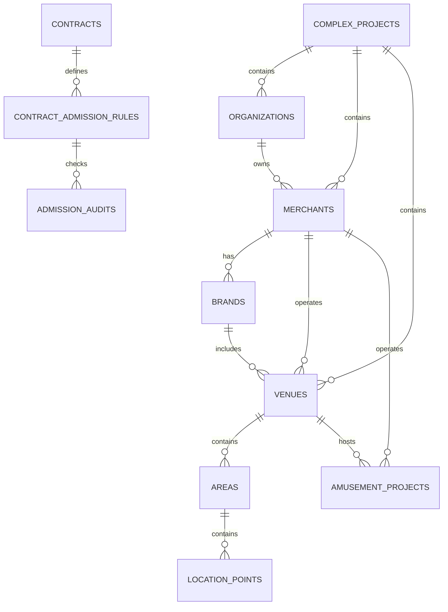
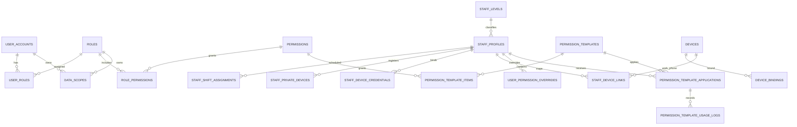
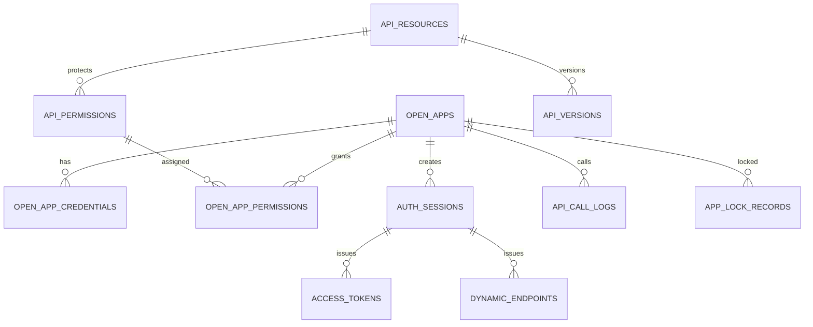
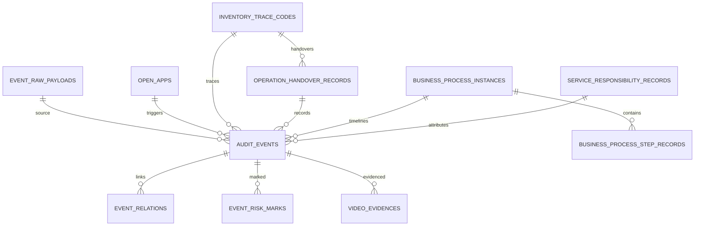
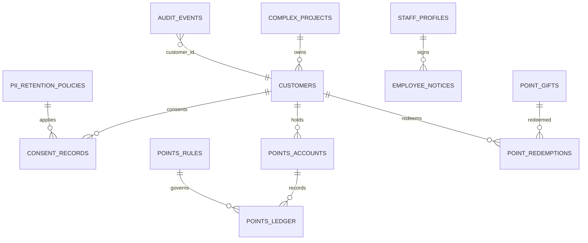

# 地基系统数据库设计第一版

> 2026-07-04 逻辑一致性修订：§2.1 organizations 表头加"已作废"内联标注（四层主体统一落 business_entities.entity_role，见 merchant-space-contract-model-v0.1 §5）；§2.0/2.5/2.7/2.8 空间四级模型表头加"已作废"内联标注（真实为扁平单表 spaces，status 仅 active/unavailable，消防容量落 spaces/venues 非 areas）；admission 两表已有作废标注不再重复。

> **⚠️ R5 业务HTML缺口审计修正标注（2026-06-18，只读审计后回填，未改代码）**
> 本设计多处表/字段为"有设计无迁移"，以真实 Flyway V001–V148 为准收口（V099–V124 新增表/列见 §11 `文档goalP1(2026-06-20)`；V143–V148 见 §11.23–§11.28 `文档goalP1(2026-06-22)`）：
> - **准入两表**：`contract_admission_rules`(§238)、`admission_audits`(§259) 迁移**零命中**；审批层级实际落 `supervisor_review_decisions`(V057)。§449"admission_audits.approval_level"为过期落点。
> - **空间四级模型**：设计的 `complex_projects/venues/areas/location_points` 四级表代码零落地，真实迁移是扁平单表 `spaces`(V005，`space_type` 自由文本无枚举)。该四级模型已过期，需作废或重写。楼栋/楼层/区块/铺位/公共区域 均由扁平 `spaces` 的 `space_type`（自由文本）+ `parent_space_id`（自套层级）承载，非四级固定表；推荐标准 `space_type` 字典：building/floor/zone/shop/public_area/parking/booth/other，录入校验为小落地项（待落地）。
> - **员工三表**：`staff_profiles`/`staff_device_credentials`/`employee_notices` **零落地**；`staff_device_credentials`（员工 Keystore 公钥/不可逆指纹）与 `terminal_device_credentials`(V011，kiosk 随机 token) 是**两套不同实体**，不可混用；`employee_notices` 无写入方，合规同意凭据未落地。
> - **综合体归属**：仅 `spaces` 有 `project_id`；`projects` 表含 `merchant_id`（project 归属 merchant），与"综合体顶级、商户归属综合体"方向相反。
> - **业务裁决（2026-06-18）**：准入统一走 supervisor_review，**不建 admission_audits/contract_admission_rules**；员工三表 staff_profiles/staff_device_credentials/employee_notices 本期 P0 建表。**二轮裁决（2026-06-18）**：空间=保留扁平 spaces（**四级模型作废**），P0 全部核心对象补 project_id + 查询隔离并修正 projects 归属方向（综合体顶级、商户/对象归属综合体）。

本文档面向第一阶段开发，覆盖四个地基系统：

1. 多商户与组织管理系统
2. 权限、账号与岗位系统
3. 开放平台与安全鉴权系统
4. 全链路事件留痕中心

设计目标：

- 先支持平台、酒吧商户、游乐商户、多门店、多项目的数据隔离。
- 先支持员工、角色、权限、数据范围、设备绑定。
- 先支持当前一个综合体，所有核心对象预留 project_id，未来可扩展多个综合体。
- 先支持合同核心摘要、准入拦截和升级审批审计。
- 先支持员工私人手机注册、设备凭证绑定（设备公钥指纹，原 NFC 绑定，依据 D8）、Root/设备异常、职级权限和公司工作手机对应关系。
- 先支持第三方开放应用、动态鉴权、连续失败锁定、人工解锁。
- 先支持所有关键行为写入统一事件中心。
- 所有核心表预留审计字段和软删除字段。

## 1. 通用字段规范

建议大部分业务表统一包含以下字段。

| 字段 | 类型建议 | 说明 |
|---|---|---|
| id | string/uuid | 主键 |
| project_id | string/uuid nullable | 归属综合体项目；全局配置表可为空，经营对象建议必填 |
<!-- F5/ISO-GAP-05：本表将 id 及各 *_id 外键（含本文档后续各表的 merchant_id）建议为 string/uuid，但实际迁移已 retrofit 为 VARCHAR(64)（非数据库原生 uuid 类型）。以正式 Flyway 迁移与 data-isolation-and-tenant-scope-security-spec-v0.1.md 为准。此处仅加注释，不改原文。 -->

| created_at | datetime | 创建时间 |
| updated_at | datetime | 更新时间 |
| deleted_at | datetime nullable | 软删除时间 |
| created_by | string nullable | 创建人 |
| updated_by | string nullable | 最后修改人 |
| status | string | 状态 |
| remark | text nullable | 备注 |

金额字段建议使用整数分，避免浮点误差。P0 仅启用人民币 CNY；涉及金额的表可保留 `currency` 字段，默认 `CNY`，多币种、汇率和外币结算进入 P2。供应商或支付通道返回非 CNY 时，P0 应进入异常复核，不得自动换算。

敏感字段建议：

- 密码只存哈希，不存明文。
- 密钥只加密存储，不明文展示。
- 手机号、证件号、银行卡号脱敏展示。
- 调用日志中保存参数摘要，不默认保存完整敏感明文。

## 2. 多商户与组织管理表

### 2.0 complex_projects 综合体项目表

> ⚠️ 本表（及 §2.5 venues / §2.7 areas / §2.8 location_points 组成的空间四级模型）已作废：真实空间为**扁平单表 `spaces`**（V005，`space_type` 自由文本 + `parent_space_id` 自套层级；`status` 仅 `active`/`unavailable`，V203），非四级固定表。消防容量卡控落 `spaces`/`venues`，非 `areas`。权威 ER 见 merchant-space-contract-model-v0.1 §2.4。「综合体项目」维度由核心对象的 `project_id` 承载。

当前先创建一个综合体项目，未来新增多个综合体时作为最高数据归属。

| 字段 | 说明 |
|---|---|
| id | 综合体项目ID |
| project_code | 项目编码 |
| name | 项目名称 |
| short_name | 项目简称 |
| address_desc | 项目地址 |
| owner_org_id | 责任主体组织ID |
| manager_staff_id | 项目负责人 nullable |
| business_positioning | 经营定位 |
| enabled_at | 启用时间 nullable |
| status | draft、pending_enable、active、paused、terminated、archived |

### 2.1 organizations 组织表

> ⚠️ **本表已作废**：代码中**无 `organizations`/`org_type` 表**。名词四层（业务：平台 → 项目公司 → 管理公司·SPV → 商户）在 DB 层统一落 `business_entities` 一张表，用 `entity_role`（VARCHAR，无 CHECK）区分角色。平台主体、商户公司、服务商公司均为 `business_entities` 的不同 `entity_role`，非独立组织表。权威 ER 见 merchant-space-contract-model-v0.1 §5。（注意：`projects` 表是**业态场馆**（venue_type），非「项目公司」。）

用于表示平台组织、商户公司、服务商公司、内部部门等组织节点。

| 字段 | 说明 |
|---|---|
| id | 组织ID |
| project_id | 综合体项目ID nullable；平台总部组织可为空 |
| parent_id | 上级组织ID |
| org_type | platform、merchant、service_provider、department |
| name | 组织名称 |
| short_name | 简称 |
| code | 组织编码 |
| status | active、suspended、terminated |
| sort_order | 排序 |
| remark | 备注 |

### 2.2 merchants 商户主体表

用于管理酒吧公司、游乐公司、餐饮商户、零售商户等经营主体。

| 字段 | 说明 |
|---|---|
| id | 商户ID |
| project_id | 综合体项目ID |
| organization_id | 关联组织ID |
| merchant_type | bar（酒吧）、catering（餐饮）、retail（零售）、amusement（游乐）、**media（传媒，V384）**、other（其他）；V348 起 NOT NULL + CHECK，V384 放开为这六值，每个商户必须且只能归一个业态，招商录入必填。传媒＝演出提供方，其收入按业务 HTML「演出票 → 传媒公司」归传媒公司（结算分流据此判定） |
| company_name | 公司名称 |
| display_name | 对外展示名称 |
| business_license_no | 统一社会信用代码 |
| legal_person | 法人 |
| contact_name | 商务联系人 |
| contact_phone | 联系电话 |
| contact_email | 联系邮箱 |
| settlement_status | normal、frozen |
| risk_level | normal、attention、high |
| status | pending、onboarding、active、suspended、settlement_frozen、terminated、blacklisted |

### 2.3 service_providers 服务商表

用于管理机器人、监控、支付、闸机、NFC、企业微信等第三方服务商。

| 字段 | 说明 |
|---|---|
| id | 服务商ID |
| project_id | 综合体项目ID nullable |
| organization_id | 关联组织ID |
| provider_type | robot、video、payment、gate、nfc、wecom、pos、other |
| name | 服务商名称 |
| contact_name | 技术或商务联系人 |
| contact_phone | 联系电话 |
| status | active、suspended、terminated |

### 2.4 brands 品牌表

一个商户可以经营多个品牌。

<!-- F5/ISO-GAP-05：本文各表的 merchant_id 沿用 §1 通用字段规范的 string/uuid 建议，但实际迁移为 VARCHAR(64) retrofit（非原生 uuid 类型）。以正式 Flyway 迁移与 data-isolation-and-tenant-scope-security-spec-v0.1.md 为准。仅加注释，不改原文。 -->

| 字段 | 说明 |
|---|---|
| id | 品牌ID |
| project_id | 综合体项目ID |
| merchant_id | 商户ID |
| name | 品牌名称 |
| brand_type | bar、restaurant、retail、amusement |
| logo_url | LOGO |
| status | active、inactive |

### 2.5 venues 门店/场地表

> ⚠️ 空间四级模型（complex_projects/venues/areas/location_points）已作废，真实为扁平单表 `spaces`（见 §2.0 标注）。消防容量卡控（fire_capacity/max_occupancy）落 `spaces`/`venues`，非 `areas`。

用于表示酒吧门店、餐饮店、零售店、游乐区域、经营场所。

| 字段 | 说明 |
|---|---|
| id | 场地ID |
| project_id | 综合体项目ID |
| merchant_id | 商户ID |
| brand_id | 品牌ID nullable |
| venue_type | bar、restaurant、retail、amusement_area、warehouse、common_area |
| name | 场地名称 |
| code | 场地编码 |
| floor | 楼层 |
| address_desc | 场地位置描述 |
| capacity | 默认容量（运营容量） |
| fire_capacity | 消防核定容量（消防容量卡控上限，依据 C8） nullable |
| max_occupancy | 最大允许在场人数（卡控阈值，依据 C8） nullable |
| business_hours | 营业时间JSON |
| status | preparing、open、paused、maintenance、closed |

### 2.6 amusement_projects 游乐项目基础档案表

这里只保存组织和基础档案。排队、核销、巡检后续由游乐系统扩展。

| 字段 | 说明 |
|---|---|
| id | 项目ID |
| project_id | 综合体项目ID |
| merchant_id | 归属游乐商户 |
| venue_id | 所属场地 |
| name | 项目名称 |
| project_type | mechanical、vr、show、interactive、children、other |
| location_desc | 位置描述 |
| base_capacity | 基础容量 |
| duration_minutes | 单次体验时长 |
| min_height_cm | 最低身高 |
| min_age | 最低年龄 |
| status | preparing、open、paused、maintenance、closed |

### 2.7 areas 区域表

> ⚠️ 空间四级模型已作废，真实为扁平单表 `spaces`（见 §2.0 标注）。楼层/区域/功能区由 `spaces.space_type`（自由文本）+ `parent_space_id` 表达；消防容量落 `spaces`/`venues`，非本表。

用于定义楼层、区域、功能区。

| 字段 | 说明 |
|---|---|
| id | 区域ID |
| project_id | 综合体项目ID |
| parent_id | 上级区域ID |
| venue_id | 所属场地ID nullable |
| name | 区域名称 |
| area_type | entrance、bar_zone、amusement_zone、restaurant_zone、retail_zone、warehouse、staff_only、common |
| floor | 楼层 |
| capacity | 区域默认容量（运营容量） |
| fire_capacity | 消防核定容量（消防容量卡控上限，依据 C8） nullable |
| max_occupancy | 最大允许在场人数（卡控阈值，建议 ≤ fire_capacity，依据 C8） nullable |
| status | active、inactive |

> 修订说明（2026-06-07）：依据 C8，区域补 `fire_capacity`（消防核定容量）与 `max_occupancy`（最大允许在场人数）做消防容量卡控。原因：原 `capacity` 为运营容量，无法承载消防容量上限与超员卡控；区域/场地在售票、入场、开台时需据消防容量限制在场人数。

### 2.8 location_points 点位表

> ⚠️ 空间四级模型已作废，真实为扁平单表 `spaces`（见 §2.0 标注）。卡座/吧台/闸机等点位由 `spaces.space_type` + `parent_space_id` 承载。

用于卡座、吧台、闸机、摄像头点、货架、机器人站点等具体点位。

| 字段 | 说明 |
|---|---|
| id | 点位ID |
| project_id | 综合体项目ID |
| area_id | 区域ID |
| venue_id | 场地ID |
| merchant_id | 归属商户 nullable |
| point_type | table、booth、bar_counter、gate、camera、shelf、robot_station、warehouse_slot、nfc_point |
| name | 点位名称 |
| code | 点位编码 |
| capacity | 点位容量 nullable |
| status | active、inactive、maintenance |

### 2.9 contracts 合同表

用于记录商户或服务商与平台的合作合同基础信息。

| 字段 | 说明 |
|---|---|
| id | 合同ID |
| project_id | 综合体项目ID |
| contract_no | 合同编号 |
| contract_name | 合同名称 |
| party_a_org_id | 甲方组织 |
| party_b_org_id | 乙方组织 |
| contract_type | lease、joint_operation、revenue_share、service、other |
| cooperation_mode | fixed_rent、sales_share、verification_share、guarantee_plus_share、service_fee |
| core_summary | 合同核心摘要，展示经营范围、空间范围、合作和结算口径 |
| allowed_business_scope | 允许经营范围JSON |
| allowed_space_scope | 允许空间、区域、点位范围JSON |
| admission_policy | 准入策略：block、escalate、warn |
| high_approval_required | 是否命中后需要更高级别审批 |
| start_date | 开始日期 |
| end_date | 结束日期 |
| settlement_cycle | daily、weekly、monthly、event_based |
| status | draft、pending_approval、active、expiring、expired、terminated |
| attachment_url | 合同附件 |

### 2.9.1 / 2.9.2 合同准入规则 / 准入检查审计（已废止）

> ⚠️ `contract_admission_rules`（合同准入规则）与 `admission_audits`（准入检查审计）已废止——2026-06-18 裁决统一走 `supervisor_review_decisions`(V050)，准入留痕与升级放行字段均由其承载（见 §7 注 / data-isolation §7）。迁移零命中、本期不建表，**不得据此建表或写迁移**。完整历史字段设计见文末《附录 Z 已废止表设计（历史留存）》。

### 2.10 merchant_credentials 商户资质表

> 修订说明（2026-06-07）：依据 C9，补有效期到期预警/阻断字段，并明确酒类/食品业态资质必填校验。原因：资质过期是合同准入拦截（留痕落 supervisor_review_decisions，admission_audits 已废止）的重要触发源，需要可计算的到期预警与阻断标志；餐饮/酒吧业态若缺 food_license/alcohol_license 应阻断相关业务。

| 字段 | 说明 |
|---|---|
| id | 资质ID |
| project_id | 综合体项目ID |
| merchant_id | 商户ID |
| credential_type | business_license、food_license、alcohol_license、special_equipment、fire_safety、public_liability_insurance、employer_liability_insurance、property_insurance、supplier_qualification、inspection_certificate、other |
| credential_name | 证照/资质/保险名称 |
| credential_no | 证照编号 |
| issuing_authority | 发证机关、保险公司或出具单位 nullable |
| valid_from | 有效期开始 |
| valid_to | 有效期结束 |
| expiry_warning_days | 到期预警提前天数，如 30；剩余有效期≤该值进入 expiring 预警 nullable |
| expiry_action | 到期处置状态，系统固定、只读派生：status=expiring 时为 warn（仅预警），status∈{expired,revoked} 时为 block（先阻断相关业务）；符合条件的升级审批另由 supervisor_review_decisions 记录，不作为可配值 |
| approval_level_on_expired | 到期后允许升级放行时的审批层级 nullable |
| is_required | 是否该业态必填（酒类业态 alcohol_license、餐饮业态 food_license 必填=true） |
| required_reason | 必填原因 nullable |
| file_url | 附件 |
| attachment_group_id | 附件组ID nullable |
| owner_dept | 责任部门 nullable |
| owner_user_id | 责任人 nullable |
| last_checked_at | 最近复核时间 nullable |
| last_reminded_at | 最近提醒时间 nullable |
| waived_by | 豁免/放行人 nullable |
| waived_at | 豁免/放行时间 nullable |
| waive_reason | 豁免/放行原因 nullable |
| status | valid、expiring、expired、revoked、pending_review |

> 业态必填规则：merchant_type=bar/catering（或经营含酒水/餐饮）时，alcohol_license（酒类）、food_license（食品）为必填资质，缺失或 status∈{expired,revoked} 时对应业务（点单/售酒/出餐）应先阻断；未命中七类红线且非权限不足的事项才进入升级审批（留痕写入 supervisor_review_decisions；admission_audits 已废止，见附录 Z）。`status=expiring` 由 valid_to 与 expiry_warning_days 派生，用于到期预警；status∈{expired,revoked} 时，expiry_action 由系统派生为 block 并触发前述阻断。

### 2.10.1 contract_key_dates 合同关键日期表

> 新增说明（2026-06-10）：依据总控关于“合同关键日期、证照/资质/保险到期字段 P0 预留颗粒度”的问题，采用《合同关键日期与证照资质保险到期字段 P0 颗粒度建议》推荐的方案 B。合同主表只保留基础摘要，关键日期采用“一事项一记录”，用于提醒、阻断、升级审批和留痕。

| 字段 | 说明 |
|---|---|
| id | 关键日期ID |
| project_id | 综合体项目ID |
| contract_id | 合同ID |
| merchant_id | 商户ID，冗余便于查询 |
| date_type | contract_start、contract_end、renewal_notice、rent_free_end、deposit_due、rent_escalation、settlement_cycle_change、custom |
| date_name | 页面展示名称 |
| due_date | 关键日期 |
| remind_days | 到期预警提前天数，默认 30 |
| remind_level | normal、important、urgent |
| block_policy | none、warn、block、escalate |
| approval_level_on_due | 到期后允许升级放行时的审批层级 nullable |
| owner_dept | 责任部门 nullable |
| owner_user_id | 责任人 nullable |
| attachment_required | 处理该事项是否必须上传附件 |
| attachment_group_id | 附件组ID nullable |
| status | active、due_soon、expired、waived、renewed、closed |
| last_reminded_at | 最近提醒时间 nullable |
| closed_by | 关闭人 nullable |
| closed_at | 关闭时间 nullable |
| close_reason | 关闭或豁免原因 nullable |
| created_by | 创建人 |
| updated_by | 更新人 |
| created_at | 创建时间 |
| updated_at | 更新时间 |

> P0 默认关键日期类型：合同开始、合同结束、续约/终止提前通知日、免租期结束、押金节点、自定义关键日期。阶梯涨租、复杂费用变更和自动账单联动进入 P1。

### 2.11 merchant_bank_accounts 商户结算账户表

| 字段 | 说明 |
|---|---|
| id | 账户ID |
| merchant_id | 商户ID |
| account_name | 户名 |
| bank_name | 银行 |
| bank_branch | 支行 |
| account_no_encrypted | 加密银行卡号 |
| account_no_masked | 脱敏展示 |
| is_default | 是否默认 |
| status | active、inactive |

## 3. 权限、账号与岗位表

### 3.1 user_accounts 系统账号表

| 字段 | 说明 |
|---|---|
| id | 账号ID |
| username | 登录名 |
| phone | 手机号 |
| password_hash | 密码哈希 |
| account_type | platform_staff、merchant_staff、service_provider_staff、device、api |
| organization_id | 所属组织 |
| merchant_id | 所属商户 nullable |
| staff_profile_id | 员工档案ID nullable |
| last_login_at | 最近登录时间 |
| failed_login_count | 连续登录失败次数 |
| locked_until | 锁定到什么时候 nullable |
| status | pending、active、disabled、locked、resigned |

### 3.2 staff_profiles 员工档案表

| 字段 | 说明 |
|---|---|
| id | 员工ID |
| project_id | 综合体项目ID |
| organization_id | 所属组织 |
| merchant_id | 所属商户 nullable |
| venue_id | 默认门店 nullable |
| employee_no | 工号 |
| name | 姓名 |
| phone | 手机号 |
| position_id | 默认岗位 |
| staff_level_id | 员工职级ID nullable |
| salary_policy_summary | 薪资口径摘要（薪资大范围，来自职级）nullable |
| base_salary_amount | 具体基本薪资，整数分（单位：分），敏感字段，控权展示、变更留痕 nullable |
| salary_currency | 薪资币种，如 CNY，默认 CNY nullable |
| salary_detail | 具体薪资明细JSON（如基本/绩效/补贴拆分），敏感字段，控权展示、变更留痕 nullable |
| registration_approval_status | unsubmitted、pending、approved、rejected、requires_review、invalidated |
| employment_status | active、on_leave、resigned |
| entry_date | 入职日期 |
| resign_date | 离职日期 nullable |

> 修订说明（2026-06-07）：依据 finding staff-1 新增 `base_salary_amount`/`salary_currency`/`salary_detail`。原因：需求把薪资拆成两层——职级绑定的「薪资大范围」(`salary_policy_summary` 摘要文本) + 员工个人的「具体薪资」。此前只落地了大范围摘要，「具体薪资」无结构化录入字段，开发只能塞进备注/摘要文本（不可控权、不可统计）。
> **薪资两层关系：** 「薪资大范围」来自员工所属职级 `staff_levels.salary_policy_summary`；「具体薪资」(`base_salary_amount`) 按员工单独填写，原则上应落在该职级大范围之内，**越界时给提示但不强制阻断**（大范围为摘要文本，由业务侧解析后比对）。`base_salary_amount` 金额单位统一为分（D1），并按敏感字段做控权展示与变更留痕。

### 3.2.1 staff_levels 员工职级表

> 修订说明（2026-06-07）：依据 finding staff-5，将原单一 `level_code` 文本拆为二维结构 `main_level`(M1..M10) + `sub_level`(上/中/下)，并派生有序 `level_rank`(1..30) 作为职级序列主键。原因：需求把职级定义为「主级 M1-M10 × 子级 上/中/下」自然形成 30 级有序序列，压成单一文本会丢失 30 级完整性/有序性、子级「上>中>下」排序规则无处承载，且 staff-2/govern-2 的相对审批层级失去可计算的有序主键。

| 字段 | 说明 |
|---|---|
| id | 职级ID |
| project_id | 综合体项目ID nullable |
| organization_id | 组织ID nullable |
| level_code | 职级编码（保留兼容字段，建议由 main_level+sub_level 自动拼接，如 M3-中） |
| main_level | 主级，枚举 M1、M2、M3、M4、M5、M6、M7、M8、M9、M10（M1 最低、M10 最高） |
| sub_level | 子级，枚举 upper、middle、lower（中文：上/中/下，上>中>下） |
| level_rank | 派生职级序列号，1..30，整数；由系统按 `(main_level 序号-1)×3 + sub_level 序号` 计算，sub_level 序号 上=1/中=2/下=3，rank 越大职级越高。作为职级有序主键，供审批层级计算（staff-2/govern-2）与权限模板绑定使用 |
| level_name | 职级名称 |
| approval_level | 可审批层级，相对层级枚举，取值见 3.2.1.1 |
| default_role_id | 默认角色ID nullable |
| salary_policy_summary | 薪资口径摘要（薪资大范围），只做摘要和对接依据；具体某员工薪资落在 staff_profiles.base_salary_amount，见 3.2 |
| status | active、inactive |

> 约束说明：建议对 (project_id, main_level, sub_level) 建唯一约束，并约束 `level_rank ∈ [1,30]` 保证 30 级完整性与有序性。`level_rank` 由 main_level/sub_level 派生，不应人工独立录入，避免与二维字段不一致。

### 3.2.1.1 审批层级模型（approval_level / required_approval_level 取值与 level_rank 计算规则）

> 修订说明（2026-06-07）：依据 finding staff-2、govern-2 新增本节。原因：「上一级/上两级/最高权限」是相对层级概念，必须落到明确的有序序列才能计算；此前 `staff_levels.approval_level` 与 `contract_admission_rules.required_approval_level`、`contracts.high_approval_required` 均无取值枚举与计算规则，导致升级审批/放行无法确定路由对象，属编码阻断级歧义。本节确立审批层级**基准序列 = 职级序列 level_rank(1..30)**。

**1) 审批层级基准序列：** 统一以 `staff_levels.level_rank`（1..30，M1上=1 … M10下=30，rank 越大越高）为唯一有序基准；角色、岗位不作为审批层级基准（职级不替代功能权限，见 staff-4）。

**2) 相对层级枚举（approval_level / required_approval_level 取值）：**

| code | 中文 | 计算规则（以触发人 level_rank = R 为基准） |
|---|---|---|
| one_level_up | 上一级 | 路由给 level_rank 最小且 > R 的职级人员（同主级不同子级也算独立一级，因 rank 连续） |
| two_levels_up | 上两级 | 路由给 level_rank 第二个 > R 的职级；不足两级时回退 top_authority |
| specified_level | 指定职级 | 由配置显式指定目标 level_rank/main_level+sub_level |
| top_authority | 最高权限 | 路由给当前组织/项目内 level_rank 最大者；无更高级时即由其本人或平台最高权限审批 |
| hr_three_levels_up | HR 会签＋直属领导向上三级 | CG-12（V450，BSM:1478 / BSM:1487）：主线＝该员工（直接受益人）直属上级链前三级，链不足三级到顶为止；平行线 hr_review＝HR 会签人（须持 staff.hr.review）；申请人与该员工不成为节点 |

**3) 步进与回退规则：**
- 「上一级」「上两级」均以 level_rank 连续步进，**同主级不同子级（如 M3-中 → M3-上）也算一级**，因为 rank 在 30 级序列上连续。
- 跨组织时先在触发人所属 organization_id 内解析目标 level_rank；本组织无更高职级则上溯父组织，仍无则回退 top_authority。
- 无更高级（触发人已是 level_rank=30 或组织内最高）时一律回退 top_authority，避免审批链断裂。

**4) 落点：** `staff_levels.approval_level`、`contract_admission_rules.required_approval_level`、`contracts.high_approval_required`（语义为是否命中后需更高审批）三处统一引用上表枚举；（历史）`admission_audits` 曾建议补 `approval_level` 字段；该表已废止，相对审批层级现统一由 `supervisor_review_decisions` 承载（见附录 Z）。

### 3.2.2 staff_registration_approvals 员工注册审批表

| 字段 | 说明 |
|---|---|
| id | 注册审批ID |
| project_id | 综合体项目ID |
| staff_id | 员工ID nullable；审批通过后回填 |
| submitted_name | 提交姓名 |
| submitted_phone | 提交手机号 |
| requested_organization_id | 申请组织ID |
| requested_merchant_id | 申请商户ID nullable |
| requested_position_id | 申请岗位ID |
| private_device_id | 私人手机记录ID nullable |
| device_credential_id | 设备凭证ID nullable（原 nfc_binding_id，关联 staff_device_credentials，依据 D8） |
| device_fingerprint_hash | 私人手机设备指纹哈希 |
| root_check_result | normal、rooted、debug、unknown |
| approval_status | pending、approved、rejected、requires_review、invalidated |
| reviewed_by | 审核人 nullable |
| reviewed_at | 审核时间 nullable |
| review_comment | 审核意见 |

### 3.2.3 staff_private_devices 员工私人手机设备表

私人手机只用于注册、通知、状态查看和设备凭证绑定，不允许现场核销、点单、放行、结算。

| 字段 | 说明 |
|---|---|
| id | 私人手机记录ID |
| project_id | 综合体项目ID |
| staff_id | 员工ID nullable |
| device_fingerprint_hash | 设备指纹哈希 |
| phone_model | 手机型号摘要 |
| os_version | 系统版本摘要 |
| root_status | normal、rooted、debug、unknown |
| app_status | unregistered、pending_review、bound、invalidated、device_change_pending、disabled |
| last_checked_at | 最近检测时间 |
| status | active、invalidated、disabled |

### 3.2.4 staff_device_credentials 员工设备凭证表（原 staff_nfc_bindings）

> 修订说明（2026-06-10）：依据基准 D8 + finding phone-3/phone-7、compliance-4，将原 `staff_nfc_bindings` / `nfc_uid_hash` 改为 `staff_device_credentials` / `device_key_fingerprint`。原因：Android 平台不向应用暴露「本机手机稳定 NFC 硬件唯一标识」，「安装时读取手机本机 NFC 唯一标识作身份」技术不可行（phone-3）；改用**安装期生成并存于设备 Keystore 的设备公钥 / 不可逆设备指纹**作为唯一可信标识（A6 用户拍板），仅持久化不可逆哈希/公钥指纹，不存原始标识（PIPL 数据最小化）。工作手机通过摄像头/扫码模块读取外部客人二维码；NFC 仅读取外部 NFC 腕带、标签、卡或设备中的权益标识，不在本表范围内。

| 字段 | 说明 |
|---|---|
| id | 设备凭证ID |
| project_id | 综合体项目ID |
| staff_id | 员工ID nullable |
| credential_type | device_keystore（设备 Keystore 公钥/指纹，主用）、staff_card、physical_tag（外部实体标签，如确需保留） |
| device_key_fingerprint | 设备公钥指纹 / 不可逆设备指纹哈希（仅存哈希/指纹，不存原始标识） |
| device_payload_hash | 设备凭证载荷哈希 nullable |
| bound_at | 绑定时间 |
| unbound_at | 解绑时间 nullable |
| status | pending、active、mismatch、revoked |

> 说明：换机=先解绑旧设备凭证（unbound_at 回填、status=revoked）再绑新；Root/调试/设备指纹变化判为 mismatch 并进入复核。原 `nfc_type=phone_nfc` 枚举废止。

### 3.2.5 staff_device_links 员工设备对应关系表

用于维护员工、私人手机、设备凭证（原 NFC 标识）和公司发放工作手机的一一对应关系。

| 字段 | 说明 |
|---|---|
| id | 对应关系ID |
| project_id | 综合体项目ID |
| staff_id | 员工ID |
| private_device_id | 私人手机记录ID nullable |
| device_credential_id | 设备凭证ID nullable（原 nfc_binding_id，关联 staff_device_credentials，依据 D8） |
| work_device_id | 公司工作手机设备ID nullable |
| link_status | pending、active、requires_review、revoked |
| approved_by | 审核人 nullable |
| approved_at | 审核时间 nullable |

### 3.3 roles 角色表

| 字段 | 说明 |
|---|---|
| id | 角色ID |
| organization_id | 所属组织 nullable |
| role_code | 角色编码 |
| role_name | 角色名称 |
| role_type | platform、merchant、service_provider |
| status | active、inactive |

### 3.4 permissions 权限点表

| 字段 | 说明 |
|---|---|
| id | 权限ID |
| permission_code | 权限编码 |
| permission_name | 权限名称，**必须中文**（权限模板页直接上屏给业务人员勾选，前端无翻译层） |
| permission_type | menu、button、api、data、sensitive |
| resource | 资源标识 |
| action | view、create、update、delete、approve、export、unlock、call |
| status | active、inactive |

设计要求：权限点按单一功能最小颗粒度维护，一个单一功能对应一个权限点，例如 `ticket.verify.execute`、`bar.table_reservation.view`。新增权限点时 `permission_code` 用英文机读编码，`permission_name` 一律写中文业务说法（V385 已把历史遗留的 18 条英文名改中文，并在迁移末尾加了「不得再有纯 ASCII 展示名」的门禁）。角色权限用于批量授权，员工仍可通过用户角色、临时授权或直接授权扩展实现完全自定义配置。

### 3.5 role_permissions 角色权限表

| 字段 | 说明 |
|---|---|
| id | 主键 |
| role_id | 角色ID |
| permission_id | 权限ID |

### 3.6 user_roles 用户角色表

| 字段 | 说明 |
|---|---|
| id | 主键 |
| user_id | 账号ID |
| role_id | 角色ID |

### 3.7 data_scopes 数据权限范围表

用于控制账号能访问哪些商户、门店、区域、项目。

| 字段 | 说明 |
|---|---|
| id | 数据范围ID |
| owner_type | user、role、open_app |
| owner_id | 账号ID、角色ID或开放应用ID |
| scope_type | platform、merchant、venue、area、project |
| scope_id | 对应对象ID |
| permission_mode | read、write、manage |
| status | active、inactive |

### 3.8 positions 岗位表

| 字段 | 说明 |
|---|---|
| id | 岗位ID |
| organization_id | 组织ID |
| position_code | 岗位编码 |
| position_name | 岗位名称 |
| position_type | manager、sales_person、cashier、bartender、warehouse_keeper、verifier、service、patrol、finance、support |
| default_staff_level_id | 默认职级ID nullable |
| salary_policy_summary | 薪资口径摘要 nullable |
| status | active、inactive |

> 修订说明（2026-06-10）：新增岗位类型 `sales_person`（销售人员），用于酒吧卡座销售归属和提成倍率判断。岗位只表达职责，不替代职级、角色或权限；销售人员的具体操作权限仍按角色/权限模板/员工级授权计算。

### 3.9 shifts 班次表

| 字段 | 说明 |
|---|---|
| id | 班次ID |
| venue_id | 门店或场地ID |
| name | 班次名称 |
| start_time | 开始时间 |
| end_time | 结束时间 |
| status | active、inactive |

### 3.10 staff_shift_assignments 员工排班/当班表

| 字段 | 说明 |
|---|---|
| id | 主键 |
| staff_id | 员工ID |
| shift_id | 班次ID |
| work_date | 工作日期 |
| venue_id | 工作场地 |
| area_id | 工作区域 nullable |
| check_in_at | 上班时间 |
| check_out_at | 下班时间 |
| status | scheduled、checked_in、checked_out、absent |

### 3.11 device_bindings 设备绑定表

| 字段 | 说明 |
|---|---|
| id | 绑定ID |
| device_id | 设备ID |
| staff_id | 员工ID |
| user_id | 账号ID |
| shift_assignment_id | 当班记录ID |
| bound_at | 绑定时间 |
| unbound_at | 解绑时间 |
| bind_method | qr、nfc、manual |
| status | active、returned、lost、abnormal |

### 3.12 wecom_bindings 企业微信绑定表

| 字段 | 说明 |
|---|---|
| id | 绑定ID |
| staff_id | 员工ID |
| user_id | 账号ID |
| wecom_user_id | 企业微信UserID |
| external_contact_enabled | 是否启用客户联系 |
| status | active、inactive、transferred |

### 3.13 temporary_grants 临时授权表

| 字段 | 说明 |
|---|---|
| id | 授权ID |
| grantee_user_id | 被授权人 |
| granted_by | 授权人 |
| permission_id | 权限ID |
| scope_type | 授权范围类型 |
| scope_id | 授权范围ID |
| reason | 授权原因 |
| valid_from | 生效时间 |
| valid_to | 失效时间 |
| status | active、expired、revoked |

### 3.13.1 user_permission_overrides 员工级直接授权表（永久增/减权）

> 修订说明（2026-06-07）：依据 finding staff-3 新增本表。原因：需求的「员工级完全自定义=可增可减」此前只覆盖「增」（多绑角色或临时授权叠加），缺少「某员工属于某角色、却要单独去掉该角色里某个权限点」的「减/排除」落地结构。`temporary_grants` 是带失效时间的「增」，不是永久「减」。本表为**永久**员工级覆盖，支持 `effect=grant/deny`，使「员工级减权/排除」可编码，避免与「完全自定义/单独增减」口径矛盾。

| 字段 | 说明 |
|---|---|
| id | 主键 |
| user_id | 账号ID |
| staff_id | 员工ID nullable |
| permission_id | 权限点ID |
| effect | grant（额外加权）、deny（永久排除/减权） |
| scope_type | 授权范围类型 nullable（与 data_scopes 口径一致：platform、merchant、venue、area、project） |
| scope_id | 授权范围ID nullable |
| reason | 配置原因 |
| granted_by | 操作人 |
| status | active、revoked |

> **最终权限计算口径（员工级权限叠加算法）：**
> 最终生效权限 = （该用户所有角色的权限并集）∪（基础权限模板授权）∪（有效临时权限模板授权）∪（员工级 override effect=grant）－（员工级 override effect=deny）－（模板项 effect=deny），再叠加当班内有效的 `temporary_grants`（临时增权，到期自动失效）。
> **优先级：** `deny` 优先级最高，员工级 deny 或模板项 deny 可排除来自角色并集、模板 grant 或员工 grant 的同一权限点；同一权限点同时存在 grant 与 deny 时以 deny 为准（最小权限原则）。临时授权和临时模板仅在 valid_from~valid_to 且 status=active 期间叠加，单次有效模板被消耗后不再生效。
> **与 staff-4 一致：** 职级仅决定默认权限模板与审批层级，不替代/越过单一功能权限点校验；本表是「员工级完全自定义」的减权承载。本表为 P0 落地（同时支持加权与减权），非 P1。

### 3.13.2 permission_templates 权限模板表（基础/临时/复制）

> 修订说明（2026-06-10 P0 执行矩阵补齐）：用户确认权限配置需要模板化，支持基础模板、临时模板、模板复制、时效和单次有效，避免逐个员工手工导入/勾选。本表组为 P0 落地，字段细则对齐 `p0-operation-permission-matrix-v0.1.md`。

| 字段 | 说明 |
|---|---|
| id | 权限模板ID |
| template_code | 模板编码，唯一 |
| template_name | 模板名称，如普通员工、普通员工01、节假日临时核销 |
| template_type | basic、temporary |
| source_template_id | 复制来源模板ID nullable；复制后只保留快照关系，不自动继承源模板后续变更 |
| owner_scope_type | platform、merchant、project、department |
| owner_scope_id | 适用主体ID nullable |
| default_role_id | 关联默认角色ID nullable |
| usage_mode | reusable、single_use |
| valid_from | 生效时间 nullable；temporary 建议必填 |
| valid_to | 失效时间 nullable；temporary 必填 |
| status | draft、active、paused、expired、revoked、archived |
| reason | 创建或启用原因 nullable |
| approved_by | 审批人 nullable |
| approved_at | 审批时间 nullable |

### 3.13.3 permission_template_items 权限模板明细表

| 字段 | 说明 |
|---|---|
| id | 模板明细ID |
| template_id | 权限模板ID |
| permission_id | 权限点ID |
| effect | grant、deny |
| data_scope_type | project、merchant、space、shift、custom nullable |
| data_scope_json | 数据范围 JSON nullable |
| is_sensitive | 是否敏感权限 |
| reason | 授权或拒绝原因 nullable |

### 3.13.4 permission_template_applications 权限模板应用表

| 字段 | 说明 |
|---|---|
| id | 应用记录ID |
| template_id | 权限模板ID |
| target_type | staff、role、position、staff_level |
| target_id | 目标对象ID |
| applied_by | 应用人ID |
| apply_reason | 应用原因 |
| valid_from | 本次应用生效时间 |
| valid_to | 本次应用失效时间 nullable |
| single_use | 是否本次应用单次有效 |
| consumed_at | 单次有效消耗时间 nullable |
| revoked_by | 撤销人 nullable |
| revoked_at | 撤销时间 nullable |
| status | active、expired、consumed、revoked、archived |

### 3.13.5 permission_template_usage_logs 权限模板使用日志表

| 字段 | 说明 |
|---|---|
| id | 使用日志ID |
| application_id | 模板应用记录ID |
| staff_id | 实际使用员工ID |
| permission_id | 被校验权限点ID |
| business_object_type | 业务对象类型 nullable |
| business_object_id | 业务对象ID nullable |
| result | allowed、denied、consumed、expired、revoked |
| reason | 结果原因 |
| event_id | 关联审计事件ID |
| used_at | 使用时间 |

| 字段 | 说明 |
|---|---|
| id | 会话ID |
| user_id | 账号ID |
| device_id | 登录设备 nullable |
| login_ip | 登录IP |
| user_agent | 客户端信息 |
| login_at | 登录时间 |
| logout_at | 退出时间 |
| status | active、expired、logout |

## 4. 设备基础表

虽然企业设备管理可以后续单独扩展，但第一阶段需要一张基础设备表。

### 4.1 devices 设备表

| 字段 | 说明 |
|---|---|
| id | 设备ID |
| device_type | work_phone、tablet、kiosk、scanner、gate、nfc_reader、camera、robot、managed_android |
| device_code | 设备编码 |
| imei | 手机IMEI nullable |
| serial_no | 序列号 |
| merchant_id | 归属商户 nullable |
| venue_id | 所属场地 nullable |
| area_id | 所属区域 nullable |
| location_point_id | 所属点位 nullable |
| provider_id | 服务商ID nullable |
| assigned_staff_id | 当前或默认绑定员工 nullable |
| linked_private_device_id | 对应私人手机记录ID nullable |
| linked_device_credential_id | 对应设备凭证ID nullable（原 linked_nfc_binding_id，关联 staff_device_credentials，依据 D8） |
| status | idle、in_use、maintenance、lost、disabled |

## 5. 开放平台与安全鉴权表

### 5.1 open_apps 开放应用表

| 字段 | 说明 |
|---|---|
| id | 应用ID |
| app_code | 应用编码 |
| app_name | 应用名称 |
| app_type | catering_pos、retail_pos、robot、video、gate、nfc、wecom、custom |
| merchant_id | 归属商户 nullable |
| service_provider_id | 归属服务商 nullable |
| venue_id | 归属门店 nullable |
| contact_name | 技术联系人 |
| contact_phone | 联系电话 |
| callback_url | 默认回调地址 |
| ip_whitelist | IP白名单JSON |
| status | draft、testing、active、suspended、locked、disabled、revoked |

### 5.2 open_app_credentials 开放应用凭证表

| 字段 | 说明 |
|---|---|
| id | 凭证ID |
| open_app_id | 应用ID |
| login_account | 应用登录账号 |
| password_hash | 应用密码哈希 |
| secret_encrypted | 签名密钥加密值 |
| secret_masked | 密钥脱敏展示 |
| failed_auth_count | 连续鉴权失败次数 |
| last_failed_at | 最近失败时间 |
| locked_at | 锁定时间 |
| status | active、locked、expired、revoked |

### 5.3 api_resources API资源表

| 字段 | 说明 |
|---|---|
| id | API资源ID |
| api_group | ticket、verification、order、merchant、event、inventory、robot、video、auth |
| api_code | API编码 |
| api_name | API名称 |
| method | GET、POST、PUT、DELETE |
| path | 标准路径 |
| current_version | 当前版本 |
| status | draft、testing、published、deprecated |

### 5.4 api_versions API版本表

| 字段 | 说明 |
|---|---|
| id | 版本ID |
| api_resource_id | API资源ID |
| version | v1、v2 |
| request_schema | 请求结构JSON |
| response_schema | 响应结构JSON |
| error_codes | 错误码JSON |
| doc_markdown | 文档内容 |
| status | draft、published、deprecated |

### 5.5 api_permissions API权限表

| 字段 | 说明 |
|---|---|
| id | API权限ID |
| api_resource_id | API资源ID |
| permission_code | 权限编码 |
| operation_type | read、write、manage、callback |
| sensitive_level | normal、sensitive、high |
| status | active、inactive |

### 5.6 open_app_permissions 应用API授权表

| 字段 | 说明 |
|---|---|
| id | 主键 |
| open_app_id | 应用ID |
| api_permission_id | API权限ID |
| status | active、inactive |

### 5.7 auth_sessions 鉴权会话表

| 字段 | 说明 |
|---|---|
| id | 鉴权会话ID |
| open_app_id | 应用ID |
| credential_id | 凭证ID |
| auth_ip | 鉴权IP |
| user_agent | 客户端信息 |
| authenticated_at | 鉴权成功时间 |
| expires_at | 会话过期时间 |
| status | active、expired、revoked |

### 5.8 access_tokens 短时效令牌表

| 字段 | 说明 |
|---|---|
| id | Token记录ID |
| open_app_id | 应用ID |
| auth_session_id | 鉴权会话ID |
| token_hash | Token哈希 |
| issued_at | 签发时间 |
| expires_at | 过期时间 |
| revoked_at | 吊销时间 nullable |
| status | active、expired、revoked |

### 5.9 dynamic_endpoints 动态调用地址表

| 字段 | 说明 |
|---|---|
| id | 动态地址ID |
| open_app_id | 应用ID |
| auth_session_id | 鉴权会话ID |
| endpoint_key | 动态地址标识 |
| endpoint_path | 动态网关路径 |
| issued_at | 签发时间 |
| expires_at | 过期时间 |
| rotated_at | 轮换时间 nullable |
| status | active、expired、revoked、rotated |

### 5.10 nonce_records 防重放记录表

| 字段 | 说明 |
|---|---|
| id | 主键 |
| open_app_id | 应用ID |
| nonce | 随机字符串 |
| request_time | 请求时间戳 |
| used_at | 使用时间 |
| expires_at | 过期时间 |

### 5.11 auth_failure_records 鉴权失败记录表

| 字段 | 说明 |
|---|---|
| id | 失败记录ID |
| open_app_id | 应用ID nullable |
| login_account | 尝试登录账号 |
| failure_type | password_error、signature_error、token_invalid、endpoint_invalid、ip_blocked、nonce_reused |
| ip | 来源IP |
| user_agent | 客户端信息 |
| occurred_at | 发生时间 |
| failure_reason | 失败原因 |

### 5.12 app_lock_records 应用锁定记录表

| 字段 | 说明 |
|---|---|
| id | 锁定记录ID |
| open_app_id | 应用ID |
| credential_id | 凭证ID nullable |
| locked_reason | 锁定原因 |
| failed_count | 触发锁定的连续失败次数 |
| locked_at | 锁定时间 |
| locked_by | system |
| status | locked、unlocked |

### 5.13 manual_unlock_records 人工解锁记录表

| 字段 | 说明 |
|---|---|
| id | 解锁记录ID |
| lock_record_id | 锁定记录ID |
| open_app_id | 应用ID |
| unlocked_by | 解锁管理员 |
| unlocked_at | 解锁时间 |
| reason | 解锁原因 |
| review_result | approved、rejected |

### 5.14 api_call_logs API调用日志表

| 字段 | 说明 |
|---|---|
| id | 调用日志ID |
| open_app_id | 应用ID |
| api_resource_id | API资源ID |
| api_version | API版本 |
| request_id | 请求ID |
| trace_id | 链路ID |
| ip | 来源IP |
| method | 请求方法 |
| path | 请求路径 |
| request_summary | 请求摘要 |
| response_summary | 响应摘要 |
| status_code | HTTP状态码 |
| business_code | 业务错误码 |
| duration_ms | 耗时 |
| result | success、failed、rejected |
| occurred_at | 调用时间 |

### 5.15 webhook_subscriptions Webhook订阅表

| 字段 | 说明 |
|---|---|
| id | 订阅ID |
| open_app_id | 应用ID |
| event_type | 订阅事件类型 |
| callback_url | 回调地址 |
| secret_encrypted | 回调签名密钥 |
| status | active、paused、disabled |

### 5.16 webhook_delivery_logs Webhook投递日志表

| 字段 | 说明 |
|---|---|
| id | 投递日志ID |
| subscription_id | 订阅ID |
| event_id | 事件ID |
| callback_url | 回调地址 |
| attempt_no | 第几次投递 |
| status_code | 返回状态码 |
| result | success、failed |
| response_summary | 响应摘要 |
| delivered_at | 投递时间 |

## 6. 全链路事件留痕中心表

### 6.1 audit_events 统一事件表

| 字段 | 说明 |
|---|---|
| id | 事件ID |
| event_type | 事件类型 |
| event_category | personnel、permission、customer、ticket、order、bar、service、inventory、amusement、finance、contract、facility、robot、video、conversation、third_party、risk |
| project_id | 综合体项目ID nullable |
| occurred_at | 业务发生时间 |
| received_at | 系统接收时间 |
| source_type | internal、third_party、device、manual |
| source_system | 来源系统 |
| merchant_id | 归属商户 nullable |
| venue_id | 归属场地 nullable |
| area_id | 归属区域 nullable |
| location_point_id | 归属点位 nullable |
| actor_type | staff、customer、device、open_app、system |
| actor_id | 操作主体ID |
| subject_type | 事件主体类型（泛型），如 order、ticket、entitlement、staff、merchant、contract、open_app、inventory_item、bar_table、bar_bill 等；作为统一时间线/索引主键 |
| subject_id | 事件主体ID（泛型） |
| device_id | 相关设备 nullable |
| customer_id | 相关客户 nullable |
| order_id | 相关订单 nullable |
| ticket_id | 相关票 nullable |
| entitlement_id | 相关权益 nullable |
| credential_id | 相关票码、权益码、NFC或其他凭证 nullable |
| credential_hash | 凭证哈希或防伪核对摘要 nullable |
| contract_id | 相关合同 nullable |
| admission_audit_id | 相关准入审计记录 nullable |
| inventory_item_id | 相关物料 nullable |
| trace_code_id | 相关物品追踪码 nullable |
| handover_record_id | 相关交接记录 nullable |
| process_instance_id | 相关业务过程实例 nullable |
| process_step_record_id | 相关业务过程步骤 nullable |
| service_responsibility_id | 相关服务责任记录 nullable |
| robot_task_id | 相关机器人任务 nullable |
| conversation_id | 相关会话 nullable |
| video_evidence_id | 相关视频证据 nullable |
| open_app_id | 相关开放应用 nullable |
| result | success、failed、abnormal、pending |
| risk_level | notice、suspicious、high、critical（低=notice、中=suspicious、高=high、严重=critical；依据 D6） |
| summary | 事件摘要 |
| payload | 标准扩展数据JSON |
| raw_payload_id | 原始数据ID nullable |
| trace_id | 链路ID |
| previous_event_id | 上一个相关事件 nullable |

> 修订说明（2026-06-07）：依据 finding trace-1，确定 audit_events 事件主体字段口径与 java-backend 对齐。**选定方案：采用泛型 `subject_type` + `subject_id` 记录事件主体并据此建索引（利于扩展和统一时间线查询），同时保留下方一组具体外键列与 `event_relations` 关联表作为「关联对象」承载（一个事件关联多个对象时用 event_relations）。** 原因：java-backend 设计文档（6.4 节、14 节）已假定用泛型 subject_type+subject_id 建索引，而本文原仅有具体外键列，两者均为 audit_events 权威定义来源，编码时无法判断建哪种列、索引也对不上，会阻塞事件中心建表与时间线查询。具体外键列（order_id/ticket_id 等）保留为查询便利与关联补充，但**事件主体唯一索引以 subject_type+subject_id 为准**。
> 修订说明（2026-06-07）：依据 D6，`risk_level` 由原 `normal、notice、suspicious、high` 改为四级 `notice、suspicious、high、critical`（低/中/高/严重），补齐「严重 critical」级，删除与四级体系不符的 `normal`（正常态用 result=success 表达，不占风险级）。`event_risk_marks.risk_level`（6.5）同步参照本口径。

### 6.2 event_raw_payloads 事件原始数据表

用于保存第三方或设备上报的原始数据，便于追溯。

| 字段 | 说明 |
|---|---|
| id | 原始数据ID |
| source_type | 来源类型 |
| source_system | 来源系统 |
| payload | 原始JSON |
| payload_hash | 原始数据哈希 |
| received_at | 接收时间 |

### 6.3 event_relations 事件关联表

用于一个事件关联多个对象的情况。

| 字段 | 说明 |
|---|---|
| id | 主键 |
| event_id | 事件ID |
| object_type | project、merchant、venue、staff、private_device、device_credential、contract、admission_audit、customer、order、ticket_credential、bar_table、bar_bill、supplier、device、video、open_app、inventory、robot_task、business_process、service_responsibility、exception |
| object_id | 对象ID |
| relation_type | primary、related、evidence、previous、next |

### 6.4 video_evidences 视频证据索引表

不直接保存完整视频，只保存第三方视频平台索引、截图和片段链接。

| 字段 | 说明 |
|---|---|
| id | 视频证据ID |
| provider_id | 监控服务商ID |
| camera_device_id | 摄像头设备ID |
| event_id | 关联事件ID nullable |
| area_id | 区域ID |
| location_point_id | 点位ID |
| start_time | 视频开始时间 |
| end_time | 视频结束时间 |
| snapshot_url | 关键截图URL |
| clip_url | 视频片段链接 |
| external_video_id | 第三方视频ID |
| candidate_from_event_id | 由哪个事件推导出的候选视频 nullable |
| candidate_score | 候选匹配分数 nullable |
| status | available、expired、missing、restricted |

### 6.5 event_risk_marks 事件风险标记表

| 字段 | 说明 |
|---|---|
| id | 风险标记ID |
| event_id | 事件ID |
| rule_code | 规则编码 |
| risk_level | notice、suspicious、high、critical（依据 D6 四级映射，补 critical「严重」） |
| risk_reason | 风险原因 |
| marked_by | system或人工用户 |
| marked_at | 标记时间 |
| status | active、resolved、ignored |

### 6.6 manual_records 人工补录记录表

人工补录系统后续可扩展，第一阶段先保留基础表。

| 字段 | 说明 |
|---|---|
| id | 补录ID |
| record_type | inventory_exception、device_exception、customer_complaint、verification_exception、other |
| merchant_id | 商户ID nullable |
| venue_id | 场地ID nullable |
| area_id | 区域ID nullable |
| submitted_by | 提交人 |
| submitted_at | 提交时间 |
| reason | 补录原因 |
| content | 补录内容JSON |
| attachment_urls | 附件JSON |
| approval_status | pending、approved、rejected |
| approved_by | 审批人 nullable |
| approved_at | 审批时间 nullable |
| related_event_id | 关联事件ID nullable |

### 6.7 inventory_trace_codes 物品追踪码表

用于记录酒水、礼品、高价值物料和需追责耗材的平台唯一二维码。可在入库时贴码，也可在出库时打印码。

| 字段 | 说明 |
|---|---|
| id | 追踪码ID |
| trace_code | 平台唯一追踪码 |
| qr_payload_hash | 二维码内容摘要 |
| item_id | 物品或酒水ID |
| batch_id | 入库批次ID nullable |
| bottle_no | 单瓶或单件编号 nullable |
| project_id | 综合体项目ID |
| merchant_id | 当前归属商户 nullable |
| warehouse_id | 当前库房ID nullable |
| location_point_id | 当前点位ID nullable |
| status | in_stock、reserved、outbound、in_robot、bar_kitchen、in_service、delivered、stored_by_customer、voided、exception |
| current_holder_type | warehouse、staff、robot、bar_kitchen、customer、system |
| current_holder_id | 当前责任主体ID nullable |
| created_event_id | 创建事件ID |
| last_event_id | 最近事件ID nullable |

### 6.8 operation_handover_records 操作交接记录表

用于记录酒水或物料在库管、机器人、后厨、服务员和客人之间的责任交接。

| 字段 | 说明 |
|---|---|
| id | 交接记录ID |
| trace_code_id | 物品追踪码ID |
| order_id | 关联订单ID nullable |
| robot_task_id | 机器人任务ID nullable |
| from_holder_type | 交出方类型 |
| from_holder_id | 交出方ID nullable |
| to_holder_type | 接收方类型 |
| to_holder_id | 接收方ID nullable |
| handover_node | outbound、to_robot、to_bar_kitchen、to_service_staff、to_customer |
| scanned_by | 扫码员工ID nullable |
| device_id | 扫码设备ID nullable |
| occurred_at | 发生时间 |
| result | success、failed、abnormal |
| evidence_id | 证据ID nullable |
| event_id | 关联事件ID |

### 6.9 terminal_capability_switches 终端能力开关表

用于控制 App、小程序、Web、平板、员工工作手机、员工私人手机、商户门户、商户 App、一体机、移动管理端等 10 端及模块是否开放（10 端口径以 D5 权威表为准，不得用「员工端」笼统合并工作/私人手机，不得漏「移动管理端」）。

> 修订说明（2026-06-07 收口）：正文原写「App、小程序、Web、平板、员工端、商户侧和一体机」，依据 finding baseline-conf-6/structural-2 与基准 D5，改为不使用「员工端」笼统词、拆分工作/私人手机并补「移动管理端」，与下方 `terminal_type` 10 端权威码及 platform-governance 字段字典 §3.1 完全对齐。

| 字段 | 说明 |
|---|---|
| id | 开关ID |
| scope_type | global、project、merchant、business_system、module、device、version |
| scope_id | 作用范围ID nullable |
| terminal_type | app、miniapp、web、tablet、staff_work_phone、staff_private_phone、merchant_portal、merchant_app、kiosk、mobile_admin（D5 十端权威码） |
| kiosk_mode | nullable；仅 `terminal_type=kiosk` 时可填：ticketing（售票型）、service（非售票型服务一体机）；不得因此新增终端类型 |
| business_system | ticket、bar、amusement、supply_chain、member、finance、risk、third_party、governance |
| module_code | 模块编码 nullable |
| enabled | 是否启用 |
| effective_from | 生效时间 |
| effective_to | 失效时间 nullable |
| reason | 开关原因 |
| updated_by | 操作人ID |
| updated_at | 更新时间 |

> 修订说明（2026-06-07 收口）：`terminal_type` 取值由旧码 `guest_app/mini_program/web_frontend/staff_tablet/staff_private_app/...` 改为 D5 十端权威码 `app/miniapp/web/tablet/staff_work_phone/staff_private_phone/merchant_portal/merchant_app/kiosk/mobile_admin`。依据 finding baseline-conf-4/structural-2：基准 D5 指认本列为「唯一权威落点」，旧码与 D5 及 platform-governance 字段字典 §3.1 差 5 项；三处（DB 表/D5/字段字典）须逐项一致，故直接替换表体为权威码（如需保留历史别名应另列映射表，不让权威字段携带非权威码）。

### 6.10 business_process_instances 业务过程实例表

用于把订单获取、销售归属、卡座服务、酒水履约、票务核销、游乐巡检、异常处理、财务调整、合同准入等“有过程的业务动作”串成一条时间线。

> 修订说明（2026-06-07）：依据 finding trace-3，`process_type` 以本表 **9 个值**为权威（含 `contract_admission`），`operation-traceability` PRD 6.4 须补 `contract_admission` 与之对齐；使合同/准入流程可挂到 business_process_instances 形成时间线。

| 字段 | 说明 |
|---|---|
| id | 业务过程ID |
| process_type | order_acquisition、ticket_verification、table_service、bar_order_fulfillment、inventory_delivery、amusement_operation、exception_handling、finance_adjustment、contract_admission（共 9 值） |
| business_object_type | order、ticket、entitlement、table、inventory_item、robot_task、exception、bill、contract |
| business_object_id | 业务对象ID |
| project_id | 综合体项目ID |
| merchant_id | 商户ID nullable |
| venue_id | 场地ID nullable |
| area_id | 区域ID nullable |
| location_point_id | 点位ID nullable |
| started_event_id | 起始事件ID |
| current_step_code | 当前步骤编码 |
| status | running、completed、abnormal、cancelled |
| started_at | 开始时间 |
| completed_at | 完成时间 nullable |

### 6.11 business_process_step_records 业务过程步骤记录表

用于记录一个业务过程里的每个节点。原则上由业务动作自动生成，人工只补原因和证据。

| 字段 | 说明 |
|---|---|
| id | 步骤记录ID |
| process_instance_id | 业务过程ID |
| step_code | 步骤编码 |
| step_name | 步骤名称 |
| actor_type | staff、customer、device、robot、system、third_party |
| actor_id | 执行主体ID nullable |
| terminal_type | 执行终端 nullable |
| device_id | 执行设备 nullable |
| location_point_id | 执行点位 nullable |
| event_id | 关联事件ID |
| auto_captured | 是否自动采集 |
| capture_source | 留痕来源类型：login_context、device_binding、qr_scan、nfc_scan、payment_callback、robot_callback、wecom_archive、third_party_webhook、mdm_event、system_rule、manual_input |
| requires_manual_reason | 是否需要人工原因 |
| result | success、failed、abnormal、skipped |
| occurred_at | 发生时间 |

> 修订说明（2026-06-08 复核修复）：新增 `capture_source`，与 operation-traceability PRD §6.5 一致，用于区分自动/人工痕迹的真实来源，支撑自动留痕率、证据可信度和责任复盘。

### 6.12 service_responsibility_records 服务责任记录表

用于回答“销售是谁、卡座谁服务、异常第一处理人是谁、是否发生责任变更”。

| 字段 | 说明 |
|---|---|
| id | 服务责任记录ID |
| order_id | 订单ID nullable |
| table_id | 桌台或卡座ID nullable |
| customer_id | 客人ID nullable |
| exception_id | 异常ID nullable |
| primary_service_staff_id | 主责服务员工ID nullable |
| assist_staff_ids | 协助人员JSON |
| sales_staff_id | 销售人员ID nullable |
| first_handler_staff_id | 异常第一处理人ID nullable |
| refunded_by | 退款人员工ID（财务责任段）nullable |
| waived_by | 免单人员工ID（财务责任段）nullable |
| approved_by | 退款/免单审批人员工ID（财务责任段）nullable |
| assigned_by | 分配人或系统ID nullable |
| shift_assignment_id | 班次记录ID nullable（外键指向 §3.10 `staff_shift_assignments.id`，支持服务责任按班次下钻） 修订说明（2026-06-08 三轮收口）：新增。依据 finding critic2-6/tracewire-9——operation-traceability §4.2 要求支持员工当班记录下钻、android 称服务责任留痕自动记录班次、`table.service_assigned` 载荷含班次，但本表此前无班次落库列。补本字段使班次有外键落点，可按班次下钻服务责任与异常首响。 |
| assigned_event_id | 分配事件ID |
| service_start_at | 服务开始时间 |
| service_end_at | 服务结束时间 nullable |
| status | active、changed、completed、cancelled |

> 修订说明（2026-06-07 收口）：新增 `refunded_by`/`waived_by`/`approved_by` 财务责任段三字段。依据 finding broken-ref-1——evidence-risk 页面清单 §10「服务责任链页」把「退款人(refunded_by)、免单人(waived_by)」当作 `service_responsibility_records` 既有数据来源引用，但本表与 operation-traceability §6.6 此前均无这两个字段，构成悬空字段引用。现于本表落库「谁退款、谁免单、谁审批」财务责任，使 evidence-risk 页面清单数据来源指向真实落库字段（与 evidence-risk 字段字典 §6.1 对齐）。

## 6A. 业务经营层核对承载（指针到权威源，本节不重复建表）

> 本节为什么改写（定位）：依据 finding dup-tables-1/3/4/5/7，本节原先给出 bar_tables/bar_bills/suppliers/ticket_credentials 四张表的**完整字段表**，等于在地基侧又建了第二套定义，与真正实现这些对象的业务开发设计（bar-operations/supply-chain/ticketing）逐表分叉（字段名、状态枚举、金额字段互不一致），成为「同名表两份文件各一套且无唯一权威源」的结构性冲突根因。
>
> **本节定位降级为「指针 + 权威源声明 + 仅列 D7 状态枚举核对项」，不重复建表，字段一律以权威源为准。** 各对象的唯一权威源（含完整字段 DDL）如下，地基侧不再维护私有字段表：
>
> | 业务对象 | 唯一权威源（完整字段以此为准） | 本节保留 |
> |---|---|---|
> | bar_tables（桌台经营状态） | bar-operations 开发设计 §6.2 | 仅核对 D7 桌台 6 态 |
> | bar_bills（酒吧账单） | bar-operations 开发设计 §6.9 | 仅核对 D7 账单 6 态、金额整数分（D1） |
> | suppliers（供货供应商） | supply-chain 开发设计 §6.1 | 仅核对 D7 供应商 5 态、与 service_providers 区分 |
> | ticket_credentials（票码/凭证绑定） | ticketing 开发设计 §6.2.3 及 ticketing 迁移 | 仅核对凭证状态、anti_fake 哈希化口径 |
>
> **业务表 DDL 交付边界：** 票务/酒吧/游乐/供应链等完整业务表的最终 DDL 以各域开发设计/ticketing 迁移为准，随包交付（见 ticket-5 / fielddb-6）。本节为地基侧的**状态枚举核对承载**，不构成第二套字段定义；凡字段以权威源为准。

### 6A.1 bar_tables 桌台经营状态（指针 → bar-operations §6.2）

> 修订说明（2026-06-07 收口）：依据 finding dup-tables-3/7，本小节由「完整字段表」降级为「指针 + 权威源声明 + D7 状态核对」。**唯一权威源 = bar-operations 开发设计 §6.2**（它承载酒吧实现，含 venue_id/area_id/capacity 等完整字段与 `business_status` 6 态列、点位级 `status` 分离）。**本节不重复建表，字段以权威源为准；** 地基侧此前的私有字段表已删除以消除分叉（原 §6A.1 与 bar-operations §6.2 字段名/列不一致）。
>
> 本节仅保留 D7 桌台 6 态枚举作为跨文档核对项（编码时 `bar_tables.business_status` 须与下表逐项一致）：

**business_status 桌台经营状态（6 态，中英映射核对项，依据 D7）：**

| 中文 | code |
|---|---|
| 空闲 | idle |
| 已预留 | reserved |
| 已开台 | opened |
| 待清台 | pending_clear |
| 停用 | disabled |
| 异常 | abnormal |

> 核对要点：经营态落 `business_status`（6 态），点位启用态另落 `status`(active/inactive)，二者分离（与权威源 bar-operations §6.2 一致）；`project_id`、软删除/审计字段以通用字段规范（§1）为准。

### 6A.2 bar_bills 酒吧账单（指针 → bar-operations §6.9）

> 修订说明（2026-06-07 收口）：依据 finding dup-tables-4/7，本小节由「完整字段表」降级为「指针 + 权威源声明 + D7 状态核对」。**唯一权威源 = bar-operations 开发设计 §6.9**（含完整金额字段与退款字段、`business_status` 6 态）。**本节不重复建表，字段以权威源为准；** 地基侧私有字段表已删除以消除分叉（原 §6A.2 与 bar-operations §6.9 在状态枚举与金额字段命名上全面分叉：foundation 用 total_amount/paid_amount，bar-operations 用 original_amount/discount_amount 等）。
>
> 本节仅保留两项核对项：(1) D7 账单 6 态枚举；(2) 金额一律整数分（D1）：

**business_status 账单状态（6 态，中英映射核对项，依据 D7）：**

| 中文 | code |
|---|---|
| 待结 | unpaid |
| 部分支付 | partial_paid |
| 已结 | settled |
| 部分退款 | partial_refunded |
| 已退款 | refunded |
| 异常 | abnormal |

> 核对要点：经营 6 态落 `business_status`、记录级 active/void 落 `status`（与桌台拆分一致，依据 structural-4）；所有金额字段单位为**整数分**（D1）并标注 currency；`project_id`、软删除/审计字段以 §1 通用字段规范为准。具体金额字段命名以权威源 bar-operations §6.9 为准。

### 6A.3 ticket_credentials 票码/凭证绑定（指针 → ticketing §6.2.3）

> 修订说明（2026-06-07 收口）：依据 finding dup-tables-5/7，本小节由「完整字段表」降级为「指针 + 权威源声明 + 状态核对」。**唯一权威源 = ticketing 开发设计 §6.2.3 及 ticketing 迁移**（票务域核心安全表）。**本节不重复建表，字段以权威源为准；** 地基侧私有字段表已删除以消除分叉（原 §6A.3 与 ticketing §6.2.3 在状态字段名、credential_type 枚举、防伪字段上全面冲突，且 foundation 用明文 anti_fake_serial 与 ticketing「不存明文」相左）。
>
> 本节仅保留状态/安全核对项（编码以权威源为准）：
> - **凭证状态**：以 ticketing §6.2.3 的 `credential_status` 一套枚举为准（不再在地基侧并立 bind_status 第二套）。
> - **防伪串码哈希化（敏感字段最小化）**：防伪串码不存明文，仅存不可逆 `credential_hash`（与 ticketing「不存明文」及 D8/compliance 数据最小化一致）。
> - **高风险联动**：防伪串码/哈希/签名不匹配应触发高风险事件（与 §4.7 风险标记「票码签名失败、防伪串码或哈希不匹配＝高风险」一致）。
> - `project_id`、软删除/审计字段以 §1 通用字段规范为准。

### 6A.4 suppliers 供货供应商（指针 → supply-chain §6.1）

> 修订说明（2026-06-07 收口）：依据 finding dup-tables-1/2/7，本小节由「完整字段表」降级为「指针 + 权威源声明 + 状态核对」。**唯一权威源 = supply-chain 开发设计 §6.1**（它承载完整供应链编码 P0，含 `supplier_category`）。**本节不重复建表，字段以权威源为准；** 地基侧私有字段表已删除以消除分叉——原 §6A.4 用 `supplier_type`(liquor/food/goods/consumable/other) 与 supply-chain §6.1 的 `supplier_category`（含 maintenance/service）字段名与枚举均冲突，而 amusement §6.6 的 `maintenance_vendor_id` 外键明确依赖 `supplier_category∈{maintenance,service}`，只能解析到 supply-chain 定义，foundation 旧定义被旁路且不兼容。
>
> 本节仅保留两项核对项：
> - **分类字段统一为 `supplier_category`**（含 maintenance/service，以 supply-chain §6.1 为唯一权威），地基侧不再自定义 `supplier_type` 枚举。
> - **D7 供应商状态 5 态（含黑名单）**：

**status 供应商状态（5 态，中英映射核对项，依据 D7）：**

| 中文 | code |
|---|---|
| 待审核 | pending_review |
| 启用 | active |
| 暂停 | suspended |
| 黑名单 | blacklisted |
| 归档 | archived |

> 与 service_providers 区分（核对项，避免混用）：`suppliers`＝供货主体（酒水/食材/物料供货，进入供应链采购与库存流水，权威源 supply-chain §6.1）；`service_providers`（§2.3）＝技术服务商（提供机器人、监控、支付、闸机、NFC、企微等系统/设备能力）。`project_id`、软删除/审计字段以 §1 通用字段规范为准。

## 6B. 核心主表补建（被大量外键引用却此前无定义）

> 本节为什么新增（定位）：复核发现一批基础主表被票务/酒吧/风控/事件中心/客人端等多处作外键引用，却在全套文档中没有任何建表 DDL，导致下游 `customer_id`、`consent_subject_id`、`employee_notice_id` 等外键悬空、合规要求只停在策略层无法编码。本节在地基侧补齐这些主表，作为权威落点。依据 finding critic-1/3/4/5/10/11、compliance-land-1/10/11、pass-1、C2/C4/C5/C10。
>
> 本节所有新表统一遵循：**金额=整数分（D1）**；状态字段给**中英映射（D7）**；预留 **`project_id`（综合体归属，原始需求）**；含**软删除 `deleted_at` 与审计字段（created_at/updated_at/created_by/updated_by）**（§1 通用字段规范）。

### 6B.1 customers 游客/会员主表（critic-3）

> 修订说明（2026-06-07 收口）：新增。依据 finding critic-3——`customer_id` 在票务、酒吧（SavedBottle.customer_id）、风控、事件中心（audit_events.customer_id）等多处作外键，但此前无主表，游客统一身份/账户体系悬空，D9「注册必登手机号+短信验证」、C2 同意主体、积分账户归属都缺承载主体。本表为游客/会员唯一身份主表，App/小程序同手机号关联同一身份（customer-app §5.4 打通口径）。

| 字段 | 说明 |
|---|---|
| id | 游客/会员ID（customer_id 外键指向此）。**随机不可反推标识**（如 `customer_`+UUID），严禁由手机号派生，否则从主键即可反推手机号、架空 phone 加密 |
| project_id | 综合体项目ID（综合体归属，原始需求） |
| phone | 手机号（**唯一**，脱敏展示，D9 注册必登并短信验证） |
| phone_hash | 手机号不可逆哈希（用于唯一性校验/查重，不暴露明文） |
| openid_map | 多端 openid 映射 JSON（app/miniapp/web 各端 openid → 同一身份） |
| nickname | 昵称 nullable |
| member_level | 会员等级（关联 6B.6 points_accounts.member_level，如 normal/silver/gold/...） |
| real_name_status | 实名状态：unverified（未实名）、pending（审核中）、verified（已实名）、failed（实名失败） |
| register_consent_id | 注册同意记录ID（关联 6B.2 consent_records）nullable |
| registered_at | 注册时间 |
| status | 见下表（账户状态，中英映射） |
| created_at / updated_at / created_by / updated_by / deleted_at | 审计与软删除字段（§1） |

**status 游客/会员账户状态（中英映射，D7）：**

| 中文 | code |
|---|---|
| 正常 | active |
| 已冻结 | frozen |
| 已注销 | deactivated |

> 隐私口径：`phone` 脱敏展示，唯一性与查重走 `phone_hash`（不可逆）；实名敏感信息不在本表存明文，按合规分类留存（见 6B.4 pii_retention_policies）。**主键 `id` 与手机号解耦**：新客人 id 用随机不可反推标识生成，绝不内嵌手机号；否则 phone 列的加密+盲索引形同虚设（可从 id 反推明文）。

### 6B.2 consent_records 同意记录表（critic-1 / compliance-land-1 / C2）

> 修订说明（2026-06-07 收口；2026-06-12 默认方案执行）：新增。依据 finding critic-1/compliance-land-1 与合规 C2——客人端同意采集 P0 接口已统一为 `POST /api/v1/customer/consents`，并列出 consent_version/consent_time/consent_scope 字段；foundation-database 此前 consent 零命中，表未落地导致前端 API 解析不到后端表。本表为统一同意记录表，承载 PIPL「收集前同意 + 可举证 + 可撤回」。`consent_records` 仅为数据库表名，不再作为 API 路径。

| 字段 | 说明 |
|---|---|
| id | 同意记录ID |
| project_id | 综合体项目ID（综合体归属） |
| consent_subject_id | 同意主体ID（游客/会员，关联 6B.1 customers；员工告知另见 6B.3） |
| consent_version | 同意的隐私政策/告知文本版本 |
| consent_scope | 同意范围枚举集合（如 register/purchase/save_bottle/payment/face/precise_location 等）|
| consent_channel | 采集渠道：app、miniapp、web、kiosk |
| consent_time | 同意时间 |
| is_sensitive_consent | 是否敏感个人信息单独同意（身份证件/人脸/支付账号/精确位置）bool |
| withdrawn_at | 撤回同意时间 nullable（撤回即触发级联软删/匿名化，见 6B.4） |
| retention_policy_id | 适用留存策略ID nullable（外键指向 6B.4 `pii_retention_policies.id`，按同意类别命中对应留存策略；撤回时据此级联到期处置） 修订说明（2026-06-08 三轮收口）：新增。依据 finding newtable-fk-4——§7.5 ER 图声明 `PII_RETENTION_POLICIES ||--o{ CONSENT_RECORDS : applies`，但本表此前无 retention_policy_id 列承载该外键。补本字段坐实 ER 外键，并使撤回同意（withdrawn_at）级联到期处置有明确策略指向。 |
| status | 见下表（中英映射） |
| created_at / updated_at / created_by / updated_by / deleted_at | 审计与软删除字段（§1） |

**status 同意状态（中英映射，D7）：**

| 中文 | code |
|---|---|
| 有效 | active |
| 已撤回 | withdrawn |
| 已过期 | expired |

> 落点说明：本表为 customer-app `POST /api/v1/customer/consents` 的后端落点；存酒/购票/注册等收集入口在收集前写入一条记录，可供事后举证（C2 §3.1）。

### 6B.3 employee_notices 员工告知记录表（compliance-land-11 / C4 / C10）

> 修订说明（2026-06-07 收口）：新增。依据 finding compliance-land-11 与合规 C4/C10——`employee_notice_id` 被 data-risk-ai §13.4、third-party-integration §14.15 wecom_messages 等多处作外键（「关联员工监控告知/同意记录」），但全库无该表定义，属悬空外键；C10 要求「向员工统一告知 + 在员工档案/注册审批留存告知签署凭据」。本表为员工数据处理与监控合规的统一告知签署记录。

| 字段 | 说明 |
|---|---|
| id | 员工告知记录ID（employee_notice_id 外键指向此） |
| project_id | 综合体项目ID（综合体归属） |
| employee_id | 员工ID（关联 staff_profiles） |
| notice_version | 告知文本版本（入职监控告知/规章制度版本） |
| scope | 告知范围枚举集合（mdm/location/device_check/wecom_qc/performance_analysis 等监控项） |
| legal_basis | 合法性基础：hr_necessity（人力资源管理必要性）、rule（规章制度）、consent（必要同意） |
| signed_at | 员工签署时间 |
| signed_channel | 签署渠道：onboarding（入职协议）、portal（治理后台）、app |
| status | 见下表（中英映射） |
| created_at / updated_at / created_by / updated_by / deleted_at | 审计与软删除字段（§1） |

**status 告知签署状态（中英映射，D7）：**

| 中文 | code |
|---|---|
| 已签署 | signed |
| 待签署 | pending |
| 已撤销 | revoked |

> 落点说明：本表使 data-risk-ai / third-party-integration 的 `employee_notice_id` 外键有指向；员工注册审批页（platform-governance §6.9）记录 `notice_version/scope/signed_at` 同意凭据可指向本表 id（C4）。

### 6B.4 pii_retention_policies 个人信息分类留存策略表（critic-5 / compliance-land-10 / C5）

> 修订说明（2026-06-07 收口）：新增。依据 finding critic-5/compliance-land-10 与合规 C5——third-party-integration §1194 已把「个人信息分类留存表」当作已存在对象引用，但任何 DB 中均无该表，C5 的「按数据类别设留存期限 + 到期处置」缺可编码主数据。本表为分类留存策略主数据，供到期删除/匿名化作业读取。
>
> 交叉引用（2026-06-08 收口）：本表与 `data-risk-ai-development-design §11.6.1` **为同一张表**（已统一表名 `pii_retention_policies`，避免重名冲突）；其**到期销毁/匿名化定时作业、撤回同意级联、作业留痕表 `data_retention_job_logs`** 的设计见 data-risk-ai §11.6，本处为 schema 权威落点。　**【已作废（2026-08-03 L-19 裁决 `DEC-CFG-2026-08-03-10`）】企微会话原文永久保存、不自动到期删除；本处销毁／留存期／到期处置规格不得实施；确需清理仅限最高权限本人插授权 U 盘密钥手动执行（逐条填写理由、先试运行预览、清理动作本身另行留痕）。原文保留仅作历史留痕。**
>
> 修订说明（2026-06-08 三轮收口）：依据 finding critic2-2/project-id-2/struct-annot-5 与主控统一权威 R5——本表（§6B.4，schema 权威落点）的 `data_category`、`retention_basis`、状态列名 `status` 为**权威码表/列名集合**，data-risk §11.6.1 须对齐到此（data_category 合并 id_document+biometric_face→id_credential、payment_account→payment、consumption_record→consumption、wecom_conversation→wecom_session；状态列名统一为 `status` 而非 policy_status；retention_basis 已补 `consent_based`）。data-risk 侧的 relation_based/min_necessary_note/legal_basis 等差异项作为「作业视角附加字段」在 data-risk 保留并注明，不在本权威表并列。

| 字段 | 说明 |
|---|---|
| id | 留存策略ID |
| project_id | 综合体项目ID（综合体归属；平台统一策略可为空） |
| data_category | 数据类别（**本表为权威码表，data-risk §11.6.1 对齐到此**）：phone_name（手机号/姓名）、id_credential（身份证件/人脸，合并 data-risk 原 id_document+biometric_face）、payment（支付/对账）、consumption（消费记录）、wecom_session（企微会话）、video_evidence（视频证据） |
| retention_basis | 留存依据：legal（法定追溯/税务会计）、business（业务关系存续）、evidence（取证期）、consent_based（基于同意）、permanent_with_basis（长期保存需附合法性论证） 修订说明（2026-06-08 三轮收口）：补 `consent_based`（基于同意）枚举值。依据 finding critic2-2 与主控统一权威 R5——data-risk §11.6.1 作业视角需要「基于同意」留存依据，本权威码表此前缺该值致 data-risk 无法对齐回本表。 |
| retention_days | 留存天数（permanent_with_basis 时为空，须附 basis 说明）nullable |
| disposal_action | 到期处置：archive（归档）、delete（删除）、anonymize（匿名化） |
| disposal_basis | 处置说明/法务论证 nullable |
| status | 见下表（中英映射） |
| created_at / updated_at / created_by / updated_by / deleted_at | 审计与软删除字段（§1） |

**status 策略状态（中英映射，D7）：**

| 中文 | code |
|---|---|
| 生效 | active |
| 草稿 | draft |
| 停用 | disabled |

> 与企微会话留存口径对齐：企微会话留存以本表 `data_category=wecom_session` 行为准，与 data-risk-ai §11.5「可配置留存」一致；撤回同意（6B.2 withdrawn_at）触发对应类别记录的级联软删/匿名化。　**【已作废（2026-08-03 L-19 裁决 `DEC-CFG-2026-08-03-10`）】企微会话原文永久保存、不自动到期删除；本处销毁／留存期／到期处置规格不得实施；确需清理仅限最高权限本人插授权 U 盘密钥手动执行（逐条填写理由、先试运行预览、清理动作本身另行留痕）。原文保留仅作历史留痕。**

### 6B.5 会员积分表组（critic-4 / pass-1 / critic-10）

> 修订说明（2026-06-07 收口；2026-06-12 默认方案收口）：新增积分五件套。依据 finding critic-4/pass-1——报告 §8.2 称「会员积分五件套已补」，但积分账户/明细/规则/兑换的数据库表此前零落点。本组表补齐积分底层，兑换扣库存联动供应链。P0 客人端当前只承接 `GET /api/v1/customer/points` 积分摘要接口，明细、礼物列表和兑换独立接口进入后续 OpenAPI 扩展；金额/积分均为整数（D1 口径下积分用整数计分）。

#### 6B.5.1 points_accounts 积分账户表

| 字段 | 说明 |
|---|---|
| id | 积分账户ID |
| project_id | 综合体项目ID（综合体归属） |
| customer_id | 游客/会员ID（关联 6B.1 customers） |
| balance | 当前可用积分余额（整数） |
| frozen_points | 冻结中积分（兑换占用，整数） |
| member_level | 会员等级（normal/silver/gold/platinum 等，与 customers.member_level 同步） |
| status | active、frozen（中英：正常/冻结） |
| created_at / updated_at / created_by / updated_by / deleted_at | 审计与软删除字段（§1） |

#### 6B.5.2 points_ledger 积分明细表

| 字段 | 说明 |
|---|---|
| id | 明细ID |
| project_id | 综合体项目ID |
| account_id | 积分账户ID（关联 6B.5.1） |
| customer_id | 游客/会员ID |
| rule_id | 积分规则ID nullable（外键指向 6B.5.3 `points_rules.id`，记录本笔积分变动适用的规则；过期/人工调整可空） 修订说明（2026-06-08 三轮收口）：新增。依据 finding newtable-fk-4——§7.5 ER 图声明 `POINTS_RULES ||--o{ POINTS_LEDGER : governs`，但本表此前无任何 rule_id 列承载该外键关系，图示外键与表体不符。补本字段坐实 ER 外键。 |
| change_type | 见下表（earn/deduct/redeem_consume/expire/adjust） |
| points_delta | 积分变动量（正/负整数） |
| balance_after | 变动后余额（整数） |
| source_doc_type | 来源单据类型：order、refund、redemption、expire_job、manual_adjust 等 |
| source_doc_id | 来源单据ID（如订单/兑换单/过期作业批次） |
| expire_at | 本笔获取积分的过期时间 nullable（FIFO 批次过期用） |
| occurred_at | 发生时间 |
| created_at / updated_at / created_by / updated_by / deleted_at | 审计与软删除字段（§1） |

**change_type 积分明细类型（中英映射，D7）：**

| 中文 | code |
|---|---|
| 获取 | earn |
| 扣减 | deduct |
| 兑换消耗 | redeem_consume |
| 过期清零 | expire |
| 人工调整 | adjust |

#### 6B.5.3 points_rules 积分规则表（含有效期/过期方式，critic-10）

| 字段 | 说明 |
|---|---|
| id | 规则ID |
| project_id | 综合体项目ID |
| rule_name | 规则名称 |
| earn_method | 获取方式：consume_amount（按消费金额）、check_in（签到）、activity（活动）等 |
| earn_ratio | 计分系数（如每消费 1 元得 N 分，整数或定点） |
| level_threshold | 等级阈值 JSON（各会员等级所需累计积分） |
| validity_type | 有效期类型（**本表为 DDL 权威枚举，字段字典 §4A.2 对齐到此**）：permanent（永久）、fixed_days（固定天数）、`natural_year`（按自然年，权威值；字段字典原 calendar_year 须改齐为 natural_year） |
| validity_days | 有效天数（validity_type=fixed_days 时必填）nullable |
| expire_mode | 过期方式（**本表为 DDL 权威枚举，字段字典对齐到此**）：fifo_batch（按获取批次 FIFO 过期）、`whole_account_yearly`（整账按年清零，权威值；字段字典原 whole_account 须改齐为 whole_account_yearly） |
| clear_day | 清零日（whole_account_yearly 时如每年 12-31）nullable |
| status | draft、active、paused、expired（中英：草稿/生效/暂停/已失效） |
| created_at / updated_at / created_by / updated_by / deleted_at | 审计与软删除字段（§1） |

> 配套：过期清零定时作业按 `expire_mode` 扫描到期积分，写 `points_ledger.change_type=expire` 明细（与 6B.4 留存销毁作业同源，pass-7/critic-10）。
>
> 修订说明（2026-06-08 三轮收口）：依据 finding struct-annot-4——本积分规则表（foundation §6B 为 DDL 权威）的 `validity_type`(natural_year)、`expire_mode`(whole_account_yearly) 为**权威枚举集合**，供 `business-operations-layer-spec-v0.2.md` 中字段字典章节逐项对齐。

#### 6B.5.4 point_gifts 积分礼物表

| 字段 | 说明 |
|---|---|
| id | 礼物ID |
| project_id | 综合体项目ID |
| gift_name | 礼物名称 |
| points_cost | 兑换所需积分（整数） |
| stock_quantity | 可兑换库存数量 |
| linked_inventory_item_id | 关联供应链库存物料ID nullable（兑换扣库存联动 supply-chain） |
| value_amount | 礼物参考价值，整数分（单位：分，D1）nullable |
| status | on_shelf、off_shelf、sold_out（中英：上架/下架/已兑完） |
| created_at / updated_at / created_by / updated_by / deleted_at | 审计与软删除字段（§1） |

#### 6B.5.5 point_redemptions 积分兑换记录表

| 字段 | 说明 |
|---|---|
| id | 兑换记录ID |
| project_id | 综合体项目ID |
| customer_id | 游客/会员ID（关联 6B.1） |
| account_id | 积分账户ID（关联 6B.5.1） |
| gift_id | 礼物ID（关联 6B.5.4） |
| points_used | 消耗积分（整数） |
| quantity | 兑换数量 |
| stock_movement_id | 外键指向 supply-chain `stock_movements.id`（movement_type=redeem_consume、source_type=redemption）nullable（兑换扣库存联动，写 redeem_consume 流水） 修订说明（2026-06-08 三轮收口）：原名 `inventory_movement_id`/注「关联供应链库存流水」指向不存在的表名 inventory_movement，全目录无此表；供应链平台级库存流水权威名为 `stock_movements`(supply-chain §6.13)。依据 finding newtable-fk-2，改名为 `stock_movement_id` 并坐实外键目标，与 supply-chain §6.13 表名严格一致。 |
| status | 见下表（中英映射） |
| redeemed_at | 兑换时间 |
| created_at / updated_at / created_by / updated_by / deleted_at | 审计与软删除字段（§1） |

**status 兑换状态（中英映射，D7；本表为 DDL 权威枚举，字段字典对齐到此）：**

| 中文 | code |
|---|---|
| 待发放 | pending |
| 已发放 | fulfilled |
| 已取消 | cancelled |
| 异常 | abnormal |

> 修订说明（2026-06-08 三轮收口）：依据 finding struct-annot-4——积分兑换状态以本表（foundation §6B DDL 权威）`pending/fulfilled/cancelled/abnormal` 一套为准，供 `business-operations-layer-spec-v0.2.md` 中字段字典章节对齐。

> 联动：兑换成功扣减 `points_accounts.balance`（写 points_ledger.redeem_consume）并扣减 `point_gifts.stock_quantity` 与供应链库存（写 `stock_movements`，movement_type=redeem_consume），形成「积分→兑换→扣库存」闭环（与 supply-chain §6.13 库存流水对齐）。
>
> 修订说明（2026-06-08 三轮收口）：原注「写 inventory_movement」指向不存在的表名，依据 finding newtable-fk-2 改为权威表名 `stock_movements`(supply-chain §6.13)，与上方 `stock_movement_id` 字段及 supply-chain §6.13 一致。

### 6B.6 ticket_inventory 票务库存（指针 → ticketing `ticket_inventories`，本节不重复建表）

> 修订说明（2026-06-08 三轮收口）：本小节由「新建 `ticket_inventory`(单数)私有字段表」**降级为指针**，删除原私有字段表。依据 finding newtable-fk-1 与主控统一权威 R1——票务库存早有同概念权威表 `ticket_inventories`(复数，定义在 ticketing 迁移 002，见 ticketing §6.1 表清单、ticketing-entitlement-settlement-breakdown §8.4 完整 DDL、ticketing-database-implementation-notes)。第二轮收口为承载并发字段(critic-11)在地基侧另建 `ticket_inventory`(单数)，与既有 `ticket_inventories` 字段全不一致，构成「同概念两张表、无唯一权威源」的结构冲突。现统一以 ticketing `ticket_inventories` 为唯一权威，**地基侧不重复建表**。
>
> **唯一权威源（完整字段 DDL 以此为准）= ticketing `ticket_inventories`(复数，迁移 002)**；权威字段名以 ticketing 既有为准：`ticket_product_id`/`inventory_date`/`total_quantity`/`sold_quantity`/`locked_quantity`（取代本处原单数表的 product_id/session_date/total/sold/reserved 私有命名）。
>
> **并发字段落点：** critic-11 需要的乐观锁字段 `version` 已补入该权威表 `ticket_inventories`（见 ticketing-entitlement-settlement-breakdown §8.4 / ticketing-database-implementation-notes 的 version 乐观锁补充）；库存扣减用行级锁或乐观锁 `version`，或 Redis 预扣 + PG 最终落账（与 ticketing §6.3 并发口径一致）。地基侧此前的私有字段表（id/product_id/session_date/total/sold/reserved/available/version/status）已删除以消除分叉。

## 7. 核心关系

### 7.1 多商户关系

### 7.2 权限关系

> 修订说明（2026-06-07）：关系图中 `STAFF_NFC_BINDINGS` 改为 `STAFF_DEVICE_CREDENTIALS`（依据 D8），并补 `USER_PERMISSION_OVERRIDES`（员工级直接授权，依据 staff-3）。

### 7.3 开放平台关系

### 7.4 事件关系

### 7.5 核心主表关系（6B 节新增）

> 修订说明（2026-06-07 收口）：新增本关系图，承载 6B 节核心主表的外键关系，使此前悬空的 `customer_id`/`consent_subject_id`/`employee_notice_id` 有明确指向。依据 critic-1/3/4/11、compliance-land-11。
>
> 修订说明（2026-06-08 三轮收口）：依据 finding newtable-fk-4——`POINTS_RULES ||--o{ POINTS_LEDGER : governs` 与 `PII_RETENTION_POLICIES ||--o{ CONSENT_RECORDS : applies` 两条关系此前在表体无对应外键列（points_ledger 无 rule_id、consent_records 无 retention_policy_id），图示外键与表体不符。现已分别在 §6B.5.2 points_ledger 补 `rule_id`、§6B.2 consent_records 补 `retention_policy_id` **坐实外键**，两条 ER 关系与表体一致。

## 8. 第一阶段建表顺序

建议按依赖顺序建表：

> ⚠️ **历史建表顺序（原始设计，已被 2026-06-18 裁决部分作废，仅存顺序参考、勿据此建表）**：空间四级模型 `complex_projects`/`venues`/`areas`/`location_points` 已废止，改扁平 `spaces`（`space_type`+`parent_space_id`）；准入两表 `contract_admission_rules`(11)/`admission_audits`(12) 已废止，改 `supervisor_review_decisions`（见 §2.9.1/2.9.2 指针与附录 Z）；`service_providers` 未建。实际表以 Flyway 迁移为唯一权威。

1. complex_projects
2. organizations
3. merchants
4. service_providers
5. brands
6. venues
7. areas
8. location_points
9. amusement_projects
10. contracts
10.1 contract_key_dates
11. contract_admission_rules
12. admission_audits
13. merchant_credentials（扩展证照/资质/保险到期字段）
14. merchant_bank_accounts
15. staff_levels
16. staff_profiles
17. user_accounts
18. staff_private_devices
19. staff_device_credentials（原 staff_nfc_bindings，依据 D8 改名）
20. staff_registration_approvals
21. roles
22. permissions
23. role_permissions
24. user_roles
25. data_scopes
26. positions
27. shifts
28. staff_shift_assignments
29. devices
30. staff_device_links
31. device_bindings
32. wecom_bindings
33. temporary_grants
33.1 user_permission_overrides（员工级直接授权，依据 staff-3）
33.2 permission_templates（权限模板，基础/临时/复制）
33.3 permission_template_items（权限模板权限明细）
33.4 permission_template_applications（权限模板应用记录）
33.5 permission_template_usage_logs（权限模板使用日志）
34. login_sessions
35. open_apps
36. open_app_credentials
37. api_resources
38. api_versions
39. api_permissions
40. open_app_permissions
41. auth_sessions
42. access_tokens
43. dynamic_endpoints
44. nonce_records
45. auth_failure_records
46. app_lock_records
47. manual_unlock_records
48. api_call_logs
49. webhook_subscriptions
50. webhook_delivery_logs
51. event_raw_payloads
52. video_evidences
53. audit_events
54. event_relations
55. event_risk_marks
56. manual_records
57. inventory_trace_codes
58. operation_handover_records
59. terminal_capability_switches
60. business_process_instances
61. business_process_step_records
62. service_responsibility_records
63. customers（游客/会员主表，依据 critic-3，6B.1）
64. consent_records（同意记录表，依据 critic-1/C2，6B.2）
65. employee_notices（员工告知记录表，依据 compliance-land-11/C4/C10，6B.3）
66. pii_retention_policies（个人信息分类留存策略表，依据 critic-5/C5，6B.4）
67. points_accounts（积分账户，依据 critic-4，6B.5.1）
68. points_rules（积分规则，依据 critic-10，6B.5.3）
69. point_gifts（积分礼物，6B.5.4）
70. points_ledger（积分明细，6B.5.2）
71. point_redemptions（积分兑换记录，6B.5.5）
72. ticket_inventories（票务库存桶唯一权威表；foundation §6B.6 仅作指针，不重复建表）

> 修订说明（2026-06-07 收口）：第 63-72 项为 6B 节新增核心主表（被大量外键引用却此前无定义），其 DDL 在本文 6B 节给出，作为地基侧权威落点；依据 critic-1/3/4/5/10/11、compliance-land-1/10/11、C2/C4/C5/C10。
>
> 修订说明（2026-06-07 收口）：原 §6A 的 bar_tables/bar_bills/suppliers/ticket_credentials 四项已不在本建表顺序中单列——依据 dup-tables-1/3/4/5/7，这些表的权威源已指向 bar-operations §6.2/§6.9、supply-chain §6.1、ticketing §6.2.3，地基侧不再重复建表，其完整 DDL 随各域开发设计/ticketing 迁移交付（ticket-5/fielddb-6）。

1. 平台能创建一个综合体项目，并让商户、空间、合同、员工和设备归属该项目。
2. 平台能创建酒吧商户和游乐商户。
3. 平台能为不同商户创建门店、项目、区域和点位。
4. 平台能创建合同核心摘要和合同准入规则。
5. 业务对象超出合同、空间、业态或有效期时，能写入准入审计并先阻断，未命中七类红线且非权限不足时才进入升级审批。
6. 员工能通过私人手机注册、设备凭证绑定（设备公钥指纹，D8）和设备指纹进入后台审核。
7. 审核通过后能生成员工账号、职级、权限，并建立私人手机、设备凭证、公司工作手机对应关系。
8. 平台能创建平台管理员、酒吧管理员、游乐管理员。
9. 酒吧管理员只能看到酒吧商户范围内的数据。
10. 游乐管理员只能看到游乐商户范围内的数据。
11. 平台能创建第三方开放应用。
12. 第三方开放应用能通过账号密码获取短时效Token和动态地址。
13. 第三方连续3次鉴权失败后自动锁定。
14. 平台管理员能人工解锁第三方应用。
15. 登录、创建、修改、鉴权、调用、锁定、解锁、准入检查、设备凭证绑定（D8）都能写入audit_events。
16. 事件查询能按综合体项目、商户、员工、开放应用、时间筛选。
17. 酒水或可追责物品能生成平台唯一追踪码，并通过扫码形成出库、交接、后厨接收和送达事件。
18. 终端能读取 terminal_capability_switches 判断端和模块是否可用，关闭时拒绝业务动作并留痕。
19. 订单获取、销售归属、卡座服务、异常第一处理人和财务调整能通过业务过程实例和步骤记录形成时间线。
20. 每条事件至少能保留项目、区域、点位、设备和发生时间，为后续视频候选片段匹配预留条件。

## 11. V099–V148 新增表与列设计（`文档goalP1(2026-06-20)` / `文档goalP1(2026-06-22)`）

> 本节标注 `文档goalP1(2026-06-20)`（V099–V124）与 `文档goalP1(2026-06-22)`（V143–V148 补回填），依据真实 Flyway 迁移逐脚本核对回填（非臆造），统一口径：金额=整数分（`*_cent`/`*_amount_cent`/`*_bps` 基点）、状态/枚举均落 CHECK、隔离键沿用 `merchant_id`（商户维）/`project_id`（综合体维）、附件/证据用 JSONB、时间用 TIMESTAMPTZ。迁移号为各表/列的权威落点。

### 11.1 准入策略 seed（V099 → `supervisor_review_policies`，不建新表）

V099 不新建表，仅向 V068 既有 `supervisor_review_policies` 补 `over_space` / `over_contract_scope` 触发模式的策略行 seed，启用判定引擎（消除"无 over_* 策略=判定空转"的 fail-open）。

- 关键列（沿用 V068 表结构）：`policy_code`(唯一)、`action_type`、`object_type`、`trigger_mode`、`outcome`、`approval_level`、`required_level`、`enabled`。
- 匹配约束：`JdbcAdmissionPolicyRepository.findEnabledPolicy` 按 (`action_type`,`object_type`) 命中且 `ORDER BY policy_code LIMIT 1`，每对仅生效一条；V099 仅补 V068 未占用的对。
- 分配口径：可解析到 space 的对象（`bar_bill`/`amusement_maintenance_record`/`amusement_incident`/`amusement_group_booking`）走 `over_space`（上两级 `two_levels_up`,3）；其余（票务/财务/库存）走 `over_contract_scope`，财务类升至 `top_authority`,4。`outcome` 一律 `block`（进 supervisor_review）。
- 幂等：`ON CONFLICT (policy_code) DO NOTHING`。

### 11.2 积分入账引擎列（V100 → `customer_points_ledger` 新列）

V100 给 V025 建表（V089 加 `expire_at`/`remaining_points`/`expired`）的 `customer_points_ledger` 增列，支持可幂等、可分状态入账（支付入 pending、履约转 confirmed、退款 deduct）。

| 新列 | 类型 | 用途 |
|---|---|---|
| `change_type` | VARCHAR(32) | 变动类型 earn/deduct（兼容历史 expire/check_in/transfer，回填=source_type） |
| `status` | VARCHAR(32) NOT NULL DEFAULT 'confirmed' | pending（支付待确认）/confirmed（履约已入账）/reversed（退款冲减置位） |
| `source_doc_type` | VARCHAR(64) | 业务单据类型（ticket_order/ticket_refund…，幂等键组成） |
| `source_doc_id` | VARCHAR(120) | 业务单据 id（幂等键组成） |

- 幂等唯一索引（partial）：`uq_customer_points_ledger_source_doc` ON (`source_doc_type`,`source_doc_id`,`change_type`) WHERE 两列非空——同单据+同变动类型至多一条；历史无单据流水不受约束。
- 隔离键：随主表 `customer_id` 归属。

### 11.3 审计事件分类/主体列（V101 → `audit_events` 新列）

V101 给 V002 建表的 `audit_events` 增两列（均可空，向后兼容，不影响既有 recordSuccess/recordFailure）：

| 新列 | 类型 | 用途 |
|---|---|---|
| `event_category` | VARCHAR(64) | 事件类目 loyalty/order/refund…（聚合检索维度，对齐 PRD §4.1 各 event_category） |
| `subject_type` | VARCHAR(64) | 事件主体类型 customer_points/customer_points_transfer…（与 business_id 配合定位主体） |

- 索引（partial）：`idx_audit_events_category_occurred_at`、`idx_audit_events_subject`。

### 11.4 存酒散客化+转赠（V102 → `saved_bottle_transfers` 新表 + `saved_bottles` 改列）

V102 在 V012（建 `saved_bottles`）+ V061（加高价值/姓名昵称/手机号/扩 status）基础上做散客化与转赠/争议入状态机。

**`saved_bottles` 改列**：`customer_id` DROP NOT NULL（散客可存）；新增 `registration_photo_refs` JSONB NOT NULL DEFAULT `[]`、`manual_note` VARCHAR(1000)、`transferred_at` TIMESTAMPTZ、`transfer_to_name_or_nickname` VARCHAR(128)、`transfer_to_phone` VARCHAR(64)、`transfer_to_phone_hash` VARCHAR(128)。status CHECK 扩为 `stored/claimed/cancelled/expired/pending_identity_review/disputed_frozen/transferred/disputed`（增 transferred 已转赠终态、disputed 争议受理态）。

**新表 `saved_bottle_transfers`（转赠流水留痕）**：

| 列 | 类型 | 说明 |
|---|---|---|
| `id` | VARCHAR(64) PK | |
| `saved_bottle_id` | VARCHAR(64) NOT NULL | FK → `saved_bottles(id)` |
| `from_customer_id` / `from_name_or_nickname` | VARCHAR | 转出方 |
| `to_name_or_nickname` | VARCHAR(128) NOT NULL | 受让人 |
| `to_phone` / `to_phone_hash` | VARCHAR | 受让人手机号/哈希 |
| `transfer_quantity` | INTEGER NOT NULL | CHECK `> 0` |
| `operator_id` | VARCHAR(128) | 操作员 |
| `status` | VARCHAR(32) NOT NULL | CHECK IN (`transferred`) |
| `evidence_attachment_ids` | JSONB NOT NULL DEFAULT `[]` | 证据 |
| `created_at` | TIMESTAMPTZ NOT NULL | |

- 外键：`saved_bottle_id` → `saved_bottles(id)`。CHECK：`chk_saved_bottle_transfers_quantity`、`chk_saved_bottle_transfers_status`。

### 11.5 统一异常责任链（V103 → `risk_alerts` + `risk_alert_actions` 新表）

V103 建立跨域异常汇聚层，统一上报→认领→转交→升级→关闭（resolve/dismiss）责任链（孤岛表 analytics_risk_alerts/inventory_risk_alerts/amusement_incidents 可后续桥接）。

**`risk_alerts`（主表）关键列**：`alert_id` VARCHAR(64) PK、`source_domain` VARCHAR(32) NOT NULL、`source_ref`、`alert_type` NOT NULL、`risk_level` NOT NULL、`status` NOT NULL、`summary` VARCHAR(500) NOT NULL、`first_reported_by` NOT NULL、`first_handler_id`、`escalated_to`、`resolved_by`、`resolution_conclusion` TEXT、`project_id`、`merchant_id`、`idempotency_key`、`created_at`/`updated_at`。
- CHECK：`source_domain` IN (ticketing/bar/amusement/inventory/finance/wecom/device/thirdparty/analytics/platform)；`risk_level` IN (normal/suspicious/high/critical)；`status` IN (open/handling/escalated/resolved/dismissed)；**关闭必有结论** `chk_risk_alerts_resolved_conclusion`（status=resolved → resolution_conclusion 非空）。
- 隔离键：`project_id`、`merchant_id`（均可空，带 partial 索引）；幂等唯一索引 `uq_risk_alerts_idempotency_key`。

**`risk_alert_actions`（责任链流水，append-only）**：`action_id` PK、`alert_id` NOT NULL FK → `risk_alerts(alert_id)` ON DELETE CASCADE、`action_type` NOT NULL、`actor_id` NOT NULL、`from_status`、`to_status` NOT NULL、`reason` TEXT、`evidence_refs` JSONB NOT NULL DEFAULT `[]`、`created_at`。
> append-only 强制（V140）：本表已贴 DELETE 阻断触发器（`complex_block_mutation`），DELETE 抛 `COMPLEX_APPEND_ONLY_VIOLATION`；删 `risk_alerts` 父行的级联删除会触发本表 trigger 致整事务回滚——`ON DELETE CASCADE` 在此被等价中止为"不可级联抹除留痕"（效果等价 RESTRICT 且更鲁棒，故未改 FK）。生产运行时用受限角色 `complex_app`（被 REVOKE DELETE）双重兜底。
- CHECK：`action_type` IN (report/claim/transfer/escalate/resolve/dismiss)；`evidence_refs` 必须为 JSON 数组。
- seed 权限：`risk_alert.report/claim/transfer/escalate/resolve/dismiss/view`（evidence 域），授 role_platform_admin。
- 真实事件名：`exception.reported`/`exception.claimed`/`exception.transferred`/`exception.escalated`/`exception.resolved`/`exception.dismissed`（PRD §4.1 字典中 `exception.first_handled` 为漂移，代码真实为 `exception.claimed`）。

### 11.6 游乐超容（V104 → `amusement_over_capacity_policy` 新表 + `amusement_incidents.incident_type`）

**`amusement_incidents` 改列**：增 `incident_type` VARCHAR(32) NOT NULL DEFAULT `accident`，CHECK `chk_amusement_incidents_type` IN (accident/fault/complaint/risk/over_capacity)；存量回填 accident。

**新表 `amusement_over_capacity_policy`（项目维一行）**：`project_id` VARCHAR(64) PK FK → `amusement_projects(id)` ON DELETE CASCADE、`operating_capacity` INTEGER NOT NULL DEFAULT 0（运营软上限）、`disposal_mode` VARCHAR(16) NOT NULL DEFAULT `block_hard`、`enabled` BOOLEAN、`created_at`/`updated_at`。
- CHECK：`operating_capacity >= 0`；`disposal_mode` IN (block_hard/warn_only)。未配置项目退化为"仅 V083 硬上限阻断、无软上限告警"（向后兼容）。
- 隔离键：`project_id`（即主键）。真实事件名：`amusement.incident.over_capacity`。

### 11.7 对账差异强制化列（V105 → `finance_reconciliation_differences` 新列）

V105 给 V008 建表的 `finance_reconciliation_differences` 增列并纯化 CHECK：

| 新列 | 类型 | 用途 |
|---|---|---|
| `expected_amount_cent` | BIGINT | 平台侧系统取数应有额 |
| `actual_amount_cent` | BIGINT | 第三方侧实际额 |
| `source` | VARCHAR(16) NOT NULL DEFAULT 'system' | 取数来源 |

- CHECK：`chk_frd_difference_type` 收紧为四类 IN (amount/count/status/missing)（历史 `amount_mismatch` 先 UPDATE 归一为 amount）；`chk_frd_source` IN (system/manual)。纯手填（无系统取数）差异由服务层拒绝。
- seed 权限：`finance.reconciliation.difference.create`。

### 11.8 企微违规命中（V106 → `wecom_risk_hits` 新表 + `analytics_risk_alerts.source_domain` + 规则 seed）

**新表 `wecom_risk_hits`（一条命中=一消息×一规则码）**：`hit_id` PK、`conversation_id` NOT NULL FK → `wecom_conversations(id)` ON DELETE CASCADE、`message_id` NOT NULL FK → `wecom_messages(id)` ON DELETE CASCADE、`rule_code` VARCHAR(128) NOT NULL、`risk_level` NOT NULL、`matched_snippet` TEXT（脱敏后）、`status` VARCHAR(32) NOT NULL DEFAULT `open`、`reviewer_id`、`review_note`、`project_id` VARCHAR(64) NOT NULL、`alert_id`、`created_at`/`updated_at`。
- CHECK：`risk_level` IN (normal/suspicious/high/critical)；`status` IN (open/reviewing/confirmed/dismissed)。
- 幂等唯一索引 `uq_wecom_risk_hits_message_rule` ON (`message_id`,`rule_code`)。隔离键：`project_id`（NOT NULL）。
- 外键：`conversation_id`/`message_id` → V087 会话/消息表。
- 同时给 `analytics_risk_alerts` 增可空 `source_domain` VARCHAR(64)（企微命中标 `wecom`，便于统一表就位后聚合）；并 seed 企微违规规则码到 `analytics_risk_rules`（domain=compliance：STAFF_PRIVATE_DEAL/STAFF_PRIVATE_PAYMENT/ABUSE/ILLEGAL_PROMISE/LURE_PRIVATE_WECHAT，关键词作 rule_config_json）。
- seed 权限：`wecom.risk_hit.view`/`wecom.risk_hit.review`。真实事件名：`wecom.risk.hit_detected`/`wecom.risk.hit_reviewed`。

### 11.9 设备生命周期+MDM处置（V107 → `terminal_devices` 改列 + `mdm_policy_violations` 改列）

**`terminal_devices` 改列**：补 `chk_terminal_devices_status` CHECK，status 枚举=`bound/returned/unbound/disabled/repair/lost/found/scrapped/blocked`（增送修/挂失/找回/报废/封禁，命名以既有代码为准：文档 in_use→bound、checked_out→returned、retired→scrapped）；`management_status` CHECK 重建为 `unmanaged/enrolled/compliant/violation/lost/retired/blocked`。

**`mdm_policy_violations` 改列**：增 `blocked_at` TIMESTAMPTZ、`disposition` VARCHAR(32)，CHECK `chk_mdm_policy_violations_disposition`（NULL 或 acknowledged/device_blocked/dismissed）。
- seed 权限：`terminal.device.lifecycle`/`mdm.violation.handle`。真实事件名：`terminal.device.repaired`/`terminal.device.lost`/`terminal.device.found`/`terminal.device.scrapped`、`mdm.violation.handled`。

### 11.10 库存盘点差异→AR/AP（V108 → `stocktake` + `inventory_variance` 新表）

**新表 `stocktake`（盘点单头）**：`id` PK、`stocktake_no` VARCHAR(64) NOT NULL UNIQUE、`warehouse_id` NOT NULL、`merchant_id`（隔离，平台库存为空）、`business_date` DATE NOT NULL、`status` VARCHAR(32) NOT NULL DEFAULT `counting`、`remark`、`created_at`/`updated_at`。CHECK `chk_stocktake_status` IN (counting/reviewing/closed)。

**新表 `inventory_variance`（差异明细）**：`id` PK、`stocktake_id` NOT NULL FK → `stocktake(id)` ON DELETE CASCADE、`item_id` NOT NULL、`batch_no`、`book_qty`/`counted_qty` NUMERIC(18,3)、`variance_qty` NUMERIC(18,3) NOT NULL（带符号）、`variance_amount_cent` BIGINT NOT NULL（带符号，分）、`reason` VARCHAR(32) NOT NULL、`supplier_id`、`review_status` VARCHAR(32) NOT NULL DEFAULT `pending`、`reviewed_by`/`reviewed_at`、`posted_ar_ap_item_id` FK → `ar_ap_items(id)`、`created_at`/`updated_at`。
- CHECK：`reason` IN (damage/shortage/overage/supplier_fault)；`review_status` IN (pending/approved/rejected)。幂等唯一索引 `uq_inventory_variance_posted`（已入账行唯一）。复核通过由 finance 生成 `ar_ap_items(source_type='inventory_difference')`。
- 隔离键：`stocktake.merchant_id`。seed 权限：`finance.inventory_variance.post`。

### 11.11 第三方回流渠道语义列（V109 → `integration_order_syncs` + `integration_reconciliation_differences` 新列）

**`integration_order_syncs` 改列**：增 `channel` VARCHAR(32) NOT NULL DEFAULT `unknown`、`external_channel_order_id` VARCHAR(160)。CHECK `chk_integration_order_syncs_channel` IN (meituan/dianping/douyin/koubei/eleme/alipay/wechat/internal/unknown)；渠道级幂等唯一索引 `uq_integration_order_syncs_channel_order`（channel+外部单号）。

**`integration_reconciliation_differences` 改列**：增 `source_domain` VARCHAR(16) NOT NULL DEFAULT `platform`，CHECK IN (platform/thirdparty)（自动对账写 thirdparty，人工录入写 platform）。
- 真实事件名：`integration.channel_reconciliation.completed`/`integration.channel_reconciliation.failed`。

### 11.12 综合体计费引擎（V110 → `turnover_rent_rules` + `deposit_ledger` + `cam_allocations` 新表）

> 注（2026-06-22，F-OPS-08）：本节 `cam_allocations`（CAM 权重分摊）**已废止**，改物业费每平米固定计费（见 §11.30，V150）；`cam_allocations` 表保留只读历史、应用层 `allocateCam` 改抛 `CAM_ALLOCATION_ABOLISHED`。`turnover_rent_rules`/`deposit_ledger` 不受影响。

**新表 `turnover_rent_rules`（营业额抽成规则）**：`id` PK、`merchant_id` NOT NULL、`rule_name` NOT NULL、`rate_bps` INTEGER NOT NULL（基点，10000=100%）、`min_amount_cent`/`max_amount_cent` BIGINT（保底/封顶 clamp，可空）、`effective_from` DATE NOT NULL、`effective_to`、`status` DEFAULT `active`、时间戳。CHECK：`rate_bps` 0..10000、min/max ≥0 且 max≥min、status IN (active/inactive)。

**新表 `deposit_ledger`（押金台账四动作）**：`id` PK、`merchant_id` NOT NULL、`action` VARCHAR(32) NOT NULL、`amount_cent` BIGINT NOT NULL（恒正）、`balance_after_cent` BIGINT NOT NULL（≥0）、`ar_ap_item_id` FK → `ar_ap_items(id)`、`reason`、`created_at`。CHECK：`action` IN (collect/refund/deduct/forfeit)；`amount_cent>0`；`balance_after_cent>=0`。

**新表 `cam_allocations`（CAM 权重分摊）**：`id` PK、`allocation_batch_id` NOT NULL、`merchant_id` NOT NULL、`period` VARCHAR(32) NOT NULL、`total_amount_cent` BIGINT NOT NULL、`weight_bps` INTEGER NOT NULL（基点，批次内合计应 10000）、`allocated_amount_cent` BIGINT NOT NULL、`ar_ap_item_id` FK → `ar_ap_items(id)`、`created_at`。CHECK：`total_amount_cent>0`、`weight_bps` 0..10000、`allocated_amount_cent>=0`；唯一约束 `uq_cam_allocations_batch_merchant`(allocation_batch_id,merchant_id)。
- 隔离键：三表均 `merchant_id`。生成 `ar_ap_items(source_type='turnover_rent'/'deposit'/'cam')`。seed 权限：`finance.turnover_rent.bill`/`finance.deposit.manage`/`finance.cam.allocate`。

### 11.13 终端开关 terminal_type 收口（V111 → `terminal_capability_switches` 改 CHECK）

V111 把 V068 的 `chk_tcs_terminal_type` 收口对齐 D5 十端权威码：先 UPDATE 漂移别名（customer_app→app、customer_miniapp→miniapp、web_admin→web、staff_personal_app→staff_private_phone、merchant_web→merchant_portal、staff_tablet→tablet），再换 CHECK = `app/miniapp/web/tablet/staff_work_phone/staff_private_phone/merchant_portal/merchant_app/kiosk/mobile_admin` ∪ {`*`}（T2 跨端通配）。无新表/新列。

### 11.14 供应商资质+结算多档（V112 → `supplier_qualifications` + `supplier_settlement_methods` 新表）

**新表 `supplier_qualifications`（进货查验绑定）**：`id` PK、`supplier_id` NOT NULL FK → `inventory_suppliers(id)`、`qualification_type` VARCHAR(48) NOT NULL、`qualification_no`、`issued_by`、`valid_from`/`valid_to` DATE、`attachment_ids` JSONB NOT NULL DEFAULT `[]`、`status` DEFAULT `active`、`merchant_id`（隔离）、时间戳。CHECK：`qualification_type` IN (business_license/food_business_license/production_license/inspection_report/hygiene_permit/import_record/other)；`status` IN (active/suspended/archived)。

**新表 `supplier_settlement_methods`（结算多档/账期）**：`id` PK、`supplier_id` NOT NULL FK → `inventory_suppliers(id)`、`settlement_method` VARCHAR(40) NOT NULL、`payment_term_days` INTEGER、`applicable_category`、`is_default` BOOLEAN、`status` DEFAULT `active`、`merchant_id`（隔离）、时间戳。CHECK：`settlement_method` IN (cash_on_delivery/monthly/credit_term/prepaid/consignment)；`payment_term_days` NULL 或 ≥0；`status` IN (active/archived)。每供应商至多一条 active 默认档（部分唯一索引 `uq_supplier_settlement_default`）。
- seed 权限：`inventory.supplier.qualification.manage`/`inventory.supplier.settlement.manage`。

### 11.15 票种刷新窗口列（V113 → `ticket_types.refresh_interval_seconds`）

V113 给 `ticket_types` 增 `refresh_interval_seconds` INTEGER（可空），CHECK `chk_ticket_types_refresh_interval`（NULL 或 IN (30,60)）；发凭证按票种取值，为空回退默认 60（向后兼容 V064 凭证级配置）。**2026-07-18 V300 上修**：两表 CHECK 放宽为 IN (10,15,30,60)，`ticket_credentials.refresh_interval_seconds` 列 DEFAULT 60→15，服务层回退默认同步 15；存量行取值不动。

### 11.16 游乐巡检结构化+项目入口点位列（V114 → `amusement_safety_inspections` + `amusement_projects` 改列）

**`amusement_projects` 改列**：增 `location_point_id` VARCHAR(64)（项目入口点位，可空）。
**`amusement_safety_inspections` 改列**：增 `inspector_id` VARCHAR(64)、`inspection_result` VARCHAR(32)、`abnormal_found` BOOLEAN NOT NULL DEFAULT FALSE、`abnormal_note` TEXT。CHECK `chk_amusement_safety_inspections_inspection_result`（NULL 或 IN (pass/fail/pending_rectification)，与 overall_result 同枚举域）。既有 overall_result/operator_note 不动。

### 11.17 集团总览权限 seed（V115 → 不建表）

V115 不新建快照表（复用 V037 `analytics_business_metric_snapshots` 平台口径 ETL 快照），仅 seed 一个权限 `analytics.group.view`（analytics 域）授 role_platform_admin，用于 `GET /api/v1/analytics/group-overview` 集团/跨项目只读总览（区别于可下放商户的 `analytics.dashboard.view`）。

### 11.18 检修单位外键（V116 加 NOT VALID → V123 VALIDATE）

V116 给 `amusement_maintenance_record.maintenance_vendor_id`（V081，VARCHAR(64) NOT NULL）加外键 `fk_amusement_maint_vendor` → `inventory_suppliers(id)`，先用 NOT VALID（仅约束新增/更新行）。V123 清洗存量悬空引用（改挂到幂等占位供应商 `__legacy_orphan_vendor__`，status=archived 业务侧不可选；因列 NOT NULL 不可置空、审计留痕不可删行）后执行 `VALIDATE CONSTRAINT` 收紧为已校验。无新表/新列。

### 11.19 酒吧 void 审批回写列（V117 → `bar_order_item_voids` 改列）

V117 让 void 流水承载审批生命周期：增 `reviewed_by_user_id` VARCHAR(64)、`reviewed_at` TIMESTAMPTZ、`review_reason` VARCHAR(500)。`chk_bar_order_item_voids_status` 放宽为 `pending/approved/rejected/applied`（需审批落 pending、无需审批落 applied）；一致性 CHECK `chk_bar_order_item_voids_review`（approved/rejected 必有审批人与时点，pending/applied 不得带审批留痕）。

### 11.20 工单 SLA 超时升级列（V120 → `merchant_service_work_orders` 改列）

V120 给 `merchant_service_work_orders`（V022）增 `sla_breached` BOOLEAN NOT NULL DEFAULT FALSE、`escalated_at` TIMESTAMPTZ（向后兼容默认未违约/未升级）；partial 索引 `idx_merchant_service_work_orders_sla_due`（扫描 due_at 已过、未关闭、未升级行）。`merchant_service_work_order_actions` 的 `chk_..._action_type` 增 `escalated` 动作类型（升级不改 status，仅打标+留痕）。真实事件名：`merchant_service.work_order.escalated`。

### 11.21 CAM 年度 true-up+退款方向（V121 → `cam_trueup_runs` + `cam_trueup_lines` 新表 + `cam_allocations`/`finance_refunds` 改列）

> 注（2026-06-22，F-OPS-08）：本节 CAM 年度 true-up（`cam_trueup_runs`/`cam_trueup_lines`，多退少补）**已废止**，物业费改不退不补、无对账差额（见 §11.30，V150）；相关表保留只读历史、应用层 `runCamTrueUp` 改抛 `CAM_TRUEUP_ABOLISHED`。`finance_refunds.refund_direction` 列不受影响。

**`cam_allocations` 改列**：增 `settlement_period` VARCHAR(32)（结算归属期，回填=period）、`trued_up` BOOLEAN NOT NULL DEFAULT FALSE（防重复 true-up）。

**新表 `cam_trueup_runs`（true-up 批次）**：`id` PK、`settlement_period` VARCHAR(32) NOT NULL、`actual_total_amount_cent` BIGINT NOT NULL（实际发生总额）、`prepaid_total_amount_cent` BIGINT NOT NULL（已预收合计）、`status` DEFAULT `completed`、`created_at`。CHECK：actual/prepaid ≥0；`status` IN (completed/void)。

**新表 `cam_trueup_lines`（逐户差额）**：`id` PK、`run_id` NOT NULL FK → `cam_trueup_runs(id)`、`merchant_id` NOT NULL、`weight_bps` INTEGER NOT NULL、`actual_allocated_amount_cent` BIGINT NOT NULL、`prepaid_amount_cent` BIGINT NOT NULL、`diff_amount_cent` BIGINT NOT NULL（=实际应摊−已预收，带符号多退少补）、`ar_ap_item_id` FK → `ar_ap_items(id)`、`created_at`。CHECK：`weight_bps` 0..10000、actual/prepaid ≥0；唯一约束 `uq_cam_trueup_lines_run_merchant`(run_id,merchant_id)。diff>0 补收应收、diff<0 退还应付、diff=0 不生成台账。

**`finance_refunds` 改列**：增 `refund_direction` VARCHAR(32)（回填默认 `original`，后置 NOT NULL+DEFAULT），CHECK `chk_finance_refunds_direction` IN (original/cash/third_party/mixed)。
- 隔离键：`cam_trueup_lines.merchant_id`。seed 权限：`finance.cam.trueup`。真实事件名：`finance_cam.trued_up`（注意为 `finance_cam.` 下划线连写，PRD/任务中 `finance.cam.trued_up` 为漂移）。

### 11.22 退菜退酒驳回反向冲销列（V124 → `bar_bill_adjustments` 改 CHECK）

V124 把 `bar_bill_adjustments` 的 `chk_bar_bill_adjustment_type` 扩为现状五种 ∪ {`waiver_reversal`,`refund_reversal`}（驳回 void 时对称回滚已施加副作用：未结账单 waiver→waiver_reversal 加回应付；已结账单 refund→refund_reversal 加回应付+对冲退款应收、携带 refunded_at 使经营日 refund 净额归零）；放宽 `chk_bar_bill_adjustment_refunded_at`：仅 refund/refund_reversal 携带 refunded_at，其余类型不得带。无新表/新列。真实事件名：`bar.order_item_void_decided`（BarWriteOperation DECIDE_ORDER_ITEM_VOID）。

### 11.23 游乐设备安全检查周期子系统（V143 → `amusement_devices` + `amusement_inspection_tasks` 新表 + `amusement_projects`/`amusement_safety_inspections` 改列）

> 本小节标注 `文档goalP1(2026-06-22)`。V143 修复 F-OPS-04（安全检查无「每设备 / 按周期」承载），并对齐 amusement 开发设计 §6.6.1（按周期生成到期检查任务工单）。此前 `amusement_safety_inspections`（V114 结构化）只能挂项目级巡检，缺设备主数据与每设备检查周期，无法表达「某台设备 N 小时内必须有一次 PASS 巡检，否则核销/运行阻断」；本迁移补设备主表 + 每设备/项目级缺省检查周期 + 到期任务工单。

**新表 `amusement_devices`（游乐设备主数据，桥接旧 `device_id` 字符串）**：

| 列 | 类型 | 说明 |
|---|---|---|
| `id` | VARCHAR(64) PK | |
| `project_id` | VARCHAR(64) NOT NULL | FK → `amusement_projects(id)` ON DELETE CASCADE（设备随项目级联） |
| `device_code` | VARCHAR(128) NOT NULL | 设备业务码，桥接旧 `amusement_safety_inspections.device_id` 字符串 |
| `name` | VARCHAR | 设备名称 |
| `status` | VARCHAR(32) NOT NULL DEFAULT `active` | 设备状态 |
| `safety_check_interval_hours` | INTEGER | 每设备检查周期（小时）；**空=回退项目级缺省** `amusement_projects.safety_check_interval_hours` |
| `location_point_id` | VARCHAR(64) | 设备所在点位 nullable |
| `last_pass_inspection_at` | TIMESTAMPTZ | 最近一次 PASS 巡检时间（冗余列，加速核销/运行期检查周期校验） nullable |
| `merchant_id` | VARCHAR(64) | 归属游乐商户（隔离键） nullable |
| `created_at` / `updated_at` | TIMESTAMPTZ | |

- CHECK：`status` IN (active/inactive/maintenance/retired)。
- 唯一约束：`UNIQUE(project_id, device_code)`（项目内设备业务码唯一）。
- 隔离键：`project_id`（综合体/项目维）、`merchant_id`（商户维）。

**`amusement_projects` 改列**：增 `safety_check_interval_hours` INTEGER NOT NULL DEFAULT 24（项目级缺省检查周期，设备未单独配置时回退此值），CHECK `safety_check_interval_hours > 0`。

**`amusement_safety_inspections` 改列**：增 `device_id` VARCHAR(128)（=设备业务码 `amusement_devices.device_code`；**可空=项目级巡检覆盖该项目全部设备**）；新增索引 `(project_id, device_id, inspected_at DESC)`（按设备取最近巡检，支撑 `last_pass_inspection_at` 派生与到期校验）。既有结构化列（inspector_id/inspection_result/abnormal_found 等，V114）不动。

**新表 `amusement_inspection_tasks`（到期检查任务工单，§6.6.1 按周期生成）**：

| 列 | 类型 | 说明 |
|---|---|---|
| `id` | VARCHAR(64) PK | |
| `project_id` | VARCHAR(64) NOT NULL | FK → `amusement_projects(id)` |
| `device_id` | VARCHAR(64) | FK → `amusement_devices(id)` ON DELETE CASCADE；**空=项目级任务**（覆盖全项目） nullable |
| `due_at` | TIMESTAMPTZ NOT NULL | 本次检查到期时间（按检查周期生成） |
| `status` | VARCHAR(16) NOT NULL DEFAULT `pending` | 任务状态 |
| `generated_at` | TIMESTAMPTZ | 工单生成时间 |
| `completed_inspection_id` | VARCHAR(64) | 完成本任务的巡检记录 id nullable |
| `completed_at` | TIMESTAMPTZ | 完成时间 nullable |
| `merchant_id` | VARCHAR(64) | 隔离键 nullable |
| `created_at` / `updated_at` | TIMESTAMPTZ | |

- CHECK：`status` IN (pending/completed/overdue/cancelled)。
- 防重唯一索引：`(project_id, COALESCE(device_id,''), due_at)`（同设备/项目同一到期时点至多一条工单；`device_id` 空值以空串归一参与去重，保证项目级任务亦不重复）。
- 隔离键：`project_id`、`merchant_id`。
- 真实事件名：`amusement.inspection.task_generated` / `amusement.inspection.task_completed` / `amusement.inspection.task_overdue`（以代码为准）。

### 11.24 游乐设备权限 seed（V144 → 不建表，seed `permissions` + `role_permissions`）

V144 不新建表，仅为 §11.23 设备主数据管理 seed 两个权限码到 `permissions`，并授 `role_platform_admin`（写 `role_permissions`）：

| permission_code | domain | risk | requires_approval | 用途 |
|---|---|---|---|---|
| `amusement.device.view` | amusement | normal | FALSE | 查看游乐设备主数据 |
| `amusement.device.manage` | amusement | high | TRUE | 维护游乐设备主数据（增改设备/检查周期，高风险需审批） |

- 幂等：seed 走 `ON CONFLICT DO NOTHING`（与 §11 其余权限 seed 同源口径）。

### 11.25 资金权威台账不可篡改（V145 → `ar_ap_items` 纳入 append-only `delete_only`，修复 F-OPS-01）

> 本小节标注 `文档goalP1(2026-06-22)`，修复 F-OPS-01（运行期资金权威主表可被物理删除，留痕可被抹除）。背景：V140 已对应付/应收域施加 append-only 防篡改保护，但**只覆盖了 `ar_ap_payments`（immutable，禁 INSERT 后的一切 UPDATE/DELETE）与 `ar_ap_item_sources`（delete_only，仅禁 DELETE）**，唯独运行期权威主表 `ar_ap_items`（被 §11.10 库存差异、§11.12 抽成/押金/CAM、§11.21 CAM true-up 等多处生成应收/应付分录）被遗漏，仍可物理删除。V145 补齐该缺口。

**`ar_ap_items` 纳入 append-only 的 `delete_only` 类**：

- 贴 `trg_append_only_d` 触发器，复用 V140 既有的 `complex_block_mutation()` 触发器函数；**仅拦截 DELETE**（抛 `COMPLEX_APPEND_ONLY_VIOLATION`），**保留合法 UPDATE**——`ar_ap_items` 运行期需要回写 paid/unpaid、`status` 等履约态，UPDATE 不可禁。
- 金额修正口径：错误金额不得删除原行，须走**冲正分录**（反向 `ar_ap_items` 记录对冲），保证台账只增不减、全程可追溯。
- 生产兜底：生产受限运行角色 `complex_app` 对 `ar_ap_items` 执行 REVOKE DELETE（与 §11.5 `risk_alert_actions` 双重兜底口径一致：触发器 + 角色权限双重阻断）。
- 与 V140 既有保护的关系（补齐后应付/应收域完整覆盖）：

| 表 | append-only 类别 | 落点 |
|---|---|---|
| `ar_ap_payments` | immutable（禁 UPDATE+DELETE） | V140 |
| `ar_ap_item_sources` | delete_only（仅禁 DELETE） | V140 |
| `ar_ap_items` | delete_only（仅禁 DELETE，保留 UPDATE） | **V145（本次补齐）** |

- 无新表/新列（仅加触发器 + 角色 REVOKE）。

### 11.26 年龄核验环节能力开关 seed（V146 → 不建表，seed `terminal_capability_switches` 一行，修复 X-02）

> 本小节标注 `文档goalP1(2026-06-22)`，修复 X-02（访客 18+ 年龄核验环节完全缺失）。背景：业务 HTML（全场 18+，综合体入场三道环节中的年龄核验环节保证场内皆 ≥18 周岁）要求该环节人脸扫描判龄、fail-closed。本期按用户口径「第三方/人脸一律预留接口 + 能力开关默认关」落地脚手架（仿 V093 支付渠道 `payment.gateway.enabled`）：端口/路由/占位见 `com.complex.platform.entry` 包（`FaceVerificationPort` + `DisabledFaceVerificationGate`/`ReservedFaceVerificationGate`/`FaceVerificationRouter`）。真实判龄（按实名身份证出生日期 + 活体、fail-closed）待接供应商 + 建实名身份模型后启用——当前系统无访客实名/身份证模型（仅 `customers.birth_date` 自报，用于生日营销），故本期仅脚手架。

**seed 能力开关 `face.verification.enabled` = FALSE（默认关）**：

- 行 `tcs_face_verification_off`：`terminal_type='*'`（跨端通配）、`scope_type='global'`、`scope_id='global'`、`enabled=FALSE`，`ON CONFLICT (terminal_type, capability_code, scope_type, scope_id) DO NOTHING`。
- 为何显式 seed false：T2 `resolveEffectiveSwitch` 语义为「无显式行=默认开启」（opt-out），人脸闸（即综合体入场三道环节中的第二道「年龄核验环节」（人脸扫描确认满 18 周岁），DEC-R8-31/32）要求「默认关」，故必须显式插入 false 行；`FaceVerificationRouter` 另对「读不到开关」fail-safe→当作关（绝不误连厂商）。
- **与 `integration.face_age.sync`（V071，T14 第三方脚手架）的区别**：后者语义=第三方人脸/年龄供应商的数据对账/同步（integration 域 `ThirdPartyScaffoldingService`）；`face.verification.enabled` 语义=综合体入场·年龄核验环节的实时年龄/人脸核验裁决（entry 域；键名沿用历史，不随 DEC-R8-32 改名变动），bar 售酒年龄继承其结论。二者职责不同、独立开关（与 payment 域 `integration.payment.sync` vs `payment.gateway.enabled` 同范式）。
- 第三方接口未接入期业务口径（对齐 `integration-capability-switches` 验收 #6 + 修复 X-03）：bar 售酒年龄核验不再信客户端自报，改为继承年龄核验环节结论——该环节第三方接口未接入（设备尚未安装或发生故障）时 → `provider_code=entry_gate_exempt` 非阻塞放行（客人继续进场，现场进入人工抽查方式，残留风险已知会），不展示「自动人脸已通过」；闸开真实接入后 fail-closed 判龄，bar 自动继承 PASSED/FAILED（`provider_code=face_inherited`）。
- 无新表/新列（仅 seed 一行开关）。开关由现有 `TerminalDeviceController.updateCapabilitySwitch`（`terminal.switch.manage`，平台权限）切换，无需新增权限。

### 11.27 商户负责人列（V147 → `merchants` 补 `owner_person`，修复 C-5）

> 本小节标注 `文档goalP1(2026-06-22)`，修复 C-5（治理 HTML platform-governance-map :429「建立商户档案、运营主体、负责人、第一联系人和第二联系人」缺「负责人」承载）。`merchants`（V005）此前仅有 `contact_name`/`contact_phone`（第一联系人）+ 后续补的 `secondary_contact_name`/`secondary_contact_phone`（第二联系人），无独立「负责人」字段。

- `ALTER TABLE merchants ADD COLUMN IF NOT EXISTS owner_person VARCHAR(120)`（可空，向后兼容存量商户）。
- 语义：负责人=商户经营责任主体自然人；联系人=日常对接人，二者区分。
- 代码侧全链补列：`MerchantRecord` / `dto.MerchantProfileRequest` 补 `ownerPerson`，`JdbcPlatformRepository` INSERT/UPDATE/SELECT/rowmap 补 `owner_person`，OpenAPI `MerchantProfileRequest` schema（yaml+json）补 `owner_person`。
- 注：本文档 §2.2 merchants 旧设计表（列 `legal_person` 等）与真实迁移不符（头部已标「有设计无迁移」），以迁移为准；owner_person 权威落点为本节。

### 11.28 主管复核决策留痕防篡改（V148 → `supervisor_review_decisions` 纳入 append-only `delete_only`，修复 F-CROSS-06）

> 本小节标注 `文档goalP1(2026-06-22)`，修复 F-CROSS-06（治理留痕可篡改：准入闸/复核决策表可被物理 DELETE 抹除）。`supervisor_review_decisions`（V057 起，记录 block/approve/reject 治理决策）此前不在 V140 append-only 清单内。

- 纳入 `delete_only`：贴 `trg_append_only_d` 触发器（复用 V140 `complex_block_mutation()`），仅禁 DELETE、保留合法 UPDATE（评估 pending → 复核 approved/rejected 的状态回写）。
- 生产受限运行角色 `complex_app` REVOKE DELETE（触发器 + 角色双重纵深，与 V140/V145 同口径）。
- 全代码库零 DELETE 该表（核验通过），无业务/测试影响；无新表/新列（仅加触发器 + 角色 REVOKE）。
- 注：核心留痕 `audit_events`/`evidence_events` 等已在 V140 immutable；本节补齐遗漏的治理决策表。隔离列（`merchant_id`/`project_id`）为独立后续子项（需 `SupervisorReviewDecisionRecord` 构造点改造 + 读过滤接线）。

### 11.29 日结锁定治理表留痕防篡改（V149 → `finance_daily_closes` 纳入 append-only `delete_only`，修复 A2-02/P1-9）

> 本小节标注 `文档goalP1(2026-06-23)`，修复 A2-02/P1-9（日结锁本身可被物理 DELETE 抹除，绕过「封账后须上级审批补录」铁律，且事后无法从 DB 约束层证明锁从未被动过）。所有资金台账（`ar_ap_items`[V145]/`ar_ap_payments`[V140]、`deposit_ledger`、`cam_trueup_*` 等）均已 append-only，唯独「日结锁」治理表 `finance_daily_closes` 此前无 DB 层防护。

- 纳入 `delete_only`：贴 `trg_append_only_d` 触发器（复用 V140 `complex_block_mutation()`），仅禁 DELETE、保留合法 UPDATE（`saveDailyClose` ON CONFLICT DO UPDATE status 状态回写）。
- 生产受限运行角色 `complex_app` REVOKE DELETE（触发器 + 角色双重纵深，与 V140/V145/V148 同口径）。
- 残留说明：经 UPDATE 翻转锁状态（locked→其它）属应用层职责——finance 域无 reopen 路径（grep 确认），补录一律走 `ar_ap_adjustments` 审批链；DB 层防删确保锁记录不可被悄悄抹除，是纵深防御关键一环。
- 无新表/新列（仅加触发器 + 角色 REVOKE）；`AppendOnlyEnforcementJdbcIntegrationTests` 的 delete_only 计数 5→6（含本表）。

### 11.30 物业费固定计费替代 CAM（V150 → 新表 `property_fee_rates` / `property_fee_bills`，废止 CAM 权重分摊 + 年度 true-up，F-OPS-08）

> 本小节标注 `文档goalP1(2026-06-22)`，落地 F-OPS-08（用户 2026-06 裁决）：公共区域维护费（CAM）由「按权重分摊 + 年度 true-up 多退少补」改为**物业费「每平米固定单价 × 商户面积」按期计费、不退不补**。三层口径矛盾（预收/实际/分摊）随 true-up 废止而消解。

- **新表 `property_fee_rates`（项目级、可按期费率）**：`id`、`project_id`、`effective_period`（如 `2026-06`，**NULL=该项目默认费率**，精确期未命中时回退）、`rate_per_square_meter_cent BIGINT`（每平米单价，分/㎡/期，CHECK ≥0）、`status`（active/inactive）、created/updated。唯一索引 `(project_id, COALESCE(effective_period,'__default__'))` 保证每 (项目,期/默认) 仅一条费率。
- **新表 `property_fee_bills`（逐户计费留痕，不退不补，幂等）**：`id`、`project_id`、`period`、`merchant_id`、`area_square_meter NUMERIC(18,2)`（计费时商户面积快照）、`rate_per_square_meter_cent`、`amount_cent`（=round(单价×面积)）、`ar_ap_item_id`（联动应收）、created。`UNIQUE(project_id,period,merchant_id)` 幂等：某 (项目,期,商户) 一经计费即固定，费率事后调整不影响已计费行。纳入 **append-only `delete_only`**（贴 `trg_append_only_d`，复用 V140 `complex_block_mutation()`；`complex_app` REVOKE DELETE）。
- **应收联动**：逐户生成 `ar_ap_items`，`source_type='property_fee'`（服务层 SOURCE_TYPES 已扩；`ar_ap_items.source_type` DB 层无 CHECK），`direction=receivable`，`counterparty_id=merchant_id`；按 (项目,期,商户) 稳定派生 ar_ap id（确定性、跨请求幂等，重复计费不重复挂账）。
- **取数（只读跨域）**：商户面积来自 `merchants.area_square_meter`（NUMERIC(18,2)，V005/V042）；**`merchants` 无 `project_id`**，故计费由运营提供 `merchant_ids` 列表（类比旧 CAM 提供 shares），费率按请求 `project_id` 解析。面积缺失/非正的商户跳过、不计费。
- **seed 权限**：`finance.property_fee.manage`（high，requires_approval）入 `permissions`+`role_permissions(role_platform_admin)`。
- **旧 CAM 处置**：`cam_allocations`（V110）/`cam_trueup_runs`/`cam_trueup_lines`（V121）表与历史数据**保留只读**，本迁移不删除；应用层 `FinanceService.allocateCam`/`runCamTrueUp` 改抛 `CAM_ALLOCATION_ABOLISHED`/`CAM_TRUEUP_ABOLISHED`（端点保留仅对旧客户端返回明确弃用码）。
- **端点**：`POST /finance/property-fee/rates`（维护费率）、`GET /finance/property-fee/rates?project_id=`（列出）、`POST /finance/property-fee/bills`（按期计费）；`POST /finance/cam/allocations`、`POST /finance/cam/trueups` 标记 deprecated。

### 11.31 积分按核销张数精确计分（V151 → `customer_points_ledger` 增 `confirmed_amount`，F-TXN-03）

> 本小节标注 `文档goalP1(2026-06-22)`，收尾 F-TXN-03（积分按核销张数）：原入账引擎 `confirmPoints` 把订单 pending earn「首次核销即整单 100% confirmed」；多次/多人票部分核销应只按 Σused/Σtotal 比例确认、冲正一张只回滚 1/Σtotal。

- **新列 `confirmed_amount BIGINT NOT NULL DEFAULT 0`**：记录该 earn 行「已确认份额」（⊆ `points_delta`）；仅对 `change_type='earn'` 行有意义。历史回填：旧 `status='confirmed'` 的正向 earn 行 `confirmed_amount = points_delta`（保持既有余额口径）。
- **set-confirmed-to-target**：`LoyaltyService.confirmPoints(docType, docId, verifiedUnits, totalUnits)` 计 `target = floor(points_delta × verifiedUnits / totalUnits)`，按 `delta = target − confirmed_amount` 双向增减可用余额 + 保级进度，回写 `confirmed_amount=target`（核销→升、冲正→降，对齐 target 天然幂等）。`status`：target>0→confirmed、target==0→pending；有有效期批次令 `remaining_points` 同步为 target（过期口径与实际入余额一致）。
- **冲正改走确认事件**：`TicketVerificationService` 核销**与冲正**两路均按订单最新 Σused/Σtotal 发 `PointsConfirmRequestedEvent(orderId, verifiedUnits, totalUnits)`；删除原 `LoyaltyPointsConsumer.onVerificationReversed` 的「冲正全额 deduct」（`VerificationReversedEvent` 仍供 finance 留痕）。
- **退款按份额**：`deductPoints` 改按 `Σ confirmed_amount` 比例冲减（而非「`status=confirmed` 全额」）；与现行「核销后不可退」一致——退款只发生在全未核销（confirmed_amount=0）→ 自然 noop。
- **单次票不变**：1/1 → target=全额，与原「首次核销整单确认」等价。无新表；`customer_points_ledger` 既有 delete_only（允许 UPDATE）口径下本列 UPDATE 合法。

### 11.32 酒吧商品管理权限（V154 → `permissions` 新增 `bar.product.view`/`bar.product.manage`，收紧 /bar/products，F-TXN-05 配套）

> 本小节标注 `文档goalP1(2026-06-23)`，配套 F-TXN-05：酒吧商品目录含 V152 `bar_products.internal_settlement_price_cent`（平台↔酒吧成本结算价基，敏感数据）。此前 `GET/POST /api/v1/bar/products` 均搭便车 `bar.order.create`，凡能下单的角色（收银/吧台）都能看改内部结算价，违反敏感成本数据应独立授权的治理原则（业主 2026-06-23 拍板专用权限）。

- **新增权限（seed，platform/access 域）**：`bar.product.view`（domain=bar，risk_level=medium，requires_approval=FALSE，查看商品目录含内部结算价）、`bar.product.manage`（risk_level=high，requires_approval=FALSE，录入/修改商品含内部价）。`ON CONFLICT(permission_code) DO UPDATE` 幂等；并 `INSERT INTO role_permissions SELECT 'role_platform_admin'...ON CONFLICT DO NOTHING` 授予平台管理员（沿用 V091/V144 seed 范式）。
- **接口收紧**：`BarController.listProducts` 改 `requirePermission("bar.product.view")`、`createProduct` 改 `requirePermission("bar.product.manage")`；OpenAPI `/api/v1/bar/products` 的 `x-permission` 同步（GET=bar.product.view、POST=bar.product.manage），`BarControllerTests.barRoutesUseExactOpenApiPermission` CsvSource 同步。
- **前端**：后台「商品管理」页 ADM-BAR-005（`/admin/bar/products`，page-permission 矩阵 + UI-ADM-BAR-005），列商品 + 录入售价/内部结算价；列表读 `bar.product.view`、录入按钮门控 `bar.product.manage`。
- **关联 bar 列迁移**：V152（`bar_products.internal_settlement_price_cent`）/V153（`bar_order_items.is_gift`）属 bar 域表列，其物理设计回写在 bar-operations §6.6/§6.8/§6.9A.2（沿用「bar 表权威定义归 bar 文档、foundation 仅留指针」惯例，故不在本 §11 重复建列）；本节仅登记 V154 平台权限 seed。

### 11.33 订卡邀请函（V155 → `bar_reservations` 增邀请函列 + 新子表 `bar_reservation_invitation_members` + 权限 seed）

> 本小节标注 `文档goalP1(2026-06-23)`，落地订卡邀请函（业主 2026-06-22 口述 + 2026-06-23 拍板两步确认 + 连客人端全链）：扩展卡座预订（不另起独立实体），权威建模在 bar-operations §6.3a（沿用「bar 表归 bar 文档」惯例）；本节仅登记迁移与平台权限 seed。

- **`bar_reservations` 新列**：`invitation_token VARCHAR(64)`（不可猜随机串，部分唯一索引 WHERE NOT NULL）、`invitation_signature VARCHAR(256)`（HMAC-SHA256 防伪）、`invitation_capacity INTEGER`（卡座 capacity 快照，CHECK NULL OR ≥0）、`invitation_status VARCHAR(16) NOT NULL DEFAULT 'none'`（CHECK none/active/revoked）、`invitation_issued_at TIMESTAMPTZ`。
- **新子表 `bar_reservation_invitation_members`**：`id` PK、`reservation_id`（FK→bar_reservations）、`bar_id`、`member_identifier`、`member_customer_id`、`is_holder`、`status`（CHECK confirmed/entered/revoked）、`confirmed_at`/`entered_at`/`device_id`/created/updated；`UNIQUE(reservation_id, member_identifier)` 幂等占位；索引 `(reservation_id)`。bar 域表（非 append-only，与既有 bar 表口径一致）。
- **权限 seed**：`bar.reservation.invitation.manage`（domain=bar，high，签发/吊销）授予 role_platform_admin（沿用 V091/V144/V154 seed 范式）。朋友确认走客人端自助（X-Customer-Token，能力 `not_applicable`，不经 requirePermission），入场核验复用既有 `bar.table.guest_checkin`，故无新增 customer 权限码。

### 11.34 地产全链与治理闭环表登记（V160–V170，2026-06-27 补登）

> 本小节 `文档goal(2026-06-27)`：审计发现 V160–V170 地产/治理迁移落地的表此前未在本设计文档登记（仅在迁移与 `data-isolation-and-tenant-scope-security-spec §3A` 自动基线出现）。按本文 §6A「指针到权威源、不重复建表」惯例补登；产品口径见 `real-estate-full-chain-domain-prd-v0.1.md` / `group-governance-rebuild-prd-v1.0.md` / `leasing-acquisition-prd-v1.0.md` / `building-operations-prd-v1.0.md`，scope 登记见 §3A。OpenAPI 见 `/api/v1/{leasing,contracts,facility,energy}/*`（权威源 `openapi-p0.json`）。

- **V160 综合体运营参数** `complex_operating_params`（scope=project_id）：项目级可配运营参数（着色阈值/审批阈值等）键值表。
- **V161 招商前链** `leasing_leads`（scope=project_id：线索，来源/负责人/状态7态）、`leasing_intents`（意向，五阶段）、`leasing_brands`（品牌/客户库，意向/储备/合作/黑名单 + 品牌名去重）、`leasing_follow_ups`（跟进记录，inherited via ref_type/ref_id）。
- **V162 合同生命周期** `contract_approval_flows`（scope=project_id：可配审批链）、`contract_approval_flow_steps`（inherited via flow_id：阶段步，同 stage_seq=并行会签）、`contract_approvals`（inherited via contract_id：审批实例留痕）、`contract_changes`（变更6类）、`contract_rent_bills`（租金/物业费/能源费周期应收，scope=project_id+merchant_id）、`contract_settlements`（退租结算5态）、`space_expiry_color_rules`（到期着色可配，scope=project_id）。（注：2026-08-04 用户裁决审批口径改为统一模型——指定最终审批人+逐级自动补全+平行部门线；本表结构为旧阶段制实现，改造已登记待办。）
- **V165 楼宇机电设备** `facility_equipment`（scope=project_id/merchant_id/space_id）：设备台账（电梯/暖通/配电/给排水/消防，状态6态 + 维保字段）。
- **V166 设施工单** `facility_work_orders`（scope=project_id/merchant_id/space_id：设备告警/故障工单）、`facility_work_order_policy`（SLA 策略配置，single_complex_default）。
- **V167 楼宇巡检** `facility_inspection_templates`（scope=project_id：巡检计划模板）、`facility_inspection_tasks`（scope=project_id/space_id：巡检任务）、`facility_inspection_records`（inherited via task_id：巡检记录）。
- **V168 能耗计量** `energy_meters`（scope=project_id/merchant_id/space_id：电/水/燃气/冷热量表台账）、`energy_meter_readings`（inherited via meter_id：抄表读数）、`energy_anomaly_thresholds`（按表计类型异常阈值配置，single_complex_default）。
- **V169 角色装配闭环** `position_role_templates`（scope=organization_id：职位/层级↔权限模板映射）、`user_position_assignments`（scope=organization_id/merchant_id：HR 定层级职位后自动适配角色）。
- **V170 高危授权审批** `access_grant_requests`（scope=project_id/merchant_id：高危权限授出前审批实例，requires_approval 范式）。

> 备注：以上为登记指针，字段级权威以迁移 `backend/src/main/resources/db/migration/V16*.sql`/`V17*.sql` 为准；append-only / scope 强制以 §3A + `verify:tenant-isolation` 为准。

### 11.35 多主体联系电话 PII 加密（V339 → 六列改密文 + DB CHECK + 明文查看权限，修复 P0-A / ★GAP-07 / SEC-04）

> v7 综合审计 E 域实证：`merchants` 59/59 手机号明文入库。商户、供应商、招商线索、费用通知接收人四条写入路径没接 `PiiCipher`；
> 本次实读代码时又发现同一缺陷面的第五条——施工进场报备联系人（`site_entry_reports.contact_phone`，V179），一并纳入。
> 消费者侧手机号早在 V188/V247/V248 已加密，本迁移把同一范式补齐到剩下的「多主体」联系电话。

**覆盖六列**（均由 `VARCHAR(20|32|40)` 加宽到 `VARCHAR(128)`，容纳 `enc:v1:base64(iv|ct+tag)` 信封）：

| 表 | 列 | 原宽度 |
|---|---|---|
| `merchants` | `contact_phone`（第一联系人） | 20 |
| `merchants` | `secondary_contact_phone`（第二联系人） | 20 |
| `inventory_suppliers` | `contact_phone` | 20 |
| `leasing_leads` | `contact_phone` | 40 |
| `merchant_fee_notification_recipient` | `recipient_phone` | 32 |
| `site_entry_reports` | `contact_phone` | 32 |

- **加解密位置**：各域 JDBC 仓库层——写参数经 `PiiCipher.encrypt`，行映射经 `PiiCipher.decrypt`。业务层/服务层始终拿明文，
  下游（如费用通知短信触达 `MerchantFeeNotificationRecipientResolver`）无感知。
- **DB 级边界**：六个 `CHECK (col IS NULL OR col = '' OR col LIKE 'enc:v1:%')`，建为 `NOT VALID`——
  放行加约束之前就存在的存量明文行（由回填负责加密），但**任何新写入/更新必须是信封密文**，
  仓库以外的手写 SQL / 批量导入 / 运维脚本一律绕不过（沿用 V249/V252 的 DB 强制思路）。
  存量全部加密后可另行 `VALIDATE CONSTRAINT` 转正（需另占迁移号）。
- **存量回填**：`common.crypto.MultiPartyContactPhonePiiBackfill`（`ApplicationRunner`，与 V188/V247/V248 三个既有回填同款）。
  **防二次加密三层**：① SQL 只捞 `NOT LIKE 'enc:v1:%'` 的行，已加密行不进结果集，重跑即空操作；
  ② 更新前先 `decrypt` 再 `encrypt`，半途中断重跑也能拿回明文；③ `PiiCipher.encrypt` 见前缀原样返回兜底。
  单条解密失败（跨密钥遗留数据）只告警跳过，不阻断启动。
- **不建盲索引**：实读全仓代码确认这六列**没有任何按手机号的后端检索路径**——后台列表的关键词过滤是前端对已取回行做
  JSON 客户端匹配，与落库形态无关。故不需要 `customers.phone` 那样的 `phone_hash`（V188）配套。
  日后若真出现"按手机号查商户/供应商"的需求，照 V188 范式补盲索引列即可。
- **展示脱敏**：新权限 `pii.contact_phone.view`（domain=governance，risk=high，V279 权限种子范式；V206 范式直授
  `role_platform_admin`）。无此权限的读端一律见掩码（前 3 后 4，统一走 `common.PhoneMask`）。
  脱敏做在 controller 层（service 之外），与 V279 内部结算价同款——避免脱敏值污染写幂等缓存后被有权限者重放读到掩码。
  依据业务 HTML§应急恢复和客人隐私「员工日常界面只显示脱敏号码，不见明文」。
- **口径纠正**：`compliance-and-personal-information-protection-requirements-v0.1.md` §6.1 原写
  「商业联系人手机号按运营检索需要保持明文」，该口径已随本迁移作废并改写（PIPL 不按消费者/商业伙伴划线，
  且"按运营检索需要"经实读证伪）。本文 §2.2 `merchants` 旧设计表与真实迁移不符（头部已标「有设计无迁移」），以迁移为准。

## 10. 下一步

> 修订说明（2026-06-07）：依据基准 D10（A1 用户 2026-06-07 拍板迁移 Java），技术栈已确定，不再是「待选择」。原「下一步进入技术栈选择」按 D10 修正为「按既定技术栈搭建骨架」。

技术栈已拍板（D10，2026-06-12 修订）：**Java 21 + Spring Boot 4.x + PostgreSQL + Flyway**。下一步进入正式项目骨架搭建、Flyway 迁移脚本编写和数据库验收。

建议优先确定：

1. 后端框架：Spring Boot（已定，D10）。
2. 前端框架。
3. 数据库：PostgreSQL（已定，D10）。
4. 认证和权限中间件。
5. API文档生成方式。
6. 迁移脚本与种子数据方案：Flyway（已定，D10）；本文 6A 节业务表的最终 DDL 以 ticketing 迁移为准随包交付（ticket-5/fielddb-6）。

## 变更日志

| 日期 | 类型 | 位置 | 内容 | 原因/依据 |
|---|---|---|---|---|
| 2026-06-07 | 改 | 3.2.1 staff_levels | level_code 拆为 main_level(M1..M10)+sub_level(上/中/下)，派生 level_rank(1..30) 主键 | staff-5：职级二维结构未结构化、30 级有序性缺失 |
| 2026-06-07 | 增 | 3.2.1.1 审批层级模型 | approval_level/required_approval_level 相对层级枚举与 level_rank 计算规则 | staff-2、govern-2：相对审批层级无可计算有序基准 |
| 2026-06-07 | 增 | 3.2 staff_profiles | base_salary_amount/salary_currency/salary_detail（敏感·控权·留痕）及薪资两层关系 | staff-1：具体薪资无结构化录入字段 |
| 2026-06-07 | 增 | 3.13.1 user_permission_overrides | 员工级直接授权表（永久 grant/deny）及最终权限=角色并集+grant-deny 算法 | staff-3：员工级减权/排除无落地表 |
| 2026-06-07 | 改 | 3.2.4 / 3.2.2 / 3.2.5 / 4.1 / 6.3 / 关系图 / 建表顺序 | staff_nfc_bindings→staff_device_credentials、nfc_uid_hash→device_key_fingerprint、nfc_binding_id→device_credential_id | D8 + phone-3/7、compliance-4、A6：NFC 唯一标识不可行，改设备公钥指纹 |
| 2026-06-07 | 改 | 6.1 audit_events | 补泛型 subject_type+subject_id 作主体索引，保留具体外键列+event_relations 作关联 | trace-1：事件主体字段口径与 java-backend 冲突，选定泛型方案 |
| 2026-06-07 | 改 | 6.1 audit_events / 6.5 event_risk_marks | risk_level 改四级 notice/suspicious/high/critical（补 critical，删 normal） | D6：风险等级中英映射 |
| 2026-06-07 | 改 | 6.10 business_process_instances | 标注 process_type 以本表 9 值（含 contract_admission）为权威 | trace-3：与 PRD 对齐 9 值 |
| 2026-06-07 | 增 | 6A.1 bar_tables | 桌台经营状态 business_status 6 态（中英映射） | fielddb-2：数据库无桌台经营状态 |
| 2026-06-07 | 增 | 6A.2 bar_bills | 酒吧账单表 6 态（中英映射），金额整数分 | fielddb-3：数据库无账单表 |
| 2026-06-07 | 增 | 6A.3 ticket_credentials | 票码/凭证绑定表（防伪串码/签名版本/有效期/刷新窗口/防伪核对状态/凭证哈希） | fielddb-8：防伪票码字段无承载表 |
| 2026-06-07 | 增 | 6A.4 suppliers | 供货供应商表（黑名单 5 态），与 service_providers 区分 | fielddb-10：供货供应商无落地表 |
| 2026-06-07 | 增 | 6A 节首 / 建表顺序 | 注明业务表 DDL 以 ticketing 迁移为准随包交付 | ticket-5/fielddb-6 |
| 2026-06-07 收口 | 改 | 6A 节首 / 6A.1-6A.4 | 将 bar_tables/bar_bills/suppliers/ticket_credentials 由「完整字段表」降级为「指针+权威源声明+仅列 D7 状态枚举核对」，删除地基侧私有字段表，权威源分别指向 bar-operations §6.2/§6.9、supply-chain §6.1、ticketing §6.2.3 | dup-tables-1/3/4/5/7：同名表两份文件各一套且无唯一权威源，消除分叉 |
| 2026-06-07 收口 | 改 | 6.9 terminal_capability_switches | terminal_type 取值改为 D5 十端权威码（app/miniapp/web/tablet/staff_work_phone/staff_private_phone/merchant_portal/merchant_app/kiosk/mobile_admin）；正文去「员工端」笼统词、补「移动管理端」 | baseline-conf-4/6、structural-2、D5 |
| 2026-06-07 收口 | 增 | 6.12 service_responsibility_records | 补 refunded_by/waived_by/approved_by 财务责任段三字段 | broken-ref-1：evidence-risk 引用退款人/免单人作既有来源但字段悬空 |
| 2026-06-07 收口 | 增 | 2.9.2 admission_audits | 补 approval_level 字段（相对审批层级） | annotation-5：§3.2.1.1 声称的落点此前未建列 |
| 2026-06-07 收口 | 增 | 6B.1 customers | 游客/会员主表（手机号唯一脱敏/openid 多端映射/会员等级/project_id/注册同意关联/实名状态/软删除） | critic-3：customer_id 外键全悬空、游客主表无定义 |
| 2026-06-07 收口 | 增 | 6B.2 consent_records | 同意记录表（consent_version/time/scope/subject_id/channel/is_sensitive_consent/withdrawn_at/project_id） | critic-1/compliance-land-1/C2：客人端 API 引用但 DB 无表 |
| 2026-06-07 收口 | 增 | 6B.3 employee_notices | 员工告知记录表（notice_version/scope/legal_basis/signed_at/employee_id） | compliance-land-11/C4/C10：employee_notice_id 悬空外键 |
| 2026-06-07 收口 | 增 | 6B.4 pii_retention_policies | 个人信息分类留存策略表（data_category/retention_basis/retention_days/disposal_action） | critic-5/compliance-land-10/C5：third-party §1194 引用但无表 |
| 2026-06-07 收口 | 增 | 6B.5 会员积分表组 | points_accounts/points_ledger/points_rules（含有效期/过期方式）/point_gifts/point_redemptions（兑换扣库存联动供应链） | critic-4/pass-1/critic-10：积分五件套底层表未建模 |
| 2026-06-07 收口 | 增 | 6B.6 ticket_inventory | 曾补票务库存桶单数表（product_id/session_date/total/sold/reserved/available/version 乐观锁/project_id），后续已在 2026-06-08 三轮收口中降级为指针 | critic-11：并发口径无字段承载 |
| 2026-06-07 收口 | 增 | 7.5 核心主表关系 / 建表顺序 63-72 | 新增 6B 主表 ER 关系与建表顺序，所有新表金额=分/状态中英/project_id/软删除 | critic/compliance-land 系列、D1/D7 |
| 2026-06-07 | 增 | 2.5 venues / 2.7 areas | 补 fire_capacity/max_occupancy 消防容量卡控 | C8 |
| 2026-06-07 | 改 | 2.10 merchant_credentials | 补到期预警/阻断字段（expiry_warning_days/expiry_action/is_required、status 补 expiring），酒类/食品业态必填 | C9 |
| 2026-06-07 | 改 | 1 通用字段 / 全文金额字段 | 金额统一整数分口径标注 | D1 |
| 2026-06-07 | 改 | 10 下一步 | 「技术栈选择」修正为已拍板 Java 栈（Spring Boot/PostgreSQL/Flyway） | D10：A1 拍板迁移 Java |
| 2026-06-08 三轮收口 | 改 | 6B.6 ticket_inventory | 由「新建单数私有字段表」降级为**指针**，删除私有字段表；唯一权威=ticketing `ticket_inventories`(复数,迁移002)，字段名以 ticket_product_id/inventory_date/total_quantity/sold_quantity/locked_quantity 为准；并发字段 version 已补入该权威表 | newtable-fk-1 / R1：票务库存重复建模、单复数两表字段全不一致 |
| 2026-06-08 三轮收口 | 改 | 6B.5.5 point_redemptions | 字段 inventory_movement_id 改名 `stock_movement_id`，注明外键指向 supply-chain `stock_movements.id`(movement_type=redeem_consume)；§6B.5 联动注释「写 inventory_movement」改「写 stock_movements」 | newtable-fk-2 / R2 同源：原指向不存在表名 inventory_movement，权威名为 stock_movements(supply-chain §6.13) |
| 2026-06-08 三轮收口 | 增 | 6B.4 pii_retention_policies | retention_basis 枚举补 `consent_based`；声明 data_category/status 为权威集合，data-risk §11.6.1 对齐到此 | critic2-2/project-id-2/struct-annot-5 / R5：同表两处枚举/列名分叉、缺基于同意依据 |
| 2026-06-08 三轮收口 | 增 | 6.12 service_responsibility_records | 补 `shift_assignment_id`（外键指向 §3.10 staff_shift_assignments），支持服务责任按班次下钻 | critic2-6/tracewire-9：班次无落库外键、无法按班次下钻 |
| 2026-06-08 三轮收口 | 增 | 6B.5.2 points_ledger / 6B.2 consent_records / 7.5 ER | 坐实 ER 外键：points_ledger 补 `rule_id`(→points_rules)、consent_records 补 `retention_policy_id`(→pii_retention_policies) | newtable-fk-4：ER 图 POINTS_RULES--POINTS_LEDGER、PII_RETENTION_POLICIES--CONSENT_RECORDS 两关系表体无外键列 |
| 2026-06-08 三轮收口 | 改 | 6B.5.3 points_rules / 6B.5.5 兑换状态 | 声明积分枚举为 DDL 权威：validity_type=natural_year、expire_mode=whole_account_yearly、兑换状态 pending/fulfilled/cancelled/abnormal，供字段字典对齐 | struct-annot-4：积分表与字段字典枚举互不一致违 D7，foundation 为权威 |
| 2026-06-10 总控拍板 | 增 | 2.10 / 2.10.1 / 建表顺序 | 扩展 `merchant_credentials` 承载证照/资质/保险到期字段；新增 `contract_key_dates` 合同关键日期表，采用一事项一记录 | 合同关键日期、证照/资质/保险到期字段 P0 颗粒度建议，推荐方案 B |
| 2026-06-10 P0 执行矩阵补齐 | 增/改 | 1 / 3.13.1-3.13.5 / 7.2 / 建表顺序 | 补 CNY 币种口径、权限模板四表、最终权限计算纳入基础/临时模板和显式拒绝 | 用户确认权限模板机制和币类默认按建议执行 |
| 2026-06-20 `文档goalP1` | 增 | 导言 / §11 V099–V124 新增表与列设计 | 覆盖范围导言由 V001–V065 改为 V001–V124；新增 §11 逐表回填 V099–V124 的新表/新列（含迁移号、关键列+类型、CHECK、外键、隔离键、用途、真实事件名）：V099 准入策略 seed、V100 customer_points_ledger 入账列、V101 audit_events 分类/主体列、V102 saved_bottle_transfers+saved_bottles 改列、V103 risk_alerts/risk_alert_actions、V104 amusement_over_capacity_policy+incident_type、V105 对账差异 expected/actual/source、V106 wecom_risk_hits、V107 设备生命周期+MDM 处置列、V108 stocktake/inventory_variance、V109 渠道语义列、V110 turnover_rent_rules/deposit_ledger/cam_allocations、V111 终端开关 CHECK、V112 supplier_qualifications/settlement_methods、V113 票种刷新窗口、V114 巡检结构化+入口点位、V115 集团总览权限、V116/V123 检修单位外键、V117 void 审批回写、V120 工单 SLA 列、V121 cam_trueup_runs/lines+退款方向、V124 bar void 反向冲销 | 逐脚本 Grep V099–V124 迁移核对回填，不臆造 |
| 2026-06-22 `文档goalP1` | 增/改 | 导言 / §11 标题与导语 / §11.23–§11.25 / 变更日志 | 覆盖范围导言由 V001–V124 改为 V001–V145；§11 标题/导语扩为 V099–V145。新增三小节回填 V143–V145：**§11.23（V143）游乐设备安全检查周期子系统**——新表 `amusement_devices`（设备主数据，UNIQUE(project_id,device_code)、每设备 safety_check_interval_hours 空则回退项目级、last_pass_inspection_at 冗余）、`amusement_inspection_tasks`（到期检查工单，防重唯一索引 (project_id,COALESCE(device_id,''),due_at)）；`amusement_projects` 增 safety_check_interval_hours NOT NULL DEFAULT 24（CHECK>0）；`amusement_safety_inspections` 增 device_id + 索引 (project_id,device_id,inspected_at DESC)。**§11.24（V144）**游乐设备权限 seed `amusement.device.view`(normal)/`amusement.device.manage`(high,requires_approval) 入 permissions+role_permissions(role_platform_admin)。**§11.25（V145）**`ar_ap_items` 纳入 append-only delete_only（贴 trg_append_only_d / 复用 V140 complex_block_mutation()，仅禁 DELETE 保留 UPDATE，金额修正走冲正分录，complex_app REVOKE DELETE）——补齐 V140 仅护 ar_ap_payments(immutable)/ar_ap_item_sources(delete_only) 而遗漏运行期权威主表的缺口 | F-OPS-04 + amusement §6.6.1（V143）；F-OPS-01（V145）；逐脚本核对 V143–V145 迁移回填，不臆造 |
| 2026-06-22 `文档goalP1` | 增/改 | §11.30 / 变更日志 | 新增 §11.30（V150）物业费固定计费替代 CAM：新表 `property_fee_rates`（项目级可按期费率，唯一索引含 COALESCE 默认键）+ `property_fee_bills`（逐户计费留痕，UNIQUE(project,period,merchant) 幂等、append-only delete_only），应收 `source_type='property_fee'`；旧 CAM 分摊/true-up 表保留只读、应用层改抛 `CAM_ALLOCATION_ABOLISHED`/`CAM_TRUEUP_ABOLISHED` | F-OPS-08（用户 2026-06 裁决 CAM 改物业费每平米固定、不退不补）；逐脚本核对 V150 迁移回填 |
| 2026-06-22 `文档goalP1` | 增/改 | §11.31 / 变更日志 | 新增 §11.31（V151）积分按核销张数精确计分：`customer_points_ledger` 增 `confirmed_amount`（历史 confirmed earn 行回填=points_delta），`confirmPoints` 改 set-confirmed-to-target（target=floor(总额×Σused/Σtotal)）、冲正改走带计数确认事件、退款按已确认份额冲减；单次票口径不变 | F-TXN-03（积分按核销张数；用户 2026-06 拍板）；逐脚本核对 V151 迁移回填 |
| 2026-06-23 `文档goalP1` | 增/改 | §11.32 / 变更日志 | 新增 §11.32（V154）酒吧商品管理权限：`permissions` seed `bar.product.view`(medium)/`bar.product.manage`(high) 并授予 role_platform_admin，`GET/POST /bar/products` 由 `bar.order.create` 收紧为 view/manage（OpenAPI x-permission 与 BarControllerTests 同步），后台新增 ADM-BAR-005 商品管理页录入售价/内部结算价；注明 V152/V153 bar 列物理设计在 bar 文档 §6.6/§6.8 不在本 §11 | F-TXN-05 配套 + 敏感内部结算价独立授权（业主 2026-06-23 拍板）；逐脚本核对 V154 迁移回填 |
| 2026-06-23 `文档goalP1` | 增/改 | §11.33 / 变更日志 | 新增 §11.33（V155）订卡邀请函：`bar_reservations` 增 invitation_token（唯一）/signature(HMAC)/capacity（卡座快照）/status/issued_at + 新子表 `bar_reservation_invitation_members`（持函人+确认朋友，UNIQUE(reservation,identifier)，confirmed→entered）+ seed `bar.reservation.invitation.manage`(high)；权威建模在 bar-operations §6.3a；两步=客人端确认占名额→门口扫码入场，总人数≤卡座 capacity，持函免通票 | 订卡邀请函（业主 2026-06-22 口述 + 2026-06-23 拍板两步+全链）；逐脚本核对 V155 迁移回填 |

## 附录 Z 已废止表设计（历史留存）

> 以下两表已于 2026-06-18 裁决废止，统一走 `supervisor_review_decisions`(V050)；迁移零命中、不建表。完整历史字段设计仅作沿革留存，**不得据此建表或写迁移**。

### 2.9.1 contract_admission_rules 合同准入规则表

用于把合同摘要转成后续业务可执行的阻断、预警或升级审批规则。

| 字段 | 说明 |
|---|---|
| id | 准入规则ID |
| project_id | 综合体项目ID |
| contract_id | 合同ID |
| merchant_id | 商户ID |
| rule_code | 规则编码 |
| rule_name | 规则名称 |
| business_domain | ticketing、bar、amusement、settlement、third_party、all |
| allowed_business_scope | 允许业务范围JSON |
| allowed_space_scope | 允许空间范围JSON |
| effective_from | 生效开始时间 |
| effective_to | 生效结束时间 |
| violation_action | block、escalate、warn |
| required_approval_level | 需要审批级别 nullable |
| status | draft、active、paused、expired |

### 2.9.2 admission_audits 准入检查审计表

用于记录业务流程是否因合同或基础定义被阻断、预警或升级审批。

| 字段 | 说明 |
|---|---|
| id | 审计ID |
| project_id | 综合体项目ID |
| contract_id | 合同ID nullable |
| rule_id | 准入规则ID nullable |
| merchant_id | 商户ID nullable |
| business_domain | 触发业务域 |
| business_object_type | ticket_product、bar_order、amusement_schedule、settlement_batch、open_app 等 |
| business_object_id | 业务对象ID |
| check_result | passed、blocked、escalated、warned |
| violation_reason | 违反原因 |
| requested_by | 触发人或系统 |
| approval_status | none、pending、approved、rejected |
| approval_level | 本次实际上提到的相对档位（引用 §3.2.1.1 审批层级模型：上一级/上两级/最高权限等相对枚举）nullable |
| approved_by | 审批人 nullable |
| checked_at | 检查时间 |

> 修订说明（2026-06-07 收口）：补 `approval_level` 字段。依据 finding annotation-5——§3.2.1.1 审批层级模型已声明「admission_audits 建议补 approval_level 字段记录本次实际上提到的相对档位」，但本表此前无该列，导致声称的落点未在表结构落地；现正式建列承载相对审批层级。

