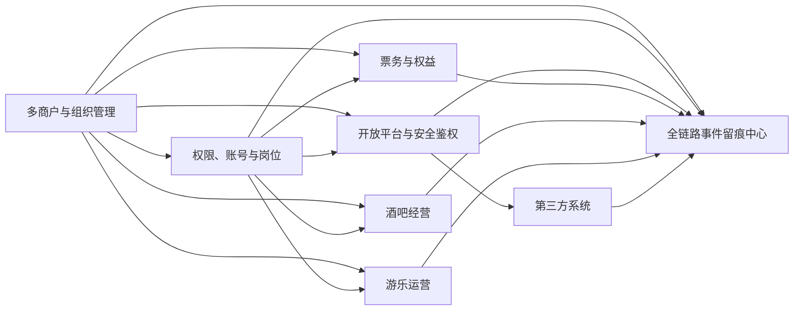

# 地基系统详细拆分

本文档拆分第一阶段优先建设的四个底层系统：

1. 多商户与组织管理系统
2. 权限、账号与岗位系统
3. 开放平台与安全鉴权系统
4. 全链路事件留痕中心

这四个系统的目标不是直接完成售票、点单或游乐运营，而是先解决后续所有业务系统都会依赖的几个核心问题：

- 谁是经营主体？
- 谁可以操作什么？
- 谁可以查看哪些数据？
- 当前一个综合体如何预留未来多个综合体的项目边界？
- 商户、合同、空间和经营范围是否允许当前业务继续执行？
- 员工如何通过私人手机 App、设备凭证（设备公钥指纹，原 NFC，D8）、审核、职级和公司工作手机建立可信身份？
- 第三方系统如何安全调用？
- 接口文档、SDK和API如何标准化输出？
- 每一个动作如何留痕？
- 第三方系统接入后如何归属、审计和追责？

## 1. 多商户与组织管理系统

### 1.1 系统定位

多商户与组织管理系统负责管理综合体内所有经营主体、服务主体、场地、区域、门店、项目和合同关系。

它是整个系统的数据隔离基础。后续票务、酒吧、游乐、餐饮、零售、机器人、监控、企业微信、财务结算都必须绑定到某个组织、商户、场地或项目上。

当前 P0 先按一个综合体落地，但所有商户、空间、合同、员工、设备、票务、酒吧和游乐对象都必须带综合体项目归属。未来新增多个综合体时，系统可以按项目隔离数据，也可以在集团层面汇总查看。

合同和基础定义不是只做档案展示，还要成为后续业务的准入依据。票务发布、酒吧点单、游乐开放、第三方接入、结算和对账如果超出合同、空间、业态、有效期或权限范围，系统应阻断流程，或要求更高级别审批。

### 1.2 负责的业务范围

| 范围 | 是否负责 | 说明 |
|---|---|---|
| 综合体项目管理 | 是 | 当前一个综合体，未来支持多个综合体的项目归属和数据隔离 |
| 平台公司主体管理 | 是 | 综合体平台方自身 |
| 第三方商户管理 | 是 | 酒吧公司、游乐公司、餐饮商户、零售商户 |
| 第三方服务商管理 | 是 | 机器人、监控、支付、闸机、NFC、企业微信服务商 |
| 门店和项目管理 | 是 | 酒吧门店、游乐项目、餐饮店、零售店 |
| 场地区域管理 | 是 | 楼层、区域、入口、库房、吧台、卡座区、游乐区 |
| 商户合同关系 | 是 | 租赁、联营、分成、保底、服务合同 |
| 合同准入规则 | 是 | 把合同核心摘要转成业务阻断、升级审批和审计依据 |
| 商户经营数据查看 | 部分负责 | 只定义数据归属，具体报表由数据系统负责 |
| 财务结算计算 | 不直接负责 | 只维护合同和规则基础信息，具体结算由结算系统负责 |

### 1.3 核心模块

#### 1.3.1 平台主体管理

| 功能 | 说明 |
|---|---|
| 综合体项目档案 | 当前先建一个综合体项目，未来可新增多个综合体项目 |
| 平台主体档案 | 维护综合体平台公司的基础信息 |
| 平台品牌信息 | 维护综合体品牌、项目名称、LOGO、营业信息 |
| 平台经营资质 | 上传营业执照、许可证、消防证明等 |
| 平台默认规则 | 默认营业时间、默认币种、默认结算周期 |

#### 1.3.2 商户主体管理

| 功能 | 说明 |
|---|---|
| 商户档案 | 公司名称、简称、统一社会信用代码、联系人、联系方式 |
| 商户类型 | 酒吧、游乐、餐饮、零售、机器人、监控、设备、支付等 |
| 商户状态 | 待入驻、正常、暂停、清退、黑名单 |
| 资质管理 | 营业执照、食品经营许可证、酒类许可证、特种设备相关资质；补有效期与到期预警/阻断（expiry_warning_days/expiry_action），酒类业态酒类许可证、餐饮业态食品许可证为必填，缺失或过期阻断相关业务（C9，落 merchant_credentials，见 foundation-database-design §2.10） |
| 联系人管理 | 法人、商务联系人、财务联系人、运营联系人、技术联系人 |
| 银行账户 | 结算账户信息，敏感字段脱敏展示 |
| 风险标签 | 高风险、重点监管、结算冻结、合同即将到期 |

#### 1.3.3 商户品牌与门店管理

| 功能 | 说明 |
|---|---|
| 品牌管理 | 一个商户可以有多个品牌 |
| 门店管理 | 一个品牌可以有多个门店或经营点位 |
| 门店业态 | 酒吧、餐厅、零售、体验项目、临时摊位 |
| 门店营业时间 | 支持固定时间、节假日时间、临时关闭 |
| 门店负责人 | 绑定店长、财务联系人、运营负责人 |
| 门店状态 | 筹备中、营业中、暂停营业、闭店 |

#### 1.3.4 游乐项目管理基础档案

这里只管理项目组织归属和基础档案，具体排队、核销、安全巡检由游乐设施运营系统负责。

| 功能 | 说明 |
|---|---|
| 项目归属 | 绑定项目所属游乐公司或平台 |
| 项目位置 | 绑定场地区域、楼层、入口 |
| 项目类型 | 机械游乐、互动体验、沉浸剧场、VR、儿童项目等 |
| 基础容量 | 记录最大接待容量，供票务和安全系统引用 |
| 项目状态 | 筹备、开放、暂停、维护、关闭 |

#### 1.3.5 场地、区域与点位管理

| 功能 | 说明 |
|---|---|
| 场地地图结构 | 综合体、楼栋、楼层、区域、点位 |
| 区域类型 | 入口、酒吧区、游乐区、餐饮区、零售区、库房、员工区 |
| 点位管理 | 闸机、吧台、卡座、桌台、摄像头、货架、机器人取货点 |
| 区域容量 | 园区容量、酒吧容量、游乐区容量；**消防容量卡控**：区域/场地补 fire_capacity（消防核定容量）与 max_occupancy（最大允许在场人数），售票/入场/开台时据此限员（C8，落 areas/venues，见 foundation-database-design §2.5/§2.7） |
| 区域权限 | 员工或商户可操作的区域范围 |
| 设备绑定 | 摄像头、NFC、扫码枪、机器人站点绑定具体点位 |

#### 1.3.6 合同与合作关系管理

| 功能 | 说明 |
|---|---|
| 合同档案 | 合同编号、合同名称、合同类型、起止时间 |
| 合作模式 | 固定租金、销售分成、核销分成、保底加分成、服务费 |
| 合同核心摘要 | 经营范围、空间范围、合作模式、租金/分成/保底摘要、结算口径、有效期 |
| 经营准入规则 | 定义哪些业务可经营、哪些业务阻断、哪些业务需升级审批 |
| 违规处理方式 | 超合同范围、超空间范围、合同过期、资质过期时阻断或进入高审 |
| 结算周期 | 日结、周结、月结、活动结束结算 |
| 保底规则 | 月保底、项目保底、活动保底 |
| 分成规则引用 | 绑定结算系统中的规则模板 |
| 合同附件 | PDF、图片、补充协议 |
| 合同预警 | 即将到期、资质过期、结算暂停 |

#### 1.3.7 商户技术接入管理

| 功能 | 说明 |
|---|---|
| 接入系统登记 | 餐饮POS、零售POS、机器人平台、监控平台等 |
| 接口凭证 | AppKey、密钥、回调地址，敏感信息加密保存 |
| 数据范围 | 限制该商户或服务商可以访问哪些门店、项目和数据 |
| 回调配置 | 订单回调、核销回调、配送状态回调、视频事件回调 |
| 接入状态 | 未接入、联调中、正常、异常、停用 |

### 1.4 核心数据对象

| 对象 | 说明 |
|---|---|
| ComplexProject | 综合体项目，当前一个，未来支持多个 |
| Organization | 组织节点，可表示平台部门、商户公司、服务商公司 |
| Merchant | 经营商户主体 |
| ServiceProvider | 第三方**技术服务商**主体（机器人、监控、支付、闸机、NFC、企微等系统/设备能力） |
| Supplier | **供货供应商**（酒水/食材/物料供货，含黑名单 5 态），与 ServiceProvider 区分（fielddb-10，落 foundation-database-design §6A.4 suppliers） |
| BusinessSubsystem | 票务、酒吧、游乐等可独立拆分的业务系统 |
| Brand | 商户品牌 |
| Venue | 具体门店、经营场所或项目场地 |
| Project | 游乐项目或体验项目 |
| Area | 场地区域 |
| LocationPoint | 具体点位，如卡座、吧台、摄像头点、机器人站点 |
| Contract | 合同 |
| CooperationMode | 合作模式 |
| ContractAdmissionRule | 合同准入规则 |
| AdmissionAudit | 准入检查和升级审批记录 |
| MerchantCredential | 商户资质 |
| MerchantBankAccount | 商户结算账户 |
| IntegrationApp | 第三方接入应用 |
| Customer | **游客/会员主表**（手机号唯一脱敏、openid 多端映射、会员等级、实名状态、注册同意关联），customer_id 外键的唯一身份落点（critic-3，落 foundation-database-design §6B.1） |
| ConsentRecord | **PIPL 同意记录**（版本/时间/范围/主体/渠道/敏感单独同意/撤回），收集个人信息前写入可举证（critic-1/C2，落 §6B.2） |
| PiiRetentionPolicy | **个人信息分类留存策略**（数据类别→留存依据/天数→到期处置 archive/delete/anonymize），供到期删除/匿名化作业（critic-5/C5，落 §6B.4） |
| PointsAccount/PointsLedger/PointsRule/PointGift/PointRedemption | **会员积分五件套**（账户/明细/规则含有效期与过期方式/礼物/兑换记录，兑换扣库存联动供应链），customer-app 积分接口落点（critic-4/critic-10/pass-1，落 §6B.5） |
| TicketInventory | **票务库存桶**（total/sold/reserved/available/乐观锁 version），承载并发扣减与预占（critic-11，落 §6B.6） |

> 修订说明（2026-06-07 收口）：在核心数据对象中登记 Customer/ConsentRecord/PiiRetentionPolicy/会员积分五件套/TicketInventory。原因：这些主表被票务/酒吧/风控/事件中心/客人端大量外键引用却此前无定义，导致 customer_id、consent_subject_id、employee_notice_id 等外键悬空、合规要求只停在策略层；现于 foundation-database-design §6B 补建，地基拆分文档同步登记为核心对象，使下游可编码。依据 critic-1/3/4/5/10/11、compliance-land-1/10/11、C2/C4/C5/C10。

### 1.5 关键状态

#### 商户状态

| 状态 | 含义 |
|---|---|
| pending | 待入驻 |
| onboarding | 入驻配置中 |
| active | 正常经营 |
| suspended | 暂停经营 |
| settlement_frozen | 结算冻结 |
| terminated | 已清退 |
| blacklisted | 黑名单 |

#### 门店/项目状态

| 状态 | 含义 |
|---|---|
| preparing | 筹备中 |
| open | 营业中 |
| paused | 临时暂停 |
| maintenance | 维护中 |
| closed | 已关闭 |

#### 合同状态

| 状态 | 含义 |
|---|---|
| draft | 草稿 |
| pending_approval | 待审批 |
| active | 生效中 |
| expiring | 即将到期 |
| expired | 已到期 |
| terminated | 已终止 |

### 1.6 关键流程

#### 1.6.1 商户入驻流程

1. 平台创建商户主体。
2. 录入商户类型、联系人、结算账户。
3. 上传经营资质。
4. 创建品牌和门店。
5. 绑定经营区域或项目点位。
6. 创建合同和合作模式。
7. 抽取合同核心摘要，形成经营范围、空间范围、结算口径和准入规则。
8. 配置结算周期和分成规则。
9. 配置商户管理员账号。
10. 配置第三方系统接入信息。
11. 审批通过后商户状态变为正常经营。
12. 后续票务、酒吧、游乐、结算和第三方流程引用该商户时，先检查合同准入规则。

#### 1.6.2 场地点位配置流程

1. 创建综合体楼层和区域。
2. 创建具体点位，例如入口闸机、吧台、卡座、库房货架。
3. 将点位绑定到对应商户或平台。
4. 绑定设备，例如摄像头、NFC、扫码枪、机器人站点。
5. 设置区域容量和权限范围。
6. 后续业务事件发生时自动关联该点位。

### 1.7 与其他系统关系

| 关联系统 | 关系 |
|---|---|
| 权限系统 | 商户、组织、区域决定员工数据权限 |
| 票务系统 | 票种和权益必须绑定商户、门店或项目 |
| 结算系统 | 合同、合作模式、结算账户是结算基础 |
| 酒吧系统 | 酒吧门店、吧台、卡座、库房来自本系统 |
| 游乐系统 | 游乐项目、区域、容量来自本系统 |
| 第三方集成 | 商户技术接入信息来自本系统 |
| 合同准入引擎 | 后续业务超合同、超空间、超业态、过期或资质异常时阻断或升级审批 |
| 事件中心 | 所有事件都需要组织、商户、区域归属 |

### 1.8 第一阶段MVP

| 必做 | 暂缓 |
|---|---|
| 综合体项目归属 | 多综合体集团级复杂报表 |
| 商户主体管理 | 复杂合同审批流 |
| 商户类型和状态 | 资质自动识别 |
| 品牌/门店/项目基础档案 | 电子合同签署 |
| 场地、区域、点位基础管理 | 可视化地图编辑 |
| 合同基础字段、核心摘要和准入拦截 | 复杂保底分成计算 |
| 商户管理员账号绑定 | 多级集团组织 |
| 第三方接入应用登记 | 自动化联调平台 |

## 2. 权限、账号与岗位系统

### 2.1 系统定位

权限、账号与岗位系统负责控制每个人、每台设备、每个第三方应用能做什么、能看什么、能操作哪些商户和区域。

系统必须同时支持平台员工、商户员工、第三方服务商人员、临时人员、设备账号、接口账号。

员工账号不应只由后台直接手工创建。P0 应支持员工在私人手机轻量 App 上提交注册资料、生成设备凭证（安装期生成并存于设备 Keystore 的设备公钥/不可逆设备指纹）和设备指纹，后台审核通过后再生成账号、角色、职级、权限，并与公司发放的工作手机建立一一对应关系。员工换手机必须先解绑旧设备凭证再绑定新设备。私人手机 App 只用于注册、通知和状态查看，不进入现场业务操作。

> 修订说明（2026-06-10）：依据基准 D8 + finding phone-3/phone-7、compliance-4、A6（用户拍板），将原「申请 NFC 权限、读取手机本机 NFC 唯一标识作员工身份」修正为「设备公钥指纹 / Keystore 凭证」。原因：Android 不向应用暴露本机稳定 NFC 硬件唯一标识，该方案技术不可行；改用安装期生成的设备公钥/不可逆设备指纹作唯一可信标识，仅持久化不可逆哈希/指纹（PIPL 数据最小化）。下文涉及「员工本机 NFC 唯一标识作身份」处均按本口径理解为「设备凭证（设备公钥指纹）」；工作手机通过摄像头/扫码模块读取外部客人二维码，NFC 仅读取外部 NFC 腕带、标签、卡或设备中的权益标识。

### 2.2 负责的业务范围

| 范围 | 是否负责 | 说明 |
|---|---|---|
| 员工账号 | 是 | 平台和商户员工 |
| 员工私人手机注册审批 | 是 | 员工自有手机提交注册、设备凭证、设备指纹和 Root/异常检测 |
| 设备凭证身份绑定 | 是 | 生成设备公钥指纹/Keystore 凭证并绑定员工，支持换机解绑旧设备后重绑（原「NFC身份绑定」，依据 D8） |
| 企业微信身份绑定 | 是 | 员工工作沟通归属 |
| 角色权限 | 是 | 管理菜单和功能权限 |
| 数据权限 | 是 | 管理商户、门店、区域、项目范围 |
| 岗位权限 | 是 | 根据岗位限制操作 |
| 职级和薪资口径摘要 | 部分负责 | 维护 M1-M10 及上/中/下职级、权限模板和薪资大范围，具体薪资单独填写，完整薪资核算可后续对接 HR 系统 |
| 设备登录权限 | 是 | 管理手机、手持机和扫码设备 |
| 第三方接口权限 | 是 | 接口访问控制 |
| 完整考勤薪资计算 | 不负责 | 可后续对接 HR 系统 |

### 2.3 核心模块

#### 2.3.1 账号管理

| 功能 | 说明 |
|---|---|
| 员工账号 | 工号、姓名、手机号、所属组织、状态 |
| 商户账号 | 绑定商户、门店、岗位 |
| 平台账号 | 绑定平台部门、岗位 |
| 服务商账号 | 绑定服务商和可处理系统 |
| 设备账号 | 闸机、扫码设备、机器人、监控回调等非人工账号 |
| 接口账号 | 第三方系统API访问账号 |
| 登录方式 | 手机号、密码、短信、企业微信、设备绑定 |
| 注册审批 | 员工私人手机 App 提交资料、设备凭证、设备指纹和岗位申请，后台审核 |
| 账号生成 | 注册审核通过后生成员工账号、角色、职级和权限 |
| 账号状态 | 正常、停用、离职、锁定、待激活 |

#### 2.3.2 角色权限管理

| 角色示例 | 可做的事 |
|---|---|
| 平台超级管理员 | 管理全系统配置 |
| 平台运营经理 | 管理票务、商户、活动、项目运营 |
| 平台财务 | 查看订单、支付、退款、结算 |
| 平台风控 | 查看事件、预警、审计、证据 |
| 商户管理员 | 管理本商户员工和经营数据 |
| 酒吧店长 | 管理酒吧桌台、点单、库存、员工 |
| 吧台员工 | 点单、出品、酒水核销 |
| 库管 | 入库、出库、盘点、报损 |
| 游乐项目主管 | 管理项目开放、排队、安全巡检 |
| 核销员 | 扫码核销指定权益 |
| 客服 | 企业微信客户沟通和工单处理 |
| 第三方技术人员 | 查看接口状态和错误日志 |

#### 2.3.3 菜单和功能权限

| 功能 | 说明 |
|---|---|
| 菜单权限 | 控制后台能看到哪些菜单 |
| 按钮权限 | 新增、编辑、删除、导出、审批、作废 |
| 接口权限 | 后端接口级权限控制 |
| 移动端权限 | 管理手机上可用功能 |
| 敏感操作权限 | 退款、调账、库存报损、查看视频、查看聊天 |
| 二次确认 | 高风险操作需要短信、企业微信或主管确认 |

权限颗粒度已确认：权限点必须按单一功能最小颗粒度定义，一个单一功能对应一个权限点，例如“票务核销”“查看卡座预定状态”。角色模板只是批量配置工具，系统必须允许按员工单独增减权限。

> 修订说明（2026-06-07）：依据 finding staff-3 补「员工级减权/排除」落地机制。原因：「按员工单独增减权限」此前只覆盖「增」（多绑角色或临时授权叠加），缺「减/排除」。落地结构为 `user_permission_overrides` 员工级直接授权表（永久，支持 effect=grant/deny；见 foundation-database-design §3.13.1）。**最终生效权限 =（用户所有角色权限并集）∪（员工级 grant）－（员工级 deny），再叠加当班内有效的临时授权；deny 优先级最高。** 本能力 P0 落地（同时支持加权与减权），非 P1。

#### 2.3.4 数据权限

| 数据维度 | 说明 |
|---|---|
| 平台范围 | 可查看全局或指定事业部 |
| 商户范围 | 可查看一个或多个商户 |
| 门店范围 | 可查看指定门店 |
| 项目范围 | 可查看指定游乐项目 |
| 区域范围 | 可操作指定场地区域 |
| 班次范围 | 只能看自己当班数据或全部数据 |
| 客户范围 | 只能看自己服务客户或门店客户 |

#### 2.3.5 岗位与班次绑定

| 功能 | 说明 |
|---|---|
| 岗位管理 | 店长、服务员、吧台、库管、核销员、巡检员 |
| 岗位职责 | 定义岗位默认权限 |
| 班次绑定 | 员工当班后获得某些临时权限 |
| 区域绑定 | 当班时绑定负责区域 |
| 设备绑定 | 当班领取管理手机后绑定设备 |
| 职级绑定 | 岗位可配置默认职级、权限级别和薪资口径摘要（大范围）；员工具体薪资单独填写，应落在大范围内、越界给提示（staff-1，落 staff_profiles.base_salary_amount，敏感·控权·留痕） |
| 下班回收 | 下班后自动收回当班权限 |

#### 2.3.6 企业微信身份绑定

| 功能 | 说明 |
|---|---|
| 员工绑定 | 系统员工绑定企业微信UserID |
| 客户归属 | 客户会话归属到员工和商户 |
| 会话权限 | 主管只能查看授权范围内的会话 |
| 离职继承 | 员工离职后客户和会话转交 |
| 会话审计 | 查看、导出、标记会话都要留痕 |

#### 2.3.7 临时授权与审批

| 场景 | 示例 |
|---|---|
| 退款授权 | 普通员工申请，主管临时授权 |
| 视频调阅 | 客诉争议时申请查看指定时间段视频 |
| 库存调整 | 盘点差异需库管和主管审批 |
| 跨店支援 | 员工临时获得另一个门店权限 |
| 设备代领 | 特殊情况下主管批准代领设备 |

#### 2.3.8 员工私人手机 App 与设备凭证绑定

> 修订说明（2026-06-07）：依据 D8/phone-3，本小节原标题「与 NFC 绑定」及「读取手机本机 NFC 唯一标识」改为「设备凭证（设备公钥指纹）」。原因同 2.1 修订说明。

| 功能 | 说明 |
|---|---|
| 私人手机注册 | 员工在自有手机提交姓名、手机号、岗位申请、所属商户或部门等注册资料 |
| 设备凭证绑定 | App 在安装期生成并存于设备 Keystore 的设备公钥/不可逆设备指纹，绑定员工，作为身份辅助校验（原 NFC 绑定，依据 D8，仅存不可逆哈希/指纹） |
| 设备指纹 | 记录私人手机设备指纹、系统版本、Root/调试检测结果 |
| 审批生成账号 | 后台审核通过后生成员工账号、角色、职级、数据范围和初始权限 |
| 工作手机对应 | 将员工、私人手机、设备凭证和公司发放工作手机建立一一对应关系；换手机时先解绑旧设备凭证再绑定新设备 |
| 使用边界 | 私人手机 App 只做注册、通知、状态查看和审批结果查看，不允许核销、点单、放行、结算 |
| 办公区寄存 | 员工进入办公区或现场作业区后，私人手机需要寄存；寄存柜流动使用，先到先选，离开时全部拿走 |
| 异常失效 | Root、调试环境、设备指纹变化、设备凭证不匹配时，私人手机 App 失效并进入复核；能被手机端检测出的异常环境均按不可信处理 |

### 2.4 核心数据对象

| 对象 | 说明 |
|---|---|
| UserAccount | 系统账号 |
| StaffProfile | 员工档案 |
| StaffRegistrationApproval | 员工私人手机注册审批 |
| StaffPrivateDevice | 员工私人手机设备记录 |
| StaffDeviceCredential | 员工设备凭证（设备公钥指纹，原 StaffNfcBinding，依据 D8） |
| StaffDeviceLink | 员工私人手机、设备凭证、公司工作手机对应关系 |
| StaffLevel | 员工职级和权限级别 |
| UserPermissionOverride | 员工级直接授权（永久 grant/deny，依据 staff-3） |
| EmployeeNotice | 员工数据处理与监控合规告知签署记录（notice_version/scope/legal_basis/signed_at），员工注册审批/档案留存告知凭据（compliance-land-11/C4/C10，落 foundation-database-design §6B.3） |
| Role | 角色 |
| Permission | 权限点 |
| RolePermission | 角色权限关系 |
| DataScope | 数据权限范围 |
| Position | 岗位 |
| Shift | 班次 |
| StaffShiftAssignment | 员工班次 |
| DeviceBinding | 员工和设备绑定记录 |
| WeComBinding | 企业微信身份绑定 |
| ApiClient | 第三方接口账号 |
| TemporaryGrant | 临时授权 |
| LoginSession | 登录会话 |
| AccessLog | 访问日志 |

### 2.5 权限控制模型

建议采用：

**RBAC角色权限 + 数据范围权限 + 当班临时权限 + 敏感操作审批**

| 权限类型 | 解决的问题 |
|---|---|
| 角色权限 | 这个人是什么角色，能用哪些功能 |
| 数据范围 | 这个人能看哪个商户、门店、区域的数据 |
| 岗位权限 | 这个人当前岗位允许做什么 |
| 班次权限 | 只有上班期间才能操作某些功能 |
| 设备权限 | 必须用公司管理手机才能操作 |
| 设备凭证身份 | 员工注册、领设备、进入区域或高风险操作可引用设备凭证（设备公钥指纹，原 NFC 绑定，依据 D8） |
| 私人/工作手机对应 | 私人手机用于注册和通知，公司工作手机用于现场操作 |
| 员工级权限覆盖 | 在角色权限之上按员工单独 grant/deny（永久增减权，依据 staff-3） |
| 职级权限 | 员工职级决定默认权限级别、审批层级和薪资口径摘要（职级不替代单一功能权限点校验，staff-4） |
| 审批权限 | 高风险操作需要更高权限确认；相对审批层级见下「职级与审批层级模型」 |

> 修订说明（2026-06-07）：依据 finding staff-5、staff-2、govern-2 补「职级与审批层级模型」。
> **职级序列（staff-5）：** 职级为二维结构「主级 M1-M10 × 子级 上/中/下」，派生有序 `level_rank`(1..30) 作为职级序列主键（M1上=1 … M10下=30，rank 越大越高），由系统派生不人工独立录入。结构化字段见 foundation-database-design §3.2.1。
> **审批层级（staff-2/govern-2）：** 「上一级/上两级/最高权限」是相对层级，统一以 `level_rank` 为基准序列计算：one_level_up=路由给 rank 最小且 > 触发人的职级、two_levels_up=第二个更高职级（不足回退最高权限）、specified_level=指定职级、top_authority=组织/项目内 rank 最大者。同主级不同子级也算一级；跨组织上溯解析；无更高级回退最高权限。字段落点：`staff_levels.approval_level`、`contract_admission_rules.required_approval_level`、`contracts.high_approval_required`，规则见 foundation-database-design §3.2.1.1。

### 2.6 关键流程

#### 2.6.1 员工入职开通账号

1. 员工在私人手机 App 提交注册信息、岗位申请、手机号，App 在安装期生成设备凭证（设备公钥指纹/Keystore 凭证），同时提交设备指纹（D8）。
2. 系统检测 Root、调试环境、设备指纹异常和设备凭证是否重复绑定。
3. 后台审核员工资料、岗位、所属组织、商户或门店。
4. 审核通过后生成员工档案和系统账号。
5. 分配岗位、职级（M1-M10×上中下/level_rank）、角色和数据范围，必要时按员工 grant/deny 调整权限。
6. 建立员工私人手机、设备凭证和公司工作手机的一一对应关系；换手机时必须先解绑旧设备凭证再绑定新设备。
7. 绑定企业微信身份。
8. 首次登录激活。
9. 账号开通、设备凭证绑定和设备对应事件写入事件中心。

#### 2.6.2 员工上班获得权限

1. 员工打卡或由主管排班确认。
2. 员工进入办公区或现场作业区前寄存私人手机，寄存柜流动使用、先到先选、离开拿走。
3. 领取公司管理手机。
4. 系统绑定员工、设备、班次、区域和职级权限。
5. 临时开启当班权限。
6. 员工使用管理手机登录管理App和企业微信。
7. 所有操作自动绑定员工、设备、班次。

#### 2.6.3 下班权限回收

1. 员工交还管理手机。
2. 系统检查设备状态和数据同步。
3. 回收当班权限。
4. 检查是否有未完成订单、补录、工单或交接事项。
5. 生成交班记录。
6. 写入事件中心。

### 2.7 与其他系统关系

| 关联系统 | 关系 |
|---|---|
| 多商户系统 | 组织、商户、门店、区域是权限边界 |
| 企业设备系统 | 设备领用影响员工可用权限 |
| 终端系统 | 员工私人手机 App、设备凭证（设备公钥指纹，原 NFC，D8）和公司工作手机对应关系决定现场操作可信身份 |
| 企业微信系统 | 员工会话归属和查看权限依赖账号 |
| 视频证据中心 | 视频调阅权限由本系统控制 |
| 事件中心 | 登录、查看、操作、审批都写入事件 |
| 酒吧系统 | 点单、库存、存酒等操作受岗位权限控制 |
| 游乐系统 | 核销、巡检、设备状态变更受岗位权限控制 |
| 财务系统 | 退款、调账、结算查看受权限控制 |

### 2.8 第一阶段MVP

| 必做 | 暂缓 |
|---|---|
| 用户账号管理 | 单点登录复杂集成 |
| 员工私人手机注册审批、设备凭证（设备公钥指纹）绑定、换机解绑重绑和 Root/异常失效 | 门禁/储物柜/考勤深度联动 |
| M1-M10×上中下=30级有序职级（派生 level_rank）、权限模板、薪资大范围与员工具体薪资录入 | 完整薪资核算 |
| 角色权限管理 + 员工级 grant/deny 增减权 | ABAC复杂策略引擎 |
| 数据范围按商户/门店控制 | 细到字段级权限 |
| 岗位管理 | 完整HR考勤薪资 |
| 企业微信UserID绑定字段 | 全量会话质检 |
| 设备绑定基础记录、预装软件清单、网站白名单和违规访问留痕 | MDM深度管控、远程锁定和策略自动下发 |
| 登录和操作日志 | 生物识别登录 |
| 临时授权基础流程 | 复杂审批流设计器 |

## 3. 开放平台与安全鉴权系统

### 3.1 系统定位

开放平台与安全鉴权系统负责把平台内部数据和业务能力标准化开放给第三方系统调用，并提供统一的账号、权限、动态鉴权、接口文档、SDK、调用审计、失败锁定和人工解锁机制。

这个系统的目标是：

- 让第三方系统能方便、标准、安全地调用平台能力。
- 所有开放接口都有清晰文档、版本、错误码和示例。
- 所有调用必须经过授权，不能依赖长期静态链接。
- 第三方获取真实业务接口前，必须先通过动态鉴权。
- 连续3次账号密码或鉴权错误后自动锁定，必须人工手动解锁。
- 每一次调用、失败、锁定、解锁都写入事件中心。

### 3.2 负责的业务范围

| 范围 | 是否负责 | 说明 |
|---|---|---|
| 第三方开放应用管理 | 是 | 给餐饮、零售、机器人、监控、设备商等创建调用身份 |
| API标准化 | 是 | 定义统一接口风格、返回格式、错误码、版本 |
| API文档生成 | 是 | 生成第三方可阅读的接口文档 |
| SDK输出 | 是 | 提供常用语言SDK或调用示例 |
| 账号密码鉴权 | 是 | 第三方应用通过账号密码获取临时授权 |
| 动态令牌 | 是 | 发放短时效Access Token |
| 动态调用地址 | 是 | 发放短时效网关地址、路由地址或接口访问凭证 |
| 签名校验 | 是 | 使用时间戳、nonce、签名防重放 |
| 连续失败锁定 | 是 | 连续3次失败自动锁定 |
| 人工解锁 | 是 | 管理员复核后手动解锁 |
| 调用审计 | 是 | 记录调用方、接口、结果、IP、耗时、风险 |
| 第三方业务实现 | 不负责 | 餐饮、零售、机器人等业务系统由第三方实现 |

### 3.3 核心模块

#### 3.3.1 开放应用管理

| 功能 | 说明 |
|---|---|
| 应用创建 | 为第三方创建开放应用 |
| 应用归属 | 绑定商户、服务商、门店或项目 |
| 应用类型 | 餐饮POS、零售POS、机器人、监控、闸机、NFC、企业微信等 |
| 应用状态 | 待联调、正常、暂停、锁定、禁用 |
| 应用账号 | 生成调用账号 |
| 密钥管理 | 生成、轮换、吊销密钥 |
| 回调地址 | 配置第三方接收平台Webhook的地址 |
| IP白名单 | 限制允许调用来源 |

#### 3.3.2 API目录与版本管理

| 功能 | 说明 |
|---|---|
| API分组 | 票务、核销、订单、会员、商户、事件、库存、视频、机器人 |
| API版本 | v1、v2等版本并存 |
| 接口状态 | 草稿、测试中、已发布、废弃 |
| 权限标记 | 每个接口声明需要的权限范围 |
| 兼容策略 | 废弃接口保留过渡期 |
| 变更记录 | 记录接口字段、规则、错误码变化 |

#### 3.3.3 接口文档中心

| 功能 | 说明 |
|---|---|
| 自动文档 | 根据接口定义生成文档 |
| 请求示例 | 提供参数示例 |
| 返回示例 | 提供成功和失败返回示例 |
| 错误码 | 统一错误码、错误说明、处理建议 |
| 鉴权说明 | 说明如何获取动态令牌和动态地址 |
| 回调说明 | 说明Webhook签名、重试、幂等规则 |
| 联调指南 | 提供测试账号、沙箱地址、常见问题 |

#### 3.3.4 SDK与示例代码

| 功能 | 说明 |
|---|---|
| SDK管理 | Java、Node.js、Python、PHP等 |
| 签名工具 | SDK内置签名、验签、token刷新 |
| 请求封装 | 封装动态地址获取和业务接口调用 |
| 回调验签 | 帮助第三方验证平台Webhook |
| 示例项目 | 提供最小可运行Demo |
| SDK版本 | SDK与API版本对应 |

#### 3.3.5 动态鉴权中心

建议采用“账号密码登录 + 短时效Token + 动态调用地址 + 请求签名”的组合。

| 功能 | 说明 |
|---|---|
| 账号密码鉴权 | 第三方应用使用app_code和password登录 |
| 短时效Token | 登录成功后发放短时效Access Token |
| Refresh Token | 可选，用于刷新Access Token |
| 动态调用地址 | 登录后返回短时效API网关地址或动态路由前缀 |
| 地址过期 | 动态地址到期后必须重新获取 |
| 请求签名 | 每个业务请求携带时间戳、nonce、签名 |
| 防重放 | 同一个nonce短时间内不可重复使用 |
| 时间窗口 | 请求时间戳超过允许范围则拒绝 |
| 权限校验 | Token只能访问授权接口和授权数据范围 |

推荐调用流程：

1. 第三方用应用账号和密码请求鉴权接口。
2. 平台校验账号、密码、应用状态、IP白名单。
3. 鉴权成功后返回短时效Access Token。
4. 同时返回短时效动态调用地址或网关路由。
5. 第三方调用业务API时使用动态地址。
6. 每次请求携带Access Token、时间戳、nonce、签名。
7. 平台校验通过后执行业务接口。
8. Token或动态地址过期后，第三方必须重新获取。

#### 3.3.6 失败锁定与人工解锁

| 功能 | 说明 |
|---|---|
| 失败计数 | 账号密码错误、签名错误、Token伪造、动态地址过期重复调用都可计数 |
| 连续3次锁定 | 连续3次鉴权失败后锁定应用或账号 |
| 锁定范围 | 可锁定应用、账号、IP或密钥 |
| 锁定通知 | 通知平台管理员和商户技术联系人 |
| 人工解锁 | 管理员核实原因后手动解锁 |
| 解锁备注 | 必须填写解锁原因 |
| 解锁审计 | 锁定和解锁都写入事件中心 |
| 失败清零 | 成功鉴权后可清零连续失败计数 |

#### 3.3.7 权限范围控制

| 维度 | 说明 |
|---|---|
| 接口权限 | 可以调用哪些API |
| 商户范围 | 可以访问哪些商户 |
| 门店范围 | 可以访问哪些门店 |
| 项目范围 | 可以访问哪些游乐项目 |
| 数据类型 | 可以读取订单、核销、库存、事件中的哪些类型 |
| 操作类型 | 只读、写入、回调、管理、作废 |
| 敏感字段 | 手机号、证件、支付信息默认脱敏或禁止；企业微信会话原文按专门权限查看并留痕 |

#### 3.3.8 调用审计

| 功能 | 说明 |
|---|---|
| 调用日志 | 记录应用、接口、时间、IP、结果、耗时 |
| 参数摘要 | 保存请求摘要，不直接暴露敏感明文 |
| 响应摘要 | 保存状态码、错误码、业务结果 |
| 风险标记 | 失败频繁、越权访问、异常IP、高频调用 |
| 日志查询 | 按应用、商户、接口、时间查询 |
| 调用导出 | 导出需要权限，导出行为也留痕 |

#### 3.3.9 限流、熔断与配额

| 功能 | 说明 |
|---|---|
| 应用限流 | 每个第三方应用限制QPS |
| 接口限流 | 不同接口设置不同频率 |
| 商户配额 | 按商户设置每日调用量 |
| 错误熔断 | 短时间大量失败自动暂停 |
| 黑名单 | 恶意IP、异常应用加入黑名单 |
| 告警通知 | 调用异常通知平台技术人员 |

#### 3.3.10 Webhook订阅与回调安全

| 功能 | 说明 |
|---|---|
| 事件订阅 | 第三方订阅订单、核销、退款、配送、库存、风险事件 |
| 回调签名 | 平台向第三方回调时附带签名 |
| 回调重试 | 第三方接收失败后按策略重试 |
| 回调幂等 | 每个回调事件有唯一ID |
| 回调日志 | 记录每次回调结果 |
| 回调暂停 | 连续失败后暂停回调并告警 |

### 3.4 核心数据对象

| 对象 | 说明 |
|---|---|
| OpenApp | 第三方开放应用 |
| OpenAppCredential | 应用账号、密码摘要、密钥 |
| ApiResource | API资源 |
| ApiVersion | API版本 |
| ApiPermission | API权限点 |
| OpenAppPermission | 应用授权范围 |
| AuthSession | 鉴权会话 |
| AccessToken | 短时效访问令牌 |
| DynamicEndpoint | 动态调用地址或动态网关路由 |
| NonceRecord | 防重放nonce记录 |
| AuthFailureRecord | 鉴权失败记录 |
| AppLockRecord | 应用锁定记录 |
| ManualUnlockRecord | 人工解锁记录 |
| ApiCallLog | API调用日志 |
| WebhookSubscription | Webhook订阅 |
| WebhookDeliveryLog | Webhook投递日志 |
| SdkPackage | SDK包和版本 |
| ApiDocument | 接口文档 |

### 3.5 关键状态

#### 开放应用状态

| 状态 | 含义 |
|---|---|
| draft | 草稿 |
| testing | 联调中 |
| active | 正常 |
| suspended | 暂停 |
| locked | 鉴权失败锁定 |
| disabled | 禁用 |
| revoked | 已吊销 |

#### 动态地址状态

| 状态 | 含义 |
|---|---|
| active | 可用 |
| expired | 已过期 |
| revoked | 已吊销 |
| rotated | 已轮换 |

### 3.6 关键流程

#### 3.6.1 第三方应用开通流程

1. 平台为第三方创建开放应用。
2. 绑定商户、服务商、门店或项目。
3. 配置允许调用的API范围。
4. 配置数据权限范围。
5. 配置IP白名单和回调地址。
6. 生成应用账号和初始密钥。
7. 开通沙箱联调。
8. 联调通过后切换为正式可用。
9. 开通、授权、上线事件写入事件中心。

#### 3.6.2 动态鉴权流程

1. 第三方提交应用账号、密码、时间戳、nonce和签名。
2. 系统检查应用状态、IP白名单、失败锁定状态。
3. 校验账号密码。
4. 校验失败则记录失败次数。
5. 连续失败达到3次，自动锁定应用或账号。
6. 校验成功后生成短时效Access Token。
7. 生成短时效动态调用地址或动态网关路由。
8. 返回Token、动态地址、有效期和签名规则。
9. 鉴权成功事件写入事件中心。

#### 3.6.3 业务接口调用流程

1. 第三方使用动态地址调用业务API。
2. 请求携带Access Token、时间戳、nonce、签名。
3. API网关校验Token是否有效。
4. 校验动态地址是否有效。
5. 校验nonce是否重复。
6. 校验签名是否正确。
7. 校验接口权限和数据范围。
8. 调用业务系统。
9. 记录API调用日志。
10. 关键调用写入事件中心。

#### 3.6.4 失败锁定和人工解锁流程

1. 系统记录连续鉴权失败次数。
2. 连续3次失败后自动锁定应用或账号。
3. 通知平台管理员和第三方技术联系人。
4. 第三方提交解锁申请或联系平台。
5. 平台管理员查看失败原因、IP、时间、调用日志。
6. 管理员确认无风险后手动解锁。
7. 系统清零连续失败计数。
8. 解锁事件写入事件中心。

### 3.7 与其他系统关系

| 关联系统 | 关系 |
|---|---|
| 多商户系统 | 开放应用必须绑定商户、服务商、门店或项目 |
| 权限系统 | 平台人员管理开放应用和查看调用日志需要权限 |
| 事件中心 | 鉴权、调用、锁定、解锁、越权访问都写入事件 |
| 第三方集成 | 餐饮、零售、机器人、监控等通过开放平台接入 |
| 风控系统 | 从调用日志和失败记录识别异常调用 |
| 数据分析系统 | 统计第三方调用量、成功率、异常率 |

### 3.8 第一阶段MVP

| 必做 | 暂缓 |
|---|---|
| 开放应用管理 | 完整开发者门户 |
| 应用账号和密码 | OAuth复杂授权码模式 |
| 短时效Access Token | 多区域动态网关 |
| 动态调用地址基础机制 | 高级零信任网络 |
| 连续3次失败锁定 | 机器学习攻击识别 |
| 人工解锁 | 自动风险评分解锁 |
| API调用日志 | 完整API商业化计费 |
| 基础API文档 | 多语言完整SDK自动发布 |
| Webhook基础签名 | 复杂事件订阅表达式 |

## 4. 全链路事件留痕中心

### 4.1 系统定位

全链路事件留痕中心负责把系统内外发生的关键行为统一记录为标准事件，形成可以查询、审计、分析、风控和追责的证据链。

它不直接替代业务系统，而是所有业务系统的“黑匣子”和“证据账本”。

### 4.2 负责的业务范围

| 范围 | 是否负责 | 说明 |
|---|---|---|
| 自有系统操作留痕 | 是 | 登录、修改、审批、核销、退款等 |
| 第三方系统事件接收 | 是 | 餐饮、零售、机器人、监控、企业微信 |
| 设备事件接收 | 是 | 闸机、扫码枪、NFC、管理手机 |
| 事件标准化 | 是 | 不同来源转成统一格式 |
| 事件关联 | 是 | 关联人、货、票、钱、设备、地点、视频 |
| 业务过程留痕 | 是 | 订单获取、销售归属、卡座服务、异常首响、复核关闭等过程步骤 |
| 物品交接留痕 | 是 | 酒水和可追责物品从库房、机器人、后厨、服务员到客人的交接 |
| 事件查询 | 是 | 按对象和时间线查询 |
| 风险识别规则 | 部分负责 | 基础风险标记，复杂处置由风控系统 |
| 视频存储 | 不直接负责 | 只保存视频索引和证据引用 |
| 人工补录审批 | 不直接负责 | 由人工补录系统负责，补录结果写入事件中心 |

### 4.3 事件分类

| 大类 | 事件示例 |
|---|---|
| 人员事件 | 员工注册、设备凭证绑定（原 NFC绑定，D8）、私人手机异常、登录、上班、领设备、进入区域、下班、归还设备 |
| 权限事件 | 角色变更、授权、撤权、查看敏感数据、导出数据 |
| 游客事件 | 注册、入园、入酒吧、项目游玩、投诉、评价 |
| 票务事件 | 购票、出票、防伪码生成、二维码刷新、改期、退票、核销、验签失败、异常核销、事后核对 |
| 订单事件 | 创建订单、支付、取消、退款、补款、调账 |
| 酒吧事件 | 开台、点单、出品、存酒、取酒、转台、结账 |
| 库存事件 | 入库、贴码、出库、调拨、盘点、报损、领料、退库、交接、送达 |
| 游乐事件 | 项目开放、项目关闭、排队、预约、设备故障、巡检 |
| 机器人事件 | 任务创建、取货、配送、到达、签收、异常 |
| 视频事件 | 事件绑定视频、截图生成、视频调阅、证据包生成 |
| 沟通事件 | 企业微信会话、敏感词、客户需求、客诉工单 |
| 第三方事件 | 餐饮订单同步、零售券核销、第三方接口异常 |
| 风险事件 | 预警生成、预警处置、冻结、复核、归档 |

### 4.4 标准事件字段

| 字段 | 说明 |
|---|---|
| event_id | 事件唯一编号 |
| event_type | 事件类型 |
| event_category | 事件大类 |
| project_id | 归属综合体项目 |
| occurred_at | 业务发生时间 |
| received_at | 系统接收时间 |
| source_type | 来源类型，自有系统、第三方、设备、人工 |
| source_system | 来源系统名称 |
| merchant_id | 归属商户 |
| venue_id | 归属门店或场地 |
| area_id | 归属区域 |
| location_point_id | 归属点位 |
| actor_type | 操作人类型，员工、游客、设备、第三方系统 |
| actor_id | 操作人ID |
| device_id | 相关设备 |
| customer_id | 相关游客或会员 |
| order_id | 相关订单 |
| ticket_id | 相关票 |
| entitlement_id | 相关权益 |
| credential_id | 相关票码、权益码、NFC或其他凭证 |
| credential_hash | 凭证哈希或防伪核对摘要 |
| contract_id | 相关合同 |
| admission_audit_id | 相关合同准入检查记录 |
| inventory_item_id | 相关物料或商品 |
| trace_code_id | 相关物品追踪码 |
| handover_record_id | 相关交接记录 |
| process_instance_id | 相关业务过程实例 |
| process_step_record_id | 相关过程步骤 |
| service_responsibility_id | 相关服务责任记录 |
| robot_task_id | 相关机器人任务 |
| conversation_id | 相关企业微信会话 |
| video_evidence_id | 相关视频证据 |
| result | 成功、失败、异常、待确认 |
| risk_level | 正常、提醒、可疑、高风险 |
| summary | 事件摘要 |
| payload | 事件原始扩展数据 |
| trace_id | 链路追踪ID |
| previous_event_id | 上一个相关事件 |

### 4.5 核心模块

#### 4.5.1 事件采集网关

| 功能 | 说明 |
|---|---|
| API接收 | 接收业务系统和第三方事件 |
| Webhook接收 | 接收机器人、监控、餐饮、零售等回调 |
| 批量导入 | 支持第三方按文件或批量接口同步 |
| 设备上报 | 接收扫码枪、闸机、NFC、管理手机事件 |
| 幂等处理 | 防止第三方重复回调产生重复事件 |
| 签名校验 | 校验第三方请求真实性 |

#### 4.5.2 事件标准化

| 功能 | 说明 |
|---|---|
| 字段映射 | 不同系统字段映射成标准事件字段 |
| 时间校准 | 统一业务时间和接收时间 |
| 主体识别 | 自动识别商户、门店、区域、设备 |
| 事件补全 | 根据订单、设备、员工补全缺失字段 |
| 原始数据保留 | 保存第三方原始payload，便于追溯 |

#### 4.5.3 事件关联引擎

| 功能 | 说明 |
|---|---|
| 订单关联 | 事件绑定订单、支付、票、权益 |
| 人员关联 | 事件绑定员工、班次、设备 |
| 地点关联 | 事件绑定区域、点位、摄像头 |
| 物料关联 | 事件绑定库存物料、存酒、机器人任务 |
| 追踪码关联 | 事件绑定平台唯一二维码、交接记录和当前责任主体 |
| 会话关联 | 客户沟通事件绑定客户、员工、订单 |
| 视频关联 | 按时间、地点、设备自动匹配视频证据 |

#### 4.5.4 事件时间线

| 功能 | 说明 |
|---|---|
| 订单时间线 | 查看订单从创建到支付、核销、退款的全过程 |
| 业务过程时间线 | 查看订单获取、销售归属、卡座服务、异常处理、财务调整等过程 |
| 服务责任时间线 | 查看销售人员、主责服务员、协助服务员、送达人、异常第一处理人 |
| 员工时间线 | 查看员工当班期间操作、沟通、设备、区域 |
| 客户时间线 | 查看客户购票、入场、消费、沟通、投诉 |
| 物料时间线 | 查看酒水或物料从入库到消耗的全过程 |
| 追踪码时间线 | 查看单瓶酒或单件物品从贴码、出库、交接、后厨接收、送达、异常的全过程 |
| 机器人任务时间线 | 查看任务从创建到签收或异常的全过程 |
| 争议事件时间线 | 汇总相关业务、聊天、视频、人工补录 |

#### 4.5.5 事件查询和审计

| 功能 | 说明 |
|---|---|
| 条件查询 | 按时间、商户、员工、客户、订单、设备、区域查询 |
| 高级筛选 | 风险等级、事件来源、事件结果、事件类型 |
| 详情查看 | 查看标准字段、原始payload、关联对象 |
| 导出控制 | 导出需要权限，导出行为也写入事件 |
| 敏感查看 | 查看聊天、视频、支付、证件信息必须留痕 |

#### 4.5.6 事件存储和归档

| 功能 | 说明 |
|---|---|
| 热数据 | 高频查询的近期事件 |
| 冷数据 | 归档历史事件 |
| 保存周期 | 按事件类型设置保存周期 |
| 不可篡改 | 关键事件只允许追加更正事件，不允许物理删除 |
| 数据脱敏 | 敏感字段按权限脱敏展示 |

### 4.6 关键流程

#### 4.6.1 自有系统事件写入流程

1. 业务系统完成操作，例如核销、退款、库存出库。
2. 业务系统生成事件。
3. 事件中心接收事件。
4. 事件中心校验必填字段。
5. 事件中心补全商户、区域、设备、员工等信息。
6. 事件写入事件库。
7. 触发风险规则和视频关联。
8. 事件可在时间线中查询。

#### 4.6.2 第三方事件接入流程

1. 第三方系统通过Webhook或API上报事件。
2. 事件采集网关校验签名和权限。
3. 幂等检查，避免重复事件。
4. 字段映射成标准事件。
5. 根据第三方应用配置识别商户和门店。
6. 保存原始payload。
7. 写入事件库。
8. 若信息不完整，生成待补全或异常事件。

#### 4.6.3 视频证据自动关联流程

1. 业务事件写入事件中心。
2. 系统根据事件地点和时间查找覆盖摄像头。
3. 请求视频监控平台生成截图或片段索引。
4. 保存视频证据ID、摄像头、时间段、链接。
5. 将视频证据绑定回事件。
6. 后续查看视频需要权限并产生查看事件。

### 4.7 风险标记规则初版

| 场景 | 风险标记 |
|---|---|
| 同一票码短时间多次核销失败 | 可疑 |
| 票码签名失败、防伪串码或哈希不匹配 | 高风险 |
| 业务超出合同、空间、业态或有效期范围 | 高风险 |
| 私人手机 Root、调试、设备指纹或设备凭证不匹配（原 NFC 不匹配，D8） | 高风险 |
| 员工非当班时间操作业务 | 高风险 |
| 管理手机未绑定员工却发生操作 | 高风险 |
| 高价值酒水报损 | 可疑 |
| 存酒取酒无客户确认 | 可疑 |
| 第三方回调金额与平台订单金额不一致 | 高风险 |
| 人工补录超过规定时间 | 可疑 |
| 主管频繁查看客户聊天或视频 | 提醒 |
| 机器人任务签收缺少取货记录 | 可疑 |
| 视频证据缺失但事件属于高价值操作 | 可疑 |

### 4.8 与其他系统关系

| 关联系统 | 关系 |
|---|---|
| 多商户系统 | 提供商户、门店、区域、点位归属 |
| 权限系统 | 控制事件查看、导出、敏感数据访问 |
| 企业设备系统 | 提供设备、员工、班次绑定关系 |
| 票务系统 | 购票、退票、核销写入事件 |
| 酒吧系统 | 点单、存酒、库存、桌台写入事件 |
| 游乐系统 | 项目开放、核销、巡检、事故写入事件 |
| 第三方集成 | 餐饮、零售、机器人、监控事件写入事件中心 |
| 风控系统 | 从事件中心读取数据生成预警 |
| 数据分析系统 | 从事件中心读取行为数据做分析 |

### 4.9 第一阶段MVP

| 必做 | 暂缓 |
|---|---|
| 标准事件模型 | 复杂事件流处理引擎 |
| 自有系统事件API | 大规模消息队列优化 |
| 第三方Webhook接收基础 | 所有第三方适配器 |
| 事件查询页面 | 图数据库关系追踪 |
| 按订单/员工/客户时间线 | AI自动判责 |
| 原始payload保存 | 完整数据湖 |
| 基础风险标记 | 复杂机器学习风控 |
| 视频证据引用字段 | 大容量视频存储 |

## 5. 四个地基系统之间的关系

### 5.1 关系说明

| 系统 | 提供什么 | 被谁使用 |
|---|---|---|
| 多商户与组织管理系统 | 综合体项目、商户、门店、项目、区域、合同、合同准入规则、接入应用 | 权限、开放平台、票务、结算、酒吧、游乐、事件中心 |
| 权限、账号与岗位系统 | 员工、私人手机注册、设备凭证（设备公钥指纹，原 NFC，D8）、角色、职级、权限（含员工级 grant/deny）、数据范围、设备绑定 | 所有后台和业务系统 |
| 开放平台与安全鉴权系统 | API、SDK、动态鉴权、动态地址、调用审计、锁定解锁 | 第三方系统、集成中心、事件中心、风控系统 |
| 全链路事件留痕中心 | 标准事件、业务过程时间线、服务责任链、证据链、审计记录 | 风控、数据分析、客服、财务、管理层 |

### 5.2 最小依赖关系

## 6. 第一阶段开发任务建议

### 6.1 第一个开发小闭环

建议第一轮编码只做一个最小闭环：

1. 创建综合体项目和平台主体。
2. 创建一个酒吧商户。
3. 创建一个游乐商户。
4. 创建两个经营场地或项目。
5. 创建合同，录入核心摘要并生成准入规则。
6. 员工通过私人手机 App 提交注册、设备凭证（设备公钥指纹，D8）和设备指纹，后台审核后生成账号、职级、权限。
7. 建立员工私人手机、设备凭证和公司工作手机对应关系。
8. 创建平台管理员、酒吧管理员、游乐管理员。
9. 给不同管理员分配不同数据范围。
10. 管理员登录并只能看到自己范围内的数据。
11. 测试票务、酒吧或游乐业务在超合同范围时被阻断或进入升级审批。
12. 创建一个第三方开放应用。
13. 给开放应用分配API权限和商户数据范围。
14. 第三方通过账号密码获取短时效Token和动态调用地址。
15. 第三方使用动态地址调用测试API。
16. 连续3次错误鉴权后应用自动锁定。
17. 平台管理员人工解锁该应用。
18. 所有新增、修改、登录、鉴权、调用、锁定、解锁、查看动作写入事件中心。
19. 在事件查询页可以按综合体项目、商户、员工、开放应用、时间查看事件。

这个闭环完成后，系统就具备继续开发票务、酒吧、游乐、第三方接入的基础。

### 6.2 第一阶段页面清单

| 页面 | 说明 |
|---|---|
| 综合体项目 | 管理当前综合体项目，未来支持多综合体 |
| 商户列表 | 查看和管理商户 |
| 商户详情 | 商户档案、资质、联系人、结算信息 |
| 门店/项目列表 | 管理酒吧门店、游乐项目、餐饮零售点位 |
| 区域/点位管理 | 管理楼层、区域、吧台、卡座、闸机、摄像头点位 |
| 合同基础信息 | 管理合同和合作模式 |
| 合同准入规则 | 查看合同核心摘要、经营范围、空间范围、阻断和升级审批规则 |
| 员工账号列表 | 管理平台和商户员工 |
| 员工注册审批 | 审核私人手机 App 注册、设备凭证绑定、Root/设备异常（D8） |
| 私人手机/设备凭证绑定 | 查看员工、私人手机、设备凭证、公司工作手机对应关系（原 NFC 绑定，D8） |
| 职级权限模板 | 管理岗位职级（M1-M10×上中下/level_rank）、权限级别、审批层级和薪资口径摘要（staff-5/staff-2） |
| 角色权限配置 | 配置角色、菜单、按钮权限、员工级 grant/deny（staff-3） |
| 数据权限配置 | 配置商户、门店、区域范围 |
| 设备绑定记录 | 查看员工和管理手机绑定 |
| 开放应用列表 | 管理第三方应用 |
| 开放应用详情 | 查看应用账号、授权范围、状态、回调地址 |
| API目录 | 管理可开放接口和版本 |
| API文档中心 | 查看接口说明、鉴权说明、错误码、示例 |
| 鉴权失败记录 | 查看连续失败、锁定原因、来源IP |
| 人工解锁页面 | 复核并手动解锁第三方应用 |
| API调用日志 | 查看第三方调用记录和结果 |
| 事件查询 | 查询系统所有事件 |
| 事件详情 | 查看事件标准字段、原始数据、关联对象 |
| 员工时间线 | 查看员工当班行为 |
| 商户事件时间线 | 查看某商户相关事件 |
| 开放应用事件时间线 | 查看某第三方应用鉴权、调用、锁定、解锁全过程 |

### 6.3 第一阶段接口清单

| 接口组 | 示例能力 |
|---|---|
| 商户接口 | 创建商户、修改商户、查询商户、停用商户 |
| 门店/项目接口 | 创建门店、创建项目、设置状态 |
| 区域点位接口 | 创建区域、绑定点位、绑定设备 |
| 合同接口 | 创建合同、修改合同状态 |
| 合同准入接口 | 创建准入规则、执行业务准入检查、发起升级审批 |
| 员工接口 | 创建员工、停用员工、绑定企业微信、填写具体薪资（控权·留痕，staff-1） |
| 员工注册接口 | 私人手机注册、设备凭证（设备公钥指纹）绑定、换机解绑重绑、Root/异常上报、注册审批（D8） |
| 职级接口 | 创建 M1-M10 主级 × 上/中/下子级（派生 level_rank 1..30），绑定岗位、绑定默认权限和薪资大范围（staff-5） |
| 角色接口 | 创建角色、分配权限 |
| 员工权限接口 | 员工级直接授权 grant/deny（永久增减权，staff-3） |
| 数据权限接口 | 分配商户、门店、区域范围 |
| 登录接口 | 登录、退出、刷新会话 |
| 开放应用接口 | 创建应用、修改应用、停用应用、锁定应用、解锁应用 |
| API目录接口 | 创建API资源、发布API版本、配置权限点 |
| 第三方鉴权接口 | 账号密码鉴权、获取Token、获取动态调用地址 |
| 动态地址接口 | 创建、刷新、吊销动态地址 |
| 失败锁定接口 | 记录失败、查询失败、自动锁定、人工解锁 |
| API调用审计接口 | 写入调用日志、查询调用日志 |
| Webhook订阅接口 | 创建订阅、修改订阅、暂停订阅 |
| 事件接口 | 写入事件、查询事件、查看事件详情 |
| 第三方事件接口 | Webhook接收、签名校验、幂等处理 |

## 7. 下一步建议

下一步可以进入更具体的技术设计，建议顺序：

1. 设计数据库表结构。
2. 按已拍板技术栈搭建骨架（后端 Java 21 + Spring Boot 4.x、数据库 PostgreSQL、迁移 Flyway，依据 D10；前端框架待定）。
3. 搭建项目骨架。
4. 实现多商户、账号权限、事件中心的最小闭环。
5. 再进入票务与权益系统拆分和开发。

> 修订说明（2026-06-07）：依据基准 D10（A1 用户拍板迁移 Java），原「确定后端技术栈和前端技术栈」中后端/数据库/迁移已定，改为「按已拍板技术栈搭建骨架」，避免与「技术栈已决」自相矛盾。

数据库表结构第一版见：[地基系统数据库设计第一版](foundation-database-design.md)。

## 8. 变更日志

| 日期 | 类型 | 位置 | 内容 | 原因/依据 |
|---|---|---|---|---|
| 2026-06-07 | 改 | 2.1/2.2/2.3.8/2.4/2.5/2.6.1 及全文相关处 | 员工身份方案由「读取手机本机 NFC 唯一标识」改为「设备凭证/设备公钥指纹（Keystore）」；StaffNfcBinding→StaffDeviceCredential | D8 + phone-3/7、compliance-4、A6 |
| 2026-06-07 | 增 | 2.3.3/2.5/接口清单/页面清单/MVP | 员工级 grant/deny 增减权机制及最终权限算法 | staff-3：员工级减权无落地 |
| 2026-06-07 | 增 | 2.5 职级与审批层级模型 | M1-M10×上中下=30级派生 level_rank；相对审批层级（上一级/上两级/最高权限）以 level_rank 计算 | staff-5、staff-2、govern-2 |
| 2026-06-07 | 增 | 2.3.5/接口清单/MVP | 员工具体薪资单独填写、落在大范围内、越界提示（敏感·控权·留痕） | staff-1 |
| 2026-06-07 | 增 | 1.4 核心数据对象 | 新增 Supplier（供货供应商，黑名单 5 态），与 ServiceProvider（技术服务商）区分 | fielddb-10 |
| 2026-06-07 | 增 | 1.3.5 场地区域 | 区域/场地补 fire_capacity/max_occupancy 消防容量卡控 | C8 |
| 2026-06-07 | 改 | 1.2.2 资质管理 | 补资质有效期到期预警/阻断，酒类/食品业态必填 | C9 |
| 2026-06-07 | 改 | 7 下一步建议 | 后端/数据库/迁移技术栈已拍板（Java/Spring Boot/PostgreSQL/Flyway） | D10 |
| 2026-06-07 收口 | 增 | 1.4 核心数据对象 | 登记 Customer/ConsentRecord/PiiRetentionPolicy/会员积分五件套/TicketInventory（均落 foundation-database-design §6B） | critic-1/3/4/5/10/11、compliance-land-1/10/11、C2/C4/C5/C10：被大量外键引用却无定义 |
| 2026-06-07 收口 | 增 | 2.4 核心数据对象 | 登记 EmployeeNotice（员工监控合规告知签署记录，落 §6B.3） | compliance-land-11/C4/C10：employee_notice_id 悬空外键 |
