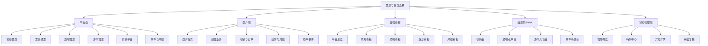

# 前端后台开发设计：平台端、商户端、运营看板

> 版本：V0.x ｜ 最后更新：2026-06-20 ｜ 覆盖迁移基线：见各小节迁移号（最新 V124）｜ 状态：现行
> 新功能承接见 docs/v099-v124-feature-implementation-and-acceptance-spec-v0.1.md
> <!-- 文档goalP3(2026-06-20)：补版本/日期/覆盖迁移头，未改正文 -->

> **⚠️ R5 业务HTML缺口审计修正标注（2026-06-18，只读审计后回填，未改代码）**
> 以业务说明地图（治理 #permission、business #analytics）为基准核验 `apps/web`：
> - **权限 DENY 优先语义缺失**：后端 `AuthorizationService` 已实现 DENY 优先四源计算（D11），但前端 `PermissionGate.tsx` 无 DENY 语义，与后端口径漂移；前端无拉取后端 effective-permissions 的渲染机制。
> - **总览看板 KPI 全渲染 0**：前端 `OverviewPage.tsx`/`types.ts` 期望字段（barOrders/issuedTickets/verifications…）与后端 `DashboardSnapshotRecord`（revenueAmountCents/orderCount/riskAlertCount…）**字段名零交集**，6 个 KPI 卡片全走 `?? 0`（legacy-console 同 bug）。
> - **准入页伪闭环**：`AdmissionAuditsPage` 仅聚合 merchants/bindings/contracts 列表，不读任何 admission 审计/阻断/放行证据（后端准入卡控本身未触发，见治理规格 R5）。
> - **业务裁决（2026-06-18）**：前端按后端 effective-permissions 渲染（新增拉取接口），与后端 DENY 优先口径一致，本期 P0；不采用"仅前端粗隐藏"。
> - **候选验收口径**：前后端 KPI DTO 字段对齐且有值；前端权限渲染与后端 DENY 优先一致。

本文档是【前端后台：平台端、商户端、运营看板】专项开发设计文档，用于指导 `apps/web` 后续编码。

参考文档：

- `docs/system-development-spec.md`
- `docs/project-progress-dashboard.md`
- `docs/system-breakdown.md`
- `docs/foundation-systems-breakdown.md`
- `docs/system-development-spec.md`（正式技术栈入口）
- `docs/openapi/openapi-p0.yaml`、`docs/openapi/openapi-p0.json`
- `docs/p0-openapi-operation-acceptance-matrix-v0.1.md`
- `docs/code-contract-difference-and-migration-audit-v0.1.md`
- `docs/ticketing-pass-entitlement-development-design.md`
- `docs/business-systems-breakdown.md`
- `apps/web`

## 1. 文档定位

### 1.1 目标

前端后台需要支撑综合体平台方、第三方商户、运营管理人员、风控人员、财务人员和现场管理人员完成日常管理、查询、配置、审计和看板分析。

第一阶段不追求所有复杂业务一次做完，而是先打通：

1. 平台端能管理商户、组织、账号、权限、开放应用和事件中心。
2. 商户端能查看本商户数据，并完成票务核销、酒吧基础经营、游乐基础运营。
3. 运营看板能查看全局经营、票务、酒吧、游乐、风控关键指标。
4. 所有页面遵守多商户数据隔离、权限菜单控制、敏感操作留痕。

### 1.2 范围

| 范围 | 是否包含 | 说明 |
|---|---|---|
| 平台管理后台 | 包含 | 平台员工使用，拥有全局或指定数据范围 |
| 商户后台 | 包含 | 酒吧、游乐、餐饮、零售、服务商使用 |
| 运营看板 | 包含 | 管理层、运营、风控、财务查看指标 |
| 移动管理端 | 包含 | 管理层/运营主管的管理概览、待办、异常详情、审批复核（见 §3.6、§5.1）；移动审批对齐 P0 |
| 触摸屏 Web/PWA | 包含设计 | 适配安卓平板、一体机触摸屏的轻量页面 |
| 手机员工 App | 不包含实现 | 由 Android 专项负责，前端只设计 Web/PWA 适配边界 |
| 客人 App/小程序（客人端） | 不在本文范围 | 由《客人购票 App/小程序开发设计》`customer-app-miniapp-development-design-v0.1.md` 承载，覆盖购票/预定/订台+定金/我的票权益/防伪二维码刷新/会员积分摘要的页面与 API 映射；积分兑换扣库存作为底层规则保留，客人端兑换页面/API 进入 P1 |
| 后端接口实现 | 不包含 | 本文只做页面与 API 映射，接口由 Java 后端实现 |
| 复杂营销会员 | 暂缓 | P1/P2 再进入详细页面设计 |

> 修订说明（2026-06-07）：① 补"客人 App/小程序"边界声明——本文（指导 `apps/web` 编码）只覆盖管理后台/商户端/看板，原文完全缺客人端落点，产品需求悬空（finding webmobile-3）；客人端改由新建《客人购票 App/小程序开发设计》承载。② 补"移动管理端"为包含范围，并在 §3.6 增路由组、§5.1 列入 P0，移动审批对齐 P0（finding webmobile-4）。

### 1.3 技术基线

管理后台采用 React + Vite + Ant Design 方案。后续继续沿用：

| 层级 | 方案 |
|---|---|
| 前端框架 | React |
| 构建工具 | Vite |
| UI 组件 | Ant Design |
| 图标 | `@ant-design/icons`，后续可补充 lucide 图标 |
| 后端接口 | Java 21 + Spring Boot 4.x REST API |
| 接口文档 | OpenAPI |
| 权限 | 后端返回菜单、权限点、数据范围，前端负责展示控制和交互约束 |

## 2. 总体信息架构

前端按“一个应用，多工作台”设计。用户登录后，根据账号身份、角色和数据范围进入不同工作台。



### 2.1 平台端

平台端用于平台管理员、运营、财务、风控、技术人员。主要能力：

- 商户、门店、项目、区域、点位管理。
- 账号、角色、岗位、班次、设备绑定管理。
- 票务产品、通票权益、核销规则、渠道配置。
- 酒吧和游乐基础运营配置。
- 开放应用、API 目录、动态鉴权、调用审计。
- 事件中心、人工补录、风控预警。
- 平台级经营看板。

### 2.2 商户端

商户端用于酒吧公司、游乐公司、餐饮商户、零售商户、机器人/监控服务商。主要能力：

- 查看本商户基础资料、门店、项目、合同摘要。
- 管理本商户员工、岗位和有限权限。
- 查看本商户票务权益、核销记录、订单、结算。
- 酒吧商户管理桌台、点单、商品、存酒、库存。
- 游乐商户管理项目开放、场次、容量、核销、巡检。
- 第三方服务商查看开放应用、调用日志、Webhook 事件。
- 查询本商户范围内事件和风险。

### 2.3 运营看板

运营看板用于老板、平台主管、运营、财务、风控。主要能力：

- 平台总览：销售额、客流、核销率、退款率、风险数。
- 票务看板：票种销量、渠道贡献、权益使用率。
- 酒吧看板：入场、桌台、低消、点单、存酒、库存风险。
- 游乐看板：项目热度、容量、核销量、设备状态、巡检异常。
- 开放平台看板：第三方调用量、失败率、锁定数。
- 风控看板：风险趋势、商户风险、员工风险、设备风险。

### 2.4 触摸屏 Web/PWA

触摸屏 Web/PWA 面向安卓平板、小一体机和临时工作台。它不是替代 Android App，而是承接以下轻量场景：

- 固定点位核销台。
- 酒吧吧台快速点单/出品台。
- 游乐项目入场核销台。
- 事件补录和异常上报台。
- 只展示当前点位、当前班次、当前员工可操作内容。

## 3. 路由表

路由按工作台分组，统一使用 `/:workspace/...` 结构。`workspace` 可为 `platform`、`merchant`、`dashboard`、`kiosk`、`mobile-admin`。

### 3.1 公共路由

| 路由 | 页面 | 权限 | 优先级 |
|---|---|---|---|
| `/login` | 登录 | public | P0 |
| `/select-workspace` | 工作台选择 | auth.session | P0 |
| `/403` | 无权限 | public | P0 |
| `/404` | 页面不存在 | public | P0 |
| `/profile` | 个人信息 | auth.profile.view | P1 |
| `/profile/security` | 密码与安全 | auth.profile.security | P1 |

### 3.2 平台端路由

| 路由 | 页面 | 主要功能 | 权限点 | 优先级 |
|---|---|---|---|---|
| `/platform` | 平台控制台 | P0 指标、待办、风险摘要 | platform.dashboard.view | P0 |
| `/platform/merchants` | 商户列表 | 查询、新增、停用、风险标签 | merchant.view | P0 |
| `/platform/merchants/new` | 新建商户 | 创建主体、类型、联系人 | merchant.create | P0 |
| `/platform/merchants/:id` | 商户详情 | 档案、资质、联系人、结算、合同 | merchant.detail.view | P0 |
| `/platform/venues` | 门店/项目列表 | 酒吧门店、游乐项目、餐饮零售点位 | venue.view | P0 |
| `/platform/areas` | 区域与点位 | 楼层、区域、吧台、卡座、闸机、摄像头 | area.view | P0 |
| `/platform/contracts` | 合同基础信息 | 合同、合作模式、结算周期 | contract.view | P1 |
| `/platform/accounts/users` | 员工账号 | 平台/商户员工、状态、企业微信绑定 | user.view | P0 |
| `/platform/accounts/roles` | 角色权限 | 角色、菜单、按钮权限 | role.view | P0 |
| `/platform/accounts/permission-templates` | 权限模板 | 基础模板、临时模板、复制模板、单次有效、撤销和审计 | access.permission_template.view | P0 |
| `/platform/accounts/data-scopes` | 数据权限 | 商户、门店、区域、项目范围 | data_scope.view | P0 |
| `/platform/accounts/shifts` | 岗位班次 | 岗位、班次、当班权限 | shift.view | P1 |
| `/platform/devices` | 企业设备 | 管理手机、平板、扫码设备、领用归还 | device.view | P1 |
| `/platform/ticketing/products` | 票种/通票 | 票种、通票、发布、暂停 | ticket.product.view | P0 |
| `/platform/ticketing/entitlements` | 权益模板 | 入场、酒水、游乐、餐饮券、零售券 | ticket.entitlement.view | P0 |
| `/platform/ticketing/rules` | 核销规则 | 有效期、次数、商户、设备、点位限制 | ticket.rule.view | P0 |
| `/platform/ticketing/channels` | 销售渠道 | 自营、窗口、第三方平台映射 | ticket.channel.view | P1 |
| `/platform/ticketing/issued` | 已出票/权益实例 | 查询票码、权益状态、归属商户 | ticket.issued.view | P0 |
| `/platform/ticketing/verifications` | 核销记录 | 成功、失败、撤销、设备、员工 | verification.view | P0 |
| `/platform/bar/venues` | 酒吧门店 | 酒吧档案、容量、营业状态 | bar.venue.view | P0 |
| `/platform/bar/tables` | 桌台卡座 | 桌台档案、状态、低消 | bar.table.view | P0 |
| `/platform/bar/products` | 酒水/简餐商品 | 商品、分类、售价、可售状态 | bar.product.view | P0 |
| `/platform/bar/orders` | 酒吧订单 | 点单、账单、支付、取消原因 | bar.order.view | P0 |
| `/platform/bar/saved-bottles` | 存酒管理 | 存酒、取酒、剩余量、到期 | bar.saved_bottle.view | P1 |
| `/platform/bar/inventory` | 酒水库存 | 入库、出库、调拨、盘点、报损 | bar.inventory.view | P1 |
| `/platform/amusement/projects` | 游乐项目 | 项目档案、容量、限制条件、状态 | amusement.session.view | P0 |
| `/platform/amusement/sessions` | 开放时间/场次 | 日历、场次、临时关闭、容量 | amusement.session.view | P0 |
| `/platform/amusement/verifications` | 游乐核销 | 项目核销、失败、人工放行 | amusement.verification.view | P0 |
| `/platform/amusement/safety-checks` | 安全巡检 | 巡检模板、开放前检查、整改复检、恢复审批 | amusement.safety_template.view / amusement.safety_inspection.view | P0 |
| `/platform/open/apps` | 开放应用 | 应用、密钥、权限、状态、锁定 | open_app.view | P0 |
| `/platform/open/api-resources` | API 目录 | API 分组、版本、状态、权限点 | api_resource.view | P0 |
| `/platform/open/docs` | 接口文档中心 | 鉴权说明、错误码、示例 | api_doc.view | P0 |
| `/platform/open/supplier-adapters` | 供应商适配器 | 能力、mock、字段映射占位、Webhook/轮询、生产就绪状态 | integration.adapter.view | P0 |
| `/platform/open/auth-logs` | 鉴权日志 | 成功、失败、锁定、解锁 | open_auth_log.view | P0 |
| `/platform/open/call-logs` | API 调用日志 | 调用方、接口、结果、耗时、IP | api_call_log.view | P0 |
| `/platform/open/unlocks` | 人工解锁 | 锁定复核、手动解锁 | open_app.unlock | P0 |
| `/platform/events` | 事件查询 | 按商户、员工、设备、订单、时间查询 | event.view | P0 |
| `/platform/events/:id` | 事件详情 | 标准字段、原始 payload、关联对象 | event.detail.view | P0 |
| `/platform/events/timelines/:type/:id` | 对象时间线 | 订单、员工、客户、商户、开放应用时间线 | event.timeline.view | P0 |
| `/platform/manual-records` | 人工补录 | 补录、附件、审批状态 | manual_record.view | P1 |
| `/platform/risks/alerts` | 风险预警 | 风险列表、处置、归档 | risk.alert.view | P1 |
| `/platform/risks/rules` | 风控规则 | 基础规则、等级、启停 | risk.rule.view | P2 |

### 3.3 商户端路由

| 路由 | 页面 | 主要功能 | 权限点 | 优先级 |
|---|---|---|---|---|
| `/merchant` | 商户首页 | 本商户今日经营、核销、风险 | merchant.dashboard.view | P0 |
| `/merchant/profile` | 商户资料 | 档案、联系人、资质、合同摘要 | merchant.profile.view | P0 |
| `/merchant/staff` | 商户员工 | 本商户员工、岗位、状态 | merchant.staff.view | P0 |
| `/merchant/ticketing/entitlements` | 本商户权益 | 可核销权益、库存、规则 | merchant.entitlement.view | P0 |
| `/merchant/ticketing/verifications` | 本商户核销 | 核销查询、失败、撤销申请 | merchant.verification.view | P0 |
| `/merchant/settlements/items` | 结算明细 | 按权益、订单、核销查看 | merchant.settlement.view | P0 |
| `/merchant/settlements/bills` | 结算单 | 确认、争议、下载 | merchant.settlement_bill.view | P0 |
| `/merchant/bar/tables` | 酒吧桌台 | 开台、清台、桌态查询 | merchant.bar.table.view | P0 |
| `/merchant/bar/orders` | 酒吧点单 | 桌台点单、吧台点单、账单 | merchant.bar.order.view | P0 |
| `/merchant/bar/products` | 酒吧商品 | 酒水/简餐商品维护 | merchant.bar.product.view | P0 |
| `/merchant/bar/saved-bottles` | 存酒 | 登记、取用、到期 | merchant.bar.saved_bottle.view | P1 |
| `/merchant/bar/inventory` | 库存库房 | 入库、出库、调拨、盘点 | merchant.bar.inventory.view | P1 |
| `/merchant/amusement/projects` | 游乐项目 | 项目档案、状态、容量 | amusement.session.view | P0 |
| `/merchant/amusement/sessions` | 场次容量 | 开放计划、场次、临时关闭 | amusement.session.view | P0 |
| `/merchant/amusement/verifications` | 项目核销 | 核销记录、失败、人工放行申请 | amusement.verification.view | P0 |
| `/merchant/amusement/safety-checks` | 安全巡检 | 巡检提交、整改复检、恢复审批状态 | amusement.safety_inspection.view | P0 |
| `/merchant/open/apps` | 商户开放应用 | 应用状态、接口权限、回调地址 | merchant.open_app.view | P1 |
| `/merchant/open/call-logs` | 商户调用日志 | 本商户第三方调用记录 | merchant.api_call_log.view | P1 |
| `/merchant/events` | 商户事件 | 本商户事件查询和时间线 | merchant.event.view | P0 |
| `/merchant/manual-records` | 商户补录 | 本商户人工补录和审批 | merchant.manual_record.view | P1 |
| `/merchant/risks` | 商户风险 | 本商户风险预警和处置 | merchant.risk.view | P1 |

### 3.4 运营看板路由

| 路由 | 页面 | 主要指标 | 权限点 | 优先级 |
|---|---|---|---|---|
| `/dashboard/platform` | 平台总览 | 销售额、客流、核销率、退款率、风险 | analytics.platform.view | P0 |
| `/dashboard/ticketing` | 票务看板 | 票种销量、渠道、权益使用率 | analytics.ticketing.view | P0 |
| `/dashboard/bar` | 酒吧看板 | 入场、桌台、低消、点单、存酒 | analytics.bar.view | P1 |
| `/dashboard/amusement` | 游乐看板 | 项目热度、容量、核销、设备状态 | analytics.amusement.view | P1 |
| `/dashboard/open-platform` | 开放平台看板 | 调用量、成功率、失败、锁定 | analytics.open_platform.view | P1 |
| `/dashboard/risk` | 风控看板 | 风险趋势、商户、员工、设备 | analytics.risk.view | P1 |
| `/dashboard/finance` | 财务看板 | 收入、退款、结算、差异 | analytics.finance.view | P2 |

### 3.5 触摸屏/PWA 路由

| 路由 | 页面 | 主要功能 | 权限点 | 优先级 |
|---|---|---|---|---|
| `/kiosk/login` | 点位登录 | 员工、设备、点位绑定 | kiosk.login | P1 |
| `/kiosk/verification` | 核销台 | 扫码/NFC 核销预览和确认 | kiosk.verification.use | P1 |
| `/kiosk/bar-order` | 酒吧点单台 | 吧台快速点单、出品状态 | kiosk.bar_order.use | P1 |
| `/kiosk/amusement-entry` | 游乐入场台 | 项目核销、容量提示、失败原因 | kiosk.amusement_entry.use | P1 |
| `/kiosk/manual-record` | 异常补录台 | 现场异常、附件、签名、提交 | kiosk.manual_record.create | P2 |

### 3.6 移动管理端路由

> 修订说明（2026-06-07）：终端展示层把"移动管理端"定义为独立终端且移动审批为 P0 诉求（`terminal-page-product-prd §7`、`flow-diagrams F6`、`field-dictionary §8`），但本文此前既无路由组又把审批降级到 P1 人工补录，产品层与实现层不一致（finding webmobile-4）。此处增设 `mobile-admin` 工作台路由组并把异常/复核的移动审批对齐 P0，对应 D5 终端 `mobile_admin`。移动管理端承载**管理类**待办审批，不承接现场作业类审批；私人手机 App 不承载审批/复核（见各终端 PRD）。

`workspace` 增加 `mobile-admin`。移动管理端为响应式工作台，复用平台端的事件、补录、风险数据与 API，只做"看指标、看待办、看异常、做审批/复核"，不做复杂配置。

| 路由 | 页面 | 主要功能 | 权限点 | 优先级 |
|---|---|---|---|---|
| `/mobile-admin` | 管理概览 | 今日收入、客流、核销、异常关键指标 | mobile_admin.dashboard.view | P0 |
| `/mobile-admin/todos` | 待办中心 | 复核、差异、异常、补录待办聚合 | mobile_admin.todo.view | P0 |
| `/mobile-admin/exceptions/:id` | 异常详情 | 事实、责任人、证据、处理动作 | mobile_admin.exception.view | P0 |
| `/mobile-admin/reviews/:id` | 审批复核 | 通过、驳回、要求补充并填写意见 | mobile_admin.review.handle | P0 |
| `/mobile-admin/business-overview` | 业务概览 | 票务、酒吧、游乐关键状态 | mobile_admin.business.view | P1 |

## 4. 权限菜单设计

### 4.1 权限模型

前端权限由后端登录态返回，前端只做展示和交互控制，最终安全校验必须由后端完成。

```text
用户账号
  -> 角色权限：能看哪些菜单、能点哪些按钮
  -> 数据范围：能看哪些商户、门店、项目、区域
  -> 岗位班次：当前是否当班，是否在允许设备/点位操作
  -> 敏感操作：是否需要二次确认或审批
```

### 4.2 角色菜单矩阵

| 角色 | 默认工作台 | 核心菜单 | 数据范围 |
|---|---|---|---|
| 平台超级管理员 | 平台端 | 全部菜单 | 全平台 |
| 平台运营经理 | 平台端 | 商户、票务、酒吧、游乐、事件、看板 | 指定或全平台 |
| 运营主管（移动管理端） | 移动管理端 | 管理概览、待办中心、异常详情、审批复核（移动审批 P0） | 指定数据范围（修订 2026-06-07，webmobile-4） |
| 平台财务 | 平台端/看板 | 订单、退款、结算、财务看板、事件 | 财务授权范围 |
| 平台风控 | 平台端/看板 | 事件中心、风险预警、视频/聊天证据、风控看板 | 风控授权范围 |
| 平台技术 | 平台端 | 开放应用、API 目录、鉴权日志、调用日志 | 技术授权范围 |
| 商户管理员 | 商户端 | 商户首页、员工、本商户业务、结算、事件 | 本商户 |
| 酒吧店长 | 商户端 | 桌台、点单、商品、存酒、库存、酒吧看板 | 本酒吧门店 |
| 吧台员工 | 商户端/PWA | 点单、出品、吧台库存查询 | 当班吧台点位 |
| 库管 | 商户端 | 入库、出库、调拨、盘点、报损 | 本库房/门店 |
| 游乐主管 | 商户端 | 项目、场次、核销、安全巡检、事故 | 本游乐项目 |
| 核销员 | PWA/商户端 | 核销台、核销记录 | 当班设备和点位 |
| 第三方技术人员 | 商户端 | 开放应用、调用日志、Webhook 状态 | 绑定应用和商户 |

### 4.3 菜单分组

平台端一级菜单：

1. 控制台
2. 商户组织
3. 账号权限
4. 企业设备
5. 票务通票
6. 酒吧经营
7. 游乐运营
8. 开放平台
9. 事件中心
10. 人工补录
11. 风控预警
12. 运营看板

商户端一级菜单：

1. 商户首页
2. 商户资料
3. 员工管理
4. 票务核销
5. 结算对账
6. 酒吧经营
7. 游乐运营
8. 开放接入
9. 商户事件
10. 商户风险

### 4.4 按钮权限

| 操作类型 | 示例权限点 | 前端行为 |
|---|---|---|
| 新增 | `merchant.create` | 显示新增按钮 |
| 编辑 | `merchant.update` | 允许进入编辑态 |
| 停用/启用 | `merchant.status.update` | 显示状态操作，需二次确认 |
| 发布 | `ticket.product.publish` | 发布票种，需展示影响范围 |
| 核销撤销 | `verification.reverse` | 需填写原因，可能进入审批 |
| 人工放行 | `verification.manual_override` | 需原因、证据、事件留痕 |
| 解锁 | `open_app.unlock` | 需复核日志，二次确认 |
| 导出 | `event.export` | 导出按钮受控，导出写事件 |
| 查看敏感 | `evidence.video.view` | 打开前二次确认，查看写事件 |

## 5. 页面清单与功能拆分

### 5.1 P0 页面

P0 目标：支撑“可运营、可核销、可留痕、可部署”的最小闭环。

| 页面 | 工作台 | 主要能力 |
|---|---|---|
| 登录 | 公共 | 账号密码登录、获取菜单权限 |
| 工作台选择 | 公共 | 平台端/商户端/看板切换 |
| 平台控制台 | 平台端 | P0 指标、风险摘要、待办 |
| 商户列表/详情 | 平台端 | 创建酒吧商户、游乐商户、服务商 |
| 门店/项目列表 | 平台端 | 创建酒吧门店、游乐项目、餐饮零售点位 |
| 区域与点位 | 平台端 | 管理吧台、卡座、闸机、摄像头、机器人点位 |
| 员工账号 | 平台端 | 创建平台/商户员工、状态管理 |
| 角色权限 | 平台端 | 菜单、按钮、角色权限 |
| 权限模板 | 平台端 | 基础模板、临时模板、复制模板、有效期、单次有效、撤销 |
| 数据权限 | 平台端 | 分配商户、门店、区域范围 |
| 票种/通票 | 平台端 | 创建、编辑、发布、暂停票务产品 |
| 权益模板 | 平台端 | 配置酒吧入场、游乐次数、餐饮券等权益 |
| 核销规则 | 平台端 | 设备、点位、商户、次数和有效期规则 |
| 已出票/权益实例 | 平台端 | 查询票、权益状态、归属商户 |
| 核销记录 | 平台端/商户端 | 成功、失败、撤销、员工、设备 |
| 酒吧门店 | 平台端 | 酒吧档案、容量、营业状态 |
| 桌台卡座 | 平台端/商户端 | 桌台档案、桌态、低消 |
| 酒水/简餐商品 | 平台端/商户端 | 商品、分类、售价、可售状态 |
| 酒吧订单 | 平台端/商户端 | 桌台点单、吧台点单、账单 |
| 游乐项目 | 平台端/商户端 | 项目档案、容量、状态、限制条件 |
| 游乐场次 | 平台端/商户端 | 开放日历、场次、容量 |
| 游乐核销 | 平台端/商户端 | 项目核销查询、失败、人工放行 |
| 开放应用 | 平台端 | 创建应用、授权、状态、锁定 |
| API 目录 | 平台端 | API 分组、版本、权限点 |
| 接口文档中心 | 平台端 | 鉴权说明、错误码、示例 |
| 供应商适配器 | 平台端 | 供应商能力、mock adapter、字段映射占位、Webhook/轮询、生产就绪 |
| 鉴权日志 | 平台端 | 成功、失败、连续三次锁定 |
| API 调用日志 | 平台端 | 调用记录、IP、结果、耗时 |
| 人工解锁 | 平台端 | 锁定复核和手动解锁 |
| 事件查询/详情 | 平台端/商户端 | 标准事件、原始 payload、关联对象 |
| 对象时间线 | 平台端/商户端 | 订单、员工、商户、开放应用全过程 |
| 商户首页 | 商户端 | 本商户今日核销、订单、结算、风险 |
| 结算明细/结算单 | 商户端 | 查看、确认、争议 |
| 平台总览看板 | 运营看板 | 销售、客流、核销、风险 |
| 票务看板 | 运营看板 | 票种、渠道、权益使用率 |
| 管理概览 | 移动管理端 | 今日收入、客流、核销、异常关键指标 |
| 待办中心 | 移动管理端 | 复核、差异、异常、补录待办聚合 |
| 异常详情 | 移动管理端 | 事实、责任人、证据、处理动作 |
| 审批复核 | 移动管理端 | 通过、驳回、要求补充并填写意见（移动审批 P0） |

### 5.2 P1 页面

| 页面 | 工作台 | 主要能力 |
|---|---|---|
| 合同基础信息 | 平台端 | 合同、合作模式、结算周期 |
| 岗位班次 | 平台端 | 排班、岗位、当班权限 |
| 企业设备 | 平台端 | 管理手机、平板、领用归还 |
| 销售渠道 | 平台端 | 第三方售票平台映射 |
| 存酒管理 | 平台端/商户端 | 存酒、取酒、转赠、作废 |
| 酒水库存 | 平台端/商户端 | 入库、出库、调拨、盘点、报损 |
| 安全巡检 | 平台端/商户端 | 巡检模板、提交、整改复检、恢复审批；故障/事故工单进入 P1 |
| 人工补录 | 平台端/商户端 | 补录、附件、审批 |
| 风险预警 | 平台端/商户端 | 风险处置、复核、归档 |
| 商户开放应用 | 商户端 | 查看本商户应用、调用日志 |
| 酒吧看板 | 运营看板 | 入场、低消、桌台、点单、库存 |
| 游乐看板 | 运营看板 | 项目热度、容量、核销、设备 |
| 开放平台看板 | 运营看板 | 调用量、成功率、失败率 |
| 风控看板 | 运营看板 | 风险趋势、商户、员工、设备 |
| 核销台 PWA | 触摸屏 | 固定点位扫码核销 |
| 酒吧点单台 PWA | 触摸屏 | 吧台快速点单 |
| 游乐入场台 PWA | 触摸屏 | 游乐核销和容量提示 |

### 5.3 P2 页面

| 页面 | 工作台 | 主要能力 |
|---|---|---|
| 风控规则 | 平台端 | 规则启停、等级、阈值 |
| 财务看板 | 运营看板 | 收入、退款、结算、差异 |
| BOM 配方 | 平台端/商户端 | 自动扣料、成本核算 |
| 机器人任务 | 平台端/商户端 | 任务、状态、签收、异常 |
| 视频证据中心 | 平台端 | 摄像头、视频索引、调阅审计 |
| 企业微信质检 | 平台端 | 会话同步、敏感词、客户需求 |
| 餐饮/零售对接 | 平台端 | 订单同步、券核销、对账 |
| 异常补录台 PWA | 触摸屏 | 异常上报、附件、签名 |

## 6. 组件结构设计

### 6.1 前端目录建议

后续编码建议将 `apps/web/src` 调整为以下结构：

```text
apps/web/src
├── app                 应用入口、路由、全局 Provider
├── layouts             平台端、商户端、看板、PWA 布局
├── routes              路由配置和权限包装
├── features
│   ├── auth            登录、会话、工作台选择
│   ├── dashboard       运营看板
│   ├── merchants       商户组织
│   ├── accounts        账号权限
│   ├── devices         企业设备
│   ├── ticketing       票务通票
│   ├── bar             酒吧经营
│   ├── amusement       游乐运营
│   ├── open-platform   开放平台与鉴权
│   ├── events          事件中心
│   ├── manual-records  人工补录
│   ├── risks           风控预警
│   └── mobile-admin    移动管理端（概览/待办/异常/审批，复用事件/补录/风险数据）
├── shared
│   ├── api             请求封装、错误处理、OpenAPI 类型适配
│   ├── auth            权限判断、菜单过滤、数据范围工具
│   ├── components      通用组件
│   ├── constants       枚举、状态、字典
│   ├── hooks           通用 hooks
│   ├── types           前端共享类型
│   └── utils           格式化、时间、脱敏
└── styles              全局样式和主题变量
```

### 6.2 通用布局组件

| 组件 | 作用 |
|---|---|
| `AppShell` | 全局外壳，挂载权限、菜单、主题 |
| `PlatformLayout` | 平台端侧栏、顶栏、面包屑 |
| `MerchantLayout` | 商户端侧栏、商户身份切换、门店筛选 |
| `DashboardLayout` | 看板全屏布局、时间筛选、自动刷新 |
| `MobileAdminLayout` | 移动管理端响应式布局：概览、待办、异常、审批四大入口，单手操作（修订 2026-06-07，承载 webmobile-4 移动管理端工作台） |
| `KioskLayout` | 触摸屏布局，大按钮、大字体、点位状态 |
| `PermissionGate` | 按权限点控制按钮/区域显示 |
| `DataScopeBanner` | 显示当前数据范围，如商户/门店/项目 |
| `SensitiveActionConfirm` | 敏感操作二次确认 |

### 6.3 通用业务组件

| 组件 | 适用页面 | 能力 |
|---|---|---|
| `SearchFilterBar` | 列表页 | 时间、商户、门店、状态、关键字筛选 |
| `DataTable` | 列表页 | 表格、分页、列显隐、批量操作 |
| `StatusTag` | 全部 | 状态颜色、风险等级、业务状态 |
| `MerchantSelector` | 平台页 | 选择商户、门店、项目 |
| `AreaPointSelector` | 点位相关 | 区域、点位、设备选择 |
| `AuditTimeline` | 事件/详情 | 时间线展示事件链 |
| `EvidencePanel` | 事件/风控/补录 | 图片、附件、视频索引、原始 payload |
| `PayloadViewer` | 事件/API 调用 | JSON 原始数据折叠查看 |
| `ApprovalPanel` | 补录/退款/解锁 | 审批记录、意见、结果 |
| `RiskBadge` | 风控相关 | 风险等级、命中规则 |
| `MetricCard` | 看板 | 指标数字、趋势、说明 |
| `TrendChart` | 看板 | 时间趋势 |
| `BreakdownChart` | 看板 | 渠道、商户、项目拆分 |
| `QrCodePanel` | 票务/核销 | 二维码展示、刷新、状态 |
| `VerificationPreview` | 核销 | 核销前预览权益、客户、风险 |
| `TableStatusBoard` | 酒吧 | 桌台状态网格 |
| `SessionCapacityBoard` | 游乐 | 场次容量和剩余名额 |

### 6.4 页面类型模板

| 页面类型 | 标准结构 |
|---|---|
| 列表页 | 标题、权限按钮、筛选区、表格、分页、批量操作 |
| 详情页 | 基础信息、状态、关联对象、事件时间线、操作区 |
| 表单页 | 分组表单、字段校验、保存草稿、提交审批 |
| 审批页 | 待审批内容、证据、历史、同意/驳回/转交 |
| 看板页 | 时间范围、数据范围、指标卡、趋势图、排行表 |
| 触摸屏页 | 当前员工/设备/点位、主操作区、异常按钮、同步状态 |

## 7. 页面能力与正式 OpenAPI 补契约清单（非正式 API 路径）

接口路径以 Java 后端最终 OpenAPI 和 OpenAPI 追溯附录为准。本文先定义前端依赖关系；正式开发时 `apps/web` 现有旧 API client 必须按 `code-contract-difference-and-migration-audit-v0.1.md` 迁移，不得用旧路径反向要求后端兼容。

> 执行口径：本章历史表格中的 `/api/admin/*`、`/api/auth/*`、`/api/me/*`、`/api/integration/*` 仅表示后台页面需要的能力，不是可直接开发的接口路径。P0 编码、联调和自动化测试必须以 `docs/openapi/openapi-p0.yaml`、`docs/openapi/openapi-p0.json` 中的 `/api/v1/{domain}`、`/api/open/d/{endpoint_key}` 为准，并按 `p0-openapi-operation-acceptance-matrix-v0.1.md` 和 `p0-openapi-contract-closure-appendix-v0.1.md` 校验字段、权限、认证上下文、终端、幂等、事件、任务簇和样例准入；缺少的 BFF/聚合接口必须先补 OpenAPI，再进入开发。

> 强制执行规则：下表旧 `/api/admin/*` 只能作为页面能力拆解和迁移参考，不得生成正式 API client、mock server、接口自动化用例或后端 Controller。后台页面若需要聚合接口，必须先补入 `docs/openapi/openapi-p0.yaml/json`，进入 operation 验收矩阵和 OpenAPI 追溯附录，并通过 `npm run verify:openapi-closure`。
>
> 表格中的 `P0/P1/P2` 只表示页面能力阶段，不表示该历史路径已经冻结、可联调或可验收。开发任务必须回到 `p0-task-api-permission-event-acceptance-map-v0.1.md` 绑定正式 OpenAPI operation 后才能开工。

### 7.1 公共与权限

| 页面 | 历史能力路径 | 用途 | 能力阶段（非正式接口路径） |
|---|---|---|---|
| 登录 | `POST /api/auth/login` | 登录并获取 token | P0 |
| 登录 | `POST /api/auth/logout` | 退出 | P0 |
| 登录 | `POST /api/auth/refresh` | 刷新会话 | P0 |
| 工作台选择 | `GET /api/me` | 当前用户、角色、数据范围 | P0 |
| 工作台选择 | `GET /api/me/workspaces` | 可进入工作台 | P0 |
| 全局菜单 | `GET /api/me/menus` | 菜单树和权限点 | P0 |
| 全局权限 | `GET /api/me/permissions` | 按钮权限、敏感操作权限 | P0 |

### 7.2 商户组织

| 页面 | 历史能力路径 | 用途 | 能力阶段（非正式接口路径） |
|---|---|---|---|
| 商户列表 | `GET /api/admin/merchants` | 查询商户 | P0 |
| 新建商户 | `POST /api/admin/merchants` | 创建商户 | P0 |
| 商户详情 | `GET /api/admin/merchants/{id}` | 商户详情 | P0 |
| 商户详情 | `PUT /api/admin/merchants/{id}` | 修改商户 | P0 |
| 商户详情 | `PATCH /api/admin/merchants/{id}/status` | 停用、恢复、冻结 | P0 |
| 商户详情 | `GET /api/admin/merchants/{id}/credentials` | 资质列表 | P1 |
| 商户详情 | `POST /api/admin/merchants/{id}/credentials` | 上传资质记录 | P1 |
| 门店/项目列表 | `GET /api/admin/venues` | 查询门店、场地、项目 | P0 |
| 门店/项目列表 | `POST /api/admin/venues` | 创建门店或项目场地 | P0 |
| 区域与点位 | `GET /api/admin/areas` | 区域树 | P0 |
| 区域与点位 | `POST /api/admin/areas` | 创建区域 | P0 |
| 区域与点位 | `GET /api/admin/location-points` | 点位列表 | P0 |
| 区域与点位 | `POST /api/admin/location-points` | 创建点位 | P0 |
| 合同基础信息 | `GET /api/admin/contracts` | 合同列表 | P1 |
| 合同基础信息 | `POST /api/admin/contracts` | 创建合同 | P1 |

### 7.3 账号权限与设备

| 页面 | 历史能力路径 | 用途 | 能力阶段（非正式接口路径） |
|---|---|---|---|
| 员工账号 | `GET /api/admin/users` | 查询账号 | P0 |
| 员工账号 | `POST /api/admin/users` | 创建账号 | P0 |
| 员工账号 | `PATCH /api/admin/users/{id}/status` | 停用、锁定、恢复 | P0 |
| 员工账号 | `PUT /api/admin/users/{id}/wecom-binding` | 绑定企业微信 UserID | P1 |
| 角色权限 | `GET /api/admin/roles` | 角色列表 | P0 |
| 角色权限 | `POST /api/admin/roles` | 创建角色 | P0 |
| 角色权限 | `PUT /api/admin/roles/{id}/permissions` | 保存权限点 | P0 |
| 权限模板 | `GET /api/admin/permission-templates` | 查询权限模板 | P0 |
| 权限模板 | `POST /api/admin/permission-templates` | 创建基础/临时权限模板 | P0 |
| 权限模板 | `PUT /api/admin/permission-templates/{id}` | 更新模板 | P0 |
| 权限模板 | `POST /api/admin/permission-templates/{id}/copy` | 复制模板为新模板 | P0 |
| 权限模板 | `POST /api/admin/permission-templates/{id}/permissions` | 设置模板授权/拒绝和数据范围 | P0 |
| 权限模板 | `POST /api/admin/permission-templates/{id}/apply` | 应用模板到员工/岗位/职级/角色 | P0 |
| 权限模板 | `POST /api/admin/permission-template-applications/{id}/revoke` | 撤销模板应用 | P0 |
| 数据权限 | `GET /api/admin/data-scopes` | 数据范围列表 | P0 |
| 数据权限 | `PUT /api/admin/users/{id}/data-scope` | 分配用户数据范围 | P0 |
| 岗位班次 | `GET /api/admin/positions` | 岗位列表 | P1 |
| 岗位班次 | `GET /api/admin/shifts` | 班次列表 | P1 |
| 企业设备 | `GET /api/admin/devices` | 设备台账 | P1 |
| 企业设备 | `GET /api/admin/device-bindings` | 领用归还记录 | P1 |

### 7.4 票务通票

| 页面 | 历史能力路径 | 用途 | 能力阶段（非正式接口路径） |
|---|---|---|---|
| 票种/通票 | `GET /api/admin/ticket-products` | 查询票务产品 | P0 |
| 票种/通票 | `POST /api/admin/ticket-products` | 创建票务产品 | P0 |
| 票种/通票 | `GET /api/admin/ticket-products/{id}` | 产品详情 | P0 |
| 票种/通票 | `PUT /api/admin/ticket-products/{id}` | 修改产品 | P0 |
| 票种/通票 | `POST /api/admin/ticket-products/{id}/publish` | 发布 | P0 |
| 票种/通票 | `POST /api/admin/ticket-products/{id}/pause` | 暂停 | P0 |
| 票种/通票 | `POST /api/admin/ticket-products/{id}/archive` | 归档 | P1 |
| 权益模板 | `GET /api/admin/entitlement-templates` | 权益模板列表 | P0 |
| 权益模板 | `POST /api/admin/entitlement-templates` | 创建权益模板 | P0 |
| 票种权益配置 | `GET /api/admin/ticket-products/{id}/entitlements` | 产品权益列表 | P0 |
| 票种权益配置 | `PUT /api/admin/ticket-products/{id}/entitlements` | 保存产品权益 | P0 |
| 核销规则 | `GET /api/admin/verification-rules` | 规则列表 | P0 |
| 核销规则 | `POST /api/admin/verification-rules` | 创建核销规则 | P0 |
| 销售渠道 | `GET /api/admin/sales-channels` | 渠道列表 | P1 |
| 销售渠道 | `POST /api/admin/channel-ticket-mappings/import` | 导入渠道映射 | P1 |
| 已出票/权益实例 | `GET /api/admin/issued-entitlements` | 平台查询权益实例 | P0 |
| 核销记录 | `GET /api/admin/verifications` | 平台查询核销 | P0 |
| 商户权益 | `GET /api/merchant/issued-entitlements` | 商户查询本商户权益 | P0 |
| 商户核销 | `GET /api/merchant/verifications` | 商户查询核销 | P0 |
| 核销台 | `POST /api/verifications/preview` | 核销预览 | P0 |
| 核销台 | `POST /api/verifications` | 创建核销 | P0 |
| 核销撤销 | `POST /api/verifications/{id}/reverse` | 撤销核销 | P1 |
| 离线同步 | `POST /api/offline-verification-syncs` | 离线核销同步 | P1 |

### 7.5 商户结算

| 页面 | 历史能力路径 | 用途 | 能力阶段（非正式接口路径） |
|---|---|---|---|
| 结算明细 | `GET /api/merchant/settlement-items` | 商户结算明细 | P0 |
| 结算单 | `GET /api/merchant/settlement-bills` | 商户结算单 | P0 |
| 结算单 | `POST /api/merchant/settlement-bills/{id}/confirm` | 商户确认结算单 | P0 |
| 结算单 | `POST /api/merchant/settlement-bills/{id}/dispute` | 商户发起争议 | P0 |

### 7.6 酒吧经营

| 页面 | 历史能力路径 | 用途 | 能力阶段（非正式接口路径） |
|---|---|---|---|
| 酒吧门店 | `GET /api/admin/bar/venues` | 酒吧门店列表 | P0 |
| 酒吧门店 | `POST /api/admin/bar/venues` | 创建酒吧门店 | P0 |
| 桌台卡座 | `GET /api/admin/bar/tables` | 平台查询桌台 | P0 |
| 桌台卡座 | `POST /api/admin/bar/tables` | 创建桌台 | P0 |
| 商户桌台 | `GET /api/merchant/bar/tables` | 商户查询桌台 | P0 |
| 商户桌台 | `POST /api/merchant/bar/tables/{id}/open` | 开台 | P0 |
| 商户桌台 | `POST /api/merchant/bar/tables/{id}/clear` | 清台 | P0 |
| 酒吧商品 | `GET /api/merchant/bar/products` | 商品列表 | P0 |
| 酒吧商品 | `POST /api/merchant/bar/products` | 创建商品 | P0 |
| 酒吧订单 | `GET /api/merchant/bar/orders` | 点单列表 | P0 |
| 酒吧订单 | `POST /api/merchant/bar/orders` | 创建点单 | P0 |
| 酒吧订单 | `POST /api/merchant/bar/orders/{id}/submit` | 提交点单 | P0 |
| 酒吧订单 | `POST /api/merchant/bar/orders/{id}/cancel` | 取消点单 | P0 |
| 酒吧账单 | `GET /api/merchant/bar/bills` | 账单查询 | P0 |
| 酒吧账单 | `POST /api/merchant/bar/bills/{id}/pay` | 结账 | P0 |
| 存酒 | `GET /api/merchant/bar/saved-bottles` | 存酒查询 | P1 |
| 存酒 | `POST /api/merchant/bar/saved-bottles` | 存酒登记 | P1 |
| 存酒 | `POST /api/merchant/bar/saved-bottles/{id}/pickup` | 取酒 | P1 |
| 酒水库存 | `GET /api/merchant/bar/inventory` | 库存余额 | P1 |
| 酒水库存 | `POST /api/merchant/bar/stock-movements` | 入库、出库、调拨、盘点、报损 | P1 |

### 7.7 游乐运营

| 页面 | 历史能力路径 | 用途 | 能力阶段（非正式接口路径） |
|---|---|---|---|
| 游乐项目 | `GET /api/admin/amusement/projects` | 平台查询项目 | P0 |
| 游乐项目 | `POST /api/admin/amusement/projects` | 创建项目 | P0 |
| 商户项目 | `GET /api/merchant/amusement/projects` | 商户查询项目 | P0 |
| 商户项目 | `PATCH /api/merchant/amusement/projects/{id}/status` | 状态变更 | P0 |
| 场次容量 | `GET /api/merchant/amusement/sessions` | 场次列表 | P0 |
| 场次容量 | `POST /api/merchant/amusement/sessions` | 创建场次 | P0 |
| 场次容量 | `PATCH /api/merchant/amusement/sessions/{id}/capacity` | 修改容量 | P0 |
| 游乐核销 | `GET /api/merchant/amusement/verifications` | 项目核销记录 | P0 |
| 游乐入场台 | `POST /api/verifications/preview` | 项目核销预览 | P0 |
| 游乐入场台 | `POST /api/verifications` | 项目核销确认 | P0 |
| 安全巡检 | `GET /api/v1/amusement/safety-templates` | 巡检模板 | P0 |
| 安全巡检 | `GET /api/v1/amusement/safety-inspections` | 巡检任务和记录 | P0 |
| 安全巡检 | `POST /api/v1/amusement/safety-inspections/{id}/submit` | 提交巡检 | P0 |
| 安全巡检 | `POST /api/v1/amusement/safety-inspections/{id}/rectify` | 提交整改 | P0 |
| 安全巡检 | `POST /api/v1/amusement/safety-inspections/{id}/recheck` | 提交复检 | P0 |
| 安全巡检 | `POST /api/v1/amusement/safety-inspections/{id}/approve-reopen` | 恢复审批 | P0 |
| 事故异常 | `POST /api/merchant/amusement/incidents` | 上报事故或异常 | P1 |

### 7.8 开放平台与安全鉴权

| 页面 | 历史能力路径 | 用途 | 能力阶段（非正式接口路径） |
|---|---|---|---|
| 开放应用 | `GET /api/admin/open-apps` | 应用列表 | P0 |
| 开放应用 | `POST /api/admin/open-apps` | 创建应用 | P0 |
| 开放应用 | `GET /api/admin/open-apps/{id}` | 应用详情 | P0 |
| 开放应用 | `PUT /api/admin/open-apps/{id}` | 修改应用 | P0 |
| 开放应用 | `PATCH /api/admin/open-apps/{id}/status` | 暂停、启用、禁用 | P0 |
| 开放应用 | `PUT /api/admin/open-apps/{id}/permissions` | 配置接口和数据权限 | P0 |
| 开放应用 | `POST /api/admin/open-apps/{id}/rotate-secret` | 密钥轮换 | P1 |
| API 目录 | `GET /api/admin/api-resources` | API 资源列表 | P0 |
| API 目录 | `POST /api/admin/api-resources` | 创建 API 资源 | P0 |
| API 目录 | `POST /api/admin/api-resources/{id}/publish` | 发布 API | P0 |
| 接口文档中心 | `GET /api/admin/api-documents` | 文档目录 | P0 |
| 接口文档中心 | `GET /api/admin/api-documents/{id}` | 文档详情 | P0 |
| 供应商适配器 | `GET /api/v1/integration/provider-adapters` | 查询适配器配置和生产就绪状态 | P0 |
| 供应商适配器 | `POST /api/v1/integration/provider-adapters` | 创建 mock 或真实供应商适配器占位 | P0 |
| 供应商适配器 | `PUT /api/v1/integration/provider-adapters/{id}` | 更新能力、映射占位、Webhook/轮询和密钥引用 | P0 |
| 供应商适配器 | `POST /api/v1/integration/provider-adapters/{id}/test-mock` | 执行 mock adapter 契约测试 | P0 |
| 供应商适配器 | `POST /api/v1/integration/provider-adapters/{id}/mark-production-ready` | 标记生产就绪 | P0 |
| 鉴权日志 | `GET /api/admin/open-auth/logs` | 鉴权成功/失败日志 | P0 |
| 人工解锁 | `GET /api/admin/open-app-locks` | 锁定记录 | P0 |
| 人工解锁 | `POST /api/admin/open-app-locks/{id}/unlock` | 人工解锁 | P0 |
| API 调用日志 | `GET /api/admin/api-call-logs` | 调用日志查询 | P0 |
| Webhook 订阅 | `GET /api/admin/webhook-subscriptions` | 订阅列表 | P1 |
| Webhook 订阅 | `POST /api/admin/webhook-subscriptions` | 创建订阅 | P1 |

### 7.9 事件中心、人工补录、风控

| 页面 | 历史能力路径 | 用途 | 能力阶段（非正式接口路径） |
|---|---|---|---|
| 事件查询 | `GET /api/admin/events` | 平台事件查询 | P0 |
| 商户事件 | `GET /api/merchant/events` | 商户事件查询 | P0 |
| 事件详情 | `GET /api/admin/events/{id}` | 事件详情 | P0 |
| 对象时间线 | `GET /api/admin/event-timelines` | 对象时间线 | P0 |
| 事件导出 | `POST /api/admin/events/export` | 事件导出，写审计 | P1 |
| 人工补录 | `GET /api/admin/manual-records` | 补录列表 | P1 |
| 人工补录 | `POST /api/admin/manual-records` | 创建补录 | P1 |
| 人工补录 | `POST /api/admin/manual-records/{id}/approve` | 审批通过 | P1 |
| 人工补录 | `POST /api/admin/manual-records/{id}/reject` | 驳回 | P1 |
| 风险预警 | `GET /api/admin/risk-alerts` | 风险列表 | P1 |
| 风险预警 | `POST /api/admin/risk-alerts/{id}/handle` | 风险处置 | P1 |
| 风控规则 | `GET /api/admin/risk-rules` | 规则列表 | P2 |
| 风控规则 | `PUT /api/admin/risk-rules/{id}` | 修改规则 | P2 |

### 7.10 运营看板

| 页面 | 历史能力路径 | 用途 | 能力阶段（非正式接口路径） |
|---|---|---|---|
| 平台总览 | `GET /api/admin/analytics/platform-summary` | 平台指标 | P0 |
| 票务看板 | `GET /api/admin/analytics/ticketing` | 票务指标 | P0 |
| 酒吧看板 | `GET /api/admin/analytics/bar` | 酒吧指标 | P1 |
| 游乐看板 | `GET /api/admin/analytics/amusement` | 游乐指标 | P1 |
| 开放平台看板 | `GET /api/admin/analytics/open-platform` | 调用指标 | P1 |
| 风控看板 | `GET /api/admin/analytics/risk` | 风险指标 | P1 |
| 财务看板 | `GET /api/admin/analytics/finance` | 财务指标 | P2 |

#### 7.10.1 总览看板 KPI 字段对齐修复规格（F9）

> 修正(2026-06-19 R5业务HTML缺口审计 F8/F9/F10)：依据本文首部审计标注（§"总览看板 KPI 全渲染 0"）——前端 `OverviewPage.tsx`/`types.ts` 期望字段（`barOrders`/`issuedTickets`/`verifications`…）与后端 `DashboardSnapshotRecord`（`revenueAmountCents`/`orderCount`/`riskAlertCount`…）**字段名零交集**，6 个 KPI 卡片全走 `?? 0`（legacy-console 同 bug）。本小节就地补充修复规格，使 6 卡渲染真实值；不重构无关页面。

**①前端 `OverviewPage` 改读后端 `DashboardSnapshotRecord` 的 `metric_code`（字段映射原则）：**

- **以后端契约为单一事实源：** 前端不再臆造 `barOrders` 等命名，改为按后端快照记录暴露的 **`metric_code`**（指标编码）取值，避免"前端期望字段 ↔ 后端 DTO 字段"两套命名漂移。
- **映射原则：** 在前端建立一份 `metric_code -> KPI 卡片` 的映射常量（单一来源，禁止散落在多个组件内 `?? 0`）；卡片渲染时按 `metric_code` 从快照集合中检索对应记录的数值/单位/同比，缺失时显式区分"无数据"与"0 值"（不再用 `?? 0` 静默吞掉缺失）。
- **单位与精度：** 金额类（如 `revenueAmountCents`）按"分→元"统一在映射层转换；计数类（如 `orderCount`/`riskAlertCount`）直取整数；口径与 `data-analysis-layer-spec-v0.2.md` 指标定义一致。
- **`legacy-console` 同 bug 一并修：** legacy-console 的总览卡片复用同一映射常量与取数逻辑，避免一处修复另一处仍渲染 0。

**②6 个 KPI 卡片绑定真实 `metric_code`（示例映射，最终编码以后端 `DashboardSnapshotRecord` 实际 `metric_code` 为准）：**

| KPI 卡片 | 绑定 `metric_code`（示例） | 来源后端字段（示例） |
|---|---|---|
| 今日营收 | `revenue.net`（或后端定义的净营收编码） | `revenueAmountCents`（分→元） |
| 订单数 | `order.count` | `orderCount` |
| 出票数 | `ticket.issued` | 后端出票快照字段 |
| 核销数 | `verification.count` | 后端核销快照字段 |
| 酒吧订单 | `bar.order.count` | 后端酒吧订单快照字段 |
| 风险告警 | `risk.alert.count` | `riskAlertCount` |

> 实际 `metric_code` 清单以后端 `DashboardSnapshotRecord` 落库为准，前端映射常量须与之逐项对齐评审，禁止保留任何无后端来源的"占位字段"。

**③UI 自动化验收：6 卡有值断言。**

- 自动化用例登录后进入总览看板，断言 6 个 KPI 卡片均渲染**非占位真实值**（来自 `DashboardSnapshotRecord` 的 `metric_code`），而非全为 `0`/空。
- 用例须能区分"真实 0 值"与"取数失败/字段未对齐"：在有种子/真实数据的环境下，至少 N 张卡片应为正数；任一卡片因字段未对齐而落 `?? 0` 即判失败。
- 与 `full-admin-ui-acceptance-matrix-v0.1.md` 的总览看板用例对齐编号，纳入 UI 自动化回归。

### 7.11 移动管理端

> 修订说明（2026-06-07）：移动管理端复用平台端事件/补录/风险/审批与分析 API，不新增后端能力，只在移动响应式工作台聚合"指标-待办-异常-审批"（finding webmobile-4）。移动审批走与后台一致的审批接口（如核销撤销、人工补录、风险处置、解锁的 approve/reject），并对齐 P0。

| 页面 | 历史能力路径 | 用途 | 能力阶段（非正式接口路径） |
|---|---|---|---|
| 管理概览 | `GET /api/admin/analytics/platform-summary` | 移动概览关键指标 | P0 |
| 待办中心 | `GET /api/admin/todos`（聚合复核/差异/异常/补录待办） | 待办聚合 | P0 |
| 异常详情 | `GET /api/admin/events/{id}` / `GET /api/admin/risk-alerts/{id}` | 异常事实与证据 | P0 |
| 审批复核 | `POST /api/admin/manual-records/{id}/approve`、`/reject` | 补录审批 | P0 |
| 审批复核 | `POST /api/admin/risk-alerts/{id}/handle` | 风险处置/复核 | P0 |
| 审批复核 | `POST /api/verifications/{id}/reverse` | 核销撤销复核（按权限） | P1 |

## 8. 前端数据与状态策略

### 8.1 请求策略

- 所有请求统一经过 `shared/api`。
- 请求自动携带 token、trace id、当前工作台、当前数据范围。
- 后端返回 401 时跳转登录，403 时跳转无权限页。
- 列表页统一支持分页、排序、筛选、状态过滤。
- 敏感接口调用前必须展示二次确认，并在请求中携带确认原因。

### 8.2 权限策略

- 菜单由后端返回，前端按菜单树渲染。
- 页面路由进入前检查路由权限。
- 按钮使用 `PermissionGate` 控制展示。
- 数据范围筛选项只能展示用户授权范围。
- 前端隐藏不等于授权，后端必须再次校验。

### 8.3 数据隔离策略

- 平台端用户如果有多个数据范围，页面顶部展示当前范围。
- 商户端默认锁定当前商户，不允许手动传入其他 `merchant_id`。
- 酒吧和游乐即使来自同一张通票，也必须通过权益归属和商户范围拆开显示。
- 第三方服务商只能查看绑定开放应用和授权数据范围。

### 8.4 缓存与刷新

| 数据 | 策略 |
|---|---|
| 当前用户、菜单、权限 | 登录后缓存，刷新 token 时更新 |
| 字典、状态枚举 | 前端缓存，版本变化后刷新 |
| 商户、门店、区域选择项 | 按数据范围缓存 |
| 看板数据 | 支持时间筛选和手动刷新，P1 可自动刷新 |
| 核销预览 | 不缓存，每次实时请求 |
| 事件详情 | 可短缓存，但查看敏感内容必须实时审计 |

## 9. 事件留痕与前端触发点

前端不直接决定是否写事件，但需要在关键操作中收集原因、证据、上下文，交给后端写入事件中心。

| 前端操作 | 需要收集 | 事件示例 |
|---|---|---|
| 登录/退出 | IP、设备、工作台 | `auth.login.success`, `auth.logout` |
| 创建商户 | 商户类型、联系人 | `merchant.created` |
| 修改角色权限 | 变更前后权限摘要 | `permission.role.updated` |
| 创建/复制/应用/撤销权限模板 | 模板快照、授权/拒绝摘要、适用对象、有效期、单次有效状态 | `permission.template.changed` |
| 配置供应商适配器 | 能力、环境、mock 状态、字段映射摘要、生产就绪状态 | `integration.adapter.configured` |
| 供应商 mock 测试 | 适配器、测试 payload 摘要、结果、错误码 | `integration.adapter.mock_tested` |
| 发布票种 | 产品、价格、权益摘要 | `ticket.product.published` |
| 核销 | 票码、权益、设备、点位 | `verification.succeeded` |
| 核销失败 | 失败原因、设备、员工 | `verification.failed` |
| 人工放行 | 原因、证据、主管确认 | `verification.manual_overridden` |
| 酒吧开台 | 桌台、客户、员工、班次 | `bar.table.opened` |
| 酒吧取消点单 | 原因、订单、员工 | `bar.order.cancelled` |
| 存酒取用 | 客户确认、剩余量 | `bar.saved_bottle_picked_up` |
| 库存报损 | 原因、图片、数量 | `inventory.damaged` |
| 游乐临时关闭 | 原因、项目、场次 | `amusement.session.closed` |
| 安全巡检提交 | 巡检项、图片、签名 | `amusement.safety_inspection.submitted` |
| 开放应用解锁 | 复核意见、失败日志 | `open_app.unlocked` |
| 查看视频/聊天 | 查看原因、对象、时间段 | `evidence.viewed` |
| 导出事件 | 筛选条件、导出数量 | `event.exported` |

## 10. 触摸屏/PWA 适配要求

### 10.1 交互原则

- 适合手指点击，主按钮高度不低于 48px。
- 一屏只做一个主要任务，减少复杂表格。
- 核销、点单、入场等操作必须明确显示成功、失败、失败原因。
- 显示当前员工、设备、班次、点位，避免误操作。
- 异常操作保留“补录/上报”入口。

### 10.2 PWA 页面要求

| 页面 | 要求 |
|---|---|
| 核销台 | 支持扫码输入、手动票码、核销预览、确认核销、失败原因 |
| 酒吧点单台 | 桌台/吧台模式、商品快捷键、账单摘要、取消原因 |
| 游乐入场台 | 当前项目、场次容量、核销结果、人工放行入口 |
| 异常补录台 | 补录类型、文字说明、图片上传、签名、提交状态 |

### 10.3 与 Android 端边界

- Android 负责扫码、NFC、离线队列、本地设备绑定、Kiosk/MDM 管控。
- Web/PWA 负责固定点位的后台页面体验和轻量业务交互。
- 离线核销冲突、Room 本地表、NFC 驱动由 Android 专项设计；离线核销仅 P1 预留，P0 不启用。

## 11. P0 开发顺序

建议前端编码按以下顺序推进：

1. 应用壳：登录、菜单、工作台、权限路由。
2. 平台地基：商户、门店/项目、区域点位、账号、角色、权限模板、数据权限。
3. 开放平台：开放应用、API 目录、供应商适配器占位、鉴权日志、调用日志、人工解锁。
4. 事件中心：事件查询、事件详情、对象时间线。
5. 票务通票：票种、权益、核销规则、权益实例、核销记录。
6. 商户端：商户首页、本商户核销、结算明细、商户事件。
7. 酒吧 P0：桌台、商品、点单、账单。
8. 游乐 P0：项目、场次、项目核销。
9. 看板 P0：平台总览、票务看板。
10. 移动管理端 P0：管理概览、待办中心、异常详情、审批复核（复用事件/补录/风险/审批 API，移动审批 P0）。

## 12. 验收标准

### 12.1 P0 验收

| 能力 | 验收标准 |
|---|---|
| 登录与菜单 | 不同角色登录后看到不同菜单 |
| 数据隔离 | 酒吧商户看不到游乐商户数据，反之亦然 |
| 商户组织 | 能创建酒吧商户、游乐商户、服务商和门店/项目 |
| 权限配置 | 能配置角色、菜单、按钮、数据范围、基础/临时权限模板、复制模板、单次有效和撤销 |
| 开放应用 | 能创建第三方应用、授权、查看锁定状态 |
| 供应商适配器 | 能维护供应商能力、mock adapter、字段映射占位、Webhook/轮询开关和生产就绪状态；供应商未到位时可完成 mock 验收 |
| 人工解锁 | 能查看连续失败日志并手动解锁 |
| 事件中心 | 能按商户、员工、开放应用、订单查询事件 |
| 票务权益 | 能配置通票并拆分酒吧/游乐不同归属权益 |
| 核销记录 | 能查看成功、失败、撤销、设备、员工 |
| 酒吧基础 | 能维护桌台、商品、创建点单和账单 |
| 游乐基础 | 能维护项目、场次、容量和核销记录 |
| 看板基础 | 能查看平台和票务核心指标 |
| 移动管理端 | 主管能在移动端查看概览/待办/异常并完成审批复核（移动审批 P0），管理类审批与后台一致；不承接现场作业类审批 |

### 12.2 页面质量标准

- 所有列表页支持筛选、分页、状态标签。
- 所有详情页展示事件时间线入口。
- 所有敏感操作必须二次确认并填写原因。
- 所有商户端页面默认带商户数据范围。
- 表格字段默认脱敏展示手机号、证件、结算账号等敏感信息。
- 无权限时不展示按钮，直接访问路由返回 403。

## 13. 已确认规则和后续排期

1. ~~平台端和商户端是否采用同一个域名下的不同工作台，还是拆成两个独立入口。~~ 已确认：P0 同一前端应用、不同工作台/路由/权限范围；后续再评估独立入口。
2. ~~平台自营酒吧/游乐是否也建成特殊商户主体，以保持所有页面和结算逻辑统一。~~ 已确认：平台自营酒吧/游乐建成平台自营商户主体，页面、结算、权限和看板统一。
3. ~~触摸屏 Web/PWA 第一阶段是否纳入 P0，还是先由 Android 端承担全部现场作业。~~ 已确认：P0 以 Android 工作手机/平板承担现场作业；触摸屏 Web/PWA 先保留页面能力和开关，正式触屏作业体验列 P1。
4. ~~酒吧 P0 是否必须包含真实收银支付，还是先做到点单和账单状态，支付由后端/第三方后续接入。~~ 已确认：P0 支持客扫、平板扫付款码、现金、POS 账单留痕；支付通道采用聚合支付优先，并保留直连接口抽象。
5. ~~酒水兑换权益核销后是否在 P0 自动扣减库存，还是先只记录核销和事件。~~ 已确认：核销后生成 0 元兑换点单，出品时扣减吧台库存。
6. ~~商户端是否允许商户自行编辑商品、桌台、场次，还是所有配置都必须平台审核后生效。~~ 已确认：P0 允许商户提交变更申请，平台审核后生效；商户完全自编辑进入 P1。
7. ~~事件导出、视频调阅、企业微信会话查看的审批强度。~~ 已确认：敏感原文/视频必须审批；普通导出二次确认 + 审计。
8. ~~看板 P0 是否要求实时刷新，还是先按接口查询和手动刷新。~~ 已确认：P0 先按接口查询和手动刷新，可加短周期缓存刷新；实时推送后置。
9. ~~API 文档中心第一阶段是后台内嵌 OpenAPI 页面，还是单独开发第三方开发者门户。~~ 已确认：P0 后台内嵌 OpenAPI/接口说明页，独立开发者门户 P2。
10. ~~移动管理端 P0 范围。~~ 已确认：移动管理端 P0 只处理高风险待办和主管复核，不做全后台。
11. 权限模板 P0 在账号权限域承接，支持基础模板、临时模板、复制模板、有效期、单次有效、应用、撤销和审计；不需要实施人员逐个员工手工勾选。
12. 供应商 SDK/API 未确定时，前端只做供应商适配器占位、mock 测试、Webhook/轮询日志和生产就绪状态，不展示或要求录入供应商私有字段。

## 13A. Web 前端（legacy-console）定位与动作边界（2026-06-18 确认）

> 业务裁决（2026-06-18，E2）：`apps/web/src/legacy-console`（当前非 `/admin` 的默认 Web 入口）定位为**正式 Web 前端**，不再视作过渡/遗留壳层。其动作边界遵守终端铁律：Web 前端 P0 只承载**轻量业务确认 + 跳转**，不在 Web 直接执行任何改变核销结果、资金、库存的现场作业动作。

> **退役更新（2026-06-23，业务已批准三壳重构）**：上述 2026-06-18 裁决已被后续「三壳重构」取代——`legacy-console` 已整体退役删除（commit `9e20a44`）。Web 前端定位转移：客人端 `CustomerApp`（`/`，购票/订台/积分/验票）承担业务人员/客人日常查询与轻量确认；管理后台 `AdminApp`（`/admin`）承担作业与高风险写。原 §13A「Web 前端只轻量确认+跳转、不直接执行核销/资金/库存写」的终端铁律按承接壳的终端类型继续遵守（客人端不执行现场高风险写，引导跳转 `/admin` 或现场端）。下方原裁决细则保留为历史记录。

### 13A.1 定位

- `legacy-console` = 正式 Web 前端，承担业务人员日常的查询、看板与轻量确认；`/admin` 管理后台与现场端（Android 工作手机/平板、触摸屏一体机）承担现场作业与高风险写动作。
- 现场作业类写动作不在 Web 直接执行，而是由 Web 引导**跳转**到管理后台或现场端完成，确保核销结果/资金/库存的现场作业有统一终端、设备上下文与留痕。

### 13A.2 允许的动作（Web 前端 P0）

| 类别 | 说明 |
|---|---|
| 查询 | 商户/订单/票务/核销记录/结算/库存/事件/风控等只读查询与下钻 |
| 看板 | 平台总览、酒吧、游乐、风控、财务等运营看板指标查看 |
| 轻量业务确认 | 不改变核销结果/资金/库存的确认类动作（如待办知悉、信息确认、跳转前的二次确认） |
| 跳转 | 对现场作业类动作提供入口，引导跳转到管理后台/现场端执行 |

### 13A.3 禁止在 Web 直接执行的动作（只跳转）

| 禁止动作 | 说明 | Web 端处置 |
|---|---|---|
| 门票/权益核销 | 改变核销结果 | 不在 Web 执行，跳转现场端/管理后台 |
| 人工放行 | 改变核销结果、涉及责任归属 | 不在 Web 执行，跳转现场端/管理后台 |
| 结账支付 | 改变资金事实 | 不在 Web 执行，跳转管理后台/现场端 |
| 存酒/取酒 | 改变库存事实 | 不在 Web 执行，跳转现场端 |

> 上表为现场作业类写动作的非穷尽清单；凡改变核销结果、资金或库存的现场作业动作，一律按"Web 不直接执行、只跳转"处置。

### 13A.4 前端门控要求（对齐 T13）

- Web 前端须补**终端开关门控**：按终端能力开关（含模块级 scope）控制 Web 模块/动作入口的可见与可用；前端隐藏仅作体验层辅助，最终以后端校验为准（详见 `operation-traceability-and-terminal-switch-prd-v0.1.md` §5.4 后端拒绝铁律）。
- Web 前端须补**权限门控**：与后端 DENY 优先的 effective-permissions 口径一致渲染入口与动作（见本文首部 R5 标注与 §8.2 权限策略）。
- 终端开关与权限门控的落地随 T13 排期推进。

## 14. 变更日志

| 日期 | 类型 | 位置 | 内容 | 原因/依据 |
|---|---|---|---|---|
| 2026-06-07 | 增 | §1.2 范围 | 增"客人端不在本文范围，由新文档承载"边界声明；"移动管理端"列入包含范围 | 客人端无编码落点（webmobile-3）；移动管理端实现层缺失（webmobile-4） |
| 2026-06-07 | 增 | §3.6、§5.1、§6.1/§6.2、§7.11、§11、§12.1 | 新增移动管理端路由组、P0 页面、布局/目录、API 映射、开发顺序与验收，移动审批对齐 P0 | 移动审批 P0 在编码层缺失、被降级到 P1（webmobile-4） |
| 2026-06-07 | 增 | §2 IA、§13 | 信息架构补移动管理端工作台；补移动管理端待决项 | 与终端展示层 P0 定位一致 |
| 2026-06-10 P0 执行矩阵补齐 | 增/改 | §3.2 / §5.1 / §7.3 / §7.8 / §9 / §11-§14 | 补权限模板页面、供应商适配器占位页面、对应 API、事件、验收和已确认执行口径 | 用户要求修复文档，第三方未定时留接口并等待供应商资料 |
| 2026-06-12 可编码收口 | 改 | §7 | 将页面/API 映射矩阵降级为页面能力与正式 OpenAPI 补契约清单；表头改为历史能力路径，明确 P0/P1/P2 仅代表页面能力阶段 | 防止旧 `/api/admin/*`、`/api/me/*`、`/api/integration/*` 被误读为正式后端路径 |
| 2026-06-13 OpenAPI 追溯闸口 | 改 | §7 | 后台页面历史能力路径必须进入 OpenAPI、operation 验收矩阵和 `p0-openapi-contract-closure-appendix-v0.1.md` 后才可生成正式 API client、mock、自动化或 Controller；缺失时必须先补契约并通过 `verify:openapi-closure` | 防止前端页面能力清单绕过权限、事件、终端和样例准入追溯 |
| 2026-06-18 E2 | 增 | §13A（新增） | 新增"Web 前端（legacy-console）定位与动作边界"：明确 legacy-console=正式 Web 前端；允许查询/看板/轻量确认；禁止核销/人工放行/结账支付/存取酒（只跳转）；并要求前端补终端开关门控与权限门控（对齐 T13） | 业务已确认（2026-06-18）legacy-console 为正式 Web 前端，须按终端铁律约束 Web 端写动作边界 |
