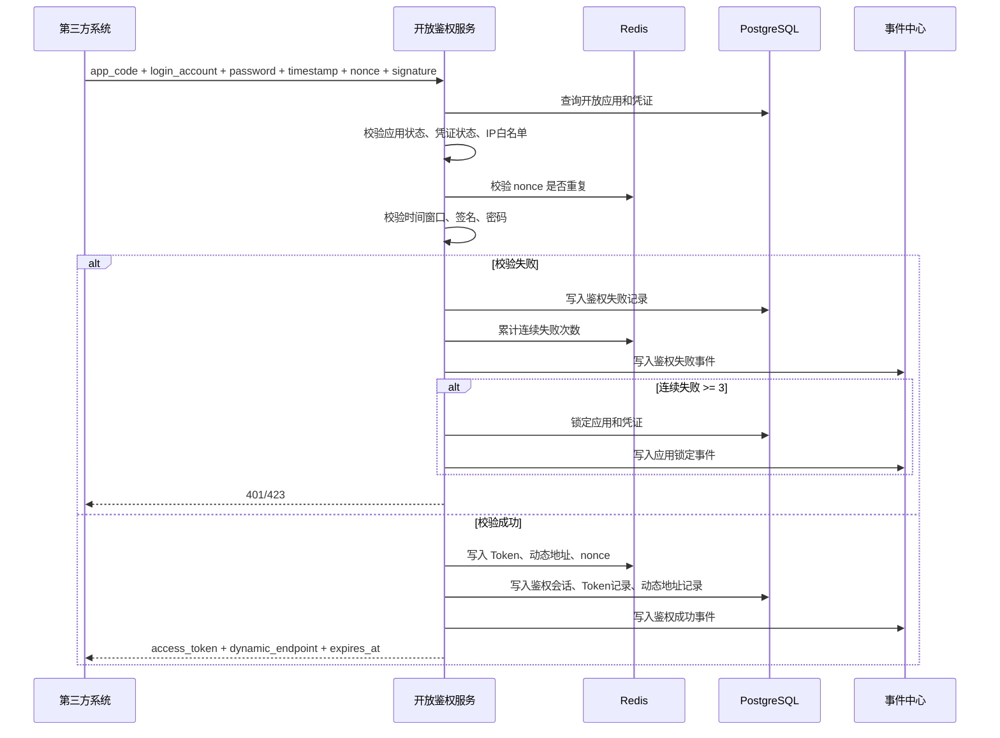
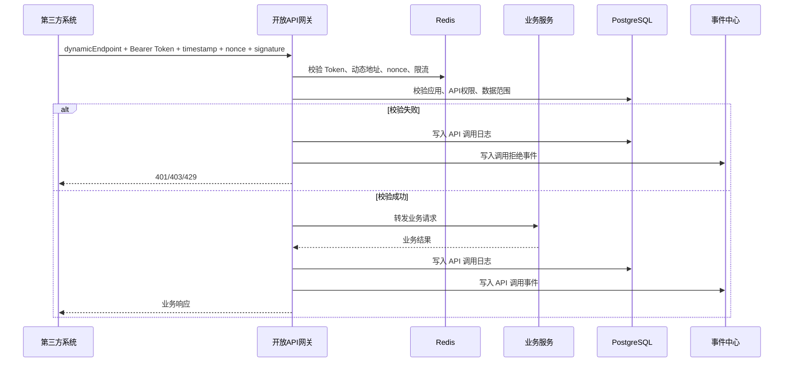
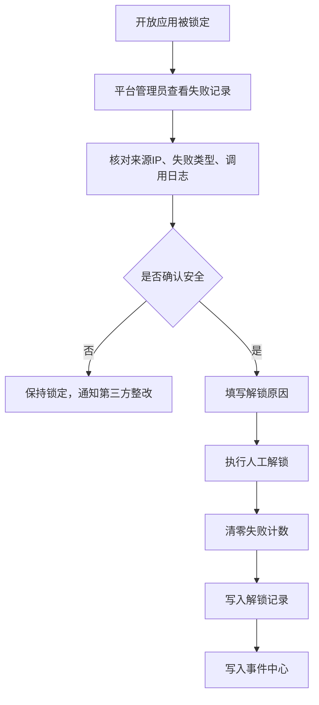

# 开放平台与安全鉴权开发设计文档

## 1. 模块定位

开放平台与安全鉴权模块负责把综合体管理系统的能力安全、标准、可审计地开放给第三方系统调用。

本模块服务对象包括：

- 餐饮 POS 系统
- 零售 POS 系统
- 机器人调度平台
- 视频监控平台
- 企业微信会话归档服务
- 闸机、NFC、扫码设备服务商
- 未来其他第三方系统或商户自有系统

本模块的核心目标：

- 第三方系统可以通过标准 API、Webhook 和签名调用示例调用平台能力；完整多语言 SDK 包进入 P2。
- 平台调用外部供应商 SDK/API 时，业务适配由第三方集成模块负责；本模块提供统一鉴权、动态路由、签名、nonce、防重放、Webhook 入口和调用审计能力。
- 所有第三方调用必须经过账号、密码、Token、动态地址、签名、nonce、防重放校验。
- 连续三次鉴权失败自动锁定开放应用，必须人工解锁。
- 每一次鉴权、调用、失败、锁定、解锁、回调都必须写入事件中心。
- 所有开放能力必须受多商户、门店、项目、接口权限和数据权限控制。

> 双向开放口径（2026-06-10 收口）：开放平台是“安全门”和“统一入口”，不是每个供应商业务适配器。对外调用平台能力走本文 `/api/open/auth/...`、`/api/open/d/{endpoint_key}/{domain}/...` 与 Webhook 订阅；平台对内调用聚合支付、企业微信、人脸/年龄核验、机器人、视频、设备、票务渠道等供应商 SDK/API 时，适配器、字段映射、状态标准化、轮询和补偿以 `third-party-supplier-integration-kit-v0.1.md` 与 `third-party-integration-development-design.md` 为准。

## 2. 业务边界

### 2.1 本模块负责

| 范围 | 说明 |
|---|---|
| 开放应用管理 | 创建第三方调用身份，绑定商户、服务商、门店、项目 |
| API 目录 | 维护可开放接口、版本、权限点、敏感级别 |
| API 文档 | 生成第三方可阅读的接口说明、错误码、示例 |
| 调用示例与 SDK | P0 输出 OpenAPI、curl、Java/JavaScript(Node.js) 签名调用示例；完整多语言 SDK 生成和发布进入 P2 |
| 动态鉴权 | 账号密码、短期 Token、动态调用地址、签名、防重放 |
| Webhook | 事件订阅、回调签名、失败重试、幂等处理 |
| 供应商回调统一入口 | 提供 `/api/open/d/{endpoint_key}/webhooks/{provider}/{event}`，供第三方集成模块承接供应商回推 |
| 调用审计 | 记录调用方、接口、IP、耗时、结果、错误码 |
| 安全控制 | 三次失败锁定、人工解锁、限流、熔断、密钥轮换 |
| 事件留痕 | 所有关键动作写入统一事件中心 |

### 2.2 本模块不负责

| 不负责范围 | 归属模块 |
|---|---|
| 餐饮 POS 具体业务逻辑 | 第三方餐饮系统 / 第三方集成模块 |
| 零售 POS 具体业务逻辑 | 第三方零售系统 / 第三方集成模块 |
| 机器人路径规划 | 机器人服务商 |
| 监控录像存储与播放内核 | 视频监控服务商 |
| 企业微信会话内容分析 | 数据分析/AI 质检模块 |
| 供应商 SDK/API 字段映射、状态标准化、轮询和业务补偿 | 第三方集成模块 / 供应商适配器 |
| 票务权益业务规则 | 票务通票模块 |
| 商户、门店、区域基础档案 | 平台地基模块 |

## 3. 角色与权限

| 角色 | 权限 |
|---|---|
| 平台超级管理员 | 管理所有开放应用、API、调用示例/SDK、锁定解锁、调用日志 |
| 平台技术管理员 | 管理 API 目录、文档、调用示例/SDK、联调环境 |
| 平台风控管理员 | 查看调用审计、失败记录、锁定记录、异常调用 |
| 平台运营管理员 | 查看商户开放应用状态和基础调用情况 |
| 商户管理员 | 查看本商户开放应用和调用日志，不可越权查看其他商户 |
| 第三方技术联系人 | 使用开放应用账号调用 API，接收 Webhook |
| 系统任务 | 自动生成 Token、动态地址、锁定应用、推送 Webhook |

敏感权限点：

> 修订说明（2026-06-07）：依据《统一口径基准》D3（devtech-2），开放平台权限编码统一为**点号风格 `domain.resource.action`**，废止冒号风格 `open_app:xxx`。映射规则：`open_app:create→openplatform.app.create`、`open_app:update→openplatform.app.update`、`open_app:disable→openplatform.app.disable`、`open_app:unlock→openplatform.auth.unlock`（解锁属鉴权域）、`open_app:rotate_secret→openplatform.app.rotate_secret`、`open_app:view→openplatform.app.view`、`api_resource:publish→openplatform.api.publish`，其余冒号编码按同规则映射到 `openplatform.<resource>.<action>`。本表与 §14 各接口权限标注、§6.5 锁定解锁权限同步统一。

| 权限编码 | 说明 |
|---|---|
| `openplatform.app.create` | 创建开放应用 |
| `openplatform.app.update` | 修改开放应用 |
| `openplatform.app.disable` | 停用开放应用 |
| `openplatform.auth.unlock` | 人工解锁开放应用 |
| `openplatform.app.rotate_secret` | 轮换密钥 |
| `openplatform.api.publish` | 发布 API |
| `openplatform.api_call_log.view_sensitive` | 查看敏感调用日志 |
| `openplatform.webhook.manage` | 管理 Webhook 订阅 |
| `openplatform.sdk.publish` | 发布 SDK 包 |

## 4. 核心对象

| 对象 | 说明 |
|---|---|
| OpenApp | 第三方开放应用，是第三方调用平台的身份主体 |
| OpenAppCredential | 开放应用凭证，包含账号、密码哈希、签名密钥 |
| ApiResource | API 资源，表示一个开放接口 |
| ApiVersion | API 版本，记录请求、响应、错误码和文档 |
| ApiPermission | API 权限点，控制接口能否调用 |
| OpenAppPermission | 开放应用和 API 权限点的授权关系 |
| DataScope | 开放应用的数据范围，复用地基系统数据权限模型 |
| AuthSession | 第三方鉴权会话 |
| AccessToken | 短时效访问令牌 |
| DynamicEndpoint | 动态调用地址或动态网关路由 |
| NonceRecord | 防重放 nonce 记录 |
| AuthFailureRecord | 鉴权失败记录 |
| AppLockRecord | 应用锁定记录 |
| ManualUnlockRecord | 人工解锁记录 |
| ApiCallLog | API 调用日志 |
| WebhookSubscription | Webhook 订阅 |
| WebhookDeliveryLog | Webhook 投递日志 |
| SdkPackage | SDK 包记录 |
| AuditEvent | 统一事件中心事件 |

## 5. 状态机

### 5.1 开放应用状态

> 修订说明（2026-06-07）：依据《统一口径基准》D3（devtech-1/7），本 §5.1 的**7 态（draft/testing/active/suspended/locked/disabled/revoked）为开放应用状态机的跨文档唯一权威**。`foundation-database open_apps.status` 与 `java-backend §12.3 开放应用状态` 须与本表对齐（含 7 态与流转），不得各自增删状态。本表保持原 7 态不变。

| 状态 | 含义 | 可进入状态 |
|---|---|---|
| `draft` | 草稿 | `testing`, `disabled` |
| `testing` | 联调中 | `active`, `disabled` |
| `active` | 正常可用 | `suspended`, `locked`, `disabled`, `revoked` |
| `suspended` | 平台暂停 | `active`, `disabled`, `revoked` |
| `locked` | 鉴权失败锁定 | `active`, `disabled`, `revoked` |
| `disabled` | 停用 | `active`, `revoked` |
| `revoked` | 吊销 | 不可恢复 |

### 5.2 凭证状态

| 状态 | 含义 |
|---|---|
| `active` | 正常 |
| `locked` | 连续鉴权失败锁定 |
| `expired` | 凭证过期 |
| `revoked` | 凭证吊销 |

### 5.3 Token 状态

| 状态 | 含义 |
|---|---|
| `active` | 可用 |
| `expired` | 已过期 |
| `revoked` | 已吊销 |

### 5.4 动态地址状态

| 状态 | 含义 |
|---|---|
| `active` | 可用 |
| `expired` | 已过期 |
| `rotated` | 已轮换 |
| `revoked` | 已吊销 |

### 5.5 Webhook 投递状态

| 状态 | 含义 |
|---|---|
| `pending` | 等待投递 |
| `success` | 投递成功 |
| `failed` | 单次投递失败 |
| `retrying` | 等待重试 |
| `dead` | 超过重试次数，进入死信 |

## 6. 动态鉴权流程

### 6.1 鉴权总流程



### 6.2 第三方首次获取 Token

> 修订说明（2026-06-07）：依据《统一口径基准》D3（devtech-1），对外鉴权路径由 `/open-api/v1/...` 统一为 `/api/open/auth/...`；动态业务网关由 `/gateway/v1/d/{...}` 统一为 `/api/open/d/{endpoint_key}/{domain}/...`。下方请求路径与 `dynamicEndpoint` 示例值同步改写。

请求：

```http
POST /api/open/auth/token
```

请求头：

| Header | 必填 | 说明 |
|---|---|---|
| `X-App-Code` | 是 | 开放应用编码 |
| `X-Timestamp` | 是 | 毫秒时间戳 |
| `X-Nonce` | 是 | 随机字符串 |
| `X-Signature` | 是 | 请求签名 |

请求体：

```json
{
  "loginAccount": "robot_vendor_001",
  "password": "plain-password-only-in-request"
}
```

> D8 字段名收口（鉴权请求标识字段）：鉴权请求标识字段统一为 **`login_account`**（请求体 JSON 字段名 `loginAccount`，DB 列名 `open_app_credentials.login_account`）。`java-backend §8.6/§13.2` 原用的 `credential_id` 已废止为鉴权请求标识字段，两文件以本字段名为准。`credential_id` 仅保留为失败计数/锁定的内部凭证维度键（见 §6.5）。

成功响应：

```json
{
  "accessToken": "短时效访问令牌",
  "tokenType": "Bearer",
  "expiresIn": 900,
  "dynamicEndpoint": "/api/open/d/7f9c.../{domain}/...",
  "dynamicEndpointExpiresIn": 600,
  "serverTime": 1780620000000
}
```

失败响应：

```json
{
  "code": "AUTH_FAILED",
  "message": "鉴权失败",
  "failedCount": 2,
  "traceId": "..."
}
```

锁定响应：

```json
{
  "code": "OPEN_APP_LOCKED",
  "message": "开放应用已锁定，请联系平台管理员人工解锁",
  "traceId": "..."
}
```

### 6.3 业务 API 调用流程



### 6.4 签名规则

建议签名原文：

```text
METHOD
PATH
TIMESTAMP
NONCE
BODY_SHA256
```

签名算法：

```text
HMAC-SHA256(signingText, appSecret)
```

签名输出：

```text
hex 或 base64
```

校验规则：

> 修订说明（2026-06-07）：依据《统一口径基准》D3（devtech-7），鉴权时间窗口保持 **300 秒**；明确 **nonce TTL = 600 秒**（为时间窗口的 2 倍，以容忍时钟偏移，避免窗口边缘的合法 nonce 被提前清理而误判重放），单位统一标注为"秒"。

| 规则 | 说明 |
|---|---|
| 时间窗口 | 请求时间与服务器时间差不得超过 300 秒 |
| nonce 唯一 | 同一开放应用 nonce 不可重复；nonce 记录在服务端保留 **600 秒（TTL）** 后过期，为时间窗口 300 秒的 2 倍以容时钟偏移 |
| body 摘要 | 请求体 SHA-256 必须和签名一致 |
| 路径一致 | 签名路径必须和实际请求路径一致 |
| 方法一致 | 签名方法必须和实际 HTTP Method 一致 |

### 6.5 连续三次失败锁定规则

计入失败的场景：

| 失败类型 | 是否计入连续失败 |
|---|---|
| 账号不存在 | 是，但只记录账号，不绑定应用 |
| 密码错误 | 是 |
| 应用状态不可用 | 是 |
| IP 不在白名单 | 是 |
| 签名错误 | 是 |
| Token 伪造 | 是 |
| 动态地址无效 | 是 |
| nonce 重复 | 是 |
| 时间戳超窗 | 是 |
| API 权限不足 | 否，记调用拒绝，不锁鉴权 |
| 业务参数错误 | 否 |

锁定策略：

- 同一 `open_app_id + credential_id` 连续失败 3 次，锁定凭证和开放应用。（D8 锁定维度收口：以本"应用+凭证"维度为跨文档唯一权威；`java-backend §13.2` 原"同一应用连续三次失败"已按本口径改为 `open_app_id + credential_id`。）
- 连续失败计数优先存 Redis，锁定结果落 PostgreSQL。
- 鉴权成功后清零连续失败计数。
- 锁定后不允许继续获取 Token。
- 只能由具备 `openplatform.auth.unlock` 权限的平台人员人工解锁。<!-- 修订说明（2026-06-07）：权限编码按 D3 由 open_app:unlock 统一为点号风格 openplatform.auth.unlock -->


## 7. 人工解锁流程



解锁要求：

- 必须填写解锁原因。
- 必须记录解锁人、解锁时间、锁定记录、复核结论。
- 解锁行为必须写入 `manual_unlock_records` 和 `audit_events`。
- 商户管理员默认不可解锁，只能查看本商户应用状态。

## 8. API 目录与文档

### 8.1 API 目录分组

| 分组 | 说明 | 示例 |
|---|---|---|
| `auth` | 鉴权 | 获取 Token、刷新 Token |
| `merchant` | 商户基础 | 查询授权商户、门店、点位 |
| `ticket` | 票务 | 查询票、权益、核销结果 |
| `verification` | 核销 | 扫码核销、NFC 核销、撤销核销 |
| `order` | 订单 | 查询订单、退款状态、支付状态 |
| `event` | 事件 | 上报第三方事件、查询事件结果 |
| `robot` | 机器人 | 创建任务、查询任务、回传状态 |
| `video` | 视频证据 | 回传录像索引、截图、事件 ID |
| `inventory` | 库存 | 库存同步、出入库事件回传 |
| `wecom` | 企业微信 | 会话归档事件、客户标签回传 |
| `webhook` | 回调 | 订阅、暂停、测试回调 |

### 8.2 API 生命周期

| 状态 | 说明 |
|---|---|
| `draft` | 草稿，仅平台内部可见 |
| `testing` | 沙箱联调可用 |
| `published` | 正式发布 |
| `deprecated` | 已废弃，保留过渡期 |
| `removed` | 已移除 |

### 8.3 文档生成规则

每个 API 必须包含：

- 接口名称
- 接口编码
- 版本
- Method
- Path
- 权限点
- 数据范围要求
- 请求头
- 请求参数
- 响应结构
- 错误码
- 签名示例
- 幂等规则
- 事件留痕说明
- 调用频率限制

## 9. 调用示例与 SDK 生成设计

### 9.1 P0/P1/P2 支持范围

| 交付物 | 优先级 | 用途 |
|---|---|---|
| OpenAPI + curl 示例 | P0 | 供应商联调、接口测试和最小接入说明 |
| Java 签名调用示例 | P0 | 企业系统、机器人服务商、POS 服务商参考 |
| JavaScript(Node.js) 签名调用示例 | P0 | 中小型第三方系统、脚本服务参考 |
| Python/PHP 调用示例 | P1 | 数据服务、AI 服务、自动化脚本和传统商户系统参考 |
| 完整多语言 SDK 包与发布流水线 | P2 | 长期开放平台生态和版本化 SDK 管理 |

### 9.2 SDK/示例必须覆盖

| 能力 | 说明 |
|---|---|
| 登录鉴权 | 账号密码获取 Token 和动态地址 |
| Token 缓存 | 自动缓存短时效 Token |
| 动态地址刷新 | 动态地址过期前自动刷新 |
| 签名 | 自动生成 HMAC-SHA256 签名 |
| nonce | 自动生成随机 nonce |
| 防重放 | SDK 本地避免重复 nonce |
| 请求重试 | 网络错误可有限重试 |
| Webhook 验签 | 校验平台回调签名 |
| 错误码映射 | 把平台错误码映射成 SDK 异常 |
| traceId | 暴露 traceId 便于排查 |

### 9.3 SDK 生成方式

P0 阶段：

- 使用 OpenAPI 文档、curl 示例和 HTTP 示例对齐接口。
- 手写最小 Java 与 JavaScript(Node.js) 签名调用示例，覆盖 `AuthClient`、签名、nonce、防重放和 Webhook 验签。
- 不发布正式 SDK 包，不承诺自动生成多语言 SDK。

P1 阶段：

- 补 Python/PHP 调用示例。
- 引入示例兼容测试和沙箱数据。

P2 阶段：

- 建立 SDK 发布流水线。
- 自动从 API 目录生成多语言 SDK。
- 发布版本化 SDK 包和下载页面。

## 10. Webhook 设计

> 修订说明（2026-06-07）：依据《统一口径基准》D3（devtech-1），开放平台**对外回调/第三方厂商回推入口路径**统一为 `/api/open/d/{endpoint_key}/webhooks/{provider}/{event}`（`{provider}` 为来源厂商，如 catering_pos、robot；`{event}` 为回调事件名）。该入口与动态业务网关共用 `/api/open/d/{endpoint_key}` 前缀并经同一套动态地址 + 签名 + nonce 校验。§10.2 描述的是平台主动回调第三方自有 URL 时携带的签名头，二者方向不同、互不冲突。

### 10.1 订阅对象

| 事件类型 | 说明 |
|---|---|
| `ticket.issued` | 出票 |
| `ticket.refunded` | 退票 |
| `entitlement.verified` | 权益核销 |
| `order.paid` | 订单支付 |
| `order.refunded` | 订单退款 |
| `robot.task.created` | 机器人任务创建 |
| `robot.task.completed` | 机器人任务完成 |
| `robot.task.failed` | 机器人任务失败 |
| `video.evidence.created` | 视频证据创建 |
| `inventory.changed` | 库存变化 |
| `risk.alert.created` | 风险预警 |
| `open_app.locked` | 开放应用锁定 |

### 10.2 Webhook 签名

平台回调第三方时携带：

| Header | 说明 |
|---|---|
| `X-Platform-App` | 平台应用标识 |
| `X-Webhook-Event-Id` | 回调事件唯一 ID |
| `X-Timestamp` | 时间戳 |
| `X-Nonce` | 随机字符串 |
| `X-Signature` | 平台签名 |
| `X-Trace-Id` | 链路 ID |

第三方必须：

- 校验签名。
- 校验时间窗口。
- 按 `eventId` 幂等处理。
- 2xx 代表成功，非 2xx 代表失败。

### 10.3 重试策略

| 次数 | 延迟 |
|---|---|
| 第 1 次 | 立即 |
| 第 2 次 | 1 分钟 |
| 第 3 次 | 5 分钟 |
| 第 4 次 | 30 分钟 |
| 第 5 次 | 2 小时 |

超过重试次数进入死信，生成 `webhook.delivery.dead` 事件。

## 11. 限流与熔断

### 11.1 限流维度

| 维度 | 示例 |
|---|---|
| 应用级 | 每个开放应用每秒 50 次 |
| 接口级 | 核销接口每秒 20 次 |
| 商户级 | 某商户所有应用每秒 100 次 |
| IP 级 | 单 IP 每秒 100 次 |
| 敏感接口 | 解锁、退款、库存调整等更低阈值 |

### 11.2 熔断场景

| 场景 | 动作 |
|---|---|
| 1 分钟内 50% 请求失败 | 暂停该应用 5 分钟 |
| 10 分钟内大量签名错误 | 锁定应用，人工复核 |
| Webhook 连续失败 | 暂停订阅 |
| 高频越权访问 | 生成高风险预警 |

P0 阶段使用 Redis 计数器实现。

P1 阶段可引入令牌桶和更细策略。

## 12. 数据库表设计

### 12.1 P0 必建表

| 表名 | 说明 |
|---|---|
| `open_apps` | 开放应用 |
| `open_app_credentials` | 开放应用凭证 |
| `api_resources` | API 资源 |
| `api_versions` | API 版本 |
| `api_permissions` | API 权限点 |
| `open_app_permissions` | 开放应用 API 授权 |
| `data_scopes` | 数据权限范围，复用地基表 |
| `auth_sessions` | 鉴权会话 |
| `access_tokens` | 短时效 Token |
| `dynamic_endpoints` | 动态调用地址 |
| `nonce_records` | nonce 记录 |
| `auth_failure_records` | 鉴权失败记录 |
| `app_lock_records` | 应用锁定记录 |
| `manual_unlock_records` | 人工解锁记录 |
| `api_call_logs` | API 调用日志 |
| `audit_events` | 统一事件 |

### 12.2 P1 表

> D8 Webhook 表优先级收口：`webhook_subscriptions`、`webhook_delivery_logs` 以本表 **P1** 归属为跨文档唯一权威；`java-backend` 原 §6.3 V003（P0）误列这两张表已移除，统一为 P1（与本文 §18.2 Webhook P1 任务一致）。

| 表名 | 说明 |
|---|---|
| `webhook_subscriptions` | Webhook 订阅 |
| `webhook_delivery_logs` | Webhook 投递日志 |
| `sdk_packages` | SDK 包记录 |
| `rate_limit_rules` | 限流规则 |
| `circuit_breaker_records` | 熔断记录 |
| `api_document_snapshots` | API 文档快照 |

### 12.3 P2 表

| 表名 | 说明 |
|---|---|
| `open_app_secret_rotations` | 密钥轮换记录 |
| `sandbox_accounts` | 沙箱账号 |
| `developer_portal_users` | 开发者门户用户 |
| `api_usage_billing_records` | API 计量计费 |

### 12.4 关键字段补充

`open_apps`

| 字段 | 说明 |
|---|---|
| `id` | 主键 |
| `app_code` | 应用编码，唯一 |
| `app_name` | 应用名称 |
| `app_type` | `catering_pos`、`retail_pos`、`robot`、`video`、`gate`、`nfc`、`wecom`、`custom` |
| `merchant_id` | 归属商户 |
| `service_provider_id` | 归属服务商 |
| `venue_id` | 归属门店 |
| `ip_whitelist` | IP 白名单 JSON |
| `status` | 应用状态 |

`open_app_credentials`

| 字段 | 说明 |
|---|---|
| `login_account` | 登录账号 |
| `password_hash` | 密码哈希 |
| `secret_encrypted` | 加密签名密钥 |
| `secret_masked` | 脱敏密钥 |
| `failed_auth_count` | 连续失败次数 |
| `locked_at` | 锁定时间 |
| `status` | 凭证状态 |

`dynamic_endpoints`

| 字段 | 说明 |
|---|---|
| `endpoint_key` | 动态地址 key |
| `endpoint_path` | 动态网关路径 |
| `issued_at` | 签发时间 |
| `expires_at` | 过期时间 |
| `status` | 状态 |

`api_call_logs`

| 字段 | 说明 |
|---|---|
| `open_app_id` | 开放应用 |
| `api_resource_id` | API |
| `request_id` | 请求 ID |
| `trace_id` | 链路 ID |
| `ip` | 来源 IP |
| `request_summary` | 请求摘要 |
| `response_summary` | 响应摘要 |
| `status_code` | HTTP 状态 |
| `business_code` | 业务错误码 |
| `duration_ms` | 耗时 |
| `result` | `success`、`failed`、`rejected` |

## 13. Java 服务模块设计

### 13.1 包结构

建议 Java 后端采用模块化包结构：

```text
com.complex
├── foundation
│   ├── merchant
│   ├── permission
│   └── event
├── openplatform
│   ├── app
│   ├── auth
│   ├── gateway
│   ├── api
│   ├── sdk
│   ├── webhook
│   ├── ratelimit
│   ├── audit
│   └── admin
└── shared
    ├── security
    ├── exception
    ├── id
    ├── time
    └── web
```

### 13.2 Java 模块职责

| 模块 | 职责 |
|---|---|
| `openplatform.app` | 开放应用 CRUD、状态变更、密钥管理 |
| `openplatform.auth` | 账号密码鉴权、Token、动态地址、失败锁定 |
| `openplatform.gateway` | 第三方业务 API 网关、签名校验、权限校验 |
| `openplatform.api` | API 目录、版本、权限点、文档 |
| `openplatform.sdk` | SDK 元数据、SDK 生成任务、示例下载 |
| `openplatform.webhook` | 订阅管理、回调投递、重试、死信 |
| `openplatform.ratelimit` | Redis 限流、熔断 |
| `openplatform.audit` | 调用日志、失败日志、锁定解锁日志 |
| `openplatform.admin` | 后台管理 REST API |

### 13.3 关键服务类

| 服务类 | 说明 |
|---|---|
| `OpenAppService` | 开放应用管理 |
| `OpenAppCredentialService` | 凭证、密钥、密码管理 |
| `OpenAuthService` | 鉴权主流程 |
| `TokenService` | Token 签发、校验、吊销 |
| `DynamicEndpointService` | 动态地址签发、校验、轮换 |
| `SignatureService` | HMAC 签名与验签 |
| `NonceService` | nonce 生成、校验、防重放 |
| `AuthFailureService` | 失败记录和锁定判断 |
| `OpenAppLockService` | 锁定与人工解锁 |
| `OpenApiCatalogService` | API 目录和版本管理 |
| `OpenApiGatewayService` | 业务 API 调用网关 |
| `ApiPermissionService` | 接口权限和数据范围校验 |
| `ApiCallAuditService` | 调用日志 |
| `WebhookSubscriptionService` | Webhook 订阅 |
| `WebhookDeliveryService` | Webhook 投递和重试 |
| `SdkPackageService` | SDK 生成和发布记录 |
| `OpenPlatformEventPublisher` | 写入事件中心 |

## 14. REST API 设计

> 2026-06-11 执行口径：本章 `/api/admin/open-apps`、`/api/admin/api-resources`、`/api/admin/webhooks` 等接口为开放平台后台管理能力草案，不等同于 P0 正式后端路径。P0 可编码接口以 `docs/openapi/openapi-p0.yaml`、`docs/openapi/openapi-p0.json`、`p0-openapi-operation-acceptance-matrix-v0.1.md` 为准；第三方正式入口为 `/api/open/auth/token`、`/api/open/d/{endpoint_key}/webhooks/{provider}/{event}`、`/api/open/d/{endpoint_key}/events/{event_id}` 以及 `/api/v1/integration/provider-adapters/**`。开放应用凭证、Webhook 签名等必须写入 `x-auth-context`，不得写成员工权限码。

### 14.1 后台管理 API

#### 创建开放应用

```http
POST /api/admin/open-apps
```

权限：`openplatform.app.create`

请求体：

```json
{
  "appName": "机器人服务商A",
  "appType": "robot",
  "merchantId": "mch_xxx",
  "serviceProviderId": "sp_xxx",
  "venueId": "venue_xxx",
  "contactName": "张三",
  "contactPhone": "13800000000",
  "ipWhitelist": ["192.168.88.10"],
  "loginAccount": "robot_vendor_a"
}
```

响应：

```json
{
  "id": "open_app_xxx",
  "appCode": "app_xxx",
  "initialPassword": "一次性初始密码",
  "secretMasked": "ab****yz",
  "status": "testing"
}
```

#### 修改开放应用

```http
PUT /api/admin/open-apps/{id}
```

权限：`openplatform.app.update`

#### 停用开放应用

```http
POST /api/admin/open-apps/{id}/disable
```

权限：`openplatform.app.disable`

#### 人工解锁开放应用

```http
POST /api/admin/open-apps/{id}/unlock
```

权限：`openplatform.auth.unlock`

请求体：

```json
{
  "reason": "第三方更换服务器后签名配置错误，已核实",
  "reviewResult": "approved"
}
```

#### 轮换密钥

```http
POST /api/admin/open-apps/{id}/rotate-secret
```

权限：`openplatform.app.rotate_secret`

#### 查询调用日志

```http
GET /api/admin/open-apps/{id}/call-logs
```

权限：`openplatform.api_call_log.view`

#### 查询失败记录

```http
GET /api/admin/open-apps/{id}/auth-failures
```

权限：`openplatform.app.view`

### 14.2 API 目录管理 API

| Method | Path | 说明 | 权限 |
|---|---|---|---|
| `POST` | `/api/admin/api-resources` | 创建 API 资源 | `openplatform.api.create` |
| `PUT` | `/api/admin/api-resources/{id}` | 修改 API 资源 | `openplatform.api.update` |
| `POST` | `/api/admin/api-resources/{id}/versions` | 创建版本 | `openplatform.api.update` |
| `POST` | `/api/admin/api-resources/{id}/publish` | 发布 API | `openplatform.api.publish` |
| `GET` | `/api/admin/api-resources` | 查询 API 目录 | `openplatform.api.view` |

### 14.3 第三方鉴权 API

> 修订说明（2026-06-07）：依据《统一口径基准》D3（devtech-1），对外鉴权路径前缀由 `/open-api/v1/...` 统一为 `/api/open/auth/...`，与 `java-backend §8.6` 一致；票务/酒吧不得另起鉴权端点，必须复用本端点。

| Method | Path | 说明 |
|---|---|---|
| `POST` | `/api/open/auth/token` | 获取 Token 和动态地址 |
| `POST` | `/api/open/auth/refresh` | 刷新 Token，P1 |
| `POST` | `/api/open/auth/revoke` | 主动吊销 Token，P1 |
| `GET` | `/api/open/auth/server-time` | 获取服务器时间 |

### 14.4 动态网关 API

业务调用统一进入动态网关：

> 修订说明（2026-06-07）：依据《统一口径基准》D3（devtech-1），动态业务网关路径由 `/gateway/v1/d/{...}` 统一为 `/api/open/d/{endpoint_key}/{domain}/...`，与 `java-backend §13.3` 一致；其中 `{domain}` 为业务域（如 verification、tickets、events），与原 `{apiGroup}/{apiName}` 等价。

```http
/api/open/d/{endpoint_key}/{domain}/{apiName}
```

示例：

```http
POST /api/open/d/7f9c.../verification/verify
```

网关职责：

- 校验动态地址。
- 校验 Token。
- 校验签名。
- 校验 nonce。
- 校验限流。
- 校验 API 权限。
- 校验数据范围。
- 写调用日志。
- 写事件中心。
- 转发到业务服务。

### 14.5 Webhook API

> 执行口径（2026-06-13 追溯闸口补强）：下表后台管理路径保留为开放平台 Webhook 管理能力说明，不是 P0 正式 Java Controller 路径。正式接口必须以 `docs/openapi/openapi-p0.yaml/json`、`p0-openapi-operation-acceptance-matrix-v0.1.md` 和 `p0-openapi-contract-closure-appendix-v0.1.md` 为准；未进入 OpenAPI 追溯附录并通过 `npm run verify:openapi-closure` 前，不得生成 SDK/mock、接口自动化或供应商联调文档。

后台管理：

| Method | Path | 说明 |
|---|---|---|
| `POST` | `/api/admin/open-apps/{id}/webhooks` | 创建订阅 |
| `PUT` | `/api/admin/webhooks/{id}` | 修改订阅 |
| `POST` | `/api/admin/webhooks/{id}/pause` | 暂停订阅 |
| `POST` | `/api/admin/webhooks/{id}/resume` | 恢复订阅 |
| `POST` | `/api/admin/webhooks/{id}/test` | 测试回调 |
| `GET` | `/api/admin/webhooks/{id}/deliveries` | 查看投递日志 |

## 15. 错误码

| 错误码 | HTTP | 说明 |
|---|---|---|
| `AUTH_FAILED` | 401 | 鉴权失败 |
| `OPEN_APP_NOT_FOUND` | 404 | 开放应用不存在 |
| `OPEN_APP_DISABLED` | 403 | 应用已停用 |
| `OPEN_APP_LOCKED` | 423 | 应用已锁定 |
| `INVALID_SIGNATURE` | 401 | 签名错误 |
| `INVALID_TIMESTAMP` | 401 | 时间戳超窗 |
| `NONCE_REUSED` | 401 | nonce 重复 |
| `TOKEN_EXPIRED` | 401 | Token 过期 |
| `TOKEN_INVALID` | 401 | Token 无效 |
| `DYNAMIC_ENDPOINT_EXPIRED` | 401 | 动态地址过期 |
| `API_PERMISSION_DENIED` | 403 | API 权限不足 |
| `DATA_SCOPE_DENIED` | 403 | 数据范围越权 |
| `RATE_LIMITED` | 429 | 触发限流 |
| `CIRCUIT_OPEN` | 429 | 熔断中 |
| `WEBHOOK_SIGNATURE_INVALID` | 401 | Webhook 签名无效 |
| `IDEMPOTENT_CONFLICT` | 409 | 幂等冲突 |

## 16. 事件留痕设计

### 16.1 事件类型

| 事件类型 | 触发时机 | 风险等级 |
|---|---|---|
| `open_app.created` | 创建开放应用 | normal |
| `open_app.updated` | 修改开放应用 | normal |
| `open_app.disabled` | 停用开放应用 | notice |
| `open_app.secret_rotated` | 轮换密钥 | notice |
| `open_app.auth_success` | 鉴权成功 | normal |
| `open_app.auth_failed` | 鉴权失败 | suspicious |
| `open_app.locked` | 连续三次失败锁定 | high |
| `open_app.unlocked` | 人工解锁 | notice |
| `open_api.called` | API 调用成功 | normal |
| `open_api.rejected` | API 调用拒绝 | suspicious |
| `open_api.rate_limited` | API 限流 | notice |
| `open_api.circuit_opened` | 熔断开启 | suspicious |
| `webhook.subscription_created` | 创建订阅 | normal |
| `webhook.delivered` | Webhook 投递成功 | normal |
| `webhook.delivery_failed` | Webhook 投递失败 | notice |
| `webhook.delivery_dead` | Webhook 死信 | suspicious |

### 16.2 事件字段映射

> D8 `event_category` 落列收口（2026-06-18 技术定稿）：本节将 `event_category` 列为事件字段，与 `java-backend §14` 事件字段最小集统一。**定稿口径：`audit_events` 表落独立数据库列 `event_category`**（值域以 `operation-traceability-and-terminal-switch-prd §4.1` 事件域分类为准，开放平台域取 `third_party`/`permission`）。本口径与 `java-backend §14` 同一裁定，二者保持一致。

| 字段 | 值 |
|---|---|
| `event_category` 【定稿：`audit_events` 落独立数据库列；值域对齐 operation-traceability §4.1 事件域】 | `third_party` 或 `permission` |
| `source_type` | `internal`、`third_party`、`system` |
| `actor_type` | `staff`、`open_app`、`system` |
| `actor_id` | 员工 ID 或开放应用 ID |
| `open_app_id` | 开放应用 ID |
| `merchant_id` | 归属商户 |
| `result` | `success`、`failed`、`abnormal` |
| `risk_level` | `normal`、`notice`、`suspicious`、`high` |
| `trace_id` | 链路 ID |
| `payload` | 摘要信息，不保存敏感明文 |

## 17. 安全测试用例

### 17.1 鉴权测试

| 用例 | 预期 |
|---|---|
| 正确账号密码获取 Token | 成功返回 Token 和动态地址 |
| 密码错误 1 次 | 返回 401，失败次数为 1 |
| 密码错误 2 次 | 返回 401，失败次数为 2 |
| 密码错误 3 次 | 返回 423，应用锁定 |
| 锁定后再次鉴权 | 返回 423 |
| 人工解锁后正确鉴权 | 成功 |
| 应用停用后鉴权 | 返回 403 |
| IP 不在白名单 | 返回 403，并计入失败 |

### 17.2 签名测试

| 用例 | 预期 |
|---|---|
| 签名正确 | 通过 |
| body 被篡改 | 拒绝 |
| path 被篡改 | 拒绝 |
| method 不一致 | 拒绝 |
| 使用错误 secret | 拒绝 |

### 17.3 nonce 和防重放测试

| 用例 | 预期 |
|---|---|
| 同一 nonce 首次使用 | 通过 |
| 同一 nonce 重复使用 | 返回 `NONCE_REUSED` |
| 时间戳超过窗口 | 返回 `INVALID_TIMESTAMP` |
| 未来时间过大 | 返回 `INVALID_TIMESTAMP` |

### 17.4 动态地址测试

| 用例 | 预期 |
|---|---|
| 动态地址有效期内调用 | 通过 |
| 动态地址过期后调用 | 返回 `DYNAMIC_ENDPOINT_EXPIRED` |
| 使用其他应用动态地址 | 返回 403 |
| 动态地址吊销后调用 | 返回 401 |

### 17.5 权限和数据范围测试

| 用例 | 预期 |
|---|---|
| 调用已授权 API | 通过 |
| 调用未授权 API | 返回 `API_PERMISSION_DENIED` |
| 查询授权商户数据 | 通过 |
| 查询其他商户数据 | 返回 `DATA_SCOPE_DENIED` |
| 敏感字段未授权 | 返回脱敏数据或拒绝 |

### 17.6 Webhook 测试

| 用例 | 预期 |
|---|---|
| 回调签名正确 | 第三方可验签 |
| 第三方返回 2xx | 投递成功 |
| 第三方返回 500 | 进入重试 |
| 连续失败 | 进入死信 |
| 同一 eventId 重复回调 | 第三方幂等处理 |

## 18. P0/P1/P2 开发顺序

### 18.1 P0 必做

| 顺序 | 任务 |
|---|---|
| 1 | 建立 Java 包结构和开放平台模块 |
| 2 | Flyway 创建 P0 表 |
| 3 | 实现开放应用 CRUD |
| 4 | 实现开放应用凭证、密码哈希、密钥生成 |
| 5 | 实现账号密码鉴权 |
| 6 | 实现短时效 Token |
| 7 | 实现动态调用地址 |
| 8 | 实现签名校验 |
| 9 | 实现 nonce 防重放 |
| 10 | 实现连续三次失败锁定 |
| 11 | 实现人工解锁 |
| 12 | 实现 API 权限和数据范围校验 |
| 13 | 实现 API 调用日志 |
| 14 | 实现事件中心写入 |
| 15 | 实现基础 OpenAPI 文档 |
| 16 | 实现 Java/JavaScript(Node.js) 签名调用示例 |

### 18.2 P1

| 任务 | 说明 |
|---|---|
| Webhook 订阅和投递 | 支持订阅、签名、重试、死信 |
| 限流熔断策略表 | 从硬编码变为配置化 |
| Token 刷新 | 支持 refresh token |
| 密钥轮换 | 支持新旧密钥过渡 |
| SDK 自动生成 | P2 从 API 目录生成完整 SDK，P1 仅补充调用示例 |
| 沙箱环境 | 提供测试数据和联调入口 |
| 调用日志检索优化 | 支持多条件查询和导出 |

### 18.3 P2

| 任务 | 说明 |
|---|---|
| 开发者门户 | 第三方自助查看文档、密钥、日志 |
| API 计量计费 | 按调用量计费或评级 |
| 异常调用 AI 分析 | 识别攻击、异常模式 |
| 多区域动态网关 | 支持更复杂部署 |
| SDK 发布平台 | 自动发布多语言 SDK |

## 19. 后台页面

| 页面 | 优先级 | 说明 |
|---|---|---|
| 开放应用列表 | P0 | 查看应用、状态、商户、类型 |
| 开放应用详情 | P0 | 基础信息、凭证、授权、白名单 |
| 创建开放应用 | P0 | 创建应用和初始凭证 |
| API 授权配置 | P0 | 给应用分配 API 权限 |
| 数据范围配置 | P0 | 给应用分配商户、门店、项目范围 |
| 鉴权失败记录 | P0 | 查看失败次数和失败原因 |
| 人工解锁页面 | P0 | 复核并解锁 |
| API 调用日志 | P0 | 查询调用结果 |
| API 目录管理 | P1 | 管理开放 API 和版本 |
| Webhook 订阅管理 | P1 | 管理订阅和投递日志 |
| SDK 下载页面 | P2 | 查看和下载完整 SDK；P0/P1 只提供文档和调用示例 |
| 限流规则配置 | P1 | 配置 QPS 和熔断 |

## 20. 验收标准

P0 验收必须满足：

1. 平台能创建开放应用。
2. 平台能给开放应用分配 API 权限和数据范围。
3. 第三方能通过账号密码获取短期 Token 和动态地址。
4. 第三方能使用动态地址调用一个测试 API。
5. 签名错误、nonce 重复、Token 过期、动态地址过期都能正确拒绝。
6. 连续三次鉴权失败后开放应用自动锁定。
7. 平台管理员能人工解锁。
8. 所有鉴权、失败、锁定、解锁、调用都写入 `api_call_logs` 或相关审计表。
9. 所有关键动作都写入 `audit_events`。
10. OpenAPI 文档能展示鉴权接口和至少一个业务测试接口。
11. Java/JavaScript(Node.js) 签名调用示例能完成鉴权和一次测试调用；完整 SDK 包不作为 P0 验收项。

## 21. 已确认执行口径

| 问题 | 已确认口径 |
|---|---|
| 动态调用地址是否必须每次鉴权都变化，还是允许有效期内复用 | 有效期内允许复用动态路由地址，过期后必须重新获取；不要求每次调用都变化 |
| Token 有效期默认是 15 分钟还是更短 | P0 默认 15 分钟，可按开放应用风险等级配置更短 |
| 动态地址有效期默认是 10 分钟还是与 Token 一致 | P0 默认与 Token 一致，特殊高风险接口可单独缩短 |
| 第三方密码由平台生成还是第三方首次登录后修改 | 平台生成初始密钥/密码，第三方首次登录或首次换密钥时强制修改/轮换 |
| 是否允许商户管理员自行创建开放应用 | P0 不允许商户管理员直接创建正式开放应用；可提交申请，平台审核后创建/启用 |
| 是否要求 IP 白名单为 P0 强制项 | P0 对生产开放应用强制 IP 白名单；演示/沙箱可配置宽松但必须标记环境 |
| 调用日志保存完整请求体还是只保存摘要 | P0 默认保存摘要、签名、状态、耗时、错误码和必要业务键；敏感请求体不全量保存，需取证时按最小授权保存脱敏片段 |
| SDK 第一批必须支持哪些语言 | P0 提供 OpenAPI 文档、curl 示例和 Java/JavaScript 示例；完整 SDK 包进入 P2 |
| 开放平台是否提供独立沙箱域名 | 160 P0 不绑定域名；沙箱以环境标识和动态路由区分，正式生产/外部联调前再配置域名和 HTTPS |
| 供应商 SDK/API 未确定时是否阻塞开放平台 | 不阻塞。开放平台先提供统一鉴权、动态路由、Webhook 入口、调用审计和 OpenAPI 示例；供应商私有字段、签名细节、错误码和对账文件由第三方集成适配器在资料到位后补齐 |

## 22. 变更日志

| 日期 | 类型 | 内容 | 原因/依据 |
|---|---|---|---|
| 2026-06-07 | 改 | §3 敏感权限点表：冒号风格 `open_app:*`/`api_resource:*`/`api_call_log:*`/`webhook:*`/`sdk:*` 全部统一为点号风格 `openplatform.<resource>.<action>`（解锁映射到 `openplatform.auth.unlock`），并补映射说明 | 统一口径基准 D3 / devtech-2：废止冒号风格，避免与 java-backend 点号风格两套并存 |
| 2026-06-07 | 改 | §6.5、§14.1、§14.2 各接口权限标注同步改为点号风格 | 同上，保持全文权限编码一致 |
| 2026-06-07 | 改 | §6.2、§14.3 对外鉴权路径 `/open-api/v1/...` → `/api/open/auth/...`；§14.4、§6.2 示例 动态网关 `/gateway/v1/d/{...}` → `/api/open/d/{endpoint_key}/{domain}/...` | 统一口径基准 D3 / devtech-1：对外路径四套并存收敛，与 java-backend §8.6/§13.3 对齐 |
| 2026-06-07 | 增 | §10 新增对外回调/厂商回推入口统一路径 `/api/open/d/{endpoint_key}/webhooks/{provider}/{event}` | 统一口径基准 D3 / devtech-1：回调入口纳入同一前缀与校验 |
| 2026-06-07 | 改 | §6.4 校验规则：明确 nonce TTL=600 秒（窗口 300 秒的 2 倍，容时钟偏移），时间窗口保持 300 秒，单位统一标"秒" | 统一口径基准 D3 / devtech-7 |
| 2026-06-07 | 增 | §5.1 声明本文 7 态开放应用状态机为跨文档唯一权威，foundation-database `open_apps.status`、java-backend §12.3 须对齐 | 统一口径基准 D3 / devtech-1/7 |
| 2026-06-07 | 注 | 本文无金额字段（仅 P2 `api_usage_billing_records` 表名占位，无字段类型定义），D1 整数分口径暂无落点，待 P2 设计计费字段时按 D1 执行 | 统一口径基准 D1 |
| 2026-06-10 P0 执行矩阵补齐 | 增/改 | §1 / §2 / §21 | 补开放平台与供应商适配器的双向开放边界：本文负责安全入口和审计，供应商 SDK/API 字段映射、状态标准化、轮询和补偿由第三方集成适配器承接 | 用户要求第三方供应商未确定时留接口，资料到位后再补字段 |
| 2026-06-13 OpenAPI 追溯闸口 | 改 | §14.5 / §22 | Webhook 后台管理路径降级为能力说明；正式接口、SDK/mock、自动化和供应商联调必须以 OpenAPI、operation 验收矩阵和 `p0-openapi-contract-closure-appendix-v0.1.md` 为准 | 防止旧 `/api/admin/*` 开放平台管理路径绕过权限、事件、终端/调用方和样例准入 |
| 2026-06-18 D8 收口 | 注 | §6.2 | 鉴权请求标识字段统一为 `login_account`（JSON `loginAccount`）；`java-backend` 原 `credential_id` 废止为请求标识字段，仅留作内部凭证维度键 | 与 java-backend §8.6/§13.2 两文件同字段名 |
| 2026-06-18 D8 收口 | 注 | §6.5 | 登录失败锁定维度以"应用+凭证 `open_app_id + credential_id`"为跨文档唯一权威，java-backend 已对齐 | 取更严口径 |
| 2026-06-18 D8 收口 | 注 | §12.2 | Webhook 表以本文 P1 归属为权威，java-backend V003（P0）误列已移除 | 优先级统一为 P1 |
| 2026-06-18 D8 收口 | 注 | §16.2 | `event_category`【待技术确认，推荐落列，值域对齐 operation-traceability §4.1】，与 java-backend §14 同一裁定 | 消除"落/不落"不一致 |
| 2026-06-18 D8 定稿 | 改 | §16.2 | `event_category` 由【待技术确认/是否落列】定稿为"`audit_events` 落独立数据库列"，值域对齐 operation-traceability §4.1 事件域，与 java-backend §14 同一裁定 | 技术已拍板，去除两可表述 |
| 2026-06-18 D8 收口 | 注 | §9.1/§21 | SDK 首批语言口径（P0=Java+JavaScript(Node.js)、P1=Python/PHP、P2=完整 SDK）保持不变，确认为权威，java-backend §18 已对齐 | 两文件 SDK 语言一致 |
