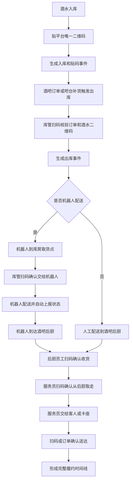

# 全链路操作留痕与终端开关 PRD V0.10

> **口径修订（2026-08-06 R10）：票务「核销预检」两步流已废止**——ENUM「核销记录状态」条 明确核销记录状态**共六态**（成功／拒绝（规则不允许）／失败（设备或网络原因）／已冲正／待复核／异常）、「**不设「预检通过」态**」，且「**检票环节内部为一次动作：扫码即核销，不设先预检、后确认的两次操作**」（DEC-R6-08 / 第三轮用户裁决 UD-11）。本文原有的 `preview_passed` 状态、`verification.previewed` 事件、`/verifications/preview` 预检端点与「预检 → 确认」两步核销流程**一律废止**，废止处就地标注；已实现的端点、事件与取值待代码轮下线，期间不得新增调用、不得新写入。**限定**：本条只针对票务核销域的预检；酒吧年龄/人脸核验预检、运行配置预检、分红预检等其他域的「预检」不受影响。

> **口径修订（2026-08-06 R10）：「人工放行」已废止**——ENUM「核销记录状态」条 明确「**系统不提供人工放行：核销要么成功、要么拒绝或失败，任何岗位、任何权限都不能以人工方式让一笔不满足规则的核销通过**」（DEC-CFG-2026-08-03-12 / DEC-R6-08）。本文原有的「人工放行」取值、端点、按钮、指标、权限点与复核类型**一律废止**，废止处就地标注「原含『人工放行』，已废止·见文首口径」；已实现的端点、权限点与状态取值待代码轮下线，期间不得新增调用、不得新写入。**注意**：合同或基础定义违规被卡住后「由更高级审核放行」的准入场景仍然存在，那是准入阻断的升级放行，与核销域无关，不得回读为「可以人工放行一笔核销」。

> 权限边界：本 PRD 只提供产品细化；三份业务 HTML 拥有最终业务解释权。其他文档、配置、代码和数据结构均不得覆盖 HTML；HTML 未记载的新规则须经用户批准并写入 HTML 后方可生效。**三份 HTML 之间若出现冲突，按确认时间线判定：凡经用户确认过的内容，确认时间越晚的优先级越高，后确认的覆盖先确认的（以决策台账记录的裁决时间为准）；无法确定确认时间先后的，仍须逐项重新裁决**（2026-08-05 补，依据 PGM「解释权声明」条；DIFF-A-051）。

> **✅ R7 复审上修标注（2026-06-19，只读核验真实迁移/代码后回填）**
> R5 横幅原标注的"终端开关后端拒绝铁律未实现/scope 收窄"已在本会话 P0 实现并落库（V068 + 切面 + 全景埋点），以下上修；事件名漂移与三层留痕接线保持开放。
> - **✅ 终端开关后端拒绝铁律（§5.4）已落地（V068）**：新增 `ActionGateAspect`（`@Order(10)`，早于业务事务）在带 `@GuardedAction(capability=...)` 的业务方法执行前由 `TerminalSwitchGuard` 校验开关、关闭/读取失败发 `terminal.access_rejected`(reason=disabled|switch_fetch_failed) 并拒绝，**finance/bar/ticketing/amusement/inventory 共 94 处 `@GuardedAction` 全景埋点**，不再可绕过。准入闸 `AdmissionGuard` + `supervisor_review_policies`(V068) 同切面串联（T3 合同准入）。
> - **✅ scope 7 维已落地（V068）**：`TerminalSwitchGuard.resolveEffectiveSwitch` 层级 device > version > module > business_system > merchant > project > global（无显式行默认关闭 opt-in，2026-10-26 V554 起；读取异常 fail-closed）；`terminal_capability_switches.scope_type` 加 7 维 CHECK，不再收窄到 global/device。
> - **✅ 求值改「取最严」+ 新增灰度层（2026-07-22 用户裁决 R-10，V342）**：V068 起的实现是"命中最具体的显式行即胜出"，**低层打开会压过高层关闭**（global=关 + device=开 → 放行），安全方向反了，v7 审计定 P0。现改为**任一层关闭即最终关闭**（返回最高层的关闭行做审计口径），并新增**灰度层**作为独立的最细粒度级别（白名单试点，只能收窄不能放宽）接入求值链。口径见 §5.5 / §5.7，数据对象见 §6.3A。
> - **（2026-07-20 安全修复 AUD-010 · 完整设计）终端/设备身份服务端派生 + 每请求设备凭证验签 + 分级强制**：堵死「攻击者不带设备凭证、直接自报 `X-Terminal-Type` 即绕过资金/切换/年龄核验环节」的伪造向量。
>   - **验签机制**：对**设备绑定型终端类型**（`staff_work_phone`/`tablet`/`kiosk`）的**写**请求，要求携带 `X-Device-Id` + `X-Device-Timestamp` + `X-Device-Nonce` + `X-Device-Signature`；签名量=`deviceId\n timestamp\n nonce\n METHOD\n path`，以**设备注册公钥**验签（复用既有员工 Android Keystore 设备凭证 `staff_device_credentials.device_public_key`，经 认证员工→员工档案→active 凭证 解析；EC SHA256withECDSA / RSA SHA256withRSA）。并核对 `terminal_devices` 登记（存在 + `status=bound` + 登记类型与声明一致）。通过则以**设备登记类型**为可信终端类型。
>   - **服务端派生注入**：`DeviceCredentialInterceptor`（`/api/**`，排在总开关拦截器之前）把派生结果存入 `TerminalIdentityHolder`（请求属性）；`GateRequestContext.terminalType()/deviceId()`（终端开关 + 年龄核验环节读取源）与 ServiceOrderController 资金四路（下单/确认收款/完成/出示收款码）统一改读**服务端派生身份**，不再各自信任自报头。
>   - **重放保护**：无状态——时间窗 `±tolerance`（默认 300s）+ nonce 纳入签名量，不建 nonce 表；资金写动作叠加既有 `idempotency_key` 去重，窗口内重放同一请求不产生二次副作用。`ponytail` 上限：签名量绑定 method+path、未绑定请求体；翻转 enforce 前若需防「截获有效签名后篡改请求体」，用 `ContentCachingRequestWrapper` 追加 body 摘要。
>   - **分级强制（生产滚动安全，配置 `access.device_credential.enforcement.<type>`=`off|grace|enforce`，默认 `grace`）**：`off`=不验签直放行（上线前/停用）；`grace`（默认，生产安全态）=**签名无效必拒**，但**缺签名/未登记设备**的写请求记审计后放行（不瘫痪尚未登记签名密钥的现网终端）；`enforce`=设备绑定型写请求**必须**有效签名 + 已绑定设备，缺失/无效一律 403。读请求（GET/HEAD/OPTIONS）不因缺签名被拒。**非设备绑定型（web/admin 浏览器靠会话认证、app 客人端）不受影响**。
>   - **（2026-11-01 第十八批 L 段第 100 条 100-R3）私人手机逐类开关键**：四类设备绑定型（工作手机、平板、一体机、私人手机）均可逐类翻转，私人手机键为 `access.device_credential.enforcement.staff_private_phone`（此前只能随 `default` 翻，会连带商户网页门户等无证明写一并拒绝）；生产翻转由运维在签名就绪后做，本次不翻。
>   - **（第十八批 M 段第 115 条）**设备绑定型的登录、设备绑定、登记签名公钥、私人手机凭证绑定四条启动请求，无设备证明在 enforce 下也放行并留痕 `bootstrap_without_credential`（坏签名照拒）；工作手机、平板、私人手机翻 enforce 不再先卡住安卓登录、新机绑定与换机重绑。
>   - **设备签名密钥登记**：复用既有员工设备凭证绑定流程（`POST /api/v1/staff/device-credentials`，`bindCredential` 存 Keystore 公钥/指纹，经主管复核转 active）——无需新登记路径。
>   - **🔴 部署决策（需用户拍板，别擅自硬强制）**：默认全类型 `grace`（含生产）。**各终端类型何时翻转 `enforce` 是部署决策**：前置条件=该类型的现网设备均已登记签名公钥且客户端已实现请求签名（安卓/一体机需发版支持）。建议顺序：先 `staff_work_phone`（资金主向量、已有 Keystore 凭证基建）→ `kiosk`（有设备令牌基建，需补非对称密钥或改 HMAC 通道）→ `tablet`（当前无每设备密钥基建，需先建登记）。**未翻转前对应类型仍处灰度（缺签名放行），伪造向量在该类型上仍开放**。
>   - **现状残留/后续**：`tablet`/`kiosk` 暂无非对称签名密钥基建，其 `enforce` 翻转前需先落设备密钥登记（`kiosk` 可用其既有设备令牌走 HMAC 通道，本期未纳入，为控制单次改动的密码学面）；签名量绑定请求体为 enforce 前的加固项。
>   - **（2026-08-03 收口 · 两道闸真正改用可信终端身份）**：AUD-010 建了 `TerminalIdentityHolder`，但**总开关拦截器与设备凭证验签自己没用它**，两处漏点已修：
>     - ①`TerminalMasterSwitchInterceptor` 原先读自报 `X-Terminal-Type`、为空即 `return true` 放行——`checkTerminalEnabled()` 全仓仅此一个生产调用点，客户端删掉一个请求头就跳过整条 `terminal.enabled` 闸（含 fail-closed 兜底）。现改读 `TerminalIdentityHolder`，且按PGM「开关拉取失败时按“兜底关闭”处理，写操作一律拒绝」条（同条另有「前端隐藏只是辅助，后端接口必须独立校验」一句），**解析不出终端身份的非 GET/HEAD/OPTIONS 请求一律 403 `TERMINAL_NOT_ALLOWED`**；读请求维持放行（端停用开关不是鉴权边界）。
>     - ②`DeviceCredentialVerifier` 原先以自报头判断是否进设备绑定型验签闸，自报为空或改报 `web` 即早退，**把 enforce 翻开也没用**。现在带 `X-Device-Id` 时一律先反查 `terminal_devices.terminal_type` 顶上，登记类型压过自报值，再做 `DEVICE_BOUND_TYPES` 与 `modeFor()` 判定；该次查询下传验签复用，不新增查库次数。自报头仍报设备绑定型却与登记类型不符 → 保持 `type_mismatch` 拒。
>     - 连带：`DeviceCredentialBodyCachingFilter` 去掉「自报头属设备绑定型」前置条件（过滤器早于拦截器，拿不到派生结果；不去掉则不发头的签名请求拿不到缓存 body、必然摘要不符），改为「写 + 带 `X-Device-Signature`」；`GET /terminals/capability-switches/effective`（前端菜单 gating 数据源）与 `GateRequestContext` 的 device scope 一并改读可信身份，避免「菜单按自报类型显示、接口按真实类型拒绝」的错位。
>     - **（2026-10-29 第十八批 I 段第 84 条 84-R1）multipart 签名请求**：`DeviceCredentialBodyCachingFilter` 不再包 `multipart/form-data`（包装器会读空原输入流，下游解析不出文件部件），multipart 签名请求按部件规范串取摘要（参数按名排序逐行 `p:<名>=<值>`，再文件按字段名排序逐行 `f:<名>:<原文件名>:<文件字节 SHA-256>`，换行连接后取 SHA-256），体积按 Spring multipart 上限（与不签名上传同一套）；JSON 签名体的 1MB 上限与 413 不变。工作手机据此签名上传交接补录证据（`POST /api/v1/evidence/attachments/upload`，`business_type=manual_backfill`）。
>     - **豁免前缀随之登记两条非终端通道**：`/api/open/`（第三方开放平台回调，自带签名，不是受管终端）与 `/api/v1/terminals/kiosks/`（一体机自助端点，`X-Device-Token` 认证，本就豁免于 `DeviceCredentialInterceptor`、拿不到可信身份）——不登记则第三方回调与一体机心跳会被新增的写请求 fail-closed 误杀。
>     - **enforcement 取值不动**（仍全类型 `grace`）：本次只让 enforce 翻开时真的有效，何时翻仍是部署决策。
>   - **（2026-07-20 补 · enforce 前置全套已做完）**：①web enforce 拒 Bearer 自报 web（合法后台 Cookie 会话，无客户端依赖可先翻）+ app enforce 拒 app 写（app 资金要客人侧证明属业务口径，待用户定）；②kiosk/tablet 设备级签名公钥 `terminal_device_signing_keys`（V325）+ 登记端点 `POST /devices/{id}/signing-key`，kiosk 自助端点豁免；③nonce 落库 `terminal_device_nonces`（V325）防重放；④body SHA-256 纳入签名量（`DeviceCredentialBodyCachingFilter` 仅包裹设备绑定型+写+带签名请求）；⑤deviceId↔密钥归属交叉校验。**服务端 ready-to-enforce；真正翻 enforce 仍依赖客户端实现签名+登记密钥（客户端侧，本 PR 不含）**，默认保持 grace。
> - **✅ opt-in 已落地（2026-10-26 第十八批第 6 条，V554；业务口径 2026-08-04 第三轮用户裁决 UD-02 / DEC-R6-07，见 §5.7）**：`TerminalSwitchGuard` 七层查不到任何显式行即拒绝（403 `TERMINAL_DISABLED`，`terminal.access_rejected` 留痕 `reason=not_configured`，与读取异常的兜底关闭 `switch_fetch_failed` 分开）；短信总开关、域开关、事件开关缺行一律不发（不可关闭的 `MANDATORY_EVENTS` 发送不看开关，不变）；MDM 自有侧 `managed_work_devices`、一体机售票设备开关、渠道售票状态 `integration.ticket_channel.sync` 缺行一律按关。同批 V554 给全部 `@GuardedAction` 在用能力（113 个，含常量引用）与已接触发点的 13 个短信域/事件补跨端（`'*'`）全局 `enabled=TRUE` 显式行，另补一条跨端 `'*'` 的 `terminal.enabled` 全局开启行，供没有终端上下文、按 `'*'` 求值的后台调用（如线上支付结果定时补结确认停车缴费时按所属综合体判总开关）——十一端各有专端行，同层专端行优先于通配行，不改变任何一端的开关；给前端菜单闸的已关闭开关行（`GET /api/v1/terminals/capability-switches/effective` 与客人端 `GET /api/v1/customer/terminal-switches/effective`）按同一口径，本端在同一（能力, 层, 范围）上有专端行时不回 `'*'` 关闭行，前端隐藏与后端拒绝一致；已有显式行的（受控/预留能力的 FALSE 行、十一端专端 `terminal.enabled` 总开关、V198/V199 模块行、已有 `sms.notify.*` 行）不动；种子完整性由 `CapabilitySwitchOptInJdbcIntegrationTests` 逐个核对。**纪律改为**：新增能力有意默认开的，必须同批 seed `enabled=TRUE`；不 seed 即关。以下为改造前的现状留档，不构成业务规则。
>   - **✅ 2026-07-04 据实核对现状（ssh 核对迁移 seed）**：终端总开关 `terminal.enabled`（V197，10 端）与 Web 后台/商户专区模块开关（V198/V199）**按设计 seed=TRUE**——它们是**已发布、有意默认开**的可控能力（关闭=停用某端/模块，属运营动作，非「未受控放行」）。**全部受控/预留能力均已配套显式 `enabled=FALSE` 兜底行**：`payment.gateway.enabled`(V093)、`face.verification.enabled`(V146)、`terminal.camera_scan.enabled`/`customer.native_client.enabled`(V097)、`staff.device_keystore.enabled`/`terminal.tablet.enabled`(V098)、`wecom.ai_qc.enabled`(V096)、`integration.*.sync`(V071)、`managed_work_devices`(V088)、`sms_notification` 总开关(V177，域级子开关按 AND 语义)。**结论：不存在「受控能力无 seed 行→默认放行」的存量定时炸弹**；opt-out 仅对上述有意默认开的总/模块开关成立。**强制纪律照旧**：新增任一受控能力必须同批 seed FALSE + 对存量做一次回溯核对，评审/门禁核对「新增受控能力是否配套 FALSE seed」。
> - **已收口——现行事件名统一（2026-08-11 / OPS-016）**：本 finding 只收口准入与异常责任链，不宣称穷举全仓全域事件。准入现行事件名为 `admission.blocked`、`admission.released`、`admission.warned`、`admission.escalated`、`admission.eval_failed_closed`、`admission.space_unresolved_closed`；异常责任链现行事件名为 `exception.reported`、`exception.claimed`、`exception.transferred`、`exception.escalated`、`exception.resolved`、`exception.dismissed`。§4.1、§4.1.6 与 §8 不再保留活动字典双轨；此前四个冲突旧名只允许存在于明确标注的历史说明和变更日志。`admission.review` 是权限码，不是事件名；已废止的 `admission.eval_skipped` 不得恢复。**已收口（2026-07-04）**：销售归属/服务责任事件名 `order.acquired`/`order.sales_attributed` 代码零命中、无替代发布，本轮已裁定改为**记录型留痕**（`service_responsibility_records.sales_staff_id`，`TraceabilityService.recordResponsibility`），§4.1 两事件已作废、不再作为待接线占位。三层过程留痕(business_process_instances/step_records，V059 建表但未全面接线)见 `evidence-risk-layer-spec-v0.2.md`。
> - **候选验收口径（已正式）**：关闭某端/模块后调用其业务接口被后端拒绝并写 `terminal.access_rejected`，前端隐藏仅作辅助。

> 2026-07-04 逻辑一致性修订：①销售归属留痕由「事件型」改为「记录型」口径——经核对代码 `order.acquired`/`order.sales_attributed` 两事件零命中且无替代发布，销售归属实际以 `service_responsibility_records.sales_staff_id`（`TraceabilityService.recordResponsibility`）记录型留痕承载，PRD 同步作废这两个事件名（§4.1）。②R7 opt-out 据实写现状：终端总开关（V197）与 Web/商户模块（V198/V199）按设计 seed=TRUE（已发布可控能力有意默认开），全部受控/预留能力（支付网关/人脸/摄像头扫码/原生客户端/平板/设备Keystore/企微AI质检/第三方同步/受管设备/短信总开关）均已显式 seed=FALSE，不存在「受控能力无 seed 行默认放行」的定时炸弹；新增受控能力强制同批 seed FALSE + 存量回溯。③补 §1A「业务系×留痕动作」矩阵。

## 1. 文档定位

本文档定义综合体管理系统的两个底层规则：

1. 所有有过程的业务动作都必须留痕，包括订单获取、销售归属、现场服务、人工操作、设备操作、机器人交接、系统自动动作、第三方回调、异常首响、复核放行和异常补录。
2. 所有终端都必须有开关接口，十类终端分别为：客人 App、小程序、Web 前端（业务人员，客人无网页端）、工作人员平板 App、员工工作手机、员工私人手机 App、商户侧 Web 门户、商户侧 App、触摸屏一体机、移动管理端。商户侧 Web 门户与商户侧 App 不得合并计数；开关为后续酒吧系统和乐园系统独立 SaaS 化预留能力。

本文不替代供应链、酒吧、游乐、终端或开放平台 PRD，而是作为这些系统共用的底层约束。

## 1A. 业务系 × 留痕动作实现矩阵

> 2026-07-04 逻辑一致性修订新增：§1「所有有过程的业务动作都必须留痕」是原则，但此前无「业务系 × 留痕动作 × 实现状态」清单，无法据实核对覆盖面。本矩阵按业务系列出核心留痕动作与实现状态（✅=事件/记录已接线；记录型=以责任/流水表记录而非事件；🅿=P1+）。事件名以 §4.1 唯一权威字典为准；权威事件字典漂移已在 §4.1.6 收口。

| 业务系 | 留痕动作 | 承载事件/记录（§4.1 权威名） | 实现状态 |
|---|---|---|---|
| 票务 | 出票 | `ticket.issued` | ✅ |
| 票务 | 退票/退款 | `ticket.refunded` / `refund.succeeded` | ✅ |
| 票务 | 改期/变更 | `ticket.changed` | ✅ |
| 票务 | 下单锁库/释放 | `ticket.inventory_locked` / `ticket.inventory_released` | ✅ |
| 票务 | 核销预检/成功/失败/撤销/人工放行（与 ENUM「核销记录状态」条冲突**两处**，均属**待改造缺口**——代码级下线待办，不得反向定义业务规则：① **人工放行**——ENUM「系统不提供人工放行」，2026-08-04 登记；② **核销预检**——ENUM「核销记录状态」，DEC-R6-08，2026-08-05 登记） | `verification.previewed`/`succeeded`/`failed`/`reversed`/`manual_overridden` | ✅ |
| 酒吧 | 开台/转台/清台 | `bar.table.opened`/`transferred`/`cleared` | ✅ |
| 酒吧 | 拆单、合单、转台、并台、拆台、撤销转台 | 记录型操作留痕；本轮不新增事件名、API 或字段 | 文档要求：完整操作前后快照与成功/阻断结果 |
| 酒吧 | 订台创建/定金支付/定金结算 | `reservation.created`/`reservation.deposit_paid`/`reservation.deposit_settled` | ✅ |
| 酒吧 | 点单创建/送达/账单结清 | `bar.order_created`/`bar.order_delivered`/`bar.bill_settled` | ✅ |
| 酒吧 | 存酒登记/取酒/作废 | `bar.saved_bottle.created`/`saved_bottle_picked_up`/`saved_bottle.voided` | ✅ |
| 酒吧 | 赠饮核销 | `bar.gift_redeemed` | ✅ |
| 酒吧 | 卡座提成计算/调整 | `bar.table_commission.calculated`/`adjusted` | ✅ |
| 酒吧 | 退菜退酒审批决策 | `bar.order_item_void_decided` (V117/V124) | ✅ |
| 酒吧 | 年龄/人脸核验预检/请求/通过/拒绝/阻断 | `bar.age_verification.*` | ✅（人脸能力默认关，见 R7） |
| 酒吧 | **销售归属** | **记录型**：`service_responsibility_records.sales_staff_id`（`order.acquired`/`sales_attributed` 已作废） | 记录型 ✅ |
| 游乐 | 核销成功/失败/人工放行（与 ENUM「核销记录状态」条「系统不提供人工放行」冲突，属**待改造缺口**——代码级下线待办，不得反向定义业务规则；2026-08-04 登记） | `amusement.verification_succeeded`/`_failed`/`_overridden` | ✅ |
| 游乐 | 设备/项目状态变化 | `amusement.device_status_changed` | ✅ |
| 游乐 | 安全巡检提交 | `amusement.safety_inspection.submitted` | ✅ |
| 游乐 | 超容落事件 | `amusement.incident.over_capacity` (V104) | ✅ |
| 财务 | 现金/POS 收款 | `payment.cash_received` / `payment.pos_received` | ✅ |
| 财务 | 支付通道回调/轮询/退款终态 | `payment.gateway_notified`/`payment.poll_checked`/`refund.succeeded` | ✅（支付网关默认关，见 R7） |
| 财务 | 账单调整/免单 | `bill.adjusted` / `bill.waived` | ✅ |
| 财务 | 结算确认 | `settlement.confirmed` | ✅ |
| 财务 | 物业费计费 | `finance_property_fee.billed`（原 CAM true-up 已废止 V150） | ✅ |
| 供应链 | 入库/出库/调拨/盘点/报损/报溢/冲正 | `inventory.*`（见 §4.1.1） | ✅ |
| 供应链 | 采购下单/供应合同审批/供应商拉黑 | `purchase.ordered`/`supply_contract.approved`/`supplier.blacklisted` | ✅ |
| 供应链 | 机器人取货/送达/后厨收货/服务员取走送达 | `robot.*` / `bar_kitchen.goods_received` / `bar_service.goods_*` | ✅ |
| 会员 | 积分获取/扣减/兑换/到期 | `points.earned`/`deducted`/`redeemed`/`expired` | ✅ |
| 合规 | 同意采集/撤回、个人信息销毁/匿名化 | `consent.recorded`/`withdrawn`、`personal_data.purged`/`anonymized` | ✅ |
| 合规 | 场所超容 | `venue.over_capacity` | ✅ |
| 治理/准入 | 准入卡住/放行/升级 | `admission.blocked`/`admission.released`/`admission.escalated` | ✅ |
| 异常责任链 | 上报/接单/转交/升级/关闭/驳回 | `exception.reported`/`claimed`/`transferred`/`escalated`/`resolved`/`dismissed` (V103) | ✅ |
| 企微 | 会话入库/违规命中/复核/同步批次 | `wecom.message_received`/`wecom.risk.hit_detected`/`hit_reviewed`/`wecom.conversation_synced` | ✅ |
| 第三方 | 订单同步/券核销/对账差异/渠道对账 | `catering.order_synced`/`retail.order_synced`/`voucher.verified_synced`/`reconciliation.diff_found`/`integration.channel_reconciliation.*` | ✅ |
| 设备/权限 | 设备生命周期/MDM 违规处置/权限授予撤销/敏感查看/证据导出 | `terminal.device.*`/`mdm.violation.handled`/`permission.granted`/`revoked`/`sensitive.viewed`/`evidence.exported` | ✅ |
| 终端开关 | 关闭端/模块后端拒绝 | `terminal.access_rejected` | ✅ |
| 视频 | 候选片段匹配 | `video.candidate_matched` | 🅿（P1 接入视频平台） |

> 说明：本矩阵为覆盖面自检清单，非新增编码要求；各动作权威事件名与载荷以 §4.1 及 `v099-v124-feature-implementation-and-acceptance-spec-v0.1.md` 为准。

> 修订说明（2026-06-07）：本文第 4.1 节"标准事件类型"是全系统**唯一权威事件字典**，`java-backend §14` 事件清单、`foundation-database` 事件清单、`data-risk-ai` 分析域事件名以及酒吧/安卓落地层事件名，均须与本节一字一致；其他文档不得另起命名（如 `bar.sales.attributed`），分析域只消费本节标准事件名。依据《统一口径基准》D4、finding tracewire-1/trace-2/devtech-6。

## 2. 全链路操作留痕规则

### 2.1 总原则

所有能影响经营事实、库存事实、客户权益、财务金额、员工责任、服务质量、设备状态和安全状态的动作都必须生成留痕记录。

留痕分两类：

| 类型 | 说明 | 示例 |
|---|---|---|
| 主动留痕 | 员工、主管、商户、客人主动扫码、确认、拍照、签名、填写原因 | 员工扫码确认出库、后厨扫码确认收货、主管审批补录 |
| 被动留痕 | 系统、设备、机器人、摄像头、第三方接口自动上报 | 机器人到达、接口回调、设备心跳、支付成功 |

每条留痕至少要能回答：

| 问题 | 字段 |
|---|---|
| 谁做的 | 员工、客人、设备、机器人、第三方应用或系统 |
| 在哪里做的 | 综合体、商户、库房、点位、卡座、吧台、后厨、设备位置 |
| 对什么做的 | 订单、票、权益、酒水、物料、存酒、机器人任务、设备、合同 |
| 什么时候做的 | 业务发生时间、系统接收时间 |
| 用什么做的 | 工作手机、平板、一体机、扫码枪、机器人、开放接口 |
| 做了什么 | 入库、贴码、出库、核验、交接、送达、作废、审批、补录 |
| 做之前和之后状态 | 原状态、新状态、原位置、新位置、原数量、新数量 |
| 结果是什么 | 成功、失败、异常、待确认、被拒绝 |
| 有没有证据 | 二维码、照片、视频、签名、接口原始报文、摄像头索引 |

实现现状（第十八批 N 段第 122 条）：操作留痕 `audit_events.terminal` 记服务端派生的可信终端（客人会话端、商户手机应用会话、登记设备类型、商户账号为 `merchant_portal`、后台网页为 `web`）；一体机自助与员工自助注册端点取请求声明的终端；没有终端信息的（无请求的后台作业、不带终端头的第三方回调）为空。后台审计页「终端」列按终端中文名显示。

#### 2.1.1 留痕保存期限与手动清理（2026-08-04 对齐业务系统地图）

- **留痕记录默认永久保存、不会自动到期删除。**
- **手动清理留存数据属于最高权限动作**，必须由**最高权限本人**操作，且操作时必须**插入授权 U 盘密钥**，**无密钥一律不可执行**。
- 每次清理**逐条填写理由**；清理前必须先**试运行预览**将清理的范围与条数；**清理动作本身**连同操作时间、理由和当次清理范围一并留痕。
- **订单、核销、结算流水、账单这类钱账数据**出于税务和审计要求**永远不能删，不在可清理范围内**。

### 2.2 留痕设计原则

留痕的设计目标不是让员工额外填很多表，而是让系统在业务动作发生时自动把痕留下来。

| 原则 | 说明 | 示例 |
|---|---|---|
| 动作即留痕 | 只要点击、扫码、支付、核销、派单、接单、切换状态，系统自动写事件 | 服务员在平板下单时自动记录服务员、卡座、设备和时间 |
| 上下文自动带入 | 尽量从登录账号、设备绑定、班次、点位、桌台、订单来源自动取值 | 工作手机已绑定员工和点位，扫码时不用再填写是谁、在哪 |
| 人工只补原因 | 人工输入只用于异常原因、照片说明、复核意见、特殊放行理由 | 退款、免单、调账必须写原因，普通支付成功不需要手填 |
| 被动数据优先 | 能由系统、设备、机器人、支付、第三方、企业微信、MDM 上报的，不要求员工重复确认 | 支付成功、机器人到达、设备离线、企微会话归档自动留痕 |
| 关键节点双证据 | 高风险节点尽量同时有业务事件和证据索引 | 高价值酒水报损同时有操作事件、照片和后续视频索引 |
| 缺口可补录但要升级 | 记录缺失时允许补录，但补录本身必须留痕并进入上级复核 | 日结后补录、异常关闭、责任人变更必须记录申请人和审批人 |

**多端同时登录与责任定位（2026-08-19 补，依据 BSM“同一账号允许在多台设备、多个端同时登录”条现文；DEC-R8-97-19）**

- **同一账号允许在多台设备、多个端同时登录**——不设同端挤下线，也不因新登录使旧会话失效。
- **收银、核销、收款、放行等现场动作，一律按执行该动作的设备绑定与该次登录会话定位到操作人并留痕**：留痕必须同时落该次会话标识与执行设备标识，二者缺一不足以定位责任人。
- **长短款补足、小费归属、提成归属等责任认定按动作发生时的会话记录判定，不因账号同时在别处登录而转移。**

### 2.3 必须留痕的业务过程清单

| 过程 | 必须留下的事实 | 优先自动留痕方式 |
|---|---|---|
| 订单获取 | 订单来源、渠道、销售人员、创建终端、创建时间、客人身份、关联卡座或项目 | App/小程序/第三方回调自动写入；销售工作台创建订台时自动记录销售账号 |
| 销售归属 | 谁促成订台、谁维护客户、是否涉及提成或业绩归属 | **记录型留痕**（非事件型）：由 `TraceabilityService.recordResponsibility` 写 `service_responsibility_records`（`sales_staff_id`/`sales_staff_position_type_snapshot`/`commission_record_id`）承载；销售登录状态、岗位快照、客户归属、订台单创建人自动带入。`order.acquired`/`order.sales_attributed` 事件已作废（见 §4.1） |
| 票务购买 | 购买渠道、票种、价格策略、优惠规则、支付结果、防伪码生成 | 官方端和第三方订单回流自动写事件，员工不能代买门票 |
| 票务核销 | 谁核销、在哪个入口核销、核销设备、核销结果、失败原因、人工放行人（历史实现字段，核销域业务口径不提供人工放行，见 ENUM「核销记录状态」条；2026-08-04 登记） | 工作手机扫码自动带入员工、设备、点位和时间 |
| 会员积分 | 积分发放、扣减、兑换礼品、等级变化、规则命中 | 订单支付、核销、兑换动作自动触发 |
| 订台和到店 | 订台入口、销售或设备来源、定金、到店确认、取消原因、转台 | App/小程序/一体机/销售工作台动作自动记录 |
| 卡座服务 | 卡座当前责任服务员、协助服务员、开台、加单、送达、换人、清台 | 班次排班、桌台绑定、平板点单、扫码送达自动形成服务时间线 |
| 卡座销售提成 | 卡座销售归属、销售人员/非销售人员岗位快照、可计提消费额、提成率、提成金额、复核和冲正 | 订台、开台、账单结清、日结锁定和财务复核自动生成 |
| 酒吧点单 | 下单人、下单设备、卡座、最低消费校验、商品明细、支付方式、收款人 | 平板、一体机、支付回调、POS/现金收款确认自动记录 |
| 台位与账单操作 | 拆单、合单、转台、并台、拆台、撤销转台的操作类型、原因、操作人、时间、涉及的原台和目标台，以及适用场景下的操作前后可邀请人数、最低消费额、邀请与成员归属、消费分配、操作前后快照和成功或阻断结果 | 操作发生或阻断时自动形成记录；人工只补原因、归属与必要证据，不新增事件名、API 或字段 |
| 酒水履约 | 出库核验、配送、后厨接收、服务员取走、送达客人或卡座 | 物品码、订单码、机器人状态和工作手机扫码串联 |
| 吧台按杯销售 | 标准出酒量、实际扣减、损耗、操作人、复核人 | 商品规则自动扣减，超阈值自动生成损耗异常 |
| 存酒 | 存入、拍照、数量标记、取酒、转赠、作废、争议处理 | 标签码、照片、员工扫码和客人手机号/昵称绑定 |
| 游乐运营 | 项目开放、场次、容量、核销、暂停、恢复、巡检、检修 | 一体机、工作手机、后台状态切换自动写事件 |
| 供应链采购 | 供应商、合同、采购单、到货、验收、入库、差异、付款关联 | 采购单状态、入库验收、合同校验自动写事件 |
| 合同和准入 | 合同摘要、基础定义、违规命中、流程卡住、上级放行 | 合同规则引擎命中时自动生成阻断和放行事件 |
| 员工和设备 | 员工注册、审批、角色权限、设备凭证绑定、工作手机领用、归还、Root/MDM 异常 | 注册审批、设备心跳、策略命中、权限变更自动写事件 |
| 企业微信 | 会话归档、客户沟通、疑似违规、质检复核、查看原文 | 企业微信同步和质检规则自动写事件，查看会话原文也要留痕 |
| 第三方回流 | 团购订单、券核销、接口失败、重复、延迟、差异 | Webhook、幂等校验、重试队列和对账任务自动写事件 |
| 异常处理 | 谁发现、谁第一个处理、谁接手、谁升级、谁关闭、关闭结论 | 异常创建、接单、转派、处理、复核、关闭动作自动形成时间线 |

### 2.4 订单、服务和异常的责任链

订单、服务和异常不是单点记录，而是责任链。

| 责任链 | 需要追溯的问题 | 核心字段 |
|---|---|---|
| 订单责任链 | 订单从哪里来，谁促成，谁创建，是否改价、退款或取消 | order_id、channel、sales_staff_id、sales_staff_position_type_snapshot、created_by、terminal_type、price_rule_id、payment_id |
| 服务责任链 | 客人坐在哪个卡座，谁负责服务，谁加单，谁送达，是否换人 | table_id、seat_id、primary_service_staff_id、assist_staff_ids、shift_id、service_start_at、service_end_at |
| 异常责任链 | 谁最先发现，谁第一个处理，谁升级，谁复核，最后怎么关闭 | exception_id、first_reported_by、first_handler_id、assigned_to、escalated_to、resolved_by、reviewed_by |
| 财务责任链 | 谁收款，谁退款，谁免单，谁调账，日结后谁申请补录 | bill_id、payment_method、cashier_id、adjusted_by、approved_by、settlement_batch_id |
| 设备责任链 | 哪台设备执行动作，谁领用，在哪个点位，是否异常 | device_id、assigned_staff_id、location_point_id、device_status、mdm_policy_result |

> **会话定位是责任链字段的取值口径（2026-08-19 补，依据 BSM“同一账号允许在多台设备、多个端同时登录”条现文；DEC-R8-97-19）**：上表各责任链中的操作人字段（`cashier_id`、`created_by`、`first_handler_id`、`resolved_by` 等），一律取**执行该动作的那一次登录会话**及其设备绑定所定位的人；同一账号在别处仍处于登录状态**不改变**已发生动作的责任归属，也不得据此改派长短款补足、小费归属与提成归属。

### 2.5 视频关联策略

视频监控前期不作为 P0 强依赖，但所有事件都要为后续视频一一对应预留条件。

| 阶段 | 设计 |
|---|---|
| P0 | 事件必须记录项目、区域、点位、设备、发生时间和持续时间范围；后台能按这些字段推导候选摄像头，不要求真实调阅视频 |
| P1 | 接入视频平台后，按事件点位和时间自动生成候选视频片段索引，人工可确认绑定 |
| P2 | 对高风险事件自动推荐视频片段，结合 AI 做异常动作识别和服务质量复盘 |

## 3. 酒水和物料二维码留痕

### 3.1 唯一码生成时机

酒水、礼品、高价值物料和需要追责的耗材必须具备唯一追踪码。

| 场景 | 规则 |
|---|---|
| 入库时贴码 | 推荐用于瓶装酒、高价值物品、礼品、客人存酒和需要长期追踪的物品 |
| 出库时打印码 | 可用于一次性配送批次、消耗品领用包、临时组合包 |
| 既有厂家码 | 可以保留厂家码，但平台仍要生成自己的平台追踪码 |
| 客人存酒 | 瓶身或瓶底标签必须和平台存酒二维码绑定 |

二维码必须关联：

- 物品或酒水档案。
- 入库批次。
- 所属综合体、商户和库房。
- 当前状态和当前所在位置。
- 当前责任人或责任设备。
- 关联订单、账单、权益或机器人任务。
- 防伪摘要、二维码版本和作废状态。

### 3.2 酒水从库房到客人的留痕流程

### 3.3 必须记录的节点

| 节点 | 留痕动作 | 责任人或设备 |
|---|---|---|
| 入库贴码 | 扫码或生成码，记录批次、库位、照片可选 | 库管 |
| 出库核验 | 扫订单码和物品码，校验是否匹配 | 库管或授权员工 |
| 机器人取货 | 机器人到达、员工扫码确认交接 | 机器人 + 库管 |
| 人工配送 | 员工扫码确认领取配送 | 配送员工 |
| 到达后厨 | 后厨员工扫码确认收货 | 后厨员工 |
| 服务员取走 | 服务员扫码确认从后厨取走 | 服务员 |
| 交给客人 | 服务员扫码确认送达卡座或客人 | 服务员，必要时客人确认 |
| 异常 | 丢失、破损、错货、超时、拒收、数量不符 | 当前责任人 + 主管复核 |

## 4. 事件和时间线

### 4.1 标准事件类型

| 事件类型 | 含义 |
|---|---|
| `inventory.item_labeled` | 物品入库或补贴平台唯一码 |
| `inventory.inbound_verified` | 入库验收完成 |
| `inventory.outbound_requested` | 出库或补货申请 |
| `inventory.outbound_verified` | 出库扫码核验完成 |
| `inventory.handover_to_robot` | 员工确认交给机器人 |
| `robot.pickup_arrived` | 机器人到达取货点 |
| `robot.delivery_arrived` | 机器人到达目标点 |
| `bar_kitchen.goods_received` | 酒吧后厨扫码收货 |
| `bar_service.goods_picked_up` | 服务员从后厨取走 |
| `bar_service.goods_delivered` | 服务员送达客人或卡座 |
| `inventory.exception_reported` | 库存或交接异常 |
| `inventory.exception_resolved` | 异常处理完成 |
| ~~`order.acquired`~~ | ~~订单被获取或创建~~ **已作废（2026-07-04）**：代码零命中、无等效替代发布。销售归属**不采用事件型留痕**，改由**记录型留痕**承载（见下条与 §6.6）。本事件名不再作为字典项，分析/风控/审计一律**不消费**本名。 |
| ~~`order.sales_attributed`~~ | ~~订单销售归属确认或变更~~ **已作废（2026-07-04）**：代码零命中、无等效替代。销售归属确认/变更以 `service_responsibility_records.sales_staff_id`（+`sales_staff_position_type_snapshot`）**记录型留痕**为权威落点（写入方 `TraceabilityService.recordResponsibility`，见 §2.3「销售归属」行与 §6.6）；PRD 同步作废本事件名，分析/风控/审计**不消费**本名。 |
| `reservation.deposit_paid` | 订台定金支付完成 |
| `table.service_assigned` | 卡座或桌台分配责任服务员 |
| `table.service_changed` | 服务责任人变更 |
| `bar.order_created` | 酒吧点单创建 |
| `bar.order_delivered` | 酒吧订单送达 |
| `payment.cash_received` | 现金收款确认 |
| `payment.pos_received` | POS 收款确认 |
| `admission.blocked` | 合同或基础定义违规命中、准入流程被卡住；由 `SupervisorReviewService.blockForAdmission` 发布，准入超范围/超空间策略见 §11.1（V099）。 |
| `admission.released` | 准入复核通过并放行；由 `SupervisorReviewService` 发布。 |
| `admission.warned` | 准入策略命中 warn 处置并记录提醒；由 `AdmissionGuard` 发布。 |
| `admission.escalated` | 准入复核驳回后升级；由 `SupervisorReviewService` 发布。 |
| `admission.eval_failed_closed` | 准入触发条件求值异常时按 fail-closed 进入复核；由 `AdmissionGuard` 发布。 |
| `admission.space_unresolved_closed` | `over_space` 策略无法解析目标空间时按 fail-closed 进入复核；由 `AdmissionGuard` 发布。 |
| `exception.reported` | 异常被发现或上报（代码命中：`RiskAlertService.report`，V103 统一异常责任链） |
| `exception.claimed` | 异常第一处理人认领接单（`RiskAlertService.claim`，V103）。 |
| `exception.transferred` | 异常转交（`文档goalP1(2026-06-20)` 新增；代码真实事件名 `exception.transferred`，`RiskAlertService.transfer`，V103） |
| `exception.escalated` | 异常升级（代码命中：`RiskAlertService.escalate`，V103） |
| `exception.resolved` | 异常处理完成（代码命中：`RiskAlertService.resolve`，V103；关闭必有结论，见 §11.5 `chk_risk_alerts_resolved_conclusion`） |
| `exception.dismissed` | 异常误报驳回关闭（`文档goalP1(2026-06-20)` 新增；代码真实事件名 `exception.dismissed`，`RiskAlertService.dismiss`，V103） |
| `video.candidate_matched` | 事件候选视频片段匹配 |
| `terminal.access_rejected` | 终端/模块开关关闭或开关拉取失败兜底关闭时，后端拒绝访问并留痕（修订说明 2026-06-07 新增，switch-4/switch-5） |

> 修订说明（2026-06-08 三轮收口）：本主表原有的聚合事件 `member.points_changed`（会员积分发放或扣减）**已删除**——会员积分变更统一由 §4.1.4 的细粒度事件 `points.earned`（获取）/`points.deducted`（扣减/冲正）/`points.redeemed`（兑换）/`points.expired`（到期清零）承载，避免同一字典内"聚合旧名 + 细粒度新名"双轨并存致分析域空跑。`java-backend §14`、`data-risk-ai §7.1` 均改为消费 `points.*` 四子事件，不再引用 `member.points_changed`。依据 R3、finding struct-annot-1/2、critic2-3、event-consumers-8。

> 修订说明（2026-06-08 三轮收口）：订台-定金生命周期由 `reservation.created` + `reservation.deposit_paid` + `reservation.deposit_settled` 三个事件分阶段承载，**三者均保留、非重复**，各自触发点与载荷如下，消除"deposit_paid 与 deposit_settled 重复"的误解：
> - `reservation.created`（域=service，登记于 §4.1.2）：**订台创建**时触发（客人/员工提交订台、生成预订单），载荷=预订、来源、终端、订金（应付）、设备、点位。由后端在订台创建环节按权威名写入。
> - `reservation.deposit_paid`（域=service，登记于本主表）：**客人支付定金完成**时触发（仅资金到账这一动作），载荷=预订、订金（分，实付）、支付渠道、支付流水、付款人。客人端付定金事件用此名（见 customer-app §4.3）。
> - `reservation.deposit_settled`（域=service，登记于 §4.1.2）：**定金最终结算**时触发（**达标已原路退回**/退还/没收，酒吧侧闭环），载荷=预订、订金（分）、`deposit_status`（`deducted` → 语义为**达标已原路退回**/refunded/forfeited）、原因、审批人。
>   **（2026-08-05 补，依据 ENUM「订台定金状态」条、BSM「订台定金状态」条；DEC-R6-05 / DIFF-A-011）**：定金**不抵扣消费**——客人在该台位消费达到该台位适用的最低消费后，定金**原路退回**。因此本事件的 `deposit_status` 取值 `deducted` 的业务语义**一律读作「达标已原路退回」，不得再按「抵扣」消费**；下游分析域按本词表消费时须按「退回」处理，不得把该金额计入消费额、低消进度或提成基数。**实现侧枚举值本身（`deducted` 字面量）尚未改名，登记为待改造缺口——与 GAP-29（订台定金状态改值改义）同源，不重复立项，此处仅作标注**。
> 即：created=下单阶段、deposit_paid=客人付款阶段、deposit_settled=结算阶段，三者是订台-定金同一生命周期的不同节点而非同义重复。依据 R4、finding event-consumers-5、critic2-5。

> 修订说明（2026-06-07 收口）：以下事件为本轮各业务域开发设计新增、但此前未登记进唯一权威字典的标准事件，现统一补登入本表，使供应链/酒吧/订台/票务/核销/退款/会员/合规/容量等域的事件名在权威字典有唯一落点（保持点+下划线风格）。补登后 `java-backend §14`、`foundation-database` 事件清单、`data-risk-ai §7.1` 引用一字对齐。依据 finding broken-ref-2/3/4、baseline-conf-5、annotation-1、《统一口径基准》D4。每条给出 `event_category`（对齐 `audit_events.event_category` / data-risk §7.1 分析域）与载荷要点。

#### 4.1.1 供应链域事件（event_category=inventory / 供应链；依据 broken-ref-4，对齐 supply-chain §9）

| 事件类型 | event_category | 含义与载荷要点 |
|---|---|---|
| `supplier.blacklisted` | inventory | 供应商拉黑：supplier_id、原因、操作人 |
| `supply_contract.approved` | inventory | 供应合同审批通过：contract_id、采购模式、供货范围、有效期、审批人 |
| `purchase.ordered` | inventory | 采购下单：purchase_cycle_id、supplier_id、contract_id、金额（分） |
| `inventory.inbound_confirmed` | inventory | 入库确认：item_id、batch_id、数量、成本（分）、进货查验记录 |
| `inventory.inspection_recorded` | inventory | 进货查验登记（C9）：batch_id、供货方资质、票据、合格证明 |
| `inventory.transferred` | inventory | 库存调拨：来源库、目标库、数量 |
| `inventory.redeem_reserved` | inventory | 兑换预占（pass-2）：兑换引用、礼品库、item_id、数量 |
| `inventory.gift_claimed` | inventory | 礼物领取实扣（pass-2）：兑换引用、流水、数量 |
| `inventory.damaged` | inventory | 报损：item_id、数量、原因、是否高价值、photo_refs、video_refs |
| `inventory.surplus_recorded` | inventory | 报溢/盘盈（supply-5）：item_id、数量、原因、证据、审批人 |
| `inventory.counted` | inventory | 盘点：账面、实盘、差异 |
| `inventory.reversed` | inventory | 库存流水冲正：原流水、原因 |
| `inventory.loss_exception` | inventory | 库存/出品损耗超阈值异常（统一承载酒吧 `bar.stock.loss_exception` 语义）：商品、标准出量、实际出量、损耗量、阈值、出品人 |

#### 4.1.2 酒吧/订台域事件（event_category=bar / service；依据 baseline-conf-5、broken-ref-2/3，对齐 bar-operations §9、customer-app §4.3）

| 事件类型 | event_category | 含义与载荷要点 |
|---|---|---|
| `bar.table.opened` | service | 开台：桌台、会话、员工、设备、人数 |
| `bar.table.transferred` | service | 转台：原桌台、目标桌台、原因 |
| `bar.table.cleared` | service | 清台：桌台、会话、员工 |
| `reservation.created` | service | 创建订台（统一命名，替代 `bar.reservation.created` 三段写法）：预订、来源、终端、订金、设备、点位 |
| `reservation.deposit_settled` | service | 订金结算（**达标已原路退回**/退还/没收）：预订、订金（分）、deposit_status（`deducted` → 语义为**达标已原路退回**，非「抵扣」/refunded/forfeited）、原因、审批人。**（2026-08-05 改，依据 ENUM「订台定金状态」条；DEC-R6-05 / DIFF-A-011）** 定金不抵扣消费，达标后原路退回；实现侧枚举字面量未改名，属待改造缺口，与 GAP-29 同源、不重复立项 |
| `bar.table_commission.calculated` | finance | 卡座提成计算：预订、账单、卡座、销售人员、岗位快照、可计提消费额、提成率、提成金额 |
| `bar.table_commission.adjusted` | finance | 卡座提成调整/冲正：原提成记录、调整原因、调整前后金额、复核人 |
| `bar.order_created` | bar | 酒吧点单创建（权威命名；替代 `bar.order.created`，见 baseline-conf-5）：点单号、桌台、员工、金额（分） |
| `bar.order_delivered` | bar | 酒吧订单送达：点单、桌台、送达人、设备、点位 |
| `bar.bill_settled` | bar | 账单结清（对齐 data-risk §7.1）：账单、支付方式、金额（分）、流水 |
| `bar.saved_bottle.created` | bar | 存酒登记：存酒编号、客户摘要、酒水、数量、照片/签收证据、员工 |
| `bar.saved_bottle_picked_up` | bar | 存酒取酒（对齐 data-risk §7.1）：存酒编号、取用量、剩余量、员工 |
| `bar.saved_bottle.voided` | bar | 存酒作废：存酒编号、作废原因、审批单、照片/视频证据、操作人 |
| `bar.gift_redeemed` | bar | 赠饮/赠送核销（对齐 data-risk §7.1）：商品、金额（分）、授权人 |
| `bar.age_verification.previewed` | compliance | 酒吧入口年龄/人脸核验预检：核验对象、入口点位、供应商配置状态、设备、员工 |
| `bar.age_verification.requested` | compliance | 触发第三方人脸/年龄核验或等效设备核验：核验对象、供应商、请求流水、点位、设备 |
| `bar.age_verification.passed` | compliance | 年龄/人脸核验通过：核验对象、最小必要结果、供应商流水、有效窗口、点位 |
| `bar.age_verification.rejected` | compliance | 年龄/人脸核验拒绝：拒绝原因、最小必要结果、供应商流水、点位 |
| `bar.age_verification.blocked` | compliance | 生产未配置供应商/设备、超时或合规阻断：阻断原因、点位、设备、员工 |
| `bar.table_guest.checked_in` | service | 卡座预约入场名额核销成功：reservation_id、bar_venue_id、table_id、入场人数、剩余额度、设备、员工、idempotency_key |
| `bar.table_guest.rejected` | service | 卡座预约入场名额核销拒绝：reservation_id、bar_venue_id、拒绝原因、已用额度、剩余额度、设备、员工 |

#### 4.1.3 票务/核销/退款域事件（event_category=ticket；依据 annotation-1，对齐 data-risk §7.1 与 ticketing §9）

> 说明：本组登记的是事件中心 `event_name` 标准名。票务开发设计中的预检（**已废止·见文首口径**）、签名失败、疑似变造、离线冲突等细分语义不得另起旧事件名写入事件中心，应放入 `reason_code`、`event_subtype` 或业务 payload；分析、风控和审计只消费下列标准名。

| 事件类型 | event_category | 含义与载荷要点 |
|---|---|---|
| `ticket.issued` | ticket | 出票：票号、订单、产品 |
| `ticket.refunded` | ticket | 退票/退款完成（聚合 ticketing §9.3 refund.* 链路终态）：退款单、订单、金额（分）、支付机构流水 |
| `ticket.changed` | ticket | 票务改期/变更：票号、原场次、新场次、原因 |
| `ticket.inventory_locked` | ticket | 下单锁库存（对齐 critic-11，承载 ticketing `ticket.inventory.locked`）：产品ID、日期、数量、订单 |
| `ticket.inventory_released` | ticket | 取消/退款释放库存（承载 ticketing `ticket.inventory.released`）：产品ID、日期、数量、原因 |
| `verification.previewed`（**已废止·见文首口径**，该事件停用、待代码轮下线） | ticket | 核销预检（停用）：权益摘要、点位、设备、风险提示、是否可核销；预检不扣次（与 ENUM「核销记录状态」条「核销无预检环节，共六态、不设『预检通过』态，扫码即核销一步完成」冲突，属**待改造缺口**——代码级下线待办，不得反向定义业务规则；DEC-R6-08，2026-08-05 登记） |
| `verification.succeeded` | ticket | 核销成功：权益、扣次、商户、点位、设备、员工 |
| `verification.failed` | ticket | 核销失败：失败原因、票码哈希、设备、员工 |
| `verification.reversed` | ticket | 核销撤销/冲正：原核销记录、原因、审批单、操作人、设备 |
| `verification.manual_overridden` | ticket | 人工放行：原拒绝/异常记录、放行原因、证据、审批人、点位、设备（与 ENUM「核销记录状态」条「系统不提供人工放行」冲突，属**待改造缺口**——代码级下线待办，不得反向定义业务规则；2026-08-04 登记） |

#### 4.1.3A 游乐、支付与财务补充事件（event_category=amusement / finance；对齐 data-risk §7.1 和 P0 留痕矩阵）

| 事件类型 | event_category | 含义与载荷要点 |
|---|---|---|
| `amusement.verification_succeeded` | amusement | 游乐权益核销成功：项目、场次、权益、点位、设备、员工、容量快照 |
| `amusement.verification_failed` | amusement | 游乐权益核销失败：项目、场次、失败原因、权益摘要、点位、设备、员工 |
| `amusement.verification_overridden` | amusement | 游乐人工放行：项目、场次、原失败原因、审批人、证据、点位（与 ENUM「核销记录状态」条「系统不提供人工放行」冲突，属**待改造缺口**——代码级下线待办，不得反向定义业务规则；2026-08-04 登记） |
| `amusement.device_status_changed` | amusement | 游乐设备/项目状态变化：设备或项目、原状态、新状态、原因、责任人 |
| `amusement.safety_inspection.submitted` | amusement | 游乐安全/巡检记录提交：项目、检查项、结果、照片/视频、提交人、点位 |
| `payment.gateway_notified` | finance | 聚合支付/退款通道回调：通道、订单/退款单、金额（分）、原始报文摘要、签名校验、幂等键 |
| `payment.poll_checked` | finance | 支付/退款轮询校验：通道、订单/退款单、查询结果、差异状态、任务批次 |
| `refund.succeeded` | finance | 退款成功财务终态：退款单、原订单、金额（分）、支付机构流水、到账时间 |
| `bill.adjusted` | finance | 账单调整：账单、调整金额（分）、原因、审批单、调整前后快照 |
| `bill.waived` | finance | 免单/减免：账单、减免金额（分）、原因、审批单、授权人 |
| `settlement.confirmed` | finance | 结算确认：结算周期、主体、金额汇总、差异说明、确认人 |

#### 4.1.4 会员/合规/容量域事件（event_category=customer / personnel / facility / compliance；依据本轮 compliance C1/C5/C8/C10、critic-8、对齐 data-risk §7.1）

| 事件类型 | event_category | 含义与载荷要点 |
|---|---|---|
| `points.earned` | customer | 会员积分获取（data-risk §7.1 customer 行消费本细粒度事件）：customer_id、积分数、来源订单/动作、规则 |
| `points.deducted` | customer | 会员积分扣减/冲正（data-risk §7.1 消费本事件）：customer_id、积分数、原因、关联流水 |
| `points.redeemed` | customer | 积分兑换礼品（data-risk §7.1 消费本事件）：customer_id、积分数、兑换礼品、扣库存流水 |
| `points.expired` | customer | 积分到期清零（critic-10 过期作业写入）：customer_id、积分数、过期批次/清零规则 |
| `consent.recorded` | personnel | 同意采集（PIPL C2；含客人侧与员工监控告知 C10）：consent_subject_id、consent_version、consent_scope、consent_channel、is_sensitive_consent |
| `consent.withdrawn` | personnel | 撤回同意（C2）：consent_subject_id、原同意版本、withdrawn_at、级联处置范围 |
| `venue.over_capacity` | facility | 场所超容（C8：酒吧/全场实时在场≥核定/消防容量，对应风控规则 VENUE_OVER_CAPACITY）：venue_id/area_id、当前在场数、max_occupancy/fire_capacity、触发动作（拦截/预警） |
| `personal_data.purged` | compliance | 个人信息到期销毁（C5：留存到期销毁定时作业 `data_retention_purge_job` 每条处置写入）：data_category、target_table、affected_count、disposal_action（purge）、job_log_id |
| `personal_data.anonymized` | compliance | 个人信息到期匿名化（C5：留存到期匿名化处置写入）：data_category、target_table、affected_count、disposal_action（anonymize）、job_log_id |

#### 4.1.5 机器人、企微、第三方、设备、权限与风控事件（event_category=robot / conversation / third_party / facility / personnel / risk）

| 事件类型 | event_category | 含义与载荷要点 |
|---|---|---|
| `robot.task_created` | robot | 机器人任务创建：任务、来源订单、取货点、送达点、优先级 |
| `robot.task_signed` | robot | 机器人任务签收：任务、签收人、签收方式、异常说明、设备 |
| `wecom.message_received` | conversation | 企业微信会话消息入库：员工、客户或会话、消息摘要、脱敏状态、同步批次 |
| `wecom.risk_hit` | conversation | 企业微信质检规则命中：规则、会话、消息摘要、风险等级、复核状态 |
| `wecom.conversation_synced` | conversation | 企业微信会话同步批次完成：员工、批次、成功数、失败数、失败原因 |
| `catering.order_synced` | third_party | 餐饮第三方订单同步：供应商、订单、金额（分）、状态、幂等键 |
| `retail.order_synced` | third_party | 零售第三方订单同步：供应商、订单、金额（分）、状态、幂等键 |
| `voucher.verified_synced` | third_party | 第三方券核销结果同步：供应商、券码摘要、核销结果、原始流水 |
| `reconciliation.diff_found` | third_party | 第三方/支付/订单对账差异发现：来源、对象、差异类型、金额（分）、批次 |
| `device.policy_violation` | facility | 受管设备策略违规：设备、员工、违规类型、策略版本、处置结果 |
| `device.locked` | facility | 设备远程锁定：设备、原因、操作人、锁定策略、恢复条件 |
| `permission.granted` | personnel | 权限授予：员工、权限点、模板/审批来源、生效时间、有效期 |
| `permission.revoked` | personnel | 权限撤销：员工、权限点、撤销原因、操作人、生效时间 |
| `sensitive.viewed` | personnel | 敏感证据/敏感数据查看：查看人、对象、用途、审批单、脱敏状态 |
| `evidence.exported` | personnel | 证据导出：导出人、对象范围、用途、审批单、水印和文件摘要 |
| `risk.alert_created` | risk | 风控告警创建：规则、对象、风险等级、命中证据、责任队列 |
| `risk.alert_resolved` | risk | 风控告警关闭/解决：告警、处置结果、复核人、证据、关闭原因 |

#### 4.1.6 V099–V124 新功能事件登记（`文档goalP1(2026-06-20)`）

> 本小节 `文档goalP1(2026-06-20)` 新增，登记本会话 V099–V124 新功能产生的标准事件，事件名均经 Grep `backend/src/main/java/` 核对为代码真实发布名（非臆造）。**新功能事件的权威定义以 `docs/v099-v124-feature-implementation-and-acceptance-spec-v0.1.md` 为准**（功能实现与验收口径），本节为事件名收口登记，分析/风控/审计只消费下列现行真实名；2026-08-11 起不再保留活动字典双轨。

| 事件类型（代码真实名） | event_category | 含义与载荷要点 / 来源 |
|---|---|---|
| `admission.blocked` | governance | 准入超合同范围/超空间被卡住（V099 over_*/over_space 策略命中 → supervisor_review）。来源 `SupervisorReviewService` |
| `admission.released` | governance | 准入复核通过并放行。来源 `SupervisorReviewService` |
| `admission.warned` | governance | 准入策略命中 warn 处置并记录提醒。来源 `AdmissionGuard` |
| `admission.escalated` | governance | 准入复核驳回后升级。来源 `SupervisorReviewService` |
| `admission.eval_failed_closed` | governance | 准入触发条件求值异常时按 fail-closed 进入复核。来源 `AdmissionGuard` |
| `admission.space_unresolved_closed` | governance | `over_space` 策略无法解析目标空间时按 fail-closed 进入复核。来源 `AdmissionGuard` |
| `exception.reported` | risk | 统一异常上报（V103 责任链：risk_alerts/risk_alert_actions）。`RiskAlertService.report` |
| `exception.claimed` | risk | 异常认领接单。`RiskAlertService.claim` |
| `exception.transferred` | risk | 异常转交。`RiskAlertService.transfer` |
| `exception.escalated` | risk | 异常升级。`RiskAlertService.escalate` |
| `exception.resolved` | risk | 异常处理完成（关闭必有结论）。`RiskAlertService.resolve` |
| `exception.dismissed` | risk | 异常误报驳回。`RiskAlertService.dismiss` |
| `amusement.incident.over_capacity` | amusement | 游乐超容落事件（V104 软上限 operating_capacity + disposal_mode）。`AmusementService` |
| `points.earned` | customer | 会员积分获取（V100 入账引擎）。`LoyaltyService` |
| `points.deducted` | customer | 会员积分扣减/冲正（V100）。`LoyaltyService` |
| `wecom.risk.hit_detected` | conversation | 企微违规命中检出（V106 wecom_risk_hits + 规则码 seed）。`WecomConversationService` |
| `wecom.risk.hit_reviewed` | conversation | 企微违规命中复核处置（confirmed/dismissed）。`WecomConversationService` |
| `terminal.device.repaired` | facility | 终端设备送修（V107 设备生命周期）。`TerminalDeviceService` |
| `terminal.device.lost` | facility | 终端设备挂失（V107）。`TerminalDeviceService` |
| `terminal.device.found` | facility | 终端设备找回（V107）。`TerminalDeviceService` |
| `terminal.device.scrapped` | facility | 终端设备报废（V107）。`TerminalDeviceService` |
| `terminal.device.pending_return` | facility | 终端设备转待归还（第 96 条 96-R2，V584；员工停岗、离职生效时名下在用的领用类设备）。`TerminalDeviceService.markHeldDevicesPendingReturn` |
| `terminal.device.archived` | facility | 报废设备归档（第 96 条 96-R3，V584）。`TerminalDeviceService.archiveDevice` |
| `terminal.device.archive_failed` | facility | 报废设备归档失败（第 96 条 96-R3）。`TerminalDeviceService.archiveDevice` |
| `mdm.violation.handled` | facility | MDM 受管设备违规处置闭环（V107 disposition：acknowledged/device_blocked/dismissed）。`MdmService` |
| `merchant_service.work_order.escalated` | service | 物业工单 SLA 自动超时升级（V120 sla_breached/escalated_at）。`MerchantServiceService` |
| `bar.order_item_void_decided` | bar | 退菜退酒审批决策（approved/rejected，V117 回写 + V124 驳回反向冲销 waiver_reversal/refund_reversal）。`BarWriteOperation.DECIDE_ORDER_ITEM_VOID` |
| `finance_cam.trued_up` | finance | ~~CAM 年度 true-up 多退少补（V121 cam_trueup_runs/lines）~~ **已废止（2026-06-22，V150 F-OPS-08）**：CAM 改物业费每平米固定计费、不退不补、无 true-up，本事件不再发出（旧映射 `finance.cam.trued_up`→`finance_cam.trued_up` 仅作历史）。物业费计费事件为 `finance_property_fee.billed`。`FinanceService` |
| `integration.channel_reconciliation.completed` | third_party | 第三方回流渠道自动对账完成（V109 channel/external_channel_order_id + source_domain）。`IntegrationOrderSyncService` |
| `integration.channel_reconciliation.failed` | third_party | 第三方回流渠道自动对账失败。`IntegrationOrderSyncService` |

> 修订说明（2026-06-08 三轮收口）：① `points.earned`/`points.redeemed` 原括注"对齐 data-risk `member.point_earned`/`member.point_redeemed`"为悬空引用（data-risk 全文无这两个名）——已改为说明"data-risk §7.1 消费本 `points.*` 细粒度事件"，与 R3 删除主表聚合旧名 `member.points_changed` 后两侧统一用 `points.*` 一致（依据 R3、event-consumers-8、struct-annot-2、critic2-3）。② 新登记 `personal_data.purged`/`personal_data.anonymized`（域=合规）承载 C5 留存销毁/匿名化作业（`data-risk §11.6.2`）每条处置的事件留痕，载荷统一为 data_category/target_table/affected_count/disposal_action/job_log_id；登记后 data-risk §11.6.2 与 java-backend §14 同步补入（依据 R6、compliance-wired-5、struct-annot-7）。

### 4.2 时间线查询

管理后台、商户侧和风控页面应支持按以下对象查看时间线：

- 单瓶酒或单个物品二维码。
- 出库单、补货单、点酒订单、吧台订单。
- 机器人任务。
- 酒吧卡座或桌台。
- 订单获取和销售归属。
- 客人服务过程。
- 员工当班记录。
- 异常事件。
- 视频候选片段或证据索引。

## 5. 终端开关接口规则

### 5.1 总原则

所有终端都必须经过后台开关控制。开关关闭时，该终端或该终端上的指定模块不可用；开关打开时，仍要继续经过登录、设备可信、商户范围、角色权限、单一功能权限和数据权限校验。

终端开关不是权限的替代品，而是系统级、商户级、业务级和 SaaS 化配置能力。

**营业时段变更禁令（2026-08-04 对齐平台治理地图）**：**开关服务、支付通路、核销与入场等营业必需的能力，不得在营业时段进行任何可能导致中断的变更、升级或维护**；所有此类操作**只能安排在非营业时段并事先报备**。（开关拉取失败时的兜底关闭口径见 §5.6；留痕是特殊写操作、不受兜底关闭影响。）

### 5.2 终端范围

| 终端 | 开关用途 |
|---|---|
| 客人 App | 控制游客 App 是否开放，以及票务、预定、会员积分、兑换等模块是否开放 |
| 小程序 | 控制小程序是否开放，并可和 App 分别开关 |
| Web 前端 | 控制业务人员只读查看和少量确认能力 |
| 工作人员平板 App | 控制酒吧点酒下单能力，支持按酒吧商户启停 |
| 员工工作手机 | 控制核销、权益领取、库房扫码、巡检、企业微信状态等能力 |
| 员工私人手机 App | 控制注册、通知、设备凭证绑定和状态查看 |
| 商户侧 Web 门户 | 控制商户浏览器入口和可用模块 |
| 商户侧 App | 控制商户移动应用入口和可用模块 |
| 触摸屏一体机 | 控制权益展示、订台、吧台买酒、游乐状态查看和检修记录 |
| 移动管理端 | 控制主管待办、复核和关键指标查看 |

> 实现现状（2026-11-01 第十八批 L 段第 100 条 100-R2）：无商户归属的员工账号（不是经销商、客人）带终端头的请求，除设备绑定型（工作手机、平板、私人手机、一体机照设备登记与验签判定）外一律按 Web 前端判总开关、模块开关与灰度，改报商户网页门户、商户手机应用、经销商门户、移动管理端、客人端都一样（PGM:745「Web 前端（业务人员，客人无网页端）」、BSM:1874-1875「Web 前端｜业务人员、管理层、运营、财务、部分商户人员」；与后台网页无商户归属账号报 web 同口径）；商户账号按商户网页门户判（第 91 条 91-R1）；不带终端头的仍为未识别终端（写请求 403 `TERMINAL_NOT_ALLOWED`、读放行）。

> 实现现状（第十八批 M 段第 109 条）：外包账号（含后台建号时挂了所属商户的）不是商户账号，带终端头的非设备绑定型请求同样按 Web 前端判总开关、模块开关（外包工作台 `tcs_web_mod_vendor`）与灰度，前端自报商户网页门户也一样（PGM:745「……Web 前端（业务人员，客人无网页端）……商户网页门户……」；BSM:1879-1881「商户侧页面｜餐饮、零售、酒吧等商户」）。

> 实现现状（第十八批 M 段第 116 条）：员工私人手机能做什么由服务端按设备类型下发（`GET /api/v1/terminals/staff-app-functions`）；终端总开关拦截器对可信终端为私人手机的请求只放行低风险功能清单内的接口，其余读写一律 403 `TERMINAL_NOT_ALLOWED` 并留痕 `terminal.access_rejected`（reason=`private_phone_function_not_allowed`）（PGM:747「……员工自有手机只开放低风险功能……」；PGM:744；PGM:738「访问被拒绝也要留痕……」）。清单见终端页面 PRD §8.5。

### 5.3 开关层级

> **业务口径＝七档（2026-08-05 改，依据 ENUM「终端开关优先级」条、PGM「开关优先级」条；DIFF-A-010）**：业务权威口径为**全局 > 综合体 > 商户 > 业务系统 > 模块 > 版本/设备 > 灰度**共**七档**，其中**版本与设备同为一档**。下表第 6 行「端版本 / 设备开关」即该合并档；实现层把它拆为 `version` 与 `device` 两个 `scope_type` 落库与求值，**属实现细节、不改变业务档数**——因求值口径为「取最严」（任一层关闭即最终关闭），拆或不拆结果一致。实现层拆分的相关证据（`scope_type` 7 维 CHECK、8 层 × 开/关 = 256 组合测试）见 §5.7，**均为实现层证据，不得据以把业务档数解释为八档**。

| 层级 | 说明 |
|---|---|
| 全局开关 | 整个系统是否启用某类终端 |
| 综合体项目开关 | 某个综合体是否启用某类终端 |
| 商户开关 | 某个商户是否启用商户侧、酒吧平板或乐园端 |
| 业务系统开关 | 票务、酒吧、游乐、供应链、会员、第三方等是否开放 |
| 模块开关 | 点酒、订台、核销、积分兑换、库房扫码、检修记录等模块是否开放 |
| 端版本 / 设备开关（**业务上同为一档**） | 某个 App 版本、设备版本是否允许继续使用；某台具体设备是否允许继续使用。**业务口径按 ENUM「终端开关优先级」条合并为「版本/设备」一档**；实现层拆为 `scope_type=version` 与 `scope_type=device` 两个落点分别配置与求值（实现细节，取最严口径下结果等价） |
| 灰度开关 | 仅开放给**白名单试点对象**（`project` / `merchant` / `business_system` / `module` / `version` / `device` 六个维度，不含 `global`）；只能收窄不能放宽，详见 §5.5。按岗位、员工、点位的**人群定向灰度后置 P1**，本期不把开关表做成人群定向引擎 |

### 5.4 关闭后的表现

> 修订说明（2026-06-07）：所有关闭场景**不得只靠前端隐藏/置灰**。前端隐藏只是体验层；任何被开关关闭的终端、商户、业务系统、模块、设备或版本，**后端接口都必须独立校验开关状态并拒绝请求**（返回明确的"已关闭/未开放"错误码），并写入 `terminal.access_rejected` 事件留痕（记录 scope_type、scope_id、terminal_type、business_system、module_code、actor、device、occurred_at、reject_reason），以便审计"谁在已关闭的端/模块上尝试了什么操作"。依据 finding switch-4。

> 修订说明（2026-06-18，E2）：业务已确认 `apps/web/src/legacy-console` 为**正式 Web 前端**（terminal_type=`web`，见 §5.2）。Web 端写动作边界与本节"终端开关后端拒绝铁律"一致：按终端铁律，Web 前端 P0 只承载轻量业务确认 + 跳转，**不在 Web 直接执行门票/权益核销、结账支付、存酒/取酒（原含「人工放行」，已废止·见文首口径）**等改变核销结果/资金/库存的现场作业动作，这些动作改为跳转到管理后台/现场端执行。Web 模块开关关闭后，**后端对应业务接口仍须独立校验并拒绝请求并写 `terminal.access_rejected`**（scope_type 含模块级），前端隐藏仅作辅助，不得因前端已隐藏而免除后端校验。Web 端动作边界、允许/禁止动作清单详见 `frontend-admin-development-design.md` §13A。

| 场景 | 关闭表现 | 后端处置与留痕 |
|---|---|---|
| 终端整体关闭（整端） | 启动页提示暂未开放，不能进入业务 | `/api/terminal/bootstrap-capabilities` 返回该端不可用；该端所有业务接口拒绝并写 `terminal.access_rejected` |
| 模块关闭 | 菜单隐藏或置灰，接口拒绝，记录访问尝试 | 模块下各接口校验 module 开关后拒绝并写 `terminal.access_rejected` |
| 商户关闭 | 该商户入口不可用，不影响其他商户 | 带该 merchant_id 的请求一律拒绝并写 `terminal.access_rejected`（scope_type=merchant），不影响其他商户 |
| 设备关闭 | 指定设备不能继续使用，进入设备异常或停用状态 | 该 device_id 的业务接口拒绝并写 `terminal.access_rejected`（scope_type=device） |
| 版本关闭（端版本） | 旧版本提示升级，不能继续执行业务动作 | 携带被禁用 app/设备版本的请求拒绝并写 `terminal.access_rejected`（scope_type=version） |

> 实现现状（2026-11-01 第十八批 L 段第 100 条 100-R1，「模块关闭」行）：Web 前端与商户网页门户的模块由服务端按所调接口定（`ServerModuleRoutes`：模块＝后台菜单组，只有某一菜单组的页面独用的接口才归该模块，按路径段边界取最长前缀；路径取应用内路径（去掉 contextPath，含 `X-Forwarded-Prefix` 转发前缀，与 Spring MVC 路由同口径），客户端加该头绕不过；商户网页门户只有商户专区一组模块行，对应 `/api/v1/merchant-portal/*` 与费用通知收件人接口），不再读请求头 `X-Module-Code`，后台前端也不再发该头。被几个菜单组的页面共用、后台外壳自己调、或所属菜单组没有模块行的接口不按模块判——PGM:719「开关关闭时，端或模块就不能用；开关打开后，也还要继续看员工权限……」，开着的模块的页面不能因别的模块关闭而用不了。灰度按「模块」圈试点只命中服务端定了模块的接口：这两端只按模块圈灰度会把外壳与共用接口挡在白名单外，不是正常业务用法（按模块分段开放用模块开关，PGM:748「可以只打开对应商户和对应模块」）。客人两端（客人 App、小程序）维持按请求头读模块码（现无客人端模块行）。

### 5.5 灰度层：独立的最细粒度级别（2026-07-22 用户裁决 R-10 重裁，取代 2026-06-07 switch-3 旧口径）

> **⛔ 旧口径已作废（2026-06-07 switch-3）**：原裁决为"P0 灰度仅借 `merchant`/`device`/`version` 三个 scope_type 表达，不新增独立落点"。
> 2026-07-22 用户就 v7 审计 R-10 重新拍板：**灰度是独立的一档，作为求值链最细粒度级别接入**；业务 HTML「终端开关」节与《业务名词速查》已按新口径改毕
> （"可以按全局、综合体项目、商户、业务系统、模块、版本/设备、灰度开关（灰度是最细的一档：只对少数试点对象——比如几台设备、某一个试点商户——先开放，确认没问题再逐步全面放开）"）。本节按新口径重写。

**灰度层的语义（按「取最严」母口径推导，见 §5.7）**

母口径是"任一层关闭即最终关闭"。灰度既然是层级里的一档，就必须服从同一条铁律，因此灰度**只能收窄、不能放宽**——它不可能把上层已经关掉的能力重新打开。由此推出灰度的唯一自洽用法是"白名单收窄"：

| 灰度状态 | 求值行为 |
|---|---|
| 该「端 × 能力」**没有**生效中的灰度试点 | 灰度层**弃权**，行为与不做灰度时完全一致（这是默认态，V342 上线零行为变化） |
| 有生效中的灰度试点，且请求上下文命中白名单 | 灰度层**不关闭**（但上面任一层关闭仍然关闭） |
| 有生效中的灰度试点，但请求上下文一个白名单条目都没命中 | 灰度层**关闭**，写 `terminal.access_rejected(reason=canary_not_whitelisted, scope_type=canary)` |
| 有生效中的灰度试点，但白名单为空 | 视同"没命中"，**全关**——绝不因为忘配白名单而全放 |

即"灰度 = 在所有上层都开的前提下，再收窄到试点对象"，而**不是**"灰度能独立开启一个上层已关的能力"。运营的实际用法是：新能力上线时上层保持打开、用灰度把放行面收到几台设备/一个试点商户，验证通过后关闭灰度试点即全量放开。

**试点对象维度**：`project / merchant / business_system / module / version / device`（复用既有 scope 维度，逐字对齐 §5.7 的层级名）。**不含 `global`**——把 global 放进白名单等于全量放开，灰度就失去意义，V342 已用 CHECK 约束禁掉。按"岗位/员工/点位"的人群定向灰度仍后置 P1，不在本期把开关表做成人群定向引擎。

**维护与留痕**：后台「终端开关矩阵」页新增"灰度试点（最细一档）"区块，可开/关试点、增删白名单条目，权限复用 `terminal.switch.view` / `terminal.switch.manage` 且写口限平台级主体。开/关试点、加白名单、移出白名单全部写审计（`terminal_canary.rollout_changed` / `target_added` / `target_archived`），对齐业务 HTML「终端开关启用、停用、灰度开放和被拒绝访问」都要留痕。移出白名单遵守**删除=软删除**铁律：填存档理由、行保留、可恢复（注意方向：移出白名单是**收紧**，该对象随即被灰度关闭）。

**⛔ 铁律：与钱有关的规则不得灰度（2026-08-04 对齐平台治理地图）**

- **与钱有关的规则——分账比例、结算口径、综合服务费、租金与抽成规则——一律不得使用灰度**，也**不得按商户、按设备做部分开放**。
- 这类规则**只能按综合体整体统一切换**；**切换日期由后台配置**（业务参数，按综合体统一可配），**切换前后各自适用完整的一套规则**。
- 本条禁止的是**规则的整体切换**（换一套分账、结算、服务费或租金抽成规则）。**同一套规则之下的参数取值**，按各文件为该参数写明的粒度配置，**不属于灰度或部分开放**。
- **灰度只用于不影响金额计算的功能开放。**

- 依据 finding switch-3（旧）+ v7 审计 R-10 用户裁决（现行）+ 平台治理地图 PGM「与钱有关的规则——分账比例、结算口径、综合服务费、租金与抽成规则——一律不得使用灰度」条。落地见 §6.3A、迁移 V342。

### 5.6 开关拉取失败的兜底策略（fail-closed，修订说明 2026-06-07 新增，switch-5）

终端启动调用 `/api/terminal/bootstrap-capabilities` 或后端接口实时校验开关时，若开关配置**拉取失败、超时或返回不可解析**，处置原则为 **fail-closed（兜底关闭）**而非 fail-open：

- **客人侧终端（App/小程序/Web）**：拉取失败时默认按"该端/该模块未开放"处理，启动页提示稍后重试，避免开关失效时业务被无差别放开。
- **员工/管理侧终端**：拉取失败时允许在本地缓存的"最近一次成功开关快照"上以只读/受限方式运行，但**写操作类接口在后端仍按 fail-closed 拒绝并写 `terminal.access_rejected`（reject_reason=switch_fetch_failed）**，直至开关恢复。
- 后端任何接口在无法确认开关为"打开"时一律拒绝，不得因开关服务异常而默认放行。
- **（2026-08-03 补）"无法确认"包含"确认不了这是哪个端"**：终端类型以服务端派生的可信身份为准（`TerminalIdentityHolder`，见顶部横幅 AUD-010 收口条），解析不出终端身份的写请求按兜底关闭直接拒绝（403 `TERMINAL_NOT_ALLOWED`），不得因为客户端"没自报终端类型"就跳过整条开关闸。自救路径（登录、开关管理）与非终端通道（第三方开放平台回调、一体机自助端点）豁免。
- 依据 finding switch-5。

> 修订说明（2026-06-07 收口，critic-13）：一体机（kiosk）既是"客人侧终端"又是现场固定点位的自助设备（权益领取/订台/吧台买酒），若简单并入上面的"客人侧 fail-closed"，断网或开关拉取失败将导致**整机停摆**，与"现场连续运营"诉求冲突。本版对一体机断网/开关拉取失败的定位作如下显式协调（与 android §8 离线策略对齐）：
>
> - **不是整机停摆，也不是无差别放开**，而是**按最近一次成功开关快照进入"只读/受限运营"**：可继续展示权益、价目、订台信息等只读内容，并执行该快照中**明确为"打开"**的低风险本地动作（如离线排队、信息查询、二维码展示），最大限度保住现场可用性。
> - **资金/核销/库存等写操作类动作仍 fail-closed**：在线优先（P0 不启用离线核销），断网期间这类请求在恢复联网后由后端按当时开关状态二次校验，校验不通过即拒绝并写 `terminal.access_rejected`（reject_reason=switch_fetch_failed / kiosk_offline）。
> - **快照过期保护**：本地开关快照超过约定 TTL（建议与 §5.6 总则一致、由配置下发）仍未刷新成功时，一体机退化为仅展示"请联系现场工作人员"的最小只读态，不再依据可能已失效的旧快照放行任何动作。
> - 即一体机的口径是"**在最近成功快照内只读受限运营（现场连续运营），写操作 fail-closed（资金/核销/库存协调一致）**"，而非"整机停摆"或"无条件放行"。依据 finding critic-13、与 §5.6 fail-closed 总则及 `android-device-terminal-development-design §8` 离线策略协调。

### 5.7 商户"全开放"与开关优先级裁决（修订说明 2026-06-07 新增，switch-6）

商户侧已拍板"在授权业务范围内全开放，不看平台全局和其他商户"（决策日志），与本文"所有终端都必须经过后台开关控制"存在表面张力。本版裁决开关优先级（从高到低，**高层级关闭一律压倒低层级打开**）。**业务口径为七档（2026-08-05 改，依据 ENUM「终端开关优先级」条、PGM「开关优先级」条；DIFF-A-010）**，**版本与设备同为第 6 档**：

1. 全局开关（global）
2. 综合体项目开关（project）
3. 商户开关（merchant）
4. 业务系统开关（business_system）
5. 模块开关（module）
6. **端版本 / 设备开关（version / device，业务上同为一档）**
7. 灰度命中（见 5.5）

> **实现层拆为八层属实现细节，不改变业务档数**：`TerminalSwitchGuard` 把第 6 档拆成 `version`、`device` 两个 `scope_type` 分别落库与求值，故实现侧的层数与组合测试基数按 8 计。因求值口径为「取最严」（任一层关闭即最终关闭），**七档与八层的最终放行结果完全一致**，业务权威口径以 ENUM 七档为准；本节以下出现的「8 层」「256 种组合」均为**实现层证据**，不得据以把业务档数解释为八档。

> **✅ 2026-07-22 R-10 收口（用户裁决 · 已落地）**：本条"高层级关闭一律压倒低层级打开"此前**只写在文档里、代码是反的**——
> `resolveEffectiveSwitch` 按 device→…→global 逐级查询、**命中第一条显式行即返回**，于是"global=关 + device=开"返回 device 行而**放行**，
> 低层打开压过高层关闭（安全方向反了，v7 审计 R-10 定 P0）。本次改为**取最严**：
> - 一次取回本请求各层的显式行，**任一层 `enabled=false` → 最终关闭**；返回其中**最高层**的关闭行作为审计口径（告诉运营是哪一层把它关了）。
> - 全部命中层都为开 → 仍返回**最具体**的那条开启行（保留调用方"默认值兜底"语义）。
> - 无任何显式行 → **默认关闭（opt-in）**。**（2026-08-04 第三轮用户裁决 UD-02 / DEC-R6-07 定稿：全部能力，不限资金/核销/库存类）**——任何能力在后台**没有显式开关配置行时一律默认关闭**，要启用**必须有人显式打开**；**开关缺行不得视为开启**，也**不得由代码或部署脚本代为「视同打开」**。与 §5.6「拉取失败兜底关闭」是两件事：后者针对**运行时读不到配置**，本条针对**配置里压根没有这一行**。已写入 PGM 终端开关章·怎么控制与 BSM 已确认规则第 35 条。原「无显式行默认开启（opt-out）」口径**已作废**，待裁决标注一并删除。
> - **同一层内**"专端行 > 跨端通配 `*` 行"的既有口径**保持不变**：通配/专端是另一坐标轴，不是"层级"，不纳入取最严
>   （否则运营关了 `*` 之后就再也无法为单个端单独放开，与"分端停用/分端启用"的运营诉求冲突）。
> - **业务第 7 档**"灰度"（**实现层排在第 8 层**）按 §5.5 作为**独立最细级别**串在最后求值，同样只能收窄不能放宽。
> - 组合矩阵证据（**实现层**）：`TerminalSwitchStrictestAndCanaryMatrixTests` 用真实库跑满 **实现层 8 层** × 开/关 = **256** 种组合，断言"任一层关闭 ⇔ 最终关闭"。**该 8 层基数来自实现把业务第 6 档「版本/设备」拆为 `version`/`device` 两层**，是实现层测试口径，**不构成业务档数的依据**（业务七档见本节开头）。
> - **✅ 已落地（2026-10-26 第十八批第 6 条，V554；以下为 2026-08-04 登记的改造口径留档）**：`TerminalSwitchGuard` 缺行即拒绝（`reason=not_configured`），同批 V554 补齐在用能力的 `enabled=TRUE` 显式行，见文首横幅。原登记：现行 `TerminalSwitchGuard.resolveEffectiveSwitch` 仍是 **opt-out**（无显式行返回默认开启），与上款 opt-in 定稿相反。改造须**两件事一起做**——① **默认值反转**：`resolveEffectiveSwitch` 无显式行时返回关闭；② **全量能力 seed 核查**：逐一核对**所有**受控能力（不只新增的）是否已有显式开关行，凡**有意默认开**的已发布能力（如 `terminal.enabled`（V197，10 端）、Web 后台／商户专区模块开关（V198/V199））必须**同批补 `enabled=TRUE` 的显式 seed 行**，否则反转当天这些端与模块会全部静默关停。两件事**不得分批上线**。改造前 opt-out 现状**不得反向定义业务规则**（缺口登记见 `docs/prd-audit-fix-change-log-20260804.md` §7.4）。

裁决口径：

- "商户全开放"指的是**在平台已为该商户打开的授权业务范围内，商户可使用其全部经营/库存/对账等功能**，而**不是**绕过终端开关。即：平台层（global/project/merchant/business_system/module）任一开关关闭，商户侧对应入口即不可用；只有当上层全部为"打开"时，商户在其授权范围内才"全开放"。
- 因此"全开放"与"必须有开关"不矛盾：开关是平台对商户授权边界的系统级闸门，"全开放"是闸门之内的体验。
- 依据 finding switch-6。

## 6. 建议数据对象

### 6.1 inventory_trace_codes 物品追踪码

| 字段 | 说明 |
|---|---|
| id | 追踪码 ID |
| trace_code | 平台唯一追踪码 |
| qr_payload_hash | 二维码内容摘要 |
| item_id | 物品或酒水 ID |
| batch_id | 入库批次 ID |
| bottle_no | 单瓶或单件编号 |
| project_id | 综合体项目 |
| merchant_id | 当前归属商户 |
| warehouse_id | 当前库房 |
| location_point_id | 当前点位 |
| status | in_stock、reserved、outbound、in_robot、bar_kitchen、in_service、delivered、stored_by_customer、voided、exception |
| current_holder_type | warehouse、staff、robot、bar_kitchen、customer、system |
| current_holder_id | 当前责任主体 |
| created_event_id | 创建事件 |
| last_event_id | 最近事件 |

### 6.2 operation_handover_records 操作交接记录

| 字段 | 说明 |
|---|---|
| id | 交接记录 ID |
| trace_code_id | 物品追踪码 ID |
| order_id | 关联订单 nullable |
| robot_task_id | 机器人任务 nullable |
| from_holder_type | 交出方类型 |
| from_holder_id | 交出方 |
| to_holder_type | 接收方类型 |
| to_holder_id | 接收方 |
| handover_node | outbound、to_robot、to_bar_kitchen、to_service_staff、to_customer |
| scanned_by | 扫码员工 |
| device_id | 扫码设备 |
| occurred_at | 发生时间 |
| result | success、failed、abnormal |
| evidence_id | 照片、视频或签名证据 nullable |
| event_id | 关联事件 |

### 6.3 terminal_capability_switches 终端能力开关

| 字段 | 说明 |
|---|---|
| id | 开关 ID |
| scope_type | global、project、merchant、business_system、module、device、version |
| scope_id | 作用范围 ID |
| terminal_type | **D5 10 端权威码 + 受控第十一端（唯一取值集）**：`app`、`miniapp`、`web`、`tablet`、`staff_work_phone`、`staff_private_phone`、`merchant_portal`、`merchant_app`、`kiosk`、`mobile_admin`、`dealer_portal`（独立经销商 Web 门户，ENUM:233，CG-11d V454 加入 CHECK 与总开关行 `tcs_term_dealer_portal`） |
| kiosk_mode | 仅 `terminal_type=kiosk` 时可填：`ticketing`（售票型一体机）、`service`（非售票型服务一体机）；其他终端为空，不作为第 11 种终端 |
| business_system | ticket、bar、amusement、supply_chain、member、finance、risk、third_party、governance |
| module_code | 模块编码 |
| enabled | 是否启用 |
| effective_from | 生效时间 |
| effective_to | 失效时间 nullable |
| reason | 开关原因 |
| updated_by | 操作人 |
| updated_at | 更新时间 |

> 修订说明（2026-06-07 收口）：`terminal_type` 为《统一口径基准》D5"10 端权威表"的唯一落点。本版**直接把表体取值替换为 D5 的 10 个权威码**（`app/miniapp/web/tablet/staff_work_phone/staff_private_phone/merchant_portal/merchant_app/kiosk/mobile_admin`），删除上一版"`guest_app/mini_program/web_frontend/staff_tablet/staff_private_app` 作别名兜底"的写法——权威字段不得携带非权威码；如确需保留历史别名，应另列独立映射表，不在本字段取值集中混入。`foundation-database §6.9`、`platform-governance-product-spec-v0.2.md`「字段字典」部分 §3.1「终端开关字段」（原独立文件《平台治理层字段字典 V0.1》已合并入该规格文件）、`java-backend`、`terminal-display-layer` 三处须与本表逐字一致。依据 finding baseline-conf-3、structural-2、annotation-3、switch-1/2、govfam-3、D5。

### 6.3A 终端开关灰度层（V342，R-10）

灰度是求值链**最细的一档**，落在独立两张表（不塞进 `terminal_capability_switches.scope_type`——灰度需要表达"白名单外一律关"，而开关表当时"无行=默认开"的 opt-out 语义表达不了这件事；**opt-in 改造后两者默认值方向一致，但灰度仍保留独立两张表**——白名单试点的目标集合与开关的层级作用域是两个坐标轴，合表会丢掉"只能收窄不能放宽"的约束）。语义见 §5.5。

**terminal_capability_canary_rollouts 灰度试点**

| 字段 | 说明 |
|---|---|
| id | 试点 ID |
| terminal_type | 端（取值集与 `terminal_capability_switches.terminal_type` 逐字一致，含跨端通配 `*`） |
| capability_code | 能力码 |
| active | 试点是否生效；`false` = 灰度层弃权（不做灰度） |
| reason | 开/关试点的理由（必填） |
| created_at / updated_at | 时间戳 |

唯一键 `(terminal_type, capability_code)`——一个「端 × 能力」最多一条试点，重复提交即覆盖（天然幂等）。

**terminal_capability_canary_targets 试点白名单**

| 字段 | 说明 |
|---|---|
| id | 白名单条目 ID |
| rollout_id | 所属试点 |
| target_type | 试点维度：project、merchant、business_system、module、version、device（**不含 global**） |
| target_id | 试点对象 ID，与该维度在请求上下文中的取值逐字比较 |
| reason | 加入白名单的理由（必填） |
| created_at / updated_at | 时间戳 |
| archived_at / archive_reason / archived_by | 软删除三列（移出白名单=存档，行保留可恢复；**删除=软删除铁律**） |

唯一键 `(rollout_id, target_type, target_id)`；求值与后台列表只认 `archived_at IS NULL` 的条目。

**接口**：`GET /api/v1/terminals/canary-rollouts`（`terminal.switch.view`）、`PUT /api/v1/terminals/canary-rollouts`、
`POST /api/v1/terminals/canary-rollouts/{id}/targets`、`POST /api/v1/terminals/canary-targets/{id}/archive`
（后三者 `terminal.switch.manage` + 平台级主体，与 §终端开关写口同一 F-CROSS-01 收口）。

**新增事件**：`terminal_canary.viewed` / `terminal_canary.rollout_changed`（metadata 带 `active` 与 `action=canary_opened|canary_closed`）/ `terminal_canary.target_added` / `terminal_canary.target_archived`，
失败面 `terminal_canary.view_failed` / `terminal_canary.rollout_change_failed` / `terminal_canary.target_add_failed` / `terminal_canary.target_archive_failed`；
灰度判定关闭时复用 `terminal.access_rejected`，payload `reason=canary_not_whitelisted`、`scope_type=canary`、`scope_id=<rollout_id>`；读取异常为 `reason=canary_fetch_failed`（fail-closed，与 §5.6 一致）。

### 6.4 business_process_instances 业务过程实例

| 字段 | 说明 |
|---|---|
| id | 业务过程 ID |
| process_type | order_acquisition、ticket_verification、table_service、bar_order_fulfillment、inventory_delivery、amusement_operation、exception_handling、finance_adjustment、contract_admission |
| business_object_type | order、ticket、entitlement、table、inventory_item、robot_task、exception、bill、contract |
| business_object_id | 业务对象 ID |
| project_id | 综合体项目 |
| merchant_id | 商户 nullable |
| started_event_id | 起始事件 |
| current_step_code | 当前步骤 |
| status | running、completed、abnormal、cancelled |
| started_at | 开始时间 |
| completed_at | 完成时间 nullable |

> 修订说明（2026-06-07）：process_type 补 `contract_admission`（合同与准入过程），与 `foundation-database §6.10` 对齐为 9 个值，使 2.3 节第 14 行"合同和准入"必须留痕的清单真正可挂到业务过程实例上形成时间线；并在 4.1 节标准事件类型补 `contract.blocked` / `contract.released` 两个合同准入事件。依据 finding trace-3。

### 6.5 business_process_step_records 业务过程步骤记录

| 字段 | 说明 |
|---|---|
| id | 步骤记录 ID |
| process_instance_id | 业务过程 ID |
| step_code | 步骤编码 |
| step_name | 步骤名称 |
| actor_type | staff、customer、device、robot、system、third_party |
| actor_id | 执行主体 ID |
| terminal_type | 执行端 nullable |
| device_id | 执行设备 nullable |
| location_point_id | 执行点位 nullable |
| event_id | 关联事件 |
| auto_captured | 是否自动采集 |
| capture_source | 留痕来源类型：login_context、device_binding、qr_scan、nfc_scan、payment_callback、robot_callback、wecom_archive、third_party_webhook、mdm_event、system_rule、manual_input |
| requires_manual_reason | 是否需要人工原因 |
| result | success、failed、abnormal、skipped |
| occurred_at | 发生时间 |

> 修订说明（2026-06-08 复核修复）：新增 `capture_source`。仅有 `auto_captured` 布尔值无法区分痕迹来自扫码、支付回调、机器人、企业微信、第三方回流、MDM 还是人工补录，也无法统计自动留痕率；本字段用于支撑“尽量自动留痕，人工只补原因和证据”的原始要求。

### 6.6 service_responsibility_records 服务责任记录

| 字段 | 说明 |
|---|---|
| id | 服务责任记录 ID |
| order_id | 订单 ID nullable |
| table_id | 桌台或卡座 ID nullable |
| customer_id | 客人 ID nullable |
| exception_id | 异常 ID nullable |
| primary_service_staff_id | 主责服务员 |
| assist_staff_ids | 协助人员 JSON |
| sales_staff_id | 销售人员 nullable |
| sales_staff_position_type_snapshot | 销售归属员工岗位快照 nullable；`sales_person` 按销售人员提成率，其它岗位按非销售人员提成率 |
| commission_record_id | 卡座提成记录 ID nullable |
| first_handler_staff_id | 异常第一处理人 nullable |
| refunded_by | 退款人员工 ID nullable |
| waived_by | 免单人员工 ID nullable |
| approved_by | 退款/免单审批人员工 ID nullable |
| assigned_by | 分配人或系统 |
| shift_assignment_id | 班次记录 ID nullable，外键指向 `staff_shift_assignments.id`，用于按班次下钻服务责任和异常首响 |
| assigned_event_id | 分配事件 |
| service_start_at | 服务开始时间 |
| service_end_at | 服务结束时间 nullable |
| status | active、changed、completed、cancelled |

> 修订说明（2026-06-08 复核修复）：本表补齐 `exception_id`、`first_handler_staff_id`、`refunded_by`、`waived_by`、`approved_by` 与 `shift_assignment_id`，与 `foundation-database-design §6.12` 的权威落库字段对齐，避免服务责任链在“异常第一处理人、退款/免单责任、按班次下钻”三类编码场景中断裂。

## 7. 能力清单与正式 OpenAPI 补契约要求（非正式 API 路径）

> 2026-06-11 执行口径，2026-06-13 追溯闸口补强：本章 API 清单保留为留痕、终端开关、责任链和视频证据的能力说明。P0 正式接口必须以 `docs/openapi/openapi-p0.yaml`、`docs/openapi/openapi-p0.json`、`p0-openapi-operation-acceptance-matrix-v0.1.md` 和 `p0-openapi-contract-closure-appendix-v0.1.md` 为准；终端能力开关落到 `/api/v1/terminals/capability-switches/**`，证据与事件查询落到 `/api/v1/evidence/**`。历史 `/api/admin/*`、`/api/terminal/bootstrap-capabilities` 路径不得直接作为 P0 Controller 路径，若确需管理端聚合查询，必须先补 OpenAPI operation、权限、数据范围、审计事件和样例准入，并通过 `npm run verify:openapi-closure`。
>
> 下表路径只保留为历史能力名称和迁移参考，不得生成正式接口、mock、自动化用例或供应商联调文档。P0/P1/P2 开发只看正式 OpenAPI、operation 验收矩阵、OpenAPI 追溯附录、权限矩阵、事件矩阵和任务映射表。

> 收口说明（2026-06-18 D7 异常接口口径统一）：旧 `/exceptions/*`、历史 `/api/mobile/*` 以及本表 `/api/admin/exceptions/{id}/first-handle` 等异常相关历史路径**一律 deprecated，不作为 P0 正式契约**，不得直接生成 Controller、mock、自动化用例或供应商联调文档。本节"历史能力路径"与 §8 "P0 异常责任链 P0 必做"**不互斥**：能力上 P0 必须落地异常责任链（发现→第一处理→转派/升级→关闭），但**必须改用正式 OpenAPI operationId**承载，并登记到 `p0-openapi-operation-acceptance-matrix-v0.1.md`、`p0-openapi-contract-closure-appendix-v0.1.md`，通过 `npm run verify:openapi-closure`。即"旧路径作废"管的是路径与契约形态，"责任链 P0 必做"管的是能力范围，两者各管一层、不冲突。

| 方法 | 历史能力路径 | 用途 |
|---|---|---|
| GET | `/api/terminal/bootstrap-capabilities` | 终端启动时获取可用能力 |
| GET | `/api/admin/terminal-switches` | 后台查询终端开关 |
| POST | `/api/admin/terminal-switches` | 新建终端开关 |
| PUT | `/api/admin/terminal-switches/{id}` | 修改终端开关 |
| POST | `/api/admin/terminal-switches/{id}/enable` | 启用终端或模块 |
| POST | `/api/admin/terminal-switches/{id}/disable` | 停用终端或模块 |
| POST | `/api/work/inventory-trace-codes/{code}/scan` | 员工扫码记录物品状态或交接 |
| GET | `/api/admin/inventory-trace-codes/{code}/timeline` | 查看单瓶酒或物品全过程 |
| GET | `/api/admin/operation-handover-records` | 查询交接记录 |
| GET | `/api/admin/events/timeline` | 按订单、员工、物品、机器人任务查看全链路时间线 |
| POST | `/api/events/process-step` | 写入业务过程步骤留痕，供各业务模块统一调用 |
| GET | `/api/admin/business-processes/{id}/timeline` | 查看订单、服务、异常等业务过程时间线 |
| GET | `/api/admin/service-responsibilities` | 查询订单、卡座、客户的服务和销售责任 |
| POST | `/api/admin/exceptions/{id}/first-handle` | 异常第一处理人接单并留痕 |
| POST | `/api/admin/events/{id}/video-candidates` | 为事件生成或查询候选视频片段索引 |

## 8. P0/P1/P2

| 阶段 | 能力 |
|---|---|
| P0 | 统一事件中心、业务过程实例、订单获取和销售归属留痕、卡座服务责任留痕、拆单/合单/转台/并台/拆台/撤销转台的完整操作前后快照及成功或阻断结果、**异常责任链（发现→第一处理→转派→升级→关闭）全链 P0 必做**、物品追踪码、入库贴码或出库打印码、扫码出库、扫码交接、后厨扫码收货、服务员扫码送达、终端开关表和启动查询接口 |
| P1 | 机器人真实状态回调、摄像头事件自动关联、服务质量复盘、端版本灰度、商户级 SaaS 套餐开关、更多物料类型追踪 |
| P2 | IoT 自动感知、无感交接辅助校验、智能异常判断、跨综合体集团级终端策略、酒吧/乐园独立 SaaS 计费开关 |

> 收口说明（2026-06-18 D7；2026-08-11 OPS-016 统一现行事件名）：P0 异常责任链不是只读留痕，而是含写动作的完整责任链：**发现/上报、第一处理（接单）、转派、升级、关闭**。各写动作必须走正式 OpenAPI operationId（不得用 §7 历史 `/api/admin/exceptions/*`、`/exceptions/*`、`/api/mobile/*` 旧路径），并登记到 `p0-openapi-operation-acceptance-matrix-v0.1.md` 完成验收。对应留痕事件为 §4.1 `exception.reported` / `exception.claimed` / `exception.transferred` / `exception.escalated` / `exception.resolved` / `exception.dismissed`；复核关闭只作为关闭动作语义或 `exception.resolved` 的载荷，不另设事件名。各写动作建议 operationId（按现有 OpenAPI 命名约定推导，若与 `openapi-p0.yaml` 既有命名不一致以 OpenAPI 为准）：
>
> | 责任链动作 | 留痕事件 | 建议 operationId |
> |---|---|---|
> | 第一处理（接单） | `exception.claimed` | `firstHandleException`【待业务/技术确认:operationId 命名】 |
> | 转派 | `exception.transferred` | `transferException`【待业务/技术确认:operationId 命名】 |
> | 升级 | `exception.escalated` | `escalateException`【待业务/技术确认:operationId 命名】 |
> | 关闭 | `exception.resolved` / `exception.dismissed` | `closeException`【待业务/技术确认:operationId 命名】 |
>
> 上述 operationId 须经 OpenAPI 与验收矩阵登记后定稿；未登记前不得据旧路径生成接口或用例。

## 9. 已确认规则

1. 所有有过程的业务动作都必须留痕，主动留痕和被动留痕都要进入统一事件中心。
2. 酒水从库房出库、机器人或人工配送、后厨接收、服务员送达客人，全过程都要扫码或设备事件留痕。
3. 酒水和可追责物品需要平台唯一二维码，可在入库时贴码，也可在出库时打印码，具体按物品类型配置。
4. 订单核验人、出库核验人、后厨接收人、服务员送达人都必须留下员工、设备、时间、地点和结果。
5. 订单获取、销售归属、卡座服务、异常首响、转派升级、复核关闭、现金/POS 收款、人工放行（历史实现字段，核销域业务口径不提供人工放行，见 ENUM「核销记录状态」条；2026-08-04 登记）、补录和调账都必须留下责任链。
6. 留痕设计要优先依赖系统、终端、设备、支付、机器人、第三方回调和班次上下文自动生成，人工输入只作为原因、证据和复核补充。
7. 视频监控前期不作为强依赖，但事件必须留下时间、点位和设备信息，为后续视频片段一一对应做准备。
8. 所有端都必须有开关接口，关闭后该端或模块不可用，打开后仍受权限和数据范围控制。
9. 终端开关要支持未来酒吧系统和乐园系统独立 SaaS 化。
10. 每次拆单、合单、转台、并台、拆台和撤销转台均须留痕。记录内容包括操作类型、原因、操作人、时间、涉及的原台和目标台，以及适用场景下的操作前后可邀请人数、最低消费额、邀请与成员归属、消费分配、操作前后快照和成功或阻断结果。

## 10. 本版结论

全链路留痕和终端开关是综合体系统的底座能力。前者保证任何订单、销售、服务、异常、酒水、物料、权益、员工和设备动作事后都能追责，并尽量通过业务动作自动生成记录；后者保证不同终端和业务模块可以按综合体、商户、系统、模块逐步开放，为后续酒吧 SaaS 和乐园 SaaS 拆分打基础。

## 变更日志

| 日期 | 类型 | 位置 | 内容 | 原因/依据 |
|---|---|---|---|---|
| 2026-11-03 | 改 | 版本、§2.1 | V0.10：第十八批 N 段第 122 条——122-R1 操作留痕 `audit_events.terminal` 改记服务端派生的可信终端（`TerminalIdentityHolder.auditTerminal`），不再一律写 `web`，没有终端信息的记空；122-R2 后台审计页「终端」列与明细按终端中文名显示 | BSM:940「同一账号允许在多台设备、多个端同时登录。收银、核销、收款、放行等现场动作，一律按执行该动作的设备绑定与该次登录会话定位到操作人并留痕……」；PGM:745「受控的十一类终端：……」 |
| 2026-11-01 | 改 | §5.2 | V0.09 同版：第十八批 M 段第 109 条——外包账号（含挂了商户的）带终端头的非设备绑定型请求按 Web 前端判；第 116 条——服务端按设备类型下发员工 App 功能清单，私人手机只放行清单内的接口、其余 403 `TERMINAL_NOT_ALLOWED` 并留痕 | PGM:745；BSM:1879-1881；PGM:747「同一个员工 App，装在公司设备和员工自有手机上能用的功能不一样：能做什么由后台按设备类型统一下发，员工自有手机只开放低风险功能……」；PGM:744；PGM:738 |
| 2026-11-01 | 改 | 版本、顶部横幅 AUD-010 | V0.09：第十八批 M 段第 115 条——设备绑定型（工作手机、平板、私人手机）的登录、设备绑定、登记签名公钥、私人手机凭证绑定四条启动请求无设备证明在 enforce 下也放行并留痕 `bootstrap_without_credential`，坏签名等无效凭证照拒、其他写请求照旧要求验签（不翻转） | BSM:940「同一账号允许在多台设备、多个端同时登录。」；PGM:906「员工注册审批、设备绑定、换机解绑重绑。」；PGM:744「前端隐藏只是辅助，后端接口必须独立校验。」 |
| 2026-11-01 | 改 | 版本、顶部横幅 AUD-010、§5.2、§5.4 | V0.08：第十八批 L 段第 100 条——100-R1 Web 前端与商户网页门户的模块由服务端按所调接口定（按应用内路径，加 `X-Forwarded-Prefix` 头绕不过）、不再读 `X-Module-Code`；100-R2 无商户归属的员工账号改报他端一律按 Web 前端判；100-R3 补私人手机逐类验签开关键 `access.device_credential.enforcement.staff_private_phone`（不翻转） | PGM:744「前端隐藏只是辅助，后端接口必须独立校验」；PGM:737「关闭后菜单不可见或不可点，接口也要拒绝业务动作」；PGM:719；PGM:745；PGM:747 |
| 2026-10-29 | 增 | 版本、§4.1.6 新功能事件登记 | V0.07：第十八批 K 段第 96 条——登记 `terminal.device.pending_return`（96-R2）、`terminal.device.archived`／`terminal.device.archive_failed`（96-R3） | ENUM:241「设备状态」「待领用、在用、待归还、维修中、挂失、报废、归档」；第十八批裁决 23、24 |
| 2026-10-29 | 改 | 版本、顶部横幅 AUD-010 | V0.06：第十八批 I 段第 84 条 84-R1——multipart 签名请求不再被 1MB 体缓存包装，摘要取部件规范串、体积按 Spring multipart 上限；工作手机可签名上传照片、录音、录像证据 | BSM 第 1201 行「扫码缺失的可事后人工补录，但一律须附证据（照片、录音、录像等）」；BSM 第 1891 行工作手机「补录……库房和酒水交接扫码」 |
| 2026-10-26 | 改 | 版本、顶部横幅、§5.7 实现现状 | V0.05：第十八批第 6 条——能力开关缺行默认关闭（opt-in）落地：`TerminalSwitchGuard` 缺行即拒绝（`reason=not_configured`）；短信域/事件开关、MDM 自有侧、一体机售票设备开关、渠道售票状态缺行即关；V554 给 113 个 `@GuardedAction` 在用能力、13 个已接触发点的短信域/事件与跨端 `'*'` 终端总开关补 `'*'`/global `enabled=TRUE` 显式行，短信开关页同步可见 | PGM「开关默认取值」（L742）；BSM 已拍板规则（L2030）；DEC-R6-07 |
| 2026-10-21 | 改 | 版本、能力开关消费形态 | V0.04：第十三批 ROOT-03-R33——退役 V097 `customer.native_client.enabled`（无消费点、关着不拒任何请求），客人两端开关以 V197 `terminal.enabled`（app、miniapp）为唯一口径；同批客人两端改为以已验证客人会话作终端证明、会话锁定登录端、生产翻强制校验，客人端可匿名读本端已关闭开关行（`GET /api/v1/customer/terminal-switches/effective`） | PGM「受控的十类终端」；PGM「关闭后菜单不可见或不可点，接口也要拒绝业务动作」 |
| 2026-10-17 | 增 | §6.3 终端能力开关 | terminal_type 取值集加受控第十一端 `dealer_portal`（独立经销商 Web 门户）：V454 重建 `chk_tcs_terminal_type` / `chk_tccr_terminal_type` 并插入总开关行，门户按统一终端开关逐请求强制、拒绝留痕 `terminal.access_rejected`、识别不出终端的写请求兜底关闭 | CG-11d；ENUM:233；BSM:1218 |
| 2026-08-19 | 增 | §2.2 / §2.4 | DEC-R8-98 下游同步（本文为多端登录规则的主落点）：补同一账号允许多设备多端同时登录、不设同端挤下线；现场动作按执行设备绑定与该次登录会话定位到操作人并留痕；长短款补足、小费归属、提成归属按动作发生时的会话记录判定，不因账号同时在别处登录而转移；§2.4 责任链操作人字段取值口径同步 | BSM“同一账号允许在多台设备、多个端同时登录”条现文（DEC-R8-97-19）；RUN 20260819-002 |
| 2026-08-11 | 增 | §1A / §2.3 / §8 / §9 | 增加拆单、合单、转台、并台、拆台、撤销转台的完整留痕覆盖，要求操作前后可邀请人数、最低消费额、邀请与成员归属、消费分配、完整前后快照及成功或阻断结果；不新增事件名、API 或字段 | OPS-MISS-005；DEC-R8-95；BSM“拆单 / 合单”；ENUM“账单操作” |
| 2026-08-11 | 改 | 顶部收口 / §1A / §4.1 / §4.1.6 / §8 | 本 finding 的活动字典统一保留六个真实 `admission.*` 与六个真实 `exception.*` 现行名，只删除 `contract.blocked`、`contract.released`、`exception.first_handled`、`exception.reviewed` 双轨；`admission.review` 明确为权限码，`admission.eval_skipped` 保持废止；§6.4 不在修改白名单 | OPS-016；现行代码发布名；DEC-R8-95 |
| 2026-08-05 R7 第三批 | 改 | §2 十类终端清单 | 「Web 前端」补限定「（业务人员，客人无网页端）」，与三份 HTML 同批改名一致（旧术语已全库清零，仅审计报告与变更日志保留引述） | 2026-08-05 用户裁决；PGM「受控的十类终端」条、ENUM「终端十端」条 |
| 2026-08-05 | 改 | §4.1 修订说明块（`reservation.deposit_settled`）、§4.1.2 事件字典行 | 事件载荷词表 `deposit_status` 的 `deducted` 语义由「抵扣」改为「**达标已原路退回**」：定金不抵扣消费，达该台位低消后原路退回；下游分析域不得再按「抵扣」消费该值。**实现侧枚举字面量未改名，登记为待改造缺口——与 GAP-29 同源，不重复立项，仅作标注** | DIFF-A-011；DEC-R6-05；ENUM「订台定金状态」条、BSM「订台定金状态」条 |
| 2026-08-05 | 改 | §5.3 开关层级、§5.7 优先级序 | 业务口径统一为**七档（版本与设备同为一档）**；实现层拆为 `version`/`device` 八层降格标注为**实现细节**（含「8 层 × 开/关 = 256 组合」测试，标注为实现层证据，不得据以解释业务档数）；业务权威以 ENUM 七档为准 | DIFF-A-010；ENUM「终端开关优先级」条、PGM「开关优先级」条 |
| 2026-08-05 | 增 | 抬头 | 补权限边界声明与「三份 HTML 之间若出现冲突，不预设先后顺序，必须逐项重新裁决」 | DIFF-A-051；PGM「解释权声明」条 |
| 2026-08-04 | 改 | §5.7 / 顶部横幅 / §6.3A | 第三轮裁决落地：开关默认取值定稿为 **opt-in**——**全部能力**（不限资金/核销/库存类）无显式配置行时一律默认关闭，缺行不得视为开启、不得由代码或部署脚本代为「视同打开」；删待裁决标注；现行 opt-out 实现登记为待改造缺口（改造含 `resolveEffectiveSwitch` 默认值反转 + 全量能力 seed 核查，两件事不得分批上线） | 第三轮用户裁决 UD-02 / DEC-R6-07；PGM 终端开关章·怎么控制、BSM 已确认规则第 35 条（CL R6B-25） |
| 2026-08-04 | 增 | §5.5 灰度层 | 补铁律：与钱有关的规则（分账比例、结算口径、综合服务费、租金与抽成规则）一律不得灰度、不得按商户/设备部分开放，只能按综合体整体统一切换（切换日期后台可配，按综合体统一可配），切换前后各自适用完整一套规则；灰度只用于不影响金额计算的功能开放 | PGM「与钱有关的规则——分账比例、结算口径、综合服务费」条（CL-14；行号 2026-08-04 F1 复核更正，原记 L657） |
| 2026-08-04 | 增 | §5.1 总原则 | 补：开关服务、支付通路、核销与入场等营业必需能力不得在营业时段做任何可能导致中断的变更、升级或维护，只能安排在非营业时段并事先报备 | PGM「开关服务、支付通路、核销与入场等营业必需的能力」条（CL-15；行号 2026-08-04 F1 复核更正，原记 L658） |
| 2026-08-04 | 增 | §2.1.1 | 新增留痕保存期限与手动清理：默认永久保存不自动删除；手动清理属最高权限动作，须本人插入授权 U 盘密钥、逐条填理由、先试运行预览、清理动作本身留痕；订单/核销/结算流水/账单等钱账数据永不可清理 | BSM「留痕记录默认永久保存、不会自动到期删除」条（CL-16；行号 2026-08-04 F1 复核更正，原记 L1446；更早原记 L1449） |
| 2026-06-07 | 改 | §1 文档定位 | 声明 4.1 节为全系统唯一权威事件字典，其他文档引用不另起命名 | 《统一口径基准》D4；finding tracewire-1/trace-2/devtech-6 |
| 2026-06-07 | 改 | §6.4 业务过程实例 | process_type 补 `contract_admission`，与 foundation-database §6.10 对齐为 9 值 | finding trace-3 |
| 2026-06-07 | 增 | §4.1 标准事件类型 | 补 `contract.blocked`/`contract.released` 合同准入事件 | finding trace-3 |
| 2026-06-07 | 增 | §4.1 标准事件类型 | 补 `terminal.access_rejected` 开关拒绝留痕事件 | finding switch-4/switch-5 |
| 2026-06-07 | 改 | §5.4 关闭后的表现 | 各关闭场景（整端/模块/商户/设备/版本）补"后端接口拒绝 + terminal.access_rejected 留痕"，明确不得只靠前端隐藏 | finding switch-4 |
| 2026-06-07 | 增 | §5.5 灰度处置 | 裁决 P0 灰度仅用 merchant/device/version 表达，不新增 gray scope_type（或声明改本条补 gray 字段） | finding switch-3 |
| 2026-06-07 | 增 | §5.6 fail-closed 兜底 | 开关拉取失败时一律兜底关闭（写操作 fail-closed），不得默认放行 | finding switch-5 |
| 2026-06-07 | 增 | §5.7 优先级裁决 | 给出开关优先级序，裁决商户"全开放"=授权范围内全开放、不绕过上层开关 | finding switch-6 |
| 2026-07-22 R-10 | 改 | §5.7 / 顶部横幅 | 求值从"最具体显式行胜出"改为**取最严**（任一层关闭即最终关闭，返回最高层关闭行做审计口径）；同层内"专端 > 通配 `*`"保持不变并说明理由 | v7 审计 R-10 用户裁决；业务 HTML「高层级关闭压倒低层级打开」 |
| 2026-07-22 R-10 | 改 | §5.5 灰度处置 | 作废 2026-06-07「灰度仅借 merchant/device/version 表达、不新增落点」旧口径，改为**灰度＝独立的最细粒度级别（白名单试点）**，按取最严母口径推导为"只能收窄不能放宽" | v7 审计 R-10 用户裁决；业务 HTML/名词速查已改 |
| 2026-07-22 R-10 | 增 | §6.3A 灰度层数据对象 | 新增 `terminal_capability_canary_rollouts` / `terminal_capability_canary_targets`（V342）、接口清单、`terminal_canary.*` 事件、`canary_not_whitelisted`/`canary_fetch_failed` 拒绝原因 | 同上 |
| 2026-06-07 | 改 | §6.3 终端能力开关 | terminal_type 标注为 D5 10 端权威落点、含 mobile_admin，并给出与 D5 code 的别名对应 | 《统一口径基准》D5；finding switch-1/2、govfam-3 |
| 2026-06-07 | 增 | §4.1 标准事件类型 | 补登各业务域本轮新增但未登记的事件：供应链 13 条（supplier.blacklisted/supply_contract.approved/purchase.ordered/inventory.* 等）、酒吧订台域（reservation.created/reservation.deposit_settled/bar.bill_settled/bar.saved_bottle_picked_up/bar.gift_redeemed 等）、票务核销退款域（ticket.refunded/ticket.changed/ticket.inventory_locked/released/verification.succeeded/failed）、会员合规容量域（points.earned/deducted/redeemed/expired、consent.recorded/withdrawn、venue.over_capacity），各给 event_category 与载荷要点 | finding broken-ref-2/3/4、baseline-conf-5、annotation-1、D4 |
| 2026-06-10 产品审计 V0.6 | 增/改 | §4.1.3 | 明确事件中心 `event_name` 只写标准名；票务预检补 `verification.previewed`，签名失败/疑似变造/离线冲突等细分语义进入 `reason_code`/`event_subtype`，不再作为旧事件名消费 | 本轮 PM Critic V0.6 事件名漂移修复 |
| 2026-06-07 | 改 | §6.3 terminal_type 表体 | 直接替换为 D5 10 个权威码，删除 guest_app/mini_program/... 别名兜底写法（权威字段不携带非权威码） | finding baseline-conf-3、structural-2、annotation-3、D5 |
| 2026-06-07 | 增 | §5.6 fail-closed 兜底 | 明确一体机断网/开关拉取失败时为"按最近成功快照只读受限运营（现场连续运营），写操作 fail-closed"，非整机停摆 | finding critic-13 |
| 2026-08-03 | 改 | 顶部横幅 AUD-010 / §5.6 | 终端总开关拦截器与设备凭证验签改用服务端可信终端身份（`TerminalIdentityHolder` / 按 `X-Device-Id` 反查登记类型），不再信自报 `X-Terminal-Type`；解析不出终端身份的写请求按兜底关闭 403 拒绝；豁免前缀登记 `/api/open/` 与 `/api/v1/terminals/kiosks/` 两条非终端通道 | PGM「关闭后…接口也要拒绝业务动作」「开关拉取失败时按兜底关闭处理，写操作一律拒绝；前端隐藏只是辅助，后端接口必须独立校验」 |
| 2026-06-08 | 删 | §4.1 标准事件类型 | 删除聚合旧名 `member.points_changed`，会员积分变更统一由 §4.1.4 `points.earned/deducted/redeemed/expired` 细粒度事件承载，消除唯一字典内"聚合旧名+细粒度新名"双轨（data-risk §7.1、java-backend §14 同步只消费 points.*） | R3 / struct-annot-1/2、critic2-3、event-consumers-8 |
| 2026-06-08 | 增 | §4.1 标准事件类型 | 就地说明 `reservation.created`（订台创建）/`reservation.deposit_paid`（客人付定金完成）/`reservation.deposit_settled`（定金最终结算：抵扣/退还/没收）三者各自触发点与载荷，消除"deposit_paid 与 deposit_settled 重复"误解，三者均保留 | R4 / event-consumers-5、critic2-5 |
| 2026-06-08 | 改 | §4.1.4 会员/合规/容量域事件 | 删除 `points.earned`/`points.redeemed` 指向不存在名 `member.point_earned`/`member.point_redeemed` 的错误括注，改为"data-risk §7.1 消费本 points.* 事件" | R3 / event-consumers-8、struct-annot-2 |
| 2026-06-08 | 增 | §4.1.4 会员/合规/容量域事件 | 登记 `personal_data.purged`/`personal_data.anonymized`（域=合规）承载 C5 留存销毁/匿名化作业留痕，载荷 data_category/target_table/affected_count/disposal_action/job_log_id；event_category 扩列 compliance | R6 / compliance-wired-5、struct-annot-7 |
| 2026-06-12 可编码收口 | 改 | §7 | 将 API 清单改为能力清单与正式 OpenAPI 补契约要求，路径列标注为历史能力路径 | 防止留痕/终端开关旧 `/api/admin/*` 和 `/api/terminal/*` 路径被误作 P0 Controller |
| 2026-06-13 OpenAPI 追溯闸口 | 改 | §7 | 留痕、终端开关、责任链和视频证据能力必须能在 OpenAPI、operation 验收矩阵和 `p0-openapi-contract-closure-appendix-v0.1.md` 中追溯；未通过 `verify:openapi-closure` 不得生成接口、mock 或自动化用例 | 防止历史能力清单绕过权限、事件、任务和样例准入 |
| 2026-06-18 E2 | 增 | §5.4 关闭后的表现 | 补同口径修订说明：确认 `legacy-console` 为正式 Web 前端，Web 端写动作边界（不直接核销/人工放行/结账支付/存取酒，只跳转）与"终端开关后端拒绝铁律"一致；Web 模块开关关闭后后端仍须独立校验拒绝并写 `terminal.access_rejected` | 业务已确认（2026-06-18）legacy-console 为正式 Web 前端，须按终端铁律约束 Web 端写动作边界 |
| 2026-06-18 D7 收口 | 改 | §7/§8 | 收口 §7 与 §8 自相矛盾：§7 明确旧 `/exceptions/*`、`/api/mobile/*` 及 `/api/admin/exceptions/*` 历史路径 deprecated、不作正式契约；§8 明确异常责任链（发现→第一处理→转派→升级→关闭）P0 必做，须改用正式 OpenAPI operationId 并登记到 operation 验收矩阵，含 first-handle/transfer/escalate/close 写动作及验收。两节各管路径形态与能力范围、不再互斥；operationId 待 OpenAPI 与验收矩阵登记后定稿 | D7 异常接口 §7/§8 自相矛盾收口 |
| 2026-06-20 `文档goalP1` | 改 | §4.1 标准事件类型 | 漂移修正：`order.acquired`/`order.sales_attributed` 代码零命中、无替代，标注为待接线占位（"字典名→代码暂无落点"）；`contract.blocked`→`admission.blocked`、`contract.released`→`admission.released`、`exception.first_handled`→`exception.claimed` 三处就地补"字典名→代码真实名"映射；主表补 `exception.transferred`/`exception.dismissed`（V103 责任链真实事件名） | Grep backend 确认事件名漂移；V103 统一异常责任链 |
| 2026-07-04 | 改 | §4.1、§2.3 | 销售归属由事件型改记录型：`order.acquired`/`order.sales_attributed` 代码零命中已作废，改由 `service_responsibility_records.sales_staff_id`（TraceabilityService.recordResponsibility）记录型留痕承载；分析/风控/审计不再消费这两个事件名 | 逻辑一致性修订；ssh 核对代码零命中 |
| 2026-07-04 | 改 | R7 横幅 opt-out 纪律 | 据实核对现状：终端总开关(V197)/Web·商户模块(V198/V199)按设计 seed=TRUE（有意默认开的已发布能力），全部受控/预留能力(V071/V088/V093/V096/V097/V098/V146/V177)均已显式 seed=FALSE，不存在「无 seed 行默认放行」定时炸弹；新增受控能力强制 seed FALSE+存量回溯照旧 | 逻辑一致性修订；ssh 核对迁移 seed |
| 2026-07-04 | 增 | §1A | 新增「业务系 × 留痕动作 × 实现状态」矩阵，据实核对 §1「所有业务动作留痕」原则的覆盖面（票务/酒吧/游乐/财务/供应链/会员/合规/治理/异常/企微/第三方/设备/终端开关/视频） | 逻辑一致性修订：§1 vs §4.1 缺业务系×动作实现清单 |
| 2026-06-20 `文档goalP1` | 增 | §4.1.6 V099–V124 新功能事件登记 | 新增小节登记本会话 V099–V124 新功能事件（均经 Grep 核对为代码真实发布名）：`exception.reported/claimed/transferred/escalated/resolved/dismissed`(V103)、`amusement.incident.over_capacity`(V104)、`points.earned/deducted`(V100)、`wecom.risk.hit_detected/hit_reviewed`(V106)、`terminal.device.repaired/lost/found/scrapped`+`mdm.violation.handled`(V107)、`merchant_service.work_order.escalated`(V120)、`bar.order_item_void_decided`(V117/V124)、`finance_cam.trued_up`(V121，注意下划线连写)、`integration.channel_reconciliation.completed/failed`(V109)；指向 `docs/v099-v124-feature-implementation-and-acceptance-spec-v0.1.md` 为新功能事件权威 | 权威事件字典漂移收口 + 新功能事件登记 |
| 2026-08-04 终审返工 | 改 | §1A 留痕矩阵（票务/游乐核销行）、§2.3 票务核销留痕字段、§4.1.3/§4.1.3A 事件字典、§9 已确认规则第 5 条 | 「人工放行」全部落点加注与 ENUM「系统不提供人工放行」条冲突、属**待改造缺口**（代码级下线待办）；`verification.manual_overridden`/`amusement.verification_overridden` 作为**既有实现**保留事件定义，不得反向定义业务规则 | ENUM L38（CL-45） |

## 附:按钮级开关禁用扫描结论(2026-07-02,修复计划 3.19 验收尾巴收口)

3.19 验收项中「开关关闭写按钮禁用」经全量扫描后**按业务拍板不做**,依据:

- 全部 31 个能力开关(terminal_capability_switches.capability_code 全集)逐一核实后端消费点,
  无一直接闸后台页面按钮。它们的真实消费形态分四类:
  1. **第三方入站通道**(integration.{type}.sync):闸的是外部系统调入的 webhook/机器人上报,非后台按钮;
  2. **自动降级路由**(payment.gateway.enabled / face.verification.enabled / wecom.ai_qc.enabled):
     关闭时自动切换降级实现(离线收款/放行/关键词质检),后台按钮功能不受影响,无需禁用;
  3. **设备端/客人端**(camera_scan / tablet / device_keystore / managed_work_devices):非 Web 后台;原 native_client(V097 `customer.native_client.enabled`)无消费点,已于 V537 退役(第十三批 ROOT-03-R33),客人两端以 V197 `terminal.enabled` 的 app、miniapp 总开关为唯一口径;
  4. **自动短信开关**(sms.notify.*):自动流程,无按钮。
- 端/模块级 terminal.enabled 开关已完整闭环:菜单整组隐藏(前端 gating)+ 逐请求硬拒
  (TERMINAL_DISABLED,总开关 AND 语义)——模块关闭时页面不可达,按钮天然不可点。
- 唯一残余场景:员工停留在已打开页面期间运营恰好关闭该模块,此时点按钮收到后端拒绝提示,
  刷新/导航即恢复一致。安全无风险(后端硬拒是铁律),不为分钟级边缘窗口引入开关轮询机制。
- 将来若新增「直接闸后台按钮」的能力开关,应随功能一并实现按钮禁用,并回写本节。
