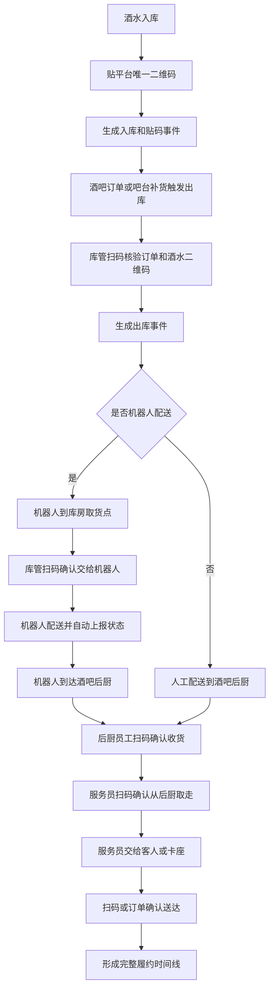

# 全链路操作留痕与终端开关 PRD V0.1

> **⚠️ R5 业务HTML缺口审计修正标注（2026-06-18，只读审计后回填，未改代码）**
> 以业务说明地图（治理 #terminal-switch、business #risk）为基准核验真实代码：
> - **终端开关后端拒绝铁律（§5.4）未实现**：除 kiosk 售票配置一处外，finance/bar/ticketing/amusement/inventory 业务接口前**无任何开关校验**，无拦截器/AOP/Filter，可被直接绕过；`terminal.access_rejected` 仅在 kiosk 设备凭证失败时触发，场景错位。`findCapabilitySwitch` 全后端唯一业务调用点是 kiosk。
> - **scope 维度收窄**：文档要求 7 维（全局/项目/商户/业务系统/模块/设备/版本），代码只产出 `global`/`device` 两值。
> - **留痕自动生成/异常责任链**：见 `evidence-risk-layer-spec-v0.2.md` R5（通用 `risk_alerts` 状态机未建、三层过程留痕未接线、销售归属/服务责任事件名 order.acquired/sales_attributed 零命中）。
> - **业务裁决（2026-06-18）**：§5.4 后端拒绝铁律本期 P0 必做（关闭后端业务接口独立校验并拒绝+写 terminal.access_rejected）；scope 扩到 7 维（全局/项目/商户/业务系统/模块/设备/版本）含模块级，不接受收窄到 global/device。
> - **候选验收口径**：关闭某端/模块后调用其业务接口被后端拒绝并写 `terminal.access_rejected`，前端隐藏仅作辅助。

## 1. 文档定位

本文档定义综合体管理系统的两个底层规则：

1. 所有有过程的业务动作都必须留痕，包括订单获取、销售归属、现场服务、人工操作、设备操作、机器人交接、系统自动动作、第三方回调、异常首响、复核放行和异常补录。
2. 所有终端都必须有开关接口，包括客人 App、小程序、Web 前端、工作人员平板 App、员工工作手机、员工私人手机 App、商户侧 App/Web、触摸屏一体机等，为后续酒吧系统和乐园系统独立 SaaS 化预留能力。

本文不替代供应链、酒吧、游乐、终端或开放平台 PRD，而是作为这些系统共用的底层约束。

> 修订说明（2026-06-07）：本文第 4.1 节"标准事件类型"是全系统**唯一权威事件字典**，`java-backend §14` 事件清单、`foundation-database` 事件清单、`data-risk-ai` 分析域事件名以及酒吧/安卓落地层事件名，均须与本节一字一致；其他文档不得另起命名（如 `bar.sales.attributed`），分析域只消费本节标准事件名。依据《统一口径基准》D4、finding tracewire-1/trace-2/devtech-6。

## 2. 全链路操作留痕规则

### 2.1 总原则

所有能影响经营事实、库存事实、客户权益、财务金额、员工责任、服务质量、设备状态和安全状态的动作都必须生成留痕记录。

留痕分两类：

| 类型 | 说明 | 示例 |
|---|---|---|
| 主动留痕 | 员工、主管、商户、客人主动扫码、确认、拍照、签名、填写原因 | 员工扫码确认出库、后厨扫码确认收货、主管审批补录 |
| 被动留痕 | 系统、设备、机器人、摄像头、第三方接口自动上报 | 机器人到达、接口回调、设备心跳、支付成功 |

每条留痕至少要能回答：

| 问题 | 字段 |
|---|---|
| 谁做的 | 员工、客人、设备、机器人、第三方应用或系统 |
| 在哪里做的 | 综合体、商户、库房、点位、卡座、吧台、后厨、设备位置 |
| 对什么做的 | 订单、票、权益、酒水、物料、存酒、机器人任务、设备、合同 |
| 什么时候做的 | 业务发生时间、系统接收时间 |
| 用什么做的 | 工作手机、平板、一体机、扫码枪、机器人、开放接口 |
| 做了什么 | 入库、贴码、出库、核验、交接、送达、作废、审批、补录 |
| 做之前和之后状态 | 原状态、新状态、原位置、新位置、原数量、新数量 |
| 结果是什么 | 成功、失败、异常、待确认、被拒绝 |
| 有没有证据 | 二维码、照片、视频、签名、接口原始报文、摄像头索引 |

### 2.2 留痕设计原则

留痕的设计目标不是让员工额外填很多表，而是让系统在业务动作发生时自动把痕留下来。

| 原则 | 说明 | 示例 |
|---|---|---|
| 动作即留痕 | 只要点击、扫码、支付、核销、派单、接单、切换状态，系统自动写事件 | 服务员在平板下单时自动记录服务员、卡座、设备和时间 |
| 上下文自动带入 | 尽量从登录账号、设备绑定、班次、点位、桌台、订单来源自动取值 | 工作手机已绑定员工和点位，扫码时不用再填写是谁、在哪 |
| 人工只补原因 | 人工输入只用于异常原因、照片说明、复核意见、特殊放行理由 | 退款、免单、调账必须写原因，普通支付成功不需要手填 |
| 被动数据优先 | 能由系统、设备、机器人、支付、第三方、企业微信、MDM 上报的，不要求员工重复确认 | 支付成功、机器人到达、设备离线、企微会话归档自动留痕 |
| 关键节点双证据 | 高风险节点尽量同时有业务事件和证据索引 | 高价值酒水报损同时有操作事件、照片和后续视频索引 |
| 缺口可补录但要升级 | 记录缺失时允许补录，但补录本身必须留痕并进入上级复核 | 日结后补录、异常关闭、责任人变更必须记录申请人和审批人 |

### 2.3 必须留痕的业务过程清单

| 过程 | 必须留下的事实 | 优先自动留痕方式 |
|---|---|---|
| 订单获取 | 订单来源、渠道、销售人员、创建终端、创建时间、客人身份、关联卡座或项目 | App/小程序/第三方回调自动写入；销售工作台创建订台时自动记录销售账号 |
| 销售归属 | 谁促成订台、谁维护客户、是否涉及提成或业绩归属 | 销售登录状态、岗位快照、客户归属、订台单创建人、跟进记录自动关联 |
| 票务购买 | 购买渠道、票种、价格策略、优惠规则、支付结果、防伪码生成 | 官方端和第三方订单回流自动写事件，员工不能代买门票 |
| 票务核销 | 谁核销、在哪个入口核销、核销设备、核销结果、失败原因、人工放行人 | 工作手机扫码自动带入员工、设备、点位和时间 |
| 会员积分 | 积分发放、扣减、兑换礼品、等级变化、规则命中 | 订单支付、核销、兑换动作自动触发 |
| 订台和到店 | 订台入口、销售或设备来源、定金、到店确认、取消原因、转台 | App/小程序/一体机/销售工作台动作自动记录 |
| 卡座服务 | 卡座当前责任服务员、协助服务员、开台、加单、送达、换人、清台 | 班次排班、桌台绑定、平板点单、扫码送达自动形成服务时间线 |
| 卡座销售提成 | 卡座销售归属、销售人员/非销售人员岗位快照、可计提消费额、提成率、提成金额、复核和冲正 | 订台、开台、账单结清、日结锁定和财务复核自动生成 |
| 酒吧点单 | 下单人、下单设备、卡座、最低消费校验、商品明细、支付方式、收款人 | 平板、一体机、支付回调、POS/现金收款确认自动记录 |
| 酒水履约 | 出库核验、配送、后厨接收、服务员取走、送达客人或卡座 | 物品码、订单码、机器人状态和工作手机扫码串联 |
| 吧台按杯销售 | 标准出酒量、实际扣减、损耗、操作人、复核人 | 商品规则自动扣减，超阈值自动生成损耗异常 |
| 存酒 | 存入、拍照、数量标记、取酒、转赠、作废、争议处理 | 标签码、照片、员工扫码和客人手机号/昵称绑定 |
| 游乐运营 | 项目开放、场次、容量、核销、暂停、恢复、巡检、检修 | 一体机、工作手机、后台状态切换自动写事件 |
| 供应链采购 | 供应商、合同、采购单、到货、验收、入库、差异、付款关联 | 采购单状态、入库验收、合同校验自动写事件 |
| 合同和准入 | 合同摘要、基础定义、违规命中、流程卡住、上级放行 | 合同规则引擎命中时自动生成阻断和放行事件 |
| 员工和设备 | 员工注册、审批、角色权限、设备凭证绑定、工作手机领用、归还、Root/MDM 异常 | 注册审批、设备心跳、策略命中、权限变更自动写事件 |
| 企业微信 | 会话归档、客户沟通、疑似违规、质检复核、查看原文 | 企业微信同步和质检规则自动写事件，查看会话原文也要留痕 |
| 第三方回流 | 团购订单、券核销、接口失败、重复、延迟、差异 | Webhook、幂等校验、重试队列和对账任务自动写事件 |
| 异常处理 | 谁发现、谁第一个处理、谁接手、谁升级、谁关闭、关闭结论 | 异常创建、接单、转派、处理、复核、关闭动作自动形成时间线 |

### 2.4 订单、服务和异常的责任链

订单、服务和异常不是单点记录，而是责任链。

| 责任链 | 需要追溯的问题 | 核心字段 |
|---|---|---|
| 订单责任链 | 订单从哪里来，谁促成，谁创建，是否改价、退款或取消 | order_id、channel、sales_staff_id、sales_staff_position_type_snapshot、created_by、terminal_type、price_rule_id、payment_id |
| 服务责任链 | 客人坐在哪个卡座，谁负责服务，谁加单，谁送达，是否换人 | table_id、seat_id、primary_service_staff_id、assist_staff_ids、shift_id、service_start_at、service_end_at |
| 异常责任链 | 谁最先发现，谁第一个处理，谁升级，谁复核，最后怎么关闭 | exception_id、first_reported_by、first_handler_id、assigned_to、escalated_to、resolved_by、reviewed_by |
| 财务责任链 | 谁收款，谁退款，谁免单，谁调账，日结后谁申请补录 | bill_id、payment_method、cashier_id、adjusted_by、approved_by、settlement_batch_id |
| 设备责任链 | 哪台设备执行动作，谁领用，在哪个点位，是否异常 | device_id、assigned_staff_id、location_point_id、device_status、mdm_policy_result |

### 2.5 视频关联策略

视频监控前期不作为 P0 强依赖，但所有事件都要为后续视频一一对应预留条件。

| 阶段 | 设计 |
|---|---|
| P0 | 事件必须记录项目、区域、点位、设备、发生时间和持续时间范围；后台能按这些字段推导候选摄像头，不要求真实调阅视频 |
| P1 | 接入视频平台后，按事件点位和时间自动生成候选视频片段索引，人工可确认绑定 |
| P2 | 对高风险事件自动推荐视频片段，结合 AI 做异常动作识别和服务质量复盘 |

## 3. 酒水和物料二维码留痕

### 3.1 唯一码生成时机

酒水、礼品、高价值物料和需要追责的耗材必须具备唯一追踪码。

| 场景 | 规则 |
|---|---|
| 入库时贴码 | 推荐用于瓶装酒、高价值物品、礼品、客人存酒和需要长期追踪的物品 |
| 出库时打印码 | 可用于一次性配送批次、消耗品领用包、临时组合包 |
| 既有厂家码 | 可以保留厂家码，但平台仍要生成自己的平台追踪码 |
| 客人存酒 | 瓶身或瓶底标签必须和平台存酒二维码绑定 |

二维码必须关联：

- 物品或酒水档案。
- 入库批次。
- 所属综合体、商户和库房。
- 当前状态和当前所在位置。
- 当前责任人或责任设备。
- 关联订单、账单、权益或机器人任务。
- 防伪摘要、二维码版本和作废状态。

### 3.2 酒水从库房到客人的留痕流程

### 3.3 必须记录的节点

| 节点 | 留痕动作 | 责任人或设备 |
|---|---|---|
| 入库贴码 | 扫码或生成码，记录批次、库位、照片可选 | 库管 |
| 出库核验 | 扫订单码和物品码，校验是否匹配 | 库管或授权员工 |
| 机器人取货 | 机器人到达、员工扫码确认交接 | 机器人 + 库管 |
| 人工配送 | 员工扫码确认领取配送 | 配送员工 |
| 到达后厨 | 后厨员工扫码确认收货 | 后厨员工 |
| 服务员取走 | 服务员扫码确认从后厨取走 | 服务员 |
| 交给客人 | 服务员扫码确认送达卡座或客人 | 服务员，必要时客人确认 |
| 异常 | 丢失、破损、错货、超时、拒收、数量不符 | 当前责任人 + 主管复核 |

## 4. 事件和时间线

### 4.1 标准事件类型

| 事件类型 | 含义 |
|---|---|
| `inventory.item_labeled` | 物品入库或补贴平台唯一码 |
| `inventory.inbound_verified` | 入库验收完成 |
| `inventory.outbound_requested` | 出库或补货申请 |
| `inventory.outbound_verified` | 出库扫码核验完成 |
| `inventory.handover_to_robot` | 员工确认交给机器人 |
| `robot.pickup_arrived` | 机器人到达取货点 |
| `robot.delivery_arrived` | 机器人到达目标点 |
| `bar_kitchen.goods_received` | 酒吧后厨扫码收货 |
| `bar_service.goods_picked_up` | 服务员从后厨取走 |
| `bar_service.goods_delivered` | 服务员送达客人或卡座 |
| `inventory.exception_reported` | 库存或交接异常 |
| `inventory.exception_resolved` | 异常处理完成 |
| `order.acquired` | 订单被获取或创建 |
| `order.sales_attributed` | 订单销售归属确认或变更 |
| `reservation.deposit_paid` | 订台定金支付完成 |
| `table.service_assigned` | 卡座或桌台分配责任服务员 |
| `table.service_changed` | 服务责任人变更 |
| `bar.order_created` | 酒吧点单创建 |
| `bar.order_delivered` | 酒吧订单送达 |
| `payment.cash_received` | 现金收款确认 |
| `payment.pos_received` | POS 收款确认 |
| `contract.blocked` | 合同或基础定义违规命中、准入流程被卡住（修订说明 2026-06-07 新增，trace-3） |
| `contract.released` | 合同准入经上级审核放行（修订说明 2026-06-07 新增，trace-3） |
| `exception.reported` | 异常被发现或上报 |
| `exception.first_handled` | 异常第一处理人接单 |
| `exception.escalated` | 异常升级 |
| `exception.resolved` | 异常处理完成 |
| `exception.reviewed` | 异常复核完成 |
| `video.candidate_matched` | 事件候选视频片段匹配 |
| `terminal.access_rejected` | 终端/模块开关关闭或开关拉取失败兜底关闭时，后端拒绝访问并留痕（修订说明 2026-06-07 新增，switch-4/switch-5） |

> 修订说明（2026-06-08 三轮收口）：本主表原有的聚合事件 `member.points_changed`（会员积分发放或扣减）**已删除**——会员积分变更统一由 §4.1.4 的细粒度事件 `points.earned`（获取）/`points.deducted`（扣减/冲正）/`points.redeemed`（兑换）/`points.expired`（到期清零）承载，避免同一字典内"聚合旧名 + 细粒度新名"双轨并存致分析域空跑。`java-backend §14`、`data-risk-ai §7.1` 均改为消费 `points.*` 四子事件，不再引用 `member.points_changed`。依据 R3、finding struct-annot-1/2、critic2-3、event-consumers-8。

> 修订说明（2026-06-08 三轮收口）：订台-定金生命周期由 `reservation.created` + `reservation.deposit_paid` + `reservation.deposit_settled` 三个事件分阶段承载，**三者均保留、非重复**，各自触发点与载荷如下，消除"deposit_paid 与 deposit_settled 重复"的误解：
> - `reservation.created`（域=service，登记于 §4.1.2）：**订台创建**时触发（客人/员工提交订台、生成预订单），载荷=预订、来源、终端、订金（应付）、设备、点位。由后端在订台创建环节按权威名写入。
> - `reservation.deposit_paid`（域=service，登记于本主表）：**客人支付定金完成**时触发（仅资金到账这一动作），载荷=预订、订金（分，实付）、支付渠道、支付流水、付款人。客人端付定金事件用此名（见 customer-app §4.3）。
> - `reservation.deposit_settled`（域=service，登记于 §4.1.2）：**定金最终结算**时触发（抵扣/退还/没收，酒吧侧闭环），载荷=预订、订金（分）、`deposit_status`（deducted/refunded/forfeited）、原因、审批人。
> 即：created=下单阶段、deposit_paid=客人付款阶段、deposit_settled=结算阶段，三者是订台-定金同一生命周期的不同节点而非同义重复。依据 R4、finding event-consumers-5、critic2-5。

> 修订说明（2026-06-07 收口）：以下事件为本轮各业务域开发设计新增、但此前未登记进唯一权威字典的标准事件，现统一补登入本表，使供应链/酒吧/订台/票务/核销/退款/会员/合规/容量等域的事件名在权威字典有唯一落点（保持点+下划线风格）。补登后 `java-backend §14`、`foundation-database` 事件清单、`data-risk-ai §7.1` 引用一字对齐。依据 finding broken-ref-2/3/4、baseline-conf-5、annotation-1、《统一口径基准》D4。每条给出 `event_category`（对齐 `audit_events.event_category` / data-risk §7.1 分析域）与载荷要点。

#### 4.1.1 供应链域事件（event_category=inventory / 供应链；依据 broken-ref-4，对齐 supply-chain §9）

| 事件类型 | event_category | 含义与载荷要点 |
|---|---|---|
| `supplier.blacklisted` | inventory | 供应商拉黑：supplier_id、原因、操作人 |
| `supply_contract.approved` | inventory | 供应合同审批通过：contract_id、采购模式、供货范围、有效期、审批人 |
| `purchase.ordered` | inventory | 采购下单：purchase_cycle_id、supplier_id、contract_id、金额（分） |
| `inventory.inbound_confirmed` | inventory | 入库确认：item_id、batch_id、数量、成本（分）、进货查验记录 |
| `inventory.inspection_recorded` | inventory | 进货查验登记（C9）：batch_id、供货方资质、票据、合格证明 |
| `inventory.transferred` | inventory | 库存调拨：来源库、目标库、数量 |
| `inventory.redeem_reserved` | inventory | 兑换预占（pass-2）：兑换引用、礼品库、item_id、数量 |
| `inventory.gift_claimed` | inventory | 礼物领取实扣（pass-2）：兑换引用、流水、数量 |
| `inventory.damaged` | inventory | 报损：item_id、数量、原因、是否高价值、photo_refs、video_refs |
| `inventory.surplus_recorded` | inventory | 报溢/盘盈（supply-5）：item_id、数量、原因、证据、审批人 |
| `inventory.counted` | inventory | 盘点：账面、实盘、差异 |
| `inventory.reversed` | inventory | 库存流水冲正：原流水、原因 |
| `inventory.loss_exception` | inventory | 库存/出品损耗超阈值异常（统一承载酒吧 `bar.stock.loss_exception` 语义）：商品、标准出量、实际出量、损耗量、阈值、出品人 |

#### 4.1.2 酒吧/订台域事件（event_category=bar / service；依据 baseline-conf-5、broken-ref-2/3，对齐 bar-operations §9、customer-app §4.3）

| 事件类型 | event_category | 含义与载荷要点 |
|---|---|---|
| `bar.table.opened` | service | 开台：桌台、会话、员工、设备、人数 |
| `bar.table.transferred` | service | 转台：原桌台、目标桌台、原因 |
| `bar.table.cleared` | service | 清台：桌台、会话、员工 |
| `reservation.created` | service | 创建订台（统一命名，替代 `bar.reservation.created` 三段写法）：预订、来源、终端、订金、设备、点位 |
| `reservation.deposit_settled` | service | 订金结算（抵扣/退还/没收）：预订、订金（分）、deposit_status（deducted/refunded/forfeited）、原因、审批人 |
| `bar.table_commission.calculated` | finance | 卡座提成计算：预订、账单、卡座、销售人员、岗位快照、可计提消费额、提成率、提成金额 |
| `bar.table_commission.adjusted` | finance | 卡座提成调整/冲正：原提成记录、调整原因、调整前后金额、复核人 |
| `bar.order_created` | bar | 酒吧点单创建（权威命名；替代 `bar.order.created`，见 baseline-conf-5）：点单号、桌台、员工、金额（分） |
| `bar.order_delivered` | bar | 酒吧订单送达：点单、桌台、送达人、设备、点位 |
| `bar.bill_settled` | bar | 账单结清（对齐 data-risk §7.1）：账单、支付方式、金额（分）、流水 |
| `bar.saved_bottle.created` | bar | 存酒登记：存酒编号、客户摘要、酒水、数量、照片/签收证据、员工 |
| `bar.saved_bottle_picked_up` | bar | 存酒取酒（对齐 data-risk §7.1）：存酒编号、取用量、剩余量、员工 |
| `bar.saved_bottle.voided` | bar | 存酒作废：存酒编号、作废原因、审批单、照片/视频证据、操作人 |
| `bar.gift_redeemed` | bar | 赠饮/赠送核销（对齐 data-risk §7.1）：商品、金额（分）、授权人 |
| `bar.age_verification.previewed` | compliance | 酒吧入口年龄/人脸核验预检：核验对象、入口点位、供应商配置状态、设备、员工 |
| `bar.age_verification.requested` | compliance | 触发第三方人脸/年龄核验或等效设备核验：核验对象、供应商、请求流水、点位、设备 |
| `bar.age_verification.passed` | compliance | 年龄/人脸核验通过：核验对象、最小必要结果、供应商流水、有效窗口、点位 |
| `bar.age_verification.rejected` | compliance | 年龄/人脸核验拒绝：拒绝原因、最小必要结果、供应商流水、点位 |
| `bar.age_verification.blocked` | compliance | 生产未配置供应商/设备、超时或合规阻断：阻断原因、点位、设备、员工 |
| `bar.table_guest.checked_in` | service | 卡座预约入场名额核销成功：reservation_id、bar_venue_id、table_id、入场人数、剩余额度、设备、员工、idempotency_key |
| `bar.table_guest.rejected` | service | 卡座预约入场名额核销拒绝：reservation_id、bar_venue_id、拒绝原因、已用额度、剩余额度、设备、员工 |

#### 4.1.3 票务/核销/退款域事件（event_category=ticket；依据 annotation-1，对齐 data-risk §7.1 与 ticketing §9）

> 说明：本组登记的是事件中心 `event_name` 标准名。票务开发设计中的预检、签名失败、疑似变造、离线冲突等细分语义不得另起旧事件名写入事件中心，应放入 `reason_code`、`event_subtype` 或业务 payload；分析、风控和审计只消费下列标准名。

| 事件类型 | event_category | 含义与载荷要点 |
|---|---|---|
| `ticket.issued` | ticket | 出票：票号、订单、产品 |
| `ticket.refunded` | ticket | 退票/退款完成（聚合 ticketing §9.3 refund.* 链路终态）：退款单、订单、金额（分）、支付机构流水 |
| `ticket.changed` | ticket | 票务改期/变更：票号、原场次、新场次、原因 |
| `ticket.inventory_locked` | ticket | 下单锁库存（对齐 critic-11，承载 ticketing `ticket.inventory.locked`）：产品ID、日期、数量、订单 |
| `ticket.inventory_released` | ticket | 取消/退款释放库存（承载 ticketing `ticket.inventory.released`）：产品ID、日期、数量、原因 |
| `verification.previewed` | ticket | 核销预检：权益摘要、点位、设备、风险提示、是否可核销；预检不扣次 |
| `verification.succeeded` | ticket | 核销成功：权益、扣次、商户、点位、设备、员工 |
| `verification.failed` | ticket | 核销失败：失败原因、票码哈希、设备、员工 |
| `verification.reversed` | ticket | 核销撤销/冲正：原核销记录、原因、审批单、操作人、设备 |
| `verification.manual_overridden` | ticket | 人工放行：原拒绝/异常记录、放行原因、证据、审批人、点位、设备 |

#### 4.1.3A 游乐、支付与财务补充事件（event_category=amusement / finance；对齐 data-risk §7.1 和 P0 留痕矩阵）

| 事件类型 | event_category | 含义与载荷要点 |
|---|---|---|
| `amusement.verification_succeeded` | amusement | 游乐权益核销成功：项目、场次、权益、点位、设备、员工、容量快照 |
| `amusement.verification_failed` | amusement | 游乐权益核销失败：项目、场次、失败原因、权益摘要、点位、设备、员工 |
| `amusement.verification_overridden` | amusement | 游乐人工放行：项目、场次、原失败原因、审批人、证据、点位 |
| `amusement.device_status_changed` | amusement | 游乐设备/项目状态变化：设备或项目、原状态、新状态、原因、责任人 |
| `amusement.safety_inspection.submitted` | amusement | 游乐安全/巡检记录提交：项目、检查项、结果、照片/视频、提交人、点位 |
| `payment.gateway_notified` | finance | 聚合支付/退款通道回调：通道、订单/退款单、金额（分）、原始报文摘要、签名校验、幂等键 |
| `payment.poll_checked` | finance | 支付/退款轮询校验：通道、订单/退款单、查询结果、差异状态、任务批次 |
| `refund.succeeded` | finance | 退款成功财务终态：退款单、原订单、金额（分）、支付机构流水、到账时间 |
| `bill.adjusted` | finance | 账单调整：账单、调整金额（分）、原因、审批单、调整前后快照 |
| `bill.waived` | finance | 免单/减免：账单、减免金额（分）、原因、审批单、授权人 |
| `settlement.confirmed` | finance | 结算确认：结算周期、主体、金额汇总、差异说明、确认人 |

#### 4.1.4 会员/合规/容量域事件（event_category=customer / personnel / facility / compliance；依据本轮 compliance C1/C5/C8/C10、critic-8、对齐 data-risk §7.1）

| 事件类型 | event_category | 含义与载荷要点 |
|---|---|---|
| `points.earned` | customer | 会员积分获取（data-risk §7.1 customer 行消费本细粒度事件）：customer_id、积分数、来源订单/动作、规则 |
| `points.deducted` | customer | 会员积分扣减/冲正（data-risk §7.1 消费本事件）：customer_id、积分数、原因、关联流水 |
| `points.redeemed` | customer | 积分兑换礼品（data-risk §7.1 消费本事件）：customer_id、积分数、兑换礼品、扣库存流水 |
| `points.expired` | customer | 积分到期清零（critic-10 过期作业写入）：customer_id、积分数、过期批次/清零规则 |
| `consent.recorded` | personnel | 同意采集（PIPL C2；含客人侧与员工监控告知 C10）：consent_subject_id、consent_version、consent_scope、consent_channel、is_sensitive_consent |
| `consent.withdrawn` | personnel | 撤回同意（C2）：consent_subject_id、原同意版本、withdrawn_at、级联处置范围 |
| `venue.over_capacity` | facility | 场所超容（C8：酒吧/全场实时在场≥核定/消防容量，对应风控规则 VENUE_OVER_CAPACITY）：venue_id/area_id、当前在场数、max_occupancy/fire_capacity、触发动作（拦截/预警） |
| `personal_data.purged` | compliance | 个人信息到期销毁（C5：留存到期销毁定时作业 `data_retention_purge_job` 每条处置写入）：data_category、target_table、affected_count、disposal_action（purge）、job_log_id |
| `personal_data.anonymized` | compliance | 个人信息到期匿名化（C5：留存到期匿名化处置写入）：data_category、target_table、affected_count、disposal_action（anonymize）、job_log_id |

#### 4.1.5 机器人、企微、第三方、设备、权限与风控事件（event_category=robot / conversation / third_party / facility / personnel / risk）

| 事件类型 | event_category | 含义与载荷要点 |
|---|---|---|
| `robot.task_created` | robot | 机器人任务创建：任务、来源订单、取货点、送达点、优先级 |
| `robot.task_signed` | robot | 机器人任务签收：任务、签收人、签收方式、异常说明、设备 |
| `wecom.message_received` | conversation | 企业微信会话消息入库：员工、客户或会话、消息摘要、脱敏状态、同步批次 |
| `wecom.risk_hit` | conversation | 企业微信质检规则命中：规则、会话、消息摘要、风险等级、复核状态 |
| `wecom.conversation_synced` | conversation | 企业微信会话同步批次完成：员工、批次、成功数、失败数、失败原因 |
| `catering.order_synced` | third_party | 餐饮第三方订单同步：供应商、订单、金额（分）、状态、幂等键 |
| `retail.order_synced` | third_party | 零售第三方订单同步：供应商、订单、金额（分）、状态、幂等键 |
| `voucher.verified_synced` | third_party | 第三方券核销结果同步：供应商、券码摘要、核销结果、原始流水 |
| `reconciliation.diff_found` | third_party | 第三方/支付/订单对账差异发现：来源、对象、差异类型、金额（分）、批次 |
| `device.policy_violation` | facility | 受管设备策略违规：设备、员工、违规类型、策略版本、处置结果 |
| `device.locked` | facility | 设备远程锁定：设备、原因、操作人、锁定策略、恢复条件 |
| `permission.granted` | personnel | 权限授予：员工、权限点、模板/审批来源、生效时间、有效期 |
| `permission.revoked` | personnel | 权限撤销：员工、权限点、撤销原因、操作人、生效时间 |
| `sensitive.viewed` | personnel | 敏感证据/敏感数据查看：查看人、对象、用途、审批单、脱敏状态 |
| `evidence.exported` | personnel | 证据导出：导出人、对象范围、用途、审批单、水印和文件摘要 |
| `risk.alert_created` | risk | 风控告警创建：规则、对象、风险等级、命中证据、责任队列 |
| `risk.alert_resolved` | risk | 风控告警关闭/解决：告警、处置结果、复核人、证据、关闭原因 |

> 修订说明（2026-06-08 三轮收口）：① `points.earned`/`points.redeemed` 原括注"对齐 data-risk `member.point_earned`/`member.point_redeemed`"为悬空引用（data-risk 全文无这两个名）——已改为说明"data-risk §7.1 消费本 `points.*` 细粒度事件"，与 R3 删除主表聚合旧名 `member.points_changed` 后两侧统一用 `points.*` 一致（依据 R3、event-consumers-8、struct-annot-2、critic2-3）。② 新登记 `personal_data.purged`/`personal_data.anonymized`（域=合规）承载 C5 留存销毁/匿名化作业（`data-risk §11.6.2`）每条处置的事件留痕，载荷统一为 data_category/target_table/affected_count/disposal_action/job_log_id；登记后 data-risk §11.6.2 与 java-backend §14 同步补入（依据 R6、compliance-wired-5、struct-annot-7）。

### 4.2 时间线查询

管理后台、商户侧和风控页面应支持按以下对象查看时间线：

- 单瓶酒或单个物品二维码。
- 出库单、补货单、点酒订单、吧台订单。
- 机器人任务。
- 酒吧卡座或桌台。
- 订单获取和销售归属。
- 客人服务过程。
- 员工当班记录。
- 异常事件。
- 视频候选片段或证据索引。

## 5. 终端开关接口规则

### 5.1 总原则

所有终端都必须经过后台开关控制。开关关闭时，该终端或该终端上的指定模块不可用；开关打开时，仍要继续经过登录、设备可信、商户范围、角色权限、单一功能权限和数据权限校验。

终端开关不是权限的替代品，而是系统级、商户级、业务级和 SaaS 化配置能力。

### 5.2 终端范围

| 终端 | 开关用途 |
|---|---|
| 客人 App | 控制游客 App 是否开放，以及票务、预定、会员积分、兑换等模块是否开放 |
| 小程序 | 控制小程序是否开放，并可和 App 分别开关 |
| Web 前端 | 控制业务人员只读查看和少量确认能力 |
| 工作人员平板 App | 控制酒吧点酒下单能力，支持按酒吧商户启停 |
| 员工工作手机 | 控制核销、权益领取、库房扫码、巡检、企业微信状态等能力 |
| 员工私人手机 App | 控制注册、通知、设备凭证绑定和状态查看 |
| 商户侧 App/Web | 控制商户侧入口和商户可用模块 |
| 触摸屏一体机 | 控制权益展示、订台、吧台买酒、游乐状态查看和检修记录 |
| 移动管理端 | 控制主管待办、复核和关键指标查看 |

### 5.3 开关层级

| 层级 | 说明 |
|---|---|
| 全局开关 | 整个系统是否启用某类终端 |
| 综合体项目开关 | 某个综合体是否启用某类终端 |
| 商户开关 | 某个商户是否启用商户侧、酒吧平板或乐园端 |
| 业务系统开关 | 票务、酒吧、游乐、供应链、会员、第三方等是否开放 |
| 模块开关 | 点酒、订台、核销、积分兑换、库房扫码、检修记录等模块是否开放 |
| 端版本开关 | 某个 App 版本、设备版本是否允许继续使用 |
| 灰度开关 | 仅开放给指定商户、岗位、员工、设备或点位 |

### 5.4 关闭后的表现

> 修订说明（2026-06-07）：所有关闭场景**不得只靠前端隐藏/置灰**。前端隐藏只是体验层；任何被开关关闭的终端、商户、业务系统、模块、设备或版本，**后端接口都必须独立校验开关状态并拒绝请求**（返回明确的"已关闭/未开放"错误码），并写入 `terminal.access_rejected` 事件留痕（记录 scope_type、scope_id、terminal_type、business_system、module_code、actor、device、occurred_at、reject_reason），以便审计"谁在已关闭的端/模块上尝试了什么操作"。依据 finding switch-4。

> 修订说明（2026-06-18，E2）：业务已确认 `apps/web/src/legacy-console` 为**正式 Web 前端**（terminal_type=`web`，见 §5.2）。Web 端写动作边界与本节"终端开关后端拒绝铁律"一致：按终端铁律，Web 前端 P0 只承载轻量业务确认 + 跳转，**不在 Web 直接执行门票/权益核销、人工放行、结账支付、存酒/取酒**等改变核销结果/资金/库存的现场作业动作，这些动作改为跳转到管理后台/现场端执行。Web 模块开关关闭后，**后端对应业务接口仍须独立校验并拒绝请求并写 `terminal.access_rejected`**（scope_type 含模块级），前端隐藏仅作辅助，不得因前端已隐藏而免除后端校验。Web 端动作边界、允许/禁止动作清单详见 `frontend-admin-development-design.md` §13A。

| 场景 | 关闭表现 | 后端处置与留痕 |
|---|---|---|
| 终端整体关闭（整端） | 启动页提示暂未开放，不能进入业务 | `/api/terminal/bootstrap-capabilities` 返回该端不可用；该端所有业务接口拒绝并写 `terminal.access_rejected` |
| 模块关闭 | 菜单隐藏或置灰，接口拒绝，记录访问尝试 | 模块下各接口校验 module 开关后拒绝并写 `terminal.access_rejected` |
| 商户关闭 | 该商户入口不可用，不影响其他商户 | 带该 merchant_id 的请求一律拒绝并写 `terminal.access_rejected`（scope_type=merchant），不影响其他商户 |
| 设备关闭 | 指定设备不能继续使用，进入设备异常或停用状态 | 该 device_id 的业务接口拒绝并写 `terminal.access_rejected`（scope_type=device） |
| 版本关闭（端版本） | 旧版本提示升级，不能继续执行业务动作 | 携带被禁用 app/设备版本的请求拒绝并写 `terminal.access_rejected`（scope_type=version） |

### 5.5 灰度开关的 scope_type 处置（修订说明 2026-06-07 新增，switch-3）

5.3 节"开关层级"列出了"灰度开关（仅开放给指定商户、岗位、员工、设备或点位）"，但 6.3 节 `terminal_capability_switches.scope_type` 枚举只有 `global、project、merchant、business_system、module、device、version`，灰度无独立落点。本版裁决（P0）：

- **P0 灰度仅通过既有 `merchant` / `device` / `version` 三个 scope_type 表达**（按商户灰度、按设备灰度、按版本灰度），不新增独立 `gray` scope_type；按"岗位/员工/点位"的更细灰度后置 P1，避免 P0 把开关表做成复杂的人群定向引擎。
- 若业务确需 P0 即支持按岗位/员工/点位灰度，则需改本条并在 6.3 节 `scope_type` 枚举补 `gray`，同时补 `gray_dimension`（merchant/role/staff/device/point）与 `gray_target_ids` 字段；在未补字段前，编码不得臆造 `gray` 取值。
- 依据 finding switch-3。

### 5.6 开关拉取失败的兜底策略（fail-closed，修订说明 2026-06-07 新增，switch-5）

终端启动调用 `/api/terminal/bootstrap-capabilities` 或后端接口实时校验开关时，若开关配置**拉取失败、超时或返回不可解析**，处置原则为 **fail-closed（兜底关闭）**而非 fail-open：

- **客人侧终端（App/小程序/Web）**：拉取失败时默认按"该端/该模块未开放"处理，启动页提示稍后重试，避免开关失效时业务被无差别放开。
- **员工/管理侧终端**：拉取失败时允许在本地缓存的"最近一次成功开关快照"上以只读/受限方式运行，但**写操作类接口在后端仍按 fail-closed 拒绝并写 `terminal.access_rejected`（reject_reason=switch_fetch_failed）**，直至开关恢复。
- 后端任何接口在无法确认开关为"打开"时一律拒绝，不得因开关服务异常而默认放行。
- 依据 finding switch-5。

> 修订说明（2026-06-07 收口，critic-13）：一体机（kiosk）既是"客人侧终端"又是现场固定点位的自助设备（权益领取/订台/吧台买酒），若简单并入上面的"客人侧 fail-closed"，断网或开关拉取失败将导致**整机停摆**，与"现场连续运营"诉求冲突。本版对一体机断网/开关拉取失败的定位作如下显式协调（与 android §8 离线策略对齐）：
>
> - **不是整机停摆，也不是无差别放开**，而是**按最近一次成功开关快照进入"只读/受限运营"**：可继续展示权益、价目、订台信息等只读内容，并执行该快照中**明确为"打开"**的低风险本地动作（如离线排队、信息查询、二维码展示），最大限度保住现场可用性。
> - **资金/核销/库存等写操作类动作仍 fail-closed**：在线优先（P0 不启用离线核销），断网期间这类请求在恢复联网后由后端按当时开关状态二次校验，校验不通过即拒绝并写 `terminal.access_rejected`（reject_reason=switch_fetch_failed / kiosk_offline）。
> - **快照过期保护**：本地开关快照超过约定 TTL（建议与 §5.6 总则一致、由配置下发）仍未刷新成功时，一体机退化为仅展示"请联系现场工作人员"的最小只读态，不再依据可能已失效的旧快照放行任何动作。
> - 即一体机的口径是"**在最近成功快照内只读受限运营（现场连续运营），写操作 fail-closed（资金/核销/库存协调一致）**"，而非"整机停摆"或"无条件放行"。依据 finding critic-13、与 §5.6 fail-closed 总则及 `android-device-terminal-development-design §8` 离线策略协调。

### 5.7 商户"全开放"与开关优先级裁决（修订说明 2026-06-07 新增，switch-6）

商户侧已拍板"在授权业务范围内全开放，不看平台全局和其他商户"（决策日志），与本文"所有终端都必须经过后台开关控制"存在表面张力。本版裁决开关优先级（从高到低，**高层级关闭一律压倒低层级打开**）：

1. 全局开关（global）
2. 综合体项目开关（project）
3. 商户开关（merchant）
4. 业务系统开关（business_system）
5. 模块开关（module）
6. 端版本开关（version）/ 设备开关（device）
7. 灰度命中（见 5.5）

裁决口径：

- "商户全开放"指的是**在平台已为该商户打开的授权业务范围内，商户可使用其全部经营/库存/对账等功能**，而**不是**绕过终端开关。即：平台层（global/project/merchant/business_system/module）任一开关关闭，商户侧对应入口即不可用；只有当上层全部为"打开"时，商户在其授权范围内才"全开放"。
- 因此"全开放"与"必须有开关"不矛盾：开关是平台对商户授权边界的系统级闸门，"全开放"是闸门之内的体验。
- 依据 finding switch-6。

## 6. 建议数据对象

### 6.1 inventory_trace_codes 物品追踪码

| 字段 | 说明 |
|---|---|
| id | 追踪码 ID |
| trace_code | 平台唯一追踪码 |
| qr_payload_hash | 二维码内容摘要 |
| item_id | 物品或酒水 ID |
| batch_id | 入库批次 ID |
| bottle_no | 单瓶或单件编号 |
| project_id | 综合体项目 |
| merchant_id | 当前归属商户 |
| warehouse_id | 当前库房 |
| location_point_id | 当前点位 |
| status | in_stock、reserved、outbound、in_robot、bar_kitchen、in_service、delivered、stored_by_customer、voided、exception |
| current_holder_type | warehouse、staff、robot、bar_kitchen、customer、system |
| current_holder_id | 当前责任主体 |
| created_event_id | 创建事件 |
| last_event_id | 最近事件 |

### 6.2 operation_handover_records 操作交接记录

| 字段 | 说明 |
|---|---|
| id | 交接记录 ID |
| trace_code_id | 物品追踪码 ID |
| order_id | 关联订单 nullable |
| robot_task_id | 机器人任务 nullable |
| from_holder_type | 交出方类型 |
| from_holder_id | 交出方 |
| to_holder_type | 接收方类型 |
| to_holder_id | 接收方 |
| handover_node | outbound、to_robot、to_bar_kitchen、to_service_staff、to_customer |
| scanned_by | 扫码员工 |
| device_id | 扫码设备 |
| occurred_at | 发生时间 |
| result | success、failed、abnormal |
| evidence_id | 照片、视频或签名证据 nullable |
| event_id | 关联事件 |

### 6.3 terminal_capability_switches 终端能力开关

| 字段 | 说明 |
|---|---|
| id | 开关 ID |
| scope_type | global、project、merchant、business_system、module、device、version |
| scope_id | 作用范围 ID |
| terminal_type | **D5 10 端权威码（唯一取值集）**：`app`、`miniapp`、`web`、`tablet`、`staff_work_phone`、`staff_private_phone`、`merchant_portal`、`merchant_app`、`kiosk`、`mobile_admin` |
| kiosk_mode | 仅 `terminal_type=kiosk` 时可填：`ticketing`（售票型一体机）、`service`（非售票型服务一体机）；其他终端为空，不作为第 11 种终端 |
| business_system | ticket、bar、amusement、supply_chain、member、finance、risk、third_party、governance |
| module_code | 模块编码 |
| enabled | 是否启用 |
| effective_from | 生效时间 |
| effective_to | 失效时间 nullable |
| reason | 开关原因 |
| updated_by | 操作人 |
| updated_at | 更新时间 |

> 修订说明（2026-06-07 收口）：`terminal_type` 为《统一口径基准》D5"10 端权威表"的唯一落点。本版**直接把表体取值替换为 D5 的 10 个权威码**（`app/miniapp/web/tablet/staff_work_phone/staff_private_phone/merchant_portal/merchant_app/kiosk/mobile_admin`），删除上一版"`guest_app/mini_program/web_frontend/staff_tablet/staff_private_app` 作别名兜底"的写法——权威字段不得携带非权威码；如确需保留历史别名，应另列独立映射表，不在本字段取值集中混入。`foundation-database §6.9`、`platform-governance 字段字典 §3.1`、`java-backend`、`terminal-display-layer` 三处须与本表逐字一致。依据 finding baseline-conf-3、structural-2、annotation-3、switch-1/2、govfam-3、D5。

### 6.4 business_process_instances 业务过程实例

| 字段 | 说明 |
|---|---|
| id | 业务过程 ID |
| process_type | order_acquisition、ticket_verification、table_service、bar_order_fulfillment、inventory_delivery、amusement_operation、exception_handling、finance_adjustment、contract_admission |
| business_object_type | order、ticket、entitlement、table、inventory_item、robot_task、exception、bill、contract |
| business_object_id | 业务对象 ID |
| project_id | 综合体项目 |
| merchant_id | 商户 nullable |
| started_event_id | 起始事件 |
| current_step_code | 当前步骤 |
| status | running、completed、abnormal、cancelled |
| started_at | 开始时间 |
| completed_at | 完成时间 nullable |

> 修订说明（2026-06-07）：process_type 补 `contract_admission`（合同与准入过程），与 `foundation-database §6.10` 对齐为 9 个值，使 2.3 节第 14 行"合同和准入"必须留痕的清单真正可挂到业务过程实例上形成时间线；并在 4.1 节标准事件类型补 `contract.blocked` / `contract.released` 两个合同准入事件。依据 finding trace-3。

### 6.5 business_process_step_records 业务过程步骤记录

| 字段 | 说明 |
|---|---|
| id | 步骤记录 ID |
| process_instance_id | 业务过程 ID |
| step_code | 步骤编码 |
| step_name | 步骤名称 |
| actor_type | staff、customer、device、robot、system、third_party |
| actor_id | 执行主体 ID |
| terminal_type | 执行端 nullable |
| device_id | 执行设备 nullable |
| location_point_id | 执行点位 nullable |
| event_id | 关联事件 |
| auto_captured | 是否自动采集 |
| capture_source | 留痕来源类型：login_context、device_binding、qr_scan、nfc_scan、payment_callback、robot_callback、wecom_archive、third_party_webhook、mdm_event、system_rule、manual_input |
| requires_manual_reason | 是否需要人工原因 |
| result | success、failed、abnormal、skipped |
| occurred_at | 发生时间 |

> 修订说明（2026-06-08 复核修复）：新增 `capture_source`。仅有 `auto_captured` 布尔值无法区分痕迹来自扫码、支付回调、机器人、企业微信、第三方回流、MDM 还是人工补录，也无法统计自动留痕率；本字段用于支撑“尽量自动留痕，人工只补原因和证据”的原始要求。

### 6.6 service_responsibility_records 服务责任记录

| 字段 | 说明 |
|---|---|
| id | 服务责任记录 ID |
| order_id | 订单 ID nullable |
| table_id | 桌台或卡座 ID nullable |
| customer_id | 客人 ID nullable |
| exception_id | 异常 ID nullable |
| primary_service_staff_id | 主责服务员 |
| assist_staff_ids | 协助人员 JSON |
| sales_staff_id | 销售人员 nullable |
| sales_staff_position_type_snapshot | 销售归属员工岗位快照 nullable；`sales_person` 按销售人员提成率，其它岗位按非销售人员提成率 |
| commission_record_id | 卡座提成记录 ID nullable |
| first_handler_staff_id | 异常第一处理人 nullable |
| refunded_by | 退款人员工 ID nullable |
| waived_by | 免单人员工 ID nullable |
| approved_by | 退款/免单审批人员工 ID nullable |
| assigned_by | 分配人或系统 |
| shift_assignment_id | 班次记录 ID nullable，外键指向 `staff_shift_assignments.id`，用于按班次下钻服务责任和异常首响 |
| assigned_event_id | 分配事件 |
| service_start_at | 服务开始时间 |
| service_end_at | 服务结束时间 nullable |
| status | active、changed、completed、cancelled |

> 修订说明（2026-06-08 复核修复）：本表补齐 `exception_id`、`first_handler_staff_id`、`refunded_by`、`waived_by`、`approved_by` 与 `shift_assignment_id`，与 `foundation-database-design §6.12` 的权威落库字段对齐，避免服务责任链在“异常第一处理人、退款/免单责任、按班次下钻”三类编码场景中断裂。

## 7. 能力清单与正式 OpenAPI 补契约要求（非正式 API 路径）

> 2026-06-11 执行口径，2026-06-13 追溯闸口补强：本章 API 清单保留为留痕、终端开关、责任链和视频证据的能力说明。P0 正式接口必须以 `docs/openapi/openapi-p0.yaml`、`docs/openapi/openapi-p0.json`、`p0-openapi-operation-acceptance-matrix-v0.1.md` 和 `p0-openapi-contract-closure-appendix-v0.1.md` 为准；终端能力开关落到 `/api/v1/terminals/capability-switches/**`，证据与事件查询落到 `/api/v1/evidence/**`。历史 `/api/admin/*`、`/api/terminal/bootstrap-capabilities` 路径不得直接作为 P0 Controller 路径，若确需管理端聚合查询，必须先补 OpenAPI operation、权限、数据范围、审计事件和样例准入，并通过 `npm run verify:openapi-closure`。
>
> 下表路径只保留为历史能力名称和迁移参考，不得生成正式接口、mock、自动化用例或供应商联调文档。P0/P1/P2 开发只看正式 OpenAPI、operation 验收矩阵、OpenAPI 追溯附录、权限矩阵、事件矩阵和任务映射表。

> 收口说明（2026-06-18 D7 异常接口口径统一）：旧 `/exceptions/*`、历史 `/api/mobile/*` 以及本表 `/api/admin/exceptions/{id}/first-handle` 等异常相关历史路径**一律 deprecated，不作为 P0 正式契约**，不得直接生成 Controller、mock、自动化用例或供应商联调文档。本节"历史能力路径"与 §8 "P0 异常责任链 P0 必做"**不互斥**：能力上 P0 必须落地异常责任链（发现→第一处理→转派/升级→关闭），但**必须改用正式 OpenAPI operationId**承载，并登记到 `p0-openapi-operation-acceptance-matrix-v0.1.md`、`p0-openapi-contract-closure-appendix-v0.1.md`，通过 `npm run verify:openapi-closure`。即"旧路径作废"管的是路径与契约形态，"责任链 P0 必做"管的是能力范围，两者各管一层、不冲突。

| 方法 | 历史能力路径 | 用途 |
|---|---|---|
| GET | `/api/terminal/bootstrap-capabilities` | 终端启动时获取可用能力 |
| GET | `/api/admin/terminal-switches` | 后台查询终端开关 |
| POST | `/api/admin/terminal-switches` | 新建终端开关 |
| PUT | `/api/admin/terminal-switches/{id}` | 修改终端开关 |
| POST | `/api/admin/terminal-switches/{id}/enable` | 启用终端或模块 |
| POST | `/api/admin/terminal-switches/{id}/disable` | 停用终端或模块 |
| POST | `/api/work/inventory-trace-codes/{code}/scan` | 员工扫码记录物品状态或交接 |
| GET | `/api/admin/inventory-trace-codes/{code}/timeline` | 查看单瓶酒或物品全过程 |
| GET | `/api/admin/operation-handover-records` | 查询交接记录 |
| GET | `/api/admin/events/timeline` | 按订单、员工、物品、机器人任务查看全链路时间线 |
| POST | `/api/events/process-step` | 写入业务过程步骤留痕，供各业务模块统一调用 |
| GET | `/api/admin/business-processes/{id}/timeline` | 查看订单、服务、异常等业务过程时间线 |
| GET | `/api/admin/service-responsibilities` | 查询订单、卡座、客户的服务和销售责任 |
| POST | `/api/admin/exceptions/{id}/first-handle` | 异常第一处理人接单并留痕 |
| POST | `/api/admin/events/{id}/video-candidates` | 为事件生成或查询候选视频片段索引 |

## 8. P0/P1/P2

| 阶段 | 能力 |
|---|---|
| P0 | 统一事件中心、业务过程实例、订单获取和销售归属留痕、卡座服务责任留痕、**异常责任链（发现→第一处理→转派→升级→关闭）全链 P0 必做**、物品追踪码、入库贴码或出库打印码、扫码出库、扫码交接、后厨扫码收货、服务员扫码送达、终端开关表和启动查询接口 |
| P1 | 机器人真实状态回调、摄像头事件自动关联、服务质量复盘、端版本灰度、商户级 SaaS 套餐开关、更多物料类型追踪 |
| P2 | IoT 自动感知、无感交接辅助校验、智能异常判断、跨综合体集团级终端策略、酒吧/乐园独立 SaaS 计费开关 |

> 收口说明（2026-06-18 D7）：P0 异常责任链不是只读留痕，而是含写动作的完整责任链：**发现/上报、第一处理（接单）、转派、升级、关闭**。各写动作必须走正式 OpenAPI operationId（不得用 §7 历史 `/api/admin/exceptions/*`、`/exceptions/*`、`/api/mobile/*` 旧路径），并登记到 `p0-openapi-operation-acceptance-matrix-v0.1.md` 完成验收，对应留痕事件为 §4.1 `exception.reported`/`exception.first_handled`/`exception.escalated`/`exception.resolved`/`exception.reviewed`。各写动作建议 operationId（按现有 OpenAPI 命名约定推导，若与 `openapi-p0.yaml` 既有命名不一致以 OpenAPI 为准）：
>
> | 责任链动作 | 留痕事件 | 建议 operationId |
> |---|---|---|
> | 第一处理（接单） | `exception.first_handled` | `firstHandleException`【待业务/技术确认:operationId 命名】 |
> | 转派 | （转派语义，载于 `assigned_to`） | `transferException`【待业务/技术确认:operationId 命名】 |
> | 升级 | `exception.escalated` | `escalateException`【待业务/技术确认:operationId 命名】 |
> | 关闭 | `exception.resolved` / `exception.reviewed` | `closeException`【待业务/技术确认:operationId 命名】 |
>
> 上述 operationId 须经 OpenAPI 与验收矩阵登记后定稿；未登记前不得据旧路径生成接口或用例。

## 9. 已确认规则

1. 所有有过程的业务动作都必须留痕，主动留痕和被动留痕都要进入统一事件中心。
2. 酒水从库房出库、机器人或人工配送、后厨接收、服务员送达客人，全过程都要扫码或设备事件留痕。
3. 酒水和可追责物品需要平台唯一二维码，可在入库时贴码，也可在出库时打印码，具体按物品类型配置。
4. 订单核验人、出库核验人、后厨接收人、服务员送达人都必须留下员工、设备、时间、地点和结果。
5. 订单获取、销售归属、卡座服务、异常首响、转派升级、复核关闭、现金/POS 收款、人工放行、补录和调账都必须留下责任链。
6. 留痕设计要优先依赖系统、终端、设备、支付、机器人、第三方回调和班次上下文自动生成，人工输入只作为原因、证据和复核补充。
7. 视频监控前期不作为强依赖，但事件必须留下时间、点位和设备信息，为后续视频片段一一对应做准备。
8. 所有端都必须有开关接口，关闭后该端或模块不可用，打开后仍受权限和数据范围控制。
9. 终端开关要支持未来酒吧系统和乐园系统独立 SaaS 化。

## 10. 本版结论

全链路留痕和终端开关是综合体系统的底座能力。前者保证任何订单、销售、服务、异常、酒水、物料、权益、员工和设备动作事后都能追责，并尽量通过业务动作自动生成记录；后者保证不同终端和业务模块可以按综合体、商户、系统、模块逐步开放，为后续酒吧 SaaS 和乐园 SaaS 拆分打基础。

## 变更日志

| 日期 | 类型 | 位置 | 内容 | 原因/依据 |
|---|---|---|---|---|
| 2026-06-07 | 改 | §1 文档定位 | 声明 4.1 节为全系统唯一权威事件字典，其他文档引用不另起命名 | 《统一口径基准》D4；finding tracewire-1/trace-2/devtech-6 |
| 2026-06-07 | 改 | §6.4 业务过程实例 | process_type 补 `contract_admission`，与 foundation-database §6.10 对齐为 9 值 | finding trace-3 |
| 2026-06-07 | 增 | §4.1 标准事件类型 | 补 `contract.blocked`/`contract.released` 合同准入事件 | finding trace-3 |
| 2026-06-07 | 增 | §4.1 标准事件类型 | 补 `terminal.access_rejected` 开关拒绝留痕事件 | finding switch-4/switch-5 |
| 2026-06-07 | 改 | §5.4 关闭后的表现 | 各关闭场景（整端/模块/商户/设备/版本）补"后端接口拒绝 + terminal.access_rejected 留痕"，明确不得只靠前端隐藏 | finding switch-4 |
| 2026-06-07 | 增 | §5.5 灰度处置 | 裁决 P0 灰度仅用 merchant/device/version 表达，不新增 gray scope_type（或声明改本条补 gray 字段） | finding switch-3 |
| 2026-06-07 | 增 | §5.6 fail-closed 兜底 | 开关拉取失败时一律兜底关闭（写操作 fail-closed），不得默认放行 | finding switch-5 |
| 2026-06-07 | 增 | §5.7 优先级裁决 | 给出开关优先级序，裁决商户"全开放"=授权范围内全开放、不绕过上层开关 | finding switch-6 |
| 2026-06-07 | 改 | §6.3 终端能力开关 | terminal_type 标注为 D5 10 端权威落点、含 mobile_admin，并给出与 D5 code 的别名对应 | 《统一口径基准》D5；finding switch-1/2、govfam-3 |
| 2026-06-07 | 增 | §4.1 标准事件类型 | 补登各业务域本轮新增但未登记的事件：供应链 13 条（supplier.blacklisted/supply_contract.approved/purchase.ordered/inventory.* 等）、酒吧订台域（reservation.created/reservation.deposit_settled/bar.bill_settled/bar.saved_bottle_picked_up/bar.gift_redeemed 等）、票务核销退款域（ticket.refunded/ticket.changed/ticket.inventory_locked/released/verification.succeeded/failed）、会员合规容量域（points.earned/deducted/redeemed/expired、consent.recorded/withdrawn、venue.over_capacity），各给 event_category 与载荷要点 | finding broken-ref-2/3/4、baseline-conf-5、annotation-1、D4 |
| 2026-06-10 产品审计 V0.6 | 增/改 | §4.1.3 | 明确事件中心 `event_name` 只写标准名；票务预检补 `verification.previewed`，签名失败/疑似变造/离线冲突等细分语义进入 `reason_code`/`event_subtype`，不再作为旧事件名消费 | 本轮 PM Critic V0.6 事件名漂移修复 |
| 2026-06-07 | 改 | §6.3 terminal_type 表体 | 直接替换为 D5 10 个权威码，删除 guest_app/mini_program/... 别名兜底写法（权威字段不携带非权威码） | finding baseline-conf-3、structural-2、annotation-3、D5 |
| 2026-06-07 | 增 | §5.6 fail-closed 兜底 | 明确一体机断网/开关拉取失败时为"按最近成功快照只读受限运营（现场连续运营），写操作 fail-closed"，非整机停摆 | finding critic-13 |
| 2026-06-08 | 删 | §4.1 标准事件类型 | 删除聚合旧名 `member.points_changed`，会员积分变更统一由 §4.1.4 `points.earned/deducted/redeemed/expired` 细粒度事件承载，消除唯一字典内"聚合旧名+细粒度新名"双轨（data-risk §7.1、java-backend §14 同步只消费 points.*） | R3 / struct-annot-1/2、critic2-3、event-consumers-8 |
| 2026-06-08 | 增 | §4.1 标准事件类型 | 就地说明 `reservation.created`（订台创建）/`reservation.deposit_paid`（客人付定金完成）/`reservation.deposit_settled`（定金最终结算：抵扣/退还/没收）三者各自触发点与载荷，消除"deposit_paid 与 deposit_settled 重复"误解，三者均保留 | R4 / event-consumers-5、critic2-5 |
| 2026-06-08 | 改 | §4.1.4 会员/合规/容量域事件 | 删除 `points.earned`/`points.redeemed` 指向不存在名 `member.point_earned`/`member.point_redeemed` 的错误括注，改为"data-risk §7.1 消费本 points.* 事件" | R3 / event-consumers-8、struct-annot-2 |
| 2026-06-08 | 增 | §4.1.4 会员/合规/容量域事件 | 登记 `personal_data.purged`/`personal_data.anonymized`（域=合规）承载 C5 留存销毁/匿名化作业留痕，载荷 data_category/target_table/affected_count/disposal_action/job_log_id；event_category 扩列 compliance | R6 / compliance-wired-5、struct-annot-7 |
| 2026-06-12 可编码收口 | 改 | §7 | 将 API 清单改为能力清单与正式 OpenAPI 补契约要求，路径列标注为历史能力路径 | 防止留痕/终端开关旧 `/api/admin/*` 和 `/api/terminal/*` 路径被误作 P0 Controller |
| 2026-06-13 OpenAPI 追溯闸口 | 改 | §7 | 留痕、终端开关、责任链和视频证据能力必须能在 OpenAPI、operation 验收矩阵和 `p0-openapi-contract-closure-appendix-v0.1.md` 中追溯；未通过 `verify:openapi-closure` 不得生成接口、mock 或自动化用例 | 防止历史能力清单绕过权限、事件、任务和样例准入 |
| 2026-06-18 E2 | 增 | §5.4 关闭后的表现 | 补同口径修订说明：确认 `legacy-console` 为正式 Web 前端，Web 端写动作边界（不直接核销/人工放行/结账支付/存取酒，只跳转）与"终端开关后端拒绝铁律"一致；Web 模块开关关闭后后端仍须独立校验拒绝并写 `terminal.access_rejected` | 业务已确认（2026-06-18）legacy-console 为正式 Web 前端，须按终端铁律约束 Web 端写动作边界 |
| 2026-06-18 D7 收口 | 改 | §7/§8 | 收口 §7 与 §8 自相矛盾：§7 明确旧 `/exceptions/*`、`/api/mobile/*` 及 `/api/admin/exceptions/*` 历史路径 deprecated、不作正式契约；§8 明确异常责任链（发现→第一处理→转派→升级→关闭）P0 必做，须改用正式 OpenAPI operationId 并登记到 operation 验收矩阵，含 first-handle/transfer/escalate/close 写动作及验收。两节各管路径形态与能力范围、不再互斥；operationId 待 OpenAPI 与验收矩阵登记后定稿 | D7 异常接口 §7/§8 自相矛盾收口 |
