# 平台治理产品规格 V0.2
> 2026-07-04 逻辑一致性修订：§9.6 准入落库口径收口为 supervisor_review + supervisor_review_decisions（admission_audits/contract_admission_rules 从未建）；§14A 终端开关职责边界脚注；补名词四层脚注

> **⚠️ R5 业务HTML缺口审计修正标注（2026-06-18，只读审计后回填，未改代码）**
> 以业务说明地图为基准核验真实迁移(V001–V065)+代码，本规格涉及的两条治理链与文档声称不符：
> - **合同准入卡控+分级放行（HTML #contract/#flow 核心链）**：`SupervisorReviewService.evaluate` 是孤立 HTTP 评估接口，票务/酒吧/游乐/结算等业务域**在动作前零调用**它，"超范围→卡住→升级→放行"闸口**不触发**；`AdmissionAuditsPage` 仅聚合 merchants/bindings/contracts 三列表做伪闭环。`contract_admission_rules`/`admission_audits` 两表**从未建**，审批层级实际落 `supervisor_review_decisions`(V057)——本规格 §9.6"合同准入规则页"与"admission_audits.approval_level"表述需收口。
> - **终端开关后端拒绝**：见 `operation-traceability-and-terminal-switch-prd-v0.1.md` R5 标注，后端业务接口未独立校验开关。
> - **业务裁决（2026-06-18）**：①准入统一走 supervisor_review，作废 admission_audits/contract_admission_rules 相关表述；票务/酒吧/游乐/结算业务动作前内嵌准入校验调用，本期 P0。②权限点首批=**全业务域最小颗粒度预置、实施阶段边配边补**（二轮裁决，与治理 HTML 拍板一致）。
> - **候选验收口径**：超合同/超空间动作在票务/酒吧/游乐/结算任一业务接口被阻断，并可经配置层级审批放行、留原因+责任人。

> 合并说明：本文按 2026-06-10 全量文档收口与合并归档审计执行，用于替代下列分散源文件。源文件已移入 `_archive/20260610-retention-audit/merged-layer-spec-sources/`，后续开发、审计和交接以本文为入口。

| 原文件 | 归档位置 |
|---|---|
| `platform-governance-page-list-v0.1.md` | `_archive/20260610-retention-audit/merged-layer-spec-sources/platform-governance-page-list-v0.1.md` |
| `platform-governance-field-dictionary-v0.1.md` | `_archive/20260610-retention-audit/merged-layer-spec-sources/platform-governance-field-dictionary-v0.1.md` |
| `platform-governance-flow-diagrams-v0.1.md` | `_archive/20260610-retention-audit/merged-layer-spec-sources/platform-governance-flow-diagrams-v0.1.md` |
| `platform-governance-low-fi-prototype-v0.1.md` | `_archive/20260610-retention-audit/merged-layer-spec-sources/platform-governance-low-fi-prototype-v0.1.md` |

---

## 原文件：`platform-governance-page-list-v0.1.md`

# 平台治理层页面清单 V0.1

## 1. 文档定位

本文档承接《平台治理层产品需求 PRD V0.1》，用于把平台治理层拆成可继续进入流程图、字段字典、低保真原型和后续开发任务的页面清单。

本文件只定义页面入口、页面目的、信息结构、关键操作、状态和页面关系，不做视觉设计、不写技术方案、不写接口、不写代码。

平台治理层页面的核心目标是帮助综合体管理方把“谁、在哪、凭什么、谁能操作、谁承担责任”管理清楚。


> **名词四层（业务口径）**：文中「综合体项目 / 商户（运营主体）/ SPV（项目公司）/ 组织主体」是业务分层称谓；底层数据库以 `business_entities` 一表多角色承载全部主体角色，并无独立 `organizations` 表，`projects` 表也不等同于「项目公司/SPV」。权威实体关系以 `merchant-space-contract-model-v0.1.md` 为准。

## 2. 页面分组总览

| 页面组 | 页面 | P0 优先级 | 说明 |
|---|---|---|---|
| 治理总览 | 治理总览页 | P0 | 管理层和平台运营的治理入口 |
| 项目与空间 | 综合体项目页 | P0 | 管理项目基础档案 |
| 项目与空间 | 空间区域页 | P0 | 管理楼层、区域、点位 |
| 项目与空间 | 业态管理页 | P0 | 管理经营分类 |
| 商户合同 | 商户管理页 | P0 | 管理商户与运营主体 |
| 商户合同 | 合同管理页 | P0 | 管理合同和合作关系 |
| 商户合同 | 合同准入规则页 | P0 | 管理合同核心摘要、经营范围、阻断和升级审批规则 |
| 人员设备 | 员工岗位页 | P0 | 管理员工、岗位和责任范围 |
| 人员设备 | 员工注册审批页 | P0 | 审核员工私人手机注册、设备凭证绑定、同意凭据和设备异常（"NFC绑定"按 D8 改为"设备凭证绑定"，2026-06-07 收口，finding decision-land-1） |
| 人员设备 | 班次排班页 | P0 | 管理上岗时间和现场责任链 |
| 人员设备 | 设备台账页 | P0 | 管理企业设备基础档案 |
| 人员设备 | 设备领还页 | P0 | 管理设备领用、归还和异常 |
| 权限留痕 | 角色权限页 | P0 | 管理功能权限和数据权限 |
| 权限留痕 | 终端开关页 | P0 | 管理各端、各商户、各业务模块是否开放 |
| 权限留痕 | 操作留痕页 | P0 | 查询治理层关键动作记录 |

## 3. 全局页面规则

### 3.1 全局筛选

平台治理层所有列表页面应尽量支持以下筛选维度：

- 综合体项目
- 商户/运营主体
- 业态
- 空间/区域
- 状态
- 负责人
- 时间范围

### 3.2 全局状态表达

所有页面都要避免只用“正常/异常”粗略表达，应展示可行动状态。例如合同不是只显示“正常”，而是显示“待确认、待生效、已生效、即将到期、已终止”。

### 3.3 全局留痕入口

涉及新增、编辑、启用、暂停、终止、归档、授权、解绑、异常处理的页面，都应能跳转到该对象的操作留痕。

### 3.4 全局空状态

空状态需要告诉用户下一步能做什么。例如“当前没有商户”时，应提供“新增商户”入口，而不是只显示空白。

## 4. 治理总览页

### 4.1 页面目的

帮助管理层和平台运营快速了解综合体治理层的当前状态，包括项目、商户、合同、空间、员工、设备、权限和待处理事项。

### 4.2 主要用户

- 综合体业主/管理层
- 平台运营
- 招商/商户管理
- 财务
- 现场主管

### 4.3 主信息区块

| 区块 | 内容 |
|---|---|
| 总览指标 | 项目数、正常商户数、已启用空间数、在职员工数、在用设备数 |
| 待处理事项 | 待确认合同、准入规则待确认、即将到期合同、员工注册待审核、设备异常、权限待复核、异常留痕 |
| 商户状态分布 | 待准入、试运营、正常、暂停、终止、归档、黑名单 |
| 合同状态分布 | 待确认、待生效、已生效、续签中、即将到期、已终止、准入异常 |
| 设备状态分布 | 待领用、在用、待归还、维修中、挂失、报废 |
| 终端开关状态 | 10 端（App、小程序、Web、平板、员工工作手机、员工私人手机、商户侧门户、商户侧 App、一体机、移动管理端）的启停状态，枚举对齐字段字典 §3.1（D5） |
| 最近留痕 | 最近关键变更、异常处理、权限调整 |

### 4.4 关键操作

- 查看待处理事项
- 跳转商户管理
- 跳转合同管理
- 跳转设备异常
- 跳转操作留痕

### 4.5 状态

- 正常状态：展示全部核心指标。
- 空状态：首次使用时引导创建综合体项目。
- 异常状态：待处理事项超过阈值时突出提醒。

## 5. 综合体项目页

### 5.1 页面目的

管理综合体项目基础档案，并作为空间、商户、合同、人员、设备和权限的最高归属入口。

### 5.2 主要用户

- 综合体管理层
- 平台运营
- 系统管理员

### 5.3 页面结构

| 区块 | 内容 |
|---|---|
| 项目列表 | 项目名称、编号、地址、责任主体、负责人、状态 |
| 项目详情 | 基础信息、经营定位、启用日期、备注 |
| 关联对象 | 空间数、商户数、合同数、员工数、设备数 |
| 状态记录 | 状态变更历史和操作原因 |

### 5.4 关键操作

- 新建项目
- 编辑项目
- 启用项目
- 暂停项目
- 终止项目
- 归档项目
- 查看关联空间
- 查看关联商户

### 5.5 状态

项目状态包括：草稿、待启用、已启用、暂停、终止、归档。

已启用项目可继续关联空间、商户、员工和设备；暂停或归档项目应限制新增经营绑定。

## 6. 空间区域页

### 6.1 页面目的

管理综合体内的楼层、区域、点位和空间用途，为商户经营、员工责任区、设备绑定和事件留痕提供位置基础。

### 6.2 主要用户

- 平台运营
- 现场主管
- 招商/商户管理
- 安保/巡检

### 6.3 页面结构

| 区块 | 内容 |
|---|---|
| 空间树 | 项目、楼栋、楼层、区块（商场区块）、区域、点位层级（区块为原始需求点名的独立治理对象，见字段字典 §5） |
| 空间列表 | 空间名称、类型、用途、所属项目、所属区块、铺位号、经营面积、状态、负责人 |
| 点位详情 | 点位编码、点位类型、容量、所属区块、所属商户、绑定设备 |
| 关联信息 | 关联商户、岗位、设备、留痕记录 |

### 6.4 关键操作

- 新增楼层
- 新增区域
- 新增点位
- 编辑用途
- 设置容量
- 绑定商户
- 绑定设备
- 暂停使用
- 封闭空间
- 查看空间留痕

### 6.5 状态

空间状态包括：规划中、已启用、调整中、暂停使用、封闭、归档。

暂停或封闭空间不能继续作为新增经营地点，但历史业务和留痕仍可查看。

## 7. 业态管理页

### 7.1 页面目的

统一维护餐饮、零售、酒吧、游乐、服务商等经营分类，避免不同系统对业务分类理解不一致。

### 7.2 主要用户

- 平台运营
- 招商/商户管理
- 综合体管理层

### 7.3 页面结构

| 区块 | 内容 |
|---|---|
| 业态列表 | 业态名称、编号、说明、状态 |
| 业态详情 | 统计口径、是否核心业态、是否第三方接入 |
| 引用关系 | 被哪些商户、合同、空间引用 |

### 7.4 关键操作

- 新增业态
- 编辑业态
- 启用业态
- 停用业态
- 查看引用对象

### 7.5 状态

业态状态包括：草稿、启用、停用、归档。

停用业态不能新增绑定，但不影响历史商户和合同记录查询。

## 8. 商户管理页

### 8.1 页面目的

管理综合体内所有商户、运营主体和服务商，明确谁在经营、经营什么、归属哪个业态、承担什么责任。

### 8.2 主要用户

- 招商/商户管理
- 平台运营
- 财务
- 综合体管理层
- 商户管理员

### 8.3 页面结构

| 区块 | 内容 |
|---|---|
| 商户列表 | 商户名称、主体名称、业态、合作模式摘要、状态、负责人 |
| 商户详情 | 主体信息、资质、联系人、经营范围、备注 |
| 经营范围 | 绑定项目、空间、区域、点位 |
| 合同关系 | 当前合同、历史合同、即将到期合同 |
| 人员关系 | 商户管理员、商户员工 |
| 留痕记录 | 商户创建、变更、暂停、终止、资质更新 |

### 8.4 关键操作

- 新增商户
- 编辑商户资料
- 维护联系人
- 上传资质
- 绑定业态
- 绑定经营范围
- 暂停商户
- 终止商户
- 设为黑名单
- 查看合同
- 查看操作留痕

### 8.5 状态

商户状态包括：待准入、试运营、正常、暂停、终止、归档、黑名单。

暂停、终止、黑名单商户不能新增经营绑定；历史合同、结算依据和留痕仍可查看。

## 9. 合同管理页

### 9.1 页面目的

管理平台与商户/服务商之间的合作依据，明确经营范围、合作模式、期限和结算口径摘要。

### 9.2 主要用户

- 招商/商户管理
- 财务
- 综合体管理层
- 平台运营

### 9.3 页面结构

| 区块 | 内容 |
|---|---|
| 合同列表 | 合同编号、商户、合作模式、开始日期、结束日期、状态 |
| 合同详情 | 基础信息、经营范围、合作模式、结算口径摘要 |
| 准入规则 | 允许业态、允许空间、允许业务、违规处理方式、高级审批级别 |
| 附件区 | 合同附件、补充协议、审批记录 |
| 到期提醒 | 即将到期、已到期、续签中 |
| 变更记录 | 合同修改、续签、终止、归档留痕 |

### 9.4 关键操作

- 新增合同
- 编辑合同
- 上传附件
- 提交确认
- 标记生效
- 发起续签
- 终止合同
- 归档合同
- 生成或更新准入规则
- 查看准入拦截记录
- 查看关联商户
- 查看关联空间

### 9.5 状态

合同状态包括：草拟、待确认、待生效、已生效、续签中、已到期、已终止、归档。

未生效合同不能作为正式经营依据；终止合同应限制新增经营关系。

### 9.6 合同准入规则页

> **2026-07-04 逻辑一致性修订（准入落库口径收口）**：本页「准入规则 / 拦截记录 / 准入审计记录」的落库与放行留痕，统一走 `supervisor_review` 评估 + `supervisor_review_decisions`（迁移 V057/V068）；并行的 `admission_audits` / `contract_admission_rules` 两表**从未建**，相关历史表述以本口径为准（另见 §2999、§24.3）。

### 9.6.1 页面目的

把合同核心摘要转成后续业务系统能执行的准入规则，明确哪些业务可以做，哪些业务必须被卡住，哪些业务可以进入更高级别审批。

### 9.6.2 主要用户

- 招商/商户管理
- 财务
- 平台运营
- 风控/审计
- 综合体管理层

### 9.6.3 页面结构

| 区块 | 内容 |
|---|---|
| 准入规则列表 | 合同、商户、业务域、规则状态、违规处理方式 |
| 规则详情 | 允许经营范围、空间范围、业态范围、有效期、审批级别 |
| 拦截记录 | 被阻断、预警或升级审批的业务记录 |
| 关联业务 | 票务、酒吧、游乐、第三方、结算引用情况 |

### 9.6.4 关键操作

- 查看合同摘要
- 新建准入规则
- 编辑准入规则
- 启用/暂停准入规则
- 设置违规处理方式
- 发起高级审批
- 查看准入审计记录

### 9.6.5 状态

准入规则状态包括：草稿、已启用、暂停、已过期、已归档。

已启用规则会影响票务发布、酒吧下单、游乐开放、第三方接入和结算依据。命中阻断时业务不能继续；命中升级审批时需要更高级别人员确认。

## 10. 员工岗位页

### 10.1 页面目的

管理员工档案、岗位和责任范围，明确人员归属、岗位职责和默认可操作范围。

### 10.2 主要用户

- 平台运营
- 现场主管
- 商户管理员
- 系统管理员

### 10.3 页面结构

| 区块 | 内容 |
|---|---|
| 员工列表 | 姓名、工号、所属主体、岗位、职级、注册审批状态、状态、联系方式 |
| 员工详情 | 基础信息、所属组织、岗位、职级、责任区域、设备凭证（设备公钥/不可逆设备指纹）、私人手机、公司工作手机、权限摘要 |
| 岗位配置 | 岗位名称、岗位说明、默认责任范围、默认职级、薪资口径摘要 |
| 关联记录 | 班次、设备、私人手机/设备凭证绑定、权限、操作留痕（"NFC"按 D8 改为设备凭证，2026-06-07 收口，finding decision-land-1） |

### 10.4 关键操作

- 新增员工
- 编辑员工
- 分配岗位
- 分配职级
- 绑定商户或平台主体
- 绑定责任区域
- 查看私人手机/设备凭证/公司工作手机对应关系
- 停岗
- 离职
- 查看班次
- 查看设备记录

### 10.5 状态

员工状态包括：待入职、在职、试岗、停岗、离职。

停岗或离职员工不能继续操作系统或领取设备。

### 10.6 员工注册审批页

### 10.6.1 页面目的

审核员工通过私人手机 App 提交的注册资料、设备凭证（设备公钥/不可逆设备指纹）和同意凭据，审核通过后生成员工账号、角色、职级、权限，并建立私人手机、设备凭证和公司工作手机的一一对应关系。


> 后台手动录入工作人员入口：企业微信关闭或员工尚未完成私人手机注册时，平台管理员、IT 管理员或 HR 可通过后台手动录入工作人员。该入口必须绑定 `organization_id`；销售、商户员工和商户管理员必须绑定 `merchant_id`；必须写入初始登录凭证哈希、账号类型、同意/授权凭据或证据附件引用，并记录 `access.user.changed`。后台手动录入不能创建 `platform_admin`，也不能绕过权限模板、临时授权和审计留痕。

> 修订说明（2026-06-10 收口）：本页按 D8/A6 把"NFC 标识/NFC 绑定"改为"设备凭证（设备公钥/不可逆设备指纹 device_key_fingerprint）"；并补"同意凭据"区块承接合规 C4（员工注册审批记录同意凭据，见 PRD §7.6/§15）。工作手机通过摄像头/扫码模块读取外部客人二维码；NFC 仅读取外部 NFC 腕带、标签、卡或设备中的权益标识，不在本页范围。依据 finding decision-land-1/baseline-conf-1/compliance-land-8、D8 条、合规 C4。

### 10.6.2 主要用户

- 平台运营
- 现场主管
- 商户管理员
- 系统管理员

### 10.6.3 页面结构

| 区块 | 内容 |
|---|---|
| 待审核列表 | 员工姓名、手机号、申请岗位、所属主体、提交时间、风险提示 |
| 注册详情 | 提交资料、岗位申请、设备凭证绑定、设备指纹、Root/调试检测 |
| 同意凭据 | 员工数据处理与监控告知同意凭据（consent_version/consent_time/consent_scope 或 employee_notice_id），承接合规 C4/C10（PRD §15） |
| 审核区 | 通过、驳回、要求复核、填写原因 |
| 绑定关系 | 员工、私人手机、设备凭证（设备公钥/不可逆设备指纹）、公司工作手机 |
| 历史记录 | 审核记录、设备变更、Root失效、设备凭证不匹配（"NFC"按 D8 改为设备凭证，2026-06-07 收口） |

### 10.6.4 关键操作

- 查看注册详情
- 审核通过
- 驳回注册
- 标记需复核
- 绑定或更换公司工作手机
- 停用私人手机设备凭证绑定
- 查看审核留痕

### 10.6.5 状态

注册审批状态包括：待提交、待审核、已通过、已驳回、需复核、已失效。

私人手机 App 状态包括：未注册、待审核、已绑定、Root失效、设备变更待审、停用。

## 11. 班次排班页

### 11.1 页面目的

管理员工在具体时间段内的上岗安排，形成现场责任链。

### 11.2 主要用户

- 现场主管
- 平台运营
- 商户管理员

### 11.3 页面结构

| 区块 | 内容 |
|---|---|
| 班次日历 | 按日期、区域、岗位查看班次 |
| 班次列表 | 班次时间、员工、岗位、区域、状态 |
| 班次详情 | 上岗人员、责任点位、设备领用、异常记录 |
| 交接记录 | 上一班次、下一班次、未完成事项 |

### 11.4 关键操作

- 创建班次
- 调整班次
- 分配员工
- 绑定责任区域
- 标记上岗
- 标记下班
- 记录异常班次
- 查看设备领还

### 11.5 状态

班次状态包括：未排班、已排班、进行中、已结束、异常。

进行中班次可绑定设备和现场任务；异常班次需要填写原因。

## 12. 设备台账页

### 12.1 页面目的

管理公司统一配发或统一监管的设备基础档案。

### 12.2 主要用户

- 设备管理员
- 现场主管
- 平台运营

### 12.3 页面结构

| 区块 | 内容 |
|---|---|
| 设备列表 | 设备编号、设备类型、型号、所属主体、状态 |
| 设备详情 | 购买信息、使用区域、当前领用人、维修记录 |
| 关联记录 | 领用记录、归还记录、异常记录、留痕 |

### 12.4 关键操作

- 新增设备
- 编辑设备
- 设置使用区域
- 标记维修
- 标记挂失
- 标记报废
- 查看流转记录

### 12.5 状态

设备状态包括：待领用、在用、待归还、维修中、挂失、报废、归档。

维修中、挂失、报废设备不可继续领用。

## 13. 设备领还页

### 13.1 页面目的

管理设备从入库到领用、归还、异常处理的完整责任链。

### 13.2 主要用户

- 员工
- 现场主管
- 设备管理员

### 13.3 页面结构

| 区块 | 内容 |
|---|---|
| 待领用设备 | 当前可领用设备 |
| 我的设备 | 当前员工或班次已领用设备 |
| 领还记录 | 领用人、班次、时间、状态 |
| 异常处理 | 未归还、损坏、丢失、维修、挂失 |

### 13.4 关键操作

- 领取设备
- 归还设备
- 确认设备状态
- 上报损坏
- 上报丢失
- 主管复核异常

### 13.5 状态

领还状态包括：待领用、已领用、待归还、已归还、异常待处理、异常已处理。

异常设备领还必须进入留痕。

## 14. 角色权限页

### 14.1 页面目的

管理不同角色、基础权限模板、临时权限模板、功能权限、数据权限和临时授权，保证平台、商户、岗位之间的数据隔离，并避免实施阶段逐个员工手工勾选权限。

### 14.2 主要用户

- 系统管理员
- 平台运营负责人
- 商户管理员
- 现场主管

### 14.3 页面结构

| 区块 | 内容 |
|---|---|
| 角色列表 | 角色名称、类型、适用主体、状态 |
| 权限模板列表 | 模板名称、模板类型、复制来源、适用范围、有效期、是否单次有效、状态 |
| 权限配置 | 可访问功能、可操作动作、敏感权限 |
| 数据范围 | 项目范围、商户范围、空间范围、班次范围 |
| 授权记录 | 授权人、被授权人、生效时间、失效时间 |

### 14.4 关键操作

- 新增角色
- 编辑角色
- 新增基础模板
- 复制模板
- 新增临时模板
- 分配权限
- 设置数据范围
- 分配给员工
- 发起临时授权
- 收回授权
- 停用角色

### 14.5 状态

权限状态包括：草稿、已启用、暂停、已停用、归档。

临时授权必须有失效时间或单次有效限制；敏感权限变更必须留痕。模板复制复制的是当时权限快照，复制后的模板独立维护。

## 14A. 终端开关页

> **2026-07-04 逻辑一致性修订（终端开关职责边界）**：本页仅管终端开关的开关元数据（范围 / 生效失效时间 / 灰度 / 留痕）；事件常量与后端拒绝规则以 `operation-traceability-and-terminal-switch-prd-v0.1.md` 为权威，本页不重复定义。

> 新增说明（2026-06-07）：依 govfam-2/govfam-1，第 2 节分组总览已把"终端开关页"登记为 P0 页面，但此前全文无明细章节（孤儿页面）。本节补完整明细，与第 2 节登记对齐，并为 flow-diagrams/low-fi 提供对应承接。

### 14A.1 页面目的

统一管理各端、各综合体项目、各商户、各业务系统、各模块、各设备和各版本是否开放。终端自己不能绕过开关；关闭后对应端或接口必须拒绝业务动作。

### 14A.2 主要用户

- 系统管理员
- 平台运营负责人
- 综合体管理层

### 14A.3 页面结构

| 区块 | 内容 |
|---|---|
| 开关列表 | 终端类型、开关范围、业务系统、模块、是否启用、生效时间、失效时间、状态 |
| 开关详情 | 终端类型(10 端枚举)、开关范围、业务系统、模块编码、是否启用、生效时间、失效时间、定时策略、开关原因 |
| 灰度配置 | 按综合体项目、商户、设备、版本设置部分开放（灰度名单/比例） |
| 被拒记录 | 终端因开关关闭被拒绝访问的记录（终端类型、设备、时间、原因） |
| 变更留痕 | 启用、停用、定时调整、灰度变更记录 |

### 14A.4 关键操作

- 新增终端开关
- 启用/停用开关
- 设置生效时间/失效时间/定时策略
- 配置灰度范围（项目/商户/设备/版本）
- 查看被拒访问记录
- 查看开关留痕

### 14A.5 状态

终端开关状态包括：草稿、已启用、已停用、归档；"定时启用/定时停用"为定时策略派生过渡态（由生效/失效时间驱动），状态与字段细节见字段字典 §14.13 与 §3.1。

终端类型枚举对齐 D5 的 10 端：App、小程序、Web、平板、员工工作手机、员工私人手机、商户侧 Web 门户、商户侧 App、一体机、移动管理端。

### 14A.6 跳转

- 从治理总览"终端开关状态"区块进入并筛选某端。
- 从操作留痕回看某次开关变更。

## 15. 操作留痕页

### 15.1 页面目的

集中查看平台治理层关键对象的创建、变更、启停、归档、授权、异常和复核记录。

### 15.2 主要用户

- 综合体管理层
- 平台运营
- 财务
- 系统管理员
- 现场主管

### 15.3 页面结构

| 区块 | 内容 |
|---|---|
| 留痕列表 | 时间、对象、动作、操作人、责任人、状态 |
| 留痕详情 | 变更前后摘要、原因、结果、备注、复核记录 |
| 筛选区 | 项目、商户、对象类型、操作人、时间、状态 |
| 待复核区 | 需要主管或管理层确认的高风险变更 |

### 15.4 关键操作

- 查看留痕详情
- 筛选留痕
- 复核留痕
- 驳回补录
- 标记作废
- 跳转关联对象

### 15.5 状态

留痕状态包括：已记录、待复核、已确认、已驳回、已作废、已归档。

留痕不可直接删除，只能通过作废或更正方式处理。

## 16. 页面之间的关键跳转

| 来源页面 | 目标页面 | 触发场景 |
|---|---|---|
| 治理总览 | 合同管理 | 查看待确认或即将到期合同 |
| 治理总览 | 合同准入规则 | 查看准入异常或待确认规则 |
| 治理总览 | 员工注册审批 | 查看待审核注册、Root失效或设备变更待审 |
| 治理总览 | 设备领还 | 查看未归还或异常设备 |
| 治理总览 | 操作留痕 | 查看最近治理异常 |
| 综合体项目 | 空间区域 | 查看项目下空间 |
| 综合体项目 | 商户管理 | 查看项目下商户 |
| 空间区域 | 商户管理 | 查看绑定该空间的商户 |
| 空间区域 | 设备台账 | 查看绑定该点位的设备 |
| 商户管理 | 合同管理 | 查看商户合同 |
| 合同管理 | 合同准入规则 | 查看合同对应的准入规则和拦截记录 |
| 商户管理 | 员工岗位 | 查看商户员工 |
| 合同管理 | 商户管理 | 查看合同归属商户 |
| 员工岗位 | 班次排班 | 查看员工班次 |
| 员工岗位 | 角色权限 | 查看员工权限 |
| 员工岗位 | 员工注册审批 | 查看员工注册、设备凭证和私人手机绑定记录（"NFC"按 D8 改为设备凭证，2026-06-07 收口） |
| 班次排班 | 设备领还 | 查看当班设备 |
| 设备台账 | 设备领还 | 查看设备流转 |
| 角色权限 | 操作留痕 | 查看权限变更记录 |
| 治理总览 | 终端开关页 | 从终端开关状态区块进入并筛选某端 |
| 终端开关页 | 操作留痕 | 查看终端开关启停/灰度变更记录 |
| 操作留痕 | 关联对象详情 | 回到被操作的项目、商户、合同、员工、设备等对象 |

## 17. P0 页面验收标准

P0 页面清单完成后，后续原型和开发应至少满足以下产品验收口径：

- 管理者能从治理总览进入所有 P0 治理页面。
- 平台运营能创建项目、空间、业态、商户、合同、合同准入规则、员工、设备和角色。
- 商户、合同、员工、设备、权限都有清晰状态。
- 员工注册审批、私人手机 App、设备凭证绑定、公司工作手机对应关系都有清晰状态（"NFC 绑定"按 D8 改为"设备凭证绑定"，2026-06-07 收口）。
- 员工注册审批页能记录员工数据处理与监控告知的同意凭据（承接合规 C4/C10，见 PRD §15）。
- 合同准入规则能说明后续业务何时阻断、何时升级审批。
- 空间、商户、合同、员工、设备之间能看到基础关联关系。
- 设备领用和归还能形成责任链。
- 关键治理动作能进入操作留痕。
- 页面空状态能引导用户做下一步操作。
- 页面异常状态能明确告诉用户需要谁处理。
- 页面不承担票务、酒吧、游乐等业务系统的具体经营动作。

## 18. 已确认规则和后续细化事项

已确认规则：

1. 员工私人手机 App 安装期在设备 Keystore 生成设备公钥/不可逆设备指纹（device_key_fingerprint）作为唯一可信标识并绑定员工；废止"读取手机本机 NFC 唯一标识"（D8/A6，2026-06-07 收口，finding decision-land-1）。工作手机通过摄像头/扫码模块读取外部客人二维码；NFC 仅读取外部 NFC 腕带、标签、卡或设备中的权益标识。
2. 员工换私人手机时必须先解绑旧手机设备凭证，再绑定新手机。
3. Root、调试或异常环境以手机端可检测能力为准，异常则失效并进入复核。
4. 办公区私人手机寄存柜不绑定固定柜，员工先到先选，离开时全部取走。
5. 员工职级可按 M1-M10 并细分上/中/下；职级只绑定薪资大范围，具体薪资单独填写。
6. 权限按单一功能最小颗粒度配置，支持角色级和员工级完全自定义。
7. 一个单一功能对应一个权限点，例如票务核销、查看卡座预定状态。
7a. 权限模板支持基础模板、临时模板、复制模板、有效期、单次有效和撤销；最终权限计算按统一口径 D11 执行，显式拒绝优先。
8. 未来需要集团视图和跨项目汇总视图，但 P0 先保证所有对象带综合体项目归属。

后续细化：

无方向性悬空事项。已确认按以下口径执行：

1. 治理总览 P0 一个入口，支持管理层视角和平台运营视角筛选；不拆两个一级入口。
2. 空间区域页 P0 先用树形结构和列表结构；平面图进入 P1。
3. 商户管理页 P0 可管理服务商主体，但机器人、监控、企业微信等专业服务商的深度配置在对应第三方/设备子域。
4. 合同管理页 P0 做录入、确认、生效、终止和待办状态确认；复杂审批页进入 P1。
5. 商户管理员可在授权范围内维护本商户员工申请和基础资料，平台审核后生效。
6. 班次排班页 P0 列表视图即可，日历视图进入 P1。
7. 设备领还 P0 后台和现场均可登记；移动端只处理高风险复核，后台负责查询、台账和异常处理。
8. 权限点首批由平台统一预置，实施阶段允许边配置边补充。
9. 操作留痕支持附件或证据引用；高风险操作必须支持。
10. 合同过期、必填证照缺失/过期、消防/特种设备资质过期、空间/业态超范围直接阻断；高级审批放行必须留痕。
11. 集团视图默认 P2；P0 仅预留 `project_id` 和跨项目汇总口径。

## 19. 本版结论

平台治理层 P0 页面应先做成稳定、清晰、可追责的后台管理结构。它不是营销页，也不是业务操作大屏，而是综合体经营系统的基础管理入口。本版已把合同准入、员工注册审批、私人手机/设备凭证绑定、职级权限纳入平台治理页面口径（"NFC绑定"按 D8 已统一为"设备凭证绑定"，2026-06-07 收口）。

本版页面清单确认后，下一步可以继续拆：

- 平台治理层字段字典 V0.1
- 平台治理层关键流程图 V0.1
- 平台治理层低保真原型说明 V0.1

## 20. 变更日志

| 日期 | 类型 | 位置 | 内容 | 原因/依据 |
|---|---|---|---|---|
| 2026-06-07 | 增 | §14A 终端开关页 | 补"终端开关页"完整明细章节（目的/用户/结构/操作/状态/跳转），与第 2 节登记对齐，消除孤儿页面 | govfam-2、govfam-1 |
| 2026-06-07 | 改 | §4.3 终端开关状态 | 终端枚举改为 10 端，对齐字段字典 §3.1 | D5、govfam-3 |
| 2026-06-07 | 改 | §6.3 空间区域页结构 | 空间树补"区块"层级，列表补所属区块/铺位号/经营面积 | govfam-6、govern-3 |
| 2026-06-07 | 增 | §16 关键跳转 | 补治理总览↔终端开关页、终端开关页→操作留痕跳转 | govfam-2 |
| 2026-06-10 | 改 | §2/§10.3/§10.4/§10.6/§16/§17/§18/§19 | 按 D8/A6 把"NFC 标识/NFC 绑定/读手机 NFC 唯一标识"改为"设备凭证（设备公钥/不可逆设备指纹 device_key_fingerprint）/设备凭证绑定"；明确二维码由摄像头扫码、NFC 读取外部 NFC 腕带/标签/卡 | D8、finding decision-land-1/baseline-conf-1；二维码/NFC 技术边界复核 |
| 2026-06-07 | 增 | §10.6 员工注册审批页/§17 验收 | 补"同意凭据"区块与验收口径，承接合规 C4（员工注册审批记录同意凭据） | 合规 C4、finding compliance-land-8 |
| 2026-06-10 | 增/改 | §14 / §17 | 角色权限页补基础模板、临时模板、复制模板、单次有效和模板留痕 | 用户确认权限模板机制；对齐 P0 权限矩阵 |

---

## 原文件：`platform-governance-field-dictionary-v0.1.md`

# 平台治理层字段字典 V0.1

## 1. 文档定位

本文档承接《平台治理层产品需求 PRD V0.1》和《平台治理层页面清单 V0.1》，用于定义平台治理层 P0 页面需要展示、录入、筛选、校验和追溯的业务字段。

本文档是产品字段字典，不是数据库设计，不是接口说明，不是技术实现方案。字段命名以业务理解和页面使用为主，后续开发可在不改变业务含义的前提下再做技术转译。

字段字典的目标是：

- 统一页面展示和录入口径。
- 避免不同页面对同一对象使用不同名称。
- 明确哪些字段是 P0 必填，哪些可以后置。
- 明确字段如何影响状态、权限、留痕和后续业务系统。

## 2. 字段使用规则

### 2.1 字段属性说明

| 属性 | 说明 |
|---|---|
| 字段名称 | 页面上面向用户展示的字段名称 |
| 字段用途 | 该字段解决什么业务问题 |
| 适用页面 | 字段出现在哪些页面或详情中 |
| P0 要求 | 必填、选填、系统生成、只读展示、后置 |
| 录入方式 | 文本、选择、日期、数字、附件、开关、关联选择等产品形态 |
| 校验口径 | 用户录入时需要满足的业务规则 |
| 留痕要求 | 变更是否需要进入操作留痕 |

### 2.2 必填判断原则

P0 必填字段必须满足至少一个条件：

- 没有该字段无法识别对象。
- 没有该字段无法建立归属关系。
- 没有该字段无法判断状态。
- 没有该字段会影响权限、责任或留痕。
- 没有该字段会影响后续票务、酒吧、游乐、结算或第三方接入的基础判断。

### 2.3 敏感字段原则

以下字段在页面上应考虑脱敏展示、权限控制或操作留痕：

- 手机号
- 证件号
- 统一社会信用代码
- 银行账户
- 合同附件
- 结算口径摘要
- 权限范围
- 设备唯一标识
- 关键联系人信息

## 3. 全局通用字段

以下字段适用于平台治理层大多数对象。

| 字段名称 | 字段用途 | 适用页面 | P0 要求 | 录入方式 | 校验口径 | 留痕要求 |
|---|---|---|---|---|---|---|
| 所属项目 | 明确对象归属哪个综合体项目 | 全部业务对象 | 必填 | 关联选择 | 必须选择已启用或允许配置的项目 | 变更需留痕 |
| 合同准入状态 | 判断对象是否可被后续业务引用 | 商户、合同、空间、设备、业务配置 | 系统生成/只读展示 | 系统计算 | 通过、阻断、需高级审批、待补充 | 自动留痕 |
| 对象名称 | 用于用户识别对象 | 全部业务对象 | 必填 | 文本 | 同一归属范围内不应重复 | 变更需留痕 |
| 对象编号 | 用于管理和搜索 | 全部业务对象 | 系统生成或必填 | 文本/自动生成 | 同一对象类型内唯一 | 变更需留痕 |
| 状态 | 表示对象当前是否可用、可经营、可操作 | 全部业务对象 | 必填 | 选择 | 必须符合该对象状态模型 | 变更需留痕 |
| 负责人 | 明确日常责任人 | 项目、空间、商户、合同、员工、设备 | 选填/P0 推荐 | 关联选择 | 应选择有效员工或联系人 | 变更需留痕 |
| 备注 | 补充说明 | 全部业务对象 | 选填 | 多行文本 | 不应填写密码、密钥等敏感信息 | 重要备注变更留痕 |
| 创建时间 | 记录对象首次建立时间 | 全部业务对象 | 只读展示 | 系统记录 | 不允许人工修改 | 自动留痕 |
| 创建人 | 记录对象首次建立人 | 全部业务对象 | 只读展示 | 系统记录 | 不允许人工修改 | 自动留痕 |
| 最近更新时间 | 显示最近变更时间 | 全部业务对象 | 只读展示 | 系统记录 | 不允许人工修改 | 自动留痕 |
| 最近操作人 | 显示最近变更人 | 全部业务对象 | 只读展示 | 系统记录 | 不允许人工修改 | 自动留痕 |

### 3.1 终端开关字段

> 修订说明（2026-06-07 收口）：标题层级由 `## 3.1` 修正为 `### 3.1`，与本文件其它 x.x 子节（2.1~2.3、8.1、9.1~9.3、14.1~14.13）一致，避免"3.1"在目录中错位为顶级章节。依据 finding structural-1。

> 修订说明（2026-06-07）：依 govfam-3 与《统一口径基准》D5，将"终端类型"统一为 10 端权威枚举（含商户侧拆 merchant_portal/merchant_app、员工端拆工作/私人手机、补 mobile_admin），本表为终端类型枚举的唯一权威来源，PRD/页面清单/验收清单一律引用本表，不再各自定义；同时依 govfam-4 补"失效时间/定时策略"字段，使"定时启用/定时停用"有字段支撑（去掉无支撑的臆造态）。

| 字段名称 | 字段用途 | 适用页面 | P0 要求 | 录入方式 | 校验口径 | 留痕要求 |
|---|---|---|---|---|---|---|
| 终端类型 | 确认控制哪个端（10 端权威枚举，对齐 D5） | 终端开关页 | 必填 | 选择 | app(客人 App)、miniapp(小程序)、web(Web 前端)、tablet(工作人员平板)、staff_work_phone(员工工作手机)、staff_private_phone(员工私人手机 App)、merchant_portal(商户侧 Web 门户)、merchant_app(商户侧 App)、kiosk(触摸屏一体机)、mobile_admin(移动管理端)；不得用"员工端"笼统合并工作/私人手机，不得漏移动管理端 | 变更需留痕 |
| 开关范围 | 确认开关作用层级 | 终端开关页 | 必填 | 选择 | 全局、综合体项目、商户、业务系统、模块、设备、版本 | 变更需留痕 |
| 业务系统 | 确认影响票务、酒吧、游乐、供应链等哪个系统 | 终端开关页 | 必填 | 选择 | 必须选择已启用业务系统 | 变更需留痕 |
| 模块编码 | 确认影响具体功能模块 | 终端开关页 | 选填/P0 推荐 | 选择/文本 | 关闭模块时必填 | 变更需留痕 |
| 是否启用 | 控制端或模块是否可用（终端开关状态的核心开关，对齐"是否启用+生效/失效时间"模型） | 终端开关页 | 必填 | 开关 | 关闭后终端或接口必须拒绝业务动作 | 变更需留痕 |
| 生效时间 | 控制开关何时生效 | 终端开关页 | 必填 | 日期时间 | 不能晚于失效时间 | 变更需留痕 |
| 失效时间 | 控制开关何时自动停用 | 终端开关页 | 选填/P0 推荐 | 日期时间 | 不能早于生效时间；为空表示长期有效 | 变更需留痕 |
| 定时策略 | 支撑"定时启用/定时停用"，到达生效/失效时间自动切换启停 | 终端开关页 | 选填 | 选择/开关 | 启用定时策略时生效时间或失效时间必填；不启用则按"是否启用"立即生效 | 变更需留痕 |
| 开关原因 | 解释为什么启用或停用 | 终端开关页 | 必填 | 多行文本 | 停用时必须填写 | 变更需留痕 |

## 4. 综合体项目字段

适用页面：治理总览、综合体项目、空间区域、商户管理、合同管理、操作留痕。

| 字段名称 | 字段用途 | P0 要求 | 录入方式 | 校验口径 | 留痕要求 |
|---|---|---|---|---|---|
| 项目名称 | 识别综合体项目 | 必填 | 文本 | 同一平台内不应重复 | 变更需留痕 |
| 项目编号 | 用于内部管理和跨页面搜索 | 系统生成或必填 | 文本 | 唯一 | 变更需留痕 |
| 项目简称 | 页面列表和看板展示 | 选填 | 文本 | 建议不超过 12 个汉字 | 可留痕 |
| 项目地址 | 明确项目所在地 | 必填 | 文本 | 应精确到可运营地址 | 变更需留痕 |
| 经营定位 | 说明项目类型和经营方向 | 选填/P0 推荐 | 多行文本 | 应描述娱乐综合体、主题业态或商业定位 | 可留痕 |
| 责任主体 | 明确项目最高责任组织 | 必填 | 关联选择 | 必须选择有效组织/公司 | 变更需留痕 |
| 项目负责人 | 日常管理责任人 | 选填/P0 推荐 | 关联选择 | 应为有效员工或管理联系人 | 变更需留痕 |
| 联系电话 | 项目管理联系入口 | 选填 | 文本 | 应符合手机号或固定电话格式 | 可留痕 |
| 启用日期 | 项目开始可经营配置的日期 | 选填/P0 推荐 | 日期 | 不应晚于项目归档日期 | 变更需留痕 |
| 项目状态 | 控制项目是否可继续绑定业务对象 | 必填 | 选择 | 草稿、待启用、已启用、暂停、终止、归档 | 变更需留痕 |

## 5. 空间/楼层/区域/点位字段

适用页面：治理总览、空间区域、商户管理、员工岗位、设备台账、操作留痕。

> 修订说明（2026-06-07）：依 govfam-6/govern-3，把原始需求的"商场区块"显式落位。空间类型枚举在"楼层"与"区域"之间补"区块（商场区块）"一级；并补"铺位号""经营面积"字段，使商户/合同可绑定到区块乃至铺位。P0 裁剪决策见下方"区块/铺位 P0 落地范围"说明。

| 字段名称 | 字段用途 | P0 要求 | 录入方式 | 校验口径 | 留痕要求 |
|---|---|---|---|---|---|
| 空间名称 | 识别楼层、区块、区域或点位 | 必填 | 文本 | 同一上级空间下不应重复 | 变更需留痕 |
| 空间编号 | 用于搜索和管理 | 系统生成或必填 | 文本 | 同一项目内唯一 | 变更需留痕 |
| 上级空间 | 建立空间层级 | 必填，项目顶层除外 | 关联选择 | 不允许形成循环层级 | 变更需留痕 |
| 空间类型 | 区分楼栋、楼层、区块、区域、点位等 | 必填 | 选择 | 项目、楼栋、楼层、区块、区域、点位（"区块"即商场区块，介于楼层与区域之间，回应原始需求的独立治理对象） | 变更需留痕 |
| 所属区块 | 标记空间归属的商场区块 | 选填/P0 推荐 | 关联选择 | 区域/点位建议归属到某个区块，便于按区块统计和招商 | 变更需留痕 |
| 铺位号 | 标记可招商的具体铺位编号 | 选填 | 文本 | 铺位级空间填写；P0 如不做铺位级则可空（见下方裁剪决策） | 变更需留痕 |
| 经营面积 | 该空间/铺位的经营面积口径 | 选填/P0 推荐 | 数字 | 不应小于 0；单位平方米；与合同"经营/计租面积"对齐 | 变更需留痕 |
| 空间用途 | 说明用于经营、通行、库房、设备等 | 必填 | 选择 | 应与业态、商户经营范围相容 | 变更需留痕 |
| 所属业态 | 标记空间主要服务业态 | 选填/P0 推荐 | 关联选择 | 可为空；绑定商户时建议填写 | 变更需留痕 |
| 所属商户 | 标记该空间当前经营或责任主体 | 选填 | 关联选择 | 应选择有效商户；共享空间需备注 | 变更需留痕 |
| 容量 | 用于现场安全和经营参考 | 选填/P0 推荐 | 数字 | 不应小于 0 | 变更需留痕 |
| 负责人 | 空间日常责任人 | 选填/P0 推荐 | 关联选择 | 应为有效员工或现场主管 | 变更需留痕 |
| 是否可经营 | 控制空间能否绑定经营业务 | 必填 | 开关 | 封闭或归档空间应为否 | 变更需留痕 |
| 是否可留痕 | 控制空间是否作为事件位置 | 必填 | 开关 | 点位通常应为是 | 变更需留痕 |
| 空间状态 | 控制空间是否可用 | 必填 | 选择 | 规划中、已启用、调整中、暂停使用、封闭、归档 | 变更需留痕 |

> 区块/铺位 P0 落地范围（裁剪决策，2026-06-07，依 govern-3/govfam-6）：P0 必做"区块（商场区块）"层级——它是原始需求点名的独立治理对象，商户/合同须能归属到区块。"铺位号"作为可选细化：**P0 仅预留铺位号字段与经营面积，不强制铺位级建模与铺位招商；铺位级精细管理（按铺位出租、铺位状态机、铺位平面图标注）后置 P1。** 与"区块需平面图"的影响：P0 区块仍用树形结构和列表表达，不要求平面图；平面图点位标注与铺位可视化随 PRD §8.1 P1"平面图点位"一并后置（避免 P0 因平面图阻塞）。

## 6. 业态字段

适用页面：业态管理、商户管理、合同管理、治理总览。

| 字段名称 | 字段用途 | P0 要求 | 录入方式 | 校验口径 | 留痕要求 |
|---|---|---|---|---|---|
| 业态名称 | 识别经营分类 | 必填 | 文本 | 同一项目或平台范围内不应重复 | 变更需留痕 |
| 业态编号 | 用于内部管理和筛选 | 系统生成或必填 | 文本 | 唯一 | 变更需留痕 |
| 业态说明 | 解释该业态适用范围 | 选填/P0 推荐 | 多行文本 | 应说明包含和不包含的经营范围 | 可留痕 |
| 是否核心业态 | 标记是否为平台重点经营业态 | 选填 | 开关 | 酒吧、游乐等可标记为核心 | 变更需留痕 |
| 是否第三方接入 | 标记是否主要依赖第三方系统 | 选填 | 开关 | 餐饮、零售、机器人、监控、企业微信可标记为是 | 变更需留痕 |
| 统计分类 | 用于后续经营看板口径 | 选填/P0 推荐 | 选择 | 应避免同一业务重复归类 | 变更需留痕 |
| 业态状态 | 控制是否可继续绑定 | 必填 | 选择 | 草稿、启用、停用、归档 | 变更需留痕 |

## 7. 商户/运营主体字段

适用页面：商户管理、合同管理、空间区域、员工岗位、角色权限、治理总览。

> 修订说明（2026-06-07）：依 govern-1，补"第一联系人/第二联系人"及其电话。第一联系人与原"主要联系人"为同一语义（避免新增对象造成歧义），第二联系人为备用责任联系人，回应原始需求对商户两个联系人的登记口径。

| 字段名称 | 字段用途 | P0 要求 | 录入方式 | 校验口径 | 留痕要求 |
|---|---|---|---|---|---|
| 商户名称 | 页面展示和经营识别 | 必填 | 文本 | 同一项目内不应重复 | 变更需留痕 |
| 经营对象名称 | 统一承载该店/项目/经营单元 | 必填 | 文本 | 同一项目内不应重复；合同、结算、权限、看板统一引用 | 变更需留痕 |
| 运营主体名称 | 实际负责日常经营的公司或组织 | 必填 | 文本 | 可与经营对象、合同主体、结算主体不同，但必须绑定到同一经营对象 | 变更需留痕 |
| 运营主体统一社会信用代码 | 运营主体资质识别 | 选填/P0 推荐 | 文本 | 如填写应符合统一社会信用代码格式 | 变更需留痕，展示需控权 |
| 合同主体名称 | 与平台签约的公司或组织 | 必填/P0 推荐 | 文本 | 应与合同、资质或授权文件一致 | 变更需留痕 |
| 合同主体统一社会信用代码 | 合同主体资质识别 | 选填/P0 推荐 | 文本 | 如填写应符合统一社会信用代码格式 | 变更需留痕，展示需控权 |
| 结算主体名称 | 收款、付款、开票或分账对应主体 | 必填/P0 推荐 | 文本 | 应与结算口径、发票抬头或收付款账户一致 | 变更需留痕，展示需控权 |
| 结算主体统一社会信用代码 | 结算主体资质识别 | 选填/P0 推荐 | 文本 | 如填写应符合统一社会信用代码格式 | 变更需留痕，展示需控权 |
| 主体绑定关系编号 | 将经营对象、运营主体、合同主体、结算主体绑定为唯一关系 | 必填 | 系统生成 | 同一经营对象当前有效绑定关系唯一；变更需生成新版本或留变更记录 | 必须留痕 |
| 商户类型 | 区分经营商户、服务商、平台主体等 | 必填 | 选择 | 平台、自营、联营、租赁商户、服务商、外包团队 | 变更需留痕 |
| 业态 | 标记商户经营分类 | 必填 | 多选关联 | 至少选择一个启用业态 | 变更需留痕 |
| 合作模式摘要 | 快速说明经营关系 | 选填/P0 推荐 | 选择/文本 | 租赁、联营、自营、代运营、服务商接入等 | 变更需留痕 |
| 主要联系人 | 商户日常联系人（即第一联系人） | 必填 | 文本 | 不应为空 | 变更需留痕 |
| 主要联系人电话 | 联系商户使用（第一联系人电话） | 必填 | 文本 | 应符合手机号或固定电话格式 | 变更需留痕，展示需控权 |
| 第一联系人 | 商户首要责任联系人，等同主要联系人 | 必填 | 文本 | 不应为空；与"主要联系人"为同一字段语义，页面任选其一展示并保持一致 | 变更需留痕 |
| 第一联系人电话 | 第一联系人联系电话 | 必填 | 文本 | 应符合手机号或固定电话格式 | 变更需留痕，展示需控权 |
| 第二联系人 | 商户备用/次要责任联系人 | 选填/P0 推荐 | 文本 | 建议填写，便于第一联系人不可达时联系 | 变更需留痕 |
| 第二联系人电话 | 第二联系人联系电话 | 选填/P0 推荐 | 文本 | 如填写应符合手机号或固定电话格式 | 变更需留痕，展示需控权 |
| 财务联系人 | 财务对账联系人 | 选填 | 文本 | 财务场景建议填写 | 变更需留痕 |
| 运营联系人 | 日常运营联系人 | 选填 | 文本 | 运营场景建议填写 | 变更需留痕 |
| 资质信息 | 记录执照、许可证、保险等资料情况 | 选填/P0 推荐 | 附件/文本/到期事项 | 涉及餐饮、酒吧、游乐、供应商等业态时建议填写；证照/资质/保险到期字段按 `merchant_credentials` 扩展或通用到期事项台账承载 | 变更需留痕 |
| 经营范围 | 说明可经营业务 | 必填 | 多行文本/关联空间 | 应与合同、业态、空间一致 | 变更需留痕 |
| 绑定空间 | 明确商户经营地点 | 选填/P0 推荐 | 关联选择 | 应选择可经营空间 | 变更需留痕 |
| 所属商场区块 | 标记商户经营所在的商场区块 | 选填/P0 推荐 | 关联选择 | 应选择已启用区块（空间类型=区块）；便于按区块招商和统计 | 变更需留痕 |
| 铺位号 | 标记商户经营的具体铺位 | 选填 | 文本/关联选择 | P0 仅预留，铺位级精细管理后置 P1（见 §5 区块/铺位裁剪决策） | 变更需留痕 |
| 商户状态 | 控制是否可继续经营 | 必填 | 选择 | 待准入、试运营、正常、暂停、终止、归档、黑名单 | 变更需留痕 |

## 8. 合同与合作关系字段

适用页面：合同管理、商户管理、治理总览、操作留痕。

> 修订说明（2026-06-07）：依 govern-1，补"每平米租金(单价)""经营/计租面积"，并就地区分"租赁面积(建筑面积，含公摊)"与"经营/计租面积(实际计租)"；依 govern-2/staff-2/govfam-8，把"高级审批级别"由单字段扩为枚举阶梯并补"放行证据"字段（见 §8.1）；金额字段统一标注单位为整数分(D1)。

| 字段名称 | 字段用途 | P0 要求 | 录入方式 | 校验口径 | 留痕要求 |
|---|---|---|---|---|---|
| 合同名称 | 用户识别合同 | 必填 | 文本 | 同一商户下建议不重复 | 变更需留痕 |
| 合同编号 | 内部管理和查询 | 系统生成或必填 | 文本 | 唯一 | 变更需留痕 |
| 关联商户 | 明确合同归属主体 | 必填 | 关联选择 | 必须选择有效商户 | 变更需留痕 |
| 经营对象 | 合同对应的经营单元 | 必填 | 关联选择 | 必须选择有效经营对象 | 变更需留痕 |
| 运营主体 | 合同对应的实际运营方 | 必填/P0 推荐 | 关联选择 | 必须来自同一主体绑定关系 | 变更需留痕 |
| 合同主体 | 合同签约方 | 必填 | 关联选择 | 必须来自同一主体绑定关系 | 变更需留痕 |
| 结算主体 | 合同收付款/开票主体 | 必填/P0 推荐 | 关联选择 | 必须来自同一主体绑定关系 | 变更需留痕 |
| 主体绑定关系编号 | 合同引用的主体绑定版本 | 必填 | 系统带出/关联选择 | 合同、结算、权限、看板、第三方接入必须一致引用 | 必须留痕 |
| 合作模式 | 确定经营关系类型 | 必填 | 选择 | 租赁、联营、自营、代运营、服务商接入、其他 | 变更需留痕 |
| 经营范围 | 合同允许经营的范围 | 必填 | 多行文本/关联空间 | 应与商户业态和空间一致 | 变更需留痕 |
| 允许空间范围 | 合同允许经营、核销、下单或履约的空间范围 | 必填/P0 推荐 | 关联空间 | 应选择已启用且可经营空间 | 变更需留痕 |
| 所属商场区块/铺位 | 合同对应的商场区块（及可选铺位号） | 选填/P0 推荐 | 关联空间/文本 | 区块对齐 §5 空间类型=区块；铺位号 P0 仅预留（见 §5 区块/铺位裁剪决策） | 变更需留痕 |
| 合同核心摘要 | 把经营范围、合作模式、结算口径、空间范围、有效期摘要成可读说明 | 必填/P0 推荐 | 多行文本/系统摘要 | 应能被招商、运营、财务看懂 | 变更需留痕，展示需控权 |
| 准入处理方式 | 定义超出合同或基础定义时如何处理 | 必填 | 选择 | 阻断、升级审批、仅预警 | 变更需留痕 |
| 高级审批级别 | 需要哪一级别审批才能放行（升级审批阶梯） | 条件必填 | 选择 + 关联角色/职级 | 准入处理方式为升级审批时必填；取值枚举见下方"高级审批级别枚举"，体现相对层级（上一级/上两级/最高权限/指定角色），并与员工职级 level_rank 做相对计算 | 变更需留痕 |
| 放行证据 | 升级审批放行时的证据/说明留痕 | 条件必填 | 附件/多行文本 | 准入处理方式为升级审批且实际放行时必填，与放行原因、审批人、审批层级一并留痕 | 上传/变更需留痕 |
| 合同开始日期 | 合同有效期开始 | 必填 | 日期 | 不应晚于结束日期 | 变更需留痕 |
| 合同结束日期 | 合同有效期结束 | 必填 | 日期 | 不应早于开始日期 | 变更需留痕 |
| 保证金/押金 | 记录合同涉及的保证金口径（金额单位：分(整数)，对齐 D1） | 选填 | 数字/文本 | 不应为负数；金额以整数分存储，禁止用元；复杂规则可备注 | 变更需留痕 |
| 租赁面积 | 记录合同租赁的建筑面积口径（含公摊，区别于计租面积） | 选填 | 数字 | 不应小于 0；单位平方米 | 变更需留痕 |
| 经营/计租面积 | 实际经营或用于计租的面积（可不含公摊，与"租赁面积"区分；与每平米租金相乘得租金口径） | 选填/P0 推荐 | 数字 | 不应小于 0；单位平方米；如与租赁面积不同应说明口径 | 变更需留痕 |
| 每平米租金(单价) | 记录按面积计租的单价口径 | 选填/P0 推荐 | 数字 | 不应为负数；金额单位：分(整数)/平方米，对齐 D1；用于结算口径摘要参考，不做具体计算 | 变更需留痕，展示需控权 |
| 结算口径摘要 | 摘要说明租金、分成、保底等原则 | 选填/P0 推荐 | 多行文本 | 不做具体计算，只说明原则；涉及金额一律整数分(D1) | 变更需留痕，展示需控权 |
| 合同附件 | 保存合同和补充协议 | 选填/P0 推荐 | 附件 | 应限制可查看角色 | 上传/删除需留痕 |
| 到期提醒日期 | 提醒续签或终止 | 选填/P0 推荐 | 日期 | 应早于或等于合同结束日期 | 变更需留痕 |
| 合同关键日期列表 | 承载合同开始、结束、续约通知、免租期结束、押金/保证金节点、自定义日期等 | P0 推荐 | 子表/列表 | 按 `contract_key_dates` 一事项一记录；每项包含到期日、提醒天数、阻断策略、责任人、附件要求和状态 | 新增、变更、关闭、豁免均需留痕 |
| 合同状态 | 控制是否可作为经营依据 | 必填 | 选择 | 草拟、待确认、待生效、已生效、续签中、已到期、已终止、归档 | 变更需留痕 |

### 8.1 高级审批级别枚举与升级审批阶梯

> 新增说明（2026-06-07）：依 govern-2/staff-2/govfam-8 与 PRD §12 已确认规则第 9 条，"上一级/上两级/最高权限"是相对层级概念，必须落到明确序列才能计算。本节明确以员工职级序列为基准做相对计算，供合同准入字段"高级审批级别"的 approval_level 取值引用（放行留痕落 supervisor_review_decisions；admission_audits 已废止，见 §2999）。

**取值枚举（高级审批级别 / approval_level）：**

| 枚举值 | 含义 | 计算/解析口径 |
|---|---|---|
| 上一级 | 比当前申请人/责任人高一级 | 以职级序列 level_rank 为有序基准（M1上=最低…M10下=最高，共 30 档），取当前层级 +1 档对应的有权审批人 |
| 上两级 | 比当前层级高两级 | 取当前层级 +2 档；跨组织时按所属主体的职级序列解析 |
| 最高权限 | 综合体/平台最高审批权限 | 路由到平台最高审批角色；无更高级时所有相对档位回退到最高权限 |
| 指定角色 | 由配置指定的具体角色/职级承接 | 直接指向选定角色或职级，不做相对步进 |

**与职级 level_rank 的相对计算规则：**

- 审批层级基准序列 = 职级序列 M1上 → M10下（30 档有序，level_rank 越大越高），不与角色、岗位三套层级混用，统一以职级序列为审批层级主键。
- "上一级/上两级"按 level_rank 的整档步进；同一职级的上/中/下子级算同一大级内的相邻档，按 30 档连续序列逐档计算。
- 跨组织（平台 vs 商户）时，相对档位在审批人所属主体的职级序列内解析；若解析后仍无更高级，回退"最高权限"。
- 该 approval_level 取值同时写入 supervisor_review_decisions（合同准入审计/放行记录；admission_audits 已废止，见 §2999），与放行原因、审批人、放行证据一并留痕。

## 9. 员工/岗位/班次字段

适用页面：员工岗位、班次排班、设备领还、角色权限、操作留痕。

### 9.1 员工字段

> 修订说明（2026-06-10 收口）：依 D8/A6，把"NFC绑定状态/手机 NFC 唯一标识/私人手机设备指纹"改为"设备凭证绑定状态/私人手机设备凭证（设备公钥/不可逆设备指纹 device_key_fingerprint）"，仅持久化不可逆哈希/公钥指纹（PIPL 数据最小化）；并补"同意凭据"字段承接合规 C4"员工注册审批记录同意凭据（版本、时间、范围）"。工作手机通过摄像头/扫码模块读取外部客人二维码；NFC 仅读取外部 NFC 腕带、标签、卡或设备中的权益标识。依据 finding decision-land-1/baseline-conf-1/structural-6/compliance-land-8、D8 条、合规 C4。

| 字段名称 | 字段用途 | P0 要求 | 录入方式 | 校验口径 | 留痕要求 |
|---|---|---|---|---|---|
| 员工姓名 | 识别员工 | 必填 | 文本 | 不应为空 | 变更需留痕 |
| 工号 | 内部人员编号 | 系统生成或必填 | 文本 | 同一主体内唯一 | 变更需留痕 |
| 手机号 | 登录、联系或绑定身份 | 选填/P0 推荐 | 文本 | 如填写应符合手机号格式 | 变更需留痕，展示需控权 |
| 注册来源 | 区分后台创建或私人手机 App 注册 | 必填 | 选择/系统记录 | 后台创建、私人手机 App | 自动留痕 |
| 注册审批状态 | 控制员工是否可生成账号和上岗 | 必填 | 选择 | 待提交、待审核、已通过、已驳回、需复核、已失效 | 变更需留痕 |
| 所属组织 | 员工归属平台、商户或服务商 | 必填 | 关联选择 | 必须选择有效组织/商户 | 变更需留痕 |
| 所属商户 | 商户员工归属 | 条件必填 | 关联选择 | 商户员工必须填写 | 变更需留痕 |
| 岗位 | 说明员工职责 | 必填 | 关联选择 | 必须选择启用岗位 | 变更需留痕 |
| 职级 | 说明员工管理等级、默认权限层级和审批层级 | 选填/P0 推荐 | 关联选择 | 后台可维护 M1-M10，并可分上、中、下 | 变更需留痕 |
| 薪资口径摘要 | 记录与岗位/职级相关的薪资大范围 | 选填 | 多行文本/系统摘要 | 具体薪资仍需单独填写，不做完整薪资核算 | 变更需留痕，展示需控权 |
| 责任区域 | 默认工作区域 | 选填/P0 推荐 | 关联选择 | 应选择已启用空间 | 变更需留痕 |
| 设备凭证绑定状态 | 判断员工是否已绑定私人手机设备凭证（设备公钥/不可逆设备指纹） | 选填/P0 推荐 | 系统记录 | 未绑定、待审核、已绑定、不匹配、已解绑、换机待审 | 自动留痕 |
| 私人手机设备凭证（设备公钥/不可逆设备指纹 device_key_fingerprint） | 员工私人手机安装期在 Keystore 生成的唯一可信标识，用于注册和异常判断 | 系统记录 | 系统生成/哈希展示 | 仅持久化不可逆哈希/公钥指纹，不读取也不存储手机本机 NFC 唯一标识，不展示敏感明文 | 自动留痕 |
| 同意凭据 | 记录员工对数据处理与监控的告知同意（承接合规 C4/C10，见 PRD §15） | 系统记录/必填 | 系统记录 | 记录 consent_version/consent_time/consent_scope，或关联 employee_notice_id 指向员工监控告知/同意记录 | 自动留痕 |
| 私人手机 Root 状态 | 判断私人手机 App 是否可信 | 系统记录 | 系统检测 | 正常、Root、调试、异常环境、未知 | 自动留痕；异常环境失效复核 |
| 对应公司工作手机 | 建立现场操作设备的一一对应关系 | 选填/P0 推荐 | 关联设备 | 应选择已登记公司工作手机；换手机需先解绑旧手机再绑定新手机 | 变更需留痕 |
| 直属主管 | 管理责任人 | 选填 | 关联选择 | 应为有效员工 | 变更需留痕 |
| 员工状态 | 控制能否上岗和操作 | 必填 | 选择 | 待入职、在职、试岗、停岗、离职 | 变更需留痕 |

### 9.2 岗位字段

| 字段名称 | 字段用途 | P0 要求 | 录入方式 | 校验口径 | 留痕要求 |
|---|---|---|---|---|---|
| 岗位名称 | 识别岗位 | 必填 | 文本 | 同一主体内不应重复 | 变更需留痕 |
| 岗位类型 | 区分运营、销售人员、财务、现场、客服、巡检等 | 必填 | 选择 | 应与角色权限相匹配；销售人员岗位用于卡座销售归属和提成倍率判断，不替代权限 | 变更需留痕 |
| 岗位说明 | 描述岗位职责 | 选填/P0 推荐 | 多行文本 | 应说明主要责任 | 可留痕 |
| 默认职级 | 岗位对应的默认管理等级 | 选填/P0 推荐 | 关联选择 | 应选择启用职级 | 变更需留痕 |
| 默认责任区域 | 岗位默认工作空间 | 选填 | 关联选择 | 可为空 | 变更需留痕 |
| 默认权限角色 | 岗位默认拥有的角色 | 选填/P0 推荐 | 关联选择 | 应选择启用角色 | 变更需留痕 |
| 岗位状态 | 控制是否可分配员工 | 必填 | 选择 | 启用、停用、归档 | 变更需留痕 |

### 9.3 班次字段

| 字段名称 | 字段用途 | P0 要求 | 录入方式 | 校验口径 | 留痕要求 |
|---|---|---|---|---|---|
| 班次名称 | 页面识别班次 | 选填 | 文本 | 可按日期和岗位自动形成 | 可留痕 |
| 班次日期 | 明确上岗日期 | 必填 | 日期 | 不应为空 | 变更需留痕 |
| 开始时间 | 明确上岗开始 | 必填 | 时间 | 应早于结束时间 | 变更需留痕 |
| 结束时间 | 明确上岗结束 | 必填 | 时间 | 应晚于开始时间 | 变更需留痕 |
| 当班员工 | 明确责任人 | 必填 | 关联选择 | 应为可上岗员工 | 变更需留痕 |
| 当班岗位 | 明确职责 | 必填 | 关联选择 | 应为启用岗位 | 变更需留痕 |
| 当班区域 | 明确责任空间 | 选填/P0 推荐 | 关联选择 | 应选择已启用空间 | 变更需留痕 |
| 班次主管 | 当班管理责任人 | 选填/P0 推荐 | 关联选择 | 应为有效员工 | 变更需留痕 |
| 班次状态 | 控制责任链是否生效 | 必填 | 选择 | 未排班、已排班、进行中、已结束、异常 | 变更需留痕 |
| 异常说明 | 记录异常班次原因 | 条件必填 | 多行文本 | 班次为异常时必填 | 变更需留痕 |

## 10. 企业设备字段

适用页面：设备台账、设备领还、班次排班、员工岗位、操作留痕。

| 字段名称 | 字段用途 | P0 要求 | 录入方式 | 校验口径 | 留痕要求 |
|---|---|---|---|---|---|
| 设备名称 | 页面识别设备 | 必填 | 文本 | 不应为空 | 变更需留痕 |
| 设备编号 | 设备唯一管理编号 | 系统生成或必填 | 文本 | 唯一 | 变更需留痕 |
| 设备类型 | 区分手机、平板、扫码枪、NFC 设备等 | 必填 | 选择 | 应从设备类型清单选择 | 变更需留痕 |
| 品牌型号 | 设备型号说明 | 选填 | 文本 | 可为空 | 可留痕 |
| 所属主体 | 设备归属平台或商户 | 必填 | 关联选择 | 必须选择有效主体 | 变更需留痕 |
| 使用区域 | 设备主要使用空间 | 选填/P0 推荐 | 关联选择 | 应选择已启用空间 | 变更需留痕 |
| 当前领用人 | 当前设备责任人 | 只读展示 | 系统记录 | 领用后形成 | 自动留痕 |
| 对应私人手机 | 公司工作手机对应的员工私人手机记录 | 选填/P0 推荐 | 关联选择 | 只建立对应关系，不允许私人手机现场作业 | 变更需留痕 |
| 对应私人手机设备凭证 | 设备责任链关联的员工私人手机设备凭证（设备公钥/不可逆设备指纹） | 选填/P0 推荐 | 关联选择 | 应与员工设备凭证绑定关系一致（"NFC 标识"按 D8 改为设备凭证，2026-06-07 收口，finding decision-land-1） | 变更需留痕 |
| 当前班次 | 当前设备关联班次 | 只读展示 | 系统记录 | 领用时关联 | 自动留痕 |
| 领用时间 | 设备被领用时间 | 只读展示 | 系统记录 | 领用时生成 | 自动留痕 |
| 归还时间 | 设备归还时间 | 只读展示 | 系统记录 | 归还时生成 | 自动留痕 |
| 设备状态 | 控制设备是否可领用 | 必填 | 选择 | 待领用、在用、待归还、维修中、挂失、报废、归档 | 变更需留痕 |
| 异常说明 | 记录损坏、丢失、未归还原因 | 条件必填 | 多行文本 | 异常状态时必填 | 变更需留痕 |

## 11. 角色权限与数据权限字段

适用页面：角色权限、员工岗位、商户管理、操作留痕。

| 字段名称 | 字段用途 | P0 要求 | 录入方式 | 校验口径 | 留痕要求 |
|---|---|---|---|---|---|
| 角色名称 | 识别权限集合 | 必填 | 文本 | 同一适用主体内不应重复 | 变更需留痕 |
| 角色类型 | 区分平台角色、商户角色、岗位角色等 | 必填 | 选择 | 应与适用主体一致 | 变更需留痕 |
| 适用主体 | 限定角色归属范围 | 必填 | 关联选择 | 平台角色可为平台，商户角色应绑定商户 | 变更需留痕 |
| 功能权限 | 控制可使用哪些页面和动作 | 必填 | 多选 | 敏感权限应清晰标识 | 变更需留痕 |
| 数据范围 | 控制可查看哪些项目、商户、空间、班次数据 | 必填 | 选择/关联选择 | 不应超出授权主体范围 | 变更需留痕 |
| 适用职级 | 说明角色默认适用于哪些职级 | 选填/P0 推荐 | 多选关联 | 支持 M1-M10 及上/中/下细分，不应与岗位职责冲突 | 变更需留痕 |
| 权限模板名称 | 识别可复用权限模板 | 条件必填 | 文本 | 模板内唯一；复制模板后可改名，例如普通员工01 | 变更需留痕 |
| 权限模板类型 | 区分基础模板和临时模板 | 条件必填 | 选择 | basic / temporary | 变更需留痕 |
| 复制来源模板 | 说明模板从哪个模板复制 | 选填 | 关联选择 | 复制后形成快照，不随源模板自动变化 | 自动留痕 |
| 模板适用范围 | 限定模板适用于哪些主体、岗位、职级或员工 | 条件必填 | 多选关联 | 不应超出授权主体范围 | 变更需留痕 |
| 是否单次有效 | 控制临时模板是否只能使用一次 | 选填/P0 推荐 | 开关 | 临时模板可开启；基础模板默认关闭 | 变更需留痕 |
| 生效时间 | 权限开始有效时间 | 选填/P0 推荐 | 日期时间 | 不晚于失效时间 | 变更需留痕 |
| 失效时间 | 权限结束有效时间 | 条件必填 | 日期时间 | 临时授权或临时模板必须填写，单次有效也应有兜底失效时间 | 变更需留痕 |
| 授权原因 | 说明为什么授予权限 | 条件必填 | 多行文本 | 临时授权或敏感权限必填 | 变更需留痕 |
| 权限状态 | 控制角色或授权是否有效 | 必填 | 选择 | 草稿、已启用、暂停、已停用、归档 | 变更需留痕 |

## 12. 平台基础留痕字段

适用页面：操作留痕、治理总览、所有对象详情。

| 字段名称 | 字段用途 | P0 要求 | 录入方式 | 校验口径 | 留痕要求 |
|---|---|---|---|---|---|
| 留痕类型 | 区分创建、编辑、启停、归档、授权、异常等 | 必填 | 选择 | 应与操作动作一致 | 自动留痕 |
| 关联对象 | 指向被操作对象 | 必填 | 关联展示 | 必须能跳回对象详情 | 自动留痕 |
| 对象类型 | 标记对象所属模块 | 必填 | 选择/系统记录 | 项目、空间、商户、合同、员工、设备、权限等 | 自动留痕 |
| 操作人 | 记录实际操作人员 | 必填 | 系统记录 | 不允许人工修改 | 自动留痕 |
| 责任人 | 记录业务责任人 | 选填/P0 推荐 | 关联选择 | 高风险动作建议填写 | 变更需留痕 |
| 发生时间 | 记录动作发生时间 | 必填 | 系统记录 | 不允许人工修改 | 自动留痕 |
| 变更摘要 | 说明变更内容 | 必填 | 文本/系统摘要 | 应能看懂改了什么 | 自动留痕 |
| 操作原因 | 说明为什么操作 | 条件必填 | 多行文本 | 暂停、终止、归档、授权、异常必须填写 | 变更需留痕 |
| 处理结果 | 说明操作结果 | 必填 | 选择/文本 | 成功、失败、待复核、已驳回等 | 自动留痕 |
| 复核人 | 记录复核责任人 | 条件必填 | 关联选择 | 待复核动作完成时填写 | 自动留痕 |
| 复核意见 | 记录复核结论 | 条件必填 | 多行文本 | 驳回时必须填写 | 自动留痕 |
| 留痕状态 | 控制留痕是否确认完成 | 必填 | 选择 | 已记录、待复核、已确认、已驳回、已作废、已归档 | 自动留痕 |

## 13. 列表筛选字段

P0 列表页建议统一提供以下筛选字段。

| 筛选字段 | 适用页面 | 说明 |
|---|---|---|
| 所属项目 | 全部列表 | 按综合体项目筛选 |
| 商户/主体 | 商户、合同、员工、设备、权限、留痕 | 按经营主体筛选 |
| 业态 | 商户、合同、空间、总览 | 按经营分类筛选 |
| 空间/区域 | 空间、商户、员工、设备、留痕 | 按位置筛选 |
| 状态 | 全部列表 | 按对象状态筛选 |
| 负责人 | 项目、空间、商户、合同、员工、设备 | 按责任人筛选 |
| 时间范围 | 合同、班次、设备领还、留痕 | 按日期或发生时间筛选 |
| 关键词 | 全部列表 | 搜索名称、编号、联系人等 |

## 14. 状态字段字典

### 14.1 项目状态

| 状态 | 含义 | 页面影响 |
|---|---|---|
| 草稿 | 项目尚未完整配置 | 不允许正式绑定经营对象 |
| 待启用 | 项目已配置，等待启用 | 可继续补充配置 |
| 已启用 | 项目可用于正式经营配置 | 可绑定空间、商户、合同等 |
| 暂停 | 项目临时停止新增经营动作 | 保留查询和历史留痕 |
| 终止 | 项目不再经营 | 限制新增关系 |
| 归档 | 项目进入历史档案 | 只读展示 |

### 14.2 商户状态

| 状态 | 含义 | 页面影响 |
|---|---|---|
| 待准入 | 商户已建档但未正式经营 | 可补充资料和合同 |
| 试运营 | 商户可在有限范围内经营 | 需要醒目标识 |
| 正常 | 商户正常经营 | 可参与业务绑定 |
| 暂停 | 商户临时不可经营 | 限制新增业务 |
| 终止 | 商户合作终止 | 保留历史查询 |
| 归档 | 商户历史归档 | 只读展示 |
| 黑名单 | 高风险或禁止合作 | 禁止新增合作 |

### 14.3 合同状态

| 状态 | 含义 | 页面影响 |
|---|---|---|
| 草拟 | 合同尚未确认 | 不可作为经营依据 |
| 待确认 | 等待财务或管理层确认 | 显示待处理 |
| 待生效 | 已确认但未到生效日期 | 可展示但不正式启用 |
| 已生效 | 合同正在有效期内 | 可作为经营依据 |
| 续签中 | 合同进入续签处理 | 显示续签提醒 |
| 已到期 | 合同超过结束日期 | 限制新增经营绑定 |
| 已终止 | 合同提前或正式终止 | 只保留历史依据 |
| 归档 | 合同归档 | 只读展示 |

### 14.4 设备状态

| 状态 | 含义 | 页面影响 |
|---|---|---|
| 待领用 | 设备可被领取 | 可进入领用流程 |
| 在用 | 设备已被员工领取 | 显示当前责任人和班次 |
| 待归还 | 班次结束后待归还 | 显示提醒 |
| 维修中 | 设备不可使用 | 禁止领用 |
| 挂失 | 设备丢失或找不到 | 禁止领用并提示异常 |
| 报废 | 设备退出使用 | 只读或归档 |
| 归档 | 历史设备记录 | 只读展示 |

### 14.5 空间/点位状态

| 状态 | 含义 | 页面影响 |
|---|---|---|
| 规划中 | 空间或点位已规划但尚未正式投入使用 | 可编辑基础信息，不可作为正式经营位置 |
| 已启用 | 空间或点位可被商户、员工、设备和业务系统引用 | 可绑定商户、设备、班次和经营范围 |
| 调整中 | 空间边界、面积、用途或归属正在调整 | 保留原有关联，新增绑定需提示风险 |
| 暂停使用 | 临时停止经营或管理使用 | 禁止新增经营绑定，保留历史关系 |
| 封闭 | 空间或点位长期关闭或不可进入 | 禁止业务引用，保留安全和历史说明 |
| 归档 | 空间或点位退出当前管理范围 | 只读展示，不参与新增流程 |

### 14.6 业态状态

| 状态 | 含义 | 页面影响 |
|---|---|---|
| 草稿 | 业态分类尚未正式启用 | 可编辑，不可被新商户正式引用 |
| 启用 | 业态分类可用于商户、合同和经营范围 | 可被选择和绑定 |
| 停用 | 业态分类暂不允许新增引用 | 已有引用保留，新增时不可选择 |
| 归档 | 业态分类退出当前使用范围 | 只读展示，不参与新增流程 |

### 14.7 员工状态

| 状态 | 含义 | 页面影响 |
|---|---|---|
| 待入职 | 员工资料已建立但尚未正式到岗 | 可补充资料，不可排入正式班次 |
| 在职 | 员工可正常上岗并承担责任 | 可排班、领用设备、获得权限 |
| 试岗 | 员工处于试岗或临时上岗状态 | 可排班，但页面需显示试岗标识 |
| 停岗 | 员工临时停止上岗 | 禁止新增班次和设备领用 |
| 离职 | 员工已离开当前组织 | 禁止新增授权、排班和设备领用 |

### 14.8 班次状态

| 状态 | 含义 | 页面影响 |
|---|---|---|
| 未排班 | 班次计划尚未配置人员或区域 | 不形成责任链 |
| 已排班 | 班次已配置人员、时间和责任范围 | 可进入执行前检查 |
| 进行中 | 班次已开始执行 | 责任人、区域和设备进入当前有效状态 |
| 已结束 | 班次正常结束 | 可进入交接、核对和归还流程 |
| 异常 | 班次存在缺岗、未交接、设备未归还等问题 | 显示异常提醒并要求处理记录 |

### 14.9 权限状态

| 状态 | 含义 | 页面影响 |
|---|---|---|
| 草稿 | 角色或授权方案尚未正式启用 | 可编辑，不影响实际操作范围 |
| 已启用 | 角色或授权方案已生效 | 控制用户可见页面、可操作功能和数据范围 |
| 暂停 | 授权临时失效 | 暂停对应操作能力，保留配置 |
| 已停用 | 授权正式停止使用 | 不再生效，保留历史记录 |
| 归档 | 角色或授权方案退出当前管理范围 | 只读展示，不参与新增授权 |

### 14.10 操作留痕状态

| 状态 | 含义 | 页面影响 |
|---|---|---|
| 已记录 | 操作已被系统记录 | 可在留痕页检索和查看 |
| 待复核 | 操作涉及敏感信息或关键配置，需要主管确认 | 在治理总览和留痕页显示待处理 |
| 已确认 | 主管或责任人已确认操作合理 | 作为后续追溯依据 |
| 已驳回 | 复核人认为操作不合理或信息不完整 | 显示驳回原因，要求补充或更正 |
| 已作废 | 记录因重复、错误或业务取消被作废 | 保留历史，不作为有效依据 |
| 已归档 | 留痕记录进入历史归档 | 只读展示 |

### 14.11 员工注册审批状态

| 状态 | 含义 | 页面影响 |
|---|---|---|
| 待提交 | 员工尚未完整提交注册资料 | 不生成正式账号 |
| 待审核 | 员工已提交资料、设备凭证和设备信息，等待后台审核 | 显示在员工注册审批页 |
| 已通过 | 后台审核通过 | 可生成员工账号、角色、职级和权限 |
| 已驳回 | 注册资料不符合要求 | 员工需重新提交或人工处理 |
| 需复核 | 设备凭证、设备指纹、岗位或资料存在疑点 | 需要主管或系统管理员复核（"NFC"按 D8 改为设备凭证，2026-06-07 收口，finding decision-land-1） |
| 已失效 | 员工注册或绑定关系不再有效 | 禁止上岗和设备绑定 |

### 14.12 私人手机 App 状态

| 状态 | 含义 | 页面影响 |
|---|---|---|
| 未注册 | 未提交员工注册 | 仅可进入注册流程 |
| 待审核 | 已提交注册，等待后台审核 | 不允许现场操作 |
| 已绑定 | 已通过审核并绑定员工和私人手机设备凭证（设备公钥/不可逆设备指纹） | 可收通知、看状态（"手机 NFC 唯一标识"按 D8 改为设备凭证，2026-06-07 收口，finding decision-land-1） |
| Root失效 | 检测到 Root 或调试环境 | App 失效并进入复核 |
| 设备变更待审 | 设备指纹变化或换手机，旧手机未解绑或新手机待绑定 | 暂停使用，等待审核 |
| 停用 | 后台停用该私人手机记录 | 仅保留历史记录 |

### 14.13 终端开关状态

> 新增说明（2026-06-07）：依 govfam-4，原"定时启用/定时停用"在字段层无支撑（终端开关字段只有"是否启用"开关）。本节按"是否启用 + 生效时间/失效时间 + 定时策略"模型定义状态：基础状态用"草稿/已启用/已停用/归档"，"定时启用/定时停用"作为由定时策略派生的过渡态（到达生效/失效时间自动切换），其字段支撑已在 §3.1 补"失效时间""定时策略"。验收清单 L108 的终端开关状态表应与本节一致。

| 状态 | 含义 | 页面影响 |
|---|---|---|
| 草稿 | 开关配置尚未启用 | 不影响实际终端可用性 |
| 已启用 | 开关生效，"是否启用=是"且在生效区间内 | 对应端/模块按配置开放 |
| 已停用 | "是否启用=否"或已过失效时间 | 对应端/模块拒绝业务动作 |
| 定时启用（过渡态） | 已配置定时策略且未到生效时间 | 到达生效时间自动转"已启用"，由"生效时间"驱动 |
| 定时停用（过渡态） | 已配置定时策略且未到失效时间 | 到达失效时间自动转"已停用"，由"失效时间"驱动 |
| 归档 | 开关配置退出当前管理范围 | 只读展示，不参与新增 |

## 15. 页面字段覆盖关系

| 页面 | 核心字段组 |
|---|---|
| 治理总览 | 项目状态、商户状态、合同状态、设备状态、待复核留痕 |
| 综合体项目 | 项目字段、关联对象摘要、项目状态 |
| 空间区域 | 空间字段、点位字段、空间状态、绑定商户/设备 |
| 业态管理 | 业态字段、引用关系、业态状态 |
| 商户管理 | 商户字段、联系人、业态、经营范围、商户状态 |
| 合同管理 | 合同字段、合作模式、期限、附件、合同状态 |
| 合同准入规则 | 合同核心摘要、允许经营范围、允许空间范围、准入处理方式、高级审批级别 |
| 员工岗位 | 员工字段、岗位字段、责任区域、员工状态 |
| 员工注册审批 | 注册来源、注册审批状态、设备凭证绑定状态、私人手机设备凭证（设备公钥/不可逆设备指纹）、Root状态、同意凭据（C4/C10） |
| 私人手机/设备凭证绑定 | 员工、私人手机、设备凭证（设备公钥/不可逆设备指纹）、对应公司工作手机、绑定状态（"NFC"按 D8 改为设备凭证，2026-06-07 收口，finding structural-6/decision-land-1） |
| 班次排班 | 班次字段、当班员工、当班区域、班次状态 |
| 设备台账 | 设备字段、所属主体、使用区域、设备状态 |
| 设备领还 | 设备编号、领用人、班次、领用时间、归还时间、异常说明 |
| 角色权限 | 角色名称、功能权限、数据范围、生效时间、失效时间 |
| 终端开关 | 终端类型(10 端枚举)、开关范围、业务系统、模块编码、是否启用、生效时间、失效时间、定时策略、开关原因、终端开关状态 |
| 操作留痕 | 留痕类型、关联对象、操作人、时间、原因、结果、状态 |

## 16. P0 字段验收标准

字段字典进入后续页面或开发前，应满足以下产品验收口径：

- 每个 P0 页面都有清晰的核心字段组。
- 每个 P0 对象都有名称、编号、状态、归属和留痕字段。
- 商户、合同、空间、员工、设备、权限之间可以通过字段建立基础关联。
- 合同核心摘要可以转成准入规则，并影响后续票务、酒吧、游乐、第三方和结算流程。
- 员工注册、私人手机、设备凭证（设备公钥/不可逆设备指纹，原"手机 NFC 唯一标识"按 D8 废止改名，2026-06-07 收口，finding structural-6）、换机解绑重绑、职级和公司工作手机之间可以建立一一对应和审核链。
- 员工注册审批可记录员工数据处理与监控的同意凭据（consent_version/consent_time/consent_scope 或 employee_notice_id），承接合规 C4/C10（见 PRD §15，2026-06-07 收口，finding compliance-land-8）。
- 状态字段可以直接影响页面是否允许新增、编辑、绑定或只读查看。
- 敏感字段有明确权限和脱敏意识。
- 关键字段变更必须能进入操作留痕。
- 字段含义使用业务语言，后续可被页面、流程和开发共同理解。

## 17. 已确认规则和后续细化事项

已确认：

1. 私人手机 App 安装期在设备 Keystore 生成设备公钥/不可逆设备指纹（device_key_fingerprint）作为员工绑定依据；废止"读取手机本机 NFC 唯一标识"（D8/A6，2026-06-07 收口，finding decision-land-1）。工作手机通过摄像头/扫码模块读取外部客人二维码；NFC 仅读取外部 NFC 腕带、标签、卡或设备中的权益标识。
2. 换手机必须先解绑旧手机设备凭证，再绑定新手机。
3. Root/调试/异常环境由手机端检测，异常时 App 失效并进入复核。
4. 职级可按 M1-M10 及上/中/下细分；职级只绑定薪资大范围，具体薪资单独填写。

后续细化：

无方向性悬空事项。已确认按以下口径执行：

1. 项目简称 P0 作为所有页面的默认展示名称，项目全称在详情和报表中展示。
2. 空间层级 P0 固定为项目、楼层、区域、点位；楼栋作为可选字段预留，P1 再做复杂楼栋/铺位模型。（物理实现为扁平 `spaces`：`space_type` 标识层级类型 + `parent_space_id` 串联自套层级，非四级固定表；楼栋/铺位为同一空间表的层级类型值，与本条“逻辑层级”一致。）
3. 商户联系人 P0 区分主要联系人、备用联系人、财务联系人、运营联系人；法人和技术联系人作为 P1 或扩展字段。
4. 合作模式 P0 固定枚举：租赁、联营、自营、代运营、服务商接入、其他。
5. 合同 P0 必须上传附件或至少上传关键合同文件/补充协议扫描件；摘要不能单独作为正式经营依据。
6. 员工手机号 P0 作为登录身份和联系信息，必须短信验证；后续可增加工号/企业微信账号辅助登录。
7. 班次 P0 建议绑定责任空间/区域，用于责任留痕和设备领用；不替代功能权限。
8. 设备唯一标识 P0 必填内部设备编号；受管设备还必须记录 MDM/Android Enterprise 设备标识或策略合规状态。
9. 临时授权 P0 必须支持失效时间，到期自动失效并留痕。
10. 高风险财务调整、敏感证据查看、设备异常解封、权限提升、主体绑定变更、合同准入放行必须主管复核。
11. 必填证照缺失/过期、合同过期、消防/特种设备资质过期、空间/业态超范围默认直接阻断；允许更高级审批放行时必须留原因、审批层级、审批人和证据。

## 18. 本版结论

平台治理层字段字典的核心是统一基础对象的业务语言。P0 不追求字段一次性覆盖所有复杂经营细节，但必须把项目、空间、业态、商户、合同准入、员工注册、设备凭证、职级、设备、权限和留痕这些地基对象说清楚。

本版确认后，下一步可以继续拆《平台治理层关键流程图 V0.1》，把商户入驻、合同生效、设备领还、权限授权、操作留痕等流程画成可评审的产品流程。

## 19. 变更日志

| 日期 | 类型 | 位置 | 内容 | 原因/依据 |
|---|---|---|---|---|
| 2026-06-07 | 改 | §3.1 终端开关字段 | "终端类型"统一为 D5 的 10 端权威枚举（含 merchant_portal/merchant_app/mobile_admin、员工工作/私人手机），本表为唯一权威源；补"失效时间""定时策略"字段 | govfam-3、D5、govfam-4 |
| 2026-06-07 | 增 | §5 空间字段 | 空间类型补"区块（商场区块）"一级；补"所属区块/铺位号/经营面积"字段；新增"区块/铺位 P0 落地范围"裁剪决策 | govfam-6、govern-3 |
| 2026-06-07 | 增 | §7 商户字段 | 补"第一联系人/第二联系人"及电话；补"所属商场区块/铺位号" | govern-1、govern-3 |
| 2026-06-07 | 增/改 | §8 合同字段 | 补"每平米租金(单价)""经营/计租面积"，区分租赁面积(建筑面积)；金额标注整数分；"高级审批级别"扩为枚举并补"放行证据" | govern-1、D1、govern-2/staff-2/govfam-8 |
| 2026-06-07 | 增 | §8.1 | 新增"高级审批级别枚举与升级审批阶梯"，明确上一级/上两级/最高权限/指定角色及与职级 level_rank 的相对计算 | govern-2/staff-2/govfam-8、PRD §12 第 9 条 |
| 2026-06-10 | 增/改 | §11 / §18 | 补权限模板字段、复制来源、适用范围、单次有效和最终权限计算规则 | 用户确认权限模板机制；对齐统一口径 D11 |
| 2026-06-07 | 增 | §14.13 | 新增"终端开关状态"分节，按"是否启用+生效/失效时间+定时策略"模型定义，使"定时启用/定时停用"有字段支撑 | govfam-4、D7 |
| 2026-06-07 | 增 | §15 | 页面字段覆盖关系补"终端开关"行 | govfam-1/2、D5 |
| 2026-06-07 | 改 | §3.1 标题 | 标题层级由 `## 3.1` 修正为 `### 3.1`，与其它子节层级一致 | finding structural-1 |
| 2026-06-07 | 改 | §9.1/§10/§14.11/§14.12/§15/§16/§17 | 按 D8/A6 把"NFC绑定状态/手机 NFC 唯一标识/私人手机设备指纹/对应 NFC 标识"改为"设备凭证绑定状态/私人手机设备凭证（设备公钥/不可逆设备指纹 device_key_fingerprint）"；现场核销口径改为二维码摄像头扫码、NFC 读取外部 NFC 腕带/标签/卡 | D8、finding structural-6/decision-land-1/baseline-conf-1 |
| 2026-06-07 | 增 | §9.1/§15/§16 | 补"同意凭据（consent_version/consent_time/consent_scope 或 employee_notice_id）"字段，承接合规 C4 注册审批记录同意凭据 | 合规 C4、finding compliance-land-8 |
| 2026-06-10 | 增/改 | §7/§8/§9.1 | 商户资质字段扩展到证照/资质/保险到期事项；合同字段补"合同关键日期列表"；纠正二维码与 NFC 技术边界 | 总控关于字段颗粒度的最新问题与技术可行性复核 |

---

## 原文件：`platform-governance-flow-diagrams-v0.1.md`

# 平台治理层关键流程图 V0.1

## 1. 文档定位

本文档承接《平台治理层产品需求 PRD V0.1》《平台治理层页面清单 V0.1》和《平台治理层字段字典 V0.1》，用于把平台治理层 P0 的关键业务流程串起来。

本文档只定义产品流程、角色分工、前置条件、状态变化、异常分支和页面关系，不做视觉设计、不写技术方案、不写接口、不写数据库、不写代码。

平台治理层流程的核心目标是：让综合体在正式开展票务、酒吧、游乐、第三方接入、结算和留痕之前，先把项目、空间、商户、合同、人员、设备、权限和责任关系建立清楚。

## 2. P0 流程总览

平台治理层 P0 应先打通以下十条流程：

| 编号 | 流程 | 目标 |
|---|---|---|
| F1 | 综合体项目初始化 | 建立最高管理单元 |
| F2 | 空间/区域/点位配置 | 明确业务发生位置 |
| F3 | 商户入驻与合同生效 | 明确谁凭什么经营 |
| F4 | 商户经营范围绑定 | 明确商户在哪里经营什么 |
| F5 | 合同准入检查与升级审批 | 明确业务是否允许继续 |
| F6 | 员工私人手机注册、设备凭证绑定与账号生成 | 明确员工可信身份如何建立（"NFC绑定"按 D8 改为"设备凭证绑定"，2026-06-07 收口） |
| F7 | 员工入职、岗位与班次 | 明确谁在什么时间负责什么 |
| F8 | 企业设备入库、领用与归还 | 明确谁拿着什么设备执行工作 |
| F9 | 角色权限与数据范围授权 | 明确谁能看、谁能操作 |
| F10 | 关键配置变更与操作留痕 | 明确变更责任和追溯链 |
| F11 | 终端开关启停、灰度与被拒访问 | 明确各端是否开放、如何灰度、被拒如何留痕 |

整体关系如下：

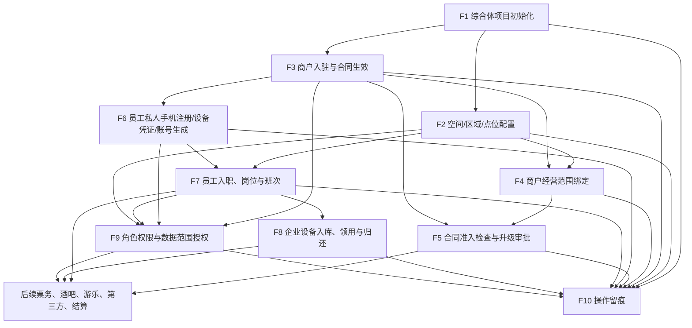

## 3. F1 综合体项目初始化

### 3.1 流程目标

建立综合体最高管理单元。没有项目，就不应继续创建正式空间、商户、合同、员工、设备和权限关系。

### 3.2 参与角色

- 综合体管理层
- 平台运营
- 系统管理员

### 3.3 前置条件

- 明确综合体项目名称、地址、经营定位和责任主体。
- 明确项目负责人或平台运营负责人。

### 3.4 正常流程

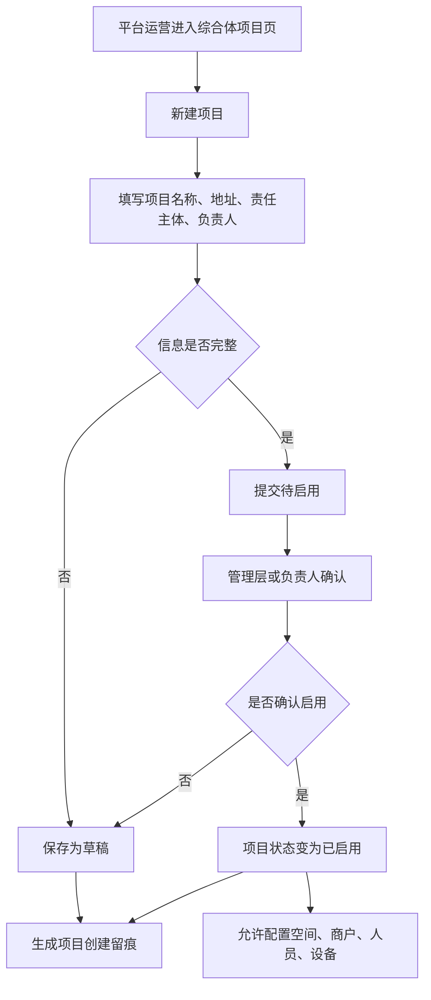

### 3.5 状态流转

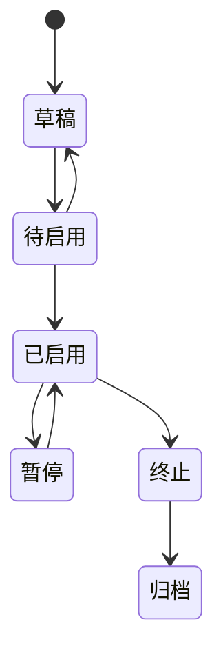

### 3.6 异常分支

| 异常 | 处理方式 |
|---|---|
| 项目名称重复 | 提示重复项目，要求修改名称或确认是否为同一项目 |
| 责任主体未明确 | 不允许启用，只能保存草稿 |
| 项目被暂停 | 暂停新增经营绑定，但保留查询和历史留痕 |
| 项目终止 | 限制新增空间、商户、合同、员工和设备绑定 |

### 3.7 输出结果

- 已启用的综合体项目。
- 项目基础档案。
- 项目创建和启用留痕。

### 3.8 涉及页面

- 综合体项目页
- 治理总览页
- 操作留痕页

## 4. F2 空间/区域/点位配置

### 4.1 流程目标

建立综合体的物理空间结构，明确业务发生位置和责任位置。

### 4.2 参与角色

- 平台运营
- 现场主管
- 招商/商户管理
- 安保/巡检

### 4.3 前置条件

- 综合体项目已创建。
- 若空间用于正式经营，项目应处于已启用状态。

### 4.4 正常流程

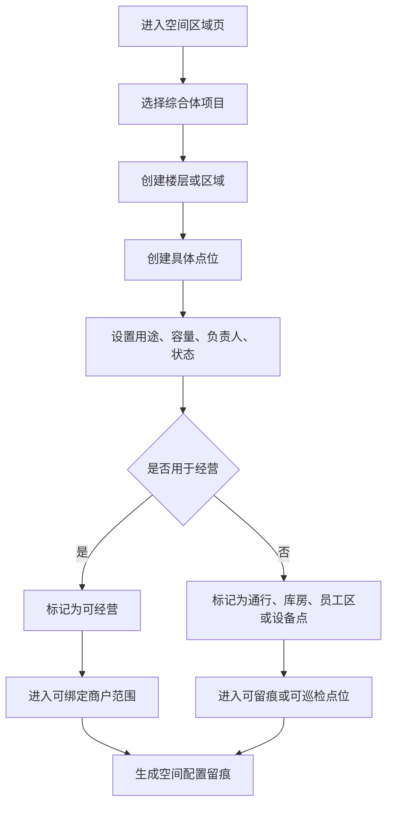

### 4.5 状态流转

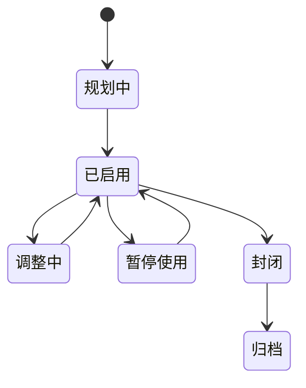

### 4.6 异常分支

| 异常 | 处理方式 |
|---|---|
| 上级空间不存在 | 不允许创建下级空间 |
| 空间编号重复 | 要求修改编号或自动生成新编号 |
| 已封闭空间被绑定商户 | 阻止绑定并提示空间不可经营 |
| 空间调整影响现有商户 | 进入待确认状态，并提示需要商户/合同复核 |

### 4.7 输出结果

- 空间层级。
- 具体点位。
- 可经营空间和可留痕点位。
- 空间变更留痕。

### 4.8 涉及页面

- 空间区域页
- 商户管理页
- 员工岗位页
- 设备台账页
- 操作留痕页

## 5. F3 商户入驻与合同生效

### 5.1 流程目标

明确“谁在综合体内经营”和“凭什么经营”。

### 5.2 参与角色

- 招商/商户管理
- 财务
- 平台运营
- 综合体管理层
- 商户管理员

### 5.3 前置条件

- 综合体项目已创建。
- 业态已配置。
- 若要绑定经营位置，空间应已配置。

### 5.4 正常流程

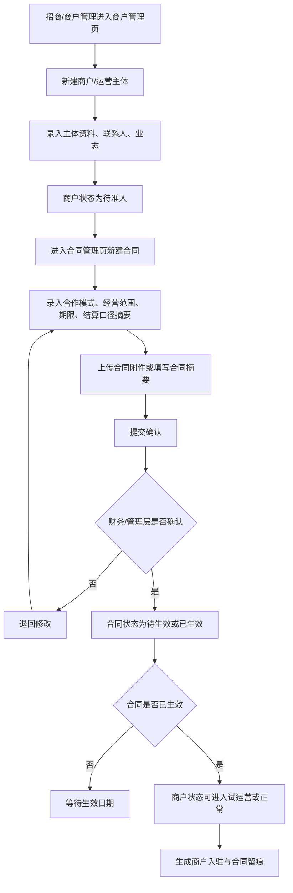

### 5.5 商户状态流转

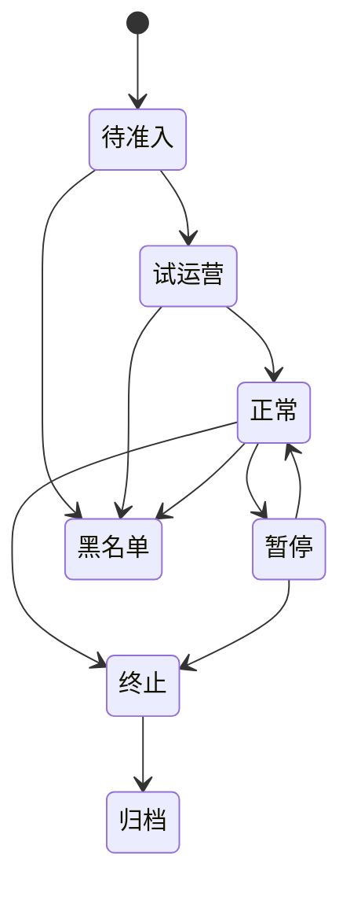

### 5.6 合同状态流转

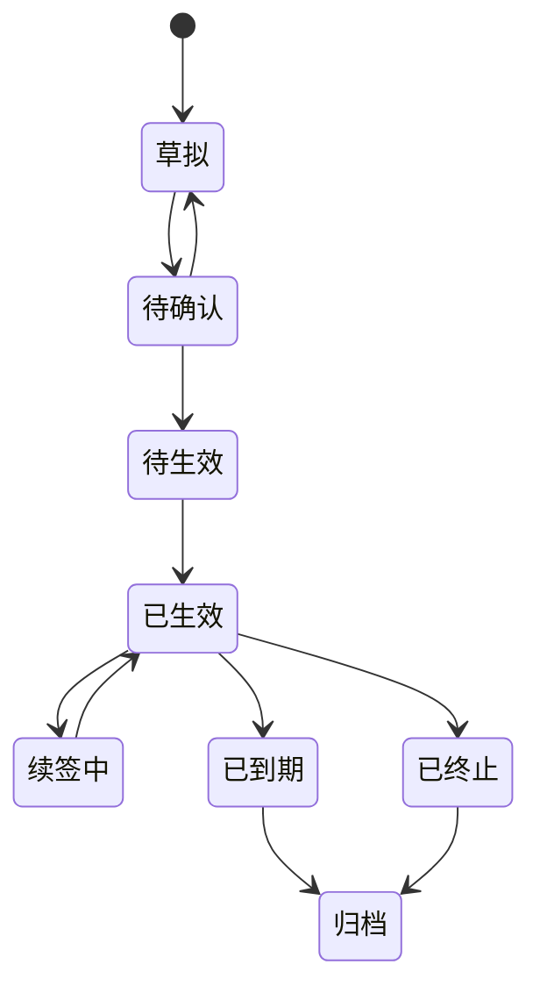

### 5.7 异常分支

| 异常 | 处理方式 |
|---|---|
| 商户资料不完整 | 只能保存待准入，不能进入正常经营 |
| 合同未生效 | 不允许作为正式经营依据 |
| 合同到期 | 提醒续签或终止，不允许新增经营绑定 |
| 商户被暂停 | 保留历史查询，限制新增经营动作 |
| 商户进入黑名单 | 禁止新增合同和经营范围 |

### 5.8 输出结果

- 商户主体档案。
- 合同和合作关系。
- 商户经营依据。
- 商户与合同留痕。

### 5.9 涉及页面

- 商户管理页
- 合同管理页
- 业态管理页
- 空间区域页
- 操作留痕页

## 6. F4 商户经营范围绑定

### 6.1 流程目标

明确商户可以在哪些项目、空间、区域或点位经营，以及经营哪些业态。

### 6.2 参与角色

- 招商/商户管理
- 平台运营
- 财务
- 商户管理员

### 6.3 前置条件

- 商户已建档。
- 合同已确认或已生效。
- 空间已配置。
- 业态已启用。

### 6.4 正常流程

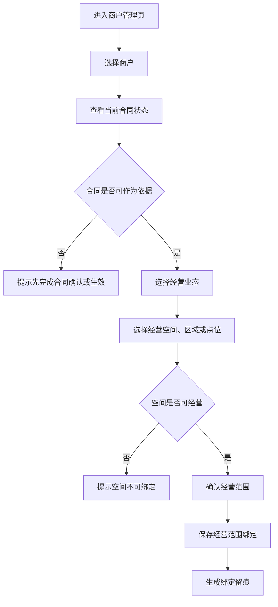

### 6.5 异常分支

| 异常 | 处理方式 |
|---|---|
| 商户状态不是正常或试运营 | 阻止新增绑定 |
| 空间已封闭或归档 | 阻止绑定 |
| 业态已停用 | 阻止绑定 |
| 经营范围超出合同 | 提示需先变更合同或补充确认 |
| 同一空间多个商户共享 | 要求明确共享说明和责任边界 |

### 6.6 输出结果

- 商户经营范围。
- 商户可用空间。
- 后续业务系统可引用的经营边界。
- 经营范围绑定留痕。

### 6.7 涉及页面

- 商户管理页
- 合同管理页
- 空间区域页
- 业态管理页
- 操作留痕页

## 7. F5 合同准入检查与升级审批

### 7.1 流程目标

在票务发布、酒吧下单、游乐开放、第三方接入和结算前，先检查业务是否符合合同、空间、业态、有效期和基础定义。

### 7.2 参与角色

- 平台运营
- 招商/商户管理
- 财务
- 风控/审计
- 综合体管理层

### 7.3 前置条件

- 商户、合同、经营范围和空间已建立。
- 合同核心摘要已录入。
- 准入规则已启用，或可按合同摘要即时检查。

### 7.4 正常流程

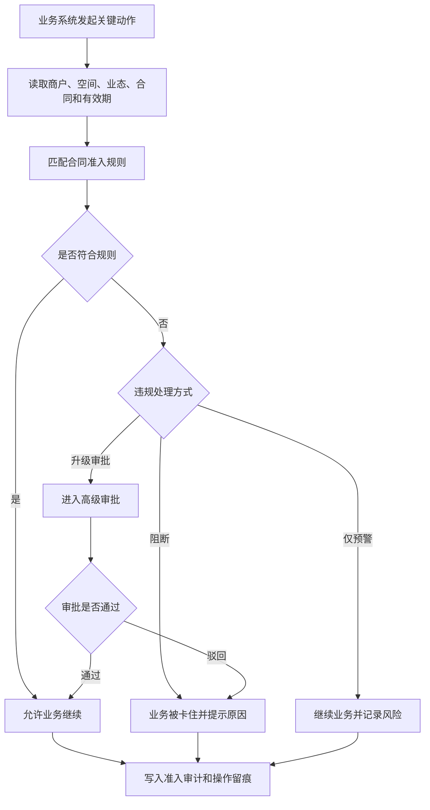

### 7.5 异常分支

| 异常 | 处理方式 |
|---|---|
| 合同未生效或已到期 | 默认阻断，除非管理层配置允许升级审批 |
| 业务超出合同经营范围 | 默认阻断或进入高级审批 |
| 业务空间不在合同允许范围 | 阻断并提示需变更合同或空间绑定 |
| 商户资质过期 | 阻断或进入风控复核 |
| 准入规则缺失 | 允许保存草稿，但正式业务不应继续 |

### 7.6 输出结果

- 准入检查结果。
- 阻断或升级审批记录。
- 后续业务可引用的准入审计。
- 事件中心留痕。

### 7.7 涉及页面

- 合同管理页
- 合同准入规则页
- 商户管理页
- 操作留痕页
- 后续票务、酒吧、游乐、第三方和结算页面

## 8. F6 员工私人手机注册、设备凭证绑定与账号生成

> 修订说明（2026-06-10 收口）：本节（含 §8.4 mermaid 设计图）按 D8/A6 改写——废止"申请 NFC 权限、读取手机本机 NFC 唯一标识"，私人手机身份改为"安装期在设备 Keystore 生成设备公钥/不可逆设备指纹（device_key_fingerprint）"，对应节点改为"生成并绑定设备凭证"。工作手机通过摄像头/扫码模块读取外部客人二维码，NFC 仅读取外部 NFC 腕带、标签、卡或设备中的权益标识，不在本流程。依据 finding decision-land-1/baseline-conf-1、D8 条。

### 8.1 流程目标

让员工先通过私人手机 App 提交注册资料、在设备 Keystore 生成设备公钥/不可逆设备指纹（device_key_fingerprint）作为设备凭证，后台审核后再生成员工账号、角色、职级、权限，并与公司工作手机建立一一对应关系；换手机必须先解绑旧手机设备凭证再绑定新手机。

### 8.2 参与角色

- 员工
- 平台运营
- 现场主管
- 商户管理员
- 系统管理员

### 8.3 前置条件

- 员工所属组织或商户已存在。
- 岗位、职级和权限模板已配置。
- 设备凭证绑定规则已确认：私人手机 App 安装期在设备 Keystore 生成设备公钥/不可逆设备指纹（device_key_fingerprint）作为唯一可信标识；废止"读取手机本机 NFC 唯一标识"（D8/A6，2026-06-07 收口，finding decision-land-1）。

### 8.4 正常流程

> 修订说明（2026-06-08 三轮收口）：在"提交资料后、建档前"插入"展示员工数据处理与监控告知→员工签署/确认→写 employee_notices"节点（B1→B2→B3），使 C4/C10「告知须在员工注册审批环节取得员工知悉/同意并留存同意凭据」在流程图有触发点，避免 foundation §6B.3 employee_notices 表建而无写入方。employee_notice_id 即作为 staff_profiles 同意凭据指向（见 §9 员工注册审批页字段、PRD §7.6/§9）。依据 finding compliance-wired-6、合规 C4/C10。

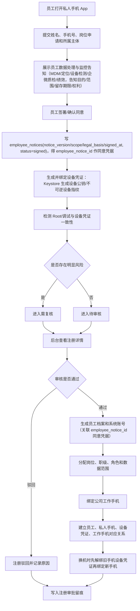

### 8.5 状态流转

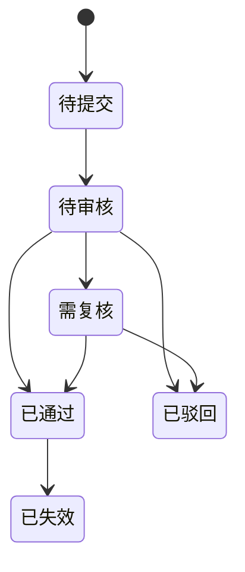

### 8.6 异常分支

| 异常 | 处理方式 |
|---|---|
| Root 或调试环境 | 私人手机 App 失效，进入复核 |
| 设备指纹变化 | 标记设备变更待审 |
| 设备凭证已绑定其他员工 | 阻止通过，进入复核（原"NFC 已绑定其他员工"按 D8 改为设备凭证，2026-06-07 收口） |
| 换手机未先解绑旧手机 | 阻止新绑定，要求先走解绑流程 |
| 员工资料不完整 | 驳回并要求补充 |
| 未绑定公司工作手机 | 可生成员工档案，但不能上岗执行现场操作 |

### 8.7 输出结果

- 员工注册审批记录。
- 员工档案和账号。
- 岗位、职级、角色、数据范围。
- 私人手机、设备凭证（设备公钥/不可逆设备指纹）、公司工作手机对应关系，以及换机解绑重绑留痕（原"手机 NFC 唯一标识"按 D8 改为设备凭证，2026-06-07 收口）。
- 注册审批和设备异常留痕。

### 8.8 涉及页面

- 员工注册审批页
- 员工岗位页
- 设备台账页
- 设备领还页
- 角色权限页
- 操作留痕页

## 9. F7 员工入职、岗位与班次

### 9.1 流程目标

明确员工归属、岗位职责、当班时间和责任区域。

### 9.2 参与角色

- 平台运营
- 现场主管
- 商户管理员
- 系统管理员

### 9.3 前置条件

- 员工所属平台或商户已存在。
- 员工注册审批已通过，或由后台创建且已经主管确认。
- 岗位已配置。
- 职级和默认权限模板已配置，职级支持 M1-M10 及上/中/下细分。
- 如需要排班，空间或责任区域已配置。

### 9.4 正常流程

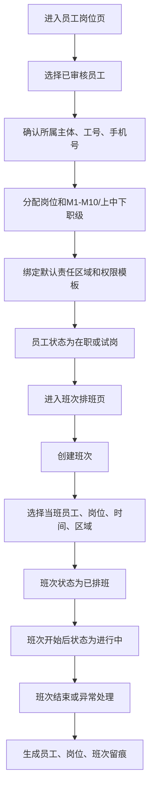

### 9.5 状态流转

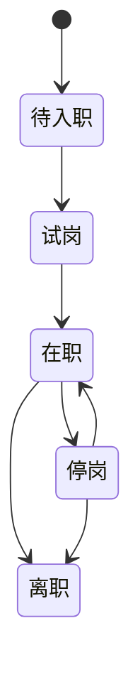

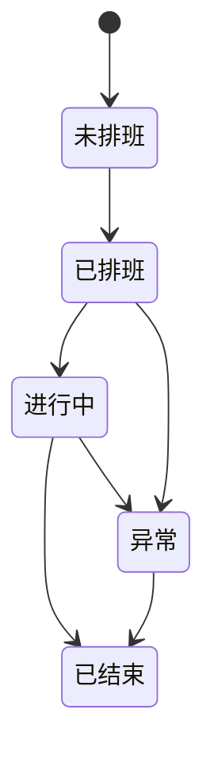

### 9.6 异常分支

| 异常 | 处理方式 |
|---|---|
| 员工未绑定主体 | 不允许保存为可上岗状态 |
| 注册审批未通过 | 不允许进入正式上岗流程 |
| 未完成设备凭证或公司工作手机对应 | 可以建档，但不能领取现场作业设备（"NFC"按 D8 改为设备凭证，2026-06-07 收口） |
| 员工停岗或离职 | 不允许加入新班次 |
| 岗位停用 | 不允许继续分配 |
| 班次缺少责任区域 | 允许保存，但提示责任链不完整 |
| 班次异常 | 必须填写异常说明 |

### 9.7 输出结果

- 员工档案。
- 岗位归属。
- 职级和默认权限依据。
- 班次安排。
- 现场责任链。

### 9.8 涉及页面

- 员工岗位页
- 班次排班页
- 空间区域页
- 角色权限页
- 操作留痕页

## 10. F8 企业设备入库、领用与归还

### 10.1 流程目标

明确企业设备的归属、流转、当班责任人和异常处理方式。

### 10.2 参与角色

- 设备管理员
- 现场主管
- 员工
- 平台运营

### 10.3 前置条件

- 设备已入库。
- 员工已建档，注册审批和设备凭证绑定已通过。
- 公司工作手机已与员工、私人手机和设备凭证建立对应关系（"NFC"按 D8 改为设备凭证，2026-06-07 收口，finding decision-land-1）。
- 班次已创建，或现场主管允许临时领用。

### 10.4 正常流程

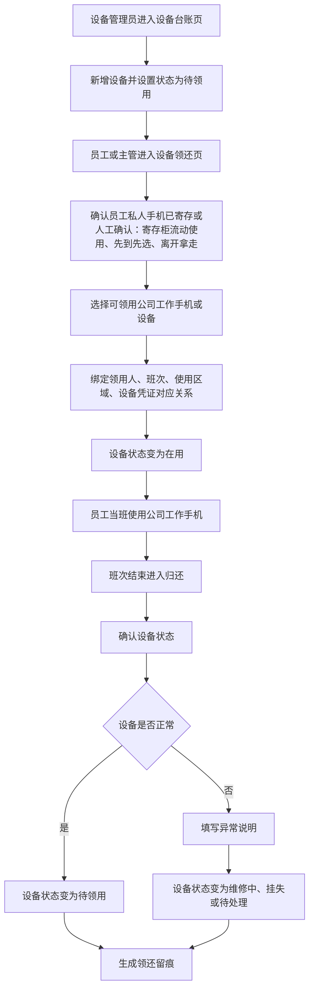

### 10.5 状态流转

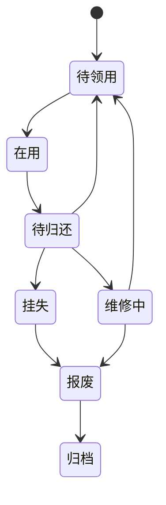

### 10.6 异常分支

| 异常 | 处理方式 |
|---|---|
| 设备维修中或挂失 | 不允许领用 |
| 员工无有效班次 | 允许主管临时处理，但必须留痕 |
| 员工私人手机未寄存 | 提示主管确认或阻止现场设备领用 |
| 公司工作手机未与员工/设备凭证对应 | 阻止领用或进入复核（"NFC"按 D8 改为设备凭证，2026-06-07 收口） |
| 设备未按时归还 | 进入待归还提醒或异常待处理 |
| 设备损坏 | 填写损坏说明，可进入主管复核 |
| 设备丢失 | 状态变为挂失，必须记录责任人 |

### 10.7 输出结果

- 设备领用记录。
- 设备归还记录。
- 设备异常记录。
- 员工、班次、设备责任链。

### 10.8 涉及页面

- 设备台账页
- 设备领还页
- 班次排班页
- 员工岗位页
- 操作留痕页

## 11. F9 角色权限与数据范围授权

### 11.1 流程目标

明确员工、商户管理员和平台人员能看什么、能操作什么、在哪些范围内操作。

### 11.2 参与角色

- 系统管理员
- 平台运营负责人
- 商户管理员
- 现场主管

### 11.3 前置条件

- 员工或账号主体已存在。
- 项目、商户、空间等数据范围已存在。
- 角色、基础权限模板、临时权限模板、职级和岗位权限模板已定义或可新建。

### 11.4 正常流程

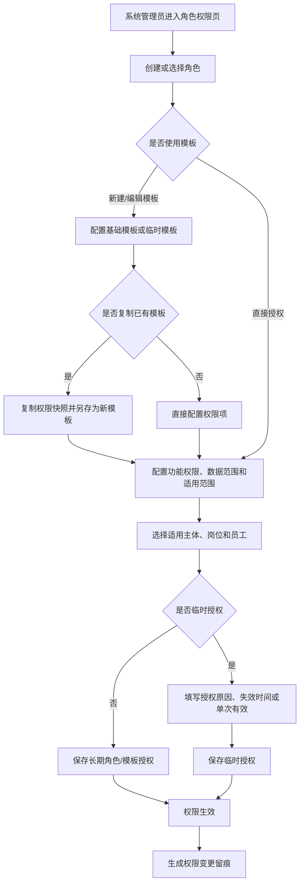

强制补充规则：

- 资金/核销/退款/调账/分红发放、提权或跨商户跨综合体、敏感数据、高危业务四类权限不得沿图中“直接授权”路径即时生效，必须先生成授权申请并按上一级、上两级或最高权限完成审批。
- 授权申请人不得审批自己的申请；同一主体同时命中申请人与审批人时，审批动作拒绝并留痕。
- 高危强制范围不能通过后台开关关闭；配置只能新增高危权限或提高审批等级。
- 岗位、职级、所属组织、所属商户或责任范围变化时立即重新计算有效权限，旧岗位和旧范围派生权限同步失效。

### 11.5 异常分支

| 异常 | 处理方式 |
|---|---|
| 数据范围超出授权主体 | 阻止保存 |
| 临时授权缺少失效时间且未设置单次有效 | 阻止保存 |
| 单次有效模板已消耗 | 阻止再次使用，并提示消耗记录 |
| 同一权限同时被授予和显式拒绝 | 按显式拒绝处理，并展示冲突来源 |
| 敏感权限未填写授权原因 | 要求补充原因 |
| 职级与敏感权限不匹配 | 阻止保存或要求高级审批 |
| 员工离职或停岗 | 立即阻断登录和业务操作，并使角色、模板、临时授权和员工单独授权失效；写收权留痕 |
| 岗位、职级、组织、商户或责任范围变化 | 立即重算有效权限并清除旧范围派生权限；超出新范围的员工单独授权暂停并重新审批 |
| 商户暂停或终止 | 立即停用该商户范围内新增业务动作的权限；仅保留经明确授权的历史只读查询 |
| 授权申请人与审批人为同一人 | 拒绝审批并记录职责分离失败 |

### 11.6 输出结果

- 角色配置。
- 权限模板配置。
- 功能权限。
- 职级权限关系。
- 数据范围。
- 长期授权、基础模板授权或临时模板授权。
- 权限变更留痕。

### 11.7 涉及页面

- 角色权限页
- 员工岗位页
- 商户管理页
- 操作留痕页

## 12. F10 关键配置变更与操作留痕

### 12.1 流程目标

记录平台治理层关键对象的创建、编辑、启停、归档、授权、异常和复核，确保所有重要动作可追溯。

### 12.2 参与角色

- 所有治理层操作角色
- 平台运营
- 财务
- 系统管理员
- 综合体管理层

### 12.3 触发条件

以下动作必须形成留痕：

- 项目启用、暂停、终止、归档。
- 空间启用、封闭、归档、绑定商户。
- 商户准入、暂停、终止、黑名单。
- 合同确认、生效、续签、终止、归档。
- 合同准入规则启用、暂停、阻断、升级审批。
- 员工注册审批、设备凭证绑定、私人手机失效、公司工作手机绑定（"NFC绑定"按 D8 改为"设备凭证绑定"，2026-06-07 收口）。
- 员工停岗、离职、岗位变更、职级变更。
- 设备领用、归还、维修、挂失、报废。
- 权限授予、变更、收回、临时授权。
- 人工补录、复核、驳回、作废。

### 12.4 正常流程

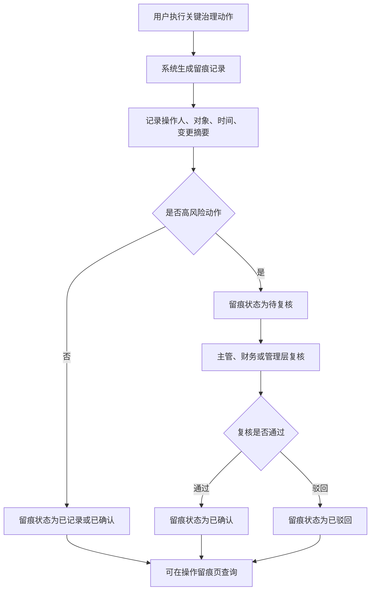

### 12.5 状态流转

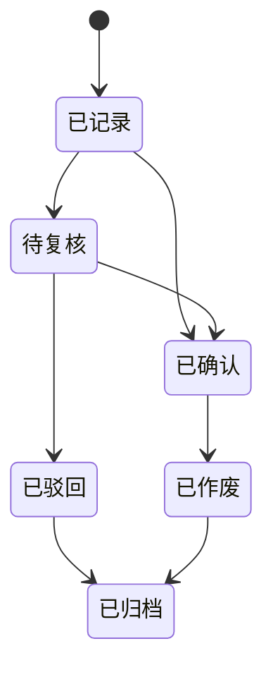

### 12.6 异常分支

| 异常 | 处理方式 |
|---|---|
| 操作原因缺失 | 对暂停、终止、归档、授权、异常类动作阻止提交 |
| 高风险变更未复核 | 允许暂存，但不进入最终确认 |
| 需要作废留痕 | 不允许删除，只能标记作废并记录原因 |
| 关联对象已归档 | 留痕仍可查询，但对象详情只读 |

### 12.7 输出结果

- 操作留痕记录。
- 复核记录。
- 变更责任链。
- 后续审计和风控依据。

### 12.8 涉及页面

- 操作留痕页
- 治理总览页
- 所有对象详情页

## 12A. F11 终端开关启停、灰度与被拒访问

> 新增说明（2026-06-07）：依 govfam-1/govern-4，终端开关此前在流程图中完全缺失，但 acceptance/completion-audit 自评其全覆盖。本节补终端开关的启停、灰度发布和被拒访问三条流程，与 page-list §14A 终端开关页、字段字典 §3.1/§14.13 对齐。

### 12A.1 流程目标

让平台统一控制 10 端（对齐 D5：App、小程序、Web、平板、员工工作手机、员工私人手机、商户侧门户、商户侧 App、一体机、移动管理端）是否开放，支持按项目/商户/业务系统/模块/设备/版本灰度，并对被拒访问留痕。

### 12A.2 参与角色

- 系统管理员
- 平台运营负责人
- 综合体管理层

### 12A.3 前置条件

- 综合体项目、商户、业务系统已存在。
- 需控制的终端类型来自 10 端权威枚举（字段字典 §3.1）。

### 12A.4 启停与灰度正常流程

```mermaid
flowchart TD
    A["进入终端开关页"] --> B["选择终端类型(10端)与开关范围"]
    B --> C["选择业务系统/模块/项目/商户/设备/版本"]
    C --> D{"是否定时生效"}
    D -- "否" --> E["设置是否启用并立即生效"]
    D -- "是" --> F["设置生效时间/失效时间/定时策略"]
    E --> G{"是否灰度"}
    F --> G
    G -- "是" --> H["配置灰度名单或比例(项目/商户/设备/版本)"]
    G -- "否" --> I["全量开放或关闭"]
    H --> J["保存开关并生成留痕"]
    I --> J
    J --> K["到达生效/失效时间自动切换启停"]
```

### 12A.5 被拒访问流程

```mermaid
flowchart TD
    A["终端发起业务动作"] --> B["读取该端开关与灰度配置"]
    B --> C{"是否启用且在生效区间内"}
    C -- "是" --> D{"是否命中灰度范围"}
    D -- "是/全量" --> E["允许业务，仍受权限和数据范围控制"]
    D -- "否" --> F["按未开放处理，拒绝并提示"]
    C -- "否" --> F
    F --> G["写入被拒访问记录(终端类型、设备、时间、原因)"]
    E --> H["写入操作留痕"]
    G --> H
```

### 12A.6 状态流转

```mermaid
stateDiagram-v2
    [*] --> 草稿
    草稿 --> 已启用
    已启用 --> 已停用
    已停用 --> 已启用
    已启用 --> 归档
    已停用 --> 归档
```

> 说明：定时策略下"定时启用/定时停用"为过渡态，由生效/失效时间自动驱动进入"已启用/已停用"，不单列为独立持久态（对齐字段字典 §14.13）。

### 12A.7 异常分支

| 异常 | 处理方式 |
|---|---|
| 生效时间晚于失效时间 | 阻止保存并提示 |
| 启用定时策略但生效/失效时间为空 | 阻止保存，要求补时间 |
| 关闭某端后该端仍尝试访问 | 拒绝业务动作并写入被拒访问记录 |
| 灰度名单为空但选择了灰度 | 提示需补灰度名单或改为全量 |

### 12A.8 输出结果

- 终端开关配置与灰度范围。
- 被拒访问记录。
- 开关启停/灰度变更留痕。

### 12A.9 涉及页面

- 终端开关页
- 治理总览页
- 操作留痕页

## 13. 跨流程依赖关系

| 依赖项 | 依赖说明 | 如果缺失的影响 |
|---|---|---|
| 项目 | 所有治理对象的最高归属 | 无法建立正式空间、商户、人员和设备 |
| 空间 | 商户、员工、设备、事件的位置基础 | 业务无法判断发生在哪里 |
| 业态 | 商户和合同的经营分类 | 后续统计和权限容易混乱 |
| 商户 | 合同、员工、权限、结算的主体 | 无法判断谁经营和谁负责 |
| 合同 | 商户经营的依据 | 无法判断是否可正式经营 |
| 合同准入规则 | 后续票务、酒吧、游乐、第三方和结算的卡控依据 | 超合同或超空间业务无法被系统阻断或高审 |
| 员工 | 现场作业和系统操作的人 | 无法形成责任链 |
| 私人手机注册 | 员工账号建立和身份审核的入口 | 员工身份来源不清晰 |
| 设备凭证绑定 | 员工身份辅助确认和设备绑定依据（设备公钥/不可逆设备指纹） | 私人手机、员工、工作手机难以形成对应关系（"NFC绑定"按 D8 改为"设备凭证绑定"，2026-06-07 收口） |
| 职级 | 默认权限、审批层级和薪资口径摘要 | 权限和审批无法按管理层级区分 |
| 班次 | 员工现场责任的时间边界 | 无法判断当时谁在岗 |
| 设备 | 现场操作的工具和证据入口 | 无法追踪设备责任 |
| 权限 | 操作和数据可见范围 | 容易发生越权 |
| 终端开关 | 各端/商户/模块/设备/版本是否开放的统一控制 | 终端可绕过开关、被拒访问无留痕 |
| 留痕 | 关键动作的追溯依据 | 无法审计和复盘 |

## 14. P0 流程验收标准

| 验收点 | 标准 |
|---|---|
| 项目初始化 | 能创建、启用、暂停、终止和归档项目，并形成留痕 |
| 空间配置 | 能建立空间层级和点位，并限制不可用空间继续绑定业务 |
| 商户入驻 | 能建立商户、合同和合作关系，并区分待准入、试运营、正常等状态 |
| 经营范围绑定 | 能把商户绑定到业态和空间，并校验合同状态 |
| 合同准入 | 能按合同、空间、业态、有效期判断通过、阻断或升级审批 |
| 员工注册 | 能审核私人手机注册、设备凭证绑定、Root/设备异常，并生成账号、职级和权限（"NFC绑定"按 D8 改为"设备凭证绑定"，2026-06-07 收口） |
| 员工班次 | 能基于已审核员工建立岗位、班次和责任区域 |
| 设备领还 | 能完成设备入库、领用、归还和异常处理 |
| 权限授权 | 能配置角色、功能权限、数据范围、基础模板、临时模板、复制模板和单次有效授权 |
| 操作留痕 | 关键治理动作能查询、复核、驳回或作废 |
| 终端开关 | 能按 10 端/项目/商户/模块/设备/版本启停与灰度，被拒访问能留痕 |
| 页面联动 | 总览、项目、空间、商户、合同、员工、设备、权限、留痕之间能互相跳转 |
| 后续支撑 | 能为票务、酒吧、游乐、第三方、结算和事件中心提供清晰基础对象、合同准入和员工可信身份 |

## 15. 已确认规则和后续细化事项

已确认：

1. 员工私人手机 App 安装期在设备 Keystore 生成设备公钥/不可逆设备指纹（device_key_fingerprint）作为唯一可信标识，换手机必须先解绑旧手机设备凭证再绑定新手机；废止"读取手机本机 NFC 唯一标识"（D8/A6，2026-06-07 收口，finding decision-land-1）。工作手机通过摄像头/扫码模块读取外部客人二维码，NFC 仅读取外部 NFC 腕带、标签、卡或设备中的权益标识。
2. Root/调试/异常环境由手机端检测，异常时 App 失效并进入复核。
3. 办公区寄存柜流动使用、先到先选、离开拿走。
4. 员工职级、权限模板和薪资大范围 P0 纳入流程，职级支持 M1-M10 及上/中/下细分。

后续细化：

无方向性悬空事项。已确认按以下口径执行：

1. 项目启用 P0 由平台运营提交，管理层或系统管理员确认后启用。
2. 空间调整影响商户经营时必须进入合同/主体绑定复核。
3. 商户试运营必须有已确认合同或试运营授权；正式经营必须合同已生效。
4. 合同生效必须经过财务确认结算口径和保证金/押金/应收应付初始事项。
5. 多商户共享同一空间必须有显式空间授权、责任主体和结算口径，不默认允许。
6. 员工排班 P0 绑定责任区域，用于责任留痕。
7. 设备领用 P0 绑定人员和班次；无班次岗位只能查询，不得做现场受控动作。
8. 敏感权限包括财务、退款/免单/调账、主体绑定、合同生效/终止、敏感证据查看、开放平台密钥和设备解封，必须二次确认或审批。
9. 高风险财务调整、敏感证据查看、设备异常解封、权限提升、主体绑定变更、合同准入放行必须复核；普通查询和低风险留痕仅记录即可。
10. 操作留痕支持附件或证据引用；高风险操作必须支持附件/证据。
11. 合同过期、必填证照缺失/过期、消防/特种设备资质过期、空间/业态超范围默认阻断；可配置高级审批放行但必须留痕。

## 16. 本版结论

平台治理层 P0 的关键流程应先把项目、空间、商户、合同、合同准入、员工私人手机注册、设备凭证、职级、设备、权限和留痕串成闭环（"NFC"按 D8 已统一为"设备凭证"，2026-06-07 收口）。这个闭环不是为了直接完成经营动作，而是为了让后续票务、酒吧、游乐、第三方接入、结算和数据分析都有清楚的归属、责任、准入和状态依据。

本版确认后，下一步可以继续拆《平台治理层低保真原型说明 V0.1》，把页面布局、列表/详情/表单结构和关键交互说明补齐。

## 17. 变更日志

| 日期 | 类型 | 位置 | 内容 | 原因/依据 |
|---|---|---|---|---|
| 2026-06-07 | 增 | §2 流程总览、§12A F11 | 新增 F11 终端开关启停、灰度与被拒访问流程（启停/灰度/被拒三图 + 状态流转） | govfam-1、govern-4 |
| 2026-06-07 | 增 | §13 跨流程依赖 | 补"终端开关"依赖行 | govfam-1 |
| 2026-06-10 | 改 | §2/§8（含 §8.4 mermaid）/§10/§11/§13/§14/§15/§16 | 按 D8/A6 把"申请 NFC 权限、读手机本机 NFC 唯一标识/NFC 绑定"改为"在 Keystore 生成并绑定设备凭证（设备公钥/不可逆设备指纹 device_key_fingerprint）"，§8.4 mermaid 节点重绘为"生成并绑定设备凭证"，前置条件同步；明确二维码摄像头扫码、NFC 读取外部 NFC 腕带/标签/卡 | D8、finding decision-land-1/baseline-conf-1；二维码/NFC 技术边界复核 |
| 2026-06-07 | 增 | §14 P0 流程验收 | 补"终端开关"验收点 | govfam-1 |
| 2026-06-08 | 增 | §8.4 注册审批正常流程 | 在"提交资料后、建档前"插入"展示员工数据处理与监控告知→员工签署/确认→写 employee_notices(notice_version/scope/legal_basis/signed_at, status=signed)"节点（B1→B2→B3），并把建档节点关联 employee_notice_id 同意凭据，使 C4/C10 告知/同意有触发点、employee_notices 表有写入方 | 三轮收口 finding compliance-wired-6、合规 C4/C10 |
| 2026-06-10 | 增/改 | §11 / §14 / §15 | F9 权限授权流程补模板复制、临时模板、单次有效、显式拒绝和模板验收 | 用户确认权限模板机制；对齐 P0 权限矩阵 |

---

## 原文件：`platform-governance-low-fi-prototype-v0.1.md`

# 平台治理层低保真原型说明 V0.1

## 1. 文档定位

本文档承接《平台治理层产品需求 PRD V0.1》《平台治理层页面清单 V0.1》《平台治理层字段字典 V0.1》和《平台治理层关键流程图 V0.1》，用于说明平台治理层 P0 页面在低保真原型阶段应如何组织信息、布局页面、承接操作和表达状态。

本文档不是视觉设计稿，不定义颜色、字体、图标风格或前端技术；也不是编码任务书。它只描述低保真原型需要表达的产品结构和交互意图。

## 2. 原型目标

平台治理层低保真原型需要验证以下问题：

- 用户能否从治理总览进入项目、空间、商户、合同、合同准入、员工注册审批、员工、设备、权限和留痕页面。
- 用户能否理解每个页面负责什么，不会把治理配置和业务经营操作混淆。
- 用户能否完成 P0 核心流程：项目启用、空间配置、商户入驻、合同生效、合同准入规则、经营范围绑定、员工私人手机注册/设备凭证审批、员工排班、设备领还、权限授权、留痕查询（"NFC审批"按 D8 改为"设备凭证审批"，2026-06-07 收口）。
- 页面是否能清晰表达对象状态、责任归属、关联对象和异常处理入口。
- 管理端、商户端和现场端的边界是否清楚。

## 3. 信息架构

### 3.1 一级导航

平台治理层作为管理后台中的一级导航组，正式名称为“平台治理”。

| 一级导航 | 二级入口 | 说明 |
|---|---|---|
| 平台治理 | 治理总览 | 管理层和平台运营的入口 |
| 平台治理 | 综合体项目 | 管理项目档案 |
| 平台治理 | 空间区域 | 管理楼层、区域、点位 |
| 平台治理 | 业态管理 | 管理经营分类 |
| 商户合同 | 商户管理 | 管理商户和运营主体 |
| 商户合同 | 合同管理 | 管理合作关系和合同依据 |
| 商户合同 | 合同准入规则 | 管理合同核心摘要、阻断和升级审批规则 |
| 人员设备 | 员工注册审批 | 审核私人手机注册、设备凭证绑定、同意凭据和设备异常（"NFC绑定"按 D8 改为"设备凭证绑定"，2026-06-07 收口） |
| 人员设备 | 员工岗位 | 管理员工、岗位、职级、责任区域 |
| 人员设备 | 班次排班 | 管理班次和上岗责任 |
| 人员设备 | 设备台账 | 管理设备基础档案 |
| 人员设备 | 设备领还 | 管理设备流转 |
| 权限审计 | 角色权限 | 管理功能权限和数据范围 |
| 权限审计 | 终端开关 | 管理各端、各商户、各模块是否开放与灰度 |
| 权限审计 | 操作留痕 | 查询治理层关键动作记录 |

### 3.2 首页进入方式

治理总览是平台治理层的首屏。其他页面既可以从左侧导航进入，也可以从治理总览的待处理卡片、指标卡片、最近留痕和状态分布进入。

## 4. 全局低保真结构

### 4.1 列表页结构

P0 大多数页面采用“筛选区 + 列表 + 详情入口 + 批量/单项操作”的结构。

| 区域 | 内容 |
|---|---|
| 页面标题区 | 页面名称、说明、主操作按钮 |
| 筛选区 | 项目、商户、业态、空间、状态、负责人、时间、关键词 |
| 列表区 | 核心字段、状态、负责人、最近更新时间 |
| 操作区 | 查看、编辑、启用/停用、归档、查看留痕 |
| 空状态 | 当前无数据时的引导操作 |
| 异常状态 | 数据不完整、权限不足、状态不可操作时的提示 |

### 4.2 详情页结构

详情页采用“基础信息 + 关联对象 + 状态记录 + 操作留痕”的结构。

| 区域 | 内容 |
|---|---|
| 对象摘要 | 名称、编号、状态、负责人、关键标签 |
| 基础信息 | 字段字典中定义的核心字段 |
| 关联对象 | 空间、商户、合同、员工、设备、权限等关联项 |
| 状态与动作 | 当前状态、可执行操作、不可操作原因 |
| 操作留痕 | 最近变更、异常记录、复核记录 |

### 4.3 表单结构

表单按“基础信息、归属关系、状态设置、备注/附件、确认提交”组织。

高风险操作如暂停、终止、归档、授权、作废，需要用户填写原因，并在提交前显示影响范围。

### 4.4 状态表达

每个对象的状态应在列表和详情中都清楚展示。状态不仅用于展示，也要影响页面操作。例如合同未生效时，经营范围绑定按钮需要禁用并说明原因。

## 5. 治理总览低保真说明

### 5.1 首屏结构

治理总览首屏应优先服务管理层和平台运营，重点展示待处理事项和治理健康度。

| 区块 | 低保真内容 |
|---|---|
| 顶部筛选 | 项目、时间范围、业态、商户 |
| 核心指标 | 商户数、已启用空间数、有效合同数、在岗员工数、在用设备数、待复核留痕数 |
| 待处理事项 | 待确认合同、准入规则待确认、员工注册待审核、即将到期合同、异常设备、权限待复核、商户待准入 |
| 状态分布 | 商户状态、合同状态、设备状态 |
| 最近留痕 | 最近关键变更、异常处理、权限调整 |

### 5.2 关键交互

- 点击待确认合同，进入合同管理并自动筛选待确认状态。
- 点击异常设备，进入设备领还并自动筛选异常待处理。
- 点击待复核留痕，进入操作留痕并自动筛选待复核状态。
- 点击商户状态分布中的“待准入”，进入商户管理并筛选待准入。

### 5.3 空状态

若尚未创建项目，治理总览只显示“创建综合体项目”的引导入口。不要显示空指标堆叠。

### 5.4 验收口径

用户能在 30 秒内判断当前最需要处理的治理事项，并能一跳进入对应页面。

## 6. 综合体项目低保真说明

### 6.1 页面结构

| 区域 | 低保真内容 |
|---|---|
| 项目列表 | 项目名称、编号、地址、责任主体、负责人、状态 |
| 项目详情 | 基础信息、经营定位、启用日期、备注 |
| 关联对象 | 空间数、商户数、合同数、员工数、设备数 |
| 状态记录 | 启用、暂停、终止、归档历史 |

### 6.2 新建项目表单

表单分组：

- 基础信息：项目名称、编号、简称、地址、经营定位。
- 责任信息：责任主体、项目负责人、联系电话。
- 状态信息：项目状态、启用日期。
- 备注信息：备注。

### 6.3 关键交互

- 草稿项目可编辑、提交待启用。
- 待启用项目可确认启用或退回草稿。
- 已启用项目可创建空间和商户。
- 暂停项目不可新增经营绑定。
- 归档项目只读展示。

## 7. 空间区域低保真说明

### 7.1 页面结构

空间区域页应支持层级管理，低保真阶段可先用树形结构和列表结构，不要求平面图。

| 区域 | 低保真内容 |
|---|---|
| 空间树 | 项目、楼层、区块（商场区块）、区域、点位 |
| 空间列表 | 名称、类型、用途、所属区块、铺位号、经营面积、容量、状态、负责人 |
| 点位详情 | 点位编号、点位类型、所属区块、所属区域、绑定商户、绑定设备 |
| 关联留痕 | 空间变更、点位绑定、暂停封闭记录 |

### 7.2 新建空间表单

表单分组：

- 层级信息：所属项目、上级空间、空间类型。
- 基础信息：空间名称、空间编号、用途。
- 经营信息：所属业态、所属商户、是否可经营。
- 管理信息：容量、负责人、是否可留痕、状态。

### 7.3 关键交互

- 从空间树选择节点，右侧显示详情。
- 对点位可执行绑定商户、绑定设备、暂停使用、封闭。
- 封闭点位提示影响哪些商户、设备或班次。
- 空间调整中时，后续业务引用应显示风险提示。

## 8. 业态管理低保真说明

### 8.1 页面结构

| 区域 | 低保真内容 |
|---|---|
| 业态列表 | 业态名称、编号、核心业态、第三方接入、状态 |
| 业态详情 | 说明、统计分类、引用关系 |
| 引用关系 | 关联商户、合同、空间数量 |

### 8.2 关键交互

- 新增业态时必须填写名称和统计分类。
- 停用业态前提示当前引用关系。
- 被引用业态不建议直接归档，应先解除新增绑定。

## 9. 商户管理低保真说明

### 9.1 页面结构

| 区域 | 低保真内容 |
|---|---|
| 商户列表 | 商户名称、主体名称、业态、合作模式摘要、状态、负责人 |
| 商户详情 | 主体信息、联系人、资质、经营范围 |
| 经营范围 | 绑定项目、空间、区域、点位 |
| 合同关系 | 当前合同、历史合同、即将到期合同 |
| 人员关系 | 商户管理员、商户员工 |
| 操作留痕 | 入驻、变更、暂停、终止记录 |

### 9.2 新建商户表单

表单分组：

- 主体信息：商户名称、主体名称、统一社会信用代码、商户类型。
- 业态信息：业态、合作模式摘要。
- 联系信息：主要联系人、电话、财务联系人、运营联系人。
- 资质信息：资质说明、附件。
- 经营信息：经营范围、绑定空间。
- 状态信息：商户状态、备注。

### 9.3 关键交互

- 待准入商户可以补充资料和合同。
- 试运营商户需要醒目标识。
- 暂停商户不可新增经营绑定。
- 黑名单商户不可新增合同。
- 从商户详情可直接进入合同、员工、空间和留痕。

## 10. 合同管理低保真说明

### 10.1 页面结构

| 区域 | 低保真内容 |
|---|---|
| 合同列表 | 合同编号、合同名称、商户、合作模式、期限、状态 |
| 合同详情 | 经营范围、结算口径摘要、保证金/押金、租赁面积 |
| 准入规则 | 允许业态、允许空间、违规处理方式、审批级别 |
| 附件区 | 合同附件、补充协议 |
| 到期提醒 | 即将到期、已到期、续签中 |
| 变更留痕 | 编辑、确认、生效、终止、归档记录 |

### 10.2 新建合同表单

表单分组：

- 基础信息：合同名称、编号、关联商户。
- 合作信息：合作模式、经营范围、结算口径摘要。
- 准入信息：允许空间、允许业务、违规处理方式、高级审批级别。
- 时间信息：开始日期、结束日期、到期提醒日期。
- 金额摘要：保证金/押金、租赁面积。
- 附件备注：合同附件、备注。
- 状态信息：合同状态。

### 10.3 关键交互

- 草拟合同可编辑。
- 待确认合同需要财务或管理层确认。
- 已生效合同可作为商户经营依据。
- 已生效合同可生成或启用准入规则，后续业务超范围时阻断或升级审批。
- 已到期合同提醒续签或终止。
- 终止合同需要填写原因并生成留痕。

## 11. 合同准入规则低保真说明

### 11.1 页面结构

| 区域 | 低保真内容 |
|---|---|
| 规则列表 | 合同、商户、业务域、状态、违规处理方式 |
| 规则详情 | 允许经营范围、空间范围、业态范围、有效期、审批级别 |
| 拦截记录 | 被阻断、预警或升级审批的业务记录 |
| 关联业务 | 票务、酒吧、游乐、第三方、结算引用情况 |

### 11.2 关键交互

- 从合同详情生成准入规则。
- 设置违规时阻断、预警或升级审批。
- 查看某次业务为什么被卡住。
- 命中升级审批时跳转待办或操作留痕。

## 12. 员工注册审批低保真说明

> 修订说明（2026-06-10 收口）：本页按 D8/A6 把"NFC绑定/NFC"改为"设备凭证（设备公钥/不可逆设备指纹 device_key_fingerprint）"；补"同意凭据"区域承接合规 C4。工作手机通过摄像头/扫码模块读取外部客人二维码；NFC 仅读取外部 NFC 腕带、标签、卡或设备中的权益标识，不在本页范围。依据 finding decision-land-1/baseline-conf-1/compliance-land-8、D8 条、合规 C4。

### 12.1 页面结构

| 区域 | 低保真内容 |
|---|---|
| 待审核列表 | 姓名、手机号、申请岗位、所属主体、提交时间、风险提示 |
| 注册详情 | 注册资料、设备凭证绑定、设备指纹、Root/调试检测 |
| 同意凭据 | 员工数据处理与监控告知同意凭据（版本/时间/范围，或 employee_notice_id），承接合规 C4/C10（PRD §15） |
| 审核区 | 通过、驳回、需复核、审核意见 |
| 绑定关系 | 员工、私人手机、设备凭证（设备公钥/不可逆设备指纹）、公司工作手机 |
| 异常历史 | Root失效、设备变更待审、设备凭证不匹配（"NFC"按 D8 改为设备凭证，2026-06-07 收口，finding decision-land-1/baseline-conf-1） |

### 12.2 关键交互

- 审核通过后生成员工账号、职级、权限和数据范围。
- 绑定或更换公司工作手机。
- 停用异常私人手机。
- 私人手机不出现现场核销、点单、放行、结算入口。

## 13. 员工岗位低保真说明

### 13.1 页面结构

| 区域 | 低保真内容 |
|---|---|
| 员工列表 | 姓名、工号、所属主体、岗位、职级、注册审批状态、责任区域、状态 |
| 员工详情 | 基础信息、岗位、职级、设备凭证（设备公钥/不可逆设备指纹）、私人手机、公司工作手机、班次、设备、权限摘要 |
| 岗位配置 | 岗位名称、岗位类型、默认责任区域、默认职级、默认权限角色 |
| 关联记录 | 最近班次、设备领用、私人手机/设备凭证绑定、权限变更、留痕（"NFC"按 D8 改为设备凭证，2026-06-07 收口） |

### 13.2 关键交互

- 新建员工必须选择所属组织和岗位。
- 商户员工必须绑定商户。
- 停岗员工不能加入新班次。
- 离职员工不能继续登录或领用设备。
- 员工详情可跳转班次、权限、设备领还。

## 14. 班次排班低保真说明

### 14.1 页面结构

低保真阶段建议先支持列表和按日期筛选；日历视图可作为 P1 或原型增强。

| 区域 | 低保真内容 |
|---|---|
| 日期筛选 | 日期、项目、商户、区域、岗位 |
| 班次列表 | 日期、开始时间、结束时间、员工、岗位、区域、状态 |
| 班次详情 | 当班员工、主管、责任区域、设备领用、异常说明 |
| 交接信息 | 未完成事项、下一班次、异常记录 |

### 14.2 关键交互

- 创建班次时选择员工、岗位、时间和区域。
- 进行中班次可进入设备领用。
- 异常班次必须填写异常说明。
- 班次结束前提示未归还设备或未处理异常。

## 15. 设备台账低保真说明

### 15.1 页面结构

| 区域 | 低保真内容 |
|---|---|
| 设备列表 | 设备编号、名称、类型、所属主体、使用区域、状态 |
| 设备详情 | 品牌型号、当前领用人、当前班次、维修记录 |
| 流转记录 | 领用、归还、维修、挂失、报废 |
| 异常记录 | 损坏、丢失、未归还、主管复核 |

### 15.2 关键交互

- 设备入库后默认为待领用。
- 维修中、挂失、报废设备不可领用。
- 设备详情可跳转设备领还和操作留痕。

## 16. 设备领还低保真说明

### 16.1 页面结构

| 区域 | 低保真内容 |
|---|---|
| 可领用设备 | 待领用设备列表 |
| 我的设备/当班设备 | 当前员工或班次已领用设备 |
| 领还记录 | 领用人、班次、时间、状态 |
| 异常处理 | 未归还、损坏、丢失、维修、挂失 |

### 16.2 关键交互

- 领用设备时选择员工、班次、使用区域。
- 归还设备时确认设备状态。
- 异常归还必须填写异常说明。
- 主管可以复核异常设备。
- 移动端可优先承接员工领还动作，后台承接查询和异常处理。

## 17. 角色权限低保真说明

### 17.1 页面结构

| 区域 | 低保真内容 |
|---|---|
| 角色列表 | 角色名称、类型、适用主体、状态 |
| 权限模板列表 | 模板名称、模板类型、复制来源、适用范围、有效期、是否单次有效、状态 |
| 功能权限 | 页面访问、操作动作、敏感权限 |
| 数据范围 | 项目、商户、空间、班次范围 |
| 授权记录 | 授权人、被授权人、生效时间、失效时间、授权原因 |

### 17.2 关键交互

- 平台角色和商户角色分开管理。
- 基础模板和临时模板分开管理，模板可复制为新模板并局部修改。
- 数据范围不能超过适用主体范围。
- 临时授权必须填写失效时间或单次有效限制，并填写原因。
- 敏感权限变更进入操作留痕。

## 17A. 终端开关低保真说明

> 新增说明（2026-06-07）：依 govfam-1，终端开关页此前在低保真中完全缺失。本节补其低保真结构与交互，与 page-list §14A、flow-diagrams F11、字段字典 §3.1/§14.13 对齐。

### 17A.1 页面结构

| 区域 | 低保真内容 |
|---|---|
| 开关列表 | 终端类型(10 端)、开关范围、业务系统、模块、是否启用、生效时间、失效时间、状态 |
| 开关详情 | 终端类型、开关范围、业务系统、模块编码、是否启用、生效时间、失效时间、定时策略、开关原因 |
| 灰度配置 | 按项目、商户、设备、版本设置部分开放（名单或比例） |
| 被拒记录 | 因开关关闭被拒绝访问的终端、设备、时间、原因 |
| 变更留痕 | 启用、停用、定时调整、灰度变更记录 |

### 17A.2 关键交互

- 选择终端类型时只能从 10 端权威枚举中选（App、小程序、Web、平板、员工工作手机、员工私人手机、商户侧门户、商户侧 App、一体机、移动管理端）。
- 启用定时策略时必须填写生效或失效时间；生效时间不能晚于失效时间。
- 配置灰度时需选择项目/商户/设备/版本范围，名单为空不允许保存灰度。
- 关闭某端后页面提示影响范围；被拒访问可一跳进入被拒记录。
- 开关启停与灰度变更进入操作留痕。

## 18. 操作留痕低保真说明

### 18.1 页面结构

| 区域 | 低保真内容 |
|---|---|
| 留痕列表 | 时间、对象类型、对象名称、动作、操作人、状态 |
| 留痕详情 | 变更摘要、原因、处理结果、复核意见 |
| 筛选区 | 项目、商户、对象类型、操作人、时间、状态 |
| 待复核区 | 权限变更、终止、归档、异常作废等高风险动作 |

### 18.2 关键交互

- 留痕可跳回关联对象详情。
- 待复核留痕可以确认或驳回。
- 留痕不可删除，只能作废并填写原因。
- 高风险动作应在治理总览显示待处理提醒。

## 19. 响应式和终端说明

平台治理层 P0 主要面向管理后台，但部分动作会自然延伸到平板和手机。

| 终端 | P0 处理方式 |
|---|---|
| PC 管理后台 | 承接项目、空间、商户、合同、合同准入、员工注册审批、员工、设备、权限、留痕的完整管理 |
| 平板 | 适合现场主管查看班次、设备、空间和异常 |
| 手机 | 适合员工设备领还、查看班次、上报异常 |
| 员工私人手机 App | 只适合注册、设备凭证绑定、通知和状态查看，不承接现场业务操作（"NFC绑定"按 D8 改为"设备凭证绑定"，2026-06-07 收口） |

低保真阶段先定义同一套信息结构；后续进入移动端原型时，再单独拆安卓现场终端的页面结构。

## 20. 低保真验收标准

| 验收项 | 标准 |
|---|---|
| 入口清晰 | 用户能从治理总览进入所有 P0 页面 |
| 对象清晰 | 每个页面都能看清对象名称、状态、归属和负责人 |
| 操作清晰 | 新建、编辑、启停、归档、授权、复核等动作有明确入口 |
| 关联清晰 | 项目、空间、商户、合同、合同准入、员工注册、设备凭证、设备、权限之间能互相跳转（"NFC"按 D8 改为设备凭证，2026-06-07 收口） |
| 状态清晰 | 不同状态影响可用操作，并说明不可操作原因 |
| 留痕清晰 | 关键动作可查看留痕，待复核事项有入口 |
| 空状态清晰 | 无数据时能引导用户下一步创建或配置 |
| 异常清晰 | 异常数据能告诉用户原因和处理角色 |
| 边界清晰 | 页面不承接票务、酒吧、游乐等业务系统的具体经营动作 |

## 21. 已确认规则和后续细化事项

已确认规则：

1. 员工私人手机 App 安装期在设备 Keystore 生成设备公钥/不可逆设备指纹（device_key_fingerprint）作为唯一可信标识并绑定员工；废止"读取手机本机 NFC 唯一标识"（D8/A6，2026-06-07 收口，finding decision-land-1）。工作手机通过摄像头/扫码模块读取外部客人二维码；NFC 仅读取外部 NFC 腕带、标签、卡或设备中的权益标识。
2. 员工换私人手机时必须先解绑旧手机设备凭证，再绑定新手机。
3. Root、调试或异常环境以手机端可检测能力为准，异常则失效并进入复核。
4. 办公区私人手机寄存柜不绑定固定柜，员工先到先选，离开时全部取走。
5. 员工职级可按 M1-M10 并细分上/中/下；职级只绑定薪资大范围，具体薪资单独填写。
6. 权限按单一功能最小颗粒度配置，支持角色级和员工级完全自定义。
7. 一个单一功能对应一个权限点，例如票务核销、查看卡座预定状态。
8. 未来需要集团视图和跨项目汇总视图，但 P0 先保证所有对象带综合体项目归属。

后续细化：

无方向性悬空事项。已确认按以下口径执行：

1. 一级导航名称使用“平台治理”；基础档案、商户合同、人员设备均归入平台治理。
2. 商户合同 P0 放在平台治理下，不单独做一级导航；P1 可按使用频率独立。
3. 人员设备 P0 放在平台治理下，不单独做一级导航。
4. 低保真原型 P0 先以 PC 管理后台为主。
5. 设备领还 P0 后台做查询、登记和异常；移动端只承接高风险待办和必要复核，完整手机端低保真进入 P1。
6. 班次排班 P0 用列表/表格视图，日历视图进入 P1。
7. 空间区域 P0 用树形结构和列表；平面图进入 P1，先图片 + 多边形坐标，CAD/SVG 标准化导入后置。
8. 合同确认 P0 在待办中心和合同列表筛选承接，不单独做复杂审批页面。
9. 合同过期、必填证照缺失/过期、消防/特种设备资质过期、空间/业态超范围默认阻断；高级审批放行必须留痕。
10. 权限点首批由平台统一预置，实施阶段允许边配置边补充。
11. 权限模板在角色权限页承接，支持基础模板、临时模板、复制模板、有效期、单次有效和撤销；不另拆孤立页面。
12. 集团视图默认 P2；P0 仅预留 `project_id` 和跨项目汇总口径。

## 22. 本版结论

平台治理层低保真原型应优先验证信息结构和流程闭环，而不是视觉表现。P0 首先要让管理者能建立项目、空间、商户、合同、合同准入、员工注册审批、设备凭证、人员、设备和权限，并能通过留痕追溯关键动作（"NFC"按 D8 已统一为"设备凭证"，2026-06-07 收口）。

本版确认后，应进入平台治理层产品完整度检查，检查 PRD、页面清单、字段字典、流程图和低保真说明之间是否一致，发现缺口后统一修缮。

## 23. 变更日志

| 日期 | 类型 | 位置 | 内容 | 原因/依据 |
|---|---|---|---|---|
| 2026-06-07 | 增 | §3.1 一级导航、§17A | 一级导航补"终端开关"；新增"终端开关低保真说明"（结构 + 交互） | govfam-1 |
| 2026-06-07 | 改 | §7.1 空间区域低保真 | 空间树补"区块"层级，列表补所属区块/铺位号/经营面积 | govfam-6、govern-3 |
| 2026-06-10 | 改 | §1/§3.1/§12/§13/§19/§20/§21/§22 | 按 D8/A6 把"NFC绑定/NFC/读手机 NFC 唯一标识"改为"设备凭证（设备公钥/不可逆设备指纹 device_key_fingerprint）/设备凭证绑定"；明确二维码由摄像头扫码、NFC 读取外部 NFC 腕带/标签/卡 | D8、finding decision-land-1/baseline-conf-1；二维码/NFC 技术边界复核 |
| 2026-06-07 | 增 | §12 员工注册审批低保真 | 补"同意凭据"区域，承接合规 C4 注册审批记录同意凭据 | 合规 C4、finding compliance-land-8 |
| 2026-06-19 | 增 | §24 | 新增"有效权限集接口 + 字段级权限后端执行 + 准入审批层级映射（深度补齐）"章节 | R6 全闭环(2026-06-19) |

---

## 24. 有效权限集接口 + 字段级权限后端执行 + 准入审批层级映射（深度补齐）

> **标注：R6 全闭环(2026-06-19)。** 本章在只读核验现网代码后回填，承接治理 HTML #permission「权限细到单一功能最小颗粒度、角色模板+员工级完全自定义」与 #contract「上一级/上两级/最高权限审批放行」两条治理链。
>
> **代码核验结论（2026-06-19，先 Grep 后回填，未改代码）**：本章所述三件事中，①有效权限集接口、③准入审批层级到职级映射在 R6 已落地，本章做收口确认；②字段级权限仅"固定脱敏"落地，"按权限动态投影"为本章新增的待补齐执行口径。逐条核验见各节"代码核验"。

### 24.1 有效权限集接口 GET /me/effective-permissions

#### 24.1.1 目的

把"角色模板权限 ∪ 员工自定义权限，应用 DENY 优先"的最终结果，以端可直接消费的权限点集合形式返回，前端据此显示/隐藏菜单、按钮、字段，**不再在前端任何位置硬编码角色到权限的映射**。回应 #permission「角色模板+员工级完全自定义」与 §14（角色权限页）、统一口径 D11（显式拒绝优先）。

#### 24.1.2 API

| 项 | 口径 |
|---|---|
| 自身有效集 | `GET /api/v1/access/effective-permissions`，仅需已登录（self 端，scope 安全，不消费单次授权） |
| 指定用户有效集 | `GET /api/v1/access/users/{id}/effective-permissions`，调用方须先校验 `access.user.view` |
| 返回体 | `{ userId, grants[], denies[], wildcard, computedAt }`：`grants` 为已扣除 `denies` 的有效授予权限点集合；`denies` 单独返回供前端展示冲突来源；`wildcard=true` 表示平台管理员通配（仍受 `denies` 拦截） |
| 消费方式 | 前端 `PermissionGate`/导航按 `hasPermissions(state, required)` 裁决：`status!=ready` 一律 fail-safe 隐藏；命中 `denies` 即拒（含 wildcard 也拒）；否则 wildcard 放行或要求 `required ⊆ grants` |

#### 24.1.3 数据来源

- 合并来源：角色权限 + 基础模板授权 + 有效临时模板授权 + 员工单独授予 −（员工/模板）显式拒绝，与 P0 权限矩阵 §2.2 规则 5/6 一致。
- 有效性过滤：剔除已消费单次授权、未到 `valid_from`、已过 `valid_until` 的条目。
- DENY 优先：`grants` 计算阶段即预扣 `denies`（同一权限同时存在授予与拒绝时按拒绝处理）。

#### 24.1.4 事件

- 读取自身/指定用户有效集为只读，不强制写业务留痕；指定用户查询沿用 `access.user.view` 的 `permission.viewed` 口径（按需）。
- 真正消费单次授权的留痕在执行动作接口（`requirePermission`），不在本只读接口产生。

#### 24.1.5 验收

1. **前端不再硬编码**：前端无任何角色→权限的静态映射常量；菜单、页面门禁、按钮显隐全部由本接口返回的 `grants/denies/wildcard` 驱动。
2. 同一权限同时被授予与拒绝时，接口返回的 `grants` 不含该权限、`denies` 含该权限，前端展示冲突来源。
3. 单次授权在"看菜单/取有效集"时不被消费，仅在执行动作时消费一次，第二次执行被拒。
4. 接口加载中（loading）或失败（error）时前端 fail-safe 隐藏受控对象，不出现"先显示后收回"。

> **代码核验（2026-06-19）**：现网已落地 `AccessController.effectivePermissions()`（`/api/v1/access/effective-permissions`）与 `effectivePermissionsForUser()`（`/api/v1/access/users/{id}/effective-permissions`），由 `AuthorizationService.computeEffectivePermissions` 按上述合并口径与 DENY 优先计算；前端 `AdminApp.tsx` 已改用该接口、`PermissionGate.tsx` 已实现 DENY 优先+wildcard+fail-safe，`adminRolePermissions` 等硬编码在全仓零命中。本节为对既有实现的收口确认，路径以现网 `/api/v1/access/...` 为准（治理 HTML 文案的 `/me/effective-permissions` 即 self 端同义）。

### 24.2 字段级权限后端执行（敏感字段后端裁决与投影）

#### 24.2.1 目的

敏感字段的"脱敏 / 可见 / 可编辑"必须由**后端按调用方有效权限裁决并落实**，响应按权限投影后再下发，而非仅靠前端隐藏。回应字段字典 §2.3 敏感字段原则（手机号、证件号、统一社会信用代码、银行账户、合同附件、结算口径摘要、权限范围、设备唯一标识、关键联系人信息）。

#### 24.2.2 API / 数据来源

| 项 | 口径 |
|---|---|
| 裁决依据 | 调用方有效权限集（§24.1）+ 字段敏感级别；敏感字段查看绑定 `evidence.sensitive.view` 等敏感权限码（P0 权限矩阵 §3） |
| 投影规则 | 无敏感权限：字段以脱敏值（如 `138****0000`）或省略下发；有查看权限：明文下发；有编辑权限：字段在响应中标记可编辑，写接口再次校验同一权限 |
| 落实位置 | 在后端序列化响应前完成投影；前端只负责按后端已投影结果渲染，不得依赖前端隐藏来"保护"未投影的明文 |

#### 24.2.3 事件

- 敏感字段明文查看按 `sensitive.viewed` 留痕（最小授权）。
- 敏感字段越权取数被拦截时，按拒绝口径记录（`PERMISSION_DENIED`），不下发明文。

#### 24.2.4 验收

1. **字段级越权取数被后端拦截**：无敏感权限的调用方，即使绕过前端直接调接口，响应中敏感字段也为脱敏/缺省值，拿不到明文。
2. 有查看权限的调用方拿到明文；有编辑权限的调用方写回时再次过权限闸，无编辑权限写回被拒。
3. 同一接口对不同权限调用方返回不同投影，差异仅在敏感字段，非敏感字段一致。

> **代码核验（2026-06-19）**：现网 `PiiTextRedactor`、`CustomerService.maskPhone` 等已对手机号等做**固定脱敏**（如登录响应仅回 `maskedPhone`），属"敏感字段不外泄明文"的体验/合规底线已具备；但**按调用方权限动态决定明文/脱敏/可编辑的投影**尚未成体系（脱敏为固定行为而非权限裁决）。本节将"字段级权限由后端按权限裁决并投影"明确为待补齐执行口径，标注 R6 全闭环(2026-06-19)。

> **补记（2026-07-22，死代码清理 PR）**：此前 `access` 包下存在为本节预研的 `FieldProjectionService / FieldProjectionPolicy / FieldProjection / FieldVisibility` 一组类，但**从未被任何接口接线调用**（全仓零引用，主编译背书），属未落地的投机实现。为免“孤儿半成品代码”与本节“待补齐”状态互相误导，已随本次清理移除。§24.2 仍为**待正式补齐执行口径**，未来落地时按 §24.2.4 验收重新实现并接线。

### 24.3 准入审批层级到岗位映射（approval_level → resolver）

#### 24.3.1 目的

把 #contract「上一级 / 上两级 / 最高权限」的放行层级，映射为可由系统解析的具体审批人规则：以发起人职级 `level_rank`（M1-M10×上/中/下，1..30）为基准，按升级类型解析出"所需审批人最低 `level_rank`"或"指定角色"，支撑准入卡控命中后的分级放行。回应 §9.6 合同准入规则与字段字典 §8.1 审批阶梯。

#### 24.3.2 映射规则（approval_level → resolver）

| approval_level | 含义 | 解析规则（resolver） |
|---|---|---|
| `one_level_up`（上一级） | 上提一个主职级 | 所需审批人 `level_rank = min(发起人 rank + 3, 30)`（一个主级=上/中/下 3 个子级） |
| `two_levels_up`（上两级） | 上提两个主职级 | 所需审批人 `level_rank = min(发起人 rank + 6, 30)` |
| `top_authority`（最高权限） | 顶级放行 | 所需审批人 `level_rank = 30`（最高职级） |
| `specific_role`（指定角色） | 不按职级 | 不按 rank 解析，由角色判定（`rankBased=false`，`requiredApproverRank=0` 表示不适用） |

#### 24.3.3 数据来源

- 职级表 `staff_levels`（`main_level` M1-M10、`sub_level` upper/middle/lower、`level_rank` 1..30）与 `staff_level_assignments`（员工→职级、薪资）。
- 准入/审批落库于 `supervisor_review_decisions`，含 `approval_level`（升级类型）与 `required_approver_rank`（按发起人职级解析出的所需审批人 rank）。
- 不新建并行 `admission_audits` 表，统一走 supervisor_review（与 §9.6 R5 业务裁决一致）。

#### 24.3.4 越级与代理

- **越级**：发起人无职级或解析得到的 rank 高于现有最高在岗 rank 时，回退到 supervisor_review 既有 `required_level`（0-3 主管级）校验；`top_authority` 直接落最高 rank。
- **代理**：审批人不可达时，可由同 rank 或更高 rank 的同范围在岗人员代理放行；代理须留代理人与原因。
- **范围**：审批人解析在满足 rank 门槛的同时，须落在与发起业务**同商户 / 同项目**范围内（默认范围，见 §24.3.6）。

#### 24.3.5 事件 / 验收

- 事件：升级类型与解析结果在 `approval_level` 留痕；放行须留放行证据、原因、责任人（承接 §9.6.5、字段字典 §8.1 放行证据）。
- 验收：
  1. **审批人可由职级解析**：给定发起人职级与升级类型，系统能解析出"所需审批人最低 `level_rank`"或"指定角色"，低于门槛的审批人不能放行。
  2. `top_authority` 必须由最高 rank 放行；`specific_role` 按角色判定而非 rank。
  3. 越级/无职级场景回退既有 `required_level` 校验，不被卡死；代理放行留代理人与原因。

#### 24.3.6 R6 建议默认

- **审批人解析默认按职级 `level_rank`（rank 门槛）+ 同商户/同项目范围**：即在满足"所需审批人最低 rank"的候选中，默认只取与发起业务同商户、同项目者；跨范围放行需显式配置并加倍留痕。
- 一个主职级 = 上/中/下 3 个子级，故"上一级 = 发起人 rank + 3"，"上两级 = +6"，上限 30。

> **代码核验（2026-06-19）**：现网 V055（`staff_levels`/`staff_level_assignments`/`level_rank`）、V057（`supervisor_review_decisions.approval_level` + `required_approver_rank`，CHECK 枚举 one_level_up/two_levels_up/top_authority/specific_role）已落地；`ApprovalLevel.java` 已实现 `requiredApproverRank(initiatorRank)` 解析（+3/+6/30/不适用），`AuthorizationService.levelRankOf/currentActorLevelRank` 已可取职级 rank。本节为对既有实现的收口确认，并补"越级/代理/同商户同项目范围"默认口径。
