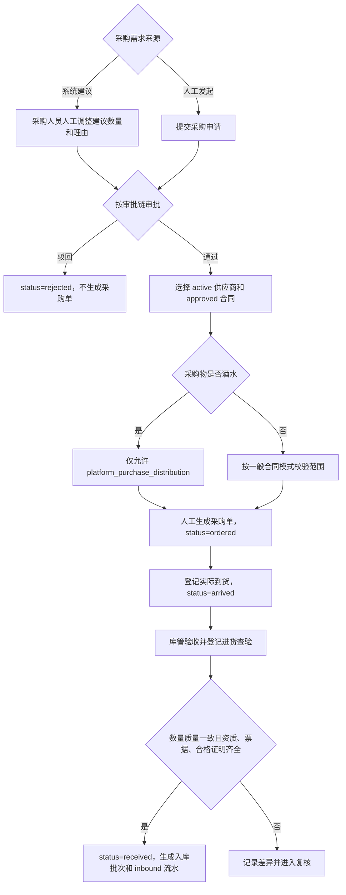
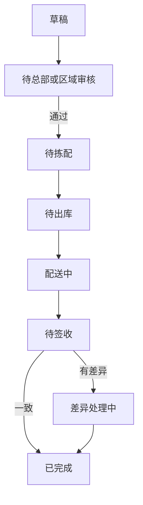
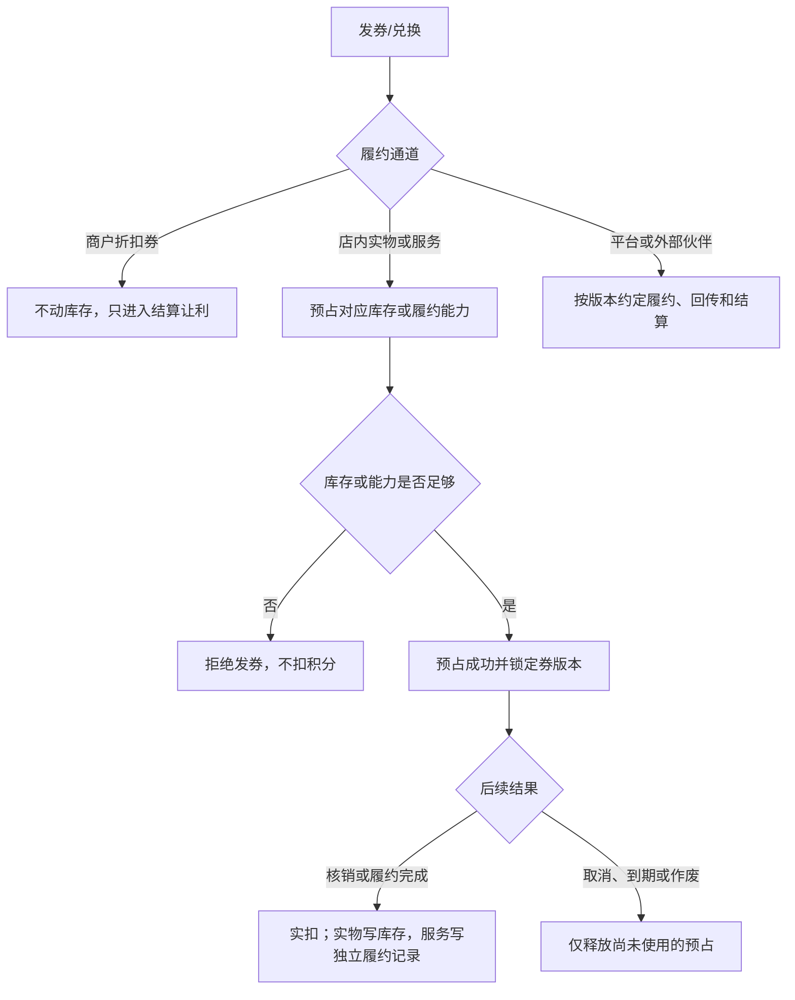
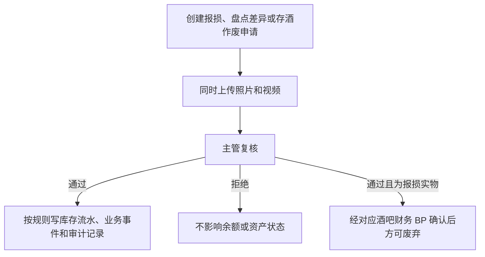

# 供应链与库存：供应商、供应合同、采购、库房、批次、流水开发设计 V0.17

> 版本：V0.17 ｜ 最后更新：2026-10-17 ｜ 覆盖迁移基线：V452 ｜ 状态：现行
> <!-- 文档goalP3(2026-06-20)：补版本/日期/覆盖迁移头，未改正文 -->

> **M09 现行口径（2026-09-03）：** 三份业务 HTML 是业务真源；本文细化但不得新增业务。迁移、Java、OpenAPI、页面和测试只证明当前实现事实，不得反向定义业务规则。下文带“建议”“任务”或未标已落地的结构/API 均为目标设计或缺口，不代表当前实现。R7/R5 横幅仅作历史留痕，现行实现以本轮逐项标注为准。

> **当前实现事实（HEAD `8cd0b602`，只证明代码现状）：**
>
> | 能力 | 已有载体 | 尚未闭合或现行违规 |
> |---|---|---|
> | 供应合同/库房 | V085 已有三合同模式、六类库房和高价值复核表 | 酒水自采未阻断；高价值复核存在低价值和 typed movement 旁路 |
> | 采购 | 数据库允许八个采购状态并有事件表；服务可达 `created → approved/rejected → ordered → arrived → received` | `submitted`、`expected` 无写入路径；空供应商和未来生效资质可绕过校验；多明细只取第一项；`purchase_inspections` 未建 |
> | 供应商 | V012 主表；V112 资质与结算子表 | 主表只有 `active/paused/archived`，不存在本文旧版五态；资质字段见 §6.1/§6.3，资质与结算现行枚举及接口见 §13C |
> | 追溯码/交接 | V128 有码表和四个允许状态值；V074 有五段交接结构 | 运行路径只实现登记/打印；五段可乱序，补录证据、主管复核和并列不可覆盖记录未实现 |
> | 跨主体流转 | V277 有流转单、收发和所有权历史 | 可消费品可借、任意单价、空 `lending_mode`、结算/改权时点分裂、无两侧库存流水，借用收货还错误改 owner |
> | 高价值阈值 | V350 有默认配置；收货接口和采购流水支持实际单价但允许为空 | 判定仍读移动加权均价；项目/商户特例仍可覆盖全局；缺成本直接按高价值只是实现事实；手工标记缺治理闭环 |
> | 冻结 HTML 的整块能力 | 基础存酒与礼品兑换路径已存在 | 智能采购、门店要货、外部经销和完整存酒生命周期尚未实现 |
>
> 2026-06-19 的 R7/R5 “零命中”或“全状态已落地”等横幅均是失效快照，本版不再把它们当现行结论；上述表和各节就地事实优先。

> **本文档为什么新增（定位）：** 依据 finding **supply-1**（HIGH/omission）——供应链是用户原始需求点名的 P0 域、三种供应合同模式被反复列为"已拍板"，但全部文档此前只在产品口径层面用散文描述，没有任何一份开发设计给出供应商表、供应合同表、采购周期表、库房/批次/流水表的字段与状态定义，P0 编码任务清单也无对应任务，处于"有 PRD 无开发设计"状态，开发无法据此编码。本文对标 `bar-operations-development-design.md` 结构，把供应链域落到可编码的数据结构、状态机、流程、API、事件与 P0 编码任务。
>
> **依据基准：** 金额单位=整数分（D1）；状态枚举给中英映射，数据库允许值与运行可达状态必须分列（D7）；事件命名用唯一事件字典点+下划线风格、不另起命名（D4）；终端类型使用冻结 HTML 的受控十一类终端（含独立经销商 Web 门户）；开放平台对外路径/权限编码统一（D3）；技术栈=Java 21 + Spring Boot 4.x + PostgreSQL + Flyway（D10，2026-06-12 修订）。
>
> **关联文档：**
> - `docs/supply-chain-inventory-product-prd-v0.1.md`（本设计的产品口径来源）
> - `docs/bar-operations-development-design.md`（酒吧库存为目标设计，基础存酒 `saved_bottles` 已落地；本文与之分工见 §1.2，避免重复建模）
> - `docs/unified-standards-baseline-v0.1.md`（历史基线；与三份 HTML 冲突时以 HTML 为准）
> - `docs/compliance-and-personal-information-protection-requirements-v0.1.md`（C9 进货查验、资质必填）
> - `docs/operation-traceability-and-terminal-switch-prd-v0.1.md`（物品追踪码、交接留痕、事件字典）

> **正式接口执行口径：** 本文负责供应链与库存业务设计、表结构建议、状态机和流程说明，不直接冻结正式后端路径。供应链 P0 Controller、前端/Android API client、SDK/mock 和接口自动化必须以 `docs/openapi/openapi-p0.yaml/json`、`p0-openapi-operation-acceptance-matrix-v0.1.md` 和 `p0-openapi-contract-closure-appendix-v0.1.md` 为准；未进入追溯附录并通过 `verify:openapi-closure` 的采购、入库、出库、盘点、报损、追踪码或存酒能力，不得作为正式联调或验收依据。

## 1. 模块定位

### 1.1 职责

供应链与库存系统负责"物品从哪里来、按什么合同供货、什么时候采购、进了哪个库、从哪里出库、被谁消耗、还剩多少、差异谁负责"的全链路台账与留痕，为酒吧经营、吧台售卖、权益兑换、财务对账和异常追责提供依据。

| 原则 | 说明 |
|---|---|
| 供应商主数据集中 | `inventory_suppliers` 是当前供货主体主表，与开放平台 `service_providers`（技术服务商）是两类对象；业务边界服从冻结 HTML，表名和实现枚举以当前迁移为准 |
| 三种供应合同显式建模 | 一般供应合同用 `platform_self_use`/`merchant_self_purchase`/`platform_purchase_distribution` 三模式；**酒水只能走平台统一采购后分销，必须阻断 `merchant_self_purchase`** |
| 金额一律整数分 | 所有金额字段单位为分（bigint），禁止 `numeric(18,2)` 元（D1） |
| 进货查验先行 | 酒类/食品入库必须绑定供货方资质、票据、批次合格证明；具体材料类型按适用法律和治理资质主数据确定；当前 `purchase_inspections` 未建 |
| 高价值判定与证据分离 | 高价值按“最近一次实际到货价 + 全平台单一阈值”或库房主管以上手工标记判断；报损、盘点差异、存酒作废无论是否高价值均须双证据与主管复核。当前均价判断仍待改造 |
| 优惠凭证履约分流 | 商户折扣券不动库存；店内实物/服务预占对应库存或履约能力后实扣；平台/外部伙伴按约定履约。礼品库只是店内礼品场景 |
| 留痕优先自动化 | 入库、出库、调拨、盘点、报损、报溢、兑换消耗、人工调整、交接均写事件中心（D4 事件字典） |

### 1.2 与酒吧库存（bar-operations）的分工边界

酒吧设计 `bar-operations-development-design.md §6.13-6.19` 描述了 `bar_inventory_items / bar_stock_batches / bar_stock_movements` 等目标逻辑表，但当前迁移、Java 与正式 OpenAPI 尚未实现这三张表；`saved_bottles` 则已由 V012 建表。分工如下：

| 范围 | 归属 | 说明 |
|---|---|---|
| 供应商主数据、供应合同、采购申请、采购周期、进货查验 | 本系统 | 跨门店、跨商户的采购侧主数据；V027 `inventory_stock_batches.supplier_id` 已引用 `inventory_suppliers`，酒吧目标批次与供应商的关联尚待正式迁移 |
| 平台级库房、库存批次、库存流水（含兑换消耗、报溢） | 本系统 | 总库、酒吧库、吧台库存、消耗品库、礼品库、存酒区 |
| 酒吧门店内的物料、批次、销售消耗、存酒 | 酒吧系统执行现场作业，本设计保留供应链契约 | `saved_bottles` 是当前载体事实；存酒的库存后果、到期转本店库存、作废双证据、跨域事件和当前 GAP 必须在 M09 自包含，不得仅转引酒吧文档 |
| 高价值判定 | HTML/PRD 为业务权威 | 当前物品档案仅保留 `manual_high_value`；阈值及价格基准差异按缺口改造 |

> 设计说明：本系统物品档案是平台级主数据；高价值业务口径以 HTML 为单一权威，当前实现差异按缺口改造。

## 2. 业务边界

### 2.1 本模块负责

| 范围 | 说明 |
|---|---|
| 供应商档案 | 供货主体、联系人、资质、结算方式和启停状态；冻结 HTML 未授权黑名单五态 |
| 供应合同 | 平台自用/商户自采/平台统一采购分销三模式、供货范围、价格口径、账期、有效期、审批状态 |
| 采购申请与采购周期 | 补货需求、审批、下单、到货计划、实际入库、结算依据 |
| 库房与库位 | 总库、酒吧库、吧台库存、消耗品库、礼品库、存酒区 |
| 物品档案 | 酒类、消耗品、礼品、其他物品的单位、成本口径、高价值标记 |
| 进货查验 | 供货方资质、票据、批次合格证明绑入库批次（C9） |
| 库存批次与流水 | 批次、保质期、库存变化及成本流水；按 HTML 十二类记录；冲正是原流水状态/反向处理，不新增第十三类 |
| 优惠凭证与积分兑换履约 | 三类履约通道分流；店内实物/服务才进入对应库存/能力的预占、实扣和释放 |
| 智能采购与门店要货 | 建议只生成数量和理由，经人工调整、审批后成单；要货九态全程留操作者和时间，当前未实现 |
| 外部经销供应链 | 经销准入、隔离门户、价格目录/询价、订单付款、库存预留、退货红冲、资金归属、职责分离，当前未实现 |
| 五段交接与跨主体借调 | 严格顺序、证据补录；借只转保管、调才转所有权，当前实现差异见 §5 |

### 2.2 本模块不直接负责

| 范围 | 边界 |
|---|---|
| 酒吧门店现场点单/出品/存酒 | 由酒吧经营系统负责（§1.2） |
| 积分账户与兑换规则引擎 | 由会员积分子系统负责，本系统只接收兑换扣减请求并回执 |
| 财务清算与三方对账引擎 | 由财务结算系统负责；本系统提供采购、入出库、报损、差异和兑换履约的不可篡改库存事实，并接收最终快照/日结阻断结果 |
| 资质有效期到期预警/经营阻断 | 资质主数据与到期卡控由平台治理/地基负责，本系统在进货查验时引用其资质有效性结论（C9） |
| 机器人调度算法、视频原始存储 | 由第三方系统负责，本系统只创建任务/关联证据索引 |

## 3. 领域模型

### 3.1 聚合划分

| 聚合 | 核心对象 | 职责 |
|---|---|---|
| 供应商聚合 | `Supplier`, `SupplierContact`, `SupplierQualification` | 供货主体、联系人、资质、结算方式和启停；现行字段见 §6.1/§6.3，资质与结算枚举及接口见 §13C |
| 供应合同聚合 | `SupplyContract`, `SupplyContractScope`, `SupplyContractPrice` | 三种供货模式、供货范围、价格口径、账期、有效期、审批 |
| 采购聚合 | `PurchaseRequest`, `PurchaseRequestItem`, `PurchaseRequestEvent` | 采购申请、明细、从申请到入库的状态流转留痕（T6：周期由申请状态机承载，不单建周期对象） |
| 库房聚合 | `Warehouse`, `WarehouseLocation` | 库房、库位 |
| 物品聚合 | `Item`, `ItemCategory` | 物品档案、分类、单位、成本口径、高价值标记 |
| 库存聚合 | `StockBatch`, `StockMovement`, `StockBalance` | 批次、流水、余额 |
| 进货查验聚合 | `PurchaseInspection` | 供货方资质/票据/合格证明绑入库批次（C9） |
| 兑换扣减聚合 | `RedemptionStockDeduction` | 积分兑换/礼物领取的库存预占与扣减（pass-2） |
| 主管复核聚合 | 当前技术载体 `InventoryHighValueReview` | HTML 只要求主管复核，不授权绕开治理队列；当前技术载体不得被升级为业务旁路规则 |
| 门店要货聚合（目标） | `StoreRequisition`, `StoreRequisitionEvent` | 九态、操作者、时间、拣配、配送、签收和差异；当前未实现 |
| 经销聚合 | `DealerRecord`, `DealerContractRecord`（含付款条款与运费模板版本）, `DealerPriceCatalogRecord`（+`Line`）, `DealerInquiryRecord`, `DealerExternalStockRecord`（CG-11a），`DealerOrderRecord`（+`Line` / `Payment` / `Refund` / `Overpayment`，CG-11b，`DealerOrderService` + `DealerOrderDeadlineJob`）；`DistributorReturn`（目标） | 冻结经销全链；准入 / 合同 / 目录 / 询价 / 外显（V451）与订单 / 付款 / 预留 / 出库 / 取消退款 / 逾期 / 超收（V452）已落地，退货未实现，不增加 HTML 外状态 |
| 交接与跨主体流转聚合 | `TraceHandover`, `TransferOrder`, `CustodyHistory` | 五段交接、补录证据、所有权/保管主体、期限和扫码时间；当前仅部分实现 |

### 3.2 核心对象说明

| 对象 | 中文名 | 关键字段 | 说明 |
|---|---|---|---|
| `Supplier` | 供应商 | 当前 V012：`supplier_name`, `supplier_type`, `contact_name`, `contact_phone`, `status` | `supplier_type` 是当前自由文本实现字段，不构成 HTML 封闭分类；状态仅 `active/paused/archived` |
| `SupplyContract` | 供应合同 | 当前 V085：`contract_mode`, `supply_scope`, `purchasable_scope`, `price_terms`, `payment_term_days`, `valid_from/valid_to`, `approval_status`, `status` | 三种一般模式；酒水须额外阻断商户自采。当前无 `price_mode` 字段 |
| `PurchaseRequest` | 采购申请 | `supplier_id`, `supply_contract_id`, `status` | 补货需求，状态机承载从申请到入库全流转（T6） |
| `PurchaseRequestEvent` | 采购流转事件 | `request_id`, `from_status`, `to_status`, `operator_user_id` | 采购状态逐步留痕（T6：取代独立采购周期表） |
| `Warehouse` | 库房 | `warehouse_type`, `merchant_id`, `status` | 总库、酒吧库、吧台库存、消耗品库、礼品库、存酒区六类 |
| `Item` | 物品 | 当前：`sku_code`, `item_name`, `item_type`, `unit`, `trace_required`, `min_quantity`, `manual_high_value` | 商品规格是定价、库存、结算、对账最小单元；当前主表无 `cost_price` |
| `StockBatch` | 库存批次 | 当前：`item_id`, `location_id`, `batch_no`, `supplier_id`, `quantity`, `expire_at`, `status` | 当前批次表无 `cost_price`；成本见流水和移动加权成本状态 |
| `StockMovement` | 库存流水 | 当前：`movement_type`, `quantity`, `business_type`, `business_id`, `status` | 所有库存变化依据，含兑换消耗/报溢 |
| `PurchaseInspection`（目标） | 进货查验记录 | `batch_id`, `supplier_qualification_refs`, `invoice_refs`, `quality_cert_refs` | 绑入库批次的法定查验台账（C9），当前未建 |
| `RedemptionStockDeduction`（目标） | 实物兑换库存扣减 | `redemption_ref`, `item_id`, `warehouse_id`, `deduct_status`, `idempotency_key` | 只承接店内实物库存预占与扣减；服务使用独立履约能力记录，当前均未建统一载体 |

## 4. 状态机（中英映射，D7）

> 原则（D7）：HTML 锁定中文业务状态和类型集合。当前已落库且存在数据库 CHECK 的字段须逐项核对中文、英文 code 与 CHECK；每个目标机读 code 必须完整、无歧义地回映射到一个 HTML 中文业务状态或类型，并须标明“目标”。同一业务类型可因账本方向或 HTML 已授权原因使用多个内部子码，但 UI、统计和业务契约必须归并回原 HTML 类型，不得借子码新增、删除、拆分、合并或改变 HTML 业务语义。没有 CHECK 的字段须按服务真实写入值说明；未进入迁移和正式 OpenAPI 的目标 code 不得宣称已实现。

### 4.1 供应商状态（当前实现事实）

冻结 HTML 只要求维护供应商启停状态，没有授权黑名单五态。当前 V012 `inventory_suppliers.status` 的数据库允许值如下；它们只描述实现，不反向扩充业务规则：

| code | 中文实现语义 | 说明 |
|---|---|---|
| `active` | 启用 | 当前可用 |
| `paused` | 暂停 | 当前暂停使用 |
| `archived` | 归档 | 历史只读 |

旧版 `pending_review/suspended/blacklisted/archived` 五态、黑名单原因和拉黑流程无冻结 HTML 来源，已从现行需求、API、任务和验收中删除；如需重新引入，须先获批写入 HTML。

### 4.2 供应合同审批状态

> 当前 V085 把审批状态 `approval_status` 和合同生命周期 `status` 分列；下列 code 只描述实现，不新增 HTML 业务状态。

供应合同审批状态 `approval_status`（当前 V085 三态）：

| code | 中文 | 说明 |
|---|---|---|
| `draft` | 草稿 | 未提交 |
| `approved` | 已审批 | 审批通过，且在有效期内可作为采购依据 |
| `rejected` | 已驳回 | 审批不通过 |

合同生命周期状态 `status`（当前 V085 数据库 CHECK 允许三值）：

| code | 中文 | 说明 |
|---|---|---|
| `active` | 生效 | 合同正常有效 |
| `suspended` | 暂停 | 临时暂停（纠纷/资质过期等） |
| `expired` | 已过期 | 超过 `valid_to` |

当前服务可达事实：`approval_status` 可由 `draft →(审批) approved/rejected`；创建合同把生命周期 `status` 写为 `active`，没有写入 `suspended/expired` 的服务路径。超过 `valid_to` 时采购校验会拒绝，但不会把状态改成 `expired`。因此只能称数据库允许三值，不得称生命周期三态流转已实现。

### 4.3 采购状态（数据库允许值与运行可达状态分列）

V085 的 `inventory_purchase_requests.status` CHECK 允许下列八个值：

| code | 中文 | 说明 |
|---|---|---|
| `created` | 已创建 | 创建后的兼容起点；可进入审批 |
| `submitted` | 已提交 | 数据库允许值；当前服务无写入路径 |
| `approved` | 已审批 | 审批通过，可下单 |
| `rejected` | 已驳回 | 审批不通过 |
| `ordered` | 已下单 | 已向供应商下单 |
| `expected` | 预计到货 | 数据库允许值；当前服务无写入路径 |
| `arrived` | 已到货 | 货物到货待入库确认 |
| `received` | 已入库 | 入库确认，生成入库 `inventory_stock_movements` 并落 warehouse/库位 |

**当前运行可达路径：** 创建写 `created`；审批写 `approved` 或 `rejected`；通过后依次写 `ordered → arrived → received` 并写事件。`submitted`、`expected` 目前不可达，因此不得称“完整八态逐步流转”已实现。业务要求仍包含申请、审批、下单、预计到货、实际到货和入库事实，但技术 code 不得反向定义业务。

### 4.4 门店要货状态（冻结目标，当前未实现）

| 顺序 | 中文状态 |
|---|---|
| 1 | 草稿 |
| 2 | 待总部或区域审核 |
| 3 | 待拣配 |
| 4 | 待出库 |
| 5 | 配送中 |
| 6 | 待签收 |
| 7 | 差异处理中 |
| 8 | 已完成 |
| 9 | 已取消 |

每次状态转换必须记录操作者和时间。HTML 未给机读 code；实现时可细化 code，但不得增加或删除业务状态。

### 4.5 经销状态（经销商 / 询价 / 价格目录 CG-11a V451、订单 CG-11b V452 已实现；退货单为冻结目标）

| 对象 | 中文状态 | 机读 code（CG-11a） |
|---|---|---|
| 经销商 | 待提交、审核中、已通过、已驳回、已停用 | `dealers.status`：pending_submission / under_review / approved / rejected / deactivated（CHECK `chk_dealers_status`；`portal_enabled` 只能在 approved 下为真；`credit_suspended` 为尾款逾期暂停账期订单标记，CG-11b） |
| 询价 | 待报价、报价审批中、已报价、已失效 | `dealer_inquiries.status`：pending_quote / quote_approval / quoted / expired |
| 价格目录 | 草稿、待审批、已生效、已失效 | `dealer_price_catalogs.status`：draft / pending_approval / effective / expired（同一合同只有一版 effective，部分唯一索引） |
| 经销订单 | 草稿、待审核、已驳回、待付款、付款核验中、待出库、配送中、已签收、已完成、取消中、已取消、待退款、退货中、部分退货、已退货 | `dealer_orders.status`：draft / pending_review / rejected / pending_payment / payment_verifying / pending_shipment / shipping / signed / completed / cancelling / cancelled / pending_refund / returning / partially_returned / returned（CHECK `chk_dealer_orders_status`；退货三态由 CG-11c 写入）。到账 `dealer_order_payments.status`：pending_verification / verified / rejected / late；退款 `dealer_order_refunds.status`：pending_request / pending_approval / approved / rejected / refunded；超收 `dealer_order_overpayments.status`：unconfirmed / prepayment / offset_applied |
| 经销退货单 | 待审批、已驳回、待收货、验收中、待红冲、待退款、退款中、退款失败、部分完成、已完成 |

### 4.6 库存批次状态

| code | 中文 | 说明 |
|---|---|---|
| `active` | 可用 | 有库存可出 |
| `consumed` | 已耗尽 | 数量已消耗 |
| `expired` | 已过期 | 超保质期 |
| `archived` | 已归档 | 历史只读 |

### 4.7 库存流水状态

当前 `inventory_stock_movements.status` 没有 DB CHECK，主要写入值为 `completed`。历史 `draft/pending_approval/confirmed/reversed/rejected` 五态没有冻结 HTML 依据，本版不再把它作为现行状态机。业务更正必须保留原流水并追加冲正，不得修改或删除原记录；具体技术 code 应在正式迁移和 OpenAPI 中统一后再验收。

### 4.8 店内实物/服务履约扣减状态（技术细化）

| code | 中文 | 说明 |
|---|---|---|
| `reserved` | 已预占 | 店内实物/服务发券时预占对应库存或履约能力；礼品只是其中一种 |
| `claimed` | 已领取 | 客人领取确认，转实扣 |
| `released` | 已释放 | 兑换取消/超时，释放预占 |

上述 code 只是目标技术映射，不是 HTML 新增业务状态。库存或能力不足时预占失败、发券不成立且不形成最终积分扣减；失败记录方式和错误 code 以正式技术契约为准，不进入 `deduct_status`。

## 5. 核心业务流程

### 5.1 采购到入库（含进货查验 C9）

进货查验关键要求（C9）：

- 酒类/食品业态入库**必须**登记进货查验记录并绑定到 `inventory_stock_batches`，缺查验记录不得确认入库。
- 查验内容：供货方资质、票据、批次合格证明；具体材料类型按适用法律和治理资质主数据确定。
- 每条进货查验记录绑定对应入库批次，可正查、反查其来源、归属和上下游关联。
- 智能采购只能生成建议数量和理由，须人工调整、审批后成单，绝不得自动向供应商下单。
- 酒水一律平台统采分销，商户自采模式必须在品类校验处被拒绝。

> **当前实现 GAP：** 当前无智能采购建议；服务没有 `submitted`、`expected` 写路径；酒水走 `merchant_self_purchase` 尚未被代码阻断；`purchase_inspections` 未建。仅在 `decision=approved` 且 `supplier_id` 非空时检查 `active` 且未过 `valid_to` 的资质，`decision=rejected` 不检查，也不检查未来 `valid_from`；空供应商会跳过校验，`receive` 也不重验，尚不能证明收货时供货方资质、票据、批次合格证明已绑定入库批次。

### 5.2 门店要货与库房履约（当前未实现）

冻结 HTML 的九个中文状态包含“已取消”，但未定义其进入条件；不得把“驳回/撤销”推定为该转换。每次转换记录操作者和时间；仓库出库、配送、门店签收分别留痕，差异关闭前不得标完成。HTML 没有给机读 code，实施时只能在九个中文状态内技术细化。

### 5.3 优惠凭证与积分兑换三类履约

关键规则（pass-2）：

- 礼品兑换可落 `warehouse_type=gift`，但礼品库只是店内实物通道的一个实例，不得成为全部券和服务的唯一来源。
- 履约通道与收费型/免费型是两个独立维度，每个券版本均须配置；发券时扣积分并锁定项目、价格、方案和成本承担版本，但不与商户结算。
- **预占失败**：库存或能力不足时发券不成立，也不得形成最终积分扣减；失败记录方式、错误 code 和跨服务调用次序以正式技术契约为准。
- **领取确认回写**：客人在一体机/前台领取或服务履约确认时由预占（reserved）转实扣（claimed）；实物库存按具体场景生成 `redeem_consume`/`gift_claim_consume`，服务使用独立履约能力记录，不得写入库存流水。
- **核销结算**：店内实物/服务实际核销或完成履约后，按发券时锁定的项目内部结算价补偿承接商户；内部结算价低于积分兑换结算单价时不得上架；积分兑换结算单价不作为补偿价；核销一件结一件，未核销不结算（依据 ENUM「发券与核销结算」）。
- 扣减接口带 `idempotency_key`，重复请求返回首次结果，避免重复扣减。
- 兑换取消、到期或作废时，只能释放尚未使用的预占（reserved -> released），已核销实扣不得沿释放路径回补。

> **当前实现 GAP：** 当前主要实现礼品兑换路径，尚未形成折扣券不动库存、店内各类实物/服务对应库存或能力、平台/外部伙伴约定履约三通道的统一契约。

### 5.4 盘点、报损、报溢与存酒作废（无金额豁免的双证据 + 主管复核）

冻结 HTML 的业务规则是：所有报损、盘点差异和存酒作废，无论金额高低，均须同时留存照片和视频并经主管复核；报损废弃前还须由财务 BP 确认。报损业务原因仅包括长期存放过期、碰落等损坏；经查明属人员造成的损坏，由相关人员照内部结算价赔偿。当前 Java/OpenAPI 仍把 `loss/damage/waste` 归入 `damage_report` 报损族，这是实现 GAP；`loss` 不构成 HTML 第三种业务报损原因。

高价值判断使用最近一次实际到货价和全平台唯一阈值：严格大于阈值为高价值，严格小于阈值为低价值；或由库房主管以上岗位手工标记为高价值，标记与取消均须填写理由并留痕，一线库管无权限。阈值未配置时一律按高价值拦截；冻结 HTML 未规定等于阈值或没有最近到货价时的分类，本设计不新增规则，也不得静默回退到移动加权价。当前 Java 在缺少成本基准时以 `BASIS_COST_UNKNOWN` 按高价值拦截，只是实现事实，不是 HTML 授权。

阈值是全平台统一可配的安全参数，出厂默认 5000 元，调整须最高权限审批、完整留痕并同时配置上下限。仓库正常情况下全程摄像、由机械手臂取货且人员一般不进入；人员确需进入时必须携带摄像设备并在进入前确认设备完好，期间录像事后做人工智能分析。录像和分析结果按项目可配长期保存，出厂默认至少五年并设下限；异常责任按冻结规则处理。

当前实现与冻结规则仍有差距：

- `HighValueDecisionService` 读取移动加权成本，而不是最近一笔实际到货价。
- V350 阈值表及其写入、读取接口允许项目/商户作用域覆盖，尚未形成全平台唯一阈值。
- 非高价值即时调整和存酒取消可直接生效；typed `damage/loss/waste` 路径可绕开复核；盘点差异路径没有强制照片、视频字段。
- 当前没有报损实物废弃前财务 BP 确认所需的字段、状态或闸口；库存落账不能替代该确认。
- 当前 `inventory_high_value_reviews` 及库存域复核服务只是技术事实；冻结 HTML 只要求主管复核，并未授权绕开统一治理队列。

库存调整、高价值复核通过和盘点差异纠账当前会在同一事务写入 `inventory_stock_movements`，用于重建余额；这一账本能力不消除上述证据与复核旁路。当前内部代码包括 `{gain, loss, damage, waste, count_correction}`，其中 `loss` 当前也会映射到 `damage_report`；这不改变 HTML 仅有两种报损原因的目标口径。

### 5.5 五段交接

冻结规则要求库管出库核验、配送/机器人、后厨接收、服务员取走、送达客人五段严格顺序留痕；缺任一段不得进入下一段。扫码缺失时只能提交带证据的补录申请，经主管复核后推进，补录必须与原始扫码记录并列保存且不可覆盖。

> **当前实现 GAP：** V074 已建立五段数据结构和基础扫描能力，但扫描与机器人回传未校验前置段，可越过前段完成后段；补录请求没有完整证据、提交人与并列不可覆盖记录载体，链路查询也不能返回完整补录和复核轨迹。异常复核无论 `approved` 还是 `rejected` 都会执行表头关闭逻辑，且关闭前不检查同一交接是否仍有其他 `pending` 异常，驳回或仍有待审异常时表头也可能恢复为 `in_progress/completed`。

### 5.6 存酒跨域库存后果

存酒是客户资产而非可售库存。库存域完整遵循 PRD §7.4、冻结 BSM「存酒登记」「取酒与人工例外」「账户注销」和 ENUM「客人存酒有效期与转存」：承接隐私同意、有效期与提醒规则版本固化、短信验证码或官方动态取酒码二选一核验、转让与转存分离、从当前到期日按该酒吧当前配置期限顺延、转存上限无例外、员工代办复核、“我的存酒”跨店汇总标店但仅原店取酒、人工例外阈值和人员分支、第三方代领恢复验证后走正常转让、到期转本店自有库存但不确认收入，以及后续报废/赠送/内部使用仍需审批等库存状态和事件后果。账户注销时必须提醒名下尚有存酒；客人可选择不取存酒、主动放弃并径行注销，放弃的存酒按到期规则转为所在酒吧自有库存资产。

> **当前实现 GAP：** 当前转让请求的 `transferQuantity` 可空，服务接受 `1..remainingQuantity`，没有强制等于整瓶当前剩余量；保存时保留原 `customerId/name/phone`、只写 `transferTo*`，取酒仍校验原姓名，转让流水的操作者为空，用户文案仍有“转赠”，因此既违反单标签酒瓶不得拆分的规则，也未正确切换权益人与取酒身份。`CustomerService.deregisterAccount` 只把账户状态改为 `deregistered`，未检查或提醒名下存酒，也没有主动放弃选择或转库存联动。提醒版本、转存期限与上限、短信/动态码核验、代办复核、跨店汇总标识、人工例外阈值/查询留痕/人员分支、第三方代领恢复验证、到期或注销放弃转换及后续处置审批也尚未形成完整闭环。

### 5.7 跨主体调拨、借用与归还

可消费物品不存在保留所有权的“借”，一律按“调（买断）”处理，交付扫码时所有权转移并按内部结算价同步出账；不可消费物品借用只转移保管责任，不转移所有权，且必须记录应还数量和期限，超期必须自动生成工单、通知借出方主管并持续走通用超时升级。溯源码须同时记录所有权主体、当前保管主体、借出主体、借入主体、应还数量与期限；时间由借出方交货扫码、每次保管人变更扫码和借出方实际归还收货扫码自动产生，不设手工填写（依据 PRD §7.6、BSM「跨主体流转」、ENUM「跨主体借调」）。

> **当前实现 GAP：** V277 未拒绝可消费品 `lending`，接受请求方任意非负单价且不核验内部结算价，`lending_mode` 还可为空；发货时出账、收货时才改 owner，两侧库存与库存流水不联动。borrow/lending 收货也会错误改 owner；空 mode 收货后既不能归还也不能取消。当前另缺保管人、应还时间、实际归还时间和超期工单载体。Controller/UI 已有基础调用；正式 OpenAPI 只收录 return/cancel，仍漏 list/get/create/ship/receive 与 `supply-entities` GET/POST，客户端覆盖也漏扫工作台。

### 5.8 外部经销供货

目标链路完整遵循 PRD §7.7、冻结 BSM 的“外部经销商准入、价格与库存”章节、ENUM 经销状态至资金归属条和 PGM 经销权限条，包括经销商准入与停用撤权、隔离门户、独立合同价目录、询价、库存外显、订单十五态、对公或平台付款、中心仓预留、迟到款退款、职责分离、退货十态、红冲重开，以及销售主体、收入和资金归属留痕。经销货款计入销售主体自身收入和分红净利润基数，分红计算仍归财务系统。已定合同价的商品才可下单，无价商品只能询价并经报价审批；合同指定中心仓、运费模板、包邮门槛、承担方和销售主体，订单固化相应版本。取消审批与到账核验互斥，取消生效后不得出库，到账后取消须退款审批且退款执行人与到账核验人分离；退货按实际验收数量退款并支持部分退货，签收后才可按最终未退金额开票。经销商门户适用统一终端开关、访问拒绝留痕和兜底关闭规则；订单必须先审核合同、价格、库存和交期，通过后才通知付款。实际计税、申报和开票服从业务发生时有效法规、主管机关规则及专业系统结果。状态值以冻结枚举 HTML 为准，不新增等级折扣、授信额度或现金收款规则。

> **当前实现 GAP：** 当前尚未形成经销商、询价、价目、订单、付款、退货和门户隔离的完整领域载体、接口与页面。

### 5.9 吧台按杯损耗率

按杯销售按标准出酒量/容量扣减库存，超出标准部分记损耗；有采集设备时实际出酒量必须由设备采集，无设备时必须按标准出酒量配酒，也按该标准计算扣减与标准损耗，禁止按零损耗记账。损耗率按“当期损耗量 ÷ 标准出酒量”计算；超过按酒吧配置的安全阈值即转核查工单，出厂默认 5%，须同时配置上下限。当前 Java 按订单项件数 `quantity` 扣库存，实际/标准容量只用于损耗计算，`bar.pour-cost.strict-mode` 是未绑定设备有无或状态的全局配置；V058/Java 另使用商品级绝对损耗量阈值并只记录异常事件，尚未形成按标准出酒量/容量扣减、设备实采超标量记损耗、损耗率阈值和核查工单闭环。

## 6. 数据库表结构

字段使用 PostgreSQL snake_case，并以实际迁移为准，不给所有表套用一组并不存在的默认列。金额字段统一使用整数分。

删除规则按冻结 HTML 分三类：配置和业务主数据仅能经审批软删除；钱账数据不得删除，纠错走冲正；事件和审计记录只能追加或作废/冲正。当前 V085 的采购事件外键仍写 `ON DELETE CASCADE`，但 V140 的 append-only 触发器会阻断有子事件时的父级联删除；目标外键应使用 `RESTRICT`/`NO ACTION`，不得以级联硬删除留痕。

项目和商户隔离列只按各表实际迁移记录；缺少直接隔离列时列为 GAP，不以虚构 `project_id` 掩盖。

### 6.1 inventory_suppliers 供应商表

| 字段 | 类型 | 说明 |
|---|---|---|
| `id` | varchar(64) | 主键（V012） |
| `supplier_name` | varchar | 供应商名称 |
| `supplier_type` | varchar | 当前为自由文本，默认 `general`；不是经 HTML 批准的封闭分类枚举 |
| `contact_name` | varchar | 联系人姓名 |
| `contact_phone` | varchar | 联系电话，按现行 PII 约束存储 |
| `status` | varchar | 当前 V012：`active/paused/archived` |
| `merchant_id` | varchar | V046 增加的商户隔离列，可空 |
| `created_at` / `updated_at` | timestamptz | 创建、更新时间 |

当前表没有 `project_id`、`supplier_code`、`supplier_category`、主表结算方式、黑名单原因或黑名单时间。未经 HTML 批准的五态黑名单和七类供应商方案已从本版目标与验收删除。维保单位可复用供应商记录，但不能据此新增 `maintenance/service` 封闭分类。

### 6.2 supplier_contacts 供应商联系人表（目标设计，当前未建表）

| 字段 | 类型 | 说明 |
|---|---|---|
| `id` | varchar(64) | 主键（目标沿用当前字符串 ID 惯例） |
| `supplier_id` | varchar(64) | 供应商 |
| `name` | varchar | 联系人姓名 |
| `phone` | varchar | 电话（按 PIPL 脱敏/加密存储） |
| `role` | varchar | 联系人职责，自由文本；不在本版新增封闭枚举 |
| `is_primary` | boolean | 是否主联系人 |

### 6.3 supplier_qualifications 供应商资质表

| 字段 | 类型 | 说明 |
|---|---|---|
| `id` | varchar(64) | 主键（V112） |
| `supplier_id` | varchar(64) | 供应商 |
| `qualification_type` | varchar | 当前 V112：`business_license/food_business_license/production_license/inspection_report/hygiene_permit/import_record/other` |
| `qualification_no` | varchar | 证照编号 |
| `issued_by` | varchar | 发证/出具机构 |
| `valid_from` | date | 起始 |
| `valid_to` | date | 到期日，可空 |
| `attachment_ids` | jsonb | 证照影像附件 |
| `status` | varchar | 当前 V112：`active/suspended/archived` |
| `merchant_id` | varchar | 商户隔离列，可空 |
| `created_at` / `updated_at` | timestamptz | 创建、更新时间 |

当前资质表已经存在；进货查验台账和入库强绑定仍未实现，不能把资质表存在等同于查验闭环完成。

### 6.4 supply_contracts 供应合同表

| 字段 | 类型 | 说明 |
|---|---|---|
| `id` | varchar(64) | 主键（V085） |
| `contract_no` | varchar | 合同编号 |
| `supplier_id` | varchar(64) | 供应商 |
| `project_id` | varchar | 当前 V085 必填 |
| `merchant_id` | varchar | 商户，可空 |
| `contract_mode` | varchar | `platform_self_use/merchant_self_purchase/platform_purchase_distribution`（平台自用/商户自采/平台统一采购分销，CHECK 三取值） |
| `supply_scope` | text | 供货范围摘要 |
| `price_terms` | text | 价格口径摘要；当前没有 `price_mode` 封闭枚举 |
| `payment_term_days` | integer | 账期天数，可空 |
| `valid_from` | date | 有效期起 |
| `valid_to` | date | 有效期止 |
| `summary` | text | 合同核心摘要 |
| `approval_status` | varchar | 当前 V085：`draft/approved/rejected` |
| `status` | varchar | 合同生命周期 `active/suspended/expired`（§4.2，与审批状态分列，CHECK 与之对应） |
| `purchasable_scope` | jsonb | 可采购物料/范围，采购时卡控（T6） |
| `created_at` / `updated_at` | timestamptz | 创建、更新时间 |

当前 V085 约束与索引：`contract_no` 使用列级 UNIQUE；显式索引只有 `idx_supply_contracts_supplier` 与 `idx_supply_contracts_scope`。

业务约束：一般供应合同可采用三种模式；酒水只能使用 `platform_purchase_distribution`，商户不得自行换供应商。当前代码仍需按此规则验收，不能从数据库三值 CHECK 推导酒水例外已被强制。

### 6.5 inventory_purchase_requests 采购申请表

> 当前采购流转使用本表状态 + §6.7 `inventory_purchase_request_events`，没有独立 `purchase_cycles` 表。数据库允许值与服务可达路径必须分列。

| 字段 | 类型 | 说明 |
|---|---|---|
| `id` | varchar(64) | 主键（V012） |
| `request_no` | varchar | 申请编号 |
| `supplier_id` | varchar(64) | 供应商，可空（V012） |
| `item_id` | varchar(64) | 当前为单一物品引用；多明细表仍是目标设计 |
| `quantity` | integer | 采购数量 |
| `supply_contract_id` | varchar(64) | 供应合同（T6，采购须在 approved 合同 `purchasable_scope` 内） |
| `merchant_id` | varchar(64) | 商户，可空 |
| `approved_by` | varchar(64) | 审批人（T6） |
| `expected_arrival_date` | date | 预计到货日 |
| `ordered_at` | timestamptz | 下单时间（T6） |
| `actual_arrival_date` | date | 实际到货日期（T6） |
| `received_at` | timestamptz | 入库确认时间（T6） |
| `received_by` | varchar(64) | 入库确认人（T6） |
| `evidence_attachment_ids` | jsonb | 附件索引 |
| `status` | varchar | 当前采购状态机 `created/submitted/approved/rejected/ordered/expected/arrived/received`（§4.3，CHECK 与之对应） |
| `created_at` / `updated_at` | timestamptz | 创建、更新时间 |

> 当前服务写入路径为 `created → approved/rejected → ordered → arrived → received`；`submitted`、`expected` 只是数据库允许值，没有对应服务写入路径。因此不能称完整八态必经流程已经落地。
> 正式 OpenAPI 对 `items` 声明 `maxItems: 200`；Java DTO 未配置项数上限，服务只要求列表非空并取第一项、不拒绝其余明细，V012 也只保存一组 `item_id/quantity`；第二项以后会被静默忽略，应用层也不拒绝超过 200 项，这是正式契约 GAP。

### 6.6 purchase_request_items 采购申请明细表（目标设计，当前未建表）

| 字段 | 类型 | 说明 |
|---|---|---|
| `id` | varchar(64) | 主键（目标沿用当前字符串 ID 惯例） |
| `request_id` | varchar(64) | 采购申请 |
| `item_id` | varchar(64) | 物品 |
| `quantity` | numeric | 数量 |
| `unit` | varchar | 单位 |
| `unit_price` | bigint | 单价，单位：分 |
| `amount` | bigint | 小计，单位：分 |

### 6.7 inventory_purchase_request_events 采购流转留痕事件表

> 当前 V085 没有独立 `purchase_cycles` 表；采购服务在可达状态变更时写本表，下单、实际到货和入库时间落在 §6.5 对应字段。`submitted/expected` 当前无服务路径。

| 字段 | 类型 | 说明 |
|---|---|---|
| `id` | varchar(64) | 主键（V085） |
| `request_id` | varchar(64) | 采购申请；当前 V085 为 `ON DELETE CASCADE`，目标改为 `RESTRICT/NO ACTION`，V140 已在有事件时阻断级联删除 |
| `from_status` | varchar | 变更前状态，可空 |
| `to_status` | varchar | 变更后状态（§4.3 采购状态枚举） |
| `operator_user_id` | varchar(64) | 操作人 |
| `note` | varchar | 备注 |
| `created_at` | timestamptz | 发生时间 |

### 6.8 warehouses 库房表

| 字段 | 类型 | 说明 |
|---|---|---|
| `id` | varchar(64) | 主键（V085） |
| `name` | varchar | 库房名 |
| `warehouse_type` | varchar | 当前 V085：`main/bar/bar_counter/consumable/gift/saved_bottle`（总库/酒吧库/吧台库存/消耗品库/礼品库/存酒区） |
| `merchant_id` | varchar(64) | 商户，可空（平台库为空） |
| `project_id` | varchar(64) | 当前 V085 必填 |
| `status` | varchar | 当前 V085：`active/archived` |
| `created_at` / `updated_at` | timestamptz | 创建、更新时间 |

> `warehouse_type=gift` 只是店内实物履约的一个库存实例；折扣券不动库存，其他店内实物/服务使用对应库存或履约能力，平台/外部伙伴按约定履约。

### 6.9 warehouse_locations 库位表（目标设计，当前未建表）

| 字段 | 类型 | 说明 |
|---|---|---|
| `id` | varchar(64) | 主键（目标沿用当前字符串 ID 惯例） |
| `warehouse_id` | varchar(64) | 库房 |
| `location_code` | varchar | 库位编码 |
| `name` | varchar | 库位名 |

### 6.10 item_categories 物品分类表（目标设计，当前未建表）

| 字段 | 类型 | 说明 |
|---|---|---|
| `id` | varchar(64) | 主键（目标沿用当前字符串 ID 惯例） |
| `name` | varchar | 分类名 |
| `parent_id` | varchar(64) | 父分类，可空 |
| `sort_order` | int | 排序 |

### 6.11 inventory_items 物品档案表

| 字段 | 类型 | 说明 |
|---|---|---|
| `id` | varchar(64) | 主键（V012） |
| `sku_code` | varchar | SKU 编码，可空且非空时唯一 |
| `item_name` | varchar | 物品名 |
| `item_type` | varchar | 当前自由文本类型；不在本版新增封闭枚举 |
| `unit` | varchar | 基础单位 |
| `barcode` | varchar | 条码，可空 |
| `min_quantity` | integer | 最小库存数量，非负 |
| `manual_high_value` | boolean | 当前实现的手工高价值标记，默认 false |
| `trace_required` | boolean | 当前实现的追溯要求标记 |
| `merchant_id` | varchar | 商户隔离列，可空 |
| `status` | varchar | 当前 V012：`active/disabled/paused/archived` |
| `created_at` / `updated_at` | timestamptz | 创建、更新时间 |

> 当前表没有 `cost_price`。V350 已删除物品级阈值字段；业务要求“最近一次实际到货价 + 全平台单一阈值”，当前移动加权价及多作用域阈值均是待改造 GAP。

### 6.12 inventory_stock_batches 库存批次表

| 字段 | 类型 | 说明 |
|---|---|---|
| `id` | varchar(80) | 主键（V027） |
| `item_id` | varchar(80) | 物品（V027） |
| `location_id` | varchar(80) | 库位，必填（V027 `NOT NULL`） |
| `batch_no` | varchar | 批次号 |
| `quantity` | integer | 当前数量，非负（V137 起 CHECK `quantity >= 0`） |
| `supplier_id` | varchar(80) | 供应商，可空（V027） |
| `expire_at` | timestamptz | 保质期，可空 |
| `evidence_attachment_ids` | jsonb | 附件索引 |
| `merchant_id` / `project_id` | varchar | 当前隔离列，可空 |
| `status` | varchar | 当前 V027：`active/consumed/expired/archived` |
| `created_at` / `updated_at` | timestamptz | 创建、更新时间 |

> 当前批次表没有 `cost_price` 或 `purchase_request_id`。收货接口可把实际单价写入流水 `unit_cost_cent/total_cost_cent`，但 `unitCostCent` 允许为空，不能保证每次到货都有实际价；移动加权成本记录在 `inventory_item_cost_state.avg_unit_cost_cent`。没有最近一次实际到货价时如何分类仍由 HTML 留白；当前 Java 缺成本时按 `BASIS_COST_UNKNOWN` 高价值拦截只是实现事实，本文不把它写成业务规则。

### 6.13 inventory_stock_movements 库存流水表

| 字段 | 类型 | 说明 |
|---|---|---|
| `id` | varchar(64) | 主键（V012） |
| `item_id` | varchar(64) | 物品 |
| `source_location_id` | varchar | 来源位置，可空 |
| `target_location_id` | varchar | 目标位置，可空 |
| `movement_type` | varchar | 见下方枚举 |
| `quantity` | integer | 正数数量 |
| `business_type` / `business_id` | varchar | 来源业务类型和对象 |
| `trace_code` | varchar | 追溯码，可空 |
| `evidence_attachment_ids` | jsonb | 当前合并附件字段；不能证明照片和视频均存在 |
| `operator_id` | varchar(128) | 操作人（V012） |
| `merchant_id` / `project_id` | varchar | 当前隔离列，可空 |
| `unit_cost_cent` / `total_cost_cent` | bigint | V296 增加的单位成本和总成本，单位：分；收货请求允许实际单价为空 |
| `status` | varchar | 当前自由文本状态 |
| `created_at` | timestamptz | 发生时间 |

HTML 十二类、目标机读 code 与当前实现须分列；目标 code 是技术细化，不反向创设业务类型：

| HTML 中文业务类型 | 目标 code | 方向/目标语义 | 当前实现事实 |
|---|---|---|---|
| 入库 | `inbound` | 采购到货入库 | 采购收货写 `inbound` |
| 出库 | `outbound` | 出库到使用点 | typed 入口允许 `outbound` |
| 调拨 | `transfer_out` / `transfer_in` | 来源侧减、目标侧增，成对落账 | 当前调拨写单一 `transfer` |
| 销售消耗 | `consume` | 正常售卖/出品扣减 | 当前售卖路径写 `outbound`，无 `consume` 运行闭环 |
| 报损 | `damage` / `waste` | 仅损坏、长期存放过期两种业务原因 | typed/调整入口允许 `damage/waste/loss`，三者当前都映射 `damage_report`；`loss` 不得成为第三种业务原因 |
| 报溢 | `gain` | 盘盈或异常增加 | 调整入口允许 `gain` |
| 盘点调整 | `count_correction` | 盘点差异纠账 | 调整入口允许 `count_correction` |
| 积分兑换消耗 | `redeem_consume` | 仅实物库存兑换实扣 | typed 入口允许 `redeem_consume` |
| 礼物领取消耗 | `gift_claim_consume` | 店内礼品实例实扣 | Java 无该 code 写入路径 |
| 回库 | `return_to_stock` | 客人退品回库、存酒到期转原酒吧库存 | 当前退品写 `inbound`，无该 code 写入路径 |
| 借出 | `lend_out` | 不可消费品只转移保管责任 | 无该 code 写入路径 |
| 归还 | `lend_return` | 借用保管责任回转 | 无该 code 写入路径 |

> 当前实现事实：`inventory_stock_movements.movement_type` 本身无 DB CHECK。V046 的 CHECK 约束及 `{gain, loss, damage, waste, count_correction}` 白名单约束的是库存调整 `adjustment_type`；typed 流水白名单是 `{outbound, damage, waste, loss, redeem_consume}`。两种白名单都不构成 HTML 业务枚举。当前流水也没有分列的 `photo_refs`/`video_refs`，因此所有报损、盘点差异和存酒作废的双证据要求仍须由上层请求、复核载体和服务共同强制。
> `transfer_in/transfer_out`、`consume`、`gift_claim_consume`、`return_to_stock`、`lend_out`、`lend_return` 均未形成完整、可无歧义回映射到 HTML 十二类的运行闭环；补齐前不得据本表认为十二类已实现。
> 冲正口径（DEC-R7-04）：**冲正不新增 `movement_type`**；保留原流水并按相反方向追加记录，具体状态 code 以正式迁移和 OpenAPI 为准。ENUM 十二类中不含「冲正」，不得自行新增第十三类。
> 命名口径登记（GAP-38）：既有命名体系两表不一致（`transfer` vs `transfer_in`/`transfer_out`、`count_adjust` vs `count_correction` 等），统一命名属 **GAP-38 代码改造范畴**，落库前须先定统一口径；本轮既有 code 一个未改名。

### 6.14 inventory_stock_balances 库存余额表

| 字段 | 类型 | 说明 |
|---|---|---|
| `id` | varchar(64) | 主键（V012） |
| `item_id` | varchar(64) | 物品 |
| `location_id` | varchar(64) | 当前余额唯一键使用的位置 |
| `warehouse_id` | varchar(64) | V085 增加的结构化库房，可空 |
| `quantity` | integer | 在库总量 |
| `available_quantity` | integer | 可用数量 |
| `reserved_quantity` | integer | 预占数量 |
| `merchant_id` / `project_id` | varchar | 当前隔离列，可空 |
| `updated_at` | timestamptz | 更新时间 |

当前唯一约束仍是 `item_id + location_id`，不是 `item_id + warehouse_id`。

### 6.15 purchase_inspections 进货查验记录表（C9，目标设计，当前未建表）

| 字段 | 类型 | 说明 |
|---|---|---|
| `id` | varchar(64) | 主键（目标沿用当前字符串 ID 惯例） |
| `project_id` | varchar(64) | 归属综合体项目，nullable；随入库批次/采购周期所属项目（见修订说明） |
| `batch_id` | varchar(80) | 绑定的入库批次（匹配 V027 批次 ID） |
| `supplier_id` | varchar(64) | 供货方 |
| `purchase_request_id` | varchar(64) | 来源采购申请（T6 收口：原 `purchase_cycle_id`） |
| `supplier_qualification_refs` | jsonb | 供货方资质引用；具体类型由治理资质主数据确定 |
| `invoice_refs` | jsonb | 票据索引 |
| `quality_cert_refs` | jsonb | 批次合格证明索引 |
| `inspected_by` | varchar(64) | 查验人 |
| `inspected_at` | timestamptz | 查验时间 |
| `result` | varchar | 目标技术结论 code：`passed/rejected`，不新增 HTML 业务状态 |

> 设计说明（C9）：酒类/食品入库必须有本记录并绑定 `inventory_stock_batches`，缺记录不得确认入库；可正查、反查来源、归属和上下游关联。
> 修订说明（2026-06-07 收口）：补 `project_id`（综合体归属），随入库批次/采购周期所属项目落值，便于按项目维度做查验台账隔离与溯源。依据 finding critic-2、foundation-database §1。

### 6.16 redemption_stock_deductions 店内实物兑换库存扣减表（pass-2，目标设计，当前未建表）

| 字段 | 类型 | 说明 |
|---|---|---|
| `id` | varchar(64) | 主键（目标沿用当前字符串 ID 惯例） |
| `redemption_ref` | varchar | 会员/票务侧兑换记录引用 |
| `item_id` | varchar(64) | 店内实物对应物品引用 |
| `warehouse_id` | varchar(64) | 对应库存库房；礼品场景可为 `warehouse_type=gift` |
| `quantity` | numeric | 数量 |
| `deduct_status` | varchar | 目标技术 code：`reserved/claimed/released`（§4.8） |
| `reserve_movement_id` | varchar(64) | 预占对应流水，可空 |
| `consume_movement_id` | varchar(64) | 领取实扣对应流水（redeem_consume/gift_claim_consume），可空 |
| `idempotency_key` | varchar | 幂等键 |
| `claimed_at` | timestamptz | 领取确认时间 |

唯一约束：`uq_redemption_deductions_idem`（`idempotency_key`）保证幂等。

### 6.17 inventory_high_value_reviews 当前复核技术载体

> V085 已建本表。表名和服务位置是当前技术事实；冻结 HTML 只要求主管复核，并未授权绕开 governance 统一复核队列。且业务要求三类动作不分金额都走双证据和主管复核，当前只覆盖高价值分支属于 GAP。

| 字段 | 类型 | 说明 |
|---|---|---|
| `id` | varchar(64) | 主键（V085） |
| `subject_type` | varchar | `damage_report/stock_variance/saved_bottle_void`（报损/盘点差异/存酒作废，CHECK 三取值） |
| `subject_id` | varchar(64) | 关联对象：`damage_report/stock_variance` → `inventory_stock_adjustments.id`；`saved_bottle_void` → `saved_bottles.id` |
| `photo_attachment_ids` | jsonb | 照片证据索引（双证据必填，supply-3） |
| `video_attachment_ids` | jsonb | 视频证据索引（双证据必填，supply-3） |
| `review_status` | varchar | `pending/approved/rejected`（CHECK 与之对应） |
| `reviewer_user_id` | varchar(64) | 复核人，可空 |
| `reason` | varchar | 复核原因/备注 |
| `reviewed_at` | timestamptz | 复核时间，可空 |
| `created_at` | timestamptz | 创建时间（V085，非空） |
| `merchant_id` | varchar(64) | 商户归属（V237 新增，可空） |

> 当前 `InventoryHighValueReviewService` 使用本表完成 `pending → approved/rejected`。低价值即时调整、typed 报损、盘点差异和低价值存酒取消仍有证据/复核旁路，不能据此宣称三类动作已全覆盖。

## 7. API 契约边界与当前缺口

内部接口使用 `/api/v1/inventory/**`；对外接口经开放平台动态业务路径。联调的唯一正式契约是 `docs/openapi/openapi-p0.yaml` 及其生成 JSON，历史 `supply.*` 草案路径和权限不再作为验收依据。第三方供应商目前没有真实接口资料；资料到位前只做自有开放能力，接入时必须核验身份、限制授权范围并记录全部调用日志。

| 项 | 当前事实 | GAP / 目标 |
|---|---|---|
| 供应合同审批 | V138 已 seed `inventory.supply_contract.approve`，但 Controller、Service 审计权限和 OpenAPI 仍使用 `inventory.purchase.approve` | 三处统一改用独立合同审批权限；仅有采购审批权不得审批合同 |
| 跨主体调拨 | Controller/UI 已使用 `GET/POST /inventory/supply-entities` 及调拨 list/get/create/ship/receive/return/cancel；工作台实际调用 supply-entities GET | OpenAPI 目前仅收录 transfer return/cancel，漏 list/get/create/ship/receive 和 supply-entities GET/POST；客户端覆盖脚本也未扫描调拨工作台，缺任一路径时门禁应失败 |
| 存酒转让 | Controller 已有 `POST /inventory/saved-bottles/{id}/transfer`，服务已有对应运行路径 | 正式 OpenAPI YAML/JSON、验收矩阵和 closure 附录均缺该路径；契约覆盖门禁未能发现该漂移 |
| 进货查验 | 采购只在 `approved` 且 `supplier_id` 非空时检查 `active` 且 `valid_to` 未过期，不检查未来 `valid_from`；空供应商跳过，`receive` 不重验；没有 `purchase_inspections` 表和入库强绑定 | 建立查验台账；缺收货时有效的供货方资质、票据或合格证明时禁止确认入库 |
| 采购多明细 | 正式 OpenAPI 对 `items` 声明 `maxItems: 200`；Java DTO 未配置项数上限，服务只要求列表非空并取第一项，V012 只保存一组 `item_id/quantity` | 第二项以后会被静默忽略，应用层也不拒绝超过 200 项；正式契约与实现须统一为单项拒绝或完整多项处理 |
| 智能采购、门店要货、外部经销 | 冻结 HTML 已规定业务流程，当前未形成完整正式 API | 依 §5.1、§5.2、§5.8 建契约；智能采购只能生成建议，人工审批后成单，不能自动向供应商下单 |
| 兑换和存酒 | 当前为分散的礼品/基础存酒路径 | 按三种履约通道和完整存酒生命周期建立统一契约，不把所有券写死为礼品库 |

`@GuardedAction` 的 capability 是终端能力开关，不是 RBAC 权限；二者必须分别校验，不能用 capability 替代合同审批权限修复。

## 8. 权限边界

采购价、成本价、内部结算价和供应链价格的查看、导出、修改必须分别授权；高危权限授予先审批并逐项单独授予，平台管理员身份不自动取得。资金类数据查看权与导出权必须分开，不得默认给同一人双权；审计数据导出另行审批。项目与商户隔离不可关闭：商户只能查看本商户供应和库存，平台管理层按授权下钻全局数据。当前 V339 却把 `pii.contact_phone.view` 配为免审批并直授 `role_platform_admin`；合同与流转单的查询、创建和审批也缺完整项目/商户作用域校验，均属于实现 GAP。

项目内部结算价按项目使用独立页面和目录，不得跨项目引用；实际提供方提交、对应域主管公司审批，提交人与审批人分离，中央餐饮供应的酒水或小食由中央餐饮公司内部不同人员提交和审批。无获批价格不得开放依赖该价的权益或券；价格变更只影响后续，核销/结算锁定当时版本。本模块只消费获批版本并保留引用，目录审批属于价格治理边界；当前尚未形成完整闭环（依据 ENUM「项目内部结算价」、BSM「内部结算价管理」、PGM「中央餐饮公司」）。

采购审批遵循全平台规则：申请人与直接受益人不得审批与自己相关的申请，转发不构成例外；外部经销业务中，合同价格编辑与审批不得同人，订单审核、到账核验和仓库出库不得由同一人完成全链，退货验收与退款执行分离；所有报损、盘点差异和存酒作废不分金额均须照片、视频和主管复核，报损废弃另须财务 BP 确认；酒水只允许平台统一采购后分销。

当前合同审批权限仍错误复用 `inventory.purchase.approve`，应改为已 seed 的 `inventory.supply_contract.approve`。采购申请当前不记录申请人，审批路径无法比对并拒绝自审。`@GuardedAction` capability 只是功能开关，不能代替 RBAC。进货查验、经销职责分离和细粒度价格权限仍须按正式 OpenAPI、权限 seed 与服务校验逐项落地。

## 9. 事件与不可篡改留痕

正式事件名以 operation-traceability 权威字典为准，本设计不另造未登记事件。采购申请、审批、下单、到货、入库，库存出入/调拨/盘点/报损/报溢，兑换预占/领取/释放，存酒状态变化，五段交接及补录复核，借调保管与归还，经销询价/订单/付款/退款/退货均须记录操作者、时间、主体、结果、证据引用、追溯号和幂等键。

事件与库存流水只能追加；更正走作废或冲正，禁止 UPDATE/DELETE 抹除历史。V140 已对部分关键表实施触发器和运行时角色限制；新载体必须沿用该约束。具体事件是否已发布只能由当前代码和权威事件字典共同证明，不能因本节列出流程就视为已经落地。

## 10. 与其他系统关系

| 连接对象 | 连接内容 | 业务意义 |
|---|---|---|
| 平台治理/地基 | 商户、员工、RBAC、资质有效性、全局高价值阈值 | 身份、审批、隔离和资质卡控 |
| 酒吧经营 | 标准出酒量/容量扣减、设备实采与损耗率核查工单、挂起订单、退品、沽清、存酒状态与出品扣减 | 酒吧域产生业务动作，库存域保留数量、成本和资产后果；当前按件数扣减、绝对量阈值与异常事件尚不等于目标闭环 |
| 票务/会员积分 | 折扣券、店内实物/服务、平台或外部伙伴三种履约通道 | 只对需要库存/能力的通道预占、实扣和释放 |
| 财务结算 | 平台系统流水、第三方渠道对账单、银行到账按营业日每日三方核对及最终快照 | 本模块提供库存、交接和异常事实；日结与差异状态按冻结 ENUM 执行，高价值差异阻断日结，低价值差异带账下期 |
| 证据风控 | 报损、盘点差异、存酒作废、交接补录的证据与主管复核 | 无金额豁免地保留照片、视频或补录证据及复核轨迹 |
| 外部经销/第三方 | 隔离门户、价格目录、订单/付款/退货；第三方身份、授权、日志 | 经销全链职责分离；真实第三方资料到位后再补字段映射和对账 |
| 数据分析 | 采购、库存、损耗、存酒、差异 | 商户仅见本商户，管理层按授权下钻 |
| 设备与维保 | 维保单位复用供应商，工单用料从指定库房出库并按当前平均进货价计成本 | 主管确认后恢复；承担方争议未定不得结案 |

三方对账在日结前须把订单与核销、退款与冲正、出品与物品交接、考勤、异常处置五类数据逐类标记为最终，最迟于闭店所在自然日次日 24:00 完成且标记不可撤销；缺失生成待办并阻断确认和锁定。差异按待识别、待处理、待复核、已关闭流转；待识别、待处理按项目可配，渠道说明期限按渠道可配，出厂默认均为 1 个工作日并须配置上下限，超时升级。核销以平台在线记录为准，资金以银行实际到账为准；人工渠道须附原始对账单并经复核签字，无原件只能待补凭证；长期无凭证只能经审批单方认定关闭并永久留存依据。完整对账引擎仍归财务，本模块不得另造状态（依据 BSM「三方对账」、ENUM「日结状态」「差异处理状态」「三方对账框架」）。

## 11. 后端职责与当前实现差距

当前 inventory 域已经有供应商、合同、采购申请、库房、物品、批次、余额、流水、高价值判断/复核、存酒、交接和跨主体调拨服务。新增能力优先落在现有领域服务和仓储端口，不为单一用例再造平行框架。

已确认的实现差距：酒水自采未阻断；资质校验可被空供应商和未来 `valid_from` 绕过且收货不重验；采购申请未记录申请人且审批未校验自审；采购多明细静默丢项；合同生命周期只有 `active` 写入路径；高价值字段可空、判定读移动加权价、缺成本按高价值，阈值可被项目/商户覆盖；手工标记缺治理；三类双证据/复核存在旁路；报损实物废弃前财务 BP 确认门禁缺失；`loss` 仍归 `damage_report`；五段交接可乱序且异常可能误关；跨主体流转存在可消费品借用、任意价格、空 mode、时点分裂、无两侧库存流水和借用改权；合同审批复用采购权限；合同/流转作用域不完整；PII 权限直授；正式 OpenAPI 的调拨、存酒转让、高价值和 typed 流水契约漂移；存酒转让允许部分数量且未正确切换权益人与取酒身份；账户注销未联动存酒提醒、主动放弃选择和转库存；HTML 十二类 code 未闭环。另有进货查验、智能采购、门店要货、经销、完整存酒、获批内部结算价版本消费/引用、交接补录、保管/期限/超期工单及追溯码 `bound/consumed` 运行路径尚未形成完整能力。吧台当前按订单项件数 `quantity` 扣库存，实际/标准容量只用于损耗计算，严格模式为未绑定设备有无或状态的全局配置；按标准出酒量/容量扣减、设备实采超标量记损耗和损耗率转核查工单均未闭环。

## 12. 当前 GAP 清单与后续编码边界

冻结 HTML 没有给以下能力划定 P0/P1/P2，因此本设计不擅自分期。本轮按“仅修文档”执行，以下代码 GAP 均未修改：

| GAP | 当前实现 | 冻结规则目标 |
|---|---|---|
| 酒水采购模式 | 合同与采购路径未按酒水阻断 `merchant_self_purchase` | 酒水只允许平台统一采购后分销 |
| 采购资质/查验 | 仅在 `decision=approved` 且 `supplier_id` 非空时检查 active 且未过 `valid_to`，`decision=rejected` 不检查，也不检查未来 `valid_from`；`receive` 不重验；无查验台账 | 收货绑定供货方资质、票据和批次合格证明，缺失不得入库 |
| 采购自审防护 | 采购申请不记录申请人；创建时不保存当前操作者，审批只记录审批人且不比较申请人 | 申请人与直接受益人不得审批与自己相关的采购申请，转发不构成例外 |
| 采购多明细 | 正式 OpenAPI 对 `items` 声明 `maxItems: 200`；Java DTO 未配置项数上限，服务只要求列表非空并取第一项 | 第二项以后会被静默忽略，应用层也不拒绝超过 200 项；正式契约与实现须统一 |
| 吧台损耗率 | 当前按订单项件数 `quantity` 扣库存；实际/标准容量只用于损耗计算；严格模式为未绑定设备有无或状态的全局配置；另使用商品级绝对损耗量阈值并只发异常事件 | 按标准出酒量/容量扣减；设备实采超标量记损耗；按酒吧配置损耗率阈值，出厂默认 5% 且设上下限，超阈值转核查工单 |
| 合同生命周期 | DB CHECK 允许 `active/suspended/expired`，服务仅创建 `active` | 不得把数据库允许值称为三态已可流转 |
| 高价值价格 | 收货实际单价可空；判定读 `avg_unit_cost_cent`，缺成本以 `BASIS_COST_UNKNOWN` 按高价值拦截 | 使用最近一次实际到货价；Java 缺价分支只是实现事实，业务分类仍待 HTML 明确 |
| 高价值阈值 | 允许项目/商户作用域覆盖 | 全平台仅一份统一阈值 |
| 手工高价值标记 | 仅有 `manual_high_value` 布尔字段，无库房主管以上角色限制、标记/取消理由和审计闭环 | 仅库房主管以上可标记/取消，均须理由并留痕 |
| 双证据/主管复核 | 低价值、typed 调整、盘点差异等存在旁路 | 报损、盘点差异、存酒作废全部无条件双证据并复核 |
| 报损废弃财务确认 | 当前没有报损实物废弃前财务 BP 确认所需的字段、状态或闸口 | 报损实物经对应酒吧财务 BP 确认后方可废弃 |
| 五段交接/异常复核 | 后段可在前段未完成时提交；驳回或仍有其他 `pending` 异常时也可能关闭表头 | 严格顺序，缺段阻断；补录证据经主管复核且并列不可覆盖；待审/驳回不得恢复正常推进 |
| 借调/买断语义 | 可消费品可借、任意单价、空 mode、发货出账与收货改权分裂、无两侧库存流水；borrow 收货改 owner，缺保管人与期限 | 不可消费品只转保管权；可消费品按内部结算价调拨并在交付时改权/出账；库存守恒；到期催办/工单 |
| 合同审批权限 | 运行时和 OpenAPI 使用采购审批权限 | 独立 `inventory.supply_contract.approve` |
| PII 权限 | V339 免审批并直授平台管理员 `pii.contact_phone.view` | 高敏能力逐项审批、单独授予，平台管理员不自动取得 |
| 合同/流转隔离 | 合同与流转的查询、创建、审批缺完整项目/商户作用域；流转表无直接隔离列 | 项目与商户隔离不可关闭，普通岗位不得跨项目/商户 |
| 调拨、主体与存酒转让契约 | OpenAPI 仅含跨主体 transfer return/cancel，漏 list/get/create/ship/receive 与 supply-entities GET/POST；运行时存酒 transfer 也未进入 YAML/JSON、验收矩阵和 closure 附录；覆盖工具漏扫工作台及存酒转让 | Controller/UI 实际依赖路径全部进入正式契约与覆盖门禁 |
| 高价值/typed 正式契约 | OpenAPI 仍写数量×单价与物料阈值、无阈值放行，并称 typed 允许 inbound/outbound/damage | 契约不得与冻结高价值规则及当前 Java 白名单漂移；实现差异仍按 GAP 管理 |
| 库存流水 code | 当前写入 `inbound/outbound/transfer/...`，白名单有限，且 `movement_type` 无 CHECK | 每个技术 code 必须完整、无歧义回映射到 HTML 十二类之一；同一类型的方向/已授权原因子码须在 UI、统计和业务契约归并回原类型；未实现 code 不得宣称已落地 |
| 存酒转让 | 请求允许部分 `transferQuantity`；保存后原 `customer*` 和剩余量不变，仅写 `transferTo*`，取酒仍校验原姓名；转让流水操作者为空，用户文案仍有“转赠” | 单标签酒瓶只能整瓶转让且不得拆分；生效时正确切换权益人与取酒身份，流水记录操作者，文案统一“转让” |
| 账户注销与存酒 | `deregisterAccount` 只改账户状态，未检查或提醒名下存酒，也没有主动放弃选择或转库存联动 | 注销时提醒尚有存酒；客人可选择不取并主动放弃，放弃的存酒按到期规则转所在酒吧自有库存 |
| 内部结算价消费 | M09 尚未完整消费、引用和锁定财务/价格治理的获批版本 | 禁跨项目引用，无获批价不得开放依赖权益/券；目录与审批不在 M09 重建 |
| 追溯码字段契约 | V277 已有 `owner_type/owner_id`，常规 DTO/OpenAPI 未暴露 | 当前字段与正式契约须一致；不得把数据库列存在等同于业务闭环 |

仍缺完整能力但不属于“现有路径写错规则”的代码错误：进货查验台账、智能采购建议、门店要货、外部经销、完整存酒生命周期、获批内部结算价版本消费/引用、交接补录载体、保管/期限/超期工单、损耗率核查工单，以及追溯码 `bound/consumed` 运行路径。后续编码必须另行授权并逐项以冻结 HTML、当前迁移和正式 OpenAPI 驱动，不能恢复被删除的无来源硬规则。

## 13. 未来实现验收标准

本节是代码修复/扩建后的验收目标，不代表当前已经通过：

1. 酒水只能平台统采后分销；智能采购只给建议，人工调整并审批后成单；门店要货九态和经销全链按冻结枚举逐步留痕。
2. 所有报损、盘点差异和存酒作废都要求照片、视频、主管复核；报损废弃前财务 BP 确认；高价值使用最近到货价和全平台单阈值，等值规则须待 HTML 明确。
3. 五段交接乱序一律拒绝；补录必须有证据、主管复核和并列不可覆盖记录；存酒生命周期和跨主体借调的所有权/保管权/期限均可追溯。
4. 三种兑换履约通道分别处理；库存不足不预占，核销实扣、取消/到期/作废只释放未用预占、重复请求幂等；折扣券不动库存，服务不写库存流水；发券锁定版本并按冻结内部结算价规则核销结算。
5. 合同审批使用独立权限；调拨和主体 API 全部进入 OpenAPI 与覆盖门禁；事件/钱账不可删除；价格细分授权、获批内部结算价版本的消费/引用、商户隔离、三方日对账和最终快照约束均可验证。

## 13A. HTML 外候选处理

历史版本中的 FIFO/FEFO、通用效期预警、供应商对账/AP、单位换算、BOM、采购退货、供应商评分/招采比价和季节性预测等硬规划，没有冻结 HTML 依据，本版不再作为需求、阶段或验收项。若未来确需引入，须先由 James 批准写入三份权威 HTML，再进入设计。HTML 已确认的安全库存、销量、在途量智能采购建议保留在 §5.1，不得与上述候选混淆，也不得自动向供应商下单。

## 13B. 平台唯一追溯码与五段交接（当前事实与 GAP）

冻结 HTML 要求系统同时支持两种赋码时点：可在入库时贴码，也可在出库时打印码；对同一物品二者是可选路径，不要求重复贴码或打印。无论采用哪一时点，均以该物品的平台唯一二维码串联五段交接。

V128 当前 `inventory_trace_codes` 基础字段为：`id VARCHAR(64)`、唯一 `trace_code`、`item_id`、可空 `batch_id`、必填 `merchant_id`、`status`、可空 `bound_ref/printed_at/created_by`、`created_at/updated_at`；V277 又加入必填 `owner_type` 和可空 `owner_id`。数据库 CHECK 允许 `registered/printed/bound/consumed` 四值，但常规 DTO/OpenAPI 未暴露 `owner_type/owner_id`，当前运行路径也只有列表、查询、登记和打印，仅实现 `registered → printed`；`bound/consumed` 尚未落地。表中没有 `code_type`、`project_id`、`bound_at` 或 `voided_at`。

V074 的父表 `inventory_trace_handovers.trace_code` 保存码字符串；`inventory_trace_handover_steps` 只通过 `handover_id` 关联父表，没有直接 `trace_code_id` 或码字符串外键。当前五段技术码为 `out_verify/dispatch/kitchen_receive/staff_pickup/deliver_customer`，数据结构和扫码/机器人回传已存在，但服务不检查前置段，后段可提前完成。异常复核的通过与驳回都会调用表头关闭逻辑，该逻辑也不检查同一交接的其他 `pending` 异常，可能在驳回或仍有待审异常时恢复表头。

缺扫码补录还没有独立、不可覆盖的证据记录：创建服务未保存完整补录证据，扫描/异常复核请求缺必要补录字段，异常查询不能返回完整补录及复核轨迹。未来验收须覆盖乱序拒绝、无证据补录拒绝、主管复核后才推进、驳回不得恢复流程、其他待审异常未清前不得关闭表头，以及原扫码、补录证据、提交人和时间并列保存。

## 13C. 供应商资质与结算方式（当前事实与查验 GAP）

V112 已建立两张子表并提供正式 list/create API；供应商主表没有 `settlement_method` 或 `default_payment_terms`，不得再称它们是兼容冗余字段。

- `supplier_qualifications` 当前字段为 `id/supplier_id/qualification_type/qualification_no/issued_by/valid_from/valid_to/attachment_ids/status/merchant_id/created_at/updated_at`；资质类型为 `business_license/food_business_license/production_license/inspection_report/hygiene_permit/import_record/other`，状态为 `active/suspended/archived`。
- `supplier_settlement_methods` 当前字段为 `id/supplier_id/settlement_method/payment_term_days/applicable_category/is_default/status/merchant_id/created_at/updated_at`；结算方式为 `cash_on_delivery/monthly/credit_term/prepaid/consignment`，状态为 `active/archived`；每个供应商最多一条 active 默认档。
- 当前 API 为 `/api/v1/inventory/supplier-qualifications` 和 `/api/v1/inventory/supplier-settlement-methods` 的列表/创建，不是历史草案中的供应商嵌套资源。

进货查验闭环仍是 GAP：当前采购仅在 `decision=approved` 且 `supplier_id` 非空时检查 active 且未过 `valid_to`，`decision=rejected` 不检查，也不检查未来 `valid_from`，`receive` 不重验；没有 `purchase_inspections` 表、票据/合格证明台账或入库批次强绑定。因此不能称 R6 全闭环，也不能新增 `valid/expiring/expired/revoked` 等与 V112 不一致的硬状态。

## 14. 变更日志

| 日期 | 类型 | 位置 | 内容 | 原因/依据 |
|---|---|---|---|---|
| 2026-10-17 | 增 | §3 聚合表、§4.5 | 版本升 V0.17；CG-11b 经销订单 / 到账 / 退款 / 超收落地（V452：dealer_orders、dealer_order_lines、dealer_order_payments、dealer_order_refunds、dealer_order_overpayments；dealer_contracts 付款条款与运费模板列；dealers.credit_suspended；权限 dealer.order.*；`/api/v1/dealers/**` 新增 19 操作；E-13 与逾期由 DealerOrderDeadlineJob 驱动，默认关闭） | BSM:1226-1234；ENUM:173、176-180 |
| 2026-10-17 | 增 | §3 聚合表、§4.5 | 版本升 V0.16；CG-11a 经销商 / 经销合同 / 价格目录 / 询价 / 库存外显落地（V451：dealers、dealer_contracts、dealer_price_catalogs(+lines)、dealer_inquiries；权限 dealer.*；`/api/v1/dealers/**` 18 操作）；职责分离在服务层硬校验（DEALER_SOD_SAME_PERSON） | BSM:1216-1222；ENUM:170-172、175、178 |
| 2026-09-03 | M09 互审修订（V0.15） | §5.6、§11、§12 | 补齐账户注销时提醒存酒、客人主动放弃后按到期规则转所在酒吧自有库存，并登记当前注销服务无联动的实现缺口 | Codex 终审发现 C-M09-004，经同一 Grok 4.6 xhigh 会话定向复核确认；仅修两份文档，不修改代码、OpenAPI 或 HTML |
| 2026-09-03 | M09 互审修订（V0.14） | §5.1 | 将采购流程图按系统建议与人工发起拆分；仅系统建议由采购人员调整建议数量和理由，人工发起直接提交采购申请后进入审批链 | Grok 4.6 xhigh 终审发现范围外溢，经 Codex 对冻结 HTML 定向复核确认；仅修两份文档，不修改代码、OpenAPI 或 HTML |
| 2026-09-03 | M09 互审修订（V0.13） | §5.6、§7、§8、§11、§12 | 收回经销职责分离的范围外溢；承接采购自审禁止并登记实现缺口；补记存酒转让正式契约漏口及部分转让、权益人、取酒身份、操作者和旧术语问题 | Codex 与同一 Grok 4.6 xhigh 会话对 V0.12 锁定字节交叉复核；仅修两份文档，不修改代码、OpenAPI 或 HTML |
| 2026-09-03 | M09 互审修订（V0.12） | §4、§6.3、§6.11、§6.12、§12 | 校正报损实物废弃前财务 BP 确认时点并登记实现 GAP；补齐三张迁移现有表的创建、更新时间字段 | Codex 与同一 Grok 4.6 xhigh 会话对 V0.11 锁定字节交叉复核；仅修两份文档，不修改代码或 HTML |
| 2026-09-03 | M09 互审修订（V0.11） | §4、§6.5、§6.13、§7、§12、§13B | 明确技术 code 回映射与子码归并规则，校正 OpenAPI/Java DTO 多明细现状，并恢复入库贴码或出库打印码的可选路径 | Codex 与同一 Grok 4.6 xhigh 会话对 V0.10 锁定字节交叉复核；仅修两份文档，不修改代码或 HTML |
| 2026-09-03 | M09 互审修订（V0.10） | 全文 | 校正进货查验与库存流水完整表名、采购资质检查条件、人员损坏赔偿范围和经销职责分离原义 | Codex 与同一 Grok 4.6 xhigh 会话对 V0.09 锁定字节交叉复核；仅修两份文档，不修改代码或 HTML |
| 2026-09-03 | M09 互审修订（V0.09） | 全文 | 校正酒吧库存落地边界、按杯扣减、门店要货未决转换、经销终端与付款前审核、库位字段、高价值复核关联及资质校验事实；移动经销 GAP 到所属章节 | Codex 与同一 Grok 4.6 xhigh 会话对 V0.08 锁定字节交叉复核；仅修两份文档，不修改代码或 HTML |
| 2026-09-03 | M09 互审修订（V0.08） | 全文 | 校正酒吧目标表、合同索引、批次非空、追溯字段、资质绕过、多明细、`loss`、PII、借调、隔离、OpenAPI、对账粒度与 V112 状态；删除反向召回、存量回填和兑换 `rejected`；补损耗率、经销资金归属及结算价边界 | Codex 与同一 Grok 4.6 xhigh 会话对 V0.07 锁定字节逐项互审；仅修两份文档，不修改代码或 HTML |
| 2026-09-03 | M09 互审修订（V0.07） | 全文 | 补齐存酒、兑换、经销、借调、内部结算价、权限和三方对账的冻结 HTML 契约；按迁移/Java/OpenAPI 校正 ID 类型、资质校验时点、合同状态可达性、可空到货价、交接异常、接口漏口和十二类流水实现；扩全 GAP | Codex 与同一 Grok 4.6 xhigh 会话对 V0.06 锁定字节逐项互审确认；仅修两份文档，不修改代码或 HTML |
| 2026-09-03 | M09 全量修订（V0.06） | 全文 | 补齐酒水统采、智能采购/门店要货、经销、存酒、五段交接、借调、三类兑换、权限与三方对账；按迁移和代码修正表/API现状；删除无 HTML 来源的黑名单五态、封闭分类、FIFO/BOM/评分等硬规划；集中记录七个已确认代码 GAP 与其他缺失能力 | 冻结 HTML 提交 `61f4fbb1`；Codex 与 Grok 4.6 xhigh 双重复核；用户裁决仅修两份文档并删除/降级无来源规则。下列历史日志仅记录当时修改，凡与 V0.07 正文冲突均已失效 |
| 2026-06-07 | 增 | 全文 | 新建供应链开发设计文档（对标 bar-operations-development-design 结构），落 suppliers/supply_contracts/purchase_requests/purchase_cycles/warehouses/stock_batches/stock_movements 等表、状态机、流程、API、事件、P0 编码任务 | finding supply-1：供应链 P0 域"有 PRD 无开发设计"，开发无法据此编码 |
| 2026-06-07 | 增 | §4.1/§6.1 | suppliers 含黑名单的 5 态，区别于开放平台 service_providers | 基准 D7、finding fielddb-10 |
| 2026-06-07 | 增 | §6.4 | supply_contracts 三模式枚举、供货范围、价格口径、payment_terms、有效期、审批状态 | finding supply-1、用户拍板三种供应合同模式 |
| 2026-06-07 | 增 | §6.11/§5.4/§12 CFG-S1 | 物品档案 is_high_value/high_value_threshold + 平台默认阈值，报损/作废/盘点自动触发双证据+复核 | finding supply-4 |
| 2026-06-07 | 增 | §6.13/§5.4 | 库存流水 redeem_consume/gift_claim_consume 兑换消耗类型与 surplus 报溢类型；photo_refs/video_refs 分列对高价值置必填 | finding pass-2、supply-5、supply-3 |
| 2026-06-07 | 增 | §4.6/§5.3/§6.16/§7.6 | 兑换→预占礼品库→领取确认实扣时序、库存不足拒绝、幂等 | finding pass-2、对齐票务 PRD §8.5 一体机领取 |
| 2026-06-07 | 增 | §6.15/§5.1/§7.5 | purchase_inspections 进货查验记录绑入库批次（供货方资质/票据/合格证明） | finding C9、《合规要求 §10》 |
| 2026-06-07 | 增 | §6/§9/§7 | 金额字段单位=分；事件命名点+下划线、不另起；对外路径走开放平台动态业务路径；权限 dot 风格 | 基准 D1/D4/D3 |
| 2026-06-07 | 增 | §6 默认字段说明 + §6.1/§6.2/§6.3/§6.4/§6.5/§6.15 | 经营侧主表 suppliers/supplier_contacts/supplier_qualifications/supply_contracts/purchase_requests/purchase_inspections 统一补 `project_id`（综合体归属，nullable；平台统一采购可空、门店/商户自采必填），补 project_id 索引并就地写取值规则 | finding critic-2、foundation-database §1「所有核心对象预留 project_id」、与地基 complex_projects 对齐 |
| 2026-06-07 | 改 | §6.1 设计说明 | 明确 `supplier_category`（含 maintenance/service）为 suppliers 唯一权威供货分类字段；amusement `maintenance_vendor_id` 外键依赖本字段取值集合；foundation §6A.4 不再自定义 supplier_type 枚举、改引用本表 | finding dup-tables-2/amuse-3 |
| 2026-06-07 | 改 | §9 标题 + 修订说明 | 事件留痕点标注从「遵循 D4 不另起命名」改为「新增 12 个供应链域事件，已登记入 operation-traceability §4.1 权威字典」（须同步 java-backend §14/foundation-database 事件清单） | finding broken-ref-4、基准 D4 |
| 2026-06-07 | 改 | §6.13 设计说明 | surplus 注解改为「两系统均已落地（bar §6.16 本轮同步新增，依据 supply-5），口径一致」，避免误导读者以为 bar 侧无 surplus | finding newdocs-4、supply-5 |
| 2026-06-11 | 改 | §11 服务分层 | 修复 `HighValuePolicy` 高价值阈值说明乱码，明确“物品阈值优先，未配置时使用平台默认阈值” | 对抗式审计发现原文问号乱码会造成规则歧义 |
| 2026-06-18 | 改（D5） | §1.1/§1.2/§4.1/§6 默认字段说明/§6.1/§6.2/§6.3/§6.4/§12/§13 | 表名/枚举统一为真实迁移 + r5-spec-T6 口径：供应商表名 `suppliers`→`inventory_suppliers`（含索引/外键引用/修订说明就地更正），供应合同三模式枚举 `platform_self/merchant_self/platform_unified_distribute`→`platform_self_use/merchant_self_purchase/platform_purchase_distribution`，多处加“表名与枚举以真实迁移 + r5-spec-T6 为准”。API 资源路径 `/inventory/suppliers`（REST 复数惯例）与变更日志历史记录保持原貌不改 | R5 收口 D5：本设计旧表名/旧枚举与真实迁移(`inventory_suppliers`)及 r5-spec-T6 枚举不符，统一到真实迁移/规格口径 |
| 2026-06-18 | 增（D11） | R5 横幅 | 现状标注补“唯一码主数据”缺口：`items.is_traceable` 仅标记位，平台物品唯一二维码主数据本身无独立表/无生成绑定流程，码—批次—物品溯源链未建模；交接条补指向 r5-spec-T17 | R5 收口 D11：横幅原缺“唯一码主数据写死/未建”一条 |
| 2026-06-18 | 增（D14） | §13A（新增） | 新增“成熟酒水/餐饮供应链深度能力规划”章：P1（批次效期 FIFO、效期预警、供应商对账/AP 桥接 finance、安全库存/补货点、单位换算瓶↔杯）/P2（配方 BOM、采购退货、供应商评分/比价、自动补货预测），逐条标能力/业务链价值/市场参考/验收口径，注明 P1/P2 规划级、非本期 P0 | R5 收口 D14：补市场深度规划补章，对标成熟进销存/WMS 标配 |
| 2026-06-18 | 改（D5 终稿） | §3.1/§3.2/§4.2/§4.3/§5.4/§6.4/§6.5/§6.7/§6.12/§6.17（新增）/§7.2/§7.3/§7.7（新增）/§11/§12/§13 | 供应链三处粒度分歧统一收口为 r5-spec-T6 权威口径（业务确认）：①供应合同审批由 6 态收口为审批三态 `draft/approved/rejected` + 合同生命周期 `status` 三态 `active/suspended/expired` 分列；②采购周期由独立 `purchase_cycles` 表收口为「扩 `inventory_purchase_requests` 状态机 `submitted/approved/rejected/ordered/expected/arrived/received` + `inventory_purchase_request_events` 留痕表」，stock_batches `purchase_cycle_id`→`purchase_request_id`；③高价值复核收口为库存域内自建 `inventory_high_value_reviews`（subject_type `damage_report/stock_variance/saved_bottle_void`、review_status `pending/approved/rejected`）+ `InventoryHighValueReviewService`，不走 governance supervisor_review | R5 收口 D5 终稿：三处分歧 2026-06-18 业务确认统一以 r5-spec-T6 为权威 |
| 2026-06-22 | 改 | §6.13 movement_type 枚举 + §5.4（mermaid/报溢规则/F-OPS-05 修复说明） | 当时按实现收口 `{gain, loss, damage, waste, count_correction}` 等代码；V0.06 已明确代码只证明现状，不能覆盖冻结 HTML 业务规则 | 历史记录；“以代码为准”的业务裁决方式自 V0.06 起失效 |
