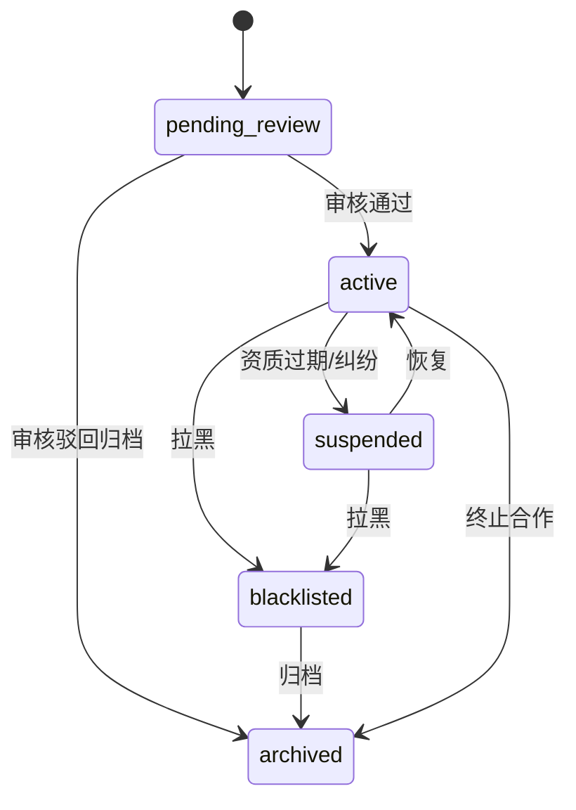
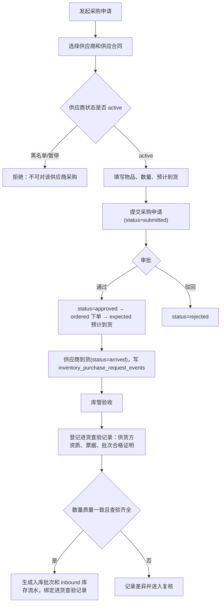
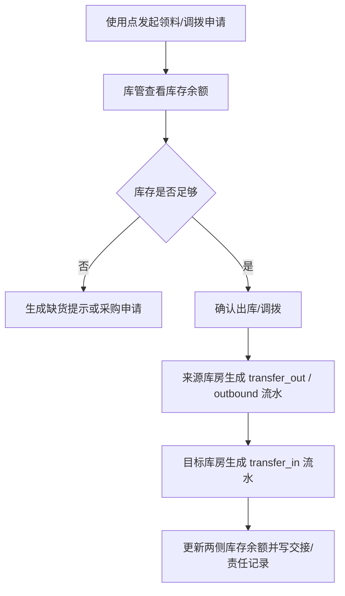
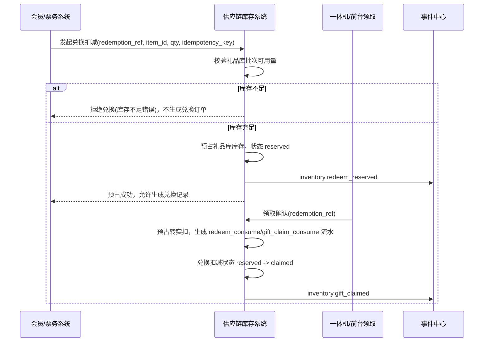
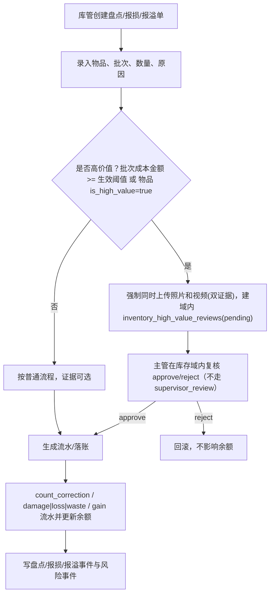

# 供应链与库存：供应商、供应合同、采购、库房、批次、流水开发设计 V0.1

> 版本：V0.1 ｜ 最后更新：2026-06-20 ｜ 覆盖迁移基线：见各小节迁移号（最新 V124）｜ 状态：现行
> 新功能承接见 docs/v099-v124-feature-implementation-and-acceptance-spec-v0.1.md
> <!-- 文档goalP3(2026-06-20)：补版本/日期/覆盖迁移头，未改正文 -->

> **⚠️ R7 复审标注（2026-06-19，只读核验真实迁移/代码后回填）**
> 本会话仅"扫码交接全链"已 P0 落库（V074），已上修；供应合同三模式/采购周期/结构化库房/高价值复核/唯一码主数据等 r5-spec-T6 项经核验**仍零命中**，保持开放。
> - **✅ 扫码交接全链已落地（V074，T17）**：`inventory_trace_handovers` 补 `overall_status`/`current_segment`（替换写死 accepted），新建 `inventory_trace_handover_steps`（五段链 out_verify/dispatch/kitchen_receive/staff_pickup/deliver_customer，`step_status` pending/done/gap/duplicate/diff）+ `inventory_trace_handover_exceptions`（gap/duplicate/diff → 复核）。员工扫码主动 + 机器人上报被动（V071 `integration_robot_task_events`），出现缺口/重复/差异进复核。
> - **仍开放——供应合同三模式（用户原始 P0，未做）**：`supply_contracts`/`contract_mode`(§6.2 platform_self_use/merchant_self_purchase/platform_purchase_distribution) 迁移**仍零命中**，纯"有设计无实现"。
> - **仍开放——采购周期（未做）**：仅 `inventory_purchase_requests` 的"申请"create，审批/下单/预计到货/实际到货/入库确认状态机与 `inventory_purchase_request_events` 未建。
> - **仍开放——唯一码主数据**：`items.is_traceable` 仅标记位，平台物品唯一二维码主数据无独立表/无生成绑定流程（`inventory_trace_codes` 零命中），码—批次—物品主数据链未建模。
> - **仍开放——库房/供应商降级**：`location_id` 自由文本（`warehouses`/`warehouse_type` 未建）；`inventory_suppliers` 缺资质/结算方式（`supplier_qualifications` 未建）。
> - **仍开放——高价值复核**：库存域内自建 `inventory_high_value_reviews` 迁移**仍零命中**，`isHighValue` 仅校验附件数≥2，未接入复核服务。
> - **仍开放——成熟进销存深度能力（P1/P2）**：FIFO/保质期效期预警、账龄、BOM 配方、采购退货、安全库存/补货点、单位换算瓶↔杯等，规划级（见 §13A），非本期 P0。
> - **裁决（保留）**：供应合同三模式 + 采购周期完整流转 + 结构化库房三项本期 P0；高价值复核=库存域内自建；扫码交接=员工主动 + 机器人被动。**以上除扫码交接外均待后续排期落地。**
> - **候选验收口径**：采购全状态可流转；交接逐段可追责且缺口进复核（已可验）；三模式合同可配置并卡控可采购范围（待落地）。

<!-- 修正(2026-06-19 R5业务HTML缺口审计 F1/F3)：依据 business-system-map-for-operations-v0.1.html #supply 与 matrix-migration-claims.json -->
> **⚠️ R5 漂移收口说明（2026-06-19，单一权威源裁定，紧随上方更早快照追加，不删除原横幅）**
> 上方"零落地/保持开放"横幅为 R7（2026-06-19 早段）只读核验时的快照，部分结论已被随后落地的迁移覆盖，**不再作为验收依据**。本文档口径以 `backend/src/main/resources/db/migration` 实际迁移 + `docs/matrix-migration-claims.json`（2026-06-19）为**单一权威源**：
> - **V085 已落地（`V085__supply_chain_t6.sql`）**：`supply_contracts` 三模式（platform_self_use/merchant_self_purchase/platform_purchase_distribution）+ approval_status/status + 可采购范围 JSONB 卡控；采购周期完整状态机（created/submitted→approved/rejected→ordered→expected→arrived→received，每步写事件 + 合同范围卡控 + received 生成入库流水）；`warehouses` 六类库房（main/bar/bar_counter/consumable/gift/saved_bottle）+ 余额挂 warehouse_id；库存域内高价值复核表（双证据照片+视频）。
> - **V094 已落地（`V094__inventory_item_high_value_threshold.sql`）**：物料 `high_value_threshold_cents`（整数分，可空，null=不视高价值），报损/盘点差异判定=数量×单价≥阈值，命中进复核。
> - **结论**：上方横幅中"供应合同三模式/采购周期/六类库房/高价值复核/高价值阈值仍零命中"的措辞为更早快照，**已被 V085/V094 覆盖；验收以最新 claims 为准**。唯一码主数据 `inventory_trace_codes` **已由 V128 落地**（2026-06-24 复核：`V128__inventory_trace_codes.sql` 建码主数据表，trace_code 唯一 + 状态机 registered→printed→bound→consumed + merchant_id 直接归属 + 码 CRUD 权限点，REQ-39 收口；下方 §13B 表设计建议已实现）。原"零命中/待建"结论失效。

> **本文档为什么新增（定位）：** 依据 finding **supply-1**（HIGH/omission）——供应链是用户原始需求点名的 P0 域、三种供应合同模式被反复列为"已拍板"，但全部文档此前只在产品口径层面用散文描述，没有任何一份开发设计给出供应商表、供应合同表、采购周期表、库房/批次/流水表的字段与状态定义，P0 编码任务清单也无对应任务，处于"有 PRD 无开发设计"状态，开发无法据此编码。本文对标 `bar-operations-development-design.md` 结构，把供应链域落到可编码的数据结构、状态机、流程、API、事件与 P0 编码任务。
>
> **依据基准：** 金额单位=整数分（D1）；状态枚举给中英映射、库数据库 CHECK 与之逐项对应（D7）；事件命名用唯一事件字典点+下划线风格、不另起命名（D4）；终端类型用 10 端权威表（D5）；开放平台对外路径/权限编码统一（D3）；技术栈=Java 21 + Spring Boot 4.x + PostgreSQL + Flyway（D10，2026-06-12 修订）。
>
> **关联文档：**
> - `docs/supply-chain-inventory-product-prd-v0.1.md`（本设计的产品口径来源）
> - `docs/bar-operations-development-design.md`（酒吧库存/存酒已有落地，本文与之分工见 §1.2，避免重复建模）
> - `docs/unified-standards-baseline-v0.1.md`（跨文档单一权威，凡冲突以它为准）
> - `docs/compliance-and-personal-information-protection-requirements-v0.1.md`（C9 进货查验、资质必填）
> - `docs/operation-traceability-and-terminal-switch-prd-v0.1.md`（物品追踪码、交接留痕、事件字典）

> **正式接口执行口径：** 本文负责供应链与库存业务设计、表结构建议、状态机和流程说明，不直接冻结正式后端路径。供应链 P0 Controller、前端/Android API client、SDK/mock 和接口自动化必须以 `docs/openapi/openapi-p0.yaml/json`、`p0-openapi-operation-acceptance-matrix-v0.1.md` 和 `p0-openapi-contract-closure-appendix-v0.1.md` 为准；未进入追溯附录并通过 `verify:openapi-closure` 的采购、入库、出库、盘点、报损、追踪码或存酒能力，不得作为正式联调或验收依据。

## 1. 模块定位

### 1.1 职责

供应链与库存系统负责"物品从哪里来、按什么合同供货、什么时候采购、进了哪个库、从哪里出库、被谁消耗、还剩多少、差异谁负责"的全链路台账与留痕，为酒吧经营、吧台售卖、权益兑换、财务对账和异常追责提供依据。

| 原则 | 说明 |
|---|---|
| 供应商主数据集中 | `inventory_suppliers` 是供货主体唯一主表，与开放平台 `service_providers`（技术服务商）是两类对象，必须区分（finding fielddb-10）。表名与枚举以真实迁移 + r5-spec-T6 为准 |
| 三种供应合同显式建模 | 平台自用 / 商户自采 / 平台统一采购分销三种模式落 `contract_mode` 枚举（`platform_self_use`/`merchant_self_purchase`/`platform_purchase_distribution`），不靠散文区分。表名与枚举以真实迁移 + r5-spec-T6 为准 |
| 金额一律整数分 | 所有金额字段单位为分（bigint），禁止 `numeric(18,2)` 元（D1） |
| 进货查验合规先行 | 酒类/食品入库必须绑定供货方资质、票据、批次合格证明（C9，P0 合规阻断） |
| 高价值自动判定 | 报损/作废/盘点据"平台默认阈值 + 物品 is_high_value"自动触发双证据（拍照和视频）+复核（supply-4） |
| 兑换消耗可追溯 | 积分兑换/礼物领取的库存消耗用独立流水类型，库存不足拒绝兑换（pass-2） |
| 留痕优先自动化 | 入库、出库、调拨、盘点、报损、报溢、兑换消耗、人工调整、交接均写事件中心（D4 事件字典） |

### 1.2 与酒吧库存（bar-operations）的分工边界

酒吧经营系统 `bar-operations-development-design.md §6.13-6.19` 已建 `bar_inventory_items / bar_stock_batches / bar_stock_movements` 等"酒吧门店内"库存表，并建有 `saved_bottles` 存酒表。为避免重复建模，分工如下：

| 范围 | 归属 | 说明 |
|---|---|---|
| 供应商主数据、供应合同、采购申请、采购周期、进货查验 | 本系统 | 跨门店、跨商户的采购侧主数据，酒吧库存 `bar_stock_batches.supplier_id` 外键引用本系统 `inventory_suppliers` |
| 平台级库房、库存批次、库存流水（含兑换消耗、报溢） | 本系统 | 总库/平台统一分销库/礼品库等平台侧库存台账 |
| 酒吧门店内的物料、批次、销售消耗、存酒 | 酒吧系统 | 门店现场作业，回写本系统库存或保持本地台账，二者通过 `item_id`/批次号对齐 |
| 物品高价值标记 `is_high_value`/`high_value_threshold` | 本系统物品档案为权威 | 酒吧 `bar_inventory_items` 引用或同步本系统物品档案的高价值口径，避免两套阈值 |

> 设计说明：本系统的 `items`（物品档案）是平台级物品主数据；酒吧 `bar_inventory_items` 可视为门店级映射。高价值阈值口径以本系统为单一权威（supply-4），酒吧库存复用，防止"两套阈值"。

## 2. 业务边界

### 2.1 本模块负责

| 范围 | 说明 |
|---|---|
| 供应商档案 | 供货主体、联系人、资质、结算方式、状态（含黑名单） |
| 供应合同 | 平台自用/商户自采/平台统一采购分销三模式、供货范围、价格口径、账期、有效期、审批状态 |
| 采购申请与采购周期 | 补货需求、审批、下单、到货计划、实际入库、结算依据 |
| 库房与库位 | 总库、平台分销库、礼品库、消耗品库等管理空间与库位 |
| 物品档案 | 酒类、消耗品、礼品、其他物品的单位、成本口径、高价值标记 |
| 进货查验 | 供货方资质、票据、批次合格证明绑入库批次（C9） |
| 库存批次与流水 | 批次成本/保质期；入库、出库、调拨、销售消耗、兑换消耗、报损、报溢、盘点调整、冲正 |
| 积分兑换/礼物领取库存扣减 | 礼品库扣减、库存不足拒绝、领取确认回写（pass-2） |

### 2.2 本模块不直接负责

| 范围 | 边界 |
|---|---|
| 酒吧门店现场点单/出品/存酒 | 由酒吧经营系统负责（§1.2） |
| 积分账户与兑换规则引擎 | 由会员积分子系统负责，本系统只接收兑换扣减请求并回执 |
| 财务清算与对账科目 | 由财务结算系统负责，本系统提供采购成本、报损、盘亏、兑换消耗成本的库存事实 |
| 资质有效期到期预警/经营阻断 | 资质主数据与到期卡控由平台治理/地基负责，本系统在进货查验时引用其资质有效性结论（C9） |
| 机器人调度算法、视频原始存储 | 由第三方系统负责，本系统只创建任务/关联证据索引 |

## 3. 领域模型

### 3.1 聚合划分

| 聚合 | 核心对象 | 职责 |
|---|---|---|
| 供应商聚合 | `Supplier`, `SupplierContact`, `SupplierQualification` | 供货主体、联系人、资质、黑名单 |
| 供应合同聚合 | `SupplyContract`, `SupplyContractScope`, `SupplyContractPrice` | 三种供货模式、供货范围、价格口径、账期、有效期、审批 |
| 采购聚合 | `PurchaseRequest`, `PurchaseRequestItem`, `PurchaseRequestEvent` | 采购申请、明细、从申请到入库的状态流转留痕（T6：周期由申请状态机承载，不单建周期对象） |
| 库房聚合 | `Warehouse`, `WarehouseLocation` | 库房、库位 |
| 物品聚合 | `Item`, `ItemCategory` | 物品档案、分类、单位、成本口径、高价值标记 |
| 库存聚合 | `StockBatch`, `StockMovement`, `StockBalance` | 批次、流水、余额 |
| 进货查验聚合 | `PurchaseInspection` | 供货方资质/票据/合格证明绑入库批次（C9） |
| 兑换扣减聚合 | `RedemptionStockDeduction` | 积分兑换/礼物领取的库存预占与扣减（pass-2） |
| 高价值复核聚合 | `InventoryHighValueReview` | 报损/盘点差异/存酒作废的库存域内高价值复核（T6，不走 governance） |

### 3.2 核心对象说明

| 对象 | 中文名 | 关键字段 | 说明 |
|---|---|---|---|
| `Supplier` | 供应商 | `supplier_code`, `supplier_category`, `settlement_method`, `status` | 供货主体，含黑名单状态；区别于开放平台技术服务商 |
| `SupplyContract` | 供应合同 | `contract_mode`, `supply_scope`, `purchasable_scope`, `price_mode`, `payment_terms`, `valid_from/valid_to`, `approval_status`, `status` | 三种供货模式与供货准入（审批 `draft/approved/rejected` 与生命周期 `active/suspended/expired` 分列，T6） |
| `PurchaseRequest` | 采购申请 | `supplier_id`, `supply_contract_id`, `status` | 补货需求，状态机承载从申请到入库全流转（T6） |
| `PurchaseRequestEvent` | 采购流转事件 | `request_id`, `from_status`, `to_status`, `operator_user_id` | 采购状态逐步留痕（T6：取代独立采购周期表） |
| `Warehouse` | 库房 | `warehouse_type`, `merchant_id`, `status` | 总库、平台分销库、礼品库、消耗品库等 |
| `Item` | 物品 | `item_type`, `unit`, `cost_price`, `is_high_value`, `high_value_threshold` | 平台级物品主数据，含高价值标记（supply-4） |
| `StockBatch` | 库存批次 | `item_id`, `warehouse_id`, `batch_no`, `quantity`, `cost_price`, `expire_at` | 某次入库形成的批次 |
| `StockMovement` | 库存流水 | `movement_type`, `quantity`, `source_type`, `status` | 所有库存变化依据，含兑换消耗/报溢 |
| `PurchaseInspection` | 进货查验记录 | `batch_id`, `supplier_qualification_refs`, `invoice_refs`, `quality_cert_refs` | 绑入库批次的法定查验台账（C9） |
| `RedemptionStockDeduction` | 兑换扣减 | `redemption_ref`, `item_id`, `warehouse_id`, `deduct_status`, `idempotency_key` | 积分兑换/礼物领取的库存预占与扣减（pass-2） |

## 4. 状态机（中英映射，D7）

> 原则（D7）：每个状态表给"中文 ↔ 英文 code"两列；数据库 CHECK 取值与之逐项对应。

### 4.1 供应商状态（5 态，含黑名单）

| code | 中文 | 说明 |
|---|---|---|
| `pending_review` | 待审核 | 新建待资质审核 |
| `active` | 启用 | 可签合同、可供货 |
| `suspended` | 暂停 | 临时停止供货（资质过期、纠纷） |
| `blacklisted` | 黑名单 | 禁止新建合同与采购，历史记录保留 |
| `archived` | 归档 | 不再合作，只读 |



> 依据：基准 D7"供应商：新增 inventory_suppliers 表及含黑名单的 5 态，与开放平台 service_providers（技术服务商）区分"；finding fielddb-10。表名与枚举以真实迁移 + r5-spec-T6 为准。

### 4.2 供应合同审批状态

> 审批状态机以 r5-spec-T6 为准（2026-06-18 业务确认）：审批状态 `approval_status` 收口为三态，合同生命周期另用独立 `status` 字段（`active/suspended/expired`）表达，二者分列，不再用单一字段混表审批与生命周期。

供应合同审批状态 `approval_status`（3 态，T6）：

| code | 中文 | 说明 |
|---|---|---|
| `draft` | 草稿 | 未提交 |
| `approved` | 已审批 | 审批通过，且在有效期内可作为采购依据 |
| `rejected` | 已驳回 | 审批不通过 |

合同生命周期状态 `status`（3 态，T6）：

| code | 中文 | 说明 |
|---|---|---|
| `active` | 生效 | 合同正常有效 |
| `suspended` | 暂停 | 临时暂停（纠纷/资质过期等） |
| `expired` | 已过期 | 超过 `valid_to` |

状态机：`approval_status`：`draft →(审批) approved/rejected`；`approved` 且在有效期内方可采购，`purchasable_scope`/`supply_scope` 卡控可采购物料。合同生命周期 `status` 在 `active/suspended/expired` 间流转，与审批解耦。

### 4.3 采购状态（扩 inventory_purchase_requests 状态机，T6）

> 采购周期口径以 r5-spec-T6 为准（2026-06-18 业务确认）：不再建独立 `purchase_cycles` 表，改为**扩 `inventory_purchase_requests` 状态机 + `inventory_purchase_request_events` 留痕事件表**承载从申请到入库的全流转；采购状态枚举改用 T6 口径（下表，CHECK 与之逐项对应）。

采购请求状态 `inventory_purchase_requests.status`（T6）：

| code | 中文 | 说明 |
|---|---|---|
| `submitted` | 已提交 | 采购申请提交待审批 |
| `approved` | 已审批 | 审批通过，可下单 |
| `rejected` | 已驳回 | 审批不通过 |
| `ordered` | 已下单 | 已向供应商下单 |
| `expected` | 预计到货 | 已确认预计到货计划 |
| `arrived` | 已到货 | 货物到货待入库确认 |
| `received` | 已入库 | 入库确认，生成入库 `inventory_stock_movements` 并落 warehouse/库位 |

状态机：`submitted →(审批) approved/rejected → ordered → expected →(到货) arrived →(入库确认) received`；每步写 `inventory_purchase_request_events`（`from_status/to_status/operator_user_id/note`），非法跳步拒绝。

### 4.4 库存批次状态

| code | 中文 | 说明 |
|---|---|---|
| `active` | 可用 | 有库存可出 |
| `depleted` | 已耗尽 | 数量为 0 |
| `expired` | 已过期 | 超保质期 |
| `locked` | 已锁定 | 盘点/纠纷冻结 |

### 4.5 库存流水状态

| code | 中文 | 说明 |
|---|---|---|
| `draft` | 草稿 | 未确认 |
| `pending_approval` | 待审批 | 高价值/异常操作需审批 |
| `confirmed` | 已确认 | 已影响库存余额 |
| `reversed` | 已冲正 | 原流水被反向冲正 |
| `rejected` | 已驳回 | 审批不通过 |

> 与 `bar-operations §4.6` 库存流水状态一致，便于跨系统对齐。

### 4.6 兑换扣减状态（pass-2）

| code | 中文 | 说明 |
|---|---|---|
| `reserved` | 已预占 | 兑换发起时预占礼品库库存 |
| `claimed` | 已领取 | 客人领取确认，转实扣 |
| `rejected` | 已拒绝 | 库存不足，拒绝兑换 |
| `released` | 已释放 | 兑换取消/超时，释放预占 |

## 5. 核心业务流程

### 5.1 采购到入库（含进货查验 C9）



进货查验关键要求（C9）：

- 酒类/食品业态入库**必须**登记进货查验记录并绑定到 `stock_batches`，缺查验记录不得确认入库。
- 查验内容：供货方资质（经营许可/食品经营许可，引用平台治理资质主数据的有效性结论）、票据（进货发票/送货单）、批次/合格证明（检验合格证、检疫证明）。
- 进货查验记录与入库批次一对一或一对多绑定，支持按批次正向溯源与按问题批次反向召回。

### 5.2 库房到使用点出库/调拨



### 5.3 积分兑换/礼物领取扣减（pass-2）



关键规则（pass-2）：

- 扣减库房固定为**礼品库**（`warehouse_type=gift`）；兑换消耗用独立流水类型 `redeem_consume`（积分兑换消耗）与 `gift_claim_consume`（礼物领取消耗），区别于售卖消耗 `consume`。
- **库存不足拒绝兑换**：预占阶段可用量不足即返回错误，不生成兑换记录、不扣积分（积分扣减由会员侧在收到本系统预占成功后执行）。
- **领取确认回写**：客人在一体机/前台领取确认时由预占（reserved）转实扣（claimed）并生成消耗流水，与票务 PRD §8.5 一体机领取流程"扣减礼物或权益库存"对齐。
- 扣减接口带 `idempotency_key`，重复请求返回首次结果，避免重复扣减。
- 兑换取消/超时未领取，释放预占（reserved -> released），回补可用量。

### 5.4 盘点、报损、报溢（高价值自动双证据 + 域内复核，supply-4 / supply-5）

> 高价值复核口径以 r5-spec-T6 为准（2026-06-18 业务确认）：高价值报损/盘点差异/存酒作废的复核**为库存域内自建**，落 §6.17 `inventory_high_value_reviews` 表与 `InventoryHighValueReviewService`，**不走 governance 统一 `supervisor_review` 队列**。复核 `pending → approved/rejected`，approved 后动作生效（扣减/作废落账），rejected 则回滚。



判定与证据规则：

- **高价值判定（supply-4）：** 生效阈值 = 物品 `high_value_threshold`（非空时）否则平台默认 `high_value_threshold`（单位：分）。满足"批次成本金额 ≥ 生效阈值"或物品 `is_high_value=true` 即判高价值。
- **双证据（supply-3）：** 高价值场景报损/作废/盘点差异**必须同时**上传照片与视频（`photo_refs` 与 `video_refs` 均非空），并建域内复核记录由主管复核；非高价值证据可选。
- **域内复核（T6）：** 高价值触发后建 `inventory_high_value_reviews`（`subject_type ∈ {damage_report, stock_variance, saved_bottle_void}`，`review_status ∈ {pending, approved, rejected}`），由 `InventoryHighValueReviewService` 在库存域内闭环，替换原"仅校验附件数≥2"且不接入 governance `SupervisorReviewService`。
- **报溢（supply-5）：** 盘盈/异常增加落 `movement_type=gain` 流水（增加方向），单独走审批 + 证据，与盘亏/报损（`loss`/`damage`/`waste`）及盘点差异纠账（`count_correction`）区分方向。（注：取值以代码白名单为准，见 §6.13 权威口径；旧文档所称 `surplus`/`count_adjust` 在代码中不存在。）

> 已实现修复（finding F-OPS-05，裁决#7「库存守恒账本」，2026-06-22，已在 160 编译通过）：此前以下三条落账路径只改写 `stock_balances` 库存余额、却未补写 `stock_movements` 流水，导致余额变更无对应流水、账本不守恒、无法逐位重建：
> 1. **库存即时调整**（人工增减）；
> 2. **高价值报损/盘点单 approve 落账**（域内复核通过后的扣减/作废生效，见 §5.4 主管 approve 分支）；
> 3. **盘点差异纠账**（盘盈/盘亏调整）。
>
> 现已改为三路在**同一事务**内补写 `stock_movements`（§6.13），`movement_type` 取自代码白名单 `{gain, loss, damage, waste, count_correction}`（= `adjustment_type`，V046 CHECK；`movement_type` 列本身无 DB 约束）：报损取 `damage`/`loss`/`waste`，盘点差异纠账取 `count_correction`，盘盈/增加取 `gain`（即时调整按增减方向落 `gain` 或 `loss`/`damage`/`waste`）。由此 `stock_movements` 成为唯一的库存守恒账本——任意时点的库存余额均可由流水逐位重建，余额表退化为可重算的物化结果。

## 6. 数据库表结构

字段命名 PostgreSQL snake_case。所有表默认包含：

```text
id, created_at, updated_at, deleted_at, created_by, updated_by, status, remark
```

> 金额字段一律 `bigint`，单位：分（D1）。
>
> 修订说明（2026-06-07 收口）：经营侧主表（inventory_suppliers/supplier_contacts/supplier_qualifications/supply_contracts/purchase_requests/purchase_inspections）统一预留 `project_id`（综合体归属，nullable）。取值口径：平台统一采购的共享主数据可空，门店/商户自采必填。warehouses（§6.8 已含 `merchant_id`）、其余库存台账表（stock_batches/stock_movements/stock_balances）的项目维度可经 `warehouse_id`→`warehouses` 或 `merchant_id` 间接定位，本轮先在采购侧主表落 `project_id`（与 finding critic-2 修复范围一致）。依据 finding critic-2、foundation-database §1「所有核心对象预留 project_id」，与地基 `complex_projects` 对齐。

### 6.1 inventory_suppliers 供应商表

| 字段 | 类型 | 说明 |
|---|---|---|
| `id` | uuid | 主键 |
| `project_id` | uuid | 归属综合体项目，nullable；平台统一采购主数据可空，门店/商户自采必填（见下方修订说明） |
| `supplier_code` | varchar | 供应商编码，平台内唯一 |
| `name` | varchar | 供应商名称 |
| `supplier_category` | varchar | `goods/alcohol/food/material/gift/maintenance/service` 唯一权威供货分类字段（含 maintenance/service；amusement `maintenance_vendor_id` 外键依赖 `supplier_category∈{maintenance,service}`，见 amuse-3/dup-tables-2） |
| `settlement_method` | varchar | `prepay/cod/credit` 结算方式 |
| `default_payment_terms` | varchar | 默认账期（如 `T+30`） |
| `unified_social_credit_code` | varchar | 统一社会信用代码 |
| `status` | varchar | `pending_review/active/suspended/blacklisted/archived`（§4.1，CHECK 与之对应） |
| `blacklist_reason` | text | 拉黑原因（status=blacklisted 时必填） |
| `blacklisted_at` | timestamptz | 拉黑时间 |

索引：`idx_inventory_suppliers_status`、`idx_inventory_suppliers_project_id`、`uq_inventory_suppliers_supplier_code`（唯一）。表名与枚举以真实迁移 + r5-spec-T6 为准。

约束：`status='blacklisted'` 时 `blacklist_reason` 非空；黑名单/暂停供应商不可被新建供应合同与采购申请引用（业务层校验）。

> 修订说明（2026-06-07 收口）：补 `project_id`（综合体归属）。依据 finding critic-2 + foundation-database §1「先支持当前一个综合体，所有核心对象预留 project_id」。`project_id` 取值规则：平台统一采购的共享供应商主数据可空（跨综合体复用），门店/商户自采的供应商必填以按项目隔离归属。`supplier_code` 平台内唯一不变（共享主数据需全局唯一）；多综合体扩展后若需按项目维度区分编码，再评估 `uq(project_id, supplier_code)`，当前保持全局唯一。与地基 `complex_projects` 对齐。
> 设计说明：与开放平台 `service_providers`（技术服务商）是两类对象，必须区分（fielddb-10）。`supplier_category` 是 inventory_suppliers 的**唯一权威供货分类字段**（含 maintenance/service），不另设 `supplier_type`；`supplier_category=maintenance` 用于打通游乐检修单位（finding amuse-3），amusement 检修记录用 `maintenance_vendor_id` 外键引用本表并依赖该字段取值集合（dup-tables-2：本字段为唯一权威，foundation §6A.4 不再自定义 supplier_type 枚举，改为引用本表）。

### 6.2 supplier_contacts 供应商联系人表

| 字段 | 类型 | 说明 |
|---|---|---|
| `id` | uuid | 主键 |
| `project_id` | uuid | 归属综合体项目，nullable；随父供应商 `inventory_suppliers.project_id`（见修订说明） |
| `supplier_id` | uuid | 供应商 |
| `name` | varchar | 联系人姓名 |
| `phone` | varchar | 电话（按 PIPL 脱敏/加密存储） |
| `role` | varchar | 角色（销售/财务/售后） |
| `is_primary` | boolean | 是否主联系人 |

> 修订说明（2026-06-07 收口）：补 `project_id` 与父表 `inventory_suppliers.project_id` 一致（冗余便于按项目隔离查询）。依据 finding critic-2、foundation-database §1。

### 6.3 supplier_qualifications 供应商资质表

| 字段 | 类型 | 说明 |
|---|---|---|
| `id` | uuid | 主键 |
| `project_id` | uuid | 归属综合体项目，nullable；随父供应商 `inventory_suppliers.project_id`（见修订说明） |
| `supplier_id` | uuid | 供应商 |
| `qualification_type` | varchar | `business_license/food_permit/alcohol_permit/other` |
| `cert_no` | varchar | 证照编号 |
| `valid_from` | date | 起始 |
| `valid_to` | date | 到期（供进货查验与到期校验，C9） |
| `attachment_refs` | jsonb | 证照影像证据索引 |

> 修订说明（2026-06-07 收口）：补 `project_id` 与父表 `inventory_suppliers.project_id` 一致。依据 finding critic-2、foundation-database §1。

> 说明：资质有效期到期预警/经营阻断由平台治理/地基资质管理统一负责（C9），本表保存供货侧资质并在进货查验时引用其有效性结论。

### 6.4 supply_contracts 供应合同表

| 字段 | 类型 | 说明 |
|---|---|---|
| `id` | uuid | 主键 |
| `project_id` | uuid | 归属综合体项目，nullable；`platform_purchase_distribution` 平台统一采购可空，`merchant_self_purchase`/门店自采必填（见修订说明） |
| `contract_no` | varchar | 合同编号 |
| `supplier_id` | uuid | 供应商 |
| `merchant_id` | uuid | 商户，可空（platform_self_use 为空，merchant_self_purchase 必填） |
| `contract_mode` | varchar | `platform_self_use/merchant_self_purchase/platform_purchase_distribution`（平台自用/商户自采/平台统一采购分销，CHECK 三取值） |
| `supply_scope` | jsonb | 供货范围（物品类别/具体物品清单） |
| `price_mode` | varchar | `fixed/tiered/floating` 价格口径（固定价/阶梯价/浮动价） |
| `price_terms` | jsonb | 价格明细（单价、阶梯、调价规则），金额单位：分 |
| `payment_terms` | varchar | 账期（如 `T+30`/`prepay`/`cod`） |
| `valid_from` | date | 有效期起 |
| `valid_to` | date | 有效期止 |
| `approval_status` | varchar | `draft/approved/rejected`（§4.2 审批三态，CHECK 与之对应；审批状态机以 r5-spec-T6 为准，2026-06-18 业务确认） |
| `status` | varchar | 合同生命周期 `active/suspended/expired`（§4.2，与审批状态分列，CHECK 与之对应） |
| `purchasable_scope` | jsonb | 可采购物料/范围，采购时卡控（T6） |
| `approved_by` | uuid | 审批人 |
| `attachment_refs` | jsonb | 合同附件索引 |

索引：`idx_supply_contracts_supplier_id`、`idx_supply_contracts_contract_mode`、`idx_supply_contracts_project_id`、`uq_supply_contracts_contract_no`（唯一）。

约束：`contract_mode='merchant_self_purchase'` 时 `merchant_id` 非空；`platform_purchase_distribution` 用于平台统一采购后分销给商户，分销关系在 `supply_contract_distributions`（P1）细化。表名、审批/生命周期枚举以真实迁移 + r5-spec-T6 为准（审批 `draft/approved/rejected`，生命周期 `active/suspended/expired`）。

> 修订说明（2026-06-07 收口）：补 `project_id`（综合体归属）。依据 finding critic-2、foundation-database §1。取值规则：`platform_self_use`/`platform_purchase_distribution` 平台侧合同可空；`merchant_self_purchase` 商户自采合同必填，按项目隔离归属。与地基 `complex_projects` 对齐。

### 6.5 inventory_purchase_requests 采购申请表（扩状态机承载采购全流转，T6）

> 采购周期口径以 r5-spec-T6 为准（2026-06-18 业务确认）：采购全流转由本表状态机 + §6.7 `inventory_purchase_request_events` 承载，不另建 `purchase_cycles` 表。下表含 T6 新增的下单/到货/入库流转字段。

| 字段 | 类型 | 说明 |
|---|---|---|
| `id` | uuid | 主键 |
| `project_id` | uuid | 归属综合体项目，nullable；平台统一采购可空，门店/商户自采必填（见修订说明） |
| `request_no` | varchar | 申请编号 |
| `supplier_id` | uuid | 供应商 |
| `supply_contract_id` | uuid | 供应合同（T6，采购须在 approved 合同 `purchasable_scope` 内） |
| `warehouse_id` | uuid | 目标入库库房 |
| `merchant_id` | uuid | 商户，可空 |
| `request_type` | varchar | `regular/temporary`（常规采购/临时补货） |
| `requested_by` | uuid | 申请人 |
| `approved_by` | uuid | 审批人（T6） |
| `expected_arrival_at` | timestamptz | 预计到货 |
| `ordered_at` | timestamptz | 下单时间（T6） |
| `actual_arrival_date` | date | 实际到货日期（T6） |
| `received_at` | timestamptz | 入库确认时间（T6） |
| `received_by` | uuid | 入库确认人（T6） |
| `total_amount` | bigint | 预估金额，单位：分 |
| `status` | varchar | 采购状态机 `submitted/approved/rejected/ordered/expected/arrived/received`（§4.3，CHECK 与之对应；以 r5-spec-T6 为准） |

> 修订说明（2026-06-07 收口）：补 `project_id`（综合体归属，建索引 `idx_purchase_requests_project_id`）。依据 finding critic-2、foundation-database §1。平台统一采购可空，门店/商户自采必填；与地基 `complex_projects` 对齐。

### 6.6 purchase_request_items 采购申请明细表

| 字段 | 类型 | 说明 |
|---|---|---|
| `id` | uuid | 主键 |
| `request_id` | uuid | 采购申请 |
| `item_id` | uuid | 物品 |
| `quantity` | numeric | 数量 |
| `unit` | varchar | 单位 |
| `unit_price` | bigint | 单价，单位：分 |
| `amount` | bigint | 小计，单位：分 |

### 6.7 inventory_purchase_request_events 采购流转留痕事件表（T6）

> 采购周期口径以 r5-spec-T6 为准（2026-06-18 业务确认）：**不建独立 `purchase_cycles` 表**。采购从申请到入库的全流转由 §6.5 `inventory_purchase_requests` 状态机承载，每次状态变更写入本表逐步留痕（下单/到货/入库时间等落在 §6.5 对应字段）。

| 字段 | 类型 | 说明 |
|---|---|---|
| `id` | uuid | 主键 |
| `request_id` | uuid | 采购申请（外键 `inventory_purchase_requests.id`，ON DELETE CASCADE） |
| `from_status` | varchar | 变更前状态，可空 |
| `to_status` | varchar | 变更后状态（§4.3 采购状态枚举） |
| `operator_user_id` | uuid | 操作人 |
| `note` | varchar | 备注 |
| `created_at` | timestamptz | 发生时间 |

### 6.8 warehouses 库房表

| 字段 | 类型 | 说明 |
|---|---|---|
| `id` | uuid | 主键 |
| `warehouse_code` | varchar | 库房编码 |
| `name` | varchar | 库房名 |
| `warehouse_type` | varchar | `main/distribute/gift/consumable/bar/saved_bottle`（总库/平台分销库/礼品库/消耗品库/酒吧库/存酒区） |
| `merchant_id` | uuid | 商户，可空（平台库为空） |
| `location_point_id` | uuid | 关联点位 |
| `status` | varchar | `active/inactive` |

> 说明：`warehouse_type=gift` 礼品库是积分兑换/礼物领取扣减的固定来源（pass-2）。

### 6.9 warehouse_locations 库位表

| 字段 | 类型 | 说明 |
|---|---|---|
| `id` | uuid | 主键 |
| `warehouse_id` | uuid | 库房 |
| `location_code` | varchar | 库位编码 |
| `name` | varchar | 库位名 |
| `status` | varchar | `active/inactive` |

### 6.10 item_categories 物品分类表

| 字段 | 类型 | 说明 |
|---|---|---|
| `id` | uuid | 主键 |
| `name` | varchar | 分类名 |
| `parent_id` | uuid | 父分类，可空 |
| `sort_order` | int | 排序 |

### 6.11 items 物品档案表

| 字段 | 类型 | 说明 |
|---|---|---|
| `id` | uuid | 主键 |
| `item_code` | varchar | 物品编码 |
| `name` | varchar | 物品名 |
| `category_id` | uuid | 分类 |
| `item_type` | varchar | `alcohol/consumable/gift/material/other`（酒类/消耗品/礼品/物料/其他） |
| `unit` | varchar | 基础单位 |
| `cost_price` | bigint | 成本价，单位：分 |
| `is_high_value` | boolean | 是否高价值（手工强制标记，supply-4），默认 false |
| `high_value_threshold` | bigint | 物品级高价值金额阈值，单位：分，可空（空则用平台默认值） |
| `is_traceable` | boolean | 是否需平台唯一二维码 |
| `status` | varchar | `active/inactive` |

索引：`uq_items_item_code`（唯一）、`idx_items_item_type`。

> 设计说明（supply-4）：`is_high_value` 与 `high_value_threshold` 落地高价值判定。生效阈值 = `high_value_threshold` 非空时取本字段，否则取平台治理全局配置 `inventory.high_value_threshold`（单位：分，商户可申请调整）。报损/作废/盘点据此自动触发双证据 + 复核。

### 6.12 stock_batches 库存批次表

| 字段 | 类型 | 说明 |
|---|---|---|
| `id` | uuid | 主键 |
| `item_id` | uuid | 物品 |
| `warehouse_id` | uuid | 库房 |
| `location_id` | uuid | 库位，可空 |
| `batch_no` | varchar | 批次号 |
| `quantity` | numeric | 当前数量 |
| `cost_price` | bigint | 批次成本，单位：分 |
| `supplier_id` | uuid | 供应商，可空 |
| `purchase_request_id` | uuid | 来源采购申请（T6 收口：原 `purchase_cycle_id`，采购周期改由 `inventory_purchase_requests` 状态机承载），可空 |
| `production_date` | date | 生产日期 |
| `expire_at` | date | 保质期 |
| `status` | varchar | `active/depleted/expired/locked`（§4.4） |

索引：`idx_stock_batches_item_warehouse`、`idx_stock_batches_expire_at`。

### 6.13 stock_movements 库存流水表

| 字段 | 类型 | 说明 |
|---|---|---|
| `id` | uuid | 主键 |
| `movement_no` | varchar | 流水号 |
| `item_id` | uuid | 物品 |
| `batch_id` | uuid | 批次，可空 |
| `from_warehouse_id` | uuid | 来源库房，可空 |
| `to_warehouse_id` | uuid | 目标库房，可空 |
| `movement_type` | varchar | 见下方枚举 |
| `quantity` | numeric | 数量 |
| `unit` | varchar | 单位 |
| `amount` | bigint | 金额（成本×数量），单位：分 |
| `source_type` | varchar | `purchase/transfer/order/redemption/count/manual/robot` |
| `source_id` | uuid | 来源对象 |
| `reason` | text | 原因 |
| `photo_refs` | jsonb | 照片证据索引（高价值报损/作废/盘点必填，supply-3） |
| `video_refs` | jsonb | 视频证据索引（高价值报损/作废/盘点必填，supply-3） |
| `operator_id` | uuid | 操作人 |
| `approved_by` | uuid | 审批人 |
| `confirmed_at` | timestamptz | 确认时间 |
| `status` | varchar | `draft/pending_approval/confirmed/reversed/rejected`（§4.5） |

`movement_type` 枚举（中英）：

| code | 中文 | 说明 |
|---|---|---|
| `inbound` | 入库 | 采购到货入库 |
| `outbound` | 出库 | 出库到使用点 |
| `transfer_out` | 调出 | 调拨来源侧 |
| `transfer_in` | 调入 | 调拨目标侧 |
| `consume` | 售卖消耗 | 正常售卖/出品扣减 |
| `redeem_consume` | 积分兑换消耗 | 积分兑换礼物扣减（pass-2，扣礼品库） |
| `gift_claim_consume` | 礼物领取消耗 | 礼物/权益领取确认扣减（pass-2，扣礼品库） |
| `damage` | 报损 | 损耗/破损扣减（库存调整 `adjustment_type` 之一） |
| `loss` | 报损/丢失 | 丢失/损耗扣减（库存调整 `adjustment_type` 之一） |
| `waste` | 废弃 | 过期/废弃扣减（库存调整 `adjustment_type` 之一） |
| `gain` | 增加/报溢 | 盘盈/异常增加（库存调整 `adjustment_type` 之一） |
| `count_correction` | 盘点纠正 | 盘点差异纠账（盘盈/盘亏，库存调整 `adjustment_type` 之一） |

> 权威口径（2026-06-22 收口，以代码为准）：库存调整/盘点/报损报溢落账实际写入的 `movement_type` 取自服务白名单 `InventoryStockMovementService.ALLOWED_ADJUSTMENT_TYPES = {gain, loss, damage, waste, count_correction}`，与 `inventory_stock_adjustments.adjustment_type` 的 DB CHECK（V046 `chk_stock_adjustment_type IN ('gain','loss','damage','waste','count_correction')`）一致。注意 **`stock_movements.movement_type` 列本身无 DB CHECK 约束**（V012 仅 `movement_type VARCHAR(64) NOT NULL`），取值正确性由服务白名单/`adjustment_type` 保证，故枚举以代码白名单为准。此前文档列出的 `surplus`/`count_adjust`/`reverse` 在代码中并不存在（已分别对应到 `gain`/`count_correction`、冲正按增减方向取对应调整类型），本轮按代码事实修正。
> 设计说明：`redeem_consume`/`gift_claim_consume`（pass-2）为本设计相对 bar-operations 的新增类型；`photo_refs`/`video_refs` 分列（supply-3），对高价值流水均置必填。`inbound/outbound/transfer_in/transfer_out/consume` 为出入库/调拨/正常消耗类流水类型（由各业务路径直接写入），不受上述调整白名单约束。

### 6.14 stock_balances 库存余额表（物化/视图）

| 字段 | 类型 | 说明 |
|---|---|---|
| `id` | uuid | 主键 |
| `item_id` | uuid | 物品 |
| `warehouse_id` | uuid | 库房 |
| `available_quantity` | numeric | 可用数量（扣除预占） |
| `reserved_quantity` | numeric | 预占数量（兑换预占等，pass-2） |
| `total_quantity` | numeric | 在库总量 |

唯一约束：`uq_stock_balances_item_warehouse`（`item_id + warehouse_id`）。

### 6.15 purchase_inspections 进货查验记录表（C9）

| 字段 | 类型 | 说明 |
|---|---|---|
| `id` | uuid | 主键 |
| `project_id` | uuid | 归属综合体项目，nullable；随入库批次/采购周期所属项目（见修订说明） |
| `batch_id` | uuid | 绑定的入库批次 |
| `supplier_id` | uuid | 供货方 |
| `purchase_request_id` | uuid | 来源采购申请（T6 收口：原 `purchase_cycle_id`） |
| `supplier_qualification_refs` | jsonb | 供货方资质引用（经营许可/食品经营许可，引用 §6.3 资质有效性结论） |
| `invoice_refs` | jsonb | 票据索引（进货发票/送货单影像） |
| `quality_cert_refs` | jsonb | 批次/合格证明（检验合格证、检疫证明影像） |
| `inspected_by` | uuid | 查验人 |
| `inspected_at` | timestamptz | 查验时间 |
| `result` | varchar | `passed/rejected` 查验结论 |

> 设计说明（C9）：酒类/食品入库必须有本记录并绑定 `stock_batches`，缺记录不得确认入库；支持按批次正向溯源与问题批次反向召回。
> 修订说明（2026-06-07 收口）：补 `project_id`（综合体归属），随入库批次/采购周期所属项目落值，便于按项目维度做查验台账隔离与溯源。依据 finding critic-2、foundation-database §1。

### 6.16 redemption_stock_deductions 兑换扣减表（pass-2）

| 字段 | 类型 | 说明 |
|---|---|---|
| `id` | uuid | 主键 |
| `redemption_ref` | varchar | 会员/票务侧兑换记录引用 |
| `item_id` | uuid | 兑换礼品对应物品 |
| `warehouse_id` | uuid | 礼品库（warehouse_type=gift） |
| `quantity` | numeric | 数量 |
| `deduct_status` | varchar | `reserved/claimed/rejected/released`（§4.6） |
| `reserve_movement_id` | uuid | 预占对应流水，可空 |
| `consume_movement_id` | uuid | 领取实扣对应流水（redeem_consume/gift_claim_consume），可空 |
| `idempotency_key` | varchar | 幂等键 |
| `claimed_at` | timestamptz | 领取确认时间 |

唯一约束：`uq_redemption_deductions_idem`（`idempotency_key`）保证幂等。

### 6.17 inventory_high_value_reviews 库存域内高价值复核表（T6）

> 高价值复核口径以 r5-spec-T6 为准（2026-06-18 业务确认）：高价值报损/盘点差异/存酒作废复核**为库存域内自建**，不走 governance `supervisor_review`。

| 字段 | 类型 | 说明 |
|---|---|---|
| `id` | uuid | 主键 |
| `subject_type` | varchar | `damage_report/stock_variance/saved_bottle_void`（报损/盘点差异/存酒作废，CHECK 三取值） |
| `subject_id` | uuid | 关联对象（stock_movement / 盘点差异 / saved_bottle） |
| `photo_attachment_ids` | jsonb | 照片证据索引（双证据必填，supply-3） |
| `video_attachment_ids` | jsonb | 视频证据索引（双证据必填，supply-3） |
| `review_status` | varchar | `pending/approved/rejected`（CHECK 与之对应） |
| `reviewer_user_id` | uuid | 复核人，可空 |
| `reason` | varchar | 复核原因/备注 |
| `reviewed_at` | timestamptz | 复核时间，可空 |

> 设计说明（T6）：由 `InventoryHighValueReviewService` 在库存域内闭环（建 pending → 主管 approve/reject）；approve 后动作（出库扣减/作废落账）生效，reject 回滚。不接入 governance 统一复核队列，与二轮裁决（2026-06-18）一致。

## 7. API 接口设计

内部接口统一放在 `/api/v1/inventory/**`。对外（第三方/会员积分系统）经开放平台动态业务路径 `/api/open/d/{endpoint_key}/inventory/...`（D3，不另定义鉴权端点）。权限编码统一 dot 风格 `domain.resource.action`（D3）。

> 执行口径：本章历史权限列中的 `supply.*` 是供应链模块草案旧名。P0 编码必须使用 `docs/openapi/openapi-p0.yaml`、`docs/openapi/openapi-p0.json`、`p0-openapi-operation-acceptance-matrix-v0.1.md` 和 `p0-operation-permission-matrix-v0.1.md` 中的 `inventory.*`、`bar.saved_bottle.manage` 等精确 operation、字段 schema、权限码、鉴权上下文、幂等和审计事件；未进入 OpenAPI 的供应商合同、复杂采购周期、礼品兑换扩展能力按 P1/P2 继续细化。

### 7.1 供应商

| 方法 | 路径 | 说明 | 权限 |
|---|---|---|---|
| `GET` | `/api/v1/inventory/suppliers` | 查询供应商 | `supply.supplier.read` |
| `POST` | `/api/v1/inventory/suppliers` | 新建供应商 | `supply.supplier.create` |
| `PUT` | `/api/v1/inventory/suppliers/{id}` | 修改供应商 | `supply.supplier.update` |
| `POST` | `/api/v1/inventory/suppliers/{id}/blacklist` | 拉黑供应商 | `supply.supplier.blacklist` |
| `POST` | `/api/v1/inventory/suppliers/{id}/restore` | 恢复供应商 | `supply.supplier.update` |

### 7.2 供应合同

| 方法 | 路径 | 说明 | 权限 |
|---|---|---|---|
| `GET` | `/api/v1/inventory/contracts` | 查询供应合同 | `supply.contract.read` |
| `POST` | `/api/v1/inventory/contracts` | 新建供应合同 | `supply.contract.create` |
| `PUT` | `/api/v1/inventory/contracts/{id}` | 修改供应合同 | `supply.contract.update` |
| `POST` | `/api/v1/inventory/contracts/{id}/approve` | 审批（`approved/rejected`，T6 审批三态） | `supply.contract.approve` |
| `POST` | `/api/v1/inventory/contracts/{id}/suspend` | 暂停合同（生命周期 `status=suspended`，T6） | `supply.contract.update` |

### 7.3 采购

| 方法 | 路径 | 说明 | 权限 |
|---|---|---|---|
| `GET` | `/api/v1/inventory/purchase-requests` | 查询采购申请 | `supply.purchase.read` |
| `POST` | `/api/v1/inventory/purchase-requests` | 创建采购申请 | `supply.purchase.create` |
| `POST` | `/api/v1/inventory/purchase-requests/{id}/approve` | 审批采购申请（`approved/rejected`） | `supply.purchase.approve` |
| `POST` | `/api/v1/inventory/purchase-requests/{id}/order` | 下单（→`ordered`） | `supply.purchase.order` |
| `POST` | `/api/v1/inventory/purchase-requests/{id}/arrive` | 登记到货（→`arrived`，T6） | `supply.purchase.order` |
| `POST` | `/api/v1/inventory/purchase-requests/{id}/receive` | 入库确认（→`received`，生成入库流水，T6） | `supply.stock.inbound` |
| `GET` | `/api/v1/inventory/purchase-requests/{id}/events` | 查询采购流转事件（T6，取代采购周期查询） | `supply.purchase.read` |

### 7.4 库房与物品

| 方法 | 路径 | 说明 | 权限 |
|---|---|---|---|
| `GET` | `/api/v1/inventory/warehouses` | 查询库房/库位 | `supply.warehouse.read` |
| `POST` | `/api/v1/inventory/warehouses` | 新建库房 | `supply.warehouse.create` |
| `GET` | `/api/v1/inventory/items` | 查询物品档案 | `supply.item.read` |
| `POST` | `/api/v1/inventory/items` | 新建物品 | `supply.item.create` |
| `PUT` | `/api/v1/inventory/items/{id}` | 修改物品（含 is_high_value/high_value_threshold） | `supply.item.update` |

### 7.5 库存批次、流水与进货查验

| 方法 | 路径 | 说明 | 权限 |
|---|---|---|---|
| `GET` | `/api/v1/inventory/stock-balances` | 查询库存余额 | `supply.stock.read` |
| `POST` | `/api/v1/inventory/stock-movements/inbound` | 入库（须带进货查验记录，C9） | `supply.stock.inbound` |
| `POST` | `/api/v1/inventory/stock-movements/transfer` | 调拨 | `supply.stock.transfer` |
| `POST` | `/api/v1/inventory/stock-movements/damage` | 报损（高价值自动校验双证据，supply-3/4） | `supply.stock.damage` |
| `POST` | `/api/v1/inventory/stock-movements/surplus` | 报溢（supply-5） | `supply.stock.surplus` |
| `POST` | `/api/v1/inventory/stock-counts` | 创建盘点 | `supply.stock.count` |
| `POST` | `/api/v1/inventory/stock-movements/{id}/approve` | 审批库存流水 | `supply.stock.approve` |
| `POST` | `/api/v1/inventory/stock-movements/{id}/reverse` | 冲正库存流水 | `supply.stock.reverse` |
| `POST` | `/api/v1/inventory/purchase-inspections` | 登记进货查验记录并绑定批次（C9） | `supply.inspection.create` |
| `GET` | `/api/v1/inventory/purchase-inspections` | 查询进货查验记录（溯源/召回） | `supply.inspection.read` |

### 7.6 兑换扣减（pass-2，供会员/票务系统调用）

| 方法 | 路径 | 说明 | 权限 |
|---|---|---|---|
| `POST` | `/api/v1/inventory/redemptions/reserve` | 兑换预占礼品库库存（库存不足返回错误） | `supply.redemption.reserve` |
| `POST` | `/api/v1/inventory/redemptions/{id}/claim` | 领取确认，预占转实扣并写消耗流水 | `supply.redemption.claim` |
| `POST` | `/api/v1/inventory/redemptions/{id}/release` | 释放预占（兑换取消/超时） | `supply.redemption.release` |

请求须带 `idempotencyKey`；`reserve` 在可用量不足时返回库存不足错误码（如 `SUPPLY_STOCK_INSUFFICIENT`），调用方据此拒绝兑换。

### 7.7 库存域内高价值复核（T6，不走 governance supervisor_review）

| 方法 | 路径 | 说明 | 权限 |
|---|---|---|---|
| `GET` | `/api/v1/inventory/high-value-reviews` | 查询库存域内高价值复核单 | `supply.high_value.read` |
| `POST` | `/api/v1/inventory/high-value-reviews/{id}/review` | 主管复核（`approved/rejected`），approve 后动作生效 | `supply.high_value.review` |

> 复核为库存域内闭环（`inventory_high_value_reviews`），不接入 governance 统一复核队列（2026-06-18 业务确认）。

## 8. 权限边界

| 角色 | 可做事项 | 不可做事项 |
|---|---|---|
| 平台管理员 | 全局供应商/合同/库房配置、全局高价值阈值配置 | 不直接参与日常出入库 |
| 平台财务 | 查看采购成本、报损、盘亏、兑换消耗、合同账期，审批合同 | 不可改物品/库存 |
| 采购人员 | 供应商、采购申请、采购周期、下单 | 不可拉黑供应商、不可审批合同 |
| 库管 | 入库、出库、调拨、盘点、报损、报溢提交、进货查验登记 | 不可审批高价值流水、不可改合同 |
| 运营主管 | 高价值流水复核、缺货/盘点差异处理 | 不可改平台结算规则 |
| 会员/票务系统（系统账号） | 调用兑换预占/领取/释放 | 不可直接改库存余额 |

强约束：

- 黑名单/暂停供应商不可被新建合同或采购申请引用。
- 酒类/食品入库无进货查验记录不得确认（C9）。
- 高价值报损/作废/盘点必须同时有照片与视频证据并主管复核（supply-3/4）。
- 兑换扣减库存不足必须拒绝，不得透支（pass-2）。

## 9. 事件留痕点（新增 12 个供应链域事件，已登记入 operation-traceability §4.1 权威字典）

> 修订说明（2026-06-07 收口）：原标题写「遵循 D4 不另起命名」，但下表实为本设计**新增**的 12 个供应链域事件（D4 唯一权威事件字典 = operation-traceability §4.1，原 §4.1 不含这些事件）。按 broken-ref-4 修复：标注从「不另起命名」改为「**新增 12 个供应链域事件，已登记入 operation-traceability §4.1 权威字典**」，与 event-dict 收口呼应——下列 12 个事件须一字一致同步登记入 operation-traceability §4.1 并同步 java-backend §14 / foundation-database 事件清单（命名仍遵循 D4 点+下划线风格）。依据 finding broken-ref-4、基准 D4。

| 事件编码 | 触发点 | 关键载荷 |
|---|---|---|
| `supplier.blacklisted` | 供应商拉黑 | 供应商、原因、操作人 |
| `supply_contract.approved` | 供应合同审批通过 | 合同、模式、供货范围、有效期 |
| `purchase.ordered` | 采购下单 | 采购申请、供应商、合同、金额 |
| `inventory.inbound_confirmed` | 入库确认 | 物品、批次、数量、成本、进货查验记录 |
| `inventory.inspection_recorded` | 进货查验登记 | 批次、供货方资质、票据、合格证明（C9） |
| `inventory.transferred` | 调拨 | 来源库、目标库、数量 |
| `inventory.redeem_reserved` | 兑换预占 | 兑换引用、礼品库、物品、数量（pass-2） |
| `inventory.gift_claimed` | 礼物领取实扣 | 兑换引用、流水、数量（pass-2） |
| `inventory.damaged` | 报损 | 物品、数量、原因、是否高价值、photo_refs、video_refs |
| `inventory.surplus_recorded` | 报溢 | 物品、数量、原因、证据（supply-5） |
| `inventory.counted` | 盘点 | 账面、实盘、差异 |
| `inventory.reversed` | 冲正 | 原流水、原因 |

事件标准字段须包含：

```text
merchant_id, warehouse_id, item_id, batch_id, stock_movement_id, supplier_id, contract_id,
purchase_request_id, redemption_ref, operator_id, device_id,
source_system, result, risk_level, evidence_ref, trace_id, idempotency_key
```

> 说明：`risk_level` 取值遵循 D6 风险等级中英映射（notice/suspicious/high/critical）；高价值报损/作废/盘亏建议置 `high` 及以上。

## 10. 与其他系统关系

| 连接对象 | 连接内容 | 业务意义 |
|---|---|---|
| 平台治理/地基 | 商户、员工、权限、资质有效性、全局高价值阈值 | 谁能采购/入库/审批；资质到期卡控（C9） |
| 酒吧经营 | 物品高价值口径、供应商外键、礼品/酒水库存对齐 | 酒吧库存复用本系统供应商与高价值口径（§1.2） |
| 票务/会员积分 | 积分兑换/礼物领取扣减、领取确认 | 兑换扣礼品库、库存不足拒绝、领取回写（pass-2） |
| 财务结算 | 采购成本、报损、盘亏、兑换消耗成本的库存事实 | 成本对账（兑换消耗成本归集见 finding pass-3，财务侧补科目） |
| 证据风控 | 高价值报损/作废/盘亏双证据、黑名单 | 异常动作复核与留证 |
| 数据分析 | 库存周转、损耗、缺货、兑换消耗 | 采购与经营效率分析 |

## 11. Java 后端包结构建议

```text
com.complex.supply
  supplier
  contract
  purchase
  warehouse
  item
  stock          // batch, movement, balance
  inspection     // 进货查验 C9
  redemption     // 兑换扣减 pass-2
  review         // 域内高价值复核 T6（inventory_high_value_reviews）
  event
  policy         // 高价值判定 supply-4
```

服务拆分原则：

- `SupplierService` 负责供应商档案与黑名单。
- `SupplyContractService` 负责三种供货模式合同与审批（审批 `draft/approved/rejected`、生命周期 `active/suspended/expired`，按 `purchasable_scope` 卡控可采购范围，T6）。
- `PurchaseService`/`PurchaseRequestService` 负责采购申请与状态机全流转（提交→审批→下单→到货→入库 + 写 `inventory_purchase_request_events`，T6；不建独立采购周期表）。
- `StockService` 负责批次、流水、余额，统一写流水。
- `PurchaseInspectionService` 负责进货查验绑定批次（C9）。
- `RedemptionStockService` 负责兑换预占/实扣/释放，幂等（pass-2）。
- `HighValuePolicy` 负责高价值判定（生效阈值 = 物品阈值优先；未配置物品阈值时使用平台默认阈值，supply-4）。
- `InventoryHighValueReviewService` 负责库存域内高价值复核（建 pending → 主管 approve/reject），不接入 governance `SupervisorReviewService`（T6，2026-06-18 业务确认）。
- `SupplyEventPublisher` 统一写事件中心（D4 命名）。

## 12. P0 开发顺序与编码任务建议

### 12.1 P0：可编码的供应链台账闭环

1. **DB-S1** inventory_suppliers（含黑名单 5 态）、supplier_contacts、supplier_qualifications 表与 Flyway 迁移。
2. **DB-S2** supply_contracts（contract_mode 三模式枚举 `platform_self_use/merchant_self_purchase/platform_purchase_distribution`、供货范围、`purchasable_scope`、价格口径、payment_terms、有效期、审批状态 `draft/approved/rejected` 与生命周期 `status` `active/suspended/expired` 分列，T6）表。
3. **DB-S3** inventory_purchase_requests（扩 T6 采购状态机 `submitted/approved/rejected/ordered/expected/arrived/received` + 下单/到货/入库流转字段）、purchase_request_items、inventory_purchase_request_events 流转留痕表（T6：不建独立 purchase_cycles 表）。
4. **DB-S4** warehouses（含 gift 礼品库类型）、warehouse_locations、item_categories、items（含 is_high_value/high_value_threshold）表。
5. **DB-S5** stock_batches、stock_movements（含 redeem_consume/gift_claim_consume/surplus 类型、photo_refs/video_refs 分列）、stock_balances 表。
6. **DB-S6** purchase_inspections 进货查验表，绑定 stock_batches（C9）。
7. **DB-S7** redemption_stock_deductions 兑换扣减表，唯一幂等键（pass-2）。
8. **BE-S1** 供应商 CRUD 与黑名单/恢复，黑名单不可被合同/采购引用校验。
9. **BE-S2** 供应合同 CRUD + 提交/审批（`draft→approved/rejected`）；生命周期 `active/suspended/expired` 维护；三模式约束（merchant_self_purchase 须 merchant_id）；按 `purchasable_scope` 卡控可采购范围（T6）。
10. **BE-S3** 采购申请/审批/下单/到货/入库全流转（`submitted→approved/rejected→ordered→expected→arrived→received`），每步写 `inventory_purchase_request_events`，非法跳步拒绝（T6）。
11. **BE-S4** 入库（强制进货查验记录绑批次，C9）+ 调拨 + 余额更新。
12. **BE-S5** 报损/报溢/盘点：HighValuePolicy 自动判定 + 高价值强制双证据 + 库存域内 `inventory_high_value_reviews` 主管复核（`InventoryHighValueReviewService`，不走 governance `supervisor_review`，T6）（supply-3/4/5）。
13. **BE-S6** 兑换预占/领取/释放接口，库存不足拒绝、幂等、领取回写（pass-2），与一体机领取流程对齐。
14. **BE-S7** 库存事件统一发布（§9，D4 命名）。
15. **CFG-S1** 平台治理增全局 `inventory.high_value_threshold` 配置项（单位：分），商户可申请调整（supply-4）。

### 12.2 P1/P2

- P1：供应商对账、合同分销关系细化、保质期/安全库存预警、进货查验到期联动经营阻断。
- P2：自动补货预测、供应商评分、招采比价、复杂 BOM 成本核算、兑换消耗成本入财务对账（联动 pass-3）。

## 13. 验收标准

P0 完成时必须能演示：

1. 新建供应商并拉黑，黑名单供应商不能被新建合同/采购引用。
2. 新建三种模式（platform_self_use/merchant_self_purchase/platform_purchase_distribution）供应合同并审批（`draft→approved`）生效，超 `purchasable_scope` 采购被卡（T6）。
3. 发起采购申请→审批→下单→到货→入库（`submitted→approved→ordered→expected→arrived→received`，每步留 `inventory_purchase_request_events`），**登记进货查验记录（供货方资质、票据、合格证明）并绑定入库批次**，缺查验记录不能确认入库（C9）。
4. 生成入库批次与 inbound 流水，库存余额增加。
5. 总库调拨到礼品库/消耗品库，两侧流水与余额正确。
6. 对高价值物品报损时，系统自动判定高价值并强制要求同时上传照片和视频，建库存域内 `inventory_high_value_reviews(pending)`、主管在库存域内 approve 后才扣减（不走 governance supervisor_review，T6/supply-3/4）。
7. 报溢/盘盈用增加方向流水（`movement_type=gain`，以代码白名单为准，见 §6.13）并走审批（supply-5）。
8. 会员/票务调用兑换预占：库存充足则预占礼品库、库存不足则拒绝兑换；领取确认后生成 redeem_consume/gift_claim_consume 流水并扣减余额，重复请求幂等（pass-2）。
9. 全流程写入事件中心，事件命名符合 D4。

## 13A. 成熟酒水/餐饮供应链深度能力规划（P1/P2 规划级，非本期 P0）

> 定位：本节对标成熟进销存/WMS（如典型酒水餐饮 ERP 的库存模块）补齐能力地图，逐条标优先级、业务链价值与市场参考理由。**P1/P2 为规划级，非本期 P0**；本期 P0 范围仍以 §12.1、§13 与 r5-spec-T6/T17 为准，本节不进入本期验收。

### 13A.1 P1（优先补强，紧贴已落地台账）

| 能力 | 业务链价值 | 市场参考理由 | 验收口径（粗） |
|---|---|---|---|
| 批次效期 FIFO 出库 | 出库自动按"先到期先出"挑批次，降低过期损耗，与酒类/食品保质期强相关 | 成熟进销存/WMS 出库策略标配（FIFO/FEFO） | 出库按 `expire_at` 升序自动占用批次，可演示同物品多批次按效期顺序扣减 |
| 保质期/到期预警 | 临期/已过期批次主动提醒，驱动促销或报损，减少呆滞 | WMS 效期管理标配，食品酒水尤甚 | 按可配置提前天数生成临期清单与预警事件，过期批次自动置 `expired` |
| 供应商对账/应付账款（桥接 finance AP） | 采购入库—合同账期—应付对账闭环，与财务结算口径一致 | 进销存与财务一体化标配（采购对账/AP） | 按供应商/合同/账期生成应付对账单，金额=分，与 finance 应付科目对账一致 |
| 安全库存/补货点 | 低于补货点自动提示或触发采购申请，避免缺货断供 | 进销存基础补货模型（ROP/安全库存）标配 | 物品可配安全库存/补货点，余额低于阈值生成缺货提示或采购建议 |
| 单位换算（瓶↔杯，基于标准容量） | 整瓶入库、按杯出品/售卖时口径统一，避免库存与售卖单位脱节 | 酒水餐饮库存标配（采购单位↔销售单位换算） | 物品配标准容量与换算系数，出品按杯扣减可正确折算瓶库存 |

### 13A.2 P2（进阶能力，依赖前序数据沉淀）

| 能力 | 业务链价值 | 市场参考理由 | 验收口径（粗） |
|---|---|---|---|
| 配方 BOM 消耗（套餐/调酒） | 售出套餐/调酒按配方自动扣减多原料，精确核算成本与损耗 | 餐饮 ERP 标配（BOM/配方反扣料） | 物品可配 BOM，出品一份自动按配方扣减各原料并归集成本 |
| 采购退货流程 | 不合格/多到货可退供应商并冲减入库与应付，闭合采购异常 | 进销存采购退货（采购退单）标配 | 入库批次可发起退货，生成反向流水并冲减应付，状态可追 |
| 供应商评分/招采比价 | 按到货及时率、质量、价格评分，多供应商比价择优 | 成熟采购/SRM 标配（供应商绩效与比价） | 按履约数据生成供应商评分，同物品多供应商报价可比价排序 |
| 自动补货预测 | 按历史消耗与季节性预测需求，自动生成补货建议 | 进阶 WMS/供应链预测能力 | 基于消耗历史输出补货建议量，可人工确认转采购申请 |

> 说明：13A.1 的 FIFO/效期/单位换算与已落地的 `stock_batches`（`expire_at`/`cost_price`）、`items`（`unit`）字段衔接成本最低，建议 P1 优先；对账/应付需与 finance 域桥接，安全库存需补物品级阈值字段。13A.2 的 BOM/退货/评分/预测依赖前序台账与履约数据沉淀，列 P2。**以上均为规划级，本期不实现、不进 P0 验收。**

<!-- 修正(2026-06-19 R5业务HTML缺口审计 F1/F3)：依据 business-system-map-for-operations-v0.1.html #supply 与 matrix-migration-claims.json -->
## 13B. 平台唯一追溯码主数据（inventory_trace_codes）（F3，✅ 已由 V128 落地）

> ✅ 收口（2026-06-24 复核）：`inventory_trace_codes` 已由 `V128__inventory_trace_codes.sql` 建表落地（trace_code 唯一 + 状态机 registered→printed→bound→consumed + merchant_id 直接归属 + 码 CRUD 权限点，REQ-39 收口），下方表设计建议已实现。原 F3 缺口关闭。
>
> 历史现状（2026-06-19，已失效，留痕）：`inventory_trace_codes` 当时在全量迁移中**零命中**，`matrix-migration-claims.json` 标记 R4-G1 DRIFT；`items.is_traceable` 仅为布尔标记位，码—批次—物品三元溯源链未建模。本章原为收口 F3 给出表设计建议，V128 已据此落地。

### 13B.1 业务依据（HTML #supply）

对酒水、礼品、高价值物料、需追责耗材，平台生成或绑定**唯一二维码**：入库时贴码（inbound_label）或出库时打印码（outbound_print）；后续每段交接扫码均回查同一码主数据，实现"码—批次—物品"可追溯与逐段追责。

### 13B.2 表设计建议：`inventory_trace_codes`（码主数据）

| 字段 | 类型 | 说明 |
|---|---|---|
| id | bigserial PK | 主键 |
| code | varchar 唯一 | 平台唯一追溯码（二维码内容/编码），全局唯一约束 |
| code_type | varchar | 码类型：`inbound_label`（入库贴码）/`outbound_print`（出库打印码） |
| item_id | bigint FK items | 绑定物品（码—物品） |
| batch_id | bigint FK stock_batches（可空） | 绑定批次（码—批次），出库打印码可在出库时绑定 |
| status | varchar | 状态机：`generated`→`bound`→`handover`→`verified`/`voided` |
| project_id | bigint（可空） | 综合体归属，与全域 project_id 口径一致 |
| merchant_id | bigint（可空） | 商户归属（商户自采/分销场景） |
| created_at / bound_at / voided_at | timestamptz | 生成/绑定/作废时间留痕 |

> 状态机说明：`generated`（已生成未绑定）→`bound`（已绑定物品/批次）→`handover`（进入交接流转）→`verified`（交接终验通过）或 `voided`（作废）。金额无关；CHECK 约束逐项对应枚举（D7）。

### 13B.3 与五段交接 `inventory_trace_handover_steps`（V074）的外键对齐

`inventory_trace_handover_steps`（V074 五段链 out_verify/dispatch/kitchen_receive/staff_pickup/deliver_customer）每段扫码时引用 `inventory_trace_codes.code`（建议加 `trace_code_id` FK 或以 `code` 值关联），使每段交接可回查到唯一码主数据，缺口/重复/差异（step_status gap/duplicate/diff）落到具体码—批次—物品。

### 13B.4 API（建议）

- 生成：`POST /api/v1/inventory/trace-codes`（按物品/批次生成码，返回 code）
- 绑定：`POST /api/v1/inventory/trace-codes/{id}/bind`（绑定 item_id/batch_id，status→bound）
- 查询：`GET /api/v1/inventory/trace-codes/{code}`（回查码—批次—物品三元 + 交接段轨迹）
- 作废：`POST /api/v1/inventory/trace-codes/{id}/void`（status→voided，留痕原因）

### 13B.5 事件（建议，登记入 operation-traceability 权威字典）

- `trace_code.generated`（生成）
- `trace_code.bound`（绑定物品/批次）
- `trace_code.voided`（作废）

### 13B.6 验收口径

- 五段交接每段扫码均可回查到同一 `inventory_trace_codes` 码主数据；
- 码—批次—物品三元可追溯（任一端可反查另两端）；
- 作废码不可再进入交接，重复扫码进 duplicate 复核。

> **待业务确认**：①码体系是否复用现有二维码方案（沿用既有编码规则/扫码 SDK），还是新建独立码段；②主路径以"入库贴码（inbound_label）"为主还是"出库打印码（outbound_print）"为主，二者是否需同时支持及优先级。

## 13C. 供应商资质/结算方式子表（收口）`R6 全闭环(2026-06-19)`

> 收口背景：进货查验合规（C9，§5.1）要求入库时绑定供货方资质，§6.3 `supplier_qualifications` 已承载资质类型/编号/有效期/附件；但结算方式当前仅以 `inventory_suppliers.settlement_method`（单值 `prepay/cod/credit`）+ `default_payment_terms`（单值默认账期）表达，**一个供应商对不同品类/合同存在多种结算方式与多档账期**时无法落库。本章在不改动 §6.3 既有 `supplier_qualifications` 结构、不动 R5（D5/F1/F3）既有内容的前提下，①明确 `supplier_qualifications` 作为资质子表的收口口径并补 `status` 在途态；②新增 `supplier_settlement_methods` 结算方式子表，把供应商主表的单值结算降维到可多档配置的子表，承接进货查验与合同账期合规。

### 13C.1 supplier_qualifications 资质子表（收口，复用 §6.3，仅补状态）

§6.3 已建表，本节仅做收口对齐，**不重复定义已有字段**（`id/project_id/supplier_id/qualification_type/cert_no/valid_from/valid_to/attachment_refs`）。补充约定：

| 补充项 | 说明 |
|---|---|
| `status`（建议补列） | `valid/expiring/expired/revoked`，进货查验时引用平台治理资质有效性结论回写；缺省 `valid`。到期预警/经营阻断仍由平台治理统一负责（§6.3 说明不变） |
| 进货查验绑定 | `purchase_inspections`（§6.15）的 `supplier_qualification_refs` 引用本表 `id`，入库时校验对应资质 `valid_to >= 入库日` 且 `status≠expired/revoked`，否则按 C9 合规阻断不得确认入库 |

> 说明：资质类型/编号/有效期/附件四要素 §6.3 已齐备，本期收口=补 `status` 在途态 + 明确与进货查验的强校验绑定，避免"资质过期仍可入库"的合规漏洞。

### 13C.2 supplier_settlement_methods 结算方式子表（新增）

把 `inventory_suppliers.settlement_method`（单值）降维到子表，支持一个供应商配置多档结算方式与账期。

| 字段 | 类型 | 说明 |
|---|---|---|
| `id` | uuid | 主键 |
| `project_id` | uuid | 归属综合体项目，nullable；随父供应商 `inventory_suppliers.project_id`（与 §6.2/§6.3 同口径） |
| `supplier_id` | uuid | 供应商，FK `inventory_suppliers.id` |
| `settlement_method` | varchar | `prepay`（预付）/`cod`（货到付款）/`credit`（账期），CHECK 约束，与 §6.1 `settlement_method` 枚举一致 |
| `payment_terms` | varchar | 账期，如 `T+30`/`T+60`/`prepay`/`cod`（与 §6.4 `supply_contracts.payment_terms` 口径一致） |
| `applicable_category` | varchar | 适用品类，可空；空=对该供应商全品类默认，非空时按 `supplier_category`（§6.1）细分 |
| `is_default` | boolean | 是否该供应商默认结算方式，同一 `supplier_id` 仅一条 `is_default=true` |
| `status` | varchar | `active/suspended`，停用的结算档不参与采购/合同选取 |
| `created_at` / `updated_at` | timestamptz | 留痕 |

索引：`idx_supplier_settlement_methods_supplier`、唯一约束 `uq_supplier_settlement_default(supplier_id) WHERE is_default`（部分唯一，保证唯一默认档）。

> 兼容口径：`inventory_suppliers.settlement_method` 与 `default_payment_terms`（§6.1）**保留为冗余默认值**（向后兼容既有引用与列表展示），落库后等同于本子表中 `is_default=true` 的那一档；多档结算/合同账期改以本子表为准。采购申请（§6.5）/供应合同（§6.4）选取结算方式时优先读子表 active 档。

### 13C.3 API（建议）

- 资质：沿用供应商子资源，`GET/POST /api/v1/inventory/suppliers/{id}/qualifications`（列/增资质，§6.3 已规划口径下补 `status`）。
- 结算方式：`GET/POST /api/v1/inventory/suppliers/{id}/settlement-methods`（列/增结算档）、`PATCH .../settlement-methods/{mid}`（改账期/停用/设默认）。
- 进货查验校验：`purchase_inspections` 创建时后端联校资质 `status`/有效期（C9 阻断）。

### 13C.4 状态

| 对象 | 状态机 |
|---|---|
| 资质 `supplier_qualifications.status` | `valid → expiring → expired`（按有效期）/ `valid → revoked`（吊销）；过期/吊销资质进货查验阻断 |
| 结算档 `supplier_settlement_methods.status` | `active ⇄ suspended`；suspended 不参与采购/合同选取 |

### 13C.5 验收

| 项 | 验收点 |
|---|---|
| 资质子表 | 资质类型/编号/有效期/附件四要素可落库（§6.3），`status` 在途态可回写 |
| 进货查验合规 | 入库时校验绑定资质有效期与 `status`，过期/吊销资质按 C9 阻断入库 |
| 结算多档 | 同一供应商可配置多条结算方式/账期，唯一默认档约束生效 |
| 兼容 | 主表 `settlement_method`/`default_payment_terms` 与子表默认档一致，既有引用不破坏 |
| 停用 | suspended 结算档不出现在采购/合同结算选取列表 |

> **待业务确认**：①是否需在本期落 `supplier_qualifications.status` 列（涉及新迁移），还是继续只引用平台治理资质有效性结论而不在本表落状态；②结算方式是否需细到 `applicable_category` 维度，或本期先按供应商单档默认 + 合同账期覆盖即可。

## 14. 变更日志

| 日期 | 类型 | 位置 | 内容 | 原因/依据 |
|---|---|---|---|---|
| 2026-06-07 | 增 | 全文 | 新建供应链开发设计文档（对标 bar-operations-development-design 结构），落 suppliers/supply_contracts/purchase_requests/purchase_cycles/warehouses/stock_batches/stock_movements 等表、状态机、流程、API、事件、P0 编码任务 | finding supply-1：供应链 P0 域"有 PRD 无开发设计"，开发无法据此编码 |
| 2026-06-07 | 增 | §4.1/§6.1 | suppliers 含黑名单的 5 态，区别于开放平台 service_providers | 基准 D7、finding fielddb-10 |
| 2026-06-07 | 增 | §6.4 | supply_contracts 三模式枚举、供货范围、价格口径、payment_terms、有效期、审批状态 | finding supply-1、用户拍板三种供应合同模式 |
| 2026-06-07 | 增 | §6.11/§5.4/§12 CFG-S1 | 物品档案 is_high_value/high_value_threshold + 平台默认阈值，报损/作废/盘点自动触发双证据+复核 | finding supply-4 |
| 2026-06-07 | 增 | §6.13/§5.4 | 库存流水 redeem_consume/gift_claim_consume 兑换消耗类型与 surplus 报溢类型；photo_refs/video_refs 分列对高价值置必填 | finding pass-2、supply-5、supply-3 |
| 2026-06-07 | 增 | §4.6/§5.3/§6.16/§7.6 | 兑换→预占礼品库→领取确认实扣时序、库存不足拒绝、幂等 | finding pass-2、对齐票务 PRD §8.5 一体机领取 |
| 2026-06-07 | 增 | §6.15/§5.1/§7.5 | purchase_inspections 进货查验记录绑入库批次（供货方资质/票据/合格证明） | finding C9、《合规要求 §10》 |
| 2026-06-07 | 增 | §6/§9/§7 | 金额字段单位=分；事件命名点+下划线、不另起；对外路径走开放平台动态业务路径；权限 dot 风格 | 基准 D1/D4/D3 |
| 2026-06-07 | 增 | §6 默认字段说明 + §6.1/§6.2/§6.3/§6.4/§6.5/§6.15 | 经营侧主表 suppliers/supplier_contacts/supplier_qualifications/supply_contracts/purchase_requests/purchase_inspections 统一补 `project_id`（综合体归属，nullable；平台统一采购可空、门店/商户自采必填），补 project_id 索引并就地写取值规则 | finding critic-2、foundation-database §1「所有核心对象预留 project_id」、与地基 complex_projects 对齐 |
| 2026-06-07 | 改 | §6.1 设计说明 | 明确 `supplier_category`（含 maintenance/service）为 suppliers 唯一权威供货分类字段；amusement `maintenance_vendor_id` 外键依赖本字段取值集合；foundation §6A.4 不再自定义 supplier_type 枚举、改引用本表 | finding dup-tables-2/amuse-3 |
| 2026-06-07 | 改 | §9 标题 + 修订说明 | 事件留痕点标注从「遵循 D4 不另起命名」改为「新增 12 个供应链域事件，已登记入 operation-traceability §4.1 权威字典」（须同步 java-backend §14/foundation-database 事件清单） | finding broken-ref-4、基准 D4 |
| 2026-06-07 | 改 | §6.13 设计说明 | surplus 注解改为「两系统均已落地（bar §6.16 本轮同步新增，依据 supply-5），口径一致」，避免误导读者以为 bar 侧无 surplus | finding newdocs-4、supply-5 |
| 2026-06-11 | 改 | §11 服务分层 | 修复 `HighValuePolicy` 高价值阈值说明乱码，明确“物品阈值优先，未配置时使用平台默认阈值” | 对抗式审计发现原文问号乱码会造成规则歧义 |
| 2026-06-18 | 改（D5） | §1.1/§1.2/§4.1/§6 默认字段说明/§6.1/§6.2/§6.3/§6.4/§12/§13 | 表名/枚举统一为真实迁移 + r5-spec-T6 口径：供应商表名 `suppliers`→`inventory_suppliers`（含索引/外键引用/修订说明就地更正），供应合同三模式枚举 `platform_self/merchant_self/platform_unified_distribute`→`platform_self_use/merchant_self_purchase/platform_purchase_distribution`，多处加“表名与枚举以真实迁移 + r5-spec-T6 为准”。API 资源路径 `/inventory/suppliers`（REST 复数惯例）与变更日志历史记录保持原貌不改 | R5 收口 D5：本设计旧表名/旧枚举与真实迁移(`inventory_suppliers`)及 r5-spec-T6 枚举不符，统一到真实迁移/规格口径 |
| 2026-06-18 | 增（D11） | R5 横幅 | 现状标注补“唯一码主数据”缺口：`items.is_traceable` 仅标记位，平台物品唯一二维码主数据本身无独立表/无生成绑定流程，码—批次—物品溯源链未建模；交接条补指向 r5-spec-T17 | R5 收口 D11：横幅原缺“唯一码主数据写死/未建”一条 |
| 2026-06-18 | 增（D14） | §13A（新增） | 新增“成熟酒水/餐饮供应链深度能力规划”章：P1（批次效期 FIFO、效期预警、供应商对账/AP 桥接 finance、安全库存/补货点、单位换算瓶↔杯）/P2（配方 BOM、采购退货、供应商评分/比价、自动补货预测），逐条标能力/业务链价值/市场参考/验收口径，注明 P1/P2 规划级、非本期 P0 | R5 收口 D14：补市场深度规划补章，对标成熟进销存/WMS 标配 |
| 2026-06-18 | 改（D5 终稿） | §3.1/§3.2/§4.2/§4.3/§5.4/§6.4/§6.5/§6.7/§6.12/§6.17（新增）/§7.2/§7.3/§7.7（新增）/§11/§12/§13 | 供应链三处粒度分歧统一收口为 r5-spec-T6 权威口径（业务确认）：①供应合同审批由 6 态收口为审批三态 `draft/approved/rejected` + 合同生命周期 `status` 三态 `active/suspended/expired` 分列；②采购周期由独立 `purchase_cycles` 表收口为「扩 `inventory_purchase_requests` 状态机 `submitted/approved/rejected/ordered/expected/arrived/received` + `inventory_purchase_request_events` 留痕表」，stock_batches `purchase_cycle_id`→`purchase_request_id`；③高价值复核收口为库存域内自建 `inventory_high_value_reviews`（subject_type `damage_report/stock_variance/saved_bottle_void`、review_status `pending/approved/rejected`）+ `InventoryHighValueReviewService`，不走 governance supervisor_review | R5 收口 D5 终稿：三处分歧 2026-06-18 业务确认统一以 r5-spec-T6 为权威 |
| 2026-06-22 | 改 | §6.13 movement_type 枚举 + §5.4（mermaid/报溢规则/F-OPS-05 修复说明） | 调整/盘点/报损报溢落账的 `movement_type` 枚举以代码为准修正为 `{gain, loss, damage, waste, count_correction}`（= `InventoryStockMovementService.ALLOWED_ADJUSTMENT_TYPES` + V046 `chk_stock_adjustment_type` CHECK；`stock_movements.movement_type` 列本身无 DB CHECK，V012）。删除代码中不存在的 `surplus`/`count_adjust`/`reverse`（分别归并到 `gain`/`count_correction`、冲正按增减方向取对应调整类型）。`inbound/outbound/transfer_in/transfer_out/consume/redeem_consume/gift_claim_consume` 出入库/调拨/消耗类型保留 | 代码↔文档不一致以代码为准；裁决#7 F-OPS-05 库存守恒账本 |
