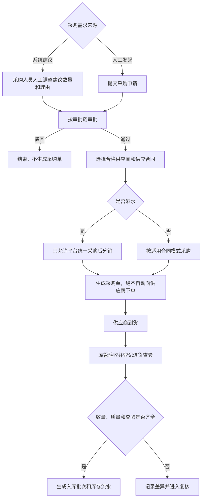
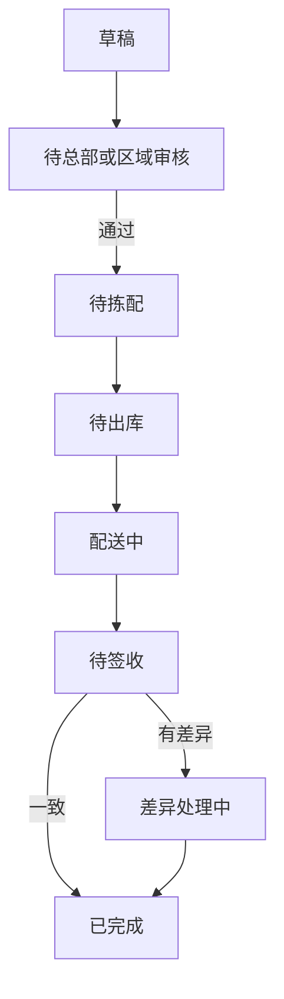
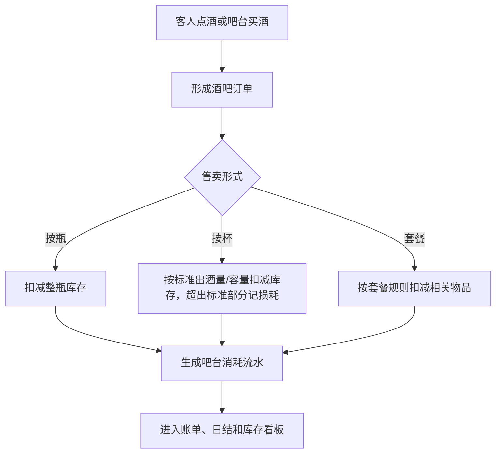
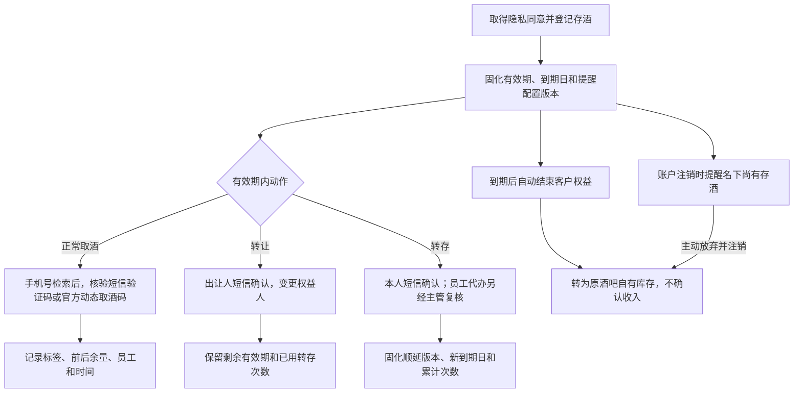
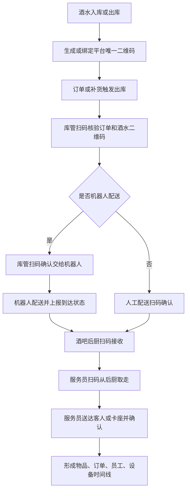

# 供应链与库存管理产品 PRD V0.14

> 版本：V0.14｜最后更新：2026-10-17｜M09 复核：业务目标与当前实现必须分列；代码只作实现事实证据，不得反向定义 HTML 业务规则。

> **锚点口径（2026-09-03 M09 全量复核）**：本文引用三份业务 HTML（BSM＝`business-system-map-for-operations-v0.1.html`／PGM＝`platform-governance-map-for-operations-v0.1.html`／ENUM＝`business-enum-quick-reference-v0.1.html`）时，一律采用**「条目名主锚点 + 冻结行号辅助」**；辅助行号对应冻结提交 `61f4fbb1be2fae9df8fcbb48f1cb2af9bb53ec68`。例如库存流水的主锚点是 BSM「库存流水」与 ENUM「库存流水类型」，不得再用旧快照 L1108 冒充现行锚点。历史变更日志只说明当时动作，不具有现行业务解释权。

> 权限边界：本 PRD 只提供产品细化；三份业务 HTML 拥有最终业务解释权。其他文档、配置、代码和数据结构均不得覆盖 HTML；HTML 未记载的新规则须经用户批准并写入 HTML 后方可生效。

## 1. 文档定位

本文档用于补齐综合体管理系统中的供应链、采购、库房、酒水库存、消耗品库存、其他物品库存和客人存酒管理。

它不是完整 ERP 或完整 WMS 的替代方案。P0 的目标是先把综合体经营中“谁供货、按什么合同供货、什么时候采购、进了哪个库、从哪里出库、被谁消耗、还剩多少、差异怎么处理”记录清楚，保证酒吧经营、吧台售卖、权益兑换、财务对账和异常追责有依据。

## 2. P0 目标

供应链与库存管理 P0 必须支持：

- 管理供应商档案、联系人、资质、结算方式和状态。
- 管理供应合同，包括平台自用供应合同、商户自采供应合同、平台统一采购后分销给商户三种模式，以及合同摘要、供货范围、价格口径、账期、有效期和审批状态。**酒水适用专门规则：一律由平台统一采购后分销给商户，商户不得自行更换供应商，只能对供货价格提出异议。**
- 管理采购周期，包括常规采购、临时补货、审批、到货计划和入库确认；采购申请必须经审批后才可生成采购单，不得自动向供应商下单。
- 管理库房，包括总库、酒吧库、吧台库存、消耗品库、礼品库、存酒区六类。
- P0 管理物品先覆盖酒类、吧台消耗、客人存酒和常用消耗品，例如纸巾、色盅、色子、杯子、杯具等；其他低频物品后续扩展。
- 记录入库、出库、调拨、盘点、报损、报溢和库存调整。
- 记录吧台酒水售卖导致的库存消耗；按杯销售按标准出酒量/容量扣减库存，超出标准部分记损耗。配有采集设备的吧台，实际出酒量必须由设备采集；未配设备的吧台，必须按标准出酒量配酒，也按该标准计算扣减与标准损耗，**不得按零损耗记账**。损耗率（当期损耗量 ÷ 标准出酒量）超过按酒吧配置的安全阈值时转核查工单；出厂默认 5%，须同时配置上下限。
- 管理客人存酒完整生命周期，包括登记、取酒、转让、转存、提醒、到期或账户注销时主动放弃后按到期规则转为原酒吧自有库存、作废、争议和异常处理。
- 报损、盘点差异和存酒作废**不分金额高低**，一律同时提交照片和视频并经主管复核；高价值判定另用于退酒等需分级的动作。
- 为酒水、礼品、高价值物料和需追责耗材生成或绑定平台唯一二维码，支持入库贴码或出库打印码。
- 记录酒水从库房出库、订单核验、机器人或人工配送、酒吧后厨接收、服务员送达客人的全链路交接留痕。
- **进货查验记录（P0）：** 酒类/食品入库时登记并绑定供货方资质、票据、批次合格证明，与入库批次可溯源关联；具体材料类型按适用法律和治理资质主数据确定。
   > 修订说明（2026-09-03）：本条只承接冻结 HTML 的供货方资质、票据和批次合格证明，不自行增加证照清单；配套开发设计以目标 `purchase_inspections` 载体细化批次关联。

### 2.1 已冻结、实施阶段不得由本文臆定的能力

以下能力已写入冻结 HTML，属于必须承接的业务规则；HTML 未指定 P0/P1/P2，本文不得用阶段标签把它们降级，具体实施顺序另由排期决定：

- **智能采购建议：** 根据安全库存、销量和在途量生成建议数量与理由；由采购人员人工调整、按审批链批准后生成采购单，绝不得自动下单。
- **门店要货：** 按草稿、待总部或区域审核、待拣配、待出库、配送中、待签收、差异处理中、已完成、已取消九态流转；每次转换记录操作者和时间。
- **外部经销供应链：** 覆盖经销商准入、独立门户、合同价格目录与询价、受限库存外显、订单审核与付款、中心仓预留、配送签收、取消退款、退货红冲、开票、资金归属、职责分离和停用撤权。当前实现缺口见 §10.1。

## 3. 业务边界

| 范围 | 本模块是否负责 | 说明 |
|---|---|---|
| 供应商档案 | 是 | 记录供货主体、联系人、资质、状态 |
| 供应合同 | 是 | 记录平台自用、商户自采、平台统一采购分销三种模式，以及供应合同核心摘要和供货准入 |
| 采购计划与采购周期 | 是 | 记录采购申请、计划到货、实际到货和周期 |
| 库房台账 | 是 | 管总库、酒吧库、吧台库存、消耗品库、礼品库、存酒区六类 |
| 酒类库存 | 是 | 管瓶装、杯卖、套餐消耗和高价值酒水 |
| 消耗品库存 | 是 | 管杯具、纸巾、冰块、果料、包装等 |
| 其他物品库存 | 是 | 管礼品、设备耗材、运营物料 |
| 吧台售卖消耗 | 是 | 按杯、按瓶、按套餐或其他形式记录消耗 |
| 客人存酒 | 是 | 存酒是客户资产，不等同于可售库存 |
| 智能采购建议与门店要货 | 是 | 冻结 HTML 已确认；实施阶段另排，当前实现缺口见 §10.1 |
| 外部经销供应链 | 是 | 冻结 HTML 已确认；实施阶段另排，当前实现缺口见 §10.1 |
| FIFO、复杂 BOM、供应商评分/比价、高级预测 | 否 | 冻结 HTML 未授权，不构成本 PRD 需求；如需重新引入，须先获批写入 HTML |

## 4. 角色

| 角色 | 关注重点 |
|---|---|
| 采购人员 | 供应商、采购申请、采购周期、到货 |
| 库管 | 入库、出库、调拨、盘点、报损、库位 |
| 酒吧店长 | 酒水库存、吧台补货、存酒异常、高价值酒审批 |
| 吧台员工 | 吧台库存、按杯/按瓶售卖、出品消耗、取存酒 |
| 财务 | 采购成本、库存差异、报损、供应合同、结算依据 |
| 运营主管 | 缺货预警、盘点差异、异常报损和责任追溯 |
| 中央餐饮/平台供货主体 | 维护供货库存、审批内部结算价、收取向商户供货的货款 |
| 经销商业务人员 | 仅通过隔离的经销商门户处理已授权的询价、订单、付款、退货和开票事项 |

敏感价格不得随岗位粗放开放。采购价、成本价、内部结算价和供应链价格的**查看、导出、修改分别授权**；系统自动用价计算不等于操作人取得查看权。敏感经营数据权限授出前须审批，审计人员查看或导出敏感信息也须逐项审批并全程留痕；项目和商户隔离不得关闭。资金类数据的查看权与导出权必须分开，不得默认给同一人双权。

财务/价格治理按项目建立内部结算价页面和独立价格目录，不得跨项目引用。实际提供方提交，由对应域主管公司审批，提交人与审批人分离；中央餐饮供应的酒水或小食由中央餐饮公司内部不同人员提交、审批，其他域公司不得代批。未取得获批内部结算价的商户，不得开通依赖该价格结算的权益或券。价格变更形成新版本且只影响后续业务，核销或结算时锁定当时版本；M09 只消费、引用并锁定获批版本，不承建目录审批（依据 ENUM「项目内部结算价」、BSM「内部结算价管理」、PGM「中央餐饮公司」）。

## 5. 核心对象

| 对象 | 定义 | 关键关系 |
|---|---|---|
| 供应商 | 提供酒水、耗材、礼品或其他物品的主体 | 关联供应合同、采购单、入库批次 |
| 供应合同 | 与供应商之间的采购和结算依据 | 区分平台自用、商户自采、平台统一采购分销，关联供货范围、价格口径、账期、有效期 |
| 采购申请 | 补货需求记录 | 关联物品、数量、预计到货、审批 |
| 采购周期 | 从申请、审批、下单、到货、入库到结算的周期记录 | 关联供应商、合同、采购单、入库 |
| 库房 | 存放物品的管理空间 | 总库、酒吧库、吧台库存、消耗品库、礼品库、存酒区 |
| 库位 | 库房内具体存放位置 | 关联物品批次和盘点 |
| 物品 | 可被采购、存放、售卖、消耗或兑换的东西 | 酒类、消耗品、礼品、其他物品 |
| 商品规格 | 定价、库存、结算和对账的最小单元 | 同一商品不同规格分别计价、计数、预留和对账 |
| 库存批次 | 某次入库形成的库存批次 | 关联供应商、采购单、成本、保质期 |
| 库存流水 | 所有库存变化的记录 | 入库、出库、调拨、销售消耗、报损、报溢、盘点调整、积分兑换消耗、礼物领取消耗、回库、借出、归还，共十二类；BSM「库存流水」与 ENUM「库存流水类型」为权威锚点，详见 §5.1 |
| 物品追踪码 | 平台为单瓶酒、单件物品或出库批次生成的唯一二维码 | 关联入库批次、库房、当前责任人、订单、机器人任务和时间线 |
| 操作交接记录 | 物品在库管、机器人、后厨、服务员、客人之间流转的记录 | 员工主动扫码与机器人或设备被动事件共同形成责任链；缺扫码仅可附照片、录音、录像等证据，经主管复核后补录生效，并与原记录并列、互不覆盖 |
| 跨主体流转单（借 / 调） | 货物在经营主体之间的流转记录：「借」只转移保管责任、「调」是买断转移所有权 | 关联所有权主体、当前保管主体、借出主体、借入主体、应归还数量与期限、内部结算价、溯源码与三类扫码时间（见 §7.6） |
| 吧台消耗 | 吧台售卖或出品导致的库存扣减 | 关联酒吧订单、账单、出品员工 |
| 客人存酒 | 客人已购买但未喝完、暂存在场内的酒 | 关联手机号、姓名/昵称、酒品、瓶底标签数值、照片、人工备注、有效期、二维码 |
| 存酒流水 | 存酒登记、取酒、**转让**、**转存（延期）**、作废等变化 | 关联客人、员工、点位、证据 |
| 门店要货单 | 门店向总部/区域和仓库提出的履约请求 | 关联九态、操作者、时间、拣配、配送、签收和差异 |
| 经销商/价格目录/经销订单/退货单 | 外部经销全链的主体、价格和履约记录 | 账号与商户/供应商隔离；合同价格版本、付款、库存预留、退货红冲与资金主体可追溯 |

> **术语更正（2026-08-04 F5）：存酒的换人动作叫「转让」，不叫「转赠」**（依据 BSM「客人存酒是客户资产、不算可售库存；可转让给他人」条、BSM「管理酒类、吧台消耗、客人存酒和常用消耗品」条、ENUM「客人存酒有效期与转存」条）。
> - **转让 ≠ 转存**，二者是**两个独立动作**：**转让＝换人**（变更权益人），**转存＝延期**（顺延到期日）。
> - **转让不消耗转存次数、不改变到期日**；受让人**继承剩余有效期与已用转存次数**。
> - 转让由**出让人短信验证码**确认，验证成功即生效，受让人**不需另行确认领取**，**不设「等待领取」或「领取前冻结」状态**，一经生效原客户不得单方撤回；只能在有效期内办理，有效期内不限转让次数。
> - **单个存酒标签对应的酒瓶是最小转让单位**，同一酒瓶的剩余酒量不得拆分给多个客户。
> - 存酒流水必须把「转让」与「转存」记成两类不同流水，不得合并为一类，也不得沿用「转赠」字样。

### 5.1 库存流水类型机读枚举（中文 ↔ code 映射，2026-08-04 F5 补；2026-08-05 R7 按 DEC-R7-04 扩为十二类）

> **2026-09-03 M09 更新：** ENUM「库存流水类型」与 BSM「库存流水」均为上述十二类。HTML 只给中文业务类型；下表机读 code 是不增加业务类型的技术细化。当前代码白名单只证明实现现状，不是业务命名权威。

| ENUM「库存流水类型」条中文 | code | 方向 | 说明 |
|---|---|---|---|
| 入库 | `inbound` | 增 | 采购到货入库 |
| 出库 | `outbound` | 减 | 出库到使用点 |
| 调拨 | `transfer_out` / `transfer_in` | 减 / 增 | 一次调拨成对落两条（来源侧、目标侧） |
| 销售消耗 | `consume` | 减 | 正常售卖/出品扣减 |
| 报损 | `damage` / `waste` | 减 | HTML 业务原因仅两类：碰落等损坏、长时间存放过期；当前 Java/OpenAPI 仍把 `loss/damage/waste` 归入 `damage_report` 报损族，这是实现 GAP，不得据此扩成第三种业务报损原因 |
| 报溢 | `gain` | 增 | 盘盈 / 异常增加 |
| 盘点调整 | `count_correction` | 增或减 | 盘点差异纠账 |
| 积分兑换消耗 | `redeem_consume` | 减 | 仅记录发生实物库存扣减的积分兑换；服务履约能力使用独立履约记录，详见 §10 第 3 条 |
| 礼物领取消耗 | `gift_claim_consume` | 减 | 店内实物领取的技术细化；不得把礼品库扩成所有券和服务的唯一履约来源 |
| 回库 | `return_to_stock` | 增 | 客人退品回到库房、客人存酒到期转为酒吧自有库存（DEC-R7-04；与采购入库 `inbound`、盘盈 `gain` 必须分开记，不得混记） |
| 借出 | `lend_out` | 减（保管责任转移，**所有权不转移**） | 跨主体借调中**不可消费物品**交付给借入方（DEC-R7-04；不得用 `transfer_out` 代记，否则会错误地转移库存归属） |
| 归还 | `lend_return` | 增（保管责任回转） | 借入方将借用物品归还借出方（DEC-R7-04；「借出」的反向动作） |

> **code 补齐状态（2026-09-03，GAP-38 文档层）**：上表 code 是对 HTML 十二类中文业务动作的机读细化，不代表当前已经逐类实现。当前采购入库写 `inbound`；typed 入口仅允许 `outbound/damage/waste/loss/redeem_consume`，调整入口可写 `gain/count_correction` 等，调拨写单一 `transfer`。`transfer_in/transfer_out`、`consume`、`gift_claim_consume`、`return_to_stock`、`lend_out`、`lend_return` 尚未形成完整、可无歧义回映射到 HTML 十二类的运行闭环；服务白名单只证明实现现状，不是业务命名权威。

**「冲正」不是独立的流水类型（口径不变）**：

| 业务动作 | 出处 | 口径 |
|---|---|---|
| **冲正** | 原流水与新增反向记录关联 | 冲正**不新增 `movement_type`**；保留原流水并按相反方向追加记录，具体状态 code 以正式迁移和 OpenAPI 为准。ENUM 十二类中不含「冲正」，不得自行新增第十三类 |

> **回库/借出/归还的落库口径（2026-08-05 DEC-R7-04 修订）**：三类动作**已获用户批准写入 ENUM「库存流水类型」条**，**业务口径即刻生效，按十二类落库**。落库须使用由开发设计登记、且能完整、无歧义回映射到 ENUM 十二类之一的机读码，不得用既有 `inbound`/`gain`/`transfer_out` 混记；服务白名单不是命名权威。同一业务类型可因账本方向或 HTML 已授权原因使用多个内部子码，但 UI、统计和业务契约必须归并回原 HTML 类型，不得借子码新增、删除、合并或改变业务语义。**「借出」只转移保管责任、不转移所有权**，仅对不可消费物品成立。

> **实现约束（E-26，如实登记，未变）**：`inventory_stock_movements` 带 DB 约束 `chk_inventory_stock_movements_quantity CHECK (quantity > 0)`（迁移 V012），**数量恒为正**，方向由 `movement_type` 与 `source_location_id`／`target_location_id` 共同表达，不能用数量正负号表示。冲正须保留原流水并按相反方向追加记录；当前 `count_correction` 的盘盈、盘亏共用同一 code，分别靠目标库位、源库位表达方向。补齐回库/借出/归还三类 code 时须同时评估：`inventory_stock_movements.movement_type` 列本身**无 DB CHECK**（取值正确性靠服务白名单保证）和「余额由流水逐位重建」的守恒口径。**本条只登记实现约束，不得据现实现反向定义业务规则，也不得据本条认为三类已实现。**

## 6. 页面/能力清单（实施阶段见 §9）

| 页面 | 内容 |
|---|---|
| 供应链总览 | 缺货、待入库、待调拨、盘点差异、存酒到期、高价值异常 |
| 供应商管理 | 供应商档案、联系人、资质、状态 |
| 供应合同管理 | 平台自用、商户自采、平台统一采购分销、合同摘要、供货范围、价格口径、账期、有效期、审批状态 |
| 采购周期管理 | 采购申请、审批、下单、到货计划、实际入库 |
| 智能采购建议 | 建议数量和理由、人工调整、审批后生成采购单；当前未实现，不得自动下单 |
| 门店要货 | 九态、操作者与时间、拣配、配送、签收和差异；当前未实现 |
| 库房管理 | 总库、酒吧库、吧台库存、消耗品库、礼品库、存酒区、库位 |
| 物品管理 | 酒类、消耗品、礼品、其他物品、单位、成本口径 |
| 入库管理 | 到货验收、批次、数量、成本、保质期、进货查验记录（供货方资质、票据、批次/合格证明绑入库批次） |
| 出库/调拨 | 总库到吧台、库房到点位、消耗品领用 |
| 物品追踪码 | 入库贴码、出库打印码、码状态、当前库位、当前责任人 |
| 交接留痕 | 出库核验、机器人取货、后厨接收、服务员取走、送达确认、异常 |
| 库存余额 | 按库房、物品、批次、状态查看库存 |
| 吧台消耗 | 按杯、按瓶、按套餐售卖后的消耗记录 |
| 盘点与差异 | 账面数、实盘数、差异、原因、复核 |
| 报损/报溢 | 报损：长时间存放过期、碰落等造成的损坏；报溢：库存异常增加；审批和证据 |
| 客人存酒 | 瓶底标签、标签数值、手机号、姓名/昵称、拍照、备注、取酒、转让、转存、提醒、有效期、到期转原酒吧库存、作废、争议和异常 |
| 经销商 Web 门户 | 与商户门户/员工端隔离的准入、询价、目录、订单、付款、库存外显、退货和开票；当前未实现 |

> **联系人手机号 PII 当前实现与 GAP（迁移 V339，2026-07-27）**：`inventory_suppliers.contact_phone` 当前以 AES-GCM 信封密文（`enc:v1:`）落库，读端按权限返回明文或前 3 后 4 掩码；这是实现事实。冻结权限规则要求高敏能力逐项单独授予，平台管理员身份不得自动取得；但 V339 把 `pii.contact_phone.view` 配为 `requires_approval=FALSE` 并直接授予 `role_platform_admin`，属于权限 GAP，不能称现行授权已合规。

## 7. 关键流程

### 7.1 采购到入库

智能采购建议只产生建议数量和理由，不能自动生成已审批采购单，更不能自动向供应商下单。酒水不得走 `merchant_self_purchase`；商户只能对供货价格提出异议，由财务、中央餐饮公司与娱乐平台公司受理。

采购审批适用全平台审批规则：申请人与直接受益人不得审批与自己相关的申请，转发不构成例外。

### 7.2 门店要货与库房履约

冻结 HTML 的门店要货状态清单包含“已取消”，但未定义其进入条件；本模块不得把“驳回/撤销”推定为进入“已取消”，该转换保持未决。

每次状态转换必须记录操作者和时间。仓库出库与门店签收分别生成库存流水和责任记录；数量、商品或规格不一致时不得直接完成，须进入差异处理。

### 7.3 吧台售卖和消耗

库存侧约束：

- 按杯场景按标准出酒量/容量扣减库存；有设备时实际出酒量必须由设备采集，超出标准部分记损耗；无设备时按标准出酒量配酒，也按该标准计算扣减与标准损耗，禁止记为零损耗。
- 损耗率按“当期损耗量 ÷ 标准出酒量”计算；超过按酒吧配置的安全阈值即转核查工单。出厂默认 5%，须同时配置上下限。
- 出品前撤单不计损耗；出品后退品按能否回库分别形成回库或损耗记录，高价值退品仍须照片、视频与主管复核。
- 正式挂起订单已经出品的，立即扣减库存；后续取消或坏账按获批处置回补或核销，不得抹除原流水。
- 库存归零不自动把商品设为沽清；沽清和解除由现场按审批规则处理，且不影响已下单未出品部分。
- 商品规格是定价、库存、结算和对账的最小单元，扣减、回库和差异均落到具体规格。

### 7.4 客人存酒

存酒业务规则：

- 登记前取得隐私同意，记录手机号、姓名/昵称、瓶底标签数值、照片、人工备注、存入时间和到期时间；本次有效期及提醒版本在登记时固化。有效期为按项目可配业务参数，出厂默认 30 天并配置上下限；默认提醒节点为到期前第 14、7、3、1 天，超出实际有效期的节点跳过。
- 转让与转存是两个独立动作。转让只变更权益人，不改到期日、不消耗转存次数；由出让人短信验证后立即生效。转存只可在当前到期日前办理，次数上限按项目可配、出厂默认 2 次并须配置上下限；每次从当前到期日起顺延该酒吧当前配置的期限，该期限按酒吧可配、出厂默认 30 天并须配置上下限。每次固化期限版本、顺延天数、新到期日、累计次数、经办人与确认方式。转存须客户本人短信验证码确认；员工代办还须当班营销主管复核。达到次数上限后不再受理，到期按既有规则转为原酒吧库存资产，不设例外通道。
- 取酒检索只能输入手机号，但手机号不得单独作为放酒凭证；必须再校验当前客户短信验证码或已登录官方应用/小程序的动态取酒码。取酒仅限存入的原酒吧，不得跨店取酒或跨店转移库存。
- 人工例外仅适用于客户手机遗失、停机等无法取得验证码或动态取酒码的情形，并须同时满足：店长发起、另一主管复核；申请手机号在本项目内满足近 1 个月至少 2 笔、近 3 个月至少 3 笔或历史累计至少 5 笔已支付且未全额退款的有效卡座消费订单之一，该安全阈值按项目可配、须配置上下限且调整须最高权限审批留痕；消费历史由发起店长经鉴权后通过手机号专门查询通道查询，界面保持脱敏并记录查询人、手机号、时间与申请；对应营销人员确认，营销已离职由其主管确认，无归属营销由存酒酒吧当班营销主管确认，无可承担责任的主管不得通过；仅客户本人到场办理，不得代领。需由他人取酒时，须先恢复短信或官方应用/小程序验证能力，再走正常转让流程。
- 客人端“我的存酒”可跨店汇总展示，但每条记录须标明所属酒吧，取酒仍只能到存入酒吧办理。
- 发起账户注销时，系统必须提醒客人名下尚有存酒；客人可选择不取存酒、主动放弃并径行注销，放弃的存酒按存酒到期规则转为所在酒吧的自有库存资产。
- 到期后自动转为原酒吧自有库存，转库存时不确认收入；以后重新销售才确认收入，转库存后的报废、赠送、内部使用须审批留痕。存酒作废无金额豁免，必须照片、视频与主管复核，损失按内部结算价记录。

### 7.5 酒水出库到客人全链路留痕

关键要求：

- 出库核验必须同时核验订单和物品二维码。
- 机器人取货、送达后厨属于被动留痕，员工扫码交接属于主动留痕。
- 后厨接收人、服务员取走人、送达人都必须记录。
- 错货、漏货、破损、超时、拒收、数量不一致进入异常复核。

> **当前实现 GAP（2026-09-03）：** V074 已有 `out_verify → dispatch → kitchen_receive → staff_pickup → deliver_customer` 五段结构和基础扫描/机器人上报，但现行服务没有在完成某段前校验所有前置段，后段可被提前置为完成；缺扫码补录也没有“证据提交→主管复核→通过后生效”的独立并列记录，异常查询还不能完整返回补录轨迹。异常复核对 `approved/rejected` 都会调用表头关闭逻辑，且关闭前不检查同一交接是否仍有其他 `pending` 异常，导致驳回或仍有待审异常时表头也可能恢复为 `in_progress/completed`。因此只能称“五段结构与基础扫描已存在”，不得称顺序阻断、补录、异常复核或全链闭环已验收。

### 7.6 跨主体流转（借与调）（2026-08-04 新增，依据 BSM「跨主体流转」条、BSM「跨主体流转结算」条、ENUM「跨主体借调」条）

货物可以在**经营主体之间**流转，分两条路径：

- **平台级供货主体（如酒水公司、中央餐饮）向商户送货 = 调拨**，商户按**货款**与供货主体结算。
- **商户之间可以借调货物**。

#### 7.6.1 结算价铁律

**跨商户之间的结算一律按内部结算价，不得另行约定低于内部结算价的价格。**

#### 7.6.2 「借」与「调」的区别（不可混用）

| | 转移什么 | 所有权 | 结算 |
|---|---|---|---|
| **借** | **只转移保管责任** | **不转移**——借出方始终是这批货的所有权人，借入方只承担临时保管与使用责任（**仅对不可消费物品成立**，可消费物品见 §7.6.3） | 见 7.6.3 分可消费/不可消费 |
| **调** | **买断** | **成交时所有权转移给接收方** | 按内部结算价成交 |

#### 7.6.3 可消费物品 vs 不可消费物品

- **可消费物品（酒水、小食等）**：借用的**实质就是按内部结算价调用**——**交付即按内部结算价出账结算**，不存在「先借着、以后再说」。
  > **【DEC-R7-P5】2026-08-05 已获 HTML 授权（DEC-R7 第二批），原待批标注撤销**（DIFF-B-036）：ENUM「跨主体借调」条已改写为「可消费物品（酒水、小食等）不存在保留所有权的「借」：其借用实质是按内部结算价调用（即买断），交付即按内部结算价出账结算，所有权于交付时转移给接收方」；BSM「跨主体流转」条的「借」已限定为「（仅适用于不可消费物品；可消费物品的借用实质是调，交付时所有权随之转移）」。本段自此为**已生效的业务口径**，不再是仅供实现的约束。
  > **显式声明（2026-08-04 F5 补，消除非法态 E-27「钱已结、货权未转」）**：**可消费物品不存在真正的「借」**——凡可消费物品的所谓借用，**一律按「调」（买断）处理**：**交付时刻所有权即转移给接收方**，与按内部结算价出账**同一时刻发生**，二者不得分离。
  > - **禁止**生成「可消费物品的借用单」并把**所有权仍挂在借出方**——那会形成「钱已按内部结算价结了、货权还没转」的非法中间态，溯源码上的所有权主体与应收应付台账互相打架。
  > - **禁止**为可消费物品设置归还时间、应归还数量或超期归还工单；这些只适用于不可消费物品。
  > - 溯源码上的**所有权主体在交付扫码时即改写为接收方**，`借出主体/借入主体`字段对可消费物品不再有后续含义（保留为流转来源留痕）。
  > - **验收**：可消费物品的跨主体流转单只能是「调」；提交「借」类型时拒绝并给出中文报错；出账记录生成后查询溯源码，所有权主体必须已是接收方，不存在「已出账且所有权仍在借出方」的记录。
- **不可消费物品（设备、器具等）**：
  - **必须约定归还时间**；
  - **借用期间保管人变更为借入方，并在溯源码上登记**；
  - **超过约定归还时间仍未归还的，系统自动生成一张工单并通知借出方主管**，按与其他工单相同的**超时升级路径**继续催办，直到归还或双方另行处理为止；
  - **不强制借入方买断，所有权仍在借出方**。

#### 7.6.4 溯源码记录内容与三个时间

溯源码**同时记录**：**所有权主体**、**当前保管主体**、**借出主体**、**借入主体**、**应归还数量与期限**，并记录**三个时间**：

| 时间 | 取值来源 | 条数 |
|---|---|---|
| 借出时间 | **借出方交货扫码**的时刻 | 一条 |
| 保管人变更时间 | **每一次交接扫码**的时刻 | **交接几次就记几条，全部保留** |
| 实际归还时间 | **借出方收货扫码**的时刻 | 一条 |

**这三个时间全部由已有的扫码动作自动生成，不设手工填写。**

#### 7.6.5 扫码纪律与买断

- 酒水与可追责物品的交接，**每一步都必须扫码**（库管出库 → 后厨接收 → 服务员取走 → 送达客人或卡座）；**缺任何一步即视为该环节工作未完成，不得进入下一环节**。**确需补录的一律须附证据（照片／录音／录像等）并经主管复核后方生效**，补录记录与原始扫码记录**并列展示、互不覆盖**（2026-08-04 第三轮用户裁决 UD-14 / DEC-R6-09）。
- **买断时溯源码归属从原主体变更到接收主体**；**收货时扫码核对，防调包**。

#### 7.6.6 验收

> 下列为冻结 HTML 的目标验收，不代表当前实现已经通过。现行 V277 调拨基础单据可收发，但借用收货也会改写溯源码所有权，且缺当前保管主体、归还期限与超期工单载体；这是实现 GAP，本轮只在文档如实登记、不修改代码。

- 跨商户流转单据的结算价**只能取内部结算价**，低于内部结算价的价格**拒绝保存**。
- 「借」的单据**不改变溯源码上的所有权主体**，只改**当前保管主体**；「调」的单据在成交时**改写所有权主体**。
- 可消费物品的借用**在交付时即生成按内部结算价的出账结算**，不允许挂空；**且同一时刻溯源码所有权主体改写为接收方**（可消费物品一律按「调」处理，见 §7.6.3），不存在「已出账、所有权仍在借出方」的记录。
- 不可消费物品的借用**无归还时间即拒绝提交**；超期未归还**自动生成工单**并通知借出方主管，走通用超时升级路径。
- 溯源码可查到所有权/当前保管/借出/借入四个主体、应归还数量与期限，以及借出、每次交接（多条）、实际归还三类时间；**三类时间不存在手工录入入口**。
- 任一环节缺扫码时，**下一环节被拒绝**；目标补录入口必须受限——**补录须附证据（照片／录音／录像等）并经主管复核后方生效**，未复核的补录不产生任何业务效力，且**补录记录与原始扫码记录并列保存、互不覆盖**（DEC-R6-09）。当前入口缺失见上方 GAP。

### 7.7 外部经销供应链

经销业务是冻结 HTML 已确认能力，不能用三种供应合同或普通调拨替代：

- **准入与门户：** 经销商状态为待提交、审核中、已通过、已驳回、已停用；企业主体、合同、开票和银行资料审核通过后才启用独立经销商 Web 门户。该门户属于受控十一类终端，与商户门户和内部员工端隔离账号、权限和数据；适用统一终端开关、访问拒绝留痕和兜底关闭规则。停用时立即终止全部会话和系统对接授权，已完成订单与审计记录保留。
- **价格与库存：** 每份合同使用独立、可版本化的销售价格目录，不复用内部结算价，不采用经销商等级统一折扣。目录状态为草稿、待审批、已生效、已失效；询价状态为待报价、报价审批中、已报价、已失效。外部库存只显示有货、紧张、缺货、预计交期，不得显示精确数量、仓库总库存或内部调拨。
- **订单与付款：** 通知付款前必须审核合同、价格、库存和交期。订单状态为草稿、待审核、已驳回、待付款、付款核验中、待出库、配送中、已签收、已完成、取消中、已取消、待退款、退货中、部分退货、已退货。审核通过时按中心仓、商品和规格预留；只接受对公转账和平台线上支付，禁止现金和个人账户收款；到账核验通过才可出库。付款截止未到账则取消并释放库存，迟到到账进入待退款。
- **退货、开票与资金：** 合同期内仅未拆封可复售或质量问题商品可申请退货；退货单状态为待审批、已驳回、待收货、验收中、待红冲、待退款、退款中、退款失败、部分完成、已完成。未开票退货验收后退款；已开票部分退货先全额红冲原发票，再按最新未退金额重开并退款；全部退货红冲后不重开。销售主体负责收款与开票；货款计入该主体自身收入和分红净利润基数，不计门店营业额或抽成，运费单列并依法开票；分红计算仍由财务系统负责。
- **职责分离：** 合同价格编辑与审批不得同人；订单审核、到账核验、仓库出库不得由同一人完成全链；退货验收与退款执行分离。通知付款时固化价格目录版本和询价单，税率只作审计快照。
- **合同价与询价：** 已定合同价的商品才可下单；未定价商品只能询价，报价审批通过后方可订购。
- **仓库、运费与销售主体固化：** 合同指定中心仓、运费模板、包邮门槛、运费承担方和销售主体；订单固化对应仓库、模板与销售主体版本。
- **取消、到账与退款：** 取消审批与到账核验互斥；取消生效后不得出库；已到账订单取消须走退款审批，退款执行人与到账核验人不得为同一人。
- **退货与开票：** 按实际验收数量退款并支持部分退货；签收后才可按最终未退金额申请电子发票。
- **税务口径：** 实际计税、申报和开票服从业务发生时有效的国家财税法规、主管机关规则及专业系统结果；文档中的税率只作审计快照。

> **当前实现 GAP（2026-09-03）：** 当前仓库中没有经销商独立门户、经销价格目录/询价、经销订单/退货及对应付款、预留、红冲闭环。本文只承接权威规则，不把未实现能力写成已具备，也不自行增加等级折扣、授信或现金收款规则。
>
> **实现现状（CG-11a，2026-10-17，迁移 V451）：** 内部后台已落地「准入与门户资格」「价格与库存」「合同价与询价」三条：经销商档案 `dealers` 五态（CHECK 与 ENUM:170 逐字对应），审核时企业资料、合同、开票、银行资料四项逐项勾核，全部通过才 `approved` 并置 `portal_enabled`（`DEALER_REVIEW_INCOMPLETE`），停用即撤销门户资格且禁止新询价、新目录（`DEALER_DEACTIVATED`）；经销合同 `dealer_contracts` 指定销售主体与中心仓；价格目录 `dealer_price_catalogs` 按合同版本递增、四态 CHECK、编辑人/提交人不得审批（`DEALER_SOD_SAME_PERSON`）、新版本生效旧版本失效；询价 `dealer_inquiries` 四态、已定合同价商品不得询价（`ITEM_ALREADY_PRICED`）、报价人不得审批；库存外显按合同中心仓可用量只给 有货 / 紧张 / 缺货 / 预计交期（紧张＝可用量不高于物品档案最低库存，技术决定）。接口 `/api/v1/dealers/**`（18 个操作），后台页 ADM-DLR-001。**仍未实现**：独立经销商 Web 门户（CG-11d）、经销订单/付款/预留/履约（CG-11b）、退货/退款/红冲/资金归属（CG-11c）、停用时终止门户会话与系统对接授权（随 CG-11d 门户账号落地）。

## 8. 与其他系统关系

| 连接对象 | 连接内容 | 业务意义 |
|---|---|---|
| 平台治理 | 综合体、商户、合同、空间、员工、权限 | 确定谁能采购、谁能入库、谁能审批、在哪个库房操作；主数据删除走审批软删，钱账与事件不得物理删除、纠错走作废/冲正 |
| 酒吧经营 | 点酒订单、吧台买酒、赠饮核销、账单 | 酒水销售和出品必须影响库存或消耗台账 |
| 票务权益 | 赠饮、积分兑换礼物、权益领取 | 赠饮或礼物领取后要形成库存消耗或领取记录，积分兑换礼物必须扣减库存 |
| 触摸屏一体机 | 吧台买酒、权益领取、兑换礼物 | 自助下单或领取要回写库存/消耗 |
| 财务经营 | 采购成本、报损、盘点差异、供应合同 | 财务对账和成本判断需要库存依据 |
| 证据风控 | 报损、盘点差异、存酒作废及其他高风险动作 | 三类动作不分金额必须照片、视频和主管复核；其他动作按冻结高价值规则分级 |
| 财务三方对账 | 平台系统流水、第三方渠道对账单、支付资金到账按营业日每日两两配平 | 本模块输出供应链与库存流水、交接和异常证据；日结、差异处理与终局认定按冻结 ENUM「日结状态」「差异处理状态」「三方对账框架」执行 |
| 第三方接入 | 当前无真实供应商接口资料；先提供自有开放能力 | 第三方须身份核验、最小授权和全量调用日志；资料到位后再补字段映射、回传与对账，不伪造结果 |
| 维保/工单 | 维保单位复用供应商记录；工单用料从指定库房出库 | 用料按当前移动加权平均进货价计成本；检修恢复与承担方争议仍由设备/工单域闭环 |
| 数据分析 | 库存周转、损耗、缺货、存酒余额 | 商户只看本商户；管理层按授权下钻，普通岗位不得看平台全局、其他商户或敏感价格 |

三方对账按营业日每日执行系统对渠道、渠道对资金、资金对系统三组核对。日结确认前须把当日订单与核销、退款与冲正、出品与物品交接、考勤、异常处置五类数据逐类标记为最终；最迟在闭店所在自然日次日 24:00 完成，标记不可撤销，缺失时生成待办并阻断日结确认和锁定。差异按待识别、待处理、待复核、已关闭流转；待识别、待处理按项目可配，渠道说明期限按渠道可配，出厂默认均为 1 个工作日并须配置上下限，超时升级。核销事实以平台在线核销记录为准，资金以银行实际到账为准；人工渠道录入须附渠道原始对账单并由复核人比对签字，无原件只能进入待补凭证；长期无法取得凭证时仅可经审批单方认定关闭，原因和依据永久留痕。高价值差异未关闭时阻断对应营业日日结，低价值差异单列带账进入下期（依据 BSM「三方对账」、ENUM「日结状态」「差异处理状态」「三方对账框架」）。

## 9. P0/P1/P2

| 阶段 | 能力 |
|---|---|
| P0 | 供应商、三类供应合同、采购周期、库房、物品、入库、出库、调拨、库存余额、物品追踪码、扫码交接留痕、吧台消耗、盘点差异、报损、客人存酒、积分兑换库存扣减 |
| HTML 已确认、阶段未指定 | 智能采购建议、门店要货、外部经销供应链；不得因未写阶段而降为候选或删除 |
| P1/P2 | 仅用于经批准后的排期；FIFO、复杂 BOM、供应商评分/比价和高级预测当前无 HTML 授权，不在本 PRD 中形成需求 |

## 10. 已确认规则和后续细化事项

已确认：

1. 供应合同分平台自用供应合同、商户自采供应合同、平台统一采购后分销给商户三种模式；**酒水一律适用平台统一采购后分销**，商户不得自行更换酒水供应商，只能对供货价格提出异议。
2. 客人存酒使用瓶底标签，按标签显示数值记录，登记时必须拍照、填写人工备注，并留取手机号和姓名/昵称。
3. 优惠凭证与积分兑换按三种履约通道分开处理；履约通道与“收费型/免费型”是两个独立维度，每个券版本须同时确定，不得把全部来源固定成礼品库：

   - **商户折扣券：** 到对应商户抵扣，不涉及库存，不预占库存。
   - **店内实物/服务：** 发券时预占对应库存或履约能力并减少可售/可承诺量；实际核销或完成履约后才转为实际消耗；取消、到期或作废时仅释放尚未使用的预占。礼品兑换可细化为礼品库，但礼品库不是所有实物、服务券的唯一来源。
   - **平台或外部伙伴履约：** 按券版本和合作约定履约、回传与结算，不虚构本地库存扣减。
   - **发券共同动作：** 扣积分并锁定项目、价格、方案和成本承担版本；发券时不与商户结算。
   - **店内实物/服务结算：** 实际核销或完成履约后，按发券时锁定的该项目该商品内部结算价补偿承接商户；发券前须校验内部结算价不低于积分兑换结算单价，倒挂不得上架；积分兑换结算单价只用于定价覆盖校验，不作为补偿价；核销一件结一件，未核销不结算。
   - **共同约束：** 库存/能力不足时拒绝发券且不扣积分；预占、实扣、释放和积分扣减须保持同一业务事务的幂等与失败回滚。只有实物库存实扣写库存流水，服务履约能力使用独立履约记录。
4. 供应链 P0 从酒类、吧台消耗、客人存酒和常用消耗品开始，常用消耗品包括纸巾、色盅、色子、杯子、杯具等。
5. 吧台按杯销售：按标准出酒量/容量扣减库存，超出标准的部分另记损耗；有采集设备时实际出酒量必须由设备采集；无设备时按标准出酒量配酒，也按该标准计算扣减与标准损耗，**不得记零损耗**。
6. 报损、盘点差异、存酒作废**不分金额高低**，必须同时拍照和视频（双证据，非二选一）并主管复核；高价值判定不得被用作低价值豁免条件。
   > 修订说明（2026-09-03 M09）：原文把双证据缩窄为高价值场景，与冻结 HTML 冲突；现明确上述三个动作无金额豁免。高价值判定口径见本节第 9 条。

   **6.1 报损情形封闭（2026-08-04 F5 补，依据 ENUM「高价值判定」条、BSM「高价值物品」条）**

   - **报损仅限两种情形**，此外一律不得以「报损」入账：
     1. **物品长时间存放过期**；
     2. **碰落等造成的损坏**。
   - **两种情形均须留存视频与照片**（与本条第 6 项双证据同一要求，不因金额高低豁免）。
   - **报损物品须经该店（该酒吧）对应的财务业务伙伴确认后，方可废弃**——**先确认、后废弃**，不得先扔后补单。
   - **经查明属人员造成的损坏，由相关人员照内部结算价赔偿**（不按售价、不按进货价）。
   - **验收**：报损单的情形字段只有上述两个可选值，无「其他」；缺照片或缺视频不得提交；未经财务业务伙伴确认的报损单不得进入「已废弃」；判定为人员造成损坏的报损，自动带出按**内部结算价**计算的赔偿金额。

   **6.2 仓库管控与录像留存（2026-08-04 F5 补，依据 ENUM「高价值判定」条、BSM「高价值物品」条）**

   - **正常情况下不应出现盘点亏损**：**仓库全程摄像**，**取货由机械手臂完成**，**人员一般不进入仓库**。
   - **人员确需进入仓库的**：**一律必须携带摄像设备**；**进入之前须先检查该摄像设备是否完好**（设备不完好即不得进入）。
   - **进入期间的摄像内容事后须进行人工智能分析**。
   - **录像与分析结果长期保存**——**业务参数，按项目可配，出厂默认至少五年，须同时配置下限**（低于下限的配置值拒绝保存）。
   - **经分析发现异常的**：**属盗窃的予以开除**；**属造成损坏的照内部结算价赔偿**。
   - **验收**：未登记「携带摄像设备 + 进入前设备完好检查」的入库房记录不得放行；每次人员进入均生成一条待 AI 分析任务，分析结果与录像绑定保存并可查；录像保存期限配置低于下限时拒绝保存并给出中文报错。

   > **实现现状（如实标注，待改造缺口）**：本条 6.1／6.2 的「报损两种情形封闭」「财务业务伙伴确认后废弃」「人员进入仓库的携带与检查登记」「录像 AI 分析与≥5 年保存的配置及下限」在当前实现中均无对应字段与流程，属**待改造缺口**；改造前不得据现实现认为已满足，也不得据现实现反向定义业务规则。
7. 酒水、礼品、高价值物料和需追责耗材必须有平台唯一二维码，可在入库时贴码，也可在出库时打印码。
8. 酒水从库房出库到客人收取的全过程必须留痕，出库核验人、机器人或配送人、后厨接收人、服务员送达人都必须可追溯。
9. **高价值判定口径（2026-08-04 修订，依据 ENUM「高价值判定」条、BSM「高价值物品」条；取代 2026-07-28 的「与移动加权当前平均进货价比较」写法）：**

   - **判定基准 = 该物品「最近一次实际到货价」**，与后台配置的**固定金额阈值**比较：HTML 明确**高于阈值为高价值、低于阈值为低价值**。HTML 没有定义“恰好等于”或没有最近一次实际到货价时的业务分类；本文不新增结论。当前 Java 把等值记为 `below_threshold`，并在缺少成本基准时以 `BASIS_COST_UNKNOWN` 按高价值拦截；两者都只是实现事实，不是业务授权。
   - **明确不使用滚动变化的「当前平均进货价」作为判定基准**——移动加权平均价随每次进货变动，用它判定会让同一件物品今天是高价值、明天不是，判定结果不稳定、可被进货节奏操纵。
   - **阈值口径**：全平台**一个固定金额阈值**（`high_value_thresholds`，单位：分；**出厂默认 5000 元**）；属**安全阈值**——**全平台统一可配，调整须最高权限审批并留痕，须同时配置上下限**。**按物料各设一个阈值的做法已删除**。出厂默认值经 2026-08-04 第三轮用户裁决 UD-18 / DEC-R6-06 定为 **5000 元**，**已写入 HTML** ENUM「高价值判定」条；DB 种子值 `hvt_default`=500000 分与之一致。**「阈值未配置一律按高价值拦下走审批、不得静默放行」分支仍然有效**（种子值被删除或置空时读取侧返回 null 即走从严一侧）。
   - **三个价格场景分开、不得互相顶替**：

   | 场景 | 用哪个价 | 用途 |
   |---|---|---|
   | **跨主体结算/人员赔偿** | **内部结算价** | 跨商户结算、人员造成损坏的赔偿与相关成本责任 |
   | **高价值判定** | **最近一次实际到货价** | 与固定金额阈值比较；报损、盘点差异、存酒作废仍无金额豁免 |
   | **成本核算** | **平均进货价（移动加权，`inventory_item_cost_state.avg_unit_cost_cent`）** | 商户领用/出库计成本、商品成本、经营净利润的成本扣减依据 |

   - **手工标记**：物品档案保留手工标记 `manual_high_value`（标了就恒为高价值，不看到货价）。**手工标记由「库房主管以上岗位」执行；标记与取消标记都必须填写理由并留痕；一线库管无此权限。**
   - **判定命中的后果**：退酒等按价值分级的动作命中高价值时，触发照片、视频和主管复核。报损、盘点差异、存酒作废无论是否命中高价值，都必须照片、视频和主管复核。
   - **不得静默放行**：**阈值未配置时一律按高价值拦下走审批**。冻结 HTML 未规定“最近一次实际到货价未知”时如何分类，本 PRD 不新增处理规则，也不得静默改用移动加权价。

   > **实现现状（如实标注，待改造缺口）**：现实现取 `inventory_item_cost_state.avg_unit_cost_cent`（移动加权**当前平均进货价**）而非最近实际到货价；V350、仓储查询、写入请求和 OpenAPI 仍允许项目/商户特例并优先读取具体作用域，而非全平台单一阈值。两项均违反本条业务口径。`manual_high_value` 的岗位限制与理由留痕也待补齐。改造完成前不得据实现反向定义业务规则。
    > 历史修订说明（2026-06-07，已被 V0.04 取代）：当时把双证据与高价值绑定；现行规则为报损、盘点差异、存酒作废不分金额均须双证据和主管复核。

### 10.1 当前实现事实与 GAP（2026-09-03 M09）

本轮用户裁决只修两份 M09 文档，不修改 Java、迁移或 OpenAPI。下表把当前实现与权威要求分列；“已有表/接口”不等于业务闭环已通过。

| 项 | 当前实现事实 | 当前 GAP / 禁止宣称 |
|---|---|---|
| 智能采购、门店要货、外部经销 | 当前没有门店要货九态和经销门户/目录/订单/退货闭环 | 不得降为 P1/P2 候选，也不得称已实现 |
| 酒水采购、采购状态与进货查验 | 当前合同/采购路径未按酒水类别阻断 `merchant_self_purchase`；采购状态约束含八个 code，但服务实际可达 `created → approved/rejected → ordered → arrived → received`，`submitted`、`expected` 无写入路径；仅在 `decision=approved` 且 `supplier_id` 非空时检查 `active` 且未过 `valid_to` 的资质，`decision=rejected` 不检查，也不检查未来 `valid_from`，`receive` 不重验；`purchase_inspections` 未建 | 不得称酒水统采、八态逐步留痕或入库查验已验收；空供应商可跳过资质检查，未来生效资质可能通过，审批后失效也可继续收货；收货尚未绑定供货方资质、票据及批次合格证明 |
| 采购自审防护 | `inventory_purchase_requests` 与 `PurchaseRequestRecord` 未记录申请人；创建时未保存当前操作者，审批时只记录审批人且不与申请人比较 | 当前无法拒绝申请人审批自己的采购申请，不得称全平台自审禁止已在采购路径落地 |
| 采购多明细契约 | 正式 OpenAPI 对 `items` 声明 `maxItems: 200`；Java DTO 未配置项数上限，服务只要求列表非空并取第一项、不拒绝其余明细，V012 也只保存一组 `item_id/quantity` | 第二项以后会被静默忽略，应用层也不拒绝超过 200 项；不得称多明细采购已实现，修代码前正式契约须限制单项或明确拒绝多项 |
| 吧台损耗率 | 当前按订单项件数 `quantity` 扣减库存；实际/标准容量仅用于后续损耗计算；`bar.pour-cost.strict-mode` 是未绑定吧台设备有无或状态的全局配置；另按商品配置绝对损耗量阈值且只记录异常事件 | 尚未实现按标准出酒量/容量扣减并把设备实采超标量记为损耗，也未实现“当期损耗量 ÷ 标准出酒量”超过按酒吧配置阈值即转核查工单；不得称按杯扣减或损耗核查闭环已落地 |
| 唯一追溯码、五段交接与异常复核 | V128 允许四个状态值，V277 又增加 `owner_type/owner_id`，但常规 DTO/OpenAPI 未暴露所有权字段；运行路径只实现登记/打印；V074 五段可乱序，异常复核对 `approved/rejected` 都调用表头关闭逻辑且不检查其他 `pending` 异常 | `bound/consumed`、所有权字段契约和严格交接均未闭环；乱序和补录未阻断；驳回或仍有其他待审异常时表头也可能恢复为 `in_progress/completed` |
| 高价值价格、阈值与手工标记 | 实际单价允许为空；现行判定读取移动加权均价，项目/商户阈值可覆盖全局，缺成本时以 `BASIS_COST_UNKNOWN` 按高价值拦截；`manual_high_value` 缺角色、理由和取消审计 | 最近到货价、全平台唯一阈值和手工标记治理均未落地；缺价按高价值只是 Java 事实，业务分类继续未决 |
| 报损、盘点差异、存酒作废 | 低价值调整和存酒作废可直接生效；typed `damage/loss/waste` 可绕复核，且 `loss` 仍被映射到 `damage_report`；盘点差异未强制照片和视频 | 违反三动作无金额豁免的双证据+主管复核规则；不得把 `loss` 解释成 HTML 第三种报损原因 |
| 跨主体借调 | V277 允许可消费品 `lending`、任意非负单价和空 `lending_mode`；发货时结算、收货时才改 owner，两侧库存/流水不联动；借用收货也改 owner，空 mode 收货后不能归还或取消 | 缺内部结算价校验、交付时点一致性、库存守恒、组合校验、保管主体、归还期限和超期工单；不得称借/调已闭环 |
| 权限与数据隔离 | 合同审批仍用 `inventory.purchase.approve`；V339 免审批并直授平台管理员手机号明文权限；合同列表/创建/审批及流转创建/详情/列表缺完整项目/商户作用域校验 | 合同审批职责未分离，PII 高敏权限违反逐项授予，合同与流转单存在跨作用域暴露/操作风险 |
| 正式 OpenAPI | 跨主体 transfer 仅收录 return/cancel，漏 list/get/create/ship/receive 与 `supply-entities` GET/POST；运行时已有存酒 `POST /api/v1/inventory/saved-bottles/{id}/transfer`，正式 YAML/JSON、验收矩阵和 closure 附录均缺失；高价值说明仍是“数量×单价≥物料阈值、无阈值即时放行”；typed 流水仍称允许 `inbound/outbound/damage` | 覆盖脚本漏扫工作台及存酒转让；高价值说明与 HTML/Java 漂移；typed 入口实际拒绝 inbound 并允许 `outbound/damage/waste/loss/redeem_consume`，契约未对齐 |
| 库存流水 code 覆盖 | `movement_type` 列无 DB CHECK；当前入库写 `inbound`，typed 和调整入口白名单分裂，调拨写单一 `transfer` | 每个技术 code 尚未形成完整、无歧义回映射到 HTML 十二类之一的运行闭环；同一类型的方向/已授权原因子码须在 UI、统计和业务契约归并回原类型；未实现 code 不得称已实现 |
| 存酒转让 | `transferQuantity` 可空且服务接受 `1..remainingQuantity`；保存时保留原 `customerId/name/phone`，只写 `transferTo*`，取酒仍校验原姓名；转让流水的操作者为空，用户文案仍有“转赠” | 现有路径违反单标签酒瓶整瓶转让、不得拆分的规则，也未正确切换权益人与取酒身份；不得称转让闭环已实现 |
| 账户注销与存酒 | `CustomerService.deregisterAccount` 只把账户状态改为 `deregistered`，未检查或提醒名下存酒，也未提供主动放弃选择或联动转库存 | 注销时放弃的存酒尚未按到期规则转为所在酒吧自有库存，不得称账户注销的存酒库存后果已闭环 |
| 存酒、优惠凭证、内部结算价与敏感价格 | 当前已有基础存酒和礼品兑换路径；库存域尚未完整消费、引用或锁定获批内部结算价版本 | 完整存酒、三类凭证履约和敏感价格分权不得称已全量实现；M09 目标只消费、引用并锁定获批内部结算价版本，目录与审批由财务/价格治理负责，不在 M09 重建 |

后续细化：

“到货价恰好等于阈值”以及“没有最近一次实际到货价”两种业务分类均未在冻结 HTML 闭合；本版删除旧有推断，不代替 James 作答。其余按以下已确认口径执行：

1. 盘点差异 P0 单独形成库存差异批次。无论金额高低，均须同时提交照片和视频并经主管复核；缺任一证据或复核未通过，不得完成库存调整。进入应收应付台账时，冻结 ENUM 另要求**高价值差异复核通过才入账**。当前 V108 的 `ar_ap_items(source_type='inventory_difference')` 与 `inventory_variance.posted_ar_ap_item_id` 只记录实现事实，不得缩窄上述全量证据与复核目标。已锁定日结不得直接改写，需影响时按财务冲正口径处理。

   > 文档goal修正(2026-06-20)：原文口径为"确需影响金额时才走调整/冲正审批后进入应收应付或财务调整台账"（即库存差异入账被表述为远期/确需才做）。审计发现与已落地代码相反——**V108 已落地为 P0**：迁移 `V108__inventory_variance_to_ap.sql` 已建 `stocktake`（盘点单）+ `inventory_variance`（库存差异明细，含 review_status pending/approved/rejected 与 posted_ar_ap_item_id 幂等防重），复核通过后由 finance 服务生成 `ar_ap_items(source_type='inventory_difference')`（服务层 SOURCE_TYPES 已加该枚举），并 seed `finance.inventory_variance.post`（high 风险、requires_approval）权限。故口径改为"V108 已落地 P0"。
   >
   > **目标验收（G/W/T）**：Given 任意金额的报损、盘点差异或存酒作废 / When 缺照片、缺视频或主管未复核通过 / Then 不得执行库存调整或资产状态变更。
   >
   > **当前 V108 财务入账验收（G/W/T）**：Given 高价值盘点差异已复核通过 / When 执行 `finance.inventory_variance.post` / Then 幂等生成 `ar_ap_items(source_type='inventory_difference')` 并回填 `posted_ar_ap_item_id`。

## 11. 本版结论

供应链与库存管理必须作为综合体管理系统的独立业务能力存在。酒吧系统负责“客人怎么点酒、怎么付钱、怎么形成账单”，供应链系统负责“酒水和物品从哪里来、在哪个库、经过谁、怎么交接、怎么消耗、剩多少、差异谁负责”。P0 先完成已明确的基础台账、平台唯一二维码和关键留痕；智能采购建议、门店要货和经销供应链虽未由 HTML 指定阶段，仍是现行权威要求，不得降成可选规划。任何新的 P1/P2 能力须有 HTML 授权。

本 PRD 的目标设计、当前实现事实与 GAP 见配套开发设计文档 `supply-chain-inventory-development-design-v0.1.md`；其中出现表名或接口不表示已经落地，必须以该文档的“当前实现事实”及正式 OpenAPI/测试证据核验。

## 12. 变更日志

| 日期 | 类型 | 位置 | 内容 | 原因/依据 |
|---|---|---|---|---|
| 2026-09-03 | M09 互审修订（V0.13） | §2、§7.4、§10.1 | 补齐账户注销时提醒存酒、客人主动放弃后按到期规则转所在酒吧自有库存，并登记当前注销服务无联动的实现缺口 | Codex 终审发现 C-M09-004，经同一 Grok 4.6 xhigh 会话定向复核确认；仅修两份文档，不修改代码、OpenAPI 或 HTML |
| 2026-09-03 | M09 互审修订（V0.12） | §7.1 | 将采购流程图按系统建议与人工发起拆分；仅系统建议由采购人员调整建议数量和理由，人工发起直接提交采购申请后进入审批链 | Grok 4.6 xhigh 终审发现范围外溢，经 Codex 对冻结 HTML 定向复核确认；仅修两份文档，不修改代码、OpenAPI 或 HTML |
| 2026-09-03 | M09 互审修订（V0.11） | §7.1、§10.1 | 承接全平台采购自审禁止并登记当前缺口；补记存酒转让正式契约漏口及部分转让、权益人、取酒身份、操作者和旧术语问题 | Codex 与同一 Grok 4.6 xhigh 会话对 V0.10 锁定字节交叉复核；仅修两份文档，不修改代码、OpenAPI 或 HTML |
| 2026-09-03 | M09 互审修订（V0.10） | §5 | 删除无冻结来源的采购申请固定发起角色，并恢复五段交接的强制扫码、设备被动留痕及缺扫码补录约束 | Codex 与同一 Grok 4.6 xhigh 会话对 V0.09 锁定字节交叉复核；仅修两份文档，不修改代码或 HTML |
| 2026-09-03 | M09 互审修订（V0.09） | §5.1、§10.1 | 收窄人员损坏赔偿验收条件，明确技术 code 回映射与子码归并规则，并校正 OpenAPI/Java DTO 多明细现状 | Codex 与同一 Grok 4.6 xhigh 会话对 V0.08 锁定字节交叉复核；仅修两份文档，不修改代码或 HTML |
| 2026-09-03 | M09 互审修订（V0.08） | 全文 | 校正库存流水方向事实与完整表名、按杯流程图、盘亏验收无来源关联规则及采购资质检查条件 | Codex 与同一 Grok 4.6 xhigh 会话对 V0.07 锁定字节交叉复核；仅修两份文档，不修改代码或 HTML |
| 2026-10-17 | CG-11a 实现现状（V0.14） | §7.7 | 经销商准入五态与四项审核启用门户、经销合同（销售主体+中心仓）、合同价格目录版本审批（编辑审批分离）、询价四态、库存外显四态已落地（V451，`/api/v1/dealers/**`，ADM-DLR-001）；门户、订单、退货仍未实现 | BSM:1216-1222；ENUM:170-172、175、178 |
| 2026-09-03 | M09 互审修订（V0.07） | 全文 | 校正按杯库存扣减与损耗事实、门店要货未决转换、经销终端和付款前审核、报损/报溢表述、内部结算价边界及页面表格结构 | Codex 与同一 Grok 4.6 xhigh 会话对 V0.06 锁定字节交叉复核；仅修两份文档，不修改代码或 HTML |
| 2026-09-03 | M09 互审修订（V0.06） | 全文 | 校正进货查验来源、资质绕过、PII 权限、`loss`、多明细、损耗率、借调、隔离、OpenAPI 和结算价边界；删除存量回填设计；补经销资金归属 | Codex 与同一 Grok 4.6 xhigh 会话对 V0.05 锁定字节交叉复核；仅修两份文档，不修改代码或 HTML |
| 2026-09-03 | M09 互审修订（V0.05） | 全文 | 消除阶段标题与旧积分说明冲突；补齐存酒、优惠凭证、经销、项目内部结算价、高敏权限和三方对账的冻结 HTML 规则；拆分库存全量证据复核与财务高价值入账；按代码、迁移和 OpenAPI 校正资质校验时点、可空到货价、交接异常、流水 code 与接口 GAP | Codex 与同一 Grok 4.6 xhigh 会话对当前 V0.04 锁定字节逐项互审确认；仅修两份文档，不修改代码或 HTML |
| 2026-09-03 | M09 全量修订（V0.04） | 全文 | 补齐酒水统采、智能采购/门店要货、经销全链、存酒生命周期、吧台实采/标准损耗、三类凭证履约、敏感价格分权和三方对账连接；六类库房与十二类流水收口；删除无 HTML 来源的 FIFO/BOM/评分/比价/高级预测硬规划；将进货查验、五段补录、借用所有权、高价值价源/阈值/证据、合同权限和 transfer 契约如实标为 GAP | 冻结 HTML 提交 `61f4fbb1`；Codex 与 Grok 4.6 xhigh 双重复核；用户裁决仅修两份文档并删除/降级无来源规则 |
| 2026-08-04 终审返工 | 改 | §7.6.5 扫码纪律 / §7.6.6 验收 | 终审返工：删两处补录禁令（「也不存在事后补录」「系统不提供事后补录该扫码的入口」），改为裁决口径——扫码缺失可事后人工补录，但**一律须附证据（照片／录音／录像等）并经主管复核后方生效**，补录记录与原始扫码记录**并列展示、互不覆盖** | 第三轮用户裁决 UD-14 / DEC-R6-09；BSM 供应链章·跨主体流转行、ENUM「跨主体借调」条（CL R6T-01） |
| 2026-08-04 | 改 | §10#9 | 第三轮裁决落地：高价值判定阈值「出厂默认值待定 / HTML 未授权」改为「**已写入 HTML，出厂默认 5000 元**」 | 第三轮用户裁决 UD-18 / DEC-R6-06；ENUM「高价值判定」条（CL R6B-18） |
| 2026-06-07 | 改 | §2 P0 目标 | 增"进货查验记录"目标（供货方资质/票据/批次合格证明绑入库批次） | finding C9、《合规要求 §10》：原入库无法定进货查验台账，溯源与持证经营合规不足 |
| 2026-06-07 | 改 | §5 核心对象·库存流水 | 流水类型补"报溢/积分兑换消耗/礼物领取消耗" | finding pass-2、supply-5：枚举缺兑换消耗与报溢类型 |
| 2026-06-07 | 改 | §6 页面清单·入库管理 | 增"进货查验记录"页面内容 | finding C9 |
| 2026-06-07 | 改 | §10 已确认第 3 条 | 补积分兑换→扣减礼品库→领取确认时序与库存不足拒绝、独立流水类型、幂等 | finding pass-2：原只声明"必须扣库存"，无可编码触发链路 |
| 2026-06-07 | 改 | §10 已确认第 6 条 | "拍照/视频"改为"同时拍照和视频（双证据）"去斜杠 | finding supply-3：斜杠写法易解为二选一，违背用户双证据口径 |
| 2026-07-28 | 改 | §10 已确认第 9 条 | 当时将阈值和进货价缺失都按高价值处理；V0.04 复核确认冻结 HTML 只规定阈值缺失从严，未规定最近到货价缺失，后者旧推断已删除 | 历史记录；现行以 §10 第 9 条为准 |
| 2026-06-07 | 增 | §10 已确认第 9 条 | 高价值判定从待确认转已确认：平台默认金额阈值 + 物品档案 is_high_value/high_value_threshold，自动触发双证据+复核 | finding supply-4：原高价值无阈值配置与物品标记字段，规则无法编码 |
| 2026-06-07 | 改 | §10 待确认 | 删除原"高价值阈值"待确认项（已转已确认第 9 条） | finding supply-4 |
| 2026-06-07 | 增 | §11 结论后 | 指向配套开发设计文档 | finding supply-1：本域原"有 PRD 无开发设计" |
| 2026-08-04 PRD 同步 B5 | 改 | §10 已确认第 9 条 | 高价值判定基准改为「该物品最近一次实际到货价」与后台固定金额阈值比较，明确不使用滚动变化的当前平均进货价；平均进货价（移动加权）仅用于成本核算（商品成本/净利润扣减依据），两场景分表列出；阈值明确为安全阈值（全平台统一可配、最高权限审批留痕、须配上下限）；手工标记限库房主管以上岗位、标记与取消均须填理由并留痕、一线库管无此权限；如实标注现实现用 avg_unit_cost_cent 比较为待改造缺口 | ENUM「高价值判定」条、BSM「高价值物品」条（情况 2） |
| 2026-08-04 PRD 同步 B5 | 增 | §5 核心对象 / §7.6 | 当时新增「跨主体流转（借与调）」及四主体、期限、三类扫码时间；其中当时写入的“无事后补录”随后已被 UD-14 / DEC-R6-09 废止，现行口径为附证据并经主管复核后可补录、与原记录并列不覆盖 | BSM「跨主体流转」条、BSM「跨主体流转结算」条、ENUM「跨主体借调」条；现行以 §7.6 为准 |
| 2026-08-04 PRD 同步 F5 | 增 | §10 已确认第 6 条（新增 6.1／6.2） | 报损与仓库整块补齐：报损仅限「长时间存放过期」「碰落等造成的损坏」两种情形且均须留存视频与照片、报损物品须经该店财务业务伙伴确认后方可废弃、属人员造成的损坏照内部结算价赔偿；仓库全程摄像+取货由机械手臂完成+人员一般不进入、确需进入必须携带摄像设备且进入前检查设备完好、事后摄像内容须做 AI 分析、录像与分析结果长期保存（业务参数按项目可配、出厂默认至少五年、须同时配置下限）、发现盗窃开除、造成损坏照内部结算价赔偿；附验收与「现实现无对应字段流程」的待改造缺口标注 | ENUM「高价值判定」条、BSM「高价值物品」条（情况 1） |
| 2026-08-04 PRD 同步 F5 | 改 | §5 核心对象·存酒流水 | 「转赠」改「转让」，并补：转让≠转存（换人 vs 延期，两个独立动作）、转让不消耗转存次数不改到期日、受让人继承剩余有效期与已用转存次数、出让人短信验证码确认即生效不设等待领取或领取前冻结、单瓶为最小转让单位不得拆分；存酒流水须把转让与转存记为两类 | BSM「客人存酒」与 ENUM「客人存酒有效期与转存」条（情况 2） |
| 2026-08-04 PRD 同步 F5 | 增 | §5.1 | 当时建立库存流水中文与 code 映射；现行已由 DEC-R7-04 收口为十二类，冲正是状态/反向处理而非第十三类，当前 code 实现缺口以 §5.1、§10.1 为准 | BSM「库存流水」、ENUM「库存流水类型」、迁移 V012、开发设计 §6.13 |
| 2026-08-04 PRD 同步 F5 | 改 | §7.6.2 表 / §7.6.3 / §7.6.6 | 显式声明可消费物品不存在真正的「借」——一律按「调」处理，交付时刻所有权即转移且与按内部结算价出账同一时刻发生；禁止生成所有权仍挂借出方的可消费物品借用单（消除非法态 E-27「钱已结、货权未转」）；禁止为可消费物品设归还时间与超期工单；补验收 | BSM「跨主体流转」条、ENUM「跨主体借调」条（情况 2，消除非法中间态） |
| 2026-08-04 PRD 同步 F5 | 改 | §7.6 / §10 / §12 | 当时修正辅助行号；辅助行号会随版本漂移，2026-09-03 起统一以冻结提交中的条目名为主锚点 | 历史记录；现行锚点口径见文首 |
