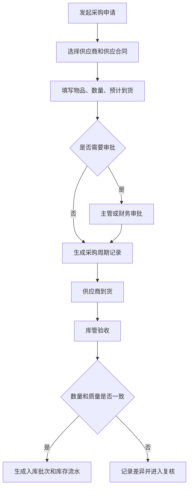
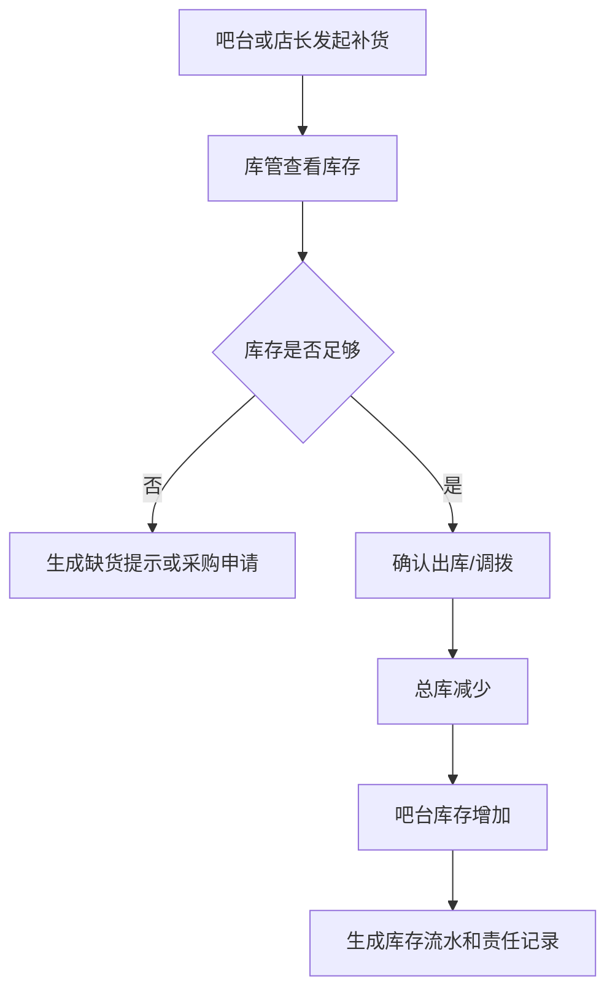
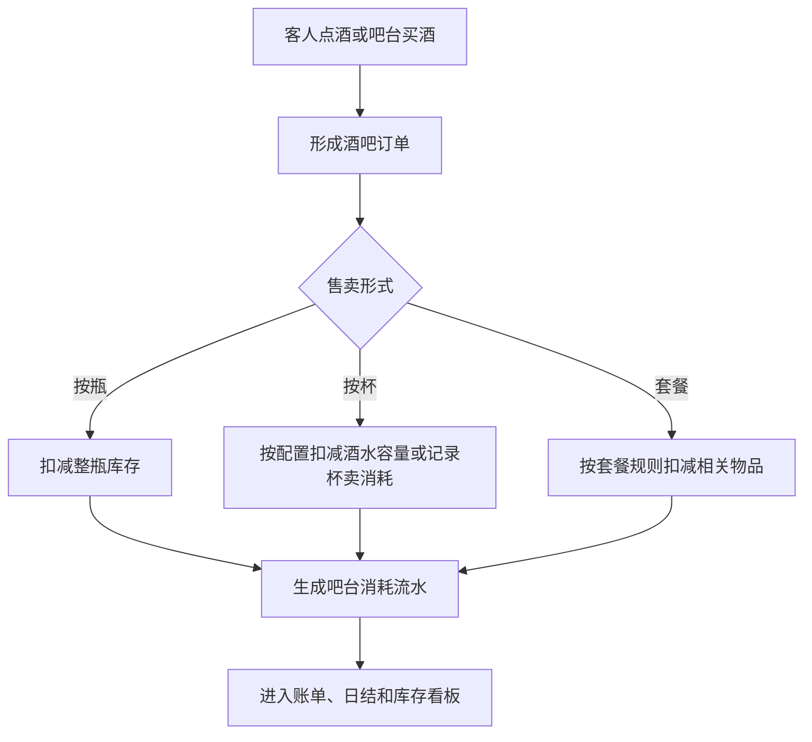
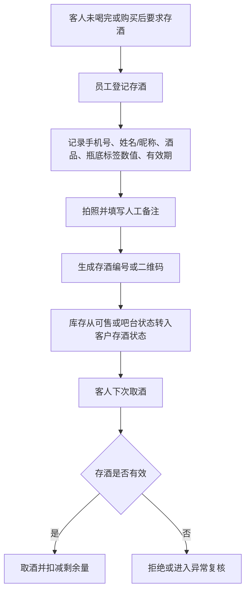
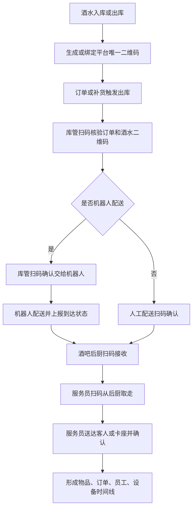

# 供应链与库存管理产品 PRD V0.1

> 权限边界：本 PRD 只提供产品细化；三份业务 HTML 拥有最终业务解释权。其他文档、配置、代码和数据结构均不得覆盖 HTML；HTML 未记载的新规则须经用户批准并写入 HTML 后方可生效。

> 2026-07-04 逻辑一致性修订：①§10 盘点差异入账口径与 V108 已落地代码对齐——复核通过（approved）后**立即**由财务生成 ar_ap_items（幂等回填 posted_ar_ap_item_id），并明确"不改写已锁定日结、需影响日结时走冲正"的制约边界②§10 积分兑换库存扣减补齐**预占→领取实扣两段式接口契约**（发券调预留库存并减少可售/可承诺量→生成待领取记录→一体机确认领取调实扣；库存不足回滚），跨票务部分已在同轮同步。

## 1. 文档定位

本文档用于补齐综合体管理系统中的供应链、采购、库房、酒水库存、消耗品库存、其他物品库存和客人存酒管理。

它不是完整 ERP 或完整 WMS 的替代方案。P0 的目标是先把综合体经营中“谁供货、按什么合同供货、什么时候采购、进了哪个库、从哪里出库、被谁消耗、还剩多少、差异怎么处理”记录清楚，保证酒吧经营、吧台售卖、权益兑换、财务对账和异常追责有依据。

## 2. P0 目标

供应链与库存管理 P0 必须支持：

- 管理供应商档案、联系人、资质、结算方式和状态。
- 管理供应合同，包括平台自用供应合同、商户自采供应合同、平台统一采购后分销给商户三种模式，以及合同摘要、供货范围、价格口径、账期、有效期和审批状态。
- 管理采购周期，包括常规采购、临时补货、到货计划和入库确认。
- 管理库房，包括总库、酒吧库、吧台库存、消耗品库、存酒区等。
- P0 管理物品先覆盖酒类、吧台消耗、客人存酒和常用消耗品，例如纸巾、色盅、色子、杯子、杯具等；其他低频物品后续扩展。
- 记录入库、出库、调拨、盘点、报损、报溢和库存调整。
- 记录吧台酒水售卖导致的库存消耗；按杯销售按后台配置的每杯标准出酒量/容量扣减，超过标准容量的部分记为损耗。
- 管理客人存酒，包括存酒登记、取酒、剩余量、有效期、作废和异常处理。
- 将高价值酒水、异常报损、盘点差异和存酒作废纳入复核和留痕。
- 为酒水、礼品、高价值物料和需追责耗材生成或绑定平台唯一二维码，支持入库贴码或出库打印码。
- 记录酒水从库房出库、订单核验、机器人或人工配送、酒吧后厨接收、服务员送达客人的全链路交接留痕。
- **进货查验记录（C9 合规，P0）：** 酒类/食品入库时登记并绑定供货方资质（经营许可/食品经营许可）、票据（进货发票/送货单）、批次/合格证明（检验合格证、检疫证明），与入库批次可溯源关联，满足《食品安全法》进货查验义务。
   > 修订说明（2026-06-07）：依据 finding C9 与《合规要求 §10》。原 P0 入库只做到货验收与批次，未形成法定进货查验记录，溯源与持证经营合规不足以编码落地。此处增进货查验记录目标，并在配套开发设计落 `purchase_inspections` 表绑定 `stock_batches`。

## 3. 业务边界

| 范围 | P0 是否负责 | 说明 |
|---|---|---|
| 供应商档案 | 是 | 记录供货主体、联系人、资质、状态 |
| 供应合同 | 是 | 记录平台自用、商户自采、平台统一采购分销三种模式，以及供应合同核心摘要和供货准入 |
| 采购计划与采购周期 | 是 | 记录采购申请、计划到货、实际到货和周期 |
| 库房台账 | 是 | 管总库、吧台库、存酒区、消耗品区 |
| 酒类库存 | 是 | 管瓶装、杯卖、套餐消耗和高价值酒水 |
| 消耗品库存 | 是 | 管杯具、纸巾、冰块、果料、包装等 |
| 其他物品库存 | 是 | 管礼品、设备耗材、运营物料 |
| 吧台售卖消耗 | 是 | 按杯、按瓶、按套餐或其他形式记录消耗 |
| 客人存酒 | 是 | 存酒是客户资产，不等同于可售库存 |
| 自动补货预测 | 否 | P1/P2 再做 |
| 复杂 BOM 成本核算 | 否 | P1/P2 再做 |
| 供应商评分和招采比价 | 否 | P1/P2 再做 |

## 4. 角色

| 角色 | 关注重点 |
|---|---|
| 采购人员 | 供应商、采购申请、采购周期、到货 |
| 库管 | 入库、出库、调拨、盘点、报损、库位 |
| 酒吧店长 | 酒水库存、吧台补货、存酒异常、高价值酒审批 |
| 吧台员工 | 吧台库存、按杯/按瓶售卖、出品消耗、取存酒 |
| 财务 | 采购成本、库存差异、报损、供应合同、结算依据 |
| 运营主管 | 缺货预警、盘点差异、异常报损和责任追溯 |

## 5. 核心对象

| 对象 | 定义 | 关键关系 |
|---|---|---|
| 供应商 | 提供酒水、耗材、礼品或其他物品的主体 | 关联供应合同、采购单、入库批次 |
| 供应合同 | 与供应商之间的采购和结算依据 | 区分平台自用、商户自采、平台统一采购分销，关联供货范围、价格口径、账期、有效期 |
| 采购申请 | 由库管、店长或运营发起的补货需求 | 关联物品、数量、预计到货、审批 |
| 采购周期 | 从申请、审批、下单、到货、入库到结算的周期记录 | 关联供应商、合同、采购单、入库 |
| 库房 | 存放物品的管理空间 | 总库、酒吧库、吧台库存、消耗品库、存酒区 |
| 库位 | 库房内具体存放位置 | 关联物品批次和盘点 |
| 物品 | 可被采购、存放、售卖、消耗或兑换的东西 | 酒类、消耗品、礼品、其他物品 |
| 库存批次 | 某次入库形成的库存批次 | 关联供应商、采购单、成本、保质期 |
| 库存流水 | 所有库存变化的记录 | 入库、出库、调拨、销售消耗、报损、报溢（盘盈/异常增加）、盘点调整、积分兑换消耗、礼物领取消耗 |
| 物品追踪码 | 平台为单瓶酒、单件物品或出库批次生成的唯一二维码 | 关联入库批次、库房、当前责任人、订单、机器人任务和时间线 |
| 操作交接记录 | 物品在库管、机器人、后厨、服务员、客人之间流转的记录 | 通过扫码、设备事件、照片、视频或签名形成责任链 |
| 跨主体流转单（借 / 调） | 货物在经营主体之间的流转记录：「借」只转移保管责任、「调」是买断转移所有权 | 关联所有权主体、当前保管主体、借出主体、借入主体、应归还数量与期限、内部结算价、溯源码与三类扫码时间（见 §7.6） |
| 吧台消耗 | 吧台售卖或出品导致的库存扣减 | 关联酒吧订单、账单、出品员工 |
| 客人存酒 | 客人已购买但未喝完、暂存在场内的酒 | 关联手机号、姓名/昵称、酒品、瓶底标签数值、照片、人工备注、有效期、二维码 |
| 存酒流水 | 存酒登记、取酒、**转让**、**转存（延期）**、作废等变化 | 关联客人、员工、点位、证据 |

> **术语更正（2026-08-04 F5）：存酒的换人动作叫「转让」，不叫「转赠」**（依据 BSM L1102「客人存酒」、BSM L1075、ENUM L92「客人存酒有效期与转存」）。
> - **转让 ≠ 转存**，二者是**两个独立动作**：**转让＝换人**（变更权益人），**转存＝延期**（顺延到期日）。
> - **转让不消耗转存次数、不改变到期日**；受让人**继承剩余有效期与已用转存次数**。
> - 转让由**出让人短信验证码**确认，验证成功即生效，受让人**不需另行确认领取**，**不设「等待领取」或「领取前冻结」状态**，一经生效原客户不得单方撤回；只能在有效期内办理，有效期内不限转让次数。
> - **单个存酒标签对应的酒瓶是最小转让单位**，同一酒瓶的剩余酒量不得拆分给多个客户。
> - 存酒流水必须把「转让」与「转存」记成两类不同流水，不得合并为一类，也不得沿用「转赠」字样。

### 5.1 库存流水类型机读枚举（中文 ↔ code 映射，2026-08-04 F5 补）

> 依据 ENUM L113「库存流水类型：入库、出库、调拨、销售消耗、报损、报溢、盘点调整、积分兑换消耗、礼物领取消耗」。HTML 只给中文词表，本表补机读 code 以便接口与数据模型引用；**code 以配套开发设计 `supply-chain-inventory-development-design-v0.1.md` §6.13 的代码白名单为准，本表不新增业务类型**。

| ENUM L113 中文 | code | 方向 | 说明 |
|---|---|---|---|
| 入库 | `inbound` | 增 | 采购到货入库 |
| 出库 | `outbound` | 减 | 出库到使用点 |
| 调拨 | `transfer_out` / `transfer_in` | 减 / 增 | 一次调拨成对落两条（来源侧、目标侧） |
| 销售消耗 | `consume` | 减 | 正常售卖/出品扣减 |
| 报损 | `damage` / `loss` / `waste` | 减 | 三个 code 同归 ENUM「报损」一词：破损 `damage`、丢失 `loss`、过期废弃 `waste` |
| 报溢 | `gain` | 增 | 盘盈 / 异常增加 |
| 盘点调整 | `count_correction` | 增或减 | 盘点差异纠账 |
| 积分兑换消耗 | `redeem_consume` | 减 | 扣礼品库（§10 已确认第 3 条） |
| 礼物领取消耗 | `gift_claim_consume` | 减 | 扣礼品库（§10 已确认第 3 条） |

**ENUM L113 未列、业务上已在别处成立、当前无对应 code 的四类（待改造缺口，不得默认已实现）**：

| 业务动作 | 出处 | 现状 |
|---|---|---|
| **回库** | 退品回库、存酒到期转为所在酒吧自有库存资产（BSM L1008） | 无独立 code，只能混记为 `inbound`/`gain`，与采购入库、盘盈无法区分 |
| **借出** | §7.6 跨主体流转「借」 | 无 code；借只转保管责任、**不转所有权**，用 `transfer_out` 记会错误地转移库存归属 |
| **归还** | §7.6 借出物归还 | 无 code；同上，反向也无法表达 |
| **冲正** | 流水 `status=reversed`（开发设计 §4.5） | 冲正不是独立 `movement_type`，只能按相反方向的调整类型落账 |

> **实现缺口（E-26，如实登记）**：`inventory_stock_movements` 带 DB 约束 `chk_inventory_stock_movements_quantity CHECK (quantity > 0)`（迁移 V012），**数量恒为正**，方向只能由 `movement_type` 隐含表达。由此产生两条硬约束：①任何「负向流水」（冲正、盘亏、借出后的归还反向）**不能写成负数量**，必须落成相反方向的类型；②上述四类动作在补齐 code 之前**不得先行落库**，否则方向语义丢失、余额重建对不平。补齐这四类 code 时须同时评估：`stock_movements.movement_type` 列本身**无 DB CHECK**（取值正确性靠服务白名单保证）、「余额由流水逐位重建」的守恒口径、以及存量流水是否需要回填分类。**本条只登记缺口，不得据现实现反向定义业务规则，也不得据本条认为已实现。**

## 6. P0 页面清单

| 页面 | P0 内容 |
|---|---|
| 供应链总览 | 缺货、待入库、待调拨、盘点差异、存酒到期、高价值异常 |
| 供应商管理 | 供应商档案、联系人、资质、状态 |

> **联系人手机号 PII 加密（P0-A / ★GAP-07 / SEC-04，迁移 V339，2026-07-27）**：`inventory_suppliers.contact_phone` 落库为 AES-GCM 信封密文（`enc:v1:`），仓库层写时加密、读时解密，业务层拿到的仍是明文；数据库 `CHECK` 约束（`NOT VALID`）卡死任何明文新写入，仓库以外的手写 SQL / 批量导入绕不过；存量明文由启动期 `MultiPartyContactPhonePiiBackfill` 幂等回填就地加密（三层防二次加密）。读端按权限脱敏：持 `pii.contact_phone.view`（高危，默认仅平台管理员）才见明文，其余见掩码（前 3 后 4）。本域无按手机号的后端检索路径，加密不影响任何既有查询，也未建盲索引。统一口径见 `compliance-and-personal-information-protection-requirements-v0.1.md` §6.1。

| 供应合同管理 | 平台自用、商户自采、平台统一采购分销、合同摘要、供货范围、价格口径、账期、有效期、审批状态 |
| 采购周期管理 | 采购申请、审批、下单、到货计划、实际入库 |
| 库房管理 | 总库、吧台库、消耗品库、存酒区、库位 |
| 物品管理 | 酒类、消耗品、礼品、其他物品、单位、成本口径 |
| 入库管理 | 到货验收、批次、数量、成本、保质期、进货查验记录（供货方资质、票据、批次/合格证明绑入库批次） |
| 出库/调拨 | 总库到吧台、库房到点位、消耗品领用 |
| 物品追踪码 | 入库贴码、出库打印码、码状态、当前库位、当前责任人 |
| 交接留痕 | 出库核验、机器人取货、后厨接收、服务员取走、送达确认、异常 |
| 库存余额 | 按库房、物品、批次、状态查看库存 |
| 吧台消耗 | 按杯、按瓶、按套餐售卖后的消耗记录 |
| 盘点与差异 | 账面数、实盘数、差异、原因、复核 |
| 报损/报溢 | 损耗、过期、破损、异常增加、审批和证据 |
| 客人存酒 | 瓶底标签、标签数值、手机号、姓名/昵称、拍照、备注、取酒、有效期、作废、异常 |

## 7. 关键流程

### 7.1 采购到入库

### 7.2 库房到吧台补货

### 7.3 吧台售卖和消耗

### 7.4 客人存酒

### 7.5 酒水出库到客人全链路留痕

关键要求：

- 出库核验必须同时核验订单和物品二维码。
- 机器人取货、送达后厨属于被动留痕，员工扫码交接属于主动留痕。
- 后厨接收人、服务员取走人、送达人都必须记录。
- 错货、漏货、破损、超时、拒收、数量不一致进入异常复核。

### 7.6 跨主体流转（借与调）（2026-08-04 新增，依据 BSM L1104「跨主体流转」、BSM L1556「跨主体流转结算」、ENUM L115「跨主体借调」；2026-08-04 F5 锚点更正：原记 BSM L1100 区、ENUM L114，二者实为「高价值物品／高价值判定」条）

货物可以在**经营主体之间**流转，分两条路径：

- **平台级供货主体（如酒水公司、中央餐饮）向商户送货 = 调拨**，商户按**货款**与供货主体结算。
- **商户之间可以借调货物**。

#### 7.6.1 结算价铁律

**跨商户之间的结算一律按内部结算价，不得另行约定低于内部结算价的价格。**

#### 7.6.2 「借」与「调」的区别（不可混用）

| | 转移什么 | 所有权 | 结算 |
|---|---|---|---|
| **借** | **只转移保管责任** | **不转移**——借出方始终是这批货的所有权人，借入方只承担临时保管与使用责任（**仅对不可消费物品成立**，可消费物品见 §7.6.3） | 见 7.6.3 分可消费/不可消费 |
| **调** | **买断** | **成交时所有权转移给接收方** | 按内部结算价成交 |

#### 7.6.3 可消费物品 vs 不可消费物品

- **可消费物品（酒水、小食等）**：借用的**实质就是按内部结算价调用**——**交付即按内部结算价出账结算**，不存在「先借着、以后再说」。
  > **显式声明（2026-08-04 F5 补，消除非法态 E-27「钱已结、货权未转」）**：**可消费物品不存在真正的「借」**——凡可消费物品的所谓借用，**一律按「调」（买断）处理**：**交付时刻所有权即转移给接收方**，与按内部结算价出账**同一时刻发生**，二者不得分离。
  > - **禁止**生成「可消费物品的借用单」并把**所有权仍挂在借出方**——那会形成「钱已按内部结算价结了、货权还没转」的非法中间态，溯源码上的所有权主体与应收应付台账互相打架。
  > - **禁止**为可消费物品设置归还时间、应归还数量或超期归还工单；这些只适用于不可消费物品。
  > - 溯源码上的**所有权主体在交付扫码时即改写为接收方**，`借出主体/借入主体`字段对可消费物品不再有后续含义（保留为流转来源留痕）。
  > - **验收**：可消费物品的跨主体流转单只能是「调」；提交「借」类型时拒绝并给出中文报错；出账记录生成后查询溯源码，所有权主体必须已是接收方，不存在「已出账且所有权仍在借出方」的记录。
- **不可消费物品（设备、器具等）**：
  - **必须约定归还时间**；
  - **借用期间保管人变更为借入方，并在溯源码上登记**；
  - **超过约定归还时间仍未归还的，系统自动生成一张工单并通知借出方主管**，按与其他工单相同的**超时升级路径**继续催办，直到归还或双方另行处理为止；
  - **不强制借入方买断，所有权仍在借出方**。

#### 7.6.4 溯源码记录内容与三个时间

溯源码**同时记录**：**所有权主体**、**当前保管主体**、**借出主体**、**借入主体**、**应归还数量与期限**，并记录**三个时间**：

| 时间 | 取值来源 | 条数 |
|---|---|---|
| 借出时间 | **借出方交货扫码**的时刻 | 一条 |
| 保管人变更时间 | **每一次交接扫码**的时刻 | **交接几次就记几条，全部保留** |
| 实际归还时间 | **借出方收货扫码**的时刻 | 一条 |

**这三个时间全部由已有的扫码动作自动生成，不设手工填写。**

#### 7.6.5 扫码纪律与买断

- 酒水与可追责物品的交接，**每一步都必须扫码**（库管出库 → 后厨接收 → 服务员取走 → 送达客人或卡座）；**缺任何一步即视为该环节工作未完成，不得进入下一环节，也不存在事后补录**。
- **买断时溯源码归属从原主体变更到接收主体**；**收货时扫码核对，防调包**。

#### 7.6.6 验收

- 跨商户流转单据的结算价**只能取内部结算价**，低于内部结算价的价格**拒绝保存**。
- 「借」的单据**不改变溯源码上的所有权主体**，只改**当前保管主体**；「调」的单据在成交时**改写所有权主体**。
- 可消费物品的借用**在交付时即生成按内部结算价的出账结算**，不允许挂空；**且同一时刻溯源码所有权主体改写为接收方**（可消费物品一律按「调」处理，见 §7.6.3），不存在「已出账、所有权仍在借出方」的记录。
- 不可消费物品的借用**无归还时间即拒绝提交**；超期未归还**自动生成工单**并通知借出方主管，走通用超时升级路径。
- 溯源码可查到所有权/当前保管/借出/借入四个主体、应归还数量与期限，以及借出、每次交接（多条）、实际归还三类时间；**三类时间不存在手工录入入口**。
- 任一环节缺扫码时，**下一环节被拒绝**；系统不提供事后补录该扫码的入口。

## 8. 与其他系统关系

| 连接对象 | 连接内容 | 业务意义 |
|---|---|---|
| 平台治理 | 综合体、商户、合同、空间、员工、权限 | 确定谁能采购、谁能入库、谁能审批、在哪个库房操作 |
| 酒吧经营 | 点酒订单、吧台买酒、赠饮核销、账单 | 酒水销售和出品必须影响库存或消耗台账 |
| 票务权益 | 赠饮、积分兑换礼物、权益领取 | 赠饮或礼物领取后要形成库存消耗或领取记录，积分兑换礼物必须扣减库存 |
| 触摸屏一体机 | 吧台买酒、权益领取、兑换礼物 | 自助下单或领取要回写库存/消耗 |
| 财务经营 | 采购成本、报损、盘点差异、供应合同 | 财务对账和成本判断需要库存依据 |
| 证据风控 | 高价值酒水、报损、盘亏、存酒作废 | 异常动作必须复核和留证 |
| 数据分析 | 库存周转、损耗、缺货、存酒余额 | 管理层判断采购和经营效率 |

## 9. P0/P1/P2

| 阶段 | 能力 |
|---|---|
| P0 | 供应商、三类供应合同、采购周期、库房、物品、入库、出库、调拨、库存余额、物品追踪码、扫码交接留痕、吧台消耗、盘点差异、报损、客人存酒、积分兑换库存扣减 |
| P1 | 安全库存、自动缺货提醒、保质期预警、复杂杯卖扣减、供应商对账、机器人真实状态联动、摄像头自动关联 |
| P2 | 自动补货预测、供应商评分、招采比价、复杂 BOM 成本核算、库存智能风控、无感交接辅助校验 |

## 10. 已确认规则和后续细化事项

已确认：

1. 供应合同分平台自用供应合同、商户自采供应合同、平台统一采购后分销给商户三种模式。
2. 客人存酒使用瓶底标签，按标签显示数值记录，登记时必须拍照、填写人工备注，并留取手机号和姓名/昵称。
3. 积分兑换礼物必须扣减库存。**兑换→扣减→领取确认两段式接口契约（pass-2；2026-07-04 逻辑一致性修订，明确预占/实扣两段）：**

   - **第一段·发券=预留库存（预占）：** 积分域确认兑换并发券时，调用供应链**"预留库存"接口**对**礼品库**做预占；预占不减少在手/会计库存，但必须减少可售量或可承诺量，防止同一库存被重复销售或兑换。成功后生成**待领取记录**（pending 领取态）。**可用库存不足时预留失败→拒绝发券**（返回库存不足错误，不扣积分、不生成虚拟券和待领取记录）。
   - **第二段·一体机/前台领取确认=实扣：** 客人在一体机/前台**领取确认**时调用**"实扣库存"接口**，由预占转实扣（冻结的预留量转为实际出库消耗），完成后待领取记录转已领取。
   - **回滚：** 预留后若兑换订单取消/超时未领取，须调用回滚接口释放预占；实扣阶段任一步失败整体回滚，不留悬空预占。
   - **库存流水类型：** 用独立的"积分兑换消耗"（redeem_consume）与"礼物领取消耗"（gift_claim_consume）两类取值（区别于售卖消耗 consume）。预留/实扣/回滚接口均须带幂等键，避免重复扣减。
   - **跨域口径（本轮已同步）：** 上游发券（预留）与一体机/前台核销或领取确认（实扣）由积分与虚拟券域触发，本 PRD 只定义供应链侧预留/实扣/回滚契约；`ticketing-entitlement-checkin-product-prd-v0.1.md` 只承接消费、履约、退款、核销等票务事实，积分状态与发券规则以 `points-and-voucher-product-prd-v1.0.md` 为准。
   > 修订说明（2026-06-07）：依据 finding pass-2。原文只声明"必须扣减库存"，未定义流水类型、扣减库房、库存不足拒绝与领取确认回写时序，上游要扣库存却无可编码的触发链路。此处补全时序与拒绝规则，并在配套开发设计 §6 库存流水 `movement_type` 落 `redeem_consume`/`gift_claim_consume` 枚举、§5 落兑换扣减时序流程。
4. 供应链 P0 从酒类、吧台消耗、客人存酒和常用消耗品开始，常用消耗品包括纸巾、色盅、色子、杯子、杯具等。
5. 吧台按杯销售按标准出酒量/容量扣减库存，超出部分记为损耗，损耗严重时进入异常核查。
6. 高价值酒水报损、盘点差异、存酒作废必须**同时拍照和视频**（双证据，非二选一），并主管复核。
   > 修订说明（2026-06-07）：原文为"拍照/视频"，斜杠写法易被理解为"二选一"。依据 finding supply-3（用户口径为"拍照和视频"双证据）去斜杠，明确为双证据同时留存。高价值判定口径见本节已确认第 9 条（原待确认"高价值阈值"已转为已确认）。

   **6.1 报损情形封闭（2026-08-04 F5 补，依据 ENUM L114「高价值判定」、BSM L1100「高价值物品」）**

   - **报损仅限两种情形**，此外一律不得以「报损」入账：
     1. **物品长时间存放过期**；
     2. **碰落等造成的损坏**。
   - **两种情形均须留存视频与照片**（与本条第 6 项双证据同一要求，不因金额高低豁免）。
   - **报损物品须经该店（该酒吧）对应的财务业务伙伴确认后，方可废弃**——**先确认、后废弃**，不得先扔后补单。
   - **经查明属人员造成的损坏，由相关人员照内部结算价赔偿**（不按售价、不按进货价）。
   - **验收**：报损单的情形字段只有上述两个可选值，无「其他」；缺照片或缺视频不得提交；未经财务业务伙伴确认的报损单不得进入「已废弃」；判定为人员责任的报损自动带出按**内部结算价**计算的赔偿金额。

   **6.2 仓库管控与录像留存（2026-08-04 F5 补，依据 ENUM L114、BSM L1100）**

   - **正常情况下不应出现盘点亏损**：**仓库全程摄像**，**取货由机械手臂完成**，**人员一般不进入仓库**。
   - **人员确需进入仓库的**：**一律必须携带摄像设备**；**进入之前须先检查该摄像设备是否完好**（设备不完好即不得进入）。
   - **进入期间的摄像内容事后须进行人工智能分析**。
   - **录像与分析结果长期保存**——**业务参数，按项目可配，出厂默认至少五年，须同时配置下限**（低于下限的配置值拒绝保存）。
   - **经分析发现异常的**：**属盗窃的予以开除**；**属造成损坏的照内部结算价赔偿**。
   - **验收**：未登记「携带摄像设备 + 进入前设备完好检查」的入库房记录不得放行；每次人员进入均生成一条待 AI 分析任务，分析结果与录像绑定保存并可查；录像保存期限配置低于下限时拒绝保存并给出中文报错；盘点亏损单必须能关联到该期间的进入记录与分析结论（无关联的须说明原因并主管复核）。

   > **实现现状（如实标注，待改造缺口）**：本条 6.1／6.2 的「报损两种情形封闭」「财务业务伙伴确认后废弃」「人员进入仓库的携带与检查登记」「录像 AI 分析与≥5 年保存的配置及下限」在当前实现中均无对应字段与流程，属**待改造缺口**；改造前不得据现实现认为已满足，也不得据现实现反向定义业务规则。
7. 酒水、礼品、高价值物料和需追责耗材必须有平台唯一二维码，可在入库时贴码，也可在出库时打印码。
8. 酒水从库房出库到客人收取的全过程必须留痕，出库核验人、机器人或配送人、后厨接收人、服务员送达人都必须可追溯。
9. **高价值判定口径（2026-08-04 修订，依据 ENUM L114「高价值判定」、BSM L1100「高价值物品」；取代 2026-07-28 的「与移动加权当前平均进货价比较」写法；2026-08-04 F5 锚点更正：原记 ENUM L113，L113 实为「库存流水类型」）：**

   - **判定基准 = 该物品「最近一次实际到货价」**，与后台配置的**固定金额阈值**比较：**最近一次实际到货价高于阈值即为高价值**。
   - **明确不使用滚动变化的「当前平均进货价」作为判定基准**——移动加权平均价随每次进货变动，用它判定会让同一件物品今天是高价值、明天不是，判定结果不稳定、可被进货节奏操纵。
   - **阈值口径**：全平台**一个固定金额阈值**（`high_value_thresholds`，单位：分；**出厂默认值待定**）；属**安全阈值**——**全平台统一可配，调整须最高权限审批并留痕，须同时配置上下限**。**按物料各设一个阈值的做法已删除**。（2026-08-04 Step4 复审 R-4 标注）DB 种子值 `hvt_default`=500000 分（5000 元）为**实现现状**，**HTML（ENUM L114）未授权任何出厂默认值**——ENUM L114 只写「与后台配置的固定金额阈值比较」「全平台统一可配，调整须最高权限审批并留痕，须同时配置上下限」，通篇无「出厂默认」字样；正式默认值待用户裁决并写入 HTML（见主台账 UD-18）。在授权前，**「阈值未配置一律按高价值拦下走审批、不得静默放行」分支仍然有效**（种子值可被删除或置空，读取侧返回 null 即走从严一侧），不得据种子值声称默认值已获授权。
   - **两个场景分开、不得互相顶替**：

   | 场景 | 用哪个价 | 用途 |
   |---|---|---|
   | **高价值判定** | **最近一次实际到货价** | 与固定金额阈值比较，决定是否走双证据 + 主管复核 |
   | **成本核算** | **平均进货价（移动加权，`inventory_item_cost_state.avg_unit_cost_cent`）** | 商户领用/出库计成本、商品成本、经营净利润的成本扣减依据 |

   - **手工标记**：物品档案保留手工标记 `manual_high_value`（标了就恒为高价值，不看到货价）。**手工标记由「库房主管以上岗位」执行；标记与取消标记都必须填写理由并留痕；一线库管无此权限。**
   - **判定命中的后果**：报损、盘点差异、存酒作废、退酒判定为高价值时**自动触发双证据（照片和视频，且附件必须真实存在）+ 主管复核**。
   - **不得静默放行**：**阈值未配置、或该物品最近一次实际到货价未知，一律按高价值拦下走审批**（改造前「物料没录阈值就直接放行」正是绕过复核的后门）。

   > **实现现状（如实标注，待改造缺口）**：现实现取 `inventory_item_cost_state.avg_unit_cost_cent`（移动加权**当前平均进货价**）与阈值比较，与本条「最近一次实际到货价」基准冲突，属**待改造缺口**；改造完成前不得据实现反向定义业务规则。`manual_high_value` 的**岗位限制（库房主管以上）与理由留痕**同样属待补齐项。
   > 修订说明（2026-06-07）：依据 finding supply-4。原"高价值"只停留在待决问题，既无阈值配置项也无物品标记字段，"报损/作废自动判定高价值并强制双证据复核"无法编码。此处明确阈值配置项与物品标记字段的落地口径，并在配套开发设计 §6 物品/物品档案表落字段、§5 报损/作废/盘点流程落自动触发。

后续细化：

无方向性悬空事项。已确认按以下口径执行：

1. 盘点差异 P0 单独形成库存差异批次，并进入证据留痕和主管复核。**复核通过（review_status=approved）后立即入账**——由财务生成 `ar_ap_items(source_type='inventory_difference')` 并幂等回填 `inventory_variance.posted_ar_ap_item_id`（同一差异行只入账一次），科目方向按 reason（供应商责任 supplier_fault / 盘盈 overage → 应付 payable；报损 damage / 盘亏 shortage → 内部核算 internal_accounting，不并入对外应收应付净额）。**日结制约边界**：财务日结只展示差异摘要和潜在金额影响，入账**不自动改写已锁定日结**；差异发生在已锁定日结期、需影响日结金额时按财务冲正口径处理（走调整/冲正而非直接改写锁定数据）。

   > 文档goal修正(2026-06-20)：原文口径为"确需影响金额时才走调整/冲正审批后进入应收应付或财务调整台账"（即库存差异入账被表述为远期/确需才做）。审计发现与已落地代码相反——**V108 已落地为 P0**：迁移 `V108__inventory_variance_to_ap.sql` 已建 `stocktake`（盘点单）+ `inventory_variance`（库存差异明细，含 review_status pending/approved/rejected 与 posted_ar_ap_item_id 幂等防重），复核通过后由 finance 服务生成 `ar_ap_items(source_type='inventory_difference')`（服务层 SOURCE_TYPES 已加该枚举），并 seed `finance.inventory_variance.post`（high 风险、requires_approval）权限。故口径改为"V108 已落地 P0"。
   >
   > **新增验收（G/W/T）**：Given 高价值报损/盘点差异经主管复核通过（review_status=approved）/ When 执行入账（finance.inventory_variance.post）/ Then 生成 `ar_ap_items(source_type='inventory_difference')`，并回填 `inventory_variance.posted_ar_ap_item_id`（幂等，同一差异行只入账一次）。

## 11. 本版结论

供应链与库存管理必须作为综合体管理系统的独立业务能力存在。酒吧系统负责“客人怎么点酒、怎么付钱、怎么形成账单”，供应链系统负责“酒水和物品从哪里来、在哪个库、经过谁、怎么交接、怎么消耗、剩多少、差异谁负责”。P0 先做基础台账、平台唯一二维码和关键留痕，P1/P2 再深化自动补货、成本核算和智能风控。

本 PRD 的可编码落地（供应商表、三种供应合同模式表、采购周期、库房、库存批次、库存流水、进货查验、高价值判定字段等）见配套开发设计文档 `supply-chain-inventory-development-design-v0.1.md`。

## 12. 变更日志

| 日期 | 类型 | 位置 | 内容 | 原因/依据 |
|---|---|---|---|---|
| 2026-06-07 | 改 | §2 P0 目标 | 增"进货查验记录"目标（供货方资质/票据/批次合格证明绑入库批次） | finding C9、《合规要求 §10》：原入库无法定进货查验台账，溯源与持证经营合规不足 |
| 2026-06-07 | 改 | §5 核心对象·库存流水 | 流水类型补"报溢/积分兑换消耗/礼物领取消耗" | finding pass-2、supply-5：枚举缺兑换消耗与报溢类型 |
| 2026-06-07 | 改 | §6 页面清单·入库管理 | 增"进货查验记录"页面内容 | finding C9 |
| 2026-06-07 | 改 | §10 已确认第 3 条 | 补积分兑换→扣减礼品库→领取确认时序与库存不足拒绝、独立流水类型、幂等 | finding pass-2：原只声明"必须扣库存"，无可编码触发链路 |
| 2026-06-07 | 改 | §10 已确认第 6 条 | "拍照/视频"改为"同时拍照和视频（双证据）"去斜杠 | finding supply-3：斜杠写法易解为二选一，违背用户双证据口径 |
| 2026-07-28 | 改 | §10 已确认第 9 条 | 高价值判定归一为「物品进货价 vs 全平台一个固定金额阈值，或手工标记」；删除按物料阈值；阈值/进货价缺失一律按高价值拦下不静默放行 | 用户 2026-07-28 拍板；业务HTML「高价值物品」定稿口径；V350 |
| 2026-06-07 | 增 | §10 已确认第 9 条 | 高价值判定从待确认转已确认：平台默认金额阈值 + 物品档案 is_high_value/high_value_threshold，自动触发双证据+复核 | finding supply-4：原高价值无阈值配置与物品标记字段，规则无法编码 |
| 2026-06-07 | 改 | §10 待确认 | 删除原"高价值阈值"待确认项（已转已确认第 9 条） | finding supply-4 |
| 2026-06-07 | 增 | §11 结论后 | 指向配套开发设计文档 | finding supply-1：本域原"有 PRD 无开发设计" |
| 2026-08-04 PRD 同步 B5 | 改 | §10 已确认第 9 条 | 高价值判定基准改为「该物品最近一次实际到货价」与后台固定金额阈值比较，明确不使用滚动变化的当前平均进货价；平均进货价（移动加权）仅用于成本核算（商品成本/净利润扣减依据），两场景分表列出；阈值明确为安全阈值（全平台统一可配、最高权限审批留痕、须配上下限）；手工标记限库房主管以上岗位、标记与取消均须填理由并留痕、一线库管无此权限；如实标注现实现用 avg_unit_cost_cent 比较为待改造缺口 | ENUM L114「高价值判定」、BSM L1100「高价值物品」（情况 2）（2026-08-04 F5 锚点更正：原记 ENUM L113「库存流水类型」、BSM L1063「管理供应合同」，两处均非高价值条目） |
| 2026-08-04 PRD 同步 B5 | 增 | §5 核心对象 / §7.6 | 新增「跨主体流转（借与调）」：平台供货主体向商户送货＝调拨按货款结算、商户间可借调；跨商户结算一律按内部结算价不得约定更低；借只转保管责任、调为买断转所有权；可消费物品借用＝按内部结算价调用交付即出账、不可消费物品必须约定归还时间且保管人变更登记溯源码、超期自动生成工单通知借出方主管走超时升级、不强制买断；溯源码记录四主体+应归还数量期限+三类时间（借出/每次交接多条/实际归还），均由扫码自动生成不设手工；每步缺扫码即该环节未完成不得进入下一环节、不存在事后补录；买断时溯源码归属变更、收货扫码核对防调包 | BSM L1104「跨主体流转」、BSM L1556「跨主体流转结算」、ENUM L115「跨主体借调」（情况 1）（2026-08-04 F5 锚点更正：原记 BSM L1100 区、ENUM L114，两处实为高价值条目） |
| 2026-08-04 PRD 同步 F5 | 增 | §10 已确认第 6 条（新增 6.1／6.2） | 报损与仓库整块补齐：报损仅限「长时间存放过期」「碰落等造成的损坏」两种情形且均须留存视频与照片、报损物品须经该店财务业务伙伴确认后方可废弃、属人员造成的损坏照内部结算价赔偿；仓库全程摄像+取货由机械手臂完成+人员一般不进入、确需进入必须携带摄像设备且进入前检查设备完好、事后摄像内容须做 AI 分析、录像与分析结果长期保存（业务参数按项目可配、出厂默认至少五年、须同时配置下限）、发现盗窃开除、造成损坏照内部结算价赔偿；附验收与「现实现无对应字段流程」的待改造缺口标注 | ENUM L114「高价值判定」、BSM L1100「高价值物品」（情况 1） |
| 2026-08-04 PRD 同步 F5 | 改 | §5 核心对象·存酒流水 | 「转赠」改「转让」，并补：转让≠转存（换人 vs 延期，两个独立动作）、转让不消耗转存次数不改到期日、受让人继承剩余有效期与已用转存次数、出让人短信验证码确认即生效不设等待领取或领取前冻结、单瓶为最小转让单位不得拆分；存酒流水须把转让与转存记为两类 | BSM L1102「客人存酒」、BSM L1075、ENUM L92「客人存酒有效期与转存」（情况 2） |
| 2026-08-04 PRD 同步 F5 | 增 | §5.1 | 新增库存流水类型机读枚举（ENUM L113 九类中文↔code 映射，code 以开发设计 §6.13 代码白名单为准）；登记 ENUM L113 未列而业务成立的四类（回库/借出/归还/冲正）为待改造缺口；登记实现缺口 E-26——`chk_inventory_stock_movements_quantity CHECK (quantity > 0)`（V012）使数量恒为正、方向只能由 movement_type 隐含，负向流水不得写负数量，四类 code 补齐前不得先行落库 | ENUM L113「库存流水类型」、迁移 V012、开发设计 §6.13（情况 1 + 实现缺口登记） |
| 2026-08-04 PRD 同步 F5 | 改 | §7.6.2 表 / §7.6.3 / §7.6.6 | 显式声明可消费物品不存在真正的「借」——一律按「调」处理，交付时刻所有权即转移且与按内部结算价出账同一时刻发生；禁止生成所有权仍挂借出方的可消费物品借用单（消除非法态 E-27「钱已结、货权未转」）；禁止为可消费物品设归还时间与超期工单；补验收 | BSM L1104「跨主体流转」、ENUM L115「跨主体借调」（情况 2，消除非法中间态） |
| 2026-08-04 PRD 同步 F5 | 改 | §7.6 标题 / §10 已确认第 9 条 / §12 两行 | 锚点全量复核更正：跨主体流转 BSM L1100 区、ENUM L114 → BSM L1104/L1556、ENUM L115；高价值判定 ENUM L113 → ENUM L114；变更日志 BSM L1063 → BSM L1100 | 基线 HTML 实测（ENUM 113/114 互换、BSM 行号偏移） |
