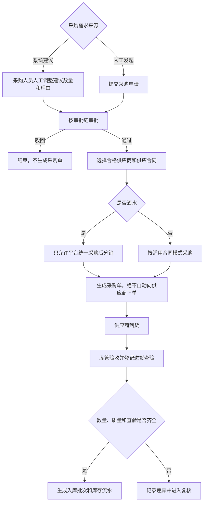
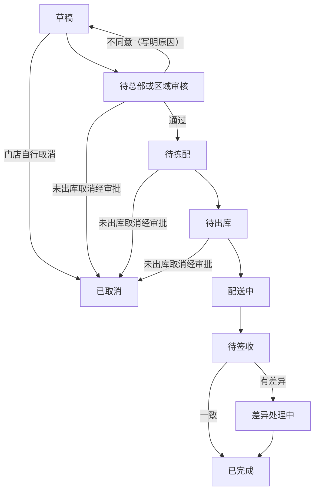
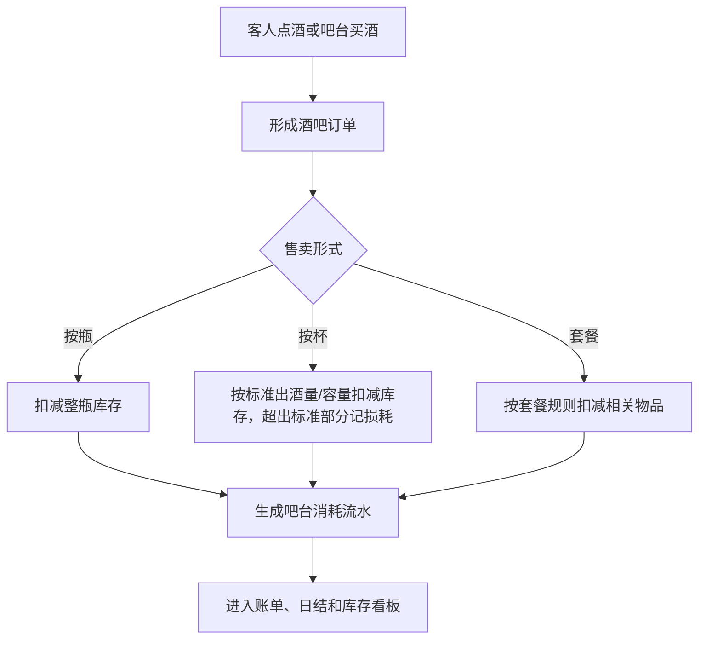
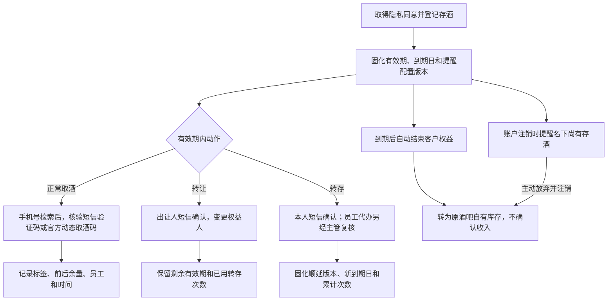
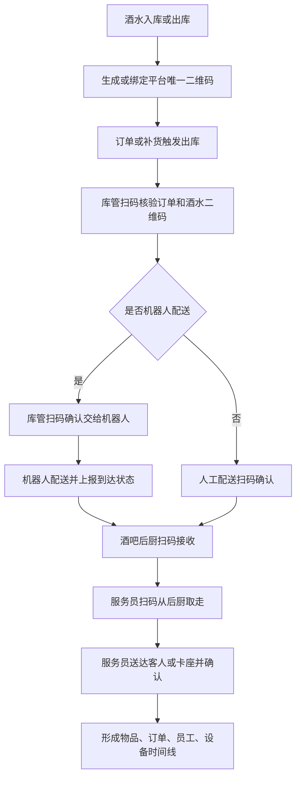

# 供应链与库存管理产品 PRD V0.27

> 版本：V0.27｜最后更新：2026-10-26｜M09 复核：业务目标与当前实现必须分列；代码只作实现事实证据，不得反向定义 HTML 业务规则。

> **锚点口径（2026-09-03 M09 全量复核）**：本文引用三份业务 HTML（BSM＝`business-system-map-for-operations-v0.1.html`／PGM＝`platform-governance-map-for-operations-v0.1.html`／ENUM＝`business-enum-quick-reference-v0.1.html`）时，一律采用**「条目名主锚点 + 冻结行号辅助」**；辅助行号对应冻结提交 `61f4fbb1be2fae9df8fcbb48f1cb2af9bb53ec68`。例如库存流水的主锚点是 BSM「库存流水」与 ENUM「库存流水类型」，不得再用旧快照 L1108 冒充现行锚点。历史变更日志只说明当时动作，不具有现行业务解释权。

> 权限边界：本 PRD 只提供产品细化；三份业务 HTML 拥有最终业务解释权。其他文档、配置、代码和数据结构均不得覆盖 HTML；HTML 未记载的新规则须经用户批准并写入 HTML 后方可生效。

## 1. 文档定位

本文档用于补齐综合体管理系统中的供应链、采购、库房、酒水库存、消耗品库存、其他物品库存和客人存酒管理。

它不是完整 ERP 或完整 WMS 的替代方案。P0 的目标是先把综合体经营中“谁供货、按什么合同供货、什么时候采购、进了哪个库、从哪里出库、被谁消耗、还剩多少、差异怎么处理”记录清楚，保证酒吧经营、吧台售卖、权益兑换、财务对账和异常追责有依据。

## 2. P0 目标

供应链与库存管理 P0 必须支持：

- 管理供应商档案、联系人、资质、结算方式和状态。
- 管理供应合同，包括平台自用供应合同、商户自采供应合同、平台统一采购后分销给商户三种模式，以及合同摘要、供货范围、价格口径、账期、有效期和审批状态。**酒水适用专门规则：一律由平台统一采购后分销给商户，商户不得自行更换供应商，只能对供货价格提出异议。**
- 管理采购周期，包括常规采购、临时补货、审批、到货计划和入库确认；采购申请必须经审批后才可生成采购单，不得自动向供应商下单。收货确认必须录实际到货价、关联供应商，按合格接收数量和锁定合同形成应付；预付款按合同冲抵并保留原付款和冲抵记录，寄售按已确认售出结算，不在入库时挂全部寄售货款应付，不统一以入库日替代合同到期起点。差异数量分别跟进补货、拒收或批准终止，退供关联原采购与付款并调整应付或待退款，进入应收应付台账（BSM「管理采购周期，从采购申请、审批、下单、预计到货」「应收应付台账」）。
  > **实现现状（2026-10-18 FS-008/009/010）**：采购统一转入 `PurchaseWorkflowService`；一申请一商品，必须选择本项目及货权范围内已批准的供应合同。审批锁定条款快照，分次验收记录实到、合格、拒收和真实附件，只有合格数量进入库存。普通采购应付以验收记录为来源，价格和到期起点来自锁定合同；预付实付与非现金冲抵分别记录，寄售必须有独立核实的售出事实。退供完整审批后还须实际交接出库，再由不同于申请人的财务人员复核成本差额、冲减未付或登记供应商应收退款。本批运行验证和页面验收未完成前，不据此声明三项验收通过。
- 管理库房，包括总库、酒吧库、吧台库存、消耗品库、礼品库、存酒区六类。
- P0 管理物品先覆盖酒类、吧台消耗、客人存酒和常用消耗品，例如纸巾、色盅、色子、杯子、杯具等；其他低频物品后续扩展。
- 记录入库、出库、调拨、盘点、报损、报溢和库存调整。
- 记录吧台酒水售卖导致的库存消耗；按杯销售按标准出酒量/容量扣减库存，超出标准部分记损耗。配有采集设备的吧台，实际出酒量必须由设备采集；未配设备的吧台，必须按标准出酒量配酒，也按该标准计算扣减与标准损耗，**不得按零损耗记账**。损耗率（当期损耗量 ÷ 标准出酒量）超过按酒吧配置的安全阈值时转核查工单；出厂默认 5%，须同时配置上下限。
- 管理客人存酒完整生命周期，包括登记、取酒、转让、转存、提醒、到期或账户注销时主动放弃后按到期规则转为原酒吧自有库存、作废、争议和异常处理。
- 报损、盘点差异和存酒作废**不分金额高低**，一律同时提交照片和视频并经主管复核；高价值判定另用于退酒等需分级的动作。
- 为酒水、礼品、高价值物料和需追责耗材生成或绑定平台唯一二维码，支持入库贴码或出库打印码。
- 记录酒水从库房出库、订单核验、机器人或人工配送、酒吧后厨接收、服务员送达客人的全链路交接留痕。
- **进货查验记录（P0）：** 酒类/食品入库时登记并绑定供货方资质、票据、批次合格证明，与入库批次可溯源关联；具体材料类型按适用法律和治理资质主数据确定。
   > 修订说明（2026-09-03）：本条只承接冻结 HTML 的供货方资质、票据和批次合格证明，不自行增加证照清单；配套开发设计以目标 `purchase_inspections` 载体细化批次关联。

### 2.1 已冻结、实施阶段不得由本文臆定的能力

以下能力已写入冻结 HTML，属于必须承接的业务规则；HTML 未指定 P0/P1/P2，本文不得用阶段标签把它们降级，具体实施顺序另由排期决定：

- **智能采购建议：** 根据安全库存、销量和在途量生成建议数量与理由；由采购人员人工调整、按审批链批准后生成采购单，绝不得自动下单。
- **门店要货：** 按草稿、待总部或区域审核、待拣配、待出库、配送中、待签收、差异处理中、已完成、已取消九态流转；每次转换记录操作者和时间。
- **外部经销供应链：** 覆盖经销商准入、独立门户、合同价格目录与询价、受限库存外显、订单审核与付款、中心仓预留、配送签收、取消退款、退货红冲、开票、资金归属、职责分离和停用撤权。当前实现缺口见 §10.1。

## 3. 业务边界

| 范围 | 本模块是否负责 | 说明 |
|---|---|---|
| 供应商档案 | 是 | 记录供货主体、联系人、资质、状态 |
| 供应合同 | 是 | 记录平台自用、商户自采、平台统一采购分销三种模式，以及供应合同核心摘要和供货准入 |
| 采购计划与采购周期 | 是 | 记录采购申请、计划到货、实际到货和周期 |
| 库房台账 | 是 | 管总库、酒吧库、吧台库存、消耗品库、礼品库、存酒区六类 |
| 酒类库存 | 是 | 管瓶装、杯卖、套餐消耗和高价值酒水 |
| 消耗品库存 | 是 | 管杯具、纸巾、冰块、果料、包装等 |
| 其他物品库存 | 是 | 管礼品、设备耗材、运营物料 |
| 吧台售卖消耗 | 是 | 按杯、按瓶、按套餐或其他形式记录消耗 |
| 客人存酒 | 是 | 存酒是客户资产，不等同于可售库存 |
| 智能采购建议与门店要货 | 是 | 冻结 HTML 已确认；实施阶段另排，当前实现缺口见 §10.1 |
| 外部经销供应链 | 是 | 冻结 HTML 已确认；实施阶段另排，当前实现缺口见 §10.1 |
| FIFO、复杂 BOM、供应商评分/比价、高级预测 | 否 | 冻结 HTML 未授权，不构成本 PRD 需求；如需重新引入，须先获批写入 HTML |

## 4. 角色

| 角色 | 关注重点 |
|---|---|
| 采购人员 | 供应商、采购申请、采购周期、到货 |
| 库管 | 入库、出库、调拨、盘点、报损、库位 |
| 酒吧店长 | 酒水库存、吧台补货、存酒异常、高价值酒审批 |
| 吧台员工 | 吧台库存、按杯/按瓶售卖、出品消耗、取存酒 |
| 财务 | 采购成本、库存差异、报损、供应合同、结算依据 |
| 运营主管 | 缺货预警、盘点差异、异常报损和责任追溯 |
| 中央餐饮/平台供货主体 | 维护供货库存、审批内部结算价、收取向商户供货的货款 |
| 经销商业务人员 | 仅通过隔离的经销商门户处理已授权的询价、订单、付款、退货和开票事项 |

敏感价格不得随岗位粗放开放。采购价、成本价、内部结算价和供应链价格的**查看、导出、修改分别授权**；系统自动用价计算不等于操作人取得查看权。敏感经营数据权限授出前须审批，审计人员查看或导出敏感信息也须逐项审批并全程留痕；项目和商户隔离不得关闭。资金类数据的查看权与导出权必须分开，不得默认给同一人双权。

财务/价格治理按项目建立内部结算价页面和独立价格目录，不得跨项目引用。实际提供方提交，由对应域主管公司审批，提交人与审批人分离；中央餐饮供应的酒水或小食由中央餐饮公司内部不同人员提交、审批，其他域公司不得代批。未取得获批内部结算价的商户，不得开通依赖该价格结算的权益或券。价格变更形成新版本且只影响后续业务，核销或结算时锁定当时版本；M09 只消费、引用并锁定获批版本，不承建目录审批（依据 ENUM「项目内部结算价」、BSM「内部结算价管理」、PGM「中央餐饮公司」）。

## 5. 核心对象

| 对象 | 定义 | 关键关系 |
|---|---|---|
| 供应商 | 提供酒水、耗材、礼品或其他物品的主体 | 关联供应合同、采购单、入库批次 |
| 供应合同 | 与供应商之间的采购和结算依据 | 区分平台自用、商户自采、平台统一采购分销，关联供货范围、价格口径、账期、有效期 |
| 采购申请 | 补货需求记录 | 关联物品、数量、预计到货、审批 |
| 采购周期 | 从申请、审批、下单、到货、入库到结算的周期记录 | 关联供应商、合同、采购单、入库 |
| 库房 | 存放物品的管理空间 | 总库、酒吧库、吧台库存、消耗品库、礼品库、存酒区 |
| 库位 | 库房内具体存放位置 | 关联物品批次和盘点 |
| 物品 | 可被采购、存放、售卖、消耗或兑换的东西 | 酒类、消耗品、礼品、其他物品 |
| 商品规格 | 定价、库存、结算和对账的最小单元 | 同一商品不同规格分别计价、计数、预留和对账 |
| 库存批次 | 某次入库形成的库存批次 | 关联供应商、采购单、成本、保质期 |
| 库存流水 | 所有库存变化的记录 | 入库、出库、调拨、销售消耗、报损、报溢、盘点调整、积分兑换消耗、礼物领取消耗、回库、借出、归还，共十二类；BSM「库存流水」与 ENUM「库存流水类型」为权威锚点，详见 §5.1 |
| 物品追踪码 | 平台为单瓶酒、单件物品或出库批次生成的唯一二维码 | 关联入库批次、库房、当前责任人、订单、机器人任务和时间线 |
| 操作交接记录 | 物品在库管、机器人、后厨、服务员、客人之间流转的记录 | 员工主动扫码与机器人或设备被动事件共同形成责任链；缺扫码仅可附照片、录音、录像等证据，经主管复核后补录生效，并与原记录并列、互不覆盖 |
| 跨主体流转单（借 / 调） | 货物在经营主体之间的流转记录：「借」只转移保管责任、「调」是买断转移所有权 | 关联所有权主体、当前保管主体、借出主体、借入主体、应归还数量与期限、内部结算价、溯源码与三类扫码时间（见 §7.6） |
| 吧台消耗 | 吧台售卖或出品导致的库存扣减 | 关联酒吧订单、账单、出品员工 |
| 客人存酒 | 客人已购买但未喝完、暂存在场内的酒 | 关联手机号、姓名/昵称、酒品、瓶底标签数值、照片、人工备注、有效期、二维码 |
| 存酒流水 | 存酒登记、取酒、**转让**、**转存（延期）**、作废等变化 | 关联客人、员工、点位、证据 |
| 门店要货单 | 门店向总部/区域和仓库提出的履约请求 | 关联九态、操作者、时间、拣配、配送、签收和差异 |
| 经销商/价格目录/经销订单/退货单 | 外部经销全链的主体、价格和履约记录 | 账号与商户/供应商隔离；合同价格版本、付款、库存预留、退货红冲与资金主体可追溯 |

> **术语更正（2026-08-04 F5）：存酒的换人动作叫「转让」，不叫「转赠」**（依据 BSM「客人存酒是客户资产、不算可售库存；可转让给他人」条、BSM「管理酒类、吧台消耗、客人存酒和常用消耗品」条、ENUM「客人存酒有效期与转存」条）。
> - **转让 ≠ 转存**，二者是**两个独立动作**：**转让＝换人**（变更权益人），**转存＝延期**（顺延到期日）。
> - **转让不消耗转存次数、不改变到期日**；受让人**继承剩余有效期与已用转存次数**。
> - 转让由**出让人短信验证码**确认，验证成功即生效，受让人**不需另行确认领取**，**不设「等待领取」或「领取前冻结」状态**，一经生效原客户不得单方撤回；只能在有效期内办理，有效期内不限转让次数。
> - **单个存酒标签对应的酒瓶是最小转让单位**，同一酒瓶的剩余酒量不得拆分给多个客户。
> - 存酒流水必须把「转让」与「转存」记成两类不同流水，不得合并为一类，也不得沿用「转赠」字样。

### 5.1 库存流水类型机读枚举（中文 ↔ code 映射，2026-08-04 F5 补；2026-08-05 R7 按 DEC-R7-04 扩为十二类）

> **2026-09-03 M09 更新：** ENUM「库存流水类型」与 BSM「库存流水」均为上述十二类。HTML 只给中文业务类型；下表机读 code 是不增加业务类型的技术细化。当前代码白名单只证明实现现状，不是业务命名权威。

| ENUM「库存流水类型」条中文 | code | 方向 | 说明 |
|---|---|---|---|
| 入库 | `inbound` | 增 | 采购到货入库 |
| 出库 | `outbound` | 减 | 出库到使用点 |
| 调拨 | `transfer_out` / `transfer_in` | 减 / 增 | 一次调拨成对落两条（来源侧、目标侧） |
| 销售消耗 | `consume` | 减 | 正常售卖/出品扣减 |
| 报损 | `damage` / `waste` | 减 | HTML 业务原因仅两类：碰落等损坏、长时间存放过期；当前 Java/OpenAPI 仍把 `loss/damage/waste` 归入 `damage_report` 报损族，这是实现 GAP，不得据此扩成第三种业务报损原因 |
| 报溢 | `gain` | 增 | 盘盈 / 异常增加 |
| 盘点调整 | `count_correction` | 增或减 | 盘点差异纠账 |
| 积分兑换消耗 | `redeem_consume` | 减 | 仅记录发生实物库存扣减的积分兑换；服务履约能力使用独立履约记录，详见 §10 第 3 条 |
| 礼物领取消耗 | `gift_claim_consume` | 减 | 店内实物领取的技术细化；不得把礼品库扩成所有券和服务的唯一履约来源 |
| 回库 | `return_to_stock` | 增 | 客人退品回到库房、客人存酒到期转为酒吧自有库存（DEC-R7-04；与采购入库 `inbound`、盘盈 `gain` 必须分开记，不得混记） |
| 借出 | `lend_out` | 减（保管责任转移，**所有权不转移**） | 跨主体借调中**不可消费物品**交付给借入方（DEC-R7-04；不得用 `transfer_out` 代记，否则会错误地转移库存归属） |
| 归还 | `lend_return` | 增（保管责任回转） | 借入方将借用物品归还借出方（DEC-R7-04；「借出」的反向动作） |

> **code 补齐状态（2026-09-03，GAP-38 文档层）**：上表 code 是对 HTML 十二类中文业务动作的机读细化，不代表当前已经逐类实现。当前采购入库写 `inbound`；typed 入口仅允许 `outbound/damage/waste/loss/redeem_consume`，调整入口可写 `gain/count_correction` 等，调拨写单一 `transfer`。`transfer_in/transfer_out`、`consume`、`gift_claim_consume`、`return_to_stock`、`lend_out`、`lend_return` 尚未形成完整、可无歧义回映射到 HTML 十二类的运行闭环；服务白名单只证明实现现状，不是业务命名权威。

**「冲正」不是独立的流水类型（口径不变）**：

| 业务动作 | 出处 | 口径 |
|---|---|---|
| **冲正** | 原流水与新增反向记录关联 | 冲正**不新增 `movement_type`**；保留原流水并按相反方向追加记录，具体状态 code 以正式迁移和 OpenAPI 为准。ENUM 十二类中不含「冲正」，不得自行新增第十三类 |

> **回库/借出/归还的落库口径（2026-08-05 DEC-R7-04 修订）**：三类动作**已获用户批准写入 ENUM「库存流水类型」条**，**业务口径即刻生效，按十二类落库**。落库须使用由开发设计登记、且能完整、无歧义回映射到 ENUM 十二类之一的机读码，不得用既有 `inbound`/`gain`/`transfer_out` 混记；服务白名单不是命名权威。同一业务类型可因账本方向或 HTML 已授权原因使用多个内部子码，但 UI、统计和业务契约必须归并回原 HTML 类型，不得借子码新增、删除、合并或改变业务语义。**「借出」只转移保管责任、不转移所有权**，仅对不可消费物品成立。

> **实现约束（E-26，如实登记，未变）**：`inventory_stock_movements` 带 DB 约束 `chk_inventory_stock_movements_quantity CHECK (quantity > 0)`（迁移 V012），**数量恒为正**，方向由 `movement_type` 与 `source_location_id`／`target_location_id` 共同表达，不能用数量正负号表示。冲正须保留原流水并按相反方向追加记录；当前 `count_correction` 的盘盈、盘亏共用同一 code，分别靠目标库位、源库位表达方向。补齐回库/借出/归还三类 code 时须同时评估：`inventory_stock_movements.movement_type` 列本身**无 DB CHECK**（取值正确性靠服务白名单保证）和「余额由流水逐位重建」的守恒口径。**本条只登记实现约束，不得据现实现反向定义业务规则，也不得据本条认为三类已实现。**

## 6. 页面/能力清单（实施阶段见 §9）

| 页面 | 内容 |
|---|---|
| 供应链总览 | 缺货、待入库、待调拨、盘点差异、存酒到期、高价值异常 |
| 供应商管理 | 供应商档案、联系人、资质、状态 |
| 供应合同管理 | 平台自用、商户自采、平台统一采购分销、合同摘要、供货范围、价格口径、账期、有效期、审批状态 |
| 采购周期管理 | 采购申请、审批、下单、到货计划、实际入库 |
| 智能采购建议 | 建议数量和理由、人工调整、审批后生成采购单；当前未实现，不得自动下单 |
| 门店要货 | 九态、操作者与时间、拣配、配送、签收和差异；第八批已实现（FS-011，见 §7.2 实装现状） |
| 库房管理 | 总库、酒吧库、吧台库存、消耗品库、礼品库、存酒区、库位 |
| 物品管理 | 酒类、消耗品、礼品、其他物品、单位、成本口径 |
| 入库管理 | 到货验收、批次、数量、成本、保质期、进货查验记录（供货方资质、票据、批次/合格证明绑入库批次） |
| 出库/调拨 | 总库到吧台、库房到点位、消耗品领用 |
| 物品追踪码 | 入库贴码、出库打印码、码状态、当前库位、当前责任人 |
| 交接留痕 | 出库核验、机器人取货、后厨接收、服务员取走、送达确认、异常 |
| 库存余额 | 按库房、物品、批次、状态查看库存 |
| 吧台消耗 | 按杯、按瓶、按套餐售卖后的消耗记录 |
| 盘点与差异 | 账面数、实盘数、差异、原因、复核 |
| 报损/报溢 | 报损：长时间存放过期、碰落等造成的损坏；报溢：库存异常增加；审批和证据 |
| 客人存酒 | 瓶底标签、标签数值、手机号、姓名/昵称、拍照、备注、取酒、转让、转存、提醒、有效期、到期转原酒吧库存、作废、争议和异常 |
| 经销商 Web 门户 | 与商户门户/员工端隔离的准入、询价、目录、订单、付款、库存外显、退货和开票；当前未实现 |

> **联系人手机号 PII 当前实现与 GAP（迁移 V339，2026-07-27）**：`inventory_suppliers.contact_phone` 当前以 AES-GCM 信封密文（`enc:v1:`）落库，读端按权限返回明文或前 3 后 4 掩码；这是实现事实。冻结权限规则要求高敏能力逐项单独授予，平台管理员身份不得自动取得；但 V339 把 `pii.contact_phone.view` 配为 `requires_approval=FALSE` 并直接授予 `role_platform_admin`，属于权限 GAP，不能称现行授权已合规。

## 7. 关键流程

### 7.1 采购到入库

智能采购建议只产生建议数量和理由，不能自动生成已审批采购单，更不能自动向供应商下单。酒水不得走 `merchant_self_purchase`；商户只能对供货价格提出异议，由财务、中央餐饮公司与娱乐平台公司受理。

采购审批适用全平台审批规则：申请人与直接受益人不得审批与自己相关的申请，转发不构成例外。

#### 7.1.1 本批采购执行与结算事实

- 供应合同先录真实我方主体、供应商、综合体及货权、商品范围、有效期，再登记可执行的价格口径与结算条款、实际原件。采用合同固定单价时，允许采购的每个商品都须有明确单价，保存条款、提交和批准合同以及采购受理均核完整性；明确零价与缺价分开，按实际到货价结算的合同不要求固定单价表。合同须通过主线及业务、财务、法务三条平行线；采购申请和余量终止使用采购审批主线。审批发起只形成待审事项，旧“批准”按钮不再直接将合同或采购改成已批准。
- 采购批准时保存合同与条款快照。条款需明确逐次验收、全部数量处理完成、签约、下单、月末或固定日期等真实起点，不以供应商后来修改的默认档替换。起点事件尚未发生时应付保持待起算，继续按既有付款审批办理；关键条款本身缺失时须补齐合同，不自动采用零天账期。
- 余量终止和退供审批原件须固定本次请求、原采购、锁定合同及相应验收或寄售售出事实，审批人可以核对当时的数量和金额依据。列表、明细、合同执行条款和工作台目录读取均保留真实成功或失败审计，权限拒绝仍返回原错误，不以空数据冒充成功。
- 原采购数量保持不变。实到数量须完整分成合格和拒收；订 100、实到 80、合格 70、拒收 10，只增加 70 库存，仍有 30 待解决。补货安排记录交期但不虚增采购量；余量终止批准后才增加终止数量。合格接收量与批准终止量之和等于原数量时，实物采购完成；货款状态单独跟进。
- 每次合格接收形成可追溯到采购、供应商、仓库与库位的批次和成本流水。实际到货价用于库存成本，合同单价用于货款；两者不互相冒充。重复提交相同幂等键不重复入库或挂应付。
- 预付额度由合同明确，实际付款通过应付台账记录。冲抵必须引用原真实付款和本采购当前有效的入库应付，累计不超过原实付未抵余额及目标未付额；冲抵另留记录，不能多造一条现金付款。日结锁账行不得直接更新抵扣；通用补录审批与采购专用红冲共同确定唯一当前应付，抵扣、退供和预付义务处理都按真实来源引用当前账款，不能继续处理被替代原单。原账、红冲、重述和真实现金流水分别保留，明细显示当前标识，锁账原单不成为可选抵扣目标。未用实付款可依据已核合同申请退回，待审、已批和已过账退款金额持续占用原付款可用余额；主线与财务线全部批准后，由不同于申请人的财务人员登记供应商应收退款，实际回款才结清。尚未支付的预付义务减少也须上述完整审批与财务过账，原账红冲并形成当前有效应付，原现金流水保持；旧单和红冲行禁止再次付款。付款历史与非现金抵用分别显示，不能凭取消采购或完成收货就标为结清。
- 寄售入库不挂全部货款。经办人提交合同明确的售出依据、来源编号、数量、时刻和凭证；不同人员同时具备本项目采购复核及财务管理权限后确认，才按已确认售出量生成应付。领用、调拨、报损和任意出库不能自动充当售出。未售退供不生成原本不存在的货款退款。
- 退供引用原验收和原寄售结算（如适用），记录确认退价与责任费用依据，经主线及财务平行线全部通过后才可交接。审批本身不扣库存；实际交接后按真实可用库存与原批次扣减，保留出库成本及退价差额。财务复核后先冲原未付货款，超过未付的部分登记供应商应收退款；需登记双方确认的退款到期日，实际到账后才结清。原应付、红冲、更正及原付款记录全部保留，已更正的旧单和红冲行不得再次支付。
- 所有经办、审批、附件和财务操作逐项核真实项目及商户货权范围。价格查看权和财务查看权分别核验；合同及非财务退供写响应在幂等执行返回后仍按当前价格权限投影，撤权或换人后重放相同幂等键不能取得缓存中的成本。系统仍照实记录出库成本；财务复核响应的成本及成本差额、明细中的完整合同价格条款仍须价格查看权，确认退货款、应付款和非金额结算方式沿财务权限继续显示。上传证据必须绑定本业务原件并确实存在文件。

### 7.2 门店要货与库房履约

“已取消”的进入条件已由操作员裁决 2026-10-19 第 2 条（所选选项原文）：「本批做，不同意退回草稿」：本批补齐九态与每次转换留痕、未出库取消须审批；供货主体不同意时退回草稿，门店改后可重新提交，不想要了再自行取消。即：草稿由门店自行取消；已提交未出库（待供货主体审核、待拣配、待出库）取消须经审批，批准后进入已取消、驳回则照常流转；已出库不能直接取消，须实际退回验收或经复核完成损失处理（BSM L1212）。

每次状态转换必须记录操作者和时间。仓库出库与门店签收分别生成库存流水和责任记录；数量、商品或规格不一致时不得直接完成，须进入差异处理。

**实装现状（FS-011，2026-10-19，V503/V504）**：门店要货（供货调拨）建单即草稿；门店提交 → 供货主体审核（同意进待拣配；不同意须写原因、退回草稿，门店可改单后重新提交）→ 拣配 → 出库（发货接口，货款不在出库时形成）→ 送达（配送中 → 待签收）→ 门店按行签收（实收＝合格＋拒收，短少＝发货－实收由系统算出）；每次转换写一行操作者与时间（`inventory_transfer_order_events`）。合格部分转移溯源码货权、计入门店库存，并按明细锁定单价形成一笔门店应付供货主体的货款；拒收与短少进入差异处理：凭绑定本单的交接证据登记退回验收、损失（供货主体／配送保管方／收货方担责）、补发或货款调整，由财务复核后生效——收货方担责的损失追加应付、补发另开关联要货单、货款调整按 V344 原行不动＋冲正行＋重述行；拒收与短少的每一件都有结果且无待复核项才完成。办理身份：签收只由门店本商户账号办理（平台管理员除外）；审核、拣配、出库、送达由供货侧非商户账号办理；门店侧其他步骤的非商户账号须能触及门店所属项目；差异复核人须为能触及门店所属项目的非商户财务且不是登记人。门店要货一律走上述流转，不为上线前的供货调拨单另设兼容口径。

### 7.3 吧台售卖和消耗

库存侧约束：

- 按杯场景按标准出酒量/容量扣减库存；有设备时实际出酒量必须由设备采集，超出标准部分记损耗；无设备时按标准出酒量配酒，也按该标准计算扣减与标准损耗，禁止记为零损耗。
- 损耗率按“当期损耗量 ÷ 标准出酒量”计算；超过按酒吧配置的安全阈值即转核查工单。出厂默认 5%，须同时配置上下限。
- 出品前撤单不计损耗；出品后退品按能否回库分别形成回库或损耗记录，高价值退品仍须照片、视频与主管复核。
- 正式挂起订单已经出品的，立即扣减库存；后续取消或坏账按获批处置回补或核销，不得抹除原流水。
- 库存归零不自动把商品设为沽清；沽清和解除由现场按审批规则处理，且不影响已下单未出品部分。
- 商品规格是定价、库存、结算和对账的最小单元，扣减、回库和差异均落到具体规格。

### 7.4 客人存酒

存酒业务规则：

- 登记前取得隐私同意，记录手机号、姓名/昵称、瓶底标签数值、照片、人工备注、存入时间和到期时间；本次有效期及提醒版本在登记时固化。有效期为按项目可配业务参数，出厂默认 30 天并配置上下限；默认提醒节点为到期前第 14、7、3、1 天，超出实际有效期的节点跳过。
  > **实现现状（2026-10-26 第十六批 G3，迁移 V548）**：到期提醒节点按项目配置（`saved_bottle_reminder_policy`：`scope_id` 为 `global` 出厂行或 `project:<项目 id>`，缺行回落出厂行；出厂到期前第 14、7、3、1 天），配置入口 `PUT /api/v1/inventory/saved-bottles/reminder-policy`、读取 `GET` 同路径（`bar.saved_bottle.reminder_policy.manage`；节点为不小于 1、不重复的天数；商户账号不可读不可改，非平台管理员只看出厂行与本项目、只能改本项目）；后台「提醒与留存天数配置」页下方「存酒到期提醒节点」区列出出厂节点与各项目节点，按项目 id 填节点保存（原单一提醒窗所在页）。到期提醒作业（`SavedBottleNotificationJob`）按北京日历日算距到期天数，每次只发已到达的最近一个节点（错过的更早节点不补发），节点大于本次有效期（登记日至当前到期日天数）的跳过；幂等键＝瓶＋到期日＋节点，每个节点只发一次，转存顺延后按新到期日重新起算。原单一提醒窗 `notification_windows(inventory.saved_bottle)` 已删除。提醒节点按发送时的配置取（BSM L1072 只写登记时固化有效期与到期日），未在登记时固化提醒版本。
- 转让与转存是两个独立动作。转让只变更权益人，不改到期日、不消耗转存次数；由出让人短信验证后立即生效。转存只可在当前到期日前办理，次数上限按项目可配、出厂默认 2 次并须配置上下限；每次从当前到期日起顺延该酒吧当前配置的期限，该期限按酒吧可配、出厂默认 30 天并须配置上下限。每次固化期限版本、顺延天数、新到期日、累计次数、经办人与确认方式。转存须客户本人短信验证码确认；员工代办还须当班营销主管复核。达到次数上限后不再受理，到期按既有规则转为原酒吧库存资产，不设例外通道。
- 取酒检索只能输入手机号，但手机号不得单独作为放酒凭证；必须再校验当前客户短信验证码或已登录官方应用/小程序的动态取酒码。取酒仅限存入的原酒吧，不得跨店取酒或跨店转移库存。
- 人工例外仅适用于客户手机遗失、停机等无法取得验证码或动态取酒码的情形，并须同时满足：店长发起、另一主管复核；申请手机号在本项目内满足近 1 个月至少 2 笔、近 3 个月至少 3 笔或历史累计至少 5 笔已支付且未全额退款的有效卡座消费订单之一，该安全阈值按项目可配、须配置上下限且调整须最高权限审批留痕；消费历史由发起店长经鉴权后通过手机号专门查询通道查询，界面保持脱敏并记录查询人、手机号、时间与申请；对应营销人员确认，营销已离职由其主管确认，无归属营销由存酒酒吧当班营销主管确认，无可承担责任的主管不得通过；仅客户本人到场办理，不得代领。需由他人取酒时，须先恢复短信或官方应用/小程序验证能力，再走正常转让流程。
  > **实现现状（2026-10-26 第十六批 G3，迁移 V548）**：消费历史条件落出厂行 `saved_bottle_manual_pickup_policy`（`project_id='global'`）：近 1 个月 2 笔、近 3 个月 3 笔、历史累计 5 笔，上下限留空（范式同 V497／V543，首次改参时与条件值同填；配置入口 `PUT /api/v1/inventory/saved-bottles/manual-pickup-policy` 要求三个条件值与上下限五项同填、最高权限本人办理）；未单独配置的项目按出厂行核对，不再一律 409 `SAVED_BOTTLE_MANUAL_PICKUP_POLICY_UNSET`。
- 客人端“我的存酒”可跨店汇总展示，但每条记录须标明所属酒吧，取酒仍只能到存入酒吧办理。
- 发起账户注销时，系统必须提醒客人名下尚有存酒；客人可选择不取存酒、主动放弃并径行注销，放弃的存酒按存酒到期规则转为所在酒吧的自有库存资产。
- 到期后自动转为原酒吧自有库存，转库存时不确认收入；以后重新销售才确认收入，转库存后的报废、赠送、内部使用须审批留痕。存酒作废无金额豁免，必须照片、视频与主管复核，损失按内部结算价记录。
  > **实现现状（2026-10-25 OBS-13-02）**：存酒到期作业（`SavedBottleNotificationJob` → `InventoryService.processSavedBottleNotifications`）置 expired 后，逐瓶小事务把已结束权益（到期或注销放弃）且未入库的瓶按标签剩余量写一条回库流水（`movement_type=return`、`business_type=saved_bottle_to_stock`、`business_id` 为存酒编号），转入所在酒吧唯一在用的存酒库房（`warehouse_type=saved_bottle`）；交娱乐平台公司保管的瓶转入该公司在本项目的存酒库房（平台库房无商户归属；操作员裁决补充第十四批第 3 条）。单价不自定，按库存成本引擎既有无价入库口径落成本，不写收入、应收应付或结算行。没有或不止一个在用存酒库房、库房盘点冻结时只留失败审计 `bar.saved_bottle.return_to_stock_failed`，下一次作业自动补记。存酒库房的出库（赠送、内部使用等）与报损族（报废）不直接扣减：落待审调整单并建 `saved_bottle_stock_disposal` 复核单，门店主管（`inventory.high_value.review`）与财务（`finance.ar_ap.manage`）经 `POST /api/v1/inventory/high-value-reviews/{id}/review`（`role`）两道都批才扣减并写同类型流水，任一道驳回不扣；审批人不得是发起人、两道不得同一人（同赔付方案审批；第十四批第 4 条）；报废证据沿用报损口径（高价值才强制照片+视频）。调拨照常（V544）：从存酒库房调拨出去后即按对应酒吧的正常库存处理，后续销售、报废、赠送、内部使用按普通库存规则；在存酒库房里直接报废、赠送、内部使用仍由门店主管与财务两道审批（操作员裁决补充第十四批第 6 条）。数据准备：各酒吧及接收存酒的娱乐平台公司须在本项目建且只建一个在用存酒库房。后台尚无高价值复核审批页面（既有复核同样只有接口）。复核单列表（`GET /api/v1/inventory/high-value-reviews`）按商户范围：有商户范围的账号只列本商户的复核单（同单条裁决的商户归属校验），平台、项目账号照旧全列。

### 7.5 酒水出库到客人全链路留痕

关键要求：

- 出库核验必须同时核验订单和物品二维码。
- 机器人取货、送达后厨属于被动留痕，员工扫码交接属于主动留痕。
- 后厨接收人、服务员取走人、送达人都必须记录。
- 错货、漏货、破损、超时、拒收、数量不一致进入异常复核。

> **当前实现 GAP（2026-09-03）：** V074 已有 `out_verify → dispatch → kitchen_receive → staff_pickup → deliver_customer` 五段结构和基础扫描/机器人上报，但现行服务没有在完成某段前校验所有前置段，后段可被提前置为完成；缺扫码补录也没有“证据提交→主管复核→通过后生效”的独立并列记录，异常查询还不能完整返回补录轨迹。异常复核对 `approved/rejected` 都会调用表头关闭逻辑，且关闭前不检查同一交接是否仍有其他 `pending` 异常，导致驳回或仍有待审异常时表头也可能恢复为 `in_progress/completed`。因此只能称“五段结构与基础扫描已存在”，不得称顺序阻断、补录、异常复核或全链闭环已验收。

### 7.6 跨主体流转（借与调）（2026-08-04 新增，依据 BSM「跨主体流转」条、BSM「跨主体流转结算」条、ENUM「跨主体借调」条）

货物可以在**经营主体之间**流转，分两条路径：

- **平台级供货主体（如酒水公司、中央餐饮）向商户送货 = 调拨**，商户按**货款**与供货主体结算。
- **商户之间可以借调货物**。

#### 7.6.1 结算价铁律

**跨商户之间的结算一律按内部结算价，不得另行约定低于内部结算价的价格。**

#### 7.6.2 「借」与「调」的区别（不可混用）

| | 转移什么 | 所有权 | 结算 |
|---|---|---|---|
| **借** | **只转移保管责任** | **不转移**——借出方始终是这批货的所有权人，借入方只承担临时保管与使用责任（**仅对不可消费物品成立**，可消费物品见 §7.6.3） | 见 7.6.3 分可消费/不可消费 |
| **调** | **买断** | **成交时所有权转移给接收方** | 按内部结算价成交 |

#### 7.6.3 可消费物品 vs 不可消费物品

- **可消费物品（酒水、小食等）**：借用的**实质就是按内部结算价调用**——**交付即按内部结算价出账结算**，不存在「先借着、以后再说」。
  > **【DEC-R7-P5】2026-08-05 已获 HTML 授权（DEC-R7 第二批），原待批标注撤销**（DIFF-B-036）：ENUM「跨主体借调」条已改写为「可消费物品（酒水、小食等）不存在保留所有权的「借」：其借用实质是按内部结算价调用（即买断），交付即按内部结算价出账结算，所有权于交付时转移给接收方」；BSM「跨主体流转」条的「借」已限定为「（仅适用于不可消费物品；可消费物品的借用实质是调，交付时所有权随之转移）」。本段自此为**已生效的业务口径**，不再是仅供实现的约束。
  > **显式声明（2026-08-04 F5 补，消除非法态 E-27「钱已结、货权未转」）**：**可消费物品不存在真正的「借」**——凡可消费物品的所谓借用，**一律按「调」（买断）处理**：**交付时刻所有权即转移给接收方**，与按内部结算价出账**同一时刻发生**，二者不得分离。
  > - **禁止**生成「可消费物品的借用单」并把**所有权仍挂在借出方**——那会形成「钱已按内部结算价结了、货权还没转」的非法中间态，溯源码上的所有权主体与应收应付台账互相打架。
  > - **禁止**为可消费物品设置归还时间、应归还数量或超期归还工单；这些只适用于不可消费物品。
  > - 溯源码上的**所有权主体在交付扫码时即改写为接收方**，`借出主体/借入主体`字段对可消费物品不再有后续含义（保留为流转来源留痕）。
  > - **验收**：可消费物品的跨主体流转单只能是「调」；提交「借」类型时拒绝并给出中文报错；出账记录生成后查询溯源码，所有权主体必须已是接收方，不存在「已出账且所有权仍在借出方」的记录。
- **不可消费物品（设备、器具等）**：
  - **必须约定归还时间**；
  - **借用期间保管人变更为借入方，并在溯源码上登记**；
  - **超过约定归还时间仍未归还的，系统自动生成一张工单并通知借出方主管**，按与其他工单相同的**超时升级路径**继续催办，直到归还或双方另行处理为止；
  - **不强制借入方买断，所有权仍在借出方**。

#### 7.6.4 溯源码记录内容与三个时间

溯源码**同时记录**：**所有权主体**、**当前保管主体**、**借出主体**、**借入主体**、**应归还数量与期限**，并记录**三个时间**：

| 时间 | 取值来源 | 条数 |
|---|---|---|
| 借出时间 | **借出方交货扫码**的时刻 | 一条 |
| 保管人变更时间 | **每一次交接扫码**的时刻 | **交接几次就记几条，全部保留** |
| 实际归还时间 | **借出方收货扫码**的时刻 | 一条 |

**这三个时间全部由已有的扫码动作自动生成，不设手工填写。**

#### 7.6.5 扫码纪律与买断

- 酒水与可追责物品的交接，**每一步都必须扫码**（库管出库 → 后厨接收 → 服务员取走 → 送达客人或卡座）；**缺任何一步即视为该环节工作未完成，不得进入下一环节**。**确需补录的一律须附证据（照片／录音／录像等）并经主管复核后方生效**，补录记录与原始扫码记录**并列展示、互不覆盖**（2026-08-04 第三轮用户裁决 UD-14 / DEC-R6-09）。
- **买断时溯源码归属从原主体变更到接收主体**；**收货时扫码核对，防调包**。

#### 7.6.6 验收

> 下列为冻结 HTML 的目标验收，不代表当前实现已经通过。现行 V277 调拨基础单据可收发，但借用收货也会改写溯源码所有权，且缺当前保管主体、归还期限与超期工单载体；这是实现 GAP，本轮只在文档如实登记、不修改代码。

- 跨商户流转单据的结算价**只能取内部结算价**，低于内部结算价的价格**拒绝保存**。
- 「借」的单据**不改变溯源码上的所有权主体**，只改**当前保管主体**；「调」的单据在成交时**改写所有权主体**。
- 可消费物品的借用**在交付时即生成按内部结算价的出账结算**，不允许挂空；**且同一时刻溯源码所有权主体改写为接收方**（可消费物品一律按「调」处理，见 §7.6.3），不存在「已出账、所有权仍在借出方」的记录。
- 不可消费物品的借用**无归还时间即拒绝提交**；超期未归还**自动生成工单**并通知借出方主管，走通用超时升级路径。
- 溯源码可查到所有权/当前保管/借出/借入四个主体、应归还数量与期限，以及借出、每次交接（多条）、实际归还三类时间；**三类时间不存在手工录入入口**。
- 任一环节缺扫码时，**下一环节被拒绝**；目标补录入口必须受限——**补录须附证据（照片／录音／录像等）并经主管复核后方生效**，未复核的补录不产生任何业务效力，且**补录记录与原始扫码记录并列保存、互不覆盖**（DEC-R6-09）。当前入口缺失见上方 GAP。

### 7.7 外部经销供应链

经销业务是冻结 HTML 已确认能力，不能用三种供应合同或普通调拨替代：

- **准入与门户：** 经销商状态为待提交、审核中、已通过、已驳回、已停用；由销售建档、运营负责人审核，保留主体范围与禁止自审。企业、合同、开票和银行四类审核均需资料附件，四项全部审核通过才允许登录独立经销商 Web 门户；内部可预建禁用账号，不能未审先登录补资料。该门户属于受控十一类终端，与商户门户和内部员工端隔离账号、权限和数据，适用统一终端开关、访问拒绝留痕和兜底关闭。门户可提取消申请及查看发票，取消仍由内部经办按原审批和订单、付款互斥规则处理，不得自批。停用立即终止会话和系统对接授权，存量事项由销售主体经办人通过已核验企业联系人留证承接，不能代替对方确认。
- **价格与库存：** 每份合同使用独立、可版本化的销售价格目录，不复用内部结算价，不采用经销商等级统一折扣。目录状态为草稿、待审批、已生效、已失效；询价状态为待报价、报价审批中、已报价、已失效。外部库存只显示有货、紧张、缺货、预计交期，不得显示精确数量、仓库总库存或内部调拨。
- **订单与付款：** 通知付款前审核合同、价格、库存和交期；订单既有十五态保持。合同中心仓实际可用库存足额才可审核通过并按商品和规格预留，不以预计到货或预计交期代替可用库存，不开展缺货预售；只接受对公转账和平台线上支付，禁止现金和个人账户收款。订单锁定合同首付款金额或比例、首付截止及尾款到期规则和具体日期，不统一套通知后或出库后 N 天；财务核验首付款达到约定门槛才可出库，未约定账期仍须全额到账。出库前首付款截止未达标才取消并释放未出库预留，已收及迟到款进入待退款；取消时尚待核验的到账也可全额登记待退款，实际退款前仍须核实真实到账并完成原审批，再原路退回，不以待退款登记代替实际支付。已发货尾款继续列原订单应收，逾期标记、后台列表及站内通知由财务跟进；暂停新增账期订单但允许全款订单，全部逾期款结清后解限，已发货不自动取消或释放库存。
- **退货、开票与资金：** 合同期内仅未拆封可复售或质量问题商品可申请退货，既有十态保持。按实际验收数量与原成交价确认退货金额，先冲原订单未收应收，不跨订单自动抵扣；超过未收应收部分须财务负责人审批后沿原路退还已收款。退款执行和结果登记权限装配给财务角色，执行人不得为退货验收人，真实成功才结清；结果未明不重复退，失败查因后重试。已开票部分退货先全额红冲原发票，再按最新未退金额重开，已实际退首程运费须剔除、未退运费保留；全部退货红冲后不重开。销售主体负责收款开票；账期单开票由财务依法确认金额，不以已收款机械封顶，开票不表示尾款到账。货款计入销售主体自身收入和依法确认的分红计算基础，不计门店营业额或抽成；运费单列依法开票。
- **职责分离：** 合同价格编辑与审批不得同人；订单审核、到账核验、仓库出库不得由同一人完成全链；退货验收与退款执行分离。通知付款时固化价格目录版本和询价单，税率只作审计快照。
- **合同价与询价：** 已定合同价的商品才可下单；未定价商品只能询价，报价审批通过后方可订购。报价人与报价审批人须分离，不得以更换提交人规避编辑审批分离；报价记录有效期，由获授权人员人工置失效，不另设自动失效作业。过期报价不得用于新下单，订单审核时仍重新核验有效期。
- **超收用途：** 超收部分按双方确认转为同一经销商在同一销售主体下的预付款，或抵其向同一销售主体采购的指定订单；未确认前不自动抵账。单次分配超过目标订单未收应收时拒绝并要求拆分，按双方确认分别分配，不自动改变用途；原收款与各次分配关联，同一金额不得重复抵用或重复确认现金收款。
- **仓库、运费与销售主体固化：** 合同指定中心仓、运费模板、包邮门槛、运费承担方和销售主体；订单固化对应仓库、模板与销售主体版本。
- **取消、到账与退款：** 取消审批与到账核验互斥；取消生效后不得出库；已到账订单取消须走退款审批；系统取消产生的退款审批由持有效到账核验权限的财务发起，退款执行人与到账核验人不得为同一人。
- **退货与开票：** 支持部分退货，按实际验收数量先冲原应收再办理应退余额；签收后按财务依法确认的最终未退金额申请电子发票。签收记录实际接收及短少、拒收、破损；差异留在原订单，按合同、双方确认和既有审批办理补交或调款，实物实际回仓才验收入库，交付与款项分别结清。
- **税务口径：** 实际计税、申报和开票服从业务发生时有效的国家财税法规、主管机关规则及专业系统结果；文档中的税率只作审计快照。

> **历史实现 GAP（2026-09-03；后续进度见下方各批次记录）：** 当前仓库中没有经销商独立门户、经销价格目录/询价、经销订单/退货及对应付款、预留、红冲闭环。本文只承接权威规则，不把未实现能力写成已具备，也不自行增加等级折扣、授信或现金收款规则。
>
> **实现现状（CG-11a，2026-10-17，迁移 V451）：** 内部后台已落地「准入与门户资格」「价格与库存」「合同价与询价」三条：经销商档案 `dealers` 五态（CHECK 与 ENUM:170 逐字对应），审核时企业资料、合同、开票、银行资料四项逐项勾核，全部通过才 `approved` 并置 `portal_enabled`（`DEALER_REVIEW_INCOMPLETE`），停用即撤销门户资格且禁止新询价、新目录（`DEALER_DEACTIVATED`）；经销合同 `dealer_contracts` 指定销售主体与中心仓；价格目录 `dealer_price_catalogs` 按合同版本递增、四态 CHECK、编辑人/提交人不得审批（`DEALER_SOD_SAME_PERSON`）、新版本生效旧版本失效；询价 `dealer_inquiries` 四态、已定合同价商品不得询价（`ITEM_ALREADY_PRICED`）、报价人不得审批；库存外显按合同中心仓可用量只给 有货 / 紧张 / 缺货 / 预计交期（现行确认规则：合同中心仓0＜可用量≤商品最低库存值为紧张，各仓共用该商品阈值；零库存显示缺货或已有预计交期）。接口 `/api/v1/dealers/**`（18 个操作），后台页 ADM-DLR-001。
>
**经销资金补齐（FS-005、FS-006，V464）：** 取消前尚未核验、取消后迟到的款项仍保留到账核验入口。核实后不恢复订单、不计入可发货货款；核实未到账须留结论并作废相应退款事项。既有退款审批通过且到账已核实，才可交统一财务原路退款台账。交待办不代表退款成功；实际执行须上传原路凭证，执行人与原到账核验人分离，结果复核人与实际执行人分离。结果不明保持处理中，不重复出款；明确失败仍保留待退占用；真实成功才回写已退款，全部对应款项有最终结果才结束取消事项。

**超收分次用途：** 原超收金额不可改写，每次必须填写分配金额、双方确认说明及真实上传的确认凭证。分别显示未分配余额、可用预付款、累计抵用和每次分配记录。未分配款可分次转预付款或抵指定其他订单；预付款也可明确金额抵该经销商在同一销售法律主体下的指定订单。单次金额超过来源余额或目标未收货款直接拒绝，不自动拆分，不重复确认现金到账。目标订单取消且未出库时，已抵部分生成引用原超收收款流水的现金退款；不回可用预付款，处理中、失败或审批驳回均不释放该笔已抵金额。原已确认用途的其他余额保持。

> **实现现状（CG-11b，2026-10-17，迁移 V452）：**「订单与付款」「职责分离」「仓库、运费与销售主体固化」「取消、到账与退款」四条已落地：合同条款（首付款比例/金额、首付款截止天数、尾款到期天数、运费模板与版本）；订单 `dealer_orders` 十五态 CHECK 与 ENUM:173 逐字对应；审核通过＝按中心仓预留（守卫式 UPDATE）、固化价格目录版本与询价单、建 `ar_ap_items`（source_type `dealer_order`）应收、算首付款门槛与截止；到账只收对公转账 / 平台线上支付（CHECK + `PAYMENT_METHOD_FORBIDDEN`）；财务核验首付款达门槛才待出库，出库人≠审核人≠核验人（`DEALER_SOD_SAME_PERSON`）；签收不等于结清、全款到账才完成；取消申请与到账核验互斥、取消生效后不得出库；**E-13**：`cancelUnpaidAtDeadline` 首付款截止未达门槛 → 释放预留、已收款与迟到款各生成退款并走既有退款审批（supervisor_review `refund` 策略）、退款执行人≠核验人、全部退款完成回到已取消；尾款逾期 `markOverdue` → 应收 overdue、经销商 `credit_suspended` 暂停账期订单（全款订单仍允许，结清解除，已发货不自动取消）；超收 `dealer_order_overpayments` 单独记录、用途确认（预付款 / 抵扣同一销售主体指定订单）后才可用。接口 `/api/v1/dealers/**` 新增 19 个操作，后台页 ADM-DLR-002。**仍未实现（截至 CG-11b）**：独立经销商 Web 门户（CG-11d）、退货/退款/红冲/开票/资金归属（CG-11c）、停用时终止门户会话与系统对接授权（随 CG-11d）。
>
> **实现现状（CG-11c，2026-10-17，迁移 V453）：**「退货、开票与资金」「退货与开票」与职责分离中的「退货验收与退款执行分离」已落地：退货单 `dealer_returns` 十态 CHECK `chk_dealer_returns_status` 与 ENUM:174 逐字对应，原因闭集 `chk_dealer_returns_reason`（unopened_resalable / quality_issue）；申请须订单已签收（`DEALER_ORDER_STATUS_INVALID`）、合同期内（`DEALER_CONTRACT_EXPIRED`）、数量不超已出库未退（含在途退货，`RETURN_QUANTITY_EXCEEDS`）；申请人不得自审（`DEALER_SOD_SAME_PERSON`），审批通过订单转退货中；收货后验收按实际验收数量 × 原成交价确认退货金额、支持部分退货，可复售数量回中心仓可用库存（流水 `dealer_return_restock`），质量问题隔离禁售（流水 `dealer_return_quarantine`，不回可用库存）；退货金额先冲减原订单未收货款（`ar_ap_items` 同步冲减 amount / unpaid，不跨订单抵扣），超出部分进待退款并开既有退款审批（supervisor_review `refund` 策略，对象 `dealer_return`），审批通过后由持 `dealer.return.refund.execute` 的人登记执行结果，执行人≠验收人（`DEALER_SOD_SAME_PERSON`），只有成功的退款计入已退金额，失败落「退款失败」可重试；退回运费承担方质量问题固定销售主体，非质量按合同 `return_freight_bearer`，未约定为「待双方确认」并由 `freight-confirmation` 留痕确认，首程运费退不退按合同 `first_leg_freight_refundable`；电子发票 `dealer_invoices` 六态（pending / issuing / issued / failed / reversed / voided），订单签收后才可按「合计 − 已退货金额」申请，不以已收款封顶，同一订单同时只一张有效发票；已开票退货验收后先进「待红冲」，红冲把原发票置 reversed 并记录红冲退货单，剩余未退金额 > 0 且订单未全部退回则按最新未退金额重开（记录 `reissued_from_invoice_id`），全部退货不重开；发票与应收主体均为订单固化的合同销售主体。退货单结清后订单按明细是否全部退回转「已退货」或「部分退货」。接口 `/api/v1/dealers/**` 新增 13 个操作（784），后台页 ADM-DLR-003「经销退货与开票」。**仍未实现（截至 CG-11c）**：独立经销商 Web 门户与停用时终止门户会话 / 系统对接授权（CG-11d）；货款计入销售主体收入 / 分红净利润基数的分红口径仍由财务系统承接，本批只固化主体并不计门店营业额。
>
> **实现现状（CG-11d，2026-10-17，迁移 V454）：**「准入与门户」中的独立经销商 Web 门户已落地为受控第十一端 `dealer_portal`（ENUM:233）：终端闭集 CHECK 与总开关行 `tcs_term_dealer_portal` 加入统一终端开关，关闭即逐请求 `TERMINAL_DISABLED` 并留痕 `terminal.access_rejected`，识别不出终端的写请求兜底关闭（`TERMINAL_NOT_ALLOWED`）；门户账号为 `access_users.account_type = dealer` + `dealer_portal_accounts` 归属，只挂 `role_dealer_portal`（仅 `dealer_portal.*`，不含任何内部 `dealer.*`），由内部后台持 `dealer.portal_account.manage` 开通（ADM-DLR-001）；门户接口 `/api/v1/dealer-portal/**` 只接受门户账号（`DEALER_PORTAL_ACCOUNT_REQUIRED`，留痕 `dealer.portal.access_rejected`）、只接受 `dealer_portal` 终端（`TERMINAL_NOT_ALLOWED`，留痕）、只见本企业资料 / 合同 / 询价 / 订单 / 退货（别家对象按不存在）；原批次在四项审核通过前允许登录提交资料（`DEALER_PORTAL_NOT_ENABLED`），与本轮C06确认的“四审通过才允许登录”冲突，须修正；不能据原实现允许未审登录；门户能力：注册资料提交、库存外显（只显示有货 / 紧张 / 缺货 / 预计交期）、询价、下单（建单 + 提交）、付款登记（只对公转账 / 平台线上支付）、签收、退货申请，审核 / 核验 / 出库 / 验收 / 退款仍在内部后台；停用生效时 `DealerPortalAccountService.revokeDealerPortal` 立即作废该经销商全部门户会话（`SessionIssuer.revokeUserSessions`，dev 内存与 prod `auth_sessions` 同一接口）、门户账号置 revoked / 停用并留痕 `dealer.portal.revoked`，已完成订单与审计记录保留。前端新增 `/dealer*` 独立门户壳（与后台、客人端分壳）。接口新增 18 个操作（802）。**仍未实现**：系统对接授权（经销商 API 对接凭证）尚无对象，停用撤权只覆盖门户会话；合同销售主体指定经办人与已核验企业联系人确认留证（BSM:1246）未建对象。

本轮文档校正（V0.19）：以上 CG 实现段落保留当时的代码事实，不能替代第7.7节现行业务目标；审核附件与岗位、按锁定合同到期、尾款逾期通知、退款财务负责人审批、已退运费剔除及未审账号禁止登录等仍须按[70项实施待办](decisions/2026-10-18-cg-pending-decisions.md)分别验证，不将本次改文视为代码验收。

> **代码补齐进展（FS-001～003，V0.20）：** 准入提交保存企业、合同、开票、银行四类实际上传资料的附件标识与提交人；附件必须绑定本经销商及对应类别，提交和批准时均校验实际文件。建档人和本次提交人不得审核。角色管理须为指定销售经办配置 `dealer.manage`、`evidence.attachment.create`，为运营复核人配置 `dealer.review`、`evidence.timeline.view`，并沿用主体范围；不能仅因职位名称自动扩权。内部预建账号为 disabled，准入批准后启用同一账号和原密码，停用立即禁用凭证并撤销会话，revoked 账号不复活。门户不再开放未审登录补资料。
>
> 订单审核通过时锁定经销合同的条款版本和完整快照，首付款起算可为签约、建单、通知付款或固定日期；尾款另可从出库、签收起算。固定日期直接锁定，事件尚未发生时到期日保持待定，应收仍保留并显示“待合同约定事件确定”，实际事件发生后按原锁定规则确定，不套当前合同的新期限。退货的合同期限和运费约定也读取原订单快照。条款登记沿现有经销合同入口，此批未新增租赁合同审批模型，也不将内部登记描述为已完成合同审批。
>
> 部分退货后以原订单金额减累计确认退货金额形成净应收；收款、超收分配、逾期扫描及账期限制解除均使用净额。退货中、部分退货和已退货状态保留，未收款继续跟进，不因实物处理完结而丢失货款；全部逾期清偿或经退货冲清才解除新增账期限制，有其他逾期订单则继续限制。本段是实现范围说明，验收以本批测试报告为准；不代表真实支付、发票渠道已联调。

### 7.8 经销分次签收与交付差异（FS-004）

- 后台及本企业经销商门户按实际发运批次逐次登记合格接收、拒收、收到破损、短少四类数量，附已核验收货联系人、实际时间和真实上传凭证。累计不能超过该批发运数量，不能只点一次签收就把剩余数量填满；已确认记录保留，重放不新增。
- 差异方案注明所处理数量、锁定合同及双方确认依据、责任方、补交或调减货款金额，并分别完成主管和财务复核。审批不等于实物已处理：实际退回且验收可售才回可用库存，质量不合格实物实际回仓后进入统一隔离余额；损失处理和经双方确认原物留用不得虚增库存。补交须实际预留、出库并另记发运批次，补交仍有差异则继续关联处理。
- 合同仅约“签收后 N 天”且未另约时，以全部交付数量已有实际合格验收或已批准且实际完成的差异结果为起点；有补交时须等补交数量同样处理完。首次完整交付时间写定后，重复请求不重置尾款日期。其他合同起点沿订单锁定快照；保留原订单状态，数量交付完成时间、净应收、累计实收、待退款与是否结清分别显示。
- 批准且实际完成的调款先减少该订单尚未收货款，超出部分按原款逐笔登记真实原路退款；复用原差异批准凭据，不再另加一次相同业务审批。统一财务的执行及独立结果核实规则不变，登记待办、处理中或失败均不算退款到账；全部对应退款实际成功后才结束该款项事项。原到账事实不抹去，净应收内已核销收款与应退款分开。调款使原单逾期净应收全部结清时清除该单逾期；同一经销商不存在其他逾期订单才解除新增账期限制。尚欠余额的部分减款继续显示逾期。多单同时调款、到账、抵用或退货时按同一经销商最终真实欠款认定限制；与逾期扫描并发也须重核，不得因并发遗漏解禁或错误解禁。交付面板仅说明交付差异款项和退款进度，不代替其他退货退款的结清结果。
- 新隔离记录复用统一库存余额和出入库成本账，不允许销售、调拨、预留、盘点或绝对覆盖把隔离数量变成可用库存。后续复检可售释放、实际报损经主管与财务审批后另登记实际完成；报损须真实照片及视频。库存实际处置与客人退款分别收尾，退款成功不能清空仍在仓内的隔离物。经销原出库、补交与隔离处置沿既有移动加权成本账；实物回库从对应签收批次追溯真实原出库总成本，分次退回按累计数量分摊并保留末份尾差，不因清仓或混入新批次改变原成本。回库后的报损继续按既有移动加权成本核算。原出库成本未知时保留未知；已有其他成本基准而原成本仍未知时须核实后办理，不能改用其他批次均价或补造零成本。
- 内部权限按订单真实中心仓项目与具体动作交集核验。隔离库存另核仓库归属及余额货权，不能仅因同一项目而访问其他商户或中心仓库存；附件与原订单/隔离记录绑定，必须为已上传且文件实际存在的照片或视频。门户继续核本企业订单、受控终端及有效账号，不开放内部审批和处置能力。
- 普通项目人员的隔离入口独立列出其库存查看权限可达、且实际存在隔离记录的仓库；旧库存台账无商户范围而不可读取时，不阻断这个新入口，也不因此放宽旧台账权限。只有查看权时不得申请或确认处置。回库及后续处置流水保留实际库存货权主体；六项交付/隔离写操作失败后，业务事实回滚，失败原因仍按原对象单独留痕。

本节为 FS-004 的实现范围说明，运行验证以本批测试和独立复核为准。FS-007 的普通退货、运费及发票实现见 §7.9；采购退供账款桥按 FS-010 后续范围跟进；本节不表示外部支付和发票渠道已联调验收，也不把后续模块写成已完成。

### 7.9 普通经销退货、运费与发票事实（FS-007）

- 普通退货引用真实合格签收批次；交付差异中的收货方留用，须原方案审批通过且实际处置完成后才计入对应原收货行的可退来源，仅批准尚未完成不能计入，也不改写原收货数量。申请量扣除该来源在办及已验收退回数量。多批次同商品必须明确来源；验收逐明细记录可复售与质量隔离数量，附真实上传凭证。可复售部分回可用库存，质量部分进入第四批统一隔离记录，沿既有主管、财务审批和实际凭证处置，不把隔离记成可售；按对应原出库成本累计恢复且末份守恒，不因清仓或混入新批次改变原成本。采购退供账款不在 FS-007 交付范围。
- 质量退回运费由合同销售主体承担；首程运费是否退按订单锁定合同，未约定须双方真实确认，部分退货不倒追原包邮。明确核定首程减款金额与依据，不按商品数量比例猜金额。正金额进入原退款审批，已提交记录不得覆盖；驳回后保留原方案并允许重新提交双方确认，输入项是否锁定以原订单合同及质量退货规则判断，不把被驳回方案当合同。批准后先冲原订单未收货款，超出部分按真实原收款逐笔登记现金退款。
- 商品货款和首程运费分别显示调整额、冲应收额、应退现金和已实际退款金额；订单列表及详情的净应收和未收额同时扣除商品退货、交付差异及已批准的首程运费调减。经销退款执行按钮只生成统一财务待办，复用原批准凭据；实际原路执行和独立结果核实沿既有财务流程。旧手填“退款成功”入口拒绝处理；处理中或明确失败均不算到账，也不释放可重复退的额度。项目财务按真实项目权限办理，不要求附有商户身份；原收款核验人、实物验收人不得兼任执行人。同一经销商、同一销售主体的原款在项目 A 收取并经双方确认抵用于项目 B 时，退款业务归属 B，实际退款仍沿 A 的原渠道及流水；准备、执行及独立确认分别核验 A、B 两项目的对应权限交集，幂等重放和已成功短路前也须核验当前范围与职责分离，越权失败保留审计。
- 商品验收后更新未开发票的货款基础。已收首程运费在实际退回前保留；批准冲减的未收首程费直接剔除，现金退款实际成功后剔除已退首程费。已开发票保留原金额，标明待红冲；提交或失败不能置为已红冲，须登记真实结果和绑定凭证，成功后部分退货生成最新金额待开发票申请，全部退货不重开。全退须交付全部数量已实际处理完成，并按累计实际合格接收数量（含实际补交和已完成留用）判断；原订 10 件、合格 6 件、其余 4 件差异已处理完时，退回 6 件即商品全退，原下单数量保持 10。仅冲应收、无需现金退款的退货也在真实红冲成功的同一事务完成原订单退货状态；仍有其他在办退货时保持退货中。新票仍须登记真实发票号及凭证，不能将申请或提交当成已开票。
- 后台与本企业门户显示真实签收来源及独立资金进度，所有新读写按实际项目/本企业权限校验并记录成功、失败。退货货款办理完成不等于首程运费退款已完成。

- 已完成减价留用的原签收来源（D03，2026-10-18 操作员裁决「按减价后净额」）：减价留用后的单价即该批货实际成交价；同一签收行净额（实收件数 × 原成交价 − 留用减价）÷ 实收件数分摊到每件，尾差落最后一件；普通退货按该净额单价 × 验收数量冲减货款，减价不重复退，冲减与退款沿既有规则。零减价留用和普通合格签收仍按原成交价办理。

本节说明第五批实际代码范围（D03 净额计价于第六批落地）。最终运行结果以本批测试、独立复核为准，不表示外部支付、银行或税务平台已经联调验收。

## 8. 与其他系统关系

| 连接对象 | 连接内容 | 业务意义 |
|---|---|---|
| 平台治理 | 综合体、商户、合同、空间、员工、权限 | 确定谁能采购、谁能入库、谁能审批、在哪个库房操作；主数据删除走审批软删，钱账与事件不得物理删除、纠错走作废/冲正 |
| 酒吧经营 | 点酒订单、吧台买酒、赠饮核销、账单 | 酒水销售和出品必须影响库存或消耗台账 |
| 票务权益 | 赠饮、积分兑换礼物、权益领取 | 赠饮或礼物领取后要形成库存消耗或领取记录，积分兑换礼物必须扣减库存 |
| 触摸屏一体机 | 吧台买酒、权益领取、兑换礼物 | 自助下单或领取要回写库存/消耗 |
| 财务经营 | 采购成本、报损、盘点差异、供应合同 | 财务对账和成本判断需要库存依据 |
| 证据风控 | 报损、盘点差异、存酒作废及其他高风险动作 | 三类动作不分金额必须照片、视频和主管复核；其他动作按冻结高价值规则分级 |
| 财务三方对账 | 平台系统流水、第三方渠道对账单、支付资金到账按营业日每日两两配平 | 本模块输出供应链与库存流水、交接和异常证据；日结、差异处理与终局认定按冻结 ENUM「日结状态」「差异处理状态」「三方对账框架」执行 |
| 第三方接入 | 当前无真实供应商接口资料；先提供自有开放能力 | 第三方须身份核验、最小授权和全量调用日志；资料到位后再补字段映射、回传与对账，不伪造结果 |
| 维保/工单 | 维保单位复用供应商记录；工单用料从指定库房出库 | 用料按当前移动加权平均进货价计成本；检修恢复与承担方争议仍由设备/工单域闭环 |
| 数据分析 | 库存周转、损耗、缺货、存酒余额 | 商户只看本商户；管理层按授权下钻，普通岗位不得看平台全局、其他商户或敏感价格 |

三方对账按营业日每日执行系统对渠道、渠道对资金、资金对系统三组核对。日结确认前须把当日订单与核销、退款与冲正、出品与物品交接、考勤、异常处置五类数据逐类标记为最终；最迟在闭店所在自然日次日 24:00 完成，标记不可撤销，缺失时生成待办并阻断日结确认和锁定。差异按待识别、待处理、待复核、已关闭流转；待识别、待处理按项目可配，渠道说明期限按渠道可配，出厂默认均为 1 个工作日并须配置上下限，超时升级。核销事实以平台在线核销记录为准，资金以银行实际到账为准；人工渠道录入须附渠道原始对账单并由复核人比对签字，无原件只能进入待补凭证；长期无法取得凭证时仅可经审批单方认定关闭，原因和依据永久留痕。高价值差异未关闭时阻断对应营业日日结，低价值差异单列带账进入下期（依据 BSM「三方对账」、ENUM「日结状态」「差异处理状态」「三方对账框架」）。

## 9. P0/P1/P2

| 阶段 | 能力 |
|---|---|
| P0 | 供应商、三类供应合同、采购周期、库房、物品、入库、出库、调拨、库存余额、物品追踪码、扫码交接留痕、吧台消耗、盘点差异、报损、客人存酒、积分兑换库存扣减 |
| HTML 已确认、阶段未指定 | 智能采购建议、门店要货、外部经销供应链；不得因未写阶段而降为候选或删除 |
| P1/P2 | 仅用于经批准后的排期；FIFO、复杂 BOM、供应商评分/比价和高级预测当前无 HTML 授权，不在本 PRD 中形成需求 |

## 10. 已确认规则和后续细化事项

已确认：

1. 供应合同分平台自用供应合同、商户自采供应合同、平台统一采购后分销给商户三种模式；**酒水一律适用平台统一采购后分销**，商户不得自行更换酒水供应商，只能对供货价格提出异议。
2. 客人存酒使用瓶底标签，按标签显示数值记录，登记时必须拍照、填写人工备注，并留取手机号和姓名/昵称。
3. 优惠凭证与积分兑换按三种履约通道分开处理；履约通道与“收费型/免费型”是两个独立维度，每个券版本须同时确定，不得把全部来源固定成礼品库：

   - **商户折扣券：** 到对应商户抵扣，不涉及库存，不预占库存。
   - **店内实物/服务：** 发券时预占对应库存或履约能力并减少可售/可承诺量；实际核销或完成履约后才转为实际消耗；取消、到期或作废时仅释放尚未使用的预占。礼品兑换可细化为礼品库，但礼品库不是所有实物、服务券的唯一来源。
   - **平台或外部伙伴履约：** 按券版本和合作约定履约、回传与结算，不虚构本地库存扣减。
   - **发券共同动作：** 扣积分并锁定项目、价格、方案和成本承担版本；发券时不与商户结算。
   - **店内实物/服务结算：** 实际核销或完成履约后，按发券时锁定的该项目该商品内部结算价补偿承接商户；发券前须校验内部结算价不低于积分兑换结算单价，倒挂不得上架；积分兑换结算单价只用于定价覆盖校验，不作为补偿价；核销一件结一件，未核销不结算。
   - **共同约束：** 库存/能力不足时拒绝发券且不扣积分；预占、实扣、释放和积分扣减须保持同一业务事务的幂等与失败回滚。只有实物库存实扣写库存流水，服务履约能力使用独立履约记录。
4. 供应链 P0 从酒类、吧台消耗、客人存酒和常用消耗品开始，常用消耗品包括纸巾、色盅、色子、杯子、杯具等。
5. 吧台按杯销售：按标准出酒量/容量扣减库存，超出标准的部分另记损耗；有采集设备时实际出酒量必须由设备采集；无设备时按标准出酒量配酒，也按该标准计算扣减与标准损耗，**不得记零损耗**。
6. 报损、盘点差异、存酒作废**不分金额高低**，必须同时拍照和视频（双证据，非二选一）并主管复核；高价值判定不得被用作低价值豁免条件。
   > 修订说明（2026-09-03 M09）：原文把双证据缩窄为高价值场景，与冻结 HTML 冲突；现明确上述三个动作无金额豁免。高价值判定口径见本节第 9 条。

   **6.1 报损情形封闭（2026-08-04 F5 补，依据 ENUM「高价值判定」条、BSM「高价值物品」条）**

   - **报损仅限两种情形**，此外一律不得以「报损」入账：
     1. **物品长时间存放过期**；
     2. **碰落等造成的损坏**。
   - **两种情形均须留存视频与照片**（与本条第 6 项双证据同一要求，不因金额高低豁免）。
   - **报损物品须经该店（该酒吧）对应的财务业务伙伴确认后，方可废弃**——**先确认、后废弃**，不得先扔后补单。
   - **经查明属人员造成的损坏，由相关人员照内部结算价赔偿**（不按售价、不按进货价）。
   - **验收**：报损单的情形字段只有上述两个可选值，无「其他」；缺照片或缺视频不得提交；未经财务业务伙伴确认的报损单不得进入「已废弃」；判定为人员造成损坏的报损，自动带出按**内部结算价**计算的赔偿金额。

   **6.2 仓库管控与录像留存（2026-08-04 F5 补，依据 ENUM「高价值判定」条、BSM「高价值物品」条）**

   - **正常情况下不应出现盘点亏损**：**仓库全程摄像**，**取货由机械手臂完成**，**人员一般不进入仓库**。
   - **人员确需进入仓库的**：**一律必须携带摄像设备**；**进入之前须先检查该摄像设备是否完好**（设备不完好即不得进入）。
   - **进入期间的摄像内容事后须进行人工智能分析**。
   - **录像与分析结果长期保存**——**业务参数，按项目可配，出厂默认至少五年，须同时配置下限**（低于下限的配置值拒绝保存）。
   - **经分析发现异常的**：**属盗窃的予以开除**；**属造成损坏的照内部结算价赔偿**。
   - **验收**：未登记「携带摄像设备 + 进入前设备完好检查」的入库房记录不得放行；每次人员进入均生成一条待 AI 分析任务，分析结果与录像绑定保存并可查；录像保存期限配置低于下限时拒绝保存并给出中文报错。

   > **实现现状（如实标注，待改造缺口）**：本条 6.1／6.2 的「报损两种情形封闭」「财务业务伙伴确认后废弃」「人员进入仓库的携带与检查登记」「录像 AI 分析与≥5 年保存的配置及下限」在当前实现中均无对应字段与流程，属**待改造缺口**；改造前不得据现实现认为已满足，也不得据现实现反向定义业务规则。
7. 酒水、礼品、高价值物料和需追责耗材必须有平台唯一二维码，可在入库时贴码，也可在出库时打印码。
8. 酒水从库房出库到客人收取的全过程必须留痕，出库核验人、机器人或配送人、后厨接收人、服务员送达人都必须可追溯。
9. **高价值判定口径（2026-08-04 修订，依据 ENUM「高价值判定」条、BSM「高价值物品」条；取代 2026-07-28 的「与移动加权当前平均进货价比较」写法）：**

   - **判定基准 = 该物品「最近一次实际到货价」**，与后台配置的**固定金额阈值**比较：HTML 明确**该到货价大于或等于阈值即为高价值、低于阈值即为低价值**（2026-10-17 CG-04 依 BSM「高价值物品」现句对齐：等于阈值按高价值）。HTML 没有定义没有最近一次实际到货价时的业务分类；本文不新增结论。当前 Java 在无采购入库流水、或最近一次采购入库未录单价时以 `BASIS_COST_UNKNOWN` 按高价值拦截；这只是实现事实，不是业务授权。
   - **明确不使用滚动变化的「当前平均进货价」作为判定基准**——移动加权平均价随每次进货变动，用它判定会让同一件物品今天是高价值、明天不是，判定结果不稳定、可被进货节奏操纵。
   - **阈值口径**：全平台**一个固定金额阈值**（`high_value_thresholds`，单位：分；**出厂默认 5000 元**）；属**安全阈值**——**全平台统一可配，调整须最高权限审批并留痕，须同时配置上下限**。**按物料各设一个阈值的做法已删除**。出厂默认值经 2026-08-04 第三轮用户裁决 UD-18 / DEC-R6-06 定为 **5000 元**，**已写入 HTML** ENUM「高价值判定」条；DB 种子值 `hvt_default`=500000 分与之一致。**「阈值未配置一律按高价值拦下走审批、不得静默放行」分支仍然有效**（种子值被删除或置空时读取侧返回 null 即走从严一侧）。
   - **三个价格场景分开、不得互相顶替**：

   | 场景 | 用哪个价 | 用途 |
   |---|---|---|
   | **跨主体结算/人员赔偿** | **内部结算价** | 跨商户结算、人员造成损坏的赔偿与相关成本责任 |
   | **高价值判定** | **最近一次实际到货价** | 与固定金额阈值比较；报损、盘点差异、存酒作废仍无金额豁免 |
   | **成本核算** | **平均进货价（移动加权，`inventory_item_cost_state.avg_unit_cost_cent`）** | 商户领用/出库计成本、商品成本、经营净利润的成本扣减依据 |

   - **手工标记**：物品档案保留手工标记 `manual_high_value`（标了就恒为高价值，不看到货价）。**手工标记由「库房主管以上岗位」执行；标记与取消标记都必须填写理由并留痕；一线库管无此权限。**
   - **判定命中的后果**：退酒等按价值分级的动作命中高价值时，触发照片、视频和主管复核。报损、盘点差异、存酒作废无论是否命中高价值，都必须照片、视频和主管复核。
   - **不得静默放行**：**阈值未配置时一律按高价值拦下走审批**。冻结 HTML 未规定“最近一次实际到货价未知”时如何分类，本 PRD 不新增处理规则，也不得静默改用移动加权价。

   > **实现现状（如实标注）**：判定基准已于 2026-10-17（CG-04）对齐——`HighValueDecisionService` 取该物品**最近一次采购入库流水**（`inventory_stock_movements` 中 `movement_type=inbound` 且 `business_type=purchase_request`，即采购单收货时写入的那条；调拨/盘盈/退货入库不算到货）的 `unit_cost_cent` 作为最近一次实际到货价，与阈值按**大于或等于**比较；不再读取 `inventory_item_cost_state.avg_unit_cost_cent`（该均价仅用于成本核算）。V350 迁移文件头部注释仍写「取 avg_unit_cost_cent」，属历史记录，迁移文件不改。**仍待改造**：V350、仓储查询、写入请求和 OpenAPI 仍允许项目/商户特例并优先读取具体作用域，而非全平台单一阈值，违反本条业务口径；`manual_high_value` 的岗位限制与理由留痕也待补齐。改造完成前不得据实现反向定义业务规则。
    > 历史修订说明（2026-06-07，已被 V0.04 取代）：当时把双证据与高价值绑定；现行规则为报损、盘点差异、存酒作废不分金额均须双证据和主管复核。

### 10.1 当前实现事实与 GAP（2026-09-03 M09）

本轮用户裁决只修两份 M09 文档，不修改 Java、迁移或 OpenAPI。下表把当前实现与权威要求分列；“已有表/接口”不等于业务闭环已通过。

| 项 | 当前实现事实 | 当前 GAP / 禁止宣称 |
|---|---|---|
| 智能采购、门店要货、外部经销 | 门店要货九态、签收与差异处理第八批已实现（§7.2）；其余当前没有经销门户/目录/订单/退货闭环 | 不得降为 P1/P2 候选，也不得称已实现 |
| 酒水采购、采购状态与进货查验 | 本批采购具备真实提交审批、逐次验收、余量补货及批准终止；批准、下单及收货重新核供应商资质，收货记录供应商、合同、原件和批次 | 酒水类别与统采模式的机器识别、专项资质类型与起效日要求仍须单独核验，不据一般合同/验收入口宣称全部进货查验已完成 |
| 采购自审防护 | 本批保存真实申请人，采购、余量终止及退供进入全平台组织审批链，申请人与直接受益人不可成为审批节点 | 以本批真实 JDBC 链与页面验证结果判定，不以存在 review_id 代替通过 |
| 采购多明细契约 | 本批保留一采购申请一商品，服务明确拒绝多项且供应商必填；正式契约同步为单项 | 不再宣称支持多商品采购单，第二项不得静默忽略 |
| 吧台损耗率 | 当前按订单项件数 `quantity` 扣减库存；实际/标准容量仅用于后续损耗计算；`bar.pour-cost.strict-mode` 是未绑定吧台设备有无或状态的全局配置；另按商品配置绝对损耗量阈值且只记录异常事件 | 尚未实现按标准出酒量/容量扣减并把设备实采超标量记为损耗，也未实现“当期损耗量 ÷ 标准出酒量”超过按酒吧配置阈值即转核查工单；不得称按杯扣减或损耗核查闭环已落地 |
| 唯一追溯码、五段交接与异常复核 | V128 允许四个状态值，V277 又增加 `owner_type/owner_id`，但常规 DTO/OpenAPI 未暴露所有权字段；运行路径只实现登记/打印；V074 五段可乱序，异常复核对 `approved/rejected` 都调用表头关闭逻辑且不检查其他 `pending` 异常 | `bound/consumed`、所有权字段契约和严格交接均未闭环；乱序和补录未阻断；驳回或仍有其他待审异常时表头也可能恢复为 `in_progress/completed` |
| 高价值价格、阈值与手工标记 | 实际单价允许为空；现行判定读取移动加权均价，项目/商户阈值可覆盖全局，缺成本时以 `BASIS_COST_UNKNOWN` 按高价值拦截；`manual_high_value` 缺角色、理由和取消审计 | 最近到货价、全平台唯一阈值和手工标记治理均未落地；缺价按高价值只是 Java 事实，业务分类继续未决 |
| 报损、盘点差异、存酒作废 | 低价值调整和存酒作废可直接生效；typed `damage/loss/waste` 可绕复核，且 `loss` 仍被映射到 `damage_report`；盘点差异未强制照片和视频 | 违反三动作无金额豁免的双证据+主管复核规则；不得把 `loss` 解释成 HTML 第三种报损原因 |
| 跨主体借调 | V277 允许可消费品 `lending`、任意非负单价和空 `lending_mode`；发货时结算、收货时才改 owner，两侧库存/流水不联动；借用收货也改 owner，空 mode 收货后不能归还或取消 | 缺内部结算价校验、交付时点一致性、库存守恒、组合校验、保管主体、归还期限和超期工单；不得称借/调已闭环 |
| 权限与数据隔离 | 合同审批仍用 `inventory.purchase.approve`；V339 免审批并直授平台管理员手机号明文权限；合同列表/创建/审批及流转创建/详情/列表缺完整项目/商户作用域校验 | 合同审批职责未分离，PII 高敏权限违反逐项授予，合同与流转单存在跨作用域暴露/操作风险 |
| 正式 OpenAPI | 跨主体 transfer 仅收录 return/cancel，漏 list/get/create/ship/receive 与 `supply-entities` GET/POST；运行时已有存酒 `POST /api/v1/inventory/saved-bottles/{id}/transfer`，正式 YAML/JSON、验收矩阵和 closure 附录均缺失；高价值说明仍是“数量×单价≥物料阈值、无阈值即时放行”；typed 流水仍称允许 `inbound/outbound/damage` | 覆盖脚本漏扫工作台及存酒转让；高价值说明与 HTML/Java 漂移；typed 入口实际拒绝 inbound 并允许 `outbound/damage/waste/loss/redeem_consume`，契约未对齐 |
| 库存流水 code 覆盖 | `movement_type` 列无 DB CHECK；当前入库写 `inbound`，typed 和调整入口白名单分裂，调拨写单一 `transfer` | 每个技术 code 尚未形成完整、无歧义回映射到 HTML 十二类之一的运行闭环；同一类型的方向/已授权原因子码须在 UI、统计和业务契约归并回原类型；未实现 code 不得称已实现 |
| 存酒转让 | `transferQuantity` 可空且服务接受 `1..remainingQuantity`；保存时保留原 `customerId/name/phone`，只写 `transferTo*`，取酒仍校验原姓名；转让流水的操作者为空，用户文案仍有“转赠” | 现有路径违反单标签酒瓶整瓶转让、不得拆分的规则，也未正确切换权益人与取酒身份；不得称转让闭环已实现 |
| 账户注销与存酒 | `CustomerService.deregisterAccount` 只把账户状态改为 `deregistered`，未检查或提醒名下存酒，也未提供主动放弃选择或联动转库存 | 注销时放弃的存酒尚未按到期规则转为所在酒吧自有库存，不得称账户注销的存酒库存后果已闭环 |
| 存酒、优惠凭证、内部结算价与敏感价格 | 当前已有基础存酒和礼品兑换路径；库存域尚未完整消费、引用或锁定获批内部结算价版本 | 完整存酒、三类凭证履约和敏感价格分权不得称已全量实现；M09 目标只消费、引用并锁定获批内部结算价版本，目录与审批由财务/价格治理负责，不在 M09 重建 |

后续细化：

“到货价恰好等于阈值”已由 BSM「高价值物品」现句闭合（该到货价大于或等于阈值即为高价值，2026-10-17 CG-04 实现对齐）；“没有最近一次实际到货价”的业务分类仍未在冻结 HTML 闭合，本版不代替 James 作答。其余按以下已确认口径执行：

1. 盘点差异 P0 单独形成库存差异批次。无论金额高低，均须同时提交照片和视频并经主管复核；缺任一证据或复核未通过，不得完成库存调整。进入应收应付台账时，冻结 ENUM 另要求**高价值差异复核通过才入账**。当前 V108 的 `ar_ap_items(source_type='inventory_difference')` 与 `inventory_variance.posted_ar_ap_item_id` 只记录实现事实，不得缩窄上述全量证据与复核目标。已锁定日结不得直接改写，需影响时按财务冲正口径处理。

   > 文档goal修正(2026-06-20)：原文口径为"确需影响金额时才走调整/冲正审批后进入应收应付或财务调整台账"（即库存差异入账被表述为远期/确需才做）。审计发现与已落地代码相反——**V108 已落地为 P0**：迁移 `V108__inventory_variance_to_ap.sql` 已建 `stocktake`（盘点单）+ `inventory_variance`（库存差异明细，含 review_status pending/approved/rejected 与 posted_ar_ap_item_id 幂等防重），复核通过后由 finance 服务生成 `ar_ap_items(source_type='inventory_difference')`（服务层 SOURCE_TYPES 已加该枚举），并 seed `finance.inventory_variance.post`（high 风险、requires_approval）权限。故口径改为"V108 已落地 P0"。
   >
   > **目标验收（G/W/T）**：Given 任意金额的报损、盘点差异或存酒作废 / When 缺照片、缺视频或主管未复核通过 / Then 不得执行库存调整或资产状态变更。
   >
   > **当前 V108 财务入账验收（G/W/T）**：Given 高价值盘点差异已复核通过 / When 执行 `finance.inventory_variance.post` / Then 幂等生成 `ar_ap_items(source_type='inventory_difference')` 并回填 `posted_ar_ap_item_id`。

## 11. 本版结论

供应链与库存管理必须作为综合体管理系统的独立业务能力存在。酒吧系统负责“客人怎么点酒、怎么付钱、怎么形成账单”，供应链系统负责“酒水和物品从哪里来、在哪个库、经过谁、怎么交接、怎么消耗、剩多少、差异谁负责”。P0 先完成已明确的基础台账、平台唯一二维码和关键留痕；智能采购建议、门店要货和经销供应链虽未由 HTML 指定阶段，仍是现行权威要求，不得降成可选规划。任何新的 P1/P2 能力须有 HTML 授权。

本 PRD 的目标设计、当前实现事实与 GAP 见配套开发设计文档 `supply-chain-inventory-development-design-v0.1.md`；其中出现表名或接口不表示已经落地，必须以该文档的“当前实现事实”及正式 OpenAPI/测试证据核验。

## 12. 变更日志

| 日期 | 类型 | 位置 | 内容 | 原因/依据 |
|---|---|---|---|---|
| 2026-10-26 | 第十六批 G3 实现同步（V0.27） | §7.4 | 存酒到期提醒改按项目可配的提醒节点各发一次（出厂 14、7、3、1 天，超出本次有效期的跳过，幂等键＝瓶＋到期日＋节点，配置入口 `PUT /saved-bottles/reminder-policy`、读取 `GET` 同路径，后台「提醒与留存天数配置」页设「存酒到期提醒节点」区）；人工例外取酒消费历史条件落出厂行（2／3／5 笔，上下限首次改参同填），未配置项目按出厂行核对（V548） | BSM L1072、L1073；待开发清单第 27、28 条 |
| 2026-10-25 | 实现同步（V0.26 同版续记） | §7.4 | 存酒库房调拨出去后即按对应酒吧的正常库存处理，在存酒库房里直接报废、赠送、内部使用仍两道审批；代码维持现状 | 操作员裁决补充（第十四批）第 6 条 |
| 2026-10-25 | 复核修复（V0.26 同版续记） | §7.4 | 高价值复核单列表按商户范围，有商户范围的账号只看到本商户的复核单（含存酒库房处置单与审批人账号） | 任务书「敏感接口逐权限码校验、project+merchant 范围」 |
| 2026-10-25 | OBS-13-02 实现同步（V0.26） | §7.4 | 存酒到期（含注销放弃）按标签剩余量写回库流水转入所在酒吧存酒库房，交平台保管的转入娱乐平台公司存酒库房，不确认收入；存酒库房的出库与报废先经门店主管与财务两道审批才扣库存（V544） | BSM L1072、L1194、L863、L1169；操作员裁决补充（第十四批）第 3 条「娱乐平台公司（推荐）」、第 4 条「门店主管与财务审批」 |
| 2026-10-19 | FS-011 实现同步（V0.25） | §6、§7.2、§10 | 门店要货九态、每次转换留痕、驳回退回草稿、草稿自行取消、未出库取消审批、按行签收与差异处理记为已实现；“已取消”进入条件改为已裁决；补办理身份口径；不为存量单设兼容口径 | BSM L1212–L1213；操作员裁决 2026-10-19 第 2 条（所选选项原文）：「本批做，不同意退回草稿」：本批补齐九态与每次转换留痕、未出库取消须审批；供货主体不同意时退回草稿，门店改后可重新提交，不想要了再自行取消。；铁律 4/8 |
| 2026-10-18 | 经销 D03 裁决落地（V0.24） | §7.9 | 去掉 `DEALER_RETURN_PRICE_BASIS_PENDING` 验收拦截；减价留用来源的退货单价改为同一签收行净额÷实收件数分摊到每件（尾差落最后一件），退货金额按净额单价×验收数量冲减货款，减价不重复退 | 2026-10-18 操作员裁决补充第 5 条「按减价后净额」；`DealerReturnService.inspectReturn` / `JdbcDealerReturnRepository.receiptLineNet` |
| 2026-10-17 | CG-10 代码与 HTML 对齐（V0.14） | §2 采购周期 | 入库确认必录合同单价并同事务形成对供应商的应付（`source_type=purchase_inbound`）进入应收应付台账，到期日按合同账期/供应商默认结算档推算；登记合格/拒收拆分与退供冲减尚未实现 | BSM「管理采购周期，从采购申请、审批、下单、预计到货」「应收应付台账」原句；PR fix/CG-10-purchase-inbound-payable |
| 2026-10-17 | CG-04 实现对齐 | §10 已确认第 9 条 / §10.1 后续细化 | 高价值判定实现改为：以该物品最近一次采购入库流水的实际到货单价（`inventory_stock_movements.unit_cost_cent`，限 `business_type=purchase_request` 的 inbound）与阈值比较，大于或等于即高价值；不再读移动加权均价；无采购入库流水或最近一次未录单价仍按到货价未知拦下。手工标记、阈值未配置两分支不变。财务对账差异的高低价值判定（ENUM「差异处理状态」条，高于阈值）独立于本项，不受波及 | BSM「高价值物品」L1195、ENUM「高价值判定」L164；实现 `HighValueDecisionService` / `InventoryRepository.findLatestPurchaseArrivalUnitCostCent` |
| 2026-09-03 | M09 互审修订（V0.13） | §2、§7.4、§10.1 | 补齐账户注销时提醒存酒、客人主动放弃后按到期规则转所在酒吧自有库存，并登记当前注销服务无联动的实现缺口 | Codex 终审发现 C-M09-004，经同一 Grok 4.6 xhigh 会话定向复核确认；仅修两份文档，不修改代码、OpenAPI 或 HTML |
| 2026-09-03 | M09 互审修订（V0.12） | §7.1 | 将采购流程图按系统建议与人工发起拆分；仅系统建议由采购人员调整建议数量和理由，人工发起直接提交采购申请后进入审批链 | Grok 4.6 xhigh 终审发现范围外溢，经 Codex 对冻结 HTML 定向复核确认；仅修两份文档，不修改代码、OpenAPI 或 HTML |
| 2026-09-03 | M09 互审修订（V0.11） | §7.1、§10.1 | 承接全平台采购自审禁止并登记当前缺口；补记存酒转让正式契约漏口及部分转让、权益人、取酒身份、操作者和旧术语问题 | Codex 与同一 Grok 4.6 xhigh 会话对 V0.10 锁定字节交叉复核；仅修两份文档，不修改代码、OpenAPI 或 HTML |
| 2026-09-03 | M09 互审修订（V0.10） | §5 | 删除无冻结来源的采购申请固定发起角色，并恢复五段交接的强制扫码、设备被动留痕及缺扫码补录约束 | Codex 与同一 Grok 4.6 xhigh 会话对 V0.09 锁定字节交叉复核；仅修两份文档，不修改代码或 HTML |
| 2026-09-03 | M09 互审修订（V0.09） | §5.1、§10.1 | 收窄人员损坏赔偿验收条件，明确技术 code 回映射与子码归并规则，并校正 OpenAPI/Java DTO 多明细现状 | Codex 与同一 Grok 4.6 xhigh 会话对 V0.08 锁定字节交叉复核；仅修两份文档，不修改代码或 HTML |
| 2026-09-03 | M09 互审修订（V0.08） | 全文 | 校正库存流水方向事实与完整表名、按杯流程图、盘亏验收无来源关联规则及采购资质检查条件 | Codex 与同一 Grok 4.6 xhigh 会话对 V0.07 锁定字节交叉复核；仅修两份文档，不修改代码或 HTML |
| 2026-10-17 | CG-11d 实现现状（V0.17） | §7.7 | 独立经销商 Web 门户落地为受控第十一端 dealer_portal：终端闭集与总开关、隔离账号（account_type=dealer + role_dealer_portal）、隔离权限与数据、门户资格门控、注册资料提交 / 库存外显 / 询价 / 下单 / 付款登记 / 签收 / 退货申请、停用立即终止全部门户会话（V454，18 个操作，/dealer* 门户壳） | BSM:1217-1218、1221、1246；ENUM:181、233 |
| 2026-10-17 | CG-11c 实现现状（V0.16） | §7.7 | 经销退货单十态、两类退货原因、签收后 / 合同期内 / 不超未退数量的申请校验、审批与验收（按验收数量 × 原成交价、可复售回库、质量问题隔离）、先冲减未收货款再既有退款审批原路退还、验收与退款执行分离、退回运费与首程运费约定、电子发票六态与签收后按最终未退金额开票、已开票先全额红冲再重开、全部退货不重开已落地（V453，13 个操作，ADM-DLR-003） | BSM:1238-1251；ENUM:174、178-179、182 |
| 2026-10-17 | CG-11b 实现现状（V0.15） | §7.7 | 经销订单十五态、合同付款条款与运费模板、中心仓预留、支付方式闭集、到账核验与出库职责分离、取消/到账互斥、E-13 截止取消与既有退款审批、尾款逾期暂停账期、超收单独记录已落地（V452，19 个操作，ADM-DLR-002） | BSM:1226-1234；ENUM:173、176-180 |
| 2026-10-17 | CG-11a 实现现状（V0.14） | §7.7 | 经销商准入五态与四项审核启用门户、经销合同（销售主体+中心仓）、合同价格目录版本审批（编辑审批分离）、询价四态、库存外显四态已落地（V451，`/api/v1/dealers/**`，ADM-DLR-001）；门户、订单、退货仍未实现 | BSM:1216-1222；ENUM:170-172、175、178 |
| 2026-09-03 | M09 互审修订（V0.07） | 全文 | 校正按杯库存扣减与损耗事实、门店要货未决转换、经销终端和付款前审核、报损/报溢表述、内部结算价边界及页面表格结构 | Codex 与同一 Grok 4.6 xhigh 会话对 V0.06 锁定字节交叉复核；仅修两份文档，不修改代码或 HTML |
| 2026-09-03 | M09 互审修订（V0.06） | 全文 | 校正进货查验来源、资质绕过、PII 权限、`loss`、多明细、损耗率、借调、隔离、OpenAPI 和结算价边界；删除存量回填设计；补经销资金归属 | Codex 与同一 Grok 4.6 xhigh 会话对 V0.05 锁定字节交叉复核；仅修两份文档，不修改代码或 HTML |
| 2026-09-03 | M09 互审修订（V0.05） | 全文 | 消除阶段标题与旧积分说明冲突；补齐存酒、优惠凭证、经销、项目内部结算价、高敏权限和三方对账的冻结 HTML 规则；拆分库存全量证据复核与财务高价值入账；按代码、迁移和 OpenAPI 校正资质校验时点、可空到货价、交接异常、流水 code 与接口 GAP | Codex 与同一 Grok 4.6 xhigh 会话对当前 V0.04 锁定字节逐项互审确认；仅修两份文档，不修改代码或 HTML |
| 2026-09-03 | M09 全量修订（V0.04） | 全文 | 补齐酒水统采、智能采购/门店要货、经销全链、存酒生命周期、吧台实采/标准损耗、三类凭证履约、敏感价格分权和三方对账连接；六类库房与十二类流水收口；删除无 HTML 来源的 FIFO/BOM/评分/比价/高级预测硬规划；将进货查验、五段补录、借用所有权、高价值价源/阈值/证据、合同权限和 transfer 契约如实标为 GAP | 冻结 HTML 提交 `61f4fbb1`；Codex 与 Grok 4.6 xhigh 双重复核；用户裁决仅修两份文档并删除/降级无来源规则 |
| 2026-08-04 终审返工 | 改 | §7.6.5 扫码纪律 / §7.6.6 验收 | 终审返工：删两处补录禁令（「也不存在事后补录」「系统不提供事后补录该扫码的入口」），改为裁决口径——扫码缺失可事后人工补录，但**一律须附证据（照片／录音／录像等）并经主管复核后方生效**，补录记录与原始扫码记录**并列展示、互不覆盖** | 第三轮用户裁决 UD-14 / DEC-R6-09；BSM 供应链章·跨主体流转行、ENUM「跨主体借调」条（CL R6T-01） |
| 2026-08-04 | 改 | §10#9 | 第三轮裁决落地：高价值判定阈值「出厂默认值待定 / HTML 未授权」改为「**已写入 HTML，出厂默认 5000 元**」 | 第三轮用户裁决 UD-18 / DEC-R6-06；ENUM「高价值判定」条（CL R6B-18） |
| 2026-06-07 | 改 | §2 P0 目标 | 增"进货查验记录"目标（供货方资质/票据/批次合格证明绑入库批次） | finding C9、《合规要求 §10》：原入库无法定进货查验台账，溯源与持证经营合规不足 |
| 2026-06-07 | 改 | §5 核心对象·库存流水 | 流水类型补"报溢/积分兑换消耗/礼物领取消耗" | finding pass-2、supply-5：枚举缺兑换消耗与报溢类型 |
| 2026-06-07 | 改 | §6 页面清单·入库管理 | 增"进货查验记录"页面内容 | finding C9 |
| 2026-06-07 | 改 | §10 已确认第 3 条 | 补积分兑换→扣减礼品库→领取确认时序与库存不足拒绝、独立流水类型、幂等 | finding pass-2：原只声明"必须扣库存"，无可编码触发链路 |
| 2026-06-07 | 改 | §10 已确认第 6 条 | "拍照/视频"改为"同时拍照和视频（双证据）"去斜杠 | finding supply-3：斜杠写法易解为二选一，违背用户双证据口径 |
| 2026-07-28 | 改 | §10 已确认第 9 条 | 当时将阈值和进货价缺失都按高价值处理；V0.04 复核确认冻结 HTML 只规定阈值缺失从严，未规定最近到货价缺失，后者旧推断已删除 | 历史记录；现行以 §10 第 9 条为准 |
| 2026-06-07 | 增 | §10 已确认第 9 条 | 高价值判定从待确认转已确认：平台默认金额阈值 + 物品档案 is_high_value/high_value_threshold，自动触发双证据+复核 | finding supply-4：原高价值无阈值配置与物品标记字段，规则无法编码 |
| 2026-06-07 | 改 | §10 待确认 | 删除原"高价值阈值"待确认项（已转已确认第 9 条） | finding supply-4 |
| 2026-06-07 | 增 | §11 结论后 | 指向配套开发设计文档 | finding supply-1：本域原"有 PRD 无开发设计" |
| 2026-08-04 PRD 同步 B5 | 改 | §10 已确认第 9 条 | 高价值判定基准改为「该物品最近一次实际到货价」与后台固定金额阈值比较，明确不使用滚动变化的当前平均进货价；平均进货价（移动加权）仅用于成本核算（商品成本/净利润扣减依据），两场景分表列出；阈值明确为安全阈值（全平台统一可配、最高权限审批留痕、须配上下限）；手工标记限库房主管以上岗位、标记与取消均须填理由并留痕、一线库管无此权限；如实标注现实现用 avg_unit_cost_cent 比较为待改造缺口 | ENUM「高价值判定」条、BSM「高价值物品」条（情况 2） |
| 2026-08-04 PRD 同步 B5 | 增 | §5 核心对象 / §7.6 | 当时新增「跨主体流转（借与调）」及四主体、期限、三类扫码时间；其中当时写入的“无事后补录”随后已被 UD-14 / DEC-R6-09 废止，现行口径为附证据并经主管复核后可补录、与原记录并列不覆盖 | BSM「跨主体流转」条、BSM「跨主体流转结算」条、ENUM「跨主体借调」条；现行以 §7.6 为准 |
| 2026-08-04 PRD 同步 F5 | 增 | §10 已确认第 6 条（新增 6.1／6.2） | 报损与仓库整块补齐：报损仅限「长时间存放过期」「碰落等造成的损坏」两种情形且均须留存视频与照片、报损物品须经该店财务业务伙伴确认后方可废弃、属人员造成的损坏照内部结算价赔偿；仓库全程摄像+取货由机械手臂完成+人员一般不进入、确需进入必须携带摄像设备且进入前检查设备完好、事后摄像内容须做 AI 分析、录像与分析结果长期保存（业务参数按项目可配、出厂默认至少五年、须同时配置下限）、发现盗窃开除、造成损坏照内部结算价赔偿；附验收与「现实现无对应字段流程」的待改造缺口标注 | ENUM「高价值判定」条、BSM「高价值物品」条（情况 1） |
| 2026-08-04 PRD 同步 F5 | 改 | §5 核心对象·存酒流水 | 「转赠」改「转让」，并补：转让≠转存（换人 vs 延期，两个独立动作）、转让不消耗转存次数不改到期日、受让人继承剩余有效期与已用转存次数、出让人短信验证码确认即生效不设等待领取或领取前冻结、单瓶为最小转让单位不得拆分；存酒流水须把转让与转存记为两类 | BSM「客人存酒」与 ENUM「客人存酒有效期与转存」条（情况 2） |
| 2026-08-04 PRD 同步 F5 | 增 | §5.1 | 当时建立库存流水中文与 code 映射；现行已由 DEC-R7-04 收口为十二类，冲正是状态/反向处理而非第十三类，当前 code 实现缺口以 §5.1、§10.1 为准 | BSM「库存流水」、ENUM「库存流水类型」、迁移 V012、开发设计 §6.13 |
| 2026-08-04 PRD 同步 F5 | 改 | §7.6.2 表 / §7.6.3 / §7.6.6 | 显式声明可消费物品不存在真正的「借」——一律按「调」处理，交付时刻所有权即转移且与按内部结算价出账同一时刻发生；禁止生成所有权仍挂借出方的可消费物品借用单（消除非法态 E-27「钱已结、货权未转」）；禁止为可消费物品设归还时间与超期工单；补验收 | BSM「跨主体流转」条、ENUM「跨主体借调」条（情况 2，消除非法中间态） |
| 2026-08-04 PRD 同步 F5 | 改 | §7.6 / §10 / §12 | 当时修正辅助行号；辅助行号会随版本漂移，2026-09-03 起统一以冻结提交中的条目名为主锚点 | 历史记录；现行锚点口径见文首 |
