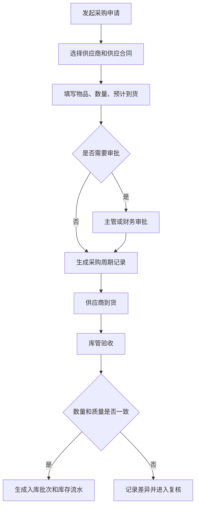
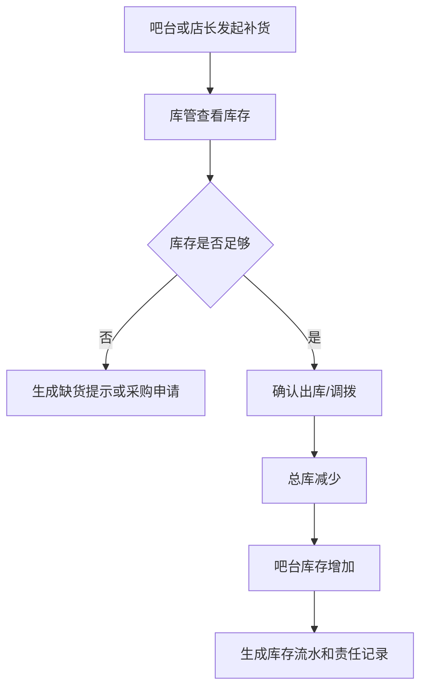
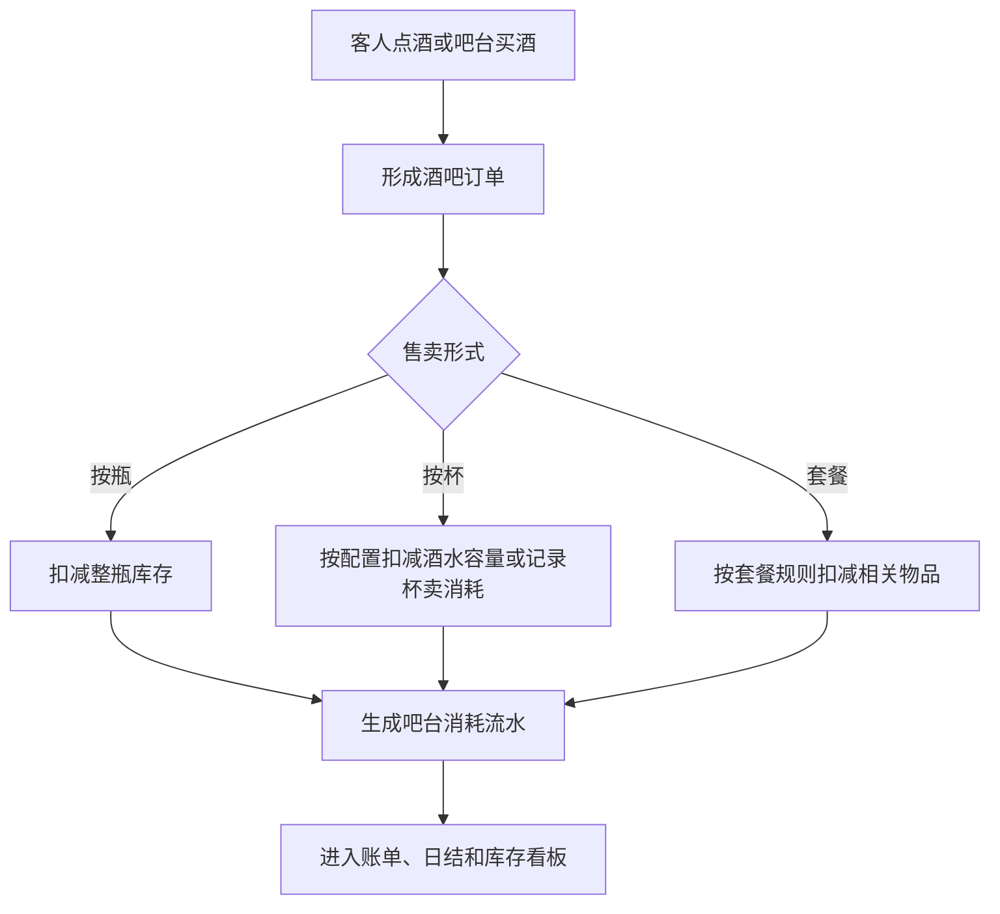
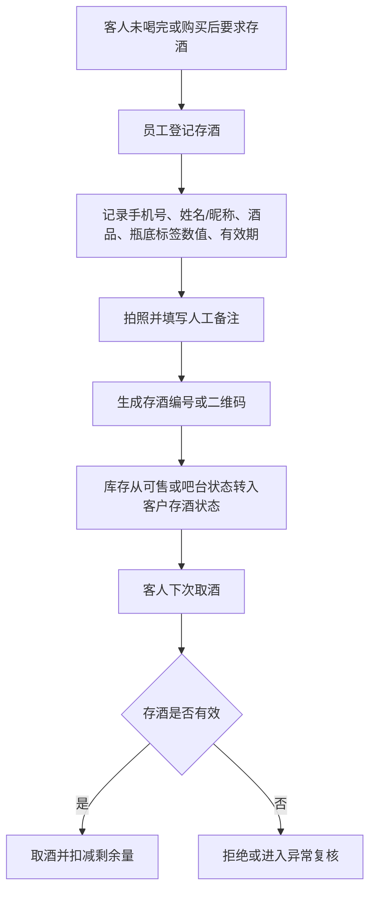
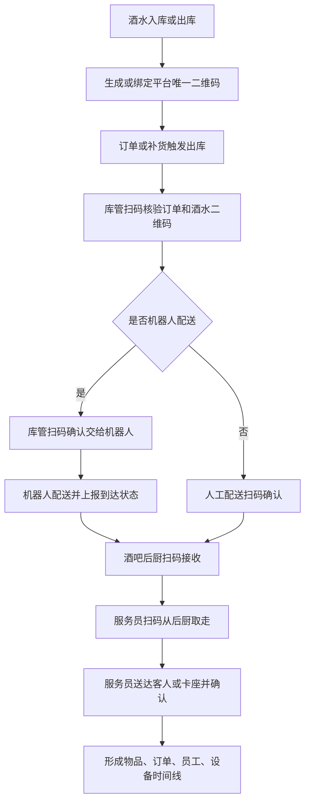

# 供应链与库存管理产品 PRD V0.1

## 1. 文档定位

本文档用于补齐综合体管理系统中的供应链、采购、库房、酒水库存、消耗品库存、其他物品库存和客人存酒管理。

它不是完整 ERP 或完整 WMS 的替代方案。P0 的目标是先把综合体经营中“谁供货、按什么合同供货、什么时候采购、进了哪个库、从哪里出库、被谁消耗、还剩多少、差异怎么处理”记录清楚，保证酒吧经营、吧台售卖、权益兑换、财务对账和异常追责有依据。

## 2. P0 目标

供应链与库存管理 P0 必须支持：

- 管理供应商档案、联系人、资质、结算方式和状态。
- 管理供应合同，包括平台自用供应合同、商户自采供应合同、平台统一采购后分销给商户三种模式，以及合同摘要、供货范围、价格口径、账期、有效期和审批状态。
- 管理采购周期，包括常规采购、临时补货、到货计划和入库确认。
- 管理库房，包括总库、酒吧库、吧台库存、消耗品库、存酒区等。
- P0 管理物品先覆盖酒类、吧台消耗、客人存酒和常用消耗品，例如纸巾、色盅、色子、杯子、杯具等；其他低频物品后续扩展。
- 记录入库、出库、调拨、盘点、报损、报溢和库存调整。
- 记录吧台酒水售卖导致的库存消耗；按杯销售按后台配置的每杯标准出酒量/容量扣减，超过标准容量的部分记为损耗。
- 管理客人存酒，包括存酒登记、取酒、剩余量、有效期、作废和异常处理。
- 将高价值酒水、异常报损、盘点差异和存酒作废纳入复核和留痕。
- 为酒水、礼品、高价值物料和需追责耗材生成或绑定平台唯一二维码，支持入库贴码或出库打印码。
- 记录酒水从库房出库、订单核验、机器人或人工配送、酒吧后厨接收、服务员送达客人的全链路交接留痕。
- **进货查验记录（C9 合规，P0）：** 酒类/食品入库时登记并绑定供货方资质（经营许可/食品经营许可）、票据（进货发票/送货单）、批次/合格证明（检验合格证、检疫证明），与入库批次可溯源关联，满足《食品安全法》进货查验义务。
   > 修订说明（2026-06-07）：依据 finding C9 与《合规要求 §10》。原 P0 入库只做到货验收与批次，未形成法定进货查验记录，溯源与持证经营合规不足以编码落地。此处增进货查验记录目标，并在配套开发设计落 `purchase_inspections` 表绑定 `stock_batches`。

## 3. 业务边界

| 范围 | P0 是否负责 | 说明 |
|---|---|---|
| 供应商档案 | 是 | 记录供货主体、联系人、资质、状态 |
| 供应合同 | 是 | 记录平台自用、商户自采、平台统一采购分销三种模式，以及供应合同核心摘要和供货准入 |
| 采购计划与采购周期 | 是 | 记录采购申请、计划到货、实际到货和周期 |
| 库房台账 | 是 | 管总库、吧台库、存酒区、消耗品区 |
| 酒类库存 | 是 | 管瓶装、杯卖、套餐消耗和高价值酒水 |
| 消耗品库存 | 是 | 管杯具、纸巾、冰块、果料、包装等 |
| 其他物品库存 | 是 | 管礼品、设备耗材、运营物料 |
| 吧台售卖消耗 | 是 | 按杯、按瓶、按套餐或其他形式记录消耗 |
| 客人存酒 | 是 | 存酒是客户资产，不等同于可售库存 |
| 自动补货预测 | 否 | P1/P2 再做 |
| 复杂 BOM 成本核算 | 否 | P1/P2 再做 |
| 供应商评分和招采比价 | 否 | P1/P2 再做 |

## 4. 角色

| 角色 | 关注重点 |
|---|---|
| 采购人员 | 供应商、采购申请、采购周期、到货 |
| 库管 | 入库、出库、调拨、盘点、报损、库位 |
| 酒吧店长 | 酒水库存、吧台补货、存酒异常、高价值酒审批 |
| 吧台员工 | 吧台库存、按杯/按瓶售卖、出品消耗、取存酒 |
| 财务 | 采购成本、库存差异、报损、供应合同、结算依据 |
| 运营主管 | 缺货预警、盘点差异、异常报损和责任追溯 |

## 5. 核心对象

| 对象 | 定义 | 关键关系 |
|---|---|---|
| 供应商 | 提供酒水、耗材、礼品或其他物品的主体 | 关联供应合同、采购单、入库批次 |
| 供应合同 | 与供应商之间的采购和结算依据 | 区分平台自用、商户自采、平台统一采购分销，关联供货范围、价格口径、账期、有效期 |
| 采购申请 | 由库管、店长或运营发起的补货需求 | 关联物品、数量、预计到货、审批 |
| 采购周期 | 从申请、审批、下单、到货、入库到结算的周期记录 | 关联供应商、合同、采购单、入库 |
| 库房 | 存放物品的管理空间 | 总库、酒吧库、吧台库存、消耗品库、存酒区 |
| 库位 | 库房内具体存放位置 | 关联物品批次和盘点 |
| 物品 | 可被采购、存放、售卖、消耗或兑换的东西 | 酒类、消耗品、礼品、其他物品 |
| 库存批次 | 某次入库形成的库存批次 | 关联供应商、采购单、成本、保质期 |
| 库存流水 | 所有库存变化的记录 | 入库、出库、调拨、销售消耗、报损、报溢（盘盈/异常增加）、盘点调整、积分兑换消耗、礼物领取消耗 |
| 物品追踪码 | 平台为单瓶酒、单件物品或出库批次生成的唯一二维码 | 关联入库批次、库房、当前责任人、订单、机器人任务和时间线 |
| 操作交接记录 | 物品在库管、机器人、后厨、服务员、客人之间流转的记录 | 通过扫码、设备事件、照片、视频或签名形成责任链 |
| 吧台消耗 | 吧台售卖或出品导致的库存扣减 | 关联酒吧订单、账单、出品员工 |
| 客人存酒 | 客人已购买但未喝完、暂存在场内的酒 | 关联手机号、姓名/昵称、酒品、瓶底标签数值、照片、人工备注、有效期、二维码 |
| 存酒流水 | 存酒登记、取酒、转赠、作废等变化 | 关联客人、员工、点位、证据 |

## 6. P0 页面清单

| 页面 | P0 内容 |
|---|---|
| 供应链总览 | 缺货、待入库、待调拨、盘点差异、存酒到期、高价值异常 |
| 供应商管理 | 供应商档案、联系人、资质、状态 |
| 供应合同管理 | 平台自用、商户自采、平台统一采购分销、合同摘要、供货范围、价格口径、账期、有效期、审批状态 |
| 采购周期管理 | 采购申请、审批、下单、到货计划、实际入库 |
| 库房管理 | 总库、吧台库、消耗品库、存酒区、库位 |
| 物品管理 | 酒类、消耗品、礼品、其他物品、单位、成本口径 |
| 入库管理 | 到货验收、批次、数量、成本、保质期、进货查验记录（供货方资质、票据、批次/合格证明绑入库批次） |
| 出库/调拨 | 总库到吧台、库房到点位、消耗品领用 |
| 物品追踪码 | 入库贴码、出库打印码、码状态、当前库位、当前责任人 |
| 交接留痕 | 出库核验、机器人取货、后厨接收、服务员取走、送达确认、异常 |
| 库存余额 | 按库房、物品、批次、状态查看库存 |
| 吧台消耗 | 按杯、按瓶、按套餐售卖后的消耗记录 |
| 盘点与差异 | 账面数、实盘数、差异、原因、复核 |
| 报损/报溢 | 损耗、过期、破损、异常增加、审批和证据 |
| 客人存酒 | 瓶底标签、标签数值、手机号、姓名/昵称、拍照、备注、取酒、有效期、作废、异常 |

## 7. 关键流程

### 7.1 采购到入库

### 7.2 库房到吧台补货

### 7.3 吧台售卖和消耗

### 7.4 客人存酒

### 7.5 酒水出库到客人全链路留痕

关键要求：

- 出库核验必须同时核验订单和物品二维码。
- 机器人取货、送达后厨属于被动留痕，员工扫码交接属于主动留痕。
- 后厨接收人、服务员取走人、送达人都必须记录。
- 错货、漏货、破损、超时、拒收、数量不一致进入异常复核。

## 8. 与其他系统关系

| 连接对象 | 连接内容 | 业务意义 |
|---|---|---|
| 平台治理 | 综合体、商户、合同、空间、员工、权限 | 确定谁能采购、谁能入库、谁能审批、在哪个库房操作 |
| 酒吧经营 | 点酒订单、吧台买酒、赠饮核销、账单 | 酒水销售和出品必须影响库存或消耗台账 |
| 票务权益 | 赠饮、积分兑换礼物、权益领取 | 赠饮或礼物领取后要形成库存消耗或领取记录，积分兑换礼物必须扣减库存 |
| 触摸屏一体机 | 吧台买酒、权益领取、兑换礼物 | 自助下单或领取要回写库存/消耗 |
| 财务经营 | 采购成本、报损、盘点差异、供应合同 | 财务对账和成本判断需要库存依据 |
| 证据风控 | 高价值酒水、报损、盘亏、存酒作废 | 异常动作必须复核和留证 |
| 数据分析 | 库存周转、损耗、缺货、存酒余额 | 管理层判断采购和经营效率 |

## 9. P0/P1/P2

| 阶段 | 能力 |
|---|---|
| P0 | 供应商、三类供应合同、采购周期、库房、物品、入库、出库、调拨、库存余额、物品追踪码、扫码交接留痕、吧台消耗、盘点差异、报损、客人存酒、积分兑换库存扣减 |
| P1 | 安全库存、自动缺货提醒、保质期预警、复杂杯卖扣减、供应商对账、机器人真实状态联动、摄像头自动关联 |
| P2 | 自动补货预测、供应商评分、招采比价、复杂 BOM 成本核算、库存智能风控、无感交接辅助校验 |

## 10. 已确认规则和后续细化事项

已确认：

1. 供应合同分平台自用供应合同、商户自采供应合同、平台统一采购后分销给商户三种模式。
2. 客人存酒使用瓶底标签，按标签显示数值记录，登记时必须拍照、填写人工备注，并留取手机号和姓名/昵称。
3. 积分兑换礼物必须扣减库存。**兑换→扣减→领取确认时序（pass-2）：** 票务/会员侧发起积分兑换时，调用供应链库存扣减接口对**礼品库**预占/扣减；库存流水类型用独立的"积分兑换消耗"（redeem_consume）与"礼物领取消耗"（gift_claim_consume）两类取值（区别于售卖消耗 consume）；**库存不足时拒绝兑换**（返回库存不足错误，不生成兑换订单）；客人在一体机/前台**领取确认**时回写库存（由预占转实扣或登记领取流水），与票务 PRD §8.5 一体机领取流程"扣减礼物或权益库存"对齐。扣减接口须带幂等键，避免重复扣减。
   > 修订说明（2026-06-07）：依据 finding pass-2。原文只声明"必须扣减库存"，未定义流水类型、扣减库房、库存不足拒绝与领取确认回写时序，上游要扣库存却无可编码的触发链路。此处补全时序与拒绝规则，并在配套开发设计 §6 库存流水 `movement_type` 落 `redeem_consume`/`gift_claim_consume` 枚举、§5 落兑换扣减时序流程。
4. 供应链 P0 从酒类、吧台消耗、客人存酒和常用消耗品开始，常用消耗品包括纸巾、色盅、色子、杯子、杯具等。
5. 吧台按杯销售按标准出酒量/容量扣减库存，超出部分记为损耗，损耗严重时进入异常核查。
6. 高价值酒水报损、盘点差异、存酒作废必须**同时拍照和视频**（双证据，非二选一），并主管复核。
   > 修订说明（2026-06-07）：原文为"拍照/视频"，斜杠写法易被理解为"二选一"。依据 finding supply-3（用户口径为"拍照和视频"双证据）去斜杠，明确为双证据同时留存。高价值判定口径见本节已确认第 9 条（原待确认"高价值阈值"已转为已确认）。
7. 酒水、礼品、高价值物料和需追责耗材必须有平台唯一二维码，可在入库时贴码，也可在出库时打印码。
8. 酒水从库房出库到客人收取的全过程必须留痕，出库核验人、机器人或配送人、后厨接收人、服务员送达人都必须可追溯。
9. **高价值判定口径（原待确认第 1 条转已确认）：** 采用"**平台默认金额阈值 + 物品档案手工标记**"双判据：平台治理侧配置全局默认高价值金额阈值（`high_value_threshold`，单位：分），物品档案（`items`）增 `is_high_value`（布尔，手工强制标记）与 `high_value_threshold`（可空，覆盖平台默认值）；商户可对本商户物品申请调整阈值，由平台审批。报损、作废、盘点差异在判定为高价值（批次成本金额≥生效阈值 或 `is_high_value=true`）时**自动触发双证据（拍照和视频）+主管复核**，否则规则会落空。
   > 修订说明（2026-06-07）：依据 finding supply-4。原"高价值"只停留在待决问题，既无阈值配置项也无物品标记字段，"报损/作废自动判定高价值并强制双证据复核"无法编码。此处明确"平台默认阈值 + 物品档案 is_high_value/high_value_threshold"落地口径，并在配套开发设计 §6 物品/物品档案表落字段、§5 报损/作废/盘点流程落自动触发。

后续细化：

无方向性悬空事项。已确认按以下口径执行：

1. 盘点差异 P0 单独形成库存差异批次，并进入证据留痕和主管复核。财务日结只展示差异摘要和潜在金额影响，不自动改写已锁定日结；高价值报损/盘点差异经复核后入账进入应收应付台账。

   > 文档goal修正(2026-06-20)：原文口径为"确需影响金额时才走调整/冲正审批后进入应收应付或财务调整台账"（即库存差异入账被表述为远期/确需才做）。审计发现与已落地代码相反——**V108 已落地为 P0**：迁移 `V108__inventory_variance_to_ap.sql` 已建 `stocktake`（盘点单）+ `inventory_variance`（库存差异明细，含 review_status pending/approved/rejected 与 posted_ar_ap_item_id 幂等防重），复核通过后由 finance 服务生成 `ar_ap_items(source_type='inventory_difference')`（服务层 SOURCE_TYPES 已加该枚举），并 seed `finance.inventory_variance.post`（high 风险、requires_approval）权限。故口径改为"V108 已落地 P0"。
   >
   > **新增验收（G/W/T）**：Given 高价值报损/盘点差异经主管复核通过（review_status=approved）/ When 执行入账（finance.inventory_variance.post）/ Then 生成 `ar_ap_items(source_type='inventory_difference')`，并回填 `inventory_variance.posted_ar_ap_item_id`（幂等，同一差异行只入账一次）。

## 11. 本版结论

供应链与库存管理必须作为综合体管理系统的独立业务能力存在。酒吧系统负责“客人怎么点酒、怎么付钱、怎么形成账单”，供应链系统负责“酒水和物品从哪里来、在哪个库、经过谁、怎么交接、怎么消耗、剩多少、差异谁负责”。P0 先做基础台账、平台唯一二维码和关键留痕，P1/P2 再深化自动补货、成本核算和智能风控。

本 PRD 的可编码落地（供应商表、三种供应合同模式表、采购周期、库房、库存批次、库存流水、进货查验、高价值判定字段等）见配套开发设计文档 `supply-chain-inventory-development-design-v0.1.md`。

## 12. 变更日志

| 日期 | 类型 | 位置 | 内容 | 原因/依据 |
|---|---|---|---|---|
| 2026-06-07 | 改 | §2 P0 目标 | 增"进货查验记录"目标（供货方资质/票据/批次合格证明绑入库批次） | finding C9、《合规要求 §10》：原入库无法定进货查验台账，溯源与持证经营合规不足 |
| 2026-06-07 | 改 | §5 核心对象·库存流水 | 流水类型补"报溢/积分兑换消耗/礼物领取消耗" | finding pass-2、supply-5：枚举缺兑换消耗与报溢类型 |
| 2026-06-07 | 改 | §6 页面清单·入库管理 | 增"进货查验记录"页面内容 | finding C9 |
| 2026-06-07 | 改 | §10 已确认第 3 条 | 补积分兑换→扣减礼品库→领取确认时序与库存不足拒绝、独立流水类型、幂等 | finding pass-2：原只声明"必须扣库存"，无可编码触发链路 |
| 2026-06-07 | 改 | §10 已确认第 6 条 | "拍照/视频"改为"同时拍照和视频（双证据）"去斜杠 | finding supply-3：斜杠写法易解为二选一，违背用户双证据口径 |
| 2026-06-07 | 增 | §10 已确认第 9 条 | 高价值判定从待确认转已确认：平台默认金额阈值 + 物品档案 is_high_value/high_value_threshold，自动触发双证据+复核 | finding supply-4：原高价值无阈值配置与物品标记字段，规则无法编码 |
| 2026-06-07 | 改 | §10 待确认 | 删除原"高价值阈值"待确认项（已转已确认第 9 条） | finding supply-4 |
| 2026-06-07 | 增 | §11 结论后 | 指向配套开发设计文档 | finding supply-1：本域原"有 PRD 无开发设计" |
