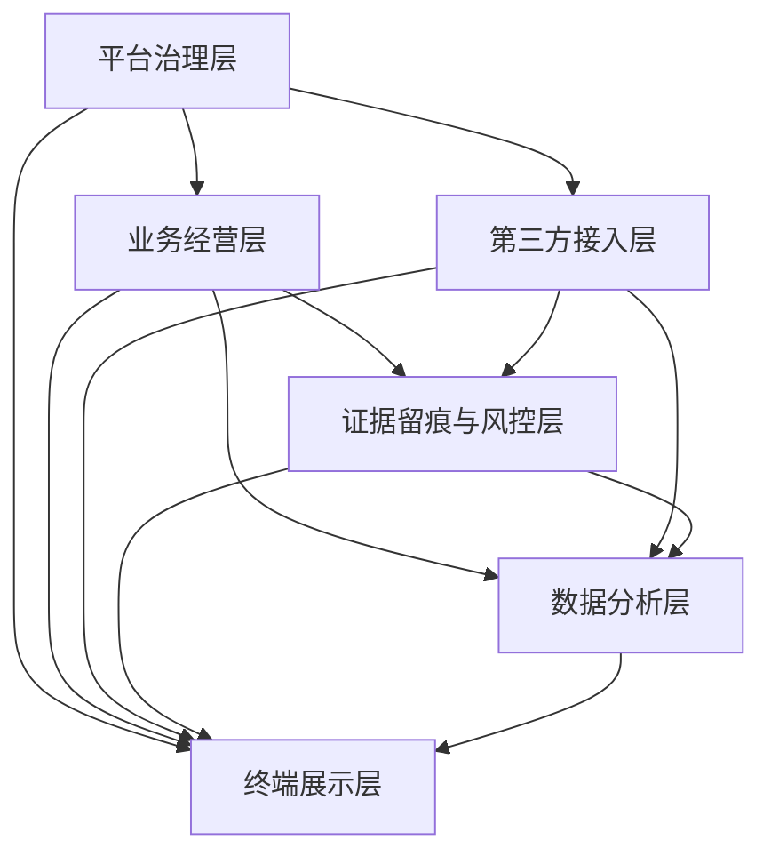

# 系统能力分层产品文档总索引 V0.1
> 2026-07-04 逻辑一致性修订：§2 能力层总览「已闭环」补缺口状态说明（R5 准入闸业务接口联动、R6 字段级权限投影等已知缺口未落地；产品闭环≠实现完成）

## 1. 文档定位

本文档按《综合体管理系统产品需求总纲 V0.1》第 8 节“系统能力分层”汇总全部能力层产品文档和 PRD。

本索引用于总控检查、后续任务分派和判断每一层是否已经具备继续细化或进入实现任务拆解的产品基础。

> 当前第一阅读入口为 `00-current-effective-document-entry-v0.1.md`。新接手项目时，必须先用该文档确认正式口径、废止内容、阅读顺序和 P0 开发准入条件，再按本文进入六层能力文档。

> 修订说明（2026-06-07）：1）**本文档指定为唯一权威总索引**（按总纲第 8 节 6 层组织全部能力层产品文档/PRD）；`product-documentation-index-v0.1.md` 为面向交付物清单的并列索引，两者收录差异以本文为准。2）能力层数固定为 **6 层**（平台治理/业务经营/第三方接入/证据留痕与风控/数据分析/终端展示），**财务为"数据分析层下的财务/对账子域"，非独立层**；全文"财务结算层"措辞统一为"数据分析层（财务/对账子域）"。3）补收录原孤儿 PRD：`finance-settlement-product-prd`、`operation-traceability-and-terminal-switch-prd`，并补 `platform-governance-map-for-operations` HTML。依据《统一口径基准》D2，finding caplayer-1/2/3/4/6/7、xref-9。

## 2. 能力层总览

| 能力层 | 总纲定位 | 产品文档状态 |
|---|---|---|
| 平台治理层 | 管“谁、在哪、凭什么、能做什么” | 已闭环 |
| 业务经营层 | 管“具体业务如何运行” | 已闭环 |
| 第三方接入层 | 管“外部系统怎么纳入平台” | 已闭环 |
| 证据留痕与风控层 | 管“出了什么事、能否追溯、风险在哪里” | 已闭环 |
| 数据分析层 | 管“经营结果和趋势怎么看” | 已闭环 |
| 终端展示层 | 管“不同角色通过什么界面使用系统” | 已闭环 |

> **2026-07-04 逻辑一致性修订（缺口状态说明）**：上表「已闭环」指**产品文档层面**已闭环，非实现层面全部完成。已知尚未落地的缺口至少包括：R5（合同准入闸与票务/酒吧/游乐/结算业务动作前的接口联动尚未接线，准入实际走 `supervisor_review`）、R6（前端按后端 DENY 优先 effective-permissions 的字段级权限投影尚未渲染）等。「产品闭环 ≠ 实现完成」，具体以各层规格顶部 R5/R6 审计标注与实现进度为准。

跨层总图：

| 文档 | 作用 | 状态 |
|---|---|---|
| `00-current-effective-document-entry-v0.1.md` | 当前第一阅读入口，明确正式口径、废止内容、阅读顺序和 P0 开发准入条件 | 已完成 |
| `member-and-tier-product-prd-v1.0.md` | 会员身份、成长值与等级的跨项目领域权威 | 现行·业务经营层 |
| `points-and-voucher-product-prd-v1.0.md` | 积分账本、冻结、有效期、兑换与虚拟券的跨层领域权威 | 现行·业务经营层/终端展示层 |
| `merchant-points-settlement-rules-v1.0.md` | 商户积分价格、费用、补偿、账单与税务边界的跨层领域权威 | 现行·业务经营层/数据分析层 |
| `prd-audit/member-points-related-doc-audit-2026-07-28.md` | 会员积分跨层 PRD 逐文件顺从性与对抗性审计 | Phase 3 已完成：22 份审计、8 份同步 |
| `prd-audit/html-prd-coverage.csv` | 三份领域权威与三个业务 HTML 的待对齐关系 | 9 组关系已登记·HTML 未修改 |
| `prototype-deprecation-and-technology-baseline-v0.1.md` | 原型废止与正式技术栈基线，明确旧 TypeScript/SQLite 后端原型不得作为正式开发依据 | 已完成 |
| `p0-coding-entry-pack-v0.1.md` | P0 编码、联调、测试和供应商 mock 的统一入口包，集中说明正式工程、契约、权限、留痕、验收和旧原型阻断规则 | 已完成 |
| `p0-api-contract-pack-v0.1.md` | P0 API 契约基线，覆盖统一路径、鉴权、响应、错误码、幂等、Webhook 和接口目录 | 已完成 |
| `openapi/openapi-p0.yaml` / `openapi/openapi-p0.json` | P0 机器可读接口契约，供 springdoc 比对、SDK/mock、接口自动化和供应商 Adapter 契约测试使用 | 已完成 |
| `p0-openapi-operation-acceptance-matrix-v0.1.md` | P0 operation 级验收矩阵，覆盖请求体、权限、认证上下文、终端、幂等、事件和边界情况 | 已完成 |
| `p0-openapi-contract-closure-appendix-v0.1.md` | P0 operation 到任务簇、权限、事件、终端和样例准入的追溯附录，供 SDK/mock、接口自动化和供应商联调同步校验 | 已完成 |
| `code-contract-difference-and-migration-audit-v0.1.md` | 旧 TypeScript/Fastify/SQLite 原型、旧 Web/Android 路径和正式 Java/OpenAPI 契约的迁移审计 | 已完成 |
| `p0-user-story-map-and-sprint-slices-v0.1.md` | P0 用户故事地图与迭代切片，按角色和业务旅程拆分可验收故事 | 已完成 |
| `p0-task-api-permission-event-acceptance-map-v0.1.md` | P0 任务、接口、权限、事件和验收标准逐行映射，作为任务可验收判定入口 | 已完成 |
| `business-functional-topology-v0.1.md` | 面向运营和业务人员的业务功能拓扑图，说明各能力层、业务模块、终端入口和数据流转关系 | 已完成 |
| `business-system-map-for-operations-v0.1.html` | 面向完全不懂产品技术的业务人员，可点击查看各子系统定位、功能和相互关系 | 已完成 |
| `platform-governance-map-for-operations-v0.1.html` | 面向业务人员的平台治理层点击式地图（治理模块、商户/设备/开放接口/留痕复核入口）（修订说明 2026-06-07 补入，xref-9） | 已完成 |
| `final-open-decisions-and-owner-checklist-20260610.md` | 最终已确认执行口径与责任人清单，承接市场基准、总控默认值和实施输入 | 已完成 |
| `document-retention-merge-audit-20260610.md` | 文档收口、合并、归档和低价值文档审计 | 已完成 |
| `contract-date-compliance-field-granularity-options-20260610.md` | 合同关键日期、证照/资质/保险到期字段 P0 已确认方案 B：标准通用事项台账 + 本地 AI 辅助判断 + 人工确认 | 已完成 |
| `p0-end-to-end-acceptance-and-edge-cases-v0.1.md` | P0 端到端验收标准和边界用例，作为开发自测、测试设计和上线验收入口 | 已完成 |
| `mdm-android-enterprise-implementation-plan-v0.1.md` | MDM / Android Enterprise 设备纳管、策略状态、终端拦截和生产前置验收 Runbook | 已完成 |
| `production-credential-rotation-runbook-v0.1.md` | 生产账号、密钥、数据库密码、对象存储密码和第三方凭证轮换 Runbook | 已完成 |
| `nas-backup-and-restore-runbook-v0.1.md` | NAS 备份范围、策略、恢复演练和可恢复验收 Runbook | 已完成 |

## 3. 平台治理层

| 文档 | 作用 | 状态 |
|---|---|---|
| `platform-governance-prd-v0.1.md` | 平台治理 PRD | 已完成 |
| `platform-governance-product-spec-v0.2.md` | 页面、字段、流程、低保真合并规格 | 已合并 |
| `platform-governance-acceptance-pack-v0.2.md` | 验收包 | 已合并 |
| `business-entity-binding-development-design-v0.1.md` | 四类主体唯一绑定 P0 开发设计（经营对象、运营主体、合同主体、结算主体） | 已完成 |
| `p0-operation-permission-matrix-v0.1.md` | P0 操作权限矩阵、权限模板、临时授权、单次有效和高风险权限审批留痕 | 已完成 |

覆盖内容：
- 综合体项目、空间、业态、商户、合同、合同准入、四类主体唯一绑定、员工注册审批、私人手机 App、设备凭证、职级、班次、设备、角色权限、权限模板、临时授权、基础留痕。

## 4. 业务经营层

| 文档 | 作用 | 状态 |
|---|---|---|
| `business-operations-layer-spec-v0.2.md` | 业务经营层总拆分、页面、字段、流程、低保真、验收合并规格 | 已合并 |
| `ticketing-entitlement-checkin-product-prd-v0.1.md` | 票务/通票/权益/核销 PRD | 已完成 |
| `bar-business-operations-product-prd-v0.1.md` | 酒吧经营 PRD | 已完成 |
| `supply-chain-inventory-product-prd-v0.1.md` | 供应链与库存管理 PRD | 已完成 |
| `operation-traceability-and-terminal-switch-prd-v0.1.md` | 全链路操作留痕与终端开关 PRD（**跨层共用底层约束**：留痕→证据风控层、终端开关→终端展示层；4.1 节为唯一权威事件字典）（修订说明 2026-06-07 补入，caplayer-4/6） | 已完成 |
| `amusement-business-operations-product-prd-v0.1.md` | 游乐运营 PRD | 已完成 |
| `amusement-p0-safety-inspection-spec-v0.1.md` | 游乐 P0 安全巡检闭环执行规格 | 已完成 |

覆盖内容：
- 票务策略、票种、通票、权益、订单、核销、退款。
- 酒吧入场、桌台、账单、赠饮、关台。
- 供应商、供应合同、采购周期、库房、酒类、消耗品、其他物品、吧台消耗、盘点、报损、客人存酒。
- 游乐项目、开放计划、场次、容量、核销、开放前阻断式安全巡检、整改复检和主管恢复。

## 5. 第三方接入层

| 文档 | 作用 | 状态 |
|---|---|---|
| `third-party-business-access-product-prd-v0.1.md` | 第三方接入 PRD | 已完成 |
| `third-party-access-layer-spec-v0.2.md` | 页面、字段、流程、低保真、验收合并规格 | 已合并 |
| `third-party-supplier-integration-kit-v0.1.md` | 第三方供应商 SDK/API 未定前的双向开放、适配器、字段映射占位和补偿策略 | 已完成 |

覆盖内容：
- 餐饮、零售、机器人、视频监控、企业微信、渠道/支付、人脸年龄核验、设备厂商。
- 接入关系、服务商档案、回流记录、回流批次、接入异常、差异清单、证据关联。
- 平台对外统一 OpenAPI/Webhook，平台对内通过供应商 SDK/API 适配器接入；供应商未确定前只保留接口、映射占位、Webhook+轮询校验、对账和补偿策略。

## 6. 证据留痕与风控层

| 文档 | 作用 | 状态 |
|---|---|---|
| `evidence-risk-control-product-prd-v0.1.md` | 证据风控 PRD | 已完成 |
| `evidence-risk-layer-spec-v0.2.md` | 页面、字段、流程、低保真、验收合并规格 | 已合并 |
| `p0-action-event-evidence-matrix-v0.1.md` | P0 操作事件、证据、复核和敏感访问留痕矩阵 | 已完成 |

覆盖内容：
- 事件中心、人工补录、复核队列、风险提示、证据索引。
- 核销留痕、异常事件、责任链、风险预警。

> 修订说明（2026-06-07）：本层的"全链路留痕"约束由跨层 PRD `operation-traceability-and-terminal-switch-prd-v0.1.md` 承载（其 4.1 节为唯一权威事件字典，6.4-6.6 节定义业务过程实例/步骤/服务责任链），该 PRD 在 §4 业务经营层登记并标注为跨层共用，本层引用之。依据 caplayer-4。

## 7. 数据分析层（含财务/对账子域）

> 修订说明（2026-06-07）：按总纲 6 层模型，**财务为本层下的"财务/对账子域"，非独立能力层**。`finance-settlement-product-prd` 作为财务/对账口径来源挂入本层（caplayer-3、D2）。

| 文档 | 作用 | 状态 |
|---|---|---|
| `data-analysis-layer-spec-v0.2.md` | 数据分析层 PRD、页面、字段、流程、低保真、验收合并规格 | 已合并 |
| `finance-settlement-product-prd-v0.1.md` | 财务经营、日结与结算 PRD（数据分析层下**财务/对账子域**，P0 对账/结算/经营流水拆解口径来源）（修订说明 2026-06-07 补入，caplayer-3） | 已完成 |
| `finance-ar-ap-ledger-development-design-v0.1.md` | P0 完整应收应付台账开发设计（应收、应付、账龄、收付款、调整、附件、审计） | 已完成 |

覆盖内容：
- 综合经营看板、收入分析、客流分析、核销分析、票务分析、酒吧分析、供应链库存分析、游乐分析、商户表现、异常风险、对账结果。
- 财务/对账子域：财务经营总览、日结、结算、对账差异、经营流水拆解、完整应收应付台账（来源 finance-settlement PRD 和 finance-ar-ap-ledger 开发设计）。

## 8. 终端展示层

| 文档 | 作用 | 状态 |
|---|---|---|
| `terminal-page-product-prd-v0.1.md` | 终端与页面 PRD | 已完成 |
| `web-mobile-app-terminal-extension-product-prd-v0.1.md` | Web 前端与移动/平板 App 扩展 PRD | 已完成 |
| `terminal-display-layer-spec-v0.2.md` | 页面、字段、流程、低保真、验收合并规格 | 已合并 |

覆盖内容：
- 管理后台、Web 前端、商户侧页面、现场作业端、员工工作手机、工作人员平板 App、触摸屏一体机、移动管理端、客人购票 App/小程序。
- 员工私人手机 App 只用于注册、通知、状态查看和设备凭证绑定；员工工作手机负责防伪核对后的门票和权益核销。

## 9. 分层依赖关系

## 10. 完成审计

| 审计项 | 结果 |
|---|---|
| 6 个能力层是否全部有 PRD 或总拆分文档 | 通过 |
| 6 个能力层是否都有页面清单 | 通过 |
| 6 个能力层是否都有字段或指标字典 | 通过 |
| 6 个能力层是否都有流程图 | 通过 |
| 6 个能力层是否都有低保真说明 | 通过 |
| 6 个能力层是否都有验收清单或完成审计 | 通过 |
| 是否保持产品文档口径 | 通过 |
| 是否避免把第三方成熟系统误拆成自研系统 | 通过 |
| 能力层数量与构成是否与总纲第 8 节一致（6 层、财务为子域非独立层） | 通过（修订说明 2026-06-07 新增审计项，已统一为 6 层，caplayer-1/7） |
| 目录中全部已存在的产品 PRD 是否均被本索引收录（含 finance-settlement、operation-traceability） | 通过（修订说明 2026-06-07 已补收录两份原孤儿 PRD，caplayer-3/4/7） |
| 是否已参考成熟市场系统并区分 P0 必做、P0 预留、P1/P2 增强 | 通过（市场基准审计报告已归档，其结论已吸收到最终执行口径和路线图；市场增强项不自动扩大 P0） |
| 是否已补齐 P0 权限模板、留痕矩阵、端到端验收和供应商未定时的接口占位 | 通过（本轮新增四份执行型文档并纳入索引） |
| 是否已补齐 OpenAPI 字段级请求体、operation 级验收和旧原型迁移闸口 | 通过（`p0-openapi-operation-acceptance-matrix-v0.1.md` 与 `code-contract-difference-and-migration-audit-v0.1.md` 已纳入顶层索引） |

## 11. 已确认规则和后续排期事项

已确认规则：

| 规则 | 影响 |
|---|---|
| 餐饮/零售第三方回流同时支持订单级和券核销级，支持日、半日、小时和单店实时汇总 | 影响第三方接入层和数据分析层 |
| 酒吧 P0 包含基础点单、商品明细、吧台买酒、赠饮/权益核销和账单支付 | 影响业务经营层和数据分析层 |
| 游乐容量按具体项目、场次/时段、点位/设备控制容量 | 影响业务经营层、风控层和数据分析层 |
| 票务二维码按票种有效期设置，30 秒或 60 秒刷新，截图无效，必须在线核验 | 影响票务权益层、风控层和终端核销 |
| 员工私人手机 App 安装期在设备 Keystore 生成设备公钥/不可逆设备指纹（device_key_fingerprint）作为可信标识，换机解绑重绑，Root/异常失效复核，寄存柜流动使用；工作手机通过摄像头扫码读取外部客人二维码，NFC 仅读取外部 NFC 腕带/标签/卡，不读取二维码<!-- 修订说明（2026-06-10 收口）：纠正"NFC 读取二维码"的技术错误表述，二维码=摄像头扫码，NFC=外部 NFC 介质。依据技术可行性复核。 --> | 影响平台治理层和终端展示层 |
| 员工职级可按 M1-M10 并细分上/中/下；职级只绑定薪资大范围，具体薪资单独填写；职级只影响默认权限模板和审批层级建议，不能替代单一功能权限点 | 影响平台治理层、权限和后续 HR/薪资对接 |
| 会员、成长值、积分、兑换券和商户积分结算分别由三份领域权威文档定义；全部参数、审批和版本由系统承载 | 影响业务经营层、数据分析层、终端展示层和库存状态 |
| Web 前端 P0 允许少量业务确认动作 | 影响终端展示层和后台权限 |
| 新人优惠、学生票、多人票由后台配置规则并自动判断 | 影响票务权益层和风控层 |
| 酒吧最低消费按时间、卡座和位置配置，不按人数 | 影响业务经营层和终端展示层 |
| 供应链 P0 从酒类、吧台消耗、客人存酒和常用消耗品开始 | 影响业务经营层、数据分析层（财务/对账子域） |
| 吧台按杯销售按标准出酒量/容量扣减，超出部分记损耗 | 影响库存准确度、现场操作和成本口径 |
| 高价值酒水报损、盘点差异、存酒作废必须拍照/视频留证并主管复核 | 影响风控层和证据留痕 |
| 人工放行、退款、免单、调账按可配置层级主管复核 | 影响风控层和终端展示层 |
| 合同或基础定义违规全部先卡住流程，允许更高级审核后放行 | 影响平台治理层、业务经营层和数据分析层（财务/对账子域） |
| 企业微信工作会话留存期限可配置（非永久），到期归档/销毁/匿名化（按 A7/合规C3、data-risk §11.5）；不脱敏原文仅限最小授权 + 审批的取证/质检场景，普通展示按权限脱敏，查看写审计<!-- 修订说明（2026-06-08 三轮收口）：原"永久保存"与 A7/C3 可配置留存相反，就地改正；2026-06-08 复核补充不脱敏原文的最小授权边界，使权威总索引与 compliance §4、data-risk §11.5 一致。依据 finding residual-scan-4、A7/C3 --> | 影响第三方接入层、风控层和数据分析层 |
| 员工权限按单一功能最小颗粒度配置，支持角色和员工级完全自定义 | 影响平台治理层、权限和后续 HR/薪资对接 |
| 权限点首批由平台统一预置，实施阶段允许边配置边补充 | 影响平台治理层、权限初始化、角色模板和前端菜单控制 |
| 权限模板支持基础模板、临时模板、复制模板、有效期、单次有效和撤销；员工最终权限按角色、模板、员工级授权/拒绝计算，显式拒绝优先 | 影响平台治理层、权限初始化、审批、菜单控制和审计留痕 |
| 日结锁定后不允许直接补录影响金额，必须上级审批通过后补录 | 影响数据分析层（财务/对账子域）和风控层 |
| 商户侧在授权业务范围内全开放，酒吧和游乐/乐园保留独立 SaaS 能力 | 影响终端展示层和业务经营层 |
| 未来需要集团视图和跨项目汇总视图，但优先级低于 P0 单综合体闭环 | 影响平台治理层和数据分析层 |
| 第三方采用双向开放方案：平台对外开放统一 OpenAPI/Webhook，平台对内通过供应商 SDK/API 适配器接入；供应商未确定前只保留接口契约和字段映射占位 | 影响第三方接入层、开放平台和供应商联调 |
| 所有有过程的业务动作必须留痕，订单获取、销售归属、卡座服务、异常第一处理人和酒水可追责物品全过程都要可追溯 | 影响地基事件中心、供应链、酒吧、机器人、风控层和数据分析层 |
| P0 币种默认 CNY，金额按整数分；保留 `currency=CNY` 字段用于未来扩展，多币种和汇率 P2 | 影响财务、支付、渠道对账和第三方供应商字段映射 |
| 所有端必须有开关接口，支持按项目、商户、业务系统、模块、设备和版本控制 | 影响平台治理层、终端展示层和后续酒吧/乐园 SaaS 化 |

后续排期事项：

| 问题 | 影响 |
|---|---|
| 管理层首屏指标优先级 | 已确认：第一屏收入、客流、核销；第二屏商户表现、供应链库存、异常风险、结算差异和应收应付逾期 |
| 集团视图默认 P2，P0 只预留 `project_id` 和跨项目汇总口径 | 已确认，不阻塞单综合体 P0 闭环 |
| 合同关键日期、证照/资质/保险到期字段采用方案 B 标准通用事项台账，并引入本地 AI 辅助判断（见 `contract-date-compliance-field-granularity-options-20260610.md`） | 已确认，影响合同准入拦截、提醒任务和后续商户服务扩展 |
| 商户服务工单、商户账单门户、酒吧高级账单、游乐安全告知/免责和预约排队进入 P1/P2 排期 | 租金/物业费/CAM/应收账龄已确认进入 P0 完整应收应付台账；商户服务工单、酒吧高级账单、游乐安全告知/免责和事故工单 P1；预约排队、团体/包场和集团视图 P2 |

## 12. 本版结论

按总纲第 8 节“系统能力分层”的全部 6 个能力层，产品文档和 PRD 已完成闭环（财务为数据分析层下子域）。本版已补齐原孤儿 PRD（finance-settlement、operation-traceability）与 platform-governance-map HTML，并补齐 P0 执行映射表和游乐 P0 安全巡检闭环规格。当前文档足以支撑继续做更细交互原型、OpenAPI、数据库迁移、接口测试集和后续实现任务拆解。

> 修订说明（2026-06-07）：原结论的"已完成闭环"建立在漏列财务/留痕 PRD、且层级口径与拓扑图冲突的清单上（caplayer-7）。本版补收录并统一为 6 层后，"闭环"结论方成立；如后续发现仍有未收录的已存在 PRD，应据实下调为"主体闭环，待归位"。

## 变更日志

| 日期 | 类型 | 位置 | 内容 | 原因/依据 |
|---|---|---|---|---|
| 2026-06-07 | 改 | §1 文档定位 | 指定为唯一权威总索引；统一 6 层、财务=数据分析层子域 | 《统一口径基准》D2；finding caplayer-1/2 |
| 2026-06-07 | 增 | §2 跨层总图 | 补 platform-governance-map HTML | finding xref-9 |
| 2026-06-07 | 增 | §4 业务经营层 | 补 operation-traceability PRD（跨层共用，留痕→风控、开关→终端） | finding caplayer-4/6 |
| 2026-06-07 | 增 | §6 证据风控层 | 注明留痕约束由 operation-traceability PRD 承载 | finding caplayer-4 |
| 2026-06-07 | 增 | §7 数据分析层 | 补 finance-settlement PRD 作为财务/对账子域 | finding caplayer-3；D2 |
| 2026-06-07 | 改 | §11 已确认规则 | "财务结算层"统一改为"数据分析层（财务/对账子域）" | finding caplayer-2；D2 |
| 2026-06-07 | 增 | §10 完成审计 | 新增"层数是否与总纲一致""是否收录全部已存在 PRD"两条审计项 | finding caplayer-7 |
| 2026-06-10 | 增/改 | §2/§4/§12 | 补 `p0-task-api-permission-event-acceptance-map-v0.1.md` 与 `amusement-p0-safety-inspection-spec-v0.1.md`，并将游乐覆盖内容扩展为安全巡检闭环 | 第一批 P0 硬缺口收口 |
| 2026-06-07 | 改 | §12 本版结论 | 据实说明闭环口径修正前提 | finding caplayer-7 |
| 2026-06-09 | 增 | §2 / §10 / §11 | 补入市场基准与对抗式审计报告，并明确市场增强项不自动扩大 P0 | 用户要求以对抗式审计方式检查全部文档并参考市场类似系统 |
| 2026-06-10 | 增 | §2 / §11 | 补入合同关键日期、证照/资质/保险到期字段 P0 颗粒度建议；收口权限点首批由平台统一预置、实施阶段可补充 | 总控拍板与字段颗粒度决策建议 |
| 2026-06-10 | 增/改 | §2-§6 / §10 / §11 | 补入 P0 权限矩阵、操作事件证据矩阵、端到端验收与供应商接入预留包；明确第三方双向开放、权限模板和 CNY 币种口径 | 用户要求修复和补齐相关文档，第三方供应商未确定时留好接口 |
| 2026-06-11 | 增/改 | §2 / §10 / §12 | 补入 P0 operation 级验收矩阵和代码契约迁移审计；明确旧原型、旧 Web/Android 路径不得作为正式 Java/OpenAPI 后端依据 | 用户要求直接修改到尽快可编码 |
| 2026-06-08 三轮收口 | 改 | §业务规则表 | "员工私人手机读取手机 NFC 唯一标识"改为"安装期 Keystore 设备公钥/不可逆设备指纹（device_key_fingerprint）" | residual-scan-7、D8/A6 |
| 2026-06-08 三轮收口 | 改 | §业务规则表 | "企业微信工作会话永久保存"改为"留存期限可配置（非永久），到期归档/销毁/匿名化（按 A7/合规C3、data-risk §11.5）" | residual-scan-4、A7/C3 |
| 2026-08-01 | 增 | §2 跨层总图 | 登记会员积分逐文件审计与 HTML 覆盖矩阵；明确 22 份 PRD 已审计、8 份已同步且 HTML 未修改 | 会员积分重构 Phase 3 |
