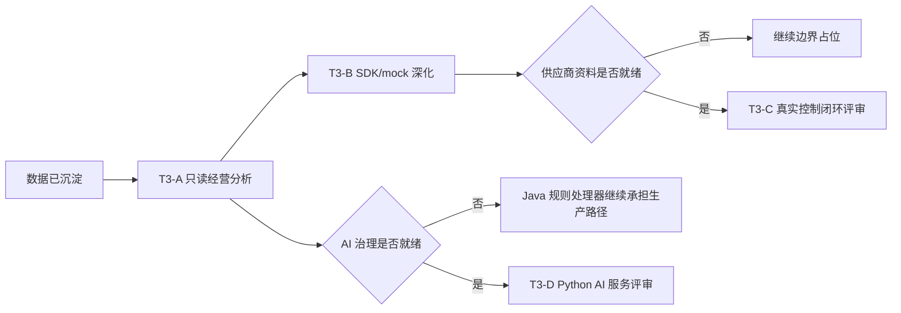

# T3 用户故事地图与迭代切片 V0.1

机器标记：T3_USER_STORY_MAP_READY
机器标记：T3-A_READONLY_ANALYTICS
机器标记：T3-B_SDK_MOCK_DEEPENING
机器标记：T3-C_VENDOR_CONTROL_BLOCKED
机器标记：T3-D_PYTHON_AI_BLOCKED

## 1. 总体旅程

T3 的目标不是扩写所有高级功能，而是在 P0/P1/P2 已形成的数据、接口、权限、审计和生产前置规则之上，谨慎推进更深的分析、供应商联调和智能化能力。

## 2. 角色与目标

| 角色 | 目标 | T3 关注点 |
|---|---|---|
| 总控 | 看清经营趋势和集团级对比 | 不希望高级分析误改业务账、票价或核销 |
| 运营经理 | 找到商户、员工、项目、票务和库存异常 | 需要只读洞察和可追溯指标口径 |
| IT/运维 | 控制供应商接入和服务稳定性 | 需要 SDK/mock、签名、回调、重试和告警证据 |
| 安全/合规 | 控制视频、AI、员工行为、客户数据风险 | 需要权限、留痕、数据最小化和保留期限 |
| 第三方供应商 | 按标准接口联调 | 需要明确字段映射、Webhook、错误码和沙箱 |

## 3. 用户故事地图

| 活动 | MVP / T3-A | 第二层 / T3-B | 未来 / T3-C/T3-D |
|---|---|---|---|
| 看经营全局 | 作为总控，我要查看集团/项目/商户/酒吧/游乐的趋势对比，以便判断经营方向 | 支持导出 mock 数据给外部分析工具 | 自动预测和经营建议，需 AI 治理后再开 |
| 看异常 | 作为运营经理，我要查看商户健康度、员工服务评分、客户意向和风险提示，以便安排人工复核 | 支持把异常样例发送给供应商 mock 或内部机器人 | 自动触发机器人/设备动作，需 T3-C 供应商就绪 |
| 做供应商联调 | 作为 IT，我要使用 SDK 示例、mock 回调和签名样例，以便减少联调成本 | 增加供应商沙箱回调、重试和补偿演示 | 真实生产控制和回调闭环，需真实 API/SDK |
| 做 AI 辅助 | 作为运营，我要看到 AI/规则质检的只读摘要，以便辅助人工判断 | 准备样本集和效果评估 | 独立 Python AI 服务，需模型/SLA/合规审批 |
| 审计追责 | 作为安全负责人，我要每个 T3 输出都能关联权限、主体和审计事件 | 增加供应商联调证据 | 视频、AI、设备控制证据归档和调阅审批 |

## 4. T3-A 候选任务

| 编号 | 用户故事 | 任务 | 验收 |
|---|---|---|---|
| T3A-US-001 | 总控查看集团级经营趋势 | 汇总 P2-D 指标快照，按集团/项目/商户维度只读展示 | 不修改财务主账、票价、核销和订单 |
| T3A-US-002 | 运营查看异常摘要 | 展示商户健康度、员工评分、客户意向和风险提示 | 明确指标来源和刷新时间 |
| T3A-US-003 | 运营追溯指标口径 | 每个指标显示口径、来源表、时间窗和排除项 | 测试可验证口径文本存在 |
| T3A-US-004 | 安全审计只读访问 | T3-A 页面和接口必须受权限保护 | 无权限访问被拒绝，并写审计事件 |

## 5. T3-B 候选任务

| 编号 | 用户故事 | 任务 | 验收 |
|---|---|---|---|
| T3B-US-001 | 供应商查看 SDK 示例 | 生成签名、请求、回调和错误示例 | 不包含真实密钥 |
| T3B-US-002 | IT 测试 mock 回调 | 提供 mock webhook 验签和重试示例 | 失败可重放，可查审计 |
| T3B-US-003 | 财务/运营查看补偿样例 | 展示差异、补偿、对账状态样例 | 不影响真实账务 |

## 6. T3-C/T3-D 阻断任务

| 编号 | 事项 | 当前状态 | 必要前置 |
|---|---|---|---|
| T3C-BLOCK-001 | 机器人真实任务指令 | blocked | API/SDK、签名、回调、沙箱、错误码、额度和验收证据 |
| T3C-BLOCK-002 | 视频真实调阅/片段绑定 | blocked | 播放 token、录像索引、保留期限、调阅审批、合规材料 |
| T3C-BLOCK-003 | 设备/闸机/NFC 控制 | blocked | 设备型号、SDK、离线策略、现场网络和失败回退 |
| T3D-BLOCK-001 | 独立 Python AI 服务 | blocked | 模型方案、数据集、SLA、隐私审查、降级 Runbook |

## 7. 验收标准

- T3-A 页面和接口只能只读。
- T3-A 指标必须可追溯来源和时间窗。
- T3-B 不得使用真实生产密钥。
- T3-C/T3-D 缺资料时必须保持 blocked，不得以 mock 成功伪装生产就绪。
- 所有 T3 变更仍必须在 160 运行验证链。

## 8. 变更记录

| 日期 | 版本 | 说明 |
|---|---|---|
| 2026-06-15 | V0.1 | 新增 T3 用户故事地图，按 T3-A、T3-B、T3-C、T3-D 分层。 |
