# 终端展示层产品规格 V0.2
> 2026-07-04 逻辑一致性修订：补名词四层脚注

> **口径修订（2026-08-05 R8）：「人工放行」已废止**——ENUM「核销记录状态」条·实测 L41 明确「**系统不提供人工放行：核销要么成功、要么拒绝或失败，任何岗位、任何权限都不能以人工方式让一笔不满足规则的核销通过**」（DEC-CFG-2026-08-03-12）。本文原有的「人工放行」取值、按钮、指标与复核类型**已从各处取值清单中移除**，移除处标注「原含『人工放行』，已废止·见文首口径」。

> **口径修订（2026-08-05 R8）：「场次容量」已废止**——BSM「容量控制」条·实测 L1167、PGM「游乐容量只按单个项目的实时在玩人数控制」条·实测 L478 明确「**只按单个游乐项目的实时在玩人数控制容量，不再按场次/时段或点位/设备另设容量；排队人数不占用容量**」（DEC-R5-2026-08-04-04；R8 用户裁决 D-02）。本文原「场次容量」一律改称「**项目容量（实时在玩人数）**」；文中仍按场次/时段维度罗列的低保真页面字段只作历史结构参考，容量口径一律以本条为准。

## 1. 文档定位

本文由归档前的同层 PRD/页面清单/字段字典/流程图/低保真说明/验收清单机械合并而来，作为该能力层后续开发、业务审计和验收的统一入口。原拆分文件已移入 `_archive/20260610-retention-audit/merged-layer-spec-sources/`，仅作历史追溯。

> **名词四层（业务口径）**：文中「综合体项目 / 商户（运营主体）/ SPV（项目公司）/ 组织主体」是业务分层称谓；底层数据库以 `business_entities` 一表多角色承载全部主体角色，并无独立 `organizations` 表，`projects` 表也不等同于「项目公司/SPV」。权威实体关系以 `merchant-space-contract-model-v0.1.md` 为准。

## 2. 合并来源

| 原文件 | 归档位置 |
|---|---|
| `terminal-display-layer-page-list-v0.1.md` | `_archive/20260610-retention-audit/merged-layer-spec-sources/terminal-display-layer-page-list-v0.1.md` |
| `terminal-display-layer-field-dictionary-v0.1.md` | `_archive/20260610-retention-audit/merged-layer-spec-sources/terminal-display-layer-field-dictionary-v0.1.md` |
| `terminal-display-layer-flow-diagrams-v0.1.md` | `_archive/20260610-retention-audit/merged-layer-spec-sources/terminal-display-layer-flow-diagrams-v0.1.md` |
| `terminal-display-layer-low-fi-prototype-v0.1.md` | `_archive/20260610-retention-audit/merged-layer-spec-sources/terminal-display-layer-low-fi-prototype-v0.1.md` |
| `terminal-display-layer-acceptance-checklist-v0.1.md` | `_archive/20260610-retention-audit/merged-layer-spec-sources/terminal-display-layer-acceptance-checklist-v0.1.md` |

> 历史来源不可覆盖声明：本文中的“来源”和合并来源内容仅保留审计证据和历史上下文，不得覆盖 `00-current-effective-document-entry-v0.1.md`、`unified-standards-baseline-v0.1.md`、`openapi/openapi-p0.yaml`、`p0-openapi-operation-acceptance-matrix-v0.1.md`、`p0-openapi-contract-closure-appendix-v0.1.md`、`p0-operation-permission-matrix-v0.1.md`、`p0-action-event-evidence-matrix-v0.1.md`、`p0-end-to-end-acceptance-and-edge-cases-v0.1.md` 和 `p0-user-story-map-and-sprint-slices-v0.1.md`。若历史段落与当前事实源冲突，以当前 S0/S1 文档为准。

## 2A. AI-ready 执行入口

本文是终端展示层产品规格入口，负责说明不同角色通过什么界面使用系统，不直接定义正式接口或终端能力开关实现。工作手机、平板、一体机、小程序/App/Web 和移动管理端进入开发前，必须回到 `openapi/openapi-p0.yaml/json`、`p0-openapi-operation-acceptance-matrix-v0.1.md` 和 `p0-openapi-contract-closure-appendix-v0.1.md` 校验 operation、终端、设备能力、权限、事件和样例准入；未进入追溯附录的端侧页面动作不得生成 SDK/mock、接口自动化或 Controller。

---

## 3. 来源：终端展示层页面清单 V0.1

> 原文件：`terminal-display-layer-page-list-v0.1.md`

### 终端展示层页面清单 V0.1

### 1. 文档定位

本文档定义终端展示层 P0 页面入口。终端展示层负责回答“不同角色通过什么界面使用系统”。

### 2. 终端总览

| 终端 | 页面组 | P0 目的 |
|---|---|---|
| 管理后台 | 总览、治理、经营、接入、风控、财务、分析 | 平台统一管理 |
| Web 前端 | Web 首页、信息查询、只读看板、票务/酒吧/游乐只读、异常摘要 | 移动端和业务信息的非编辑状态展示 |
| 商户侧页面 | 商户首页、经营记录、对账差异、结算依据、事件记录 | 商户看本商户事项 |
| 现场作业端/员工工作手机 | 上岗、设备、门票核销、权益核销、酒吧、游乐、巡检、补录、交接 | 现场员工完成核销和现场动作 |
| 工作人员平板 App | 工作台、酒吧定位、卡座/桌台定位、点酒下单、最低消费校验、支付引导 | 只负责酒吧点酒下单 |
| 触摸屏一体机 | 售票型：授权服务人员辅助购票、取票、订单查询；非售票型：扫码识别、权益领取、订台下单、吧台买酒、游乐状态、状态检查 | 固定点位现场服务；售票型承担授权服务人员辅助售票，非售票型不承担门票售卖 |
| 移动管理端 | 管理概览、待办、异常详情、复核 | 主管快速判断和处理 |
| 客人购票 App/小程序 | 首页、票务列表、预定、我的订单、我的票/权益、验票二维码、会员积分、积分兑换 | 游客官方购票、预定、查询、出示凭证和会员积分 |
| 员工私人手机 App | 注册提交、设备凭证绑定、设备检测、审批状态、通知中心、个人状态 | 员工自有手机只用于注册、通知和状态查看，不做现场业务 |

所有终端都必须有后台开关。开关关闭时，该端或该端上的指定模块不可用；开关打开后仍受登录、设备可信、商户范围、角色权限、单一功能权限和数据权限控制。

> 修订说明（2026-06-07）：本清单终端与基准 D5《终端类型枚举（10 端权威表）》映射（编码以 `terminal_capability_switches.terminal_type` 为唯一权威）：管理后台/Web 前端→`web`、商户侧页面→`merchant_portal`（商户侧 App `merchant_app` 为 P1+ 预留，P0 不实现）、现场作业端/员工工作手机→`staff_work_phone`、工作人员平板 App→`tablet`、触摸屏一体机→`kiosk`、移动管理端→`mobile_admin`、客人 App→`app`、小程序→`miniapp`、员工私人手机 App→`staff_private_phone`。不得用"员工端"笼统合并工作手机与私人手机（依据 D5、govfam-3）。

### 3. 管理后台页面

| 页面 | P0 内容 |
|---|---|
| 首页总览 | 综合体收入、客流、核销、异常、待办 |
| 平台治理 | 项目、空间、业态、商户、合同、合同准入、员工注册审批、设备凭证、设备、权限 |
| 业务经营 | 票务、酒吧、游乐经营入口 |
| 第三方接入 | 接入关系、回流、异常、差异 |
| 事件风控 | 事件中心、补录、复核、风险、证据 |
| 财务经营 | 流水、日结、对账、结算 |
| 数据分析 | 经营看板、收入、客流、核销、商户表现 |

### 4. Web 前端页面

| 页面 | P0 内容 |
|---|---|
| Web 首页 | 综合体概览、今日经营、公告、快捷入口 |
| 信息查询 | 票务、权益、订单、核销、酒吧、游乐、商户摘要 |
| 经营看板只读 | 收入、客流、核销、异常、商户表现 |
| 票务信息只读 | 票种、通票、权益状态、核销记录 |
| 酒吧信息只读 | 桌台状态、账单摘要、赠饮核销 |
| 游乐信息只读 | 项目开放、项目容量（实时在玩人数）、核销状态 |
| 异常与待办只读 | 待复核、风险提示、差异摘要 |
| 我的权限范围 | 当前用户可查看的数据范围 |

### 5. 商户侧页面

商户侧在授权业务范围内全开放，不看平台全局和其他商户。酒吧系统和游乐/乐园系统需要保留未来独立 SaaS 能力。

| 页面 | P0 内容 |
|---|---|
| 商户首页 | 本商户收入、订单、核销、差异、待办 |
| 商户资料 | 档案、合同摘要、空间、联系人 |
| 经营记录 | 本商户订单、核销、退款、回流结果 |
| 对账差异 | 本商户差异、处理状态、确认入口 |
| 结算依据 | 本商户结算周期、金额、状态 |
| 事件记录 | 本商户相关异常、补录、复核 |
| 业务工作台 | 本商户授权范围内的票务、酒吧、游乐、供应链、对账、员工和看板功能 |

### 6. 现场作业端页面

| 页面 | P0 内容 |
|---|---|
| 登录/上岗 | 员工、岗位、班次、责任区域 |
| 设备领用 | 领取设备、归还设备、异常上报 |
| 核销工作台 | 凭证识别、权益判断、核销、拒绝（原含「人工放行」，已废止·见文首口径） |
| 员工工作手机门票核销 | 扫客人 App/小程序或第三方票码防伪二维码，先验签再核销门票入场 |
| 员工工作手机权益核销 | 扫权益二维码，先做防伪核对，再核销赠饮、礼物、餐饮/零售券等领取资格 |
| 员工工作手机企业微信状态 | 企业微信绑定、每日会话上传状态、上传失败原因 |
| 员工工作手机设备策略 | 预装软件清单、应用白名单、网站白名单、违规提示 |
| 员工工作手机库房/交接扫码 | 酒水或物料平台唯一二维码、出库核验、机器人交接、后厨接收、服务员取走、送达确认 |
| 酒吧作业 | 入场、开台、赠饮核销、关台 |
| 游乐作业 | 项目核销、项目容量（实时在玩人数）、暂停上报 |
| 巡检记录 | 巡检项、结果、异常说明 |
| 人工补录 | 原因、对象、证据、提交复核 |
| 班次交接 | 未完成事项、设备归还、异常确认 |

### 7. 工作人员平板 App 页面

| 页面 | P0 内容 |
|---|---|
| 工作台首页 | 当前员工、班次、平板设备、当前酒吧、当前卡座/桌台 |
| 酒吧定位 | 选择或确认当前酒吧 |
| 卡座/桌台定位 | 选择或确认客人所在卡座、桌台或吧台位 |
| 点酒下单 | 选择酒水、套餐、数量、服务备注 |
| 最低消费校验 | 当前已点金额、最低消费要求、差额提示，未达标不可提交 |
| 订单确认 | 酒水明细、数量、金额、卡座、服务员、支付方式 |
| 支付二维码 | 生成二维码供客人手机扫码支付 |
| 扫客人付款码 | 平板扫描客人手机支付码完成支付 |
| 订单状态 | 待支付、已支付、已关闭、异常 |
| 卡座账单 | 当前卡座消费、最低消费达成情况、关台状态 |

### 8. 移动管理端页面

| 页面 | P0 内容 |
|---|---|
| 管理概览 | 今日收入、客流、核销、异常 |
| 待办中心 | 复核、差异、异常、补录 |
| 异常详情 | 事实、责任人、证据、处理动作 |
| 复核处理 | 通过、驳回、要求补充 |
| 业务概览 | 票务、酒吧、游乐关键状态 |

### 9. 客人购票 App/小程序页面

| 页面 | P0 内容 |
|---|---|
| 首页 | 综合体介绍、票务入口、活动/公告、推荐票种 |
| 票务列表 | 平日票、周末票、节假日票、学生票、多人票、通票 |
| 票务详情 | 价格、适用日期、人群、权益组成、使用限制 |
| 预定入口 | 日期、场次、人数、项目或套餐选择 |
| 酒吧订台 | 选择酒吧、日期、时段、卡座/桌台/吧台位、人数、备注（订台需支付定金） |
| 订台定金支付 | 订台位置、定金金额（分）、支付方式、到店/取消/退款状态 |
| 下单确认 | 票种、数量、游客信息、金额、优惠 |
| 支付结果 | 成功、失败、待支付、订单状态 |
| 我的订单 | 订单状态、退款状态、权益生成状态 |
| 我的票 | 票码、有效期、状态 |
| 我的权益 | 入场、游乐、酒水、餐饮/零售券 |
| 使用记录 | 已核销、退款、失效 |
| 验票二维码 | 可出示并被现场核销的防伪二维码 |
| 会员积分 | P0：积分余额、会员等级、最近积分摘要；P1：积分明细、消费积分规则详情 |
| 积分兑换 | P1：可兑换礼物、兑换条件、兑换发起、兑换记录；兑换成功必须扣减库存 |
| 信息查询 | 营业时间、游乐项目、酒吧规则、场地说明、常见问题 |

### 10. 员工私人手机 App 页面

> 修订说明（2026-06-07）：依基准 D8，"NFC绑定"页改为"设备凭证绑定"（设备公钥/不可逆设备指纹，废止读取手机本机 NFC 唯一标识方案）。

| 页面 | P0 内容 |
|---|---|
| 注册提交 | 员工姓名、手机号、所属主体、岗位申请、资料摘要 |
| 设备凭证绑定 | 生成并绑定设备公钥/不可逆设备指纹（存于设备 Keystore），先解绑旧设备凭证再绑定新设备 |
| 设备检测 | 设备指纹、系统版本、Root/调试检测结果 |
| 审批状态 | 待审核、已通过、已驳回、需复核、已失效 |
| 通知中心 | 工作通知、制度通知、排班提醒 |
| 个人状态 | 岗位、职级、权限摘要、公司工作手机绑定状态 |

### 11. 触摸屏一体机页面

| 页面 | P0 内容 |
|---|---|
| 辅助购票/取票/订单查询（售票型） | 展示可售票种、基础价/派生价、库存和可售日期，支持聚合支付、出票、防伪二维码展示、订单查询和取票 |
| 扫码识别 | 扫客人票码或权益码 |
| 可领取内容 | 展示可领取酒水、礼物、权益名称、数量、有效期 |
| 领取确认 | 展示领取完成、已领取、不可领取或异常原因 |
| 订台下单 | 选择酒吧、日期、时段、卡座/桌台/吧台位、人数和备注 |
| 吧台买酒 | 选择酒水、套餐、数量，生成待支付订单 |
| 支付引导 | 生成支付二维码，提示扫码支付或工作人员辅助收款 |
| 游乐状态 | 展示开放、排队、容量、暂停、关闭、故障、维护和安全提醒 |
| 状态检查 | 授权员工记录游乐设施检查结果、异常原因和处理状态 |

### 12. 页面验收标准

- Web 前端、后台、商户侧、现场端/员工工作手机、平板 App、触摸屏一体机、移动管理端、客人 App/小程序职责边界清晰。
- 管理后台有完整管理入口。
- Web 前端以非编辑状态查看为主，允许白名单内的少量业务确认（对账差异确认、异常待办标记已读、结算单查看确认，见 `terminal-page-product-prd §9.1`），其余处理跳转对应端。
- 商户侧不越权查看平台全局。
- 现场作业端和员工工作手机只保留现场高频动作和扫码核销。
- 员工工作手机核销前必须能展示防伪核对结果，包括签名、有效期、随机串和哈希校验。
- 员工工作手机必须展示企业微信绑定和每日会话上传状态，执行应用白名单和网站白名单。
- 员工私人手机 App 只做注册、通知、状态查看和设备凭证绑定，不能核销、点单、放行、结算或补录。
- 员工私人手机 App 不承接任何现场作业类审批/复核；管理类待办审批由移动管理端承载，私人手机 App 不承载审批/复核动作。
- 工作人员平板 App 只做酒吧点酒下单，不能购买门票，不能生成门票或游乐权益。
- 触摸屏一体机分售票型和非售票型：售票型可由授权服务人员辅助到店购票/取票/订单查询；非售票型可展示/确认可领取权益，也可做订台、吧台买酒、游乐状态查看和授权状态检查，但不承担门票售卖。
- 移动管理端不做复杂配置。
- 客人 App/小程序不展示后台术语，P0 必须能展示防伪验票二维码、会员积分摘要和等级；积分明细、礼物列表、兑换发起和兑换记录进入 P1。

### 13. 本版结论

终端展示层页面清单已覆盖 P0 角色入口和页面边界，并补充 Web 前端、工作人员平板 App、员工工作手机、员工私人手机 App、触摸屏一体机、客人购票 App/小程序等新增终端。

### 14. 变更日志

| 日期 | 类型 | 位置 | 内容 | 原因/依据 |
|---|---|---|---|---|
| 2026-06-07 | 增 | §2 终端总览 | 补 D5 10 端枚举映射说明 | 终端枚举对齐 D5（D5、govfam-3） |
| 2026-06-07 | 增 | §9 客人 App 页面 | 新增"酒吧订台""订台定金支付" | 客人端订台+定金缺页（webmobile-6）；金额=分(D1) |
| 2026-06-07 | 增 | §12 验收 | 补私人手机 App 审批禁项 | 审批禁项漏列易被误读为可远程审批（webmobile-8） |
| 2026-06-07 | 改 | §2、§3、§10、§12 | "NFC/NFC绑定"改为"设备凭证/设备凭证绑定" | 对齐基准 D8 |
| 2026-06-07 | 改 | §12 验收 | Web"非编辑状态查看为主"补白名单少量确认 | 与 webmobile-1/2 口径对齐 |

---

## 4. 来源：终端展示层字段字典 V0.1

> 原文件：`terminal-display-layer-field-dictionary-v0.1.md`

### 终端展示层字段字典 V0.1

### 1. 文档定位

本文档定义终端展示层 P0 页面字段和终端上下文字段，用于保证不同端展示范围一致。

### 2. 终端上下文字段

| 字段名 | 含义 | 适用终端 |
|---|---|---|
| 当前用户 | 登录或使用系统的人 | 全部 |
| 当前角色 | 管理层、运营、商户、现场员工、游客等 | 全部 |
| 当前项目 | 所属综合体项目 | 后台、商户侧、现场端、移动端 |
| 当前商户 | 当前数据归属商户 | 商户侧、后台 |
| 当前查看模式 | 只读、可处理、可编辑 | Web 前端、后台、移动端 |
| 当前班次 | 现场员工作业班次 | 现场端 |
| 当前设备 | 员工使用设备 | 现场端 |
| 当前设备凭证 | 员工绑定的设备公钥/不可逆设备指纹摘要 | 员工私人手机 App、现场端 |
| 当前点位 | 员工当前作业位置 | 现场端 |
| 当前酒吧 | 平板点酒所绑定的酒吧 | 工作人员平板 App |
| 当前卡座/桌台 | 平板点酒所绑定的位置 | 工作人员平板 App |
| 数据范围 | 可查看的数据边界 | 后台、商户侧、移动端 |
| 跨端来源 | Web、App、小程序、平板、工作手机、一体机、后台等 | 全部 |
| 终端开关状态 | 当前终端或模块是否启用 | 全部 |
| 终端开关范围 | 全局、综合体项目、商户、业务系统、模块、设备或版本 | 全部 |

### 3. 管理后台字段

| 字段名 | 含义 | 用途 |
|---|---|---|
| 业务模块 | 平台治理、票务、酒吧、游乐等 | 导航 |
| 待办数量 | 当前待处理事项 | 首页 |
| 异常数量 | 当前异常事项 | 风控 |
| 筛选条件 | 项目、业态、商户、日期、状态 | 列表 |
| 操作权限 | 当前用户可执行动作 | 权限控制 |

### 4. Web 前端字段

> 修订说明（2026-06-07）：补"确认动作类型/确认状态/确认意见"三字段，承载 Web P0 白名单内的少量业务确认动作（对账差异确认、异常待办标记已读、结算单查看确认），与 `terminal-page-product-prd §9.1`、`flow-diagrams F2` 对齐（finding webmobile-1）。

| 字段名 | 含义 | 用途 |
|---|---|---|
| 查看用户 | 当前查看信息的业务人员 | 权限 |
| 查看范围 | 可查看项目、商户、业态、空间 | 数据边界 |
| 只读标识 | 当前页面是否禁止编辑 | 页面控制 |
| 信息来源 | 来自后台、移动端、业务经营或数据分析 | 溯源 |
| 展示对象 | 票务、权益、订单、酒吧、游乐、异常等 | 查询 |
| 更新时间 | 展示内容最近更新时间 | 可信度 |
| 确认动作类型 | 对账差异确认、异常待办标记已读、结算单查看确认（白名单枚举） | 轻量确认 |
| 确认状态 | 待确认、已确认（或未读→已读） | 轻量确认 |
| 确认意见 | 确认人填写的说明或备注 | 留痕/审计 |
| 确认人和时间 | 执行确认的用户与时间 | 留痕/审计 |

### 5. 商户侧字段

| 字段名 | 含义 | 用途 |
|---|---|---|
| 商户名称 | 当前商户 | 页面标题 |
| 商户状态 | 正常、暂停、终止等 | 展示 |
| 本商户收入 | 商户经营收入 | 首页 |
| 本商户订单 | 商户订单或回流结果 | 经营记录 |
| 本商户差异 | 商户对账差异 | 对账 |
| 本商户事件 | 商户相关事件 | 留痕 |

### 6. 现场作业端字段

| 字段名 | 含义 | 用途 |
|---|---|---|
| 员工姓名 | 当前现场员工 | 上岗 |
| 岗位 | 当前岗位 | 上岗 |
| 班次 | 当前班次 | 作业范围 |
| 设备编号 | 领用设备 | 责任链 |
| 点位 | 当前作业位置 | 核销/巡检 |
| 凭证 | 票码、权益码或游客凭证 | 核销 |
| 门票二维码 | 客人 App/小程序或第三方渠道防伪票码 | 门票核销 |
| 权益二维码 | 赠饮、礼物、餐饮/零售券等权益防伪码 | 权益核销 |
| 防伪签名结果 | 二维码签名是否有效 | 核销前判断 |
| 防伪串码状态 | 防伪串码是否匹配 | 核销前判断 |
| 二维码有效期 | 二维码当前是否在有效期内 | 核销前判断 |
| 凭证哈希 | 本次提交凭证的哈希摘要 | 事后核对 |
| 作业结果 | 成功、拒绝、人工处理、异常 | 留痕 |
| 交接事项 | 未完成事项和异常 | 交接 |
| 物品追踪码 | 酒水或物料的平台唯一二维码 | 出库、交接、后厨接收、送达 |
| 上一交接节点 | 当前物品上一责任节点 | 交接 |
| 下一交接节点 | 当前物品下一责任节点 | 交接 |

### 7. 工作人员平板 App 字段

| 字段名 | 含义 | 用途 |
|---|---|---|
| 点酒员工 | 帮客人在酒吧点酒下单的员工 | 责任链 |
| 平板设备编号 | 使用的平板设备 | 责任链 |
| 所属酒吧 | 当前平板绑定的酒吧 | 点酒范围 |
| 卡座/桌台 | 当前客人所在位置 | 下单定位 |
| 酒水/套餐 | 客人选择的酒水、套餐或酒吧消费项目 | 点酒 |
| 数量 | 酒水或套餐数量 | 点酒 |
| 最低消费 | 当前卡座或酒吧要求的最低消费 | 下单校验 |
| 当前已点金额 | 当前订单或卡座已点金额 | 判断是否满足最低消费 |
| 差额提示 | 未满足最低消费时的差额 | 下单限制 |
| 订单金额 | 应付金额 | 订单确认 |
| 支付状态 | 待支付、已支付、失败、关闭 | 订单判断 |
| 支付二维码 | 供客人手机扫码支付的二维码 | 支付 |
| 客人付款码 | 客人手机展示、由平板扫描的付款码 | 支付 |
| 卡座账单状态 | 进行中、待支付、已支付、已关台、异常 | 酒吧账单 |

### 8. 移动管理端字段

| 字段名 | 含义 | 用途 |
|---|---|---|
| 今日指标 | 收入、客流、核销、异常 | 概览 |
| 待办类型 | 复核、差异、补录、异常 | 待办 |
| 处理动作 | 通过、驳回、要求补充 | 复核 |
| 处理意见 | 管理端处理说明 | 审计 |

### 9. 客人购票 App/小程序字段

| 字段名 | 含义 | 用途 |
|---|---|---|
| 游客标识 | 游客或会员身份 | 展示 |
| 手机号 | 游客身份和订单关联 | 登录/查询 |
| 预定信息 | 日期、人数、场次或项目 | 预定 |
| 订台位置 | 选择的酒吧、卡座/桌台/吧台位、日期时段 | 酒吧订台 |
| 订台定金金额 | 订台需支付的定金金额（单位：分(整数)，基准 D1） | 订台定金支付 |
| 订台状态 | 待支付定金、已订台、到店、取消、退款 | 订台跟踪 |
| 订单号 | 游客订单识别 | 查询 |
| 支付状态 | 待支付、已支付、失败、关闭 | 查询 |
| 票码 | 可出示凭证，关联防伪串码和核对记录 | 入场 |
| 验票二维码 | 可被现场核销的防伪二维码 | 核销 |
| 二维码签名版本 | 当前二维码使用的签名版本 | 防伪核对 |
| 二维码有效期 | 二维码可展示或可核验时间 | 防伪核对 |
| 防伪核对状态 | 未核对、通过、失败、疑似变造 | 使用记录 |
| 权益名称 | 游客可用权益 | 展示 |
| 有效期 | 权益可用时间 | 判断 |
| 权益状态 | 可使用、已使用、已退款等 | 展示 |
| 使用记录 | 已核销或退款历史 | 查询 |
| 会员等级 | 当前会员等级 | 会员 |
| 积分余额 | 当前可用积分 | 会员 |
| 积分明细 | 消费获得、后台调整、兑换扣减等记录 | 会员 |
| 兑换礼物 | 可用积分兑换的礼物或权益 | 积分兑换 |
| 兑换记录 | 已兑换内容和状态 | 积分兑换 |
| 小程序同步状态 | App 与小程序数据是否一致 | 跨端 |

### 10. 员工私人手机 App 字段

> 修订说明（2026-06-07）：依基准 D8，"NFC标识"改为"设备凭证指纹"（设备公钥/不可逆设备指纹，仅存不可逆哈希），废止读取手机本机 NFC 唯一标识方案。§2 终端上下文字段"当前NFC标识"同步改为"当前设备凭证"。

| 字段名 | 含义 | 用途 |
|---|---|---|
| 注册姓名 | 员工提交姓名 | 注册 |
| 注册手机号 | 员工提交手机号 | 注册和审核 |
| 申请岗位 | 员工申请岗位 | 后台审核 |
| 设备凭证指纹 | 员工绑定的设备公钥/不可逆设备指纹摘要 | 身份可信确认 |
| 私人手机设备指纹 | 自有手机设备指纹摘要 | 设备一致性判断 |
| Root检测结果 | 正常、Root、调试、未知 | 风险判断 |
| 注册审批状态 | 待审核、已通过、已驳回、需复核、已失效 | 状态查看 |
| 职级摘要 | 审核通过后的员工职级摘要 | 状态查看 |
| 对应工作手机 | 公司发放工作手机绑定状态 | 现场作业资格判断 |

### 11. 触摸屏一体机字段

| 字段名 | 含义 | 用途 |
|---|---|---|
| 扫码凭证 | 客人票码、权益码、会员码或订单码 | 识别 |
| 可领取权益 | 可领取的酒水、礼物或其他权益 | 展示 |
| 可领取数量 | 当前可领取数量 | 展示 |
| 领取限制 | 有效期、领取地点、领取次数等 | 判断 |
| 领取状态 | 可领取、已领取、不可领取、异常 | 展示 |
| 领取结果 | 领取完成后的结果 | 回写 |
| 订台酒吧 | 客人选择的酒吧 | 订台下单 |
| 订台日期时段 | 日期、开始时间、结束时间 | 订台下单 |
| 卡座/桌台/吧台位 | 客人选择的位置 | 订台下单 |
| 订台人数 | 到店人数 | 订台下单 |
| 吧台商品 | 酒水、套餐、数量和金额 | 吧台买酒 |
| 支付状态 | 待支付、已支付、失败、关闭 | 支付引导 |
| 游乐设施状态 | 开放、排队、容量、暂停、关闭、故障、维护 | 状态查看 |
| 状态检查结果 | 正常、异常、需暂停、已处理 | 授权员工检查 |
| 检查人和点位 | 员工、设备、点位和时间 | 留痕 |

### 12. 字段验收标准

- 所有端必须有当前用户或游客标识。
- Web 前端必须有只读标识和查看范围；承载白名单确认动作时必须有确认动作类型、确认状态、确认意见、确认人和时间。
- 商户侧必须有商户数据边界字段。
- 现场端必须有员工、班次、设备、点位。
- 现场端和员工工作手机必须有防伪签名结果、防伪串码状态、二维码有效期和凭证哈希。
- 平板 App 点酒下单必须绑定员工、设备、酒吧、卡座/桌台和最低消费校验结果。
- 平板 App 不得出现票种、门票、游乐权益购买字段。
- 移动管理端处理动作必须有处理意见。
- 客人 App/小程序必须有订单、票、权益、预定、酒吧订台（订台位置、订台定金金额、订台状态）、防伪二维码、会员积分、等级和兑换字段。
- App 与小程序必须有同一订单、权益、积分和兑换状态口径。
- 员工工作手机必须有门票二维码、权益二维码、员工、设备、点位和核销结果。
- 员工私人手机 App 必须有注册资料、设备凭证指纹、设备指纹、Root检测、审批状态和对应工作手机字段。
- 触摸屏一体机必须能展示/领取权益，形成订台订单、吧台买酒订单、支付状态、游乐设施状态和授权状态检查记录。

### 13. 本版结论

终端展示层字段已覆盖不同角色入口和数据边界要求，并补充 Web 前端、工作人员平板 App、员工工作手机、员工私人手机 App、触摸屏一体机、客人购票 App/小程序的关键字段。

### 14. 变更日志

| 日期 | 类型 | 位置 | 内容 | 原因/依据 |
|---|---|---|---|---|
| 2026-06-07 | 增 | §4 Web 前端字段 | 增"确认动作类型/确认状态/确认意见/确认人和时间" | 承载 Web P0 业务确认动作（webmobile-1） |
| 2026-06-07 | 增 | §9 客人 App 字段 | 增"订台位置/订台定金金额/订台状态" | 客人端订台+定金缺字段（webmobile-6）；金额=分(D1) |
| 2026-06-07 | 改 | §2、§10、§12 | "NFC标识/当前NFC标识"改为"设备凭证/设备凭证指纹" | 对齐基准 D8（废止读取手机本机 NFC 唯一标识） |

---

## 5. 来源：终端展示层关键流程图 V0.1

> 原文件：`terminal-display-layer-flow-diagrams-v0.1.md`

### 终端展示层关键流程图 V0.1

### 1. 文档定位

本文档描述终端展示层 P0 流程，明确不同终端如何承接业务。

### 2. F1 管理后台处理流程

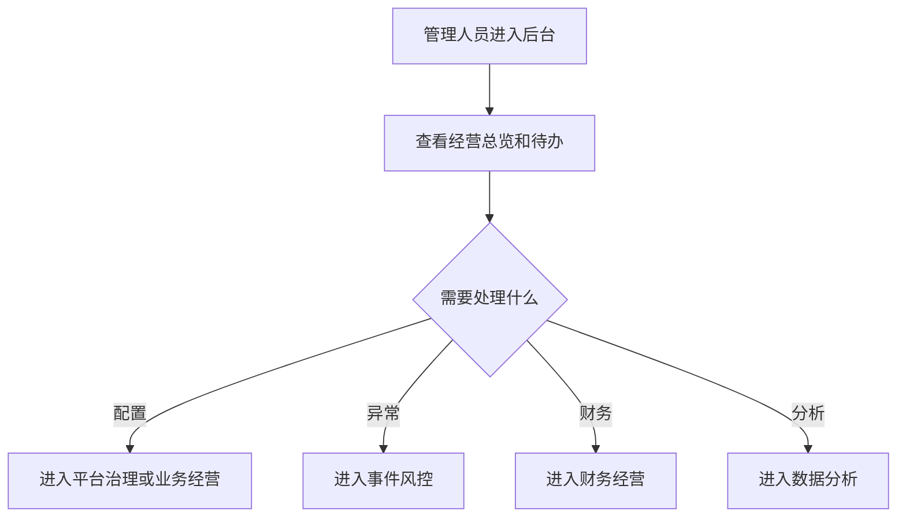

### 3. F2 Web 前端查看与轻量确认流程

> 修订说明（2026-06-07）：原 F2 否认 Web 端任何"业务确认"能力，与 PRD/验收"允许少量业务确认动作"自相矛盾（finding webmobile-2）。此处把"纯只读"改为"以只读为主+白名单内少量确认"，补一条"轻量确认"分支；白名单（对账差异确认、异常待办标记已读、结算单查看确认）见 `terminal-page-product-prd §9.1`，排除项见 §9.2。

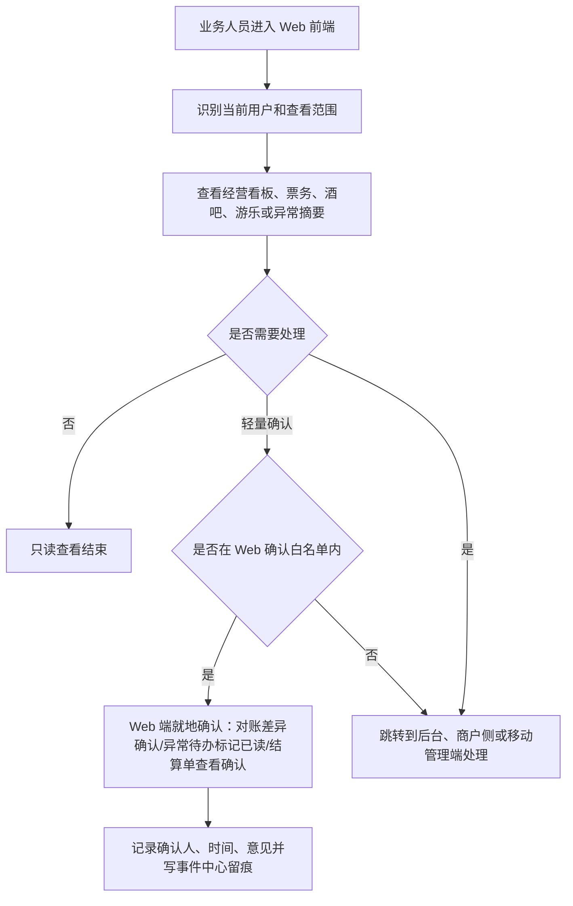

### 4. F3 商户侧使用流程

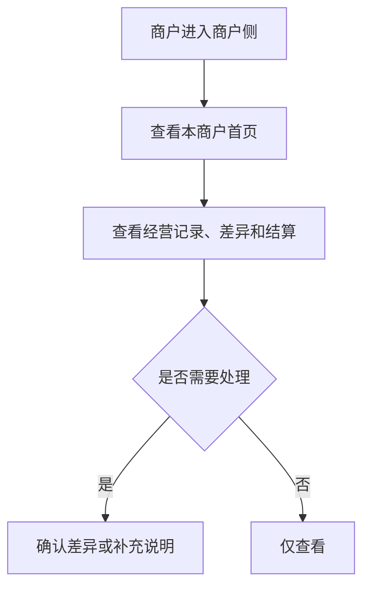

### 5. F4 现场作业端流程

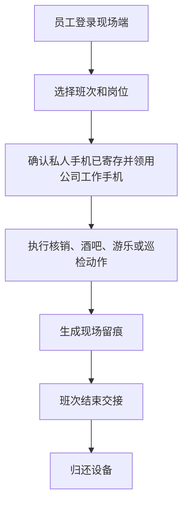

### 6. F5 工作人员平板 App 酒吧点酒下单流程

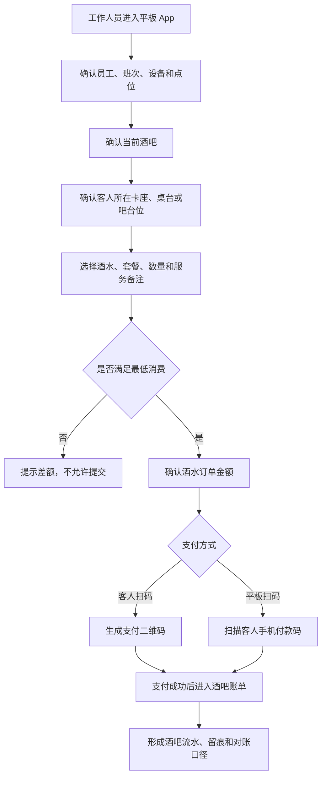

### 7. F6 移动管理端复核流程

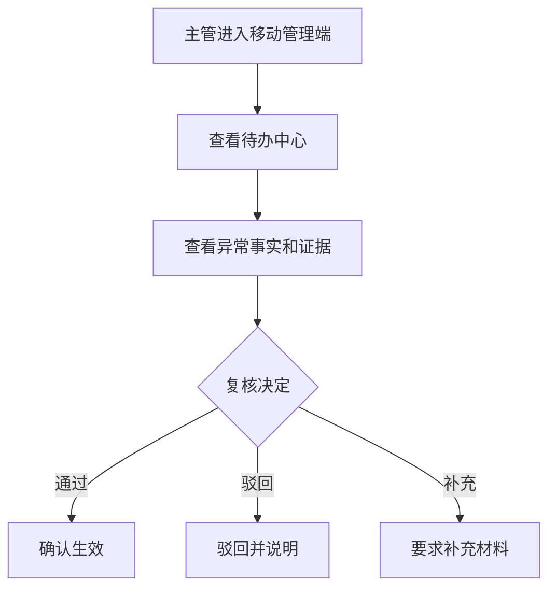

### 8. F7 客人购票 App/小程序流程

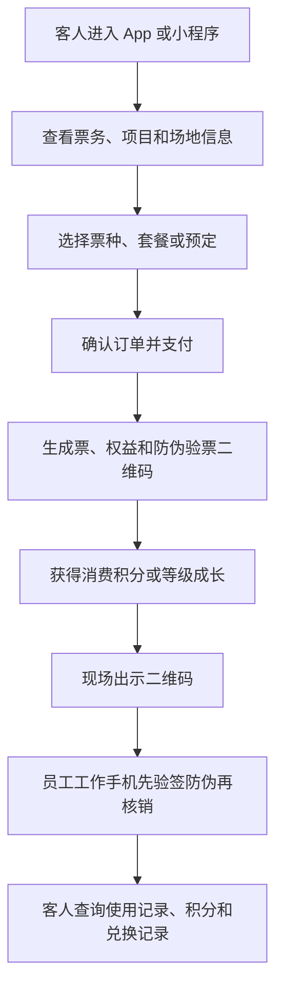

### 9. F8 App 与小程序打通流程

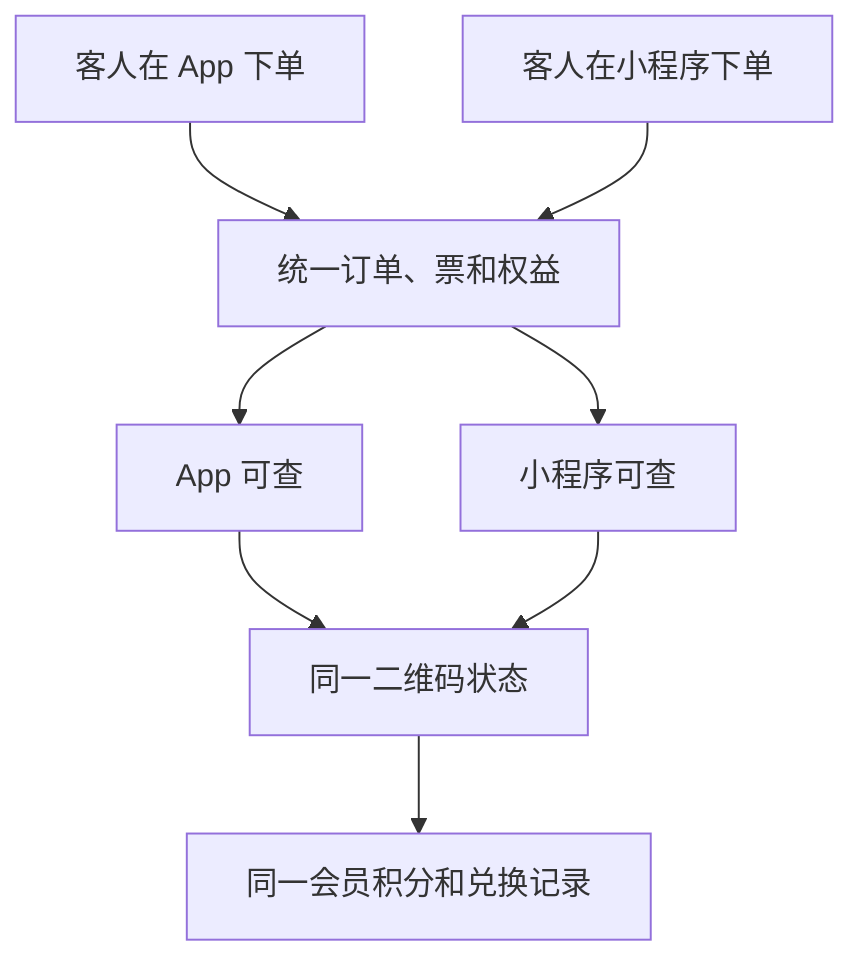

### 10. F9 员工工作手机核销流程

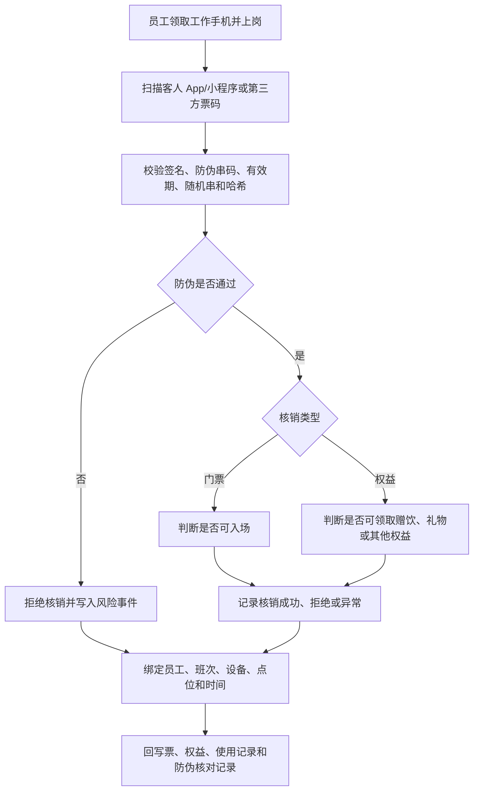

### 11. F10 员工私人手机 App 注册流程

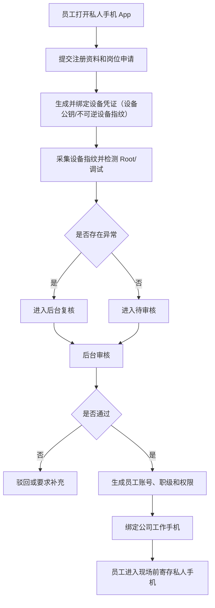

### 12. F11 触摸屏一体机自助服务流程

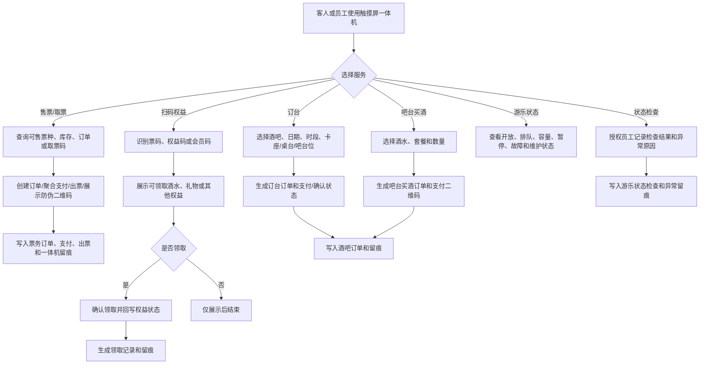

### 13. 流程验收标准

- 后台负责配置、复核、对账和分析。
- Web 前端以只读查看为主，允许白名单内的少量业务确认（对账差异确认、异常待办标记已读、结算单查看确认，见 `terminal-page-product-prd §9.1`），其余需要处理时跳到对应端。
- 商户侧只处理本商户事项。
- 现场端必须形成作业留痕。
- 现场端领用公司工作手机前，必须能确认员工注册/设备凭证/设备对应关系；私人手机只做注册和通知。
- 工作人员平板 App 只做酒吧点酒下单，必须绑定员工、设备、班次、酒吧和卡座/桌台。
- 平板点酒必须校验最低消费，未满足最低消费不可提交。
- 门票主路径由客人通过官方 App/小程序或第三方渠道自助购买；少量到店服务场景由授权服务人员通过售票型一体机辅助购票。
- 员工工作手机负责核销门票、赠饮和其他权益，核销前必须校验防伪签名、防伪串码、有效期和哈希。
- 员工私人手机 App 只负责注册、通知、状态查看和设备凭证绑定，不允许核销、点单、放行、结算、补录或审批/复核。
- 触摸屏一体机分售票型和非售票型；售票型负责授权服务人员辅助购票、取票和订单查询，非售票型负责展示/领取权益，也可做订台下单、吧台买酒下单、游乐状态查看和授权状态检查，不承担门票售卖。
- 移动端可处理待办但不承担复杂配置。
- 客人 App/小程序能完成官方购票、预定/订台、防伪二维码展示和会员积分摘要查看；兑换记录查看进入 P1。
- App 与小程序的订单、票、权益、二维码、积分摘要状态必须一致；兑换状态一致性在 P1 兑换能力中验收。

### 14. 本版结论

终端展示层流程已覆盖 P0 各角色使用路径，并补充 Web 前端、工作人员平板 App、员工工作手机、员工私人手机 App、触摸屏一体机、客人购票 App/小程序的关键流程。

### 15. 变更日志

| 日期 | 类型 | 位置 | 内容 | 原因/依据 |
|---|---|---|---|---|
| 2026-06-07 | 改 | §3 F2 | "纯只读"改为"以只读为主+白名单内少量确认"，补"轻量确认"分支与留痕 | F2 否认确认能力与 PRD/验收矛盾（webmobile-2/1） |
| 2026-06-07 | 改 | §11 F10、§13 验收 | 私人手机"绑定 NFC 标识"改为"生成并绑定设备凭证" | 对齐基准 D8（废止读取手机本机 NFC 唯一标识） |

---

## 6. 来源：终端展示层低保真原型说明 V0.1

> 原文件：`terminal-display-layer-low-fi-prototype-v0.1.md`

### 终端展示层低保真原型说明 V0.1

### 1. 文档定位

本文档说明终端展示层低保真结构。它不定义视觉样式，只定义页面组织和交互重心。

### 2. 管理后台低保真

结构：
- 左侧主导航：平台治理、业务经营、第三方、事件风控、财务、数据分析。
- 顶部全局筛选：项目、日期、业态、商户。
- 主区域：列表、详情、看板或工作台。
- 右侧或详情区：待办、风险、关联对象。

### 3. Web 前端低保真

结构：
- 顶部显示当前用户、查看范围和只读标识。
- 首页展示综合体概览、今日经营、公告和快捷入口。
- 信息查询页展示票务、权益、订单、核销、酒吧、游乐、商户摘要。
- 看板页展示收入、客流、核销、异常、商户表现。
- 详情页显示来源、更新时间、关联对象和跳转入口。

重点：
- 默认不编辑，以只读展示为主。
- 能承接移动端 App 展示内容。
- 业务人员可在非编辑状态查看信息，并可执行白名单内的少量业务确认（对账差异确认、异常待办标记已读、结算单查看确认，见 `terminal-page-product-prd §9.1`），确认动作需记录确认人/时间/意见并写留痕；其余处理跳转对应端。

### 4. 商户侧低保真

结构：
- 顶部显示商户名称和数据范围。
- 首页展示本商户今日经营和待处理事项。
- 二级页：经营记录、对账差异、结算依据、事件记录。

重点：
- 不显示平台全局指标。
- 所有列表默认限制在本商户。
- 在授权业务范围内全开放，可操作本商户可用的酒吧、游乐/乐园、供应链、对账和看板功能。
- 酒吧和游乐/乐园侧低保真要保留未来独立 SaaS 化的空间。
- 商户侧入口和模块受后台开关控制，便于后续按商户启用独立 SaaS 能力。

### 5. 现场作业端低保真

结构：
- 首页显示员工、班次、设备、点位。
- 大入口：门票核销、权益核销、酒吧、游乐、巡检、补录、交接。
- 工作页强调单一主动作。
- 最近操作记录和异常提醒常驻。
- 员工工作手机首屏突出扫码核销，扫客人 App/小程序或第三方票码防伪二维码。

重点：
- 适配安卓手机和平板。
- 操作少步骤、强状态、清晰反馈。
- 员工工作手机用于门票和权益核销，核销前展示防伪签名、有效期和哈希核对结果，不用于售票。
- 员工工作手机还要承接库房和交接扫码，展示物品二维码、订单匹配结果、上一节点、下一节点和异常上报入口。
- 终端启动和进入模块前要读取后台开关状态，关闭的端或模块不能进入业务动作。

### 6. 工作人员平板 App 低保真

结构：
- 首页显示员工、班次、平板设备、当前酒吧、当前卡座/桌台。
- 酒吧定位页确认当前属于哪个酒吧。
- 卡座/桌台定位页确认客人所在位置。
- 点酒下单页选择酒水、套餐、数量和服务备注。
- 最低消费校验区展示最低消费、当前金额、差额，未达标时不可提交。
- 订单确认页展示酒水明细、金额、卡座、服务员和支付方式。
- 支付页支持生成二维码给客人手机扫码，也支持平板扫描客人手机付款码。
- 卡座账单页展示当前消费、最低消费达成情况和关台状态。

重点：
- 只用于酒吧点酒下单，不允许购买门票。
- 所有点酒动作绑定员工、设备、班次、酒吧和卡座/桌台。
- 必须先满足最低消费才能提交点酒订单。

### 7. 移动管理端低保真

结构：
- 今日概览。
- 待办中心。
- 异常详情。
- 复核操作区。

重点：
- 不做复杂配置。
- 每个处理动作都要求意见或说明。

### 8. 客人购票 App/小程序低保真

结构：
- 首页：综合体信息、票务入口、活动公告、推荐票种。
- 票务列表：平日票、周末票、节假日票、学生票、多人票、通票。
- 预定入口：日期、人数、场次、项目或套餐选择。
- 下单确认：票种、数量、金额、游客信息、优惠。
- 我的订单：订单状态、退款状态、权益生成状态。
- 我的票。
- 我的权益。
- 防伪验票二维码。
- 使用记录。
- 会员中心：P0 展示积分余额、会员等级和最近积分摘要；积分明细进入 P1。
- 积分兑换：P1 展示可兑换礼物、兑换条件、兑换发起和兑换记录。
- 信息查询：营业时间、项目介绍、酒吧规则、常见问题。

重点：
- 用游客能理解的语言。
- 不展示内部状态和后台术语。
- App 和小程序展示同一订单、票、权益、防伪二维码和会员积分摘要；兑换状态进入 P1。
- 门票主路径由客人通过官方 App/小程序或第三方渠道自助购买；少量到店服务场景由授权服务人员通过售票型一体机辅助购票。

### 9. 员工私人手机 App 低保真

> 修订说明（2026-06-07）：依基准 D8，"NFC绑定页"改为"设备凭证绑定页"（设备公钥/不可逆设备指纹，废止读取手机本机 NFC 唯一标识方案）；并补充私人手机 App 不承接任何现场作业类审批/复核的重点（finding webmobile-8）。

结构：
- 注册页：填写姓名、手机号、所属主体和岗位申请。
- 设备凭证绑定页：生成并绑定设备公钥/不可逆设备指纹（存于设备 Keystore），先解绑旧设备凭证再绑定新设备。
- 设备检测页：展示设备指纹、系统版本、Root/调试检测结果。
- 审批状态页：展示待审核、已通过、已驳回、需复核、已失效。
- 通知页：查看工作通知、制度通知和排班提醒。
- 个人状态页：展示岗位、职级、权限摘要和公司工作手机绑定状态。

重点：
- 私人手机 App 不做现场业务操作；不承接任何现场作业类审批/复核，管理类审批由移动管理端承载。
- Root、调试、设备指纹变化或设备凭证不匹配时，页面应明确提示失效和复核状态。
- 员工进入办公区或现场作业区后，私人手机需要寄存；现场使用公司工作手机。

### 10. 触摸屏一体机低保真

结构：
- 扫码区：识别客人票码或权益码。
- 可领取内容区：展示酒水、礼物或其他权益名称、数量、有效期。
- 状态区：可领取、已领取、不可领取、异常。
- 结果区：领取完成后展示结果并回写记录。
- 售票区（售票型）：可售票种、基础价/派生价、库存、订单查询、取票码、支付二维码和防伪二维码。
- 自助服务区：订台、吧台买酒、游乐状态三个大按钮入口。
- 订台区：选择酒吧、日期、时段、卡座/桌台/吧台位、人数和备注。
- 买酒区：选择酒水、套餐、数量、金额和支付二维码。
- 游乐状态区：展示开放、排队、容量、暂停、关闭、故障和维护。
- 状态检查区：授权员工记录检查结果、异常原因和处理状态。

重点：
- 售票型可由授权服务人员辅助购票、取票和订单查询；非售票型可做权益展示/领取、订台、吧台买酒、游乐状态查看和授权状态检查，不承担售票；所有一体机都不承担后台配置。
- 页面文字必须让客人和现场员工一眼看懂能做什么、是否需要支付、是否需要工作人员处理。

### 11. 验收标准

- 九类入口都有清晰首页或首屏。
- 不同终端的信息密度不同。
- Web 前端以只读展示为主，允许白名单内的少量业务确认（见 `terminal-page-product-prd §9.1`）。
- 现场端和员工工作手机优先扫码核销效率。
- 员工工作手机核销前必须清楚展示防伪核对结果。
- 员工私人手机 App 优先注册、设备凭证绑定、审批状态和通知，不得出现现场核销、点单、放行、结算入口，也不承接任何审批/复核。
- 平板 App 优先酒吧点酒效率和最低消费校验。
- 触摸屏一体机优先让客人快速完成扫码、订台、吧台买酒和游乐状态查看。
- 管理端优先判断和复核。
- 商户端优先边界和确认。
- 客人 App/小程序优先官方购票、预定、防伪二维码、会员积分、兑换和查询。

### 12. 本版结论

终端展示层低保真已覆盖 P0 多角色、多终端的使用结构，并补充 Web 前端、工作人员平板 App、员工工作手机、员工私人手机 App、触摸屏一体机、客人购票 App/小程序。

### 13. 变更日志

| 日期 | 类型 | 位置 | 内容 | 原因/依据 |
|---|---|---|---|---|
| 2026-06-07 | 改 | §3、§11 | Web 重点/验收补"白名单少量业务确认" | Web"少量业务确认"口径对齐（webmobile-1/2） |
| 2026-06-07 | 改 | §9、§11 | "NFC绑定"改"设备凭证绑定"，补私人手机审批禁项 | 设备身份对齐 D8；审批禁项统一（webmobile-8） |

---

## 7. 来源：终端展示层产品验收清单 V0.1

> 原文件：`terminal-display-layer-acceptance-checklist-v0.1.md`

### 终端展示层产品验收清单 V0.1

### 1. 文档定位

本文档用于验收终端展示层产品文档是否完整。

### 2. 文档完整度

| 文档 | 状态 |
|---|---|
| `terminal-page-product-prd-v0.1.md` | 已完成 |
| `terminal-display-layer-page-list-v0.1.md` | 已完成 |
| `terminal-display-layer-field-dictionary-v0.1.md` | 已完成 |
| `terminal-display-layer-flow-diagrams-v0.1.md` | 已完成 |
| `terminal-display-layer-low-fi-prototype-v0.1.md` | 已完成 |
| `web-mobile-app-terminal-extension-product-prd-v0.1.md` | 已完成 |

### 3. 终端覆盖验收

| 终端 | 结果 |
|---|---|
| 管理后台 | 通过 |
| Web 前端 | 通过 |
| 商户侧页面 | 通过 |
| 现场作业端 | 通过 |
| 工作人员平板 App | 通过 |
| 员工工作手机 | 通过 |
| 员工私人手机 App | 通过 |
| 触摸屏一体机 | 通过 |
| 移动管理端 | 通过 |
| 客人购票 App/小程序 | 通过 |

### 4. 边界验收

- 后台负责配置、复核、财务和分析。
- Web 前端负责非编辑状态查看，并允许白名单内的少量业务确认（对账差异确认、异常待办标记已读、结算单查看确认，见 `terminal-page-product-prd §9.1`），不能替代后台配置。
- 商户侧只看本商户数据。
- 现场端只承接现场高频动作。
- 工作人员平板 App 只负责酒吧点酒下单，不能帮客人购买门票。
- 员工工作手机负责扫码核销门票、赠饮和其他权益，核销前必须校验防伪签名、防伪串码、有效期和哈希。
- 员工私人手机 App 只负责注册、通知、状态查看和设备凭证绑定（设备公钥/不可逆设备指纹，基准 D8），不能核销、点单、放行、结算、补录或审批/复核；管理类审批由移动管理端承载。
- 员工工作手机只允许企业微信工作沟通，企业微信会话每天自动上传后台。
- 员工工作手机不允许安装除预装软件之外的任何软件，只允许访问白名单网站。
- 后台必须能查看企业微信上传状态、基础违规命中和复核状态。
- 售票型触摸屏一体机负责授权服务人员辅助购票、取票和订单查询；非售票型触摸屏一体机负责扫码展示/领取权益，也可做订台下单、吧台买酒下单、游乐设施状态查看和授权状态检查。
- 移动端负责待办和复核。
- 客人 App/小程序负责官方购票、预定、查询信息、展示防伪验票二维码和会员积分摘要；积分兑换进入 P1。
- 第三方渠道购票结果需要进入平台订单、票、权益、核销和对账口径。
- 客人 App 和小程序的订单、票、权益、二维码和积分摘要必须一致；兑换状态进入 P1 后再验收一致性。

### 5. 已确认规则和后续细化事项

已确认：

1. 官方购票入口 App 和小程序同步建设；美团、大众点评、抖音 P0 只做团购购票回流。
2. 积分兑换礼物需要扣减库存；客人端兑换独立页面和接口进入 P1，不作为 P0 验收项。
3. 平板点酒和吧台买酒优先线上支付，同时必须允许现金和 POS 机并进入对账。
4. 工作手机预装软件清单和网站白名单由后台维护，通过 Android Enterprise / Android Management API + 商业 MDM 阻止违规访问。
5. 一体机订台需要定金；订台也可由 App、小程序和销售人员发起。
6. 员工私人手机 App 以设备公钥/不可逆设备指纹（存于设备 Keystore）作为可信标识，换机先解绑旧设备凭证再绑定新设备，Root/异常失效复核，寄存柜流动使用。（依基准 D8 修订：废止读取手机本机 NFC 唯一标识方案）
7. 票务二维码 30 秒或 60 秒刷新，截图无效，必须在线核验。
8. Web 前端 P0 允许少量业务确认动作。
9. 会员积分、等级成长和兑换规则由后台定义。
10. 酒吧最低消费按时间、卡座和位置配置，不按人数。
11. 企业微信工作会话**留存期限可配置（非永久）**，到期归档/销毁/匿名化；普通展示按权限脱敏；不脱敏原文仅限最小授权 + 审批的取证/质检场景，查看必须写入审计。（依基准 A7/合规 C3 修订：原"永久保存"改为可配置留存，与第三方接入层验收清单口径统一）　**【已作废（2026-08-03 L-19 裁决 `DEC-CFG-2026-08-03-10`）】企微会话原文永久保存、不自动到期删除；本处销毁／留存期／到期处置规格不得实施；确需清理仅限最高权限本人插授权 U 盘密钥手动执行（逐条填写理由、先试运行预览、清理动作本身另行留痕）。原文保留仅作历史留痕。**
12. 一体机游乐设施检修由工程师填写，检修单位作为供应商记录，主管确认后才能恢复营业。
13. 商户侧在授权业务范围内全开放，不看平台全局和其他商户。
14. 酒吧系统和游乐/乐园系统保留未来独立 SaaS 能力。
15. 所有端都必须有开关接口，支持按全局、综合体项目、商户、业务系统、模块、设备和版本控制。
16. 酒水和可追责物品从库房出库、订单核验、机器人或人工配送、后厨接收、服务员送达客人，都必须扫码或通过设备事件留痕。

后续细化：

1. 客人预定 P0：酒吧/卡座支持日期、人数、定金和预定卡座所在酒吧入场权益；游乐 P0 以现场排队/员工辅助为主，具体场次/预约排队进入 P2。
2. 移动管理端 P0 可处理高风险待办和主管复核；财务差异仅查看和发起复核，不做完整财务处理。
3. 企业微信后台配置已确认采用最低管理成本方案：管理员一次性完成授权和密钥配置，系统自动做账号映射、同步、失败告警、基础规则质检和留存策略。

### 6. 本版结论

终端展示层 P0 产品文档已闭环，并已纳入 Web 前端、工作人员平板 App、员工工作手机、员工私人手机 App、触摸屏一体机、客人购票 App/小程序，可进入后续视觉设计或实现任务拆解。

### 7. 变更日志

| 日期 | 类型 | 位置 | 内容 | 原因/依据 |
|---|---|---|---|---|
| 2026-06-07 | 改 | §4 边界 | Web 补"白名单少量业务确认"；私人手机补审批禁项 | webmobile-1/2、webmobile-8 |
| 2026-06-07 | 改 | §4、§5 #6 | 私人手机"NFC 绑定/读取 NFC 唯一标识"改为"设备凭证绑定" | 对齐基准 D8 |
| 2026-06-07 收口 | 改 | §5 已确认 #11 | 企业微信会话"永久保存"改为"留存期限可配置（非永久），到期归档/销毁/匿名化" | 本轮第三方/合规已改可配置留存，本文件 #11 仍写"永久"造成跨文件不一致。依据 finding overclaim-5、合规 C3、报告 A7 |

