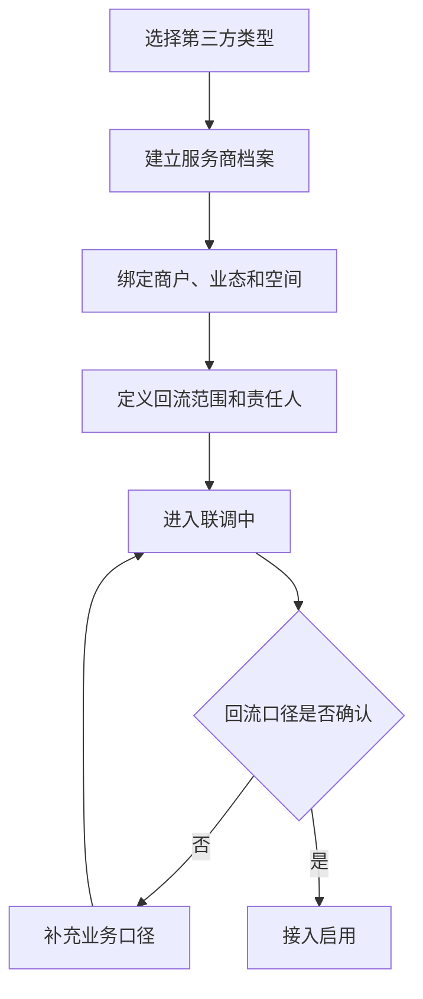
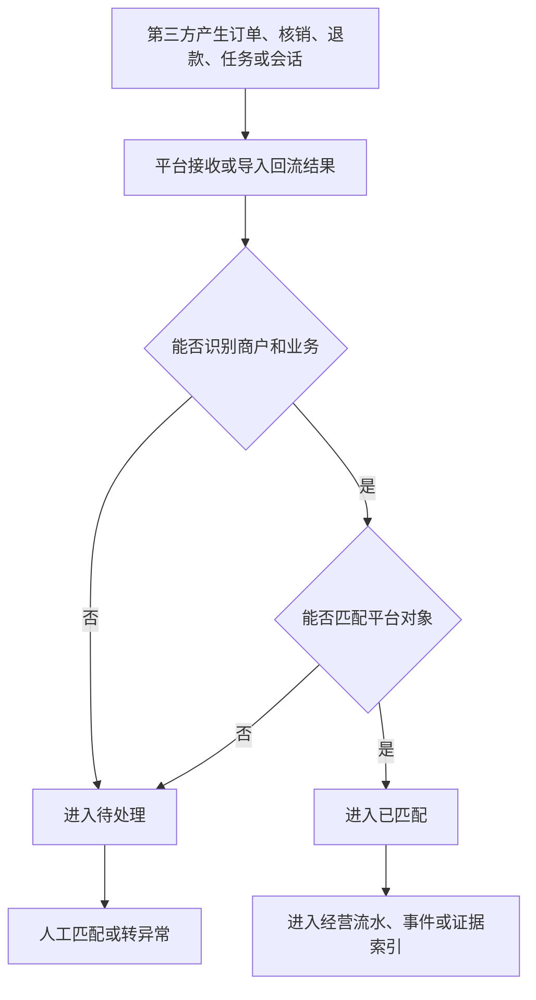
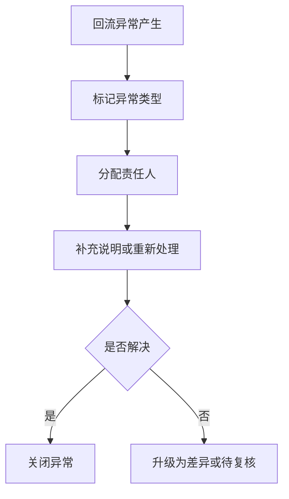
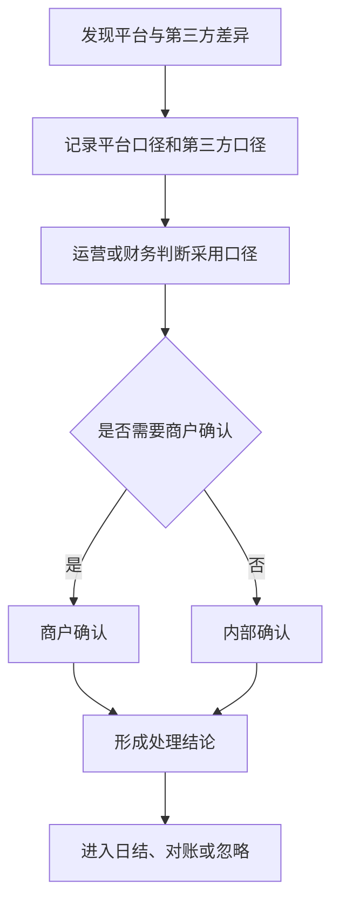
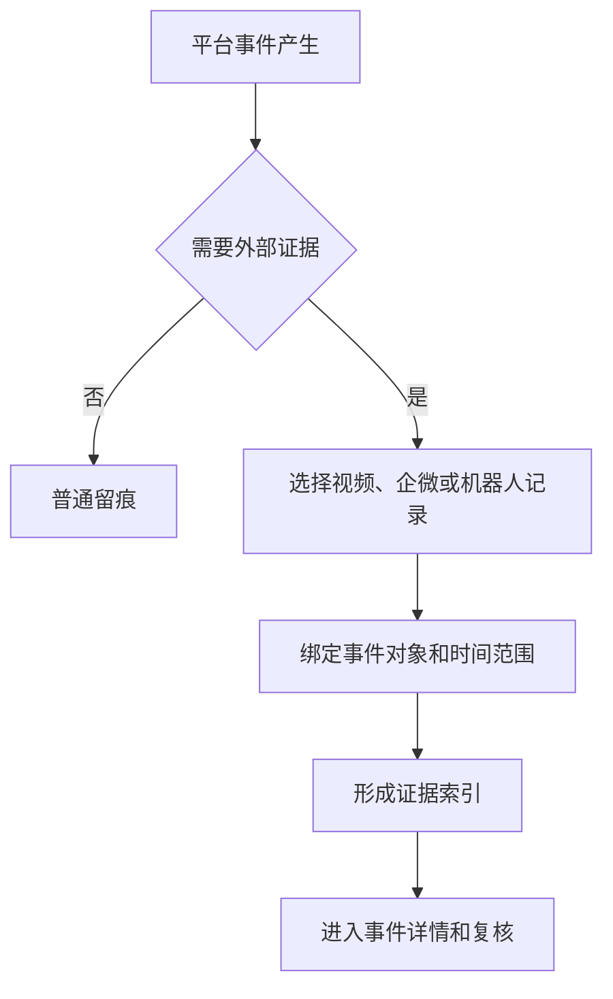
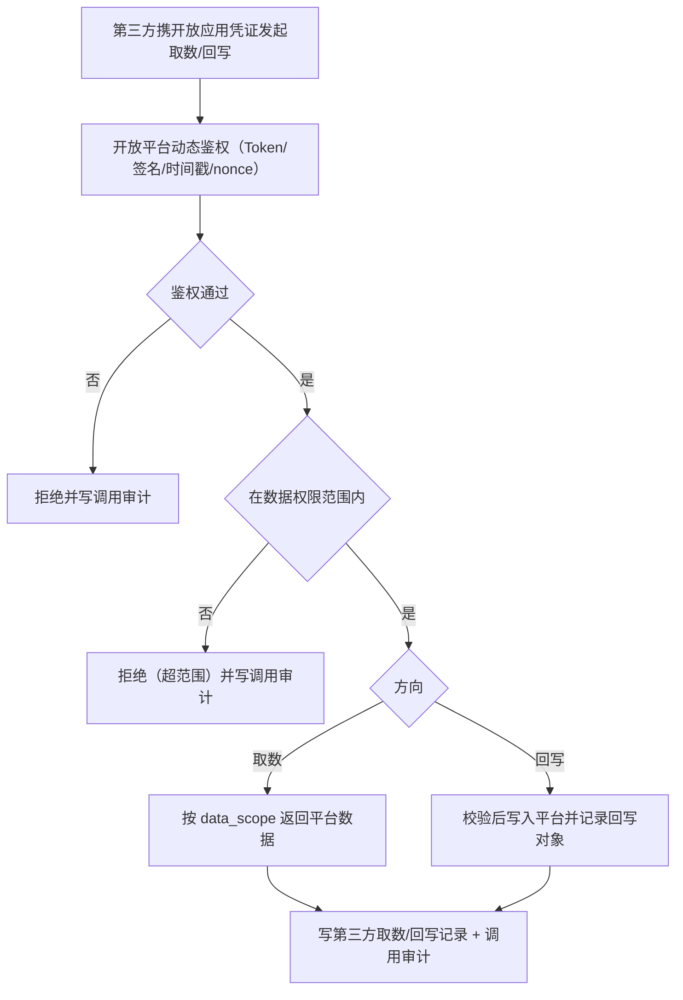

# 第三方接入层产品规格 V0.2
> 2026-07-04 逻辑一致性修订：补名词四层脚注

## 1. 文档定位

本文由归档前的同层 PRD/页面清单/字段字典/流程图/低保真说明/验收清单机械合并而来，作为该能力层后续开发、业务审计和验收的统一入口。原拆分文件已移入 `_archive/20260610-retention-audit/merged-layer-spec-sources/`，仅作历史追溯。

> **名词四层（业务口径）**：文中「综合体项目 / 商户（运营主体）/ SPV（项目公司）/ 组织主体」是业务分层称谓；底层数据库以 `business_entities` 一表多角色承载全部主体角色，并无独立 `organizations` 表，`projects` 表也不等同于「项目公司/SPV」。权威实体关系以 `merchant-space-contract-model-v0.1.md` 为准。

## 2. 合并来源

| 原文件 | 归档位置 |
|---|---|
| `third-party-access-layer-page-list-v0.1.md` | `_archive/20260610-retention-audit/merged-layer-spec-sources/third-party-access-layer-page-list-v0.1.md` |
| `third-party-access-layer-field-dictionary-v0.1.md` | `_archive/20260610-retention-audit/merged-layer-spec-sources/third-party-access-layer-field-dictionary-v0.1.md` |
| `third-party-access-layer-flow-diagrams-v0.1.md` | `_archive/20260610-retention-audit/merged-layer-spec-sources/third-party-access-layer-flow-diagrams-v0.1.md` |
| `third-party-access-layer-low-fi-prototype-v0.1.md` | `_archive/20260610-retention-audit/merged-layer-spec-sources/third-party-access-layer-low-fi-prototype-v0.1.md` |
| `third-party-access-layer-acceptance-checklist-v0.1.md` | `_archive/20260610-retention-audit/merged-layer-spec-sources/third-party-access-layer-acceptance-checklist-v0.1.md` |

> 历史来源不可覆盖声明：本文中的“来源”和合并来源内容仅保留审计证据和历史上下文，不得覆盖 `00-current-effective-document-entry-v0.1.md`、`unified-standards-baseline-v0.1.md`、`openapi/openapi-p0.yaml`、`p0-openapi-operation-acceptance-matrix-v0.1.md`、`p0-openapi-contract-closure-appendix-v0.1.md`、`p0-operation-permission-matrix-v0.1.md`、`p0-action-event-evidence-matrix-v0.1.md`、`p0-end-to-end-acceptance-and-edge-cases-v0.1.md` 和 `p0-user-story-map-and-sprint-slices-v0.1.md`。若历史段落与当前事实源冲突，以当前 S0/S1 文档为准。

## 2A. AI-ready 执行入口

本文是第三方接入层产品规格入口，负责说明第三方接入页面和业务职责，不替代开放平台契约或供应商适配器设计。任何第三方调用平台、平台调用供应商、Webhook、轮询校验、对账或补偿能力进入开发前，必须回到 `openapi/openapi-p0.yaml/json`、`p0-openapi-operation-acceptance-matrix-v0.1.md` 和 `p0-openapi-contract-closure-appendix-v0.1.md`；未进入追溯附录并通过 `verify:openapi-closure` 的能力不得生成供应商联调文档、SDK/mock 或接口自动化。

---

## 2B. 回流 payload 映射与渠道语义（mapPayload）

> 新增章节（修正(2026-06-19 R5业务HTML缺口审计 F11/F12)）：依据业务HTML #thirdparty——餐饮/零售四级汇总+实时、团购渠道（美团/点评/抖音）订单号/票码/支付/退款/核销/差异。**代码核验（Grep 佐证）**：webhook 入站仅落信封（`IntegrationOrderSyncService` 以 `safeMap(request.payload())` 原样存 `provider_payload_json`），**无 mapPayload 标准化映射**；团购回流复用通用 `integration_order_syncs`（V030），其 CHECK 仅约束 `business_type ∈ {catering, retail}`、`sync_type ∈ {order, refund, voucher_verification}`，**无渠道语义列**（无 `external_channel_order_id`、无 `channel`），无法区分美团/点评/抖音渠道，也无自动差异识别（全靠管理员手填）。本章补映射框架，使回流能解析为标准模型并参与对账。

### 2B.1 mapPayload 映射规范（webhook payload → 标准订单/券核销模型）

回流 webhook 的原始 payload 落库后，必须经 mapPayload 标准化为平台标准订单/券核销模型，而非原样透传业务主模型：

| 环节 | 规范 |
|---|---|
| 字段对齐 | 原始 payload 字段经 `request_mapping`/`response_mapping` 映射占位（见集成开发设计 §14.3）映射到标准订单（外部单号、金额分、支付/退款状态、营业日）/标准券核销（券码、核销状态、核销时间）模型；映射失败的 payload 仍保留原始留痕（`parse_status = failed`），进异常复核 |
| 幂等 | 映射前先按幂等键去重（订单：`open_app_id + (channel) + external_(channel_)order_id + order_status`；退款：`+ external_(channel_)refund_id`；券核销：`+ external_voucher_code + verification_seq`），重复回调返回首次结果不重复落标准模型 |
| 签名校验 | webhook 入站必须验签（HMAC + 时间戳 + nonce 防重放，复用开放平台动态鉴权）后才进入 mapPayload；验签失败拒绝并写调用审计，不落标准模型 |
| 金额口径 | 标准模型金额一律整数分（per 统一口径基准 D1），映射时完成单位归一 |

### 2B.2 团购渠道语义

为区分通用 POS 回流与团购渠道回流，标准模型新增渠道语义字段（落地以集成开发设计 §9.1 幂等键、§13.7 渠道事件为准，本层为产品口径登记）：

| 字段 | 含义 | 取值/说明 |
|---|---|---|
| `external_channel_order_id` | 团购渠道侧订单号 | 区分一笔渠道券核销与一笔 POS 订单（两条独立对账线，对齐 §6 回流层级） |
| `channel` | 团购渠道 | `meituan`（美团）/ `dianping`（大众点评）/ `douyin`（抖音） |

> 与现状差异：真实 `integration_order_syncs`（V030）当前**无** `external_channel_order_id`/`channel` 列，团购回流被并入通用 catering/retail。落地时需新迁移补渠道语义列或独立渠道回流表，并在 mapPayload 中按 `channel` 分流。

### 2B.3 自动差异识别（回流→标准模型→对账→差异→复核）

回流不再只落信封等管理员手填，而是构成自动链路（与 F5 对账强制化衔接）：

1. webhook 回流 → 验签 → 落原始 payload；
2. mapPayload → 标准订单/券核销模型（按 §2B.1）；
3. 标准模型自动进入对账：按回流层级（订单级/券核销级）与渠道分别比对平台侧流水；
4. 比对不一致自动生成差异（金额/数量/状态/缺失/重复），不依赖人工逐条录入；
5. 差异进差异清单复核（确认平台口径/第三方口径/转财务）。

### 2B.4 真实供应商字段未定前的占位

真实第三方接口字段/签名/对账文件未定前，按 `third-party-supplier-integration-kit-v0.1.md`（supplier kit）以适配器映射占位先行：固化 mapPayload 框架、标准模型、渠道语义字段、幂等与对账链路；供应商私有字段经适配器 `request_mapping/response_mapping` 占位，**不写死进票务/财务等业务主模型**。映射框架先行、真实字段后补。

### 2B.5 验收

- 回流 webhook payload 能经 mapPayload 解析为标准订单/券核销模型（映射失败留痕进异常），而非原样信封手填。
- 团购渠道订单可按 `channel`（meituan/dianping/douyin）与 `external_channel_order_id` 区分，订单级与券核销级两条对账线不混算。
- 回流标准模型自动参与对账并按四类差异自动识别，进差异清单复核。

> **待业务确认**：真实第三方（美团/点评/抖音、餐饮/零售 POS）接口字段、签名算法/header、对账文件格式资料未定；上述为映射框架与产品口径，真实字段映射、错误码、对账细则待供应商资料到位后补齐。

### 2B.6 回流自动差异识别与对账闭环（衔接F5）

> 新增小节（`R6 全闭环(2026-06-19)`）：承接 §2B.3（自动差异识别）并与 §5 流程图 F4（差异确认与对账协同）、集成开发设计 §12 对账差异衔接，明确"回流标准模型→对账批次→四类差异→差异进复核→结算"的数据流与状态。本小节与现有 R5(F12) 标注口径一致，不改既有内容；真实接口未接入前以 mock + 人工兜底（business-decision-log `R6-D07`）。

#### 2B.6.1 数据流与状态（回流→对账批次→四类差异→复核→结算）

| 环节 | 输入 | 处理 | 状态流转 |
|---|---|---|---|
| 回流标准模型 | webhook 原始 payload | 经 §2B.1 mapPayload 标准化为标准订单/券核销模型（映射失败 `parse_status=failed` 进异常） | 回流记录：received → matched / to_handle |
| 对账批次 | 标准模型（按回流层级订单级/券核销级 + 渠道分流） | 平台侧 expected 由系统取数自动生成（**禁止人工手填**，R6-D07）；第三方侧取数；按批次归集 | 回流批次：processing → completed / has_error |
| 四类差异识别 | 平台侧 expected vs 第三方侧 actual | 自动比对识别四类差异（见 §2B.6.2，引用集成开发设计 §12 强制枚举） | 差异记录：to_identify → open |
| 差异进复核 | open 差异 | 进差异清单（§9）复核：确认平台口径/第三方口径/转财务 | 差异记录：open → pending_review → closed |
| 结算 | 已关闭差异结论 | 按处理结论进入日结/对账/结算依据（财务子域） | 入账口径：accounted |

#### 2B.6.2 四类差异（amount/count/status/missing，引用 F5 强制枚举）

四类差异枚举与集成开发设计 §12.2 对账差异类型对齐（强制枚举，不自定义）：

| 差异类型 | 含义 | 处理方式（对齐 §9 差异清单） |
|---|---|---|
| `amount`（金额） | 平台侧与第三方侧金额不一致（单位分，D1） | 财务复核，确认采用口径 |
| `count`（数量） | 订单数/核销数不一致 | 运营确认事实，按层级核对 |
| `status`（状态） | 订单/核销/退款状态不一致 | 按状态优先级修正 |
| `missing`（缺失） | 一侧有另一侧无（平台缺/第三方缺） | 主动补拉或人工确认/重发 |

> 与 §9 差异清单页字段（差异类型：金额/数量/状态/缺失/重复）对齐；`missing` 对应集成开发设计 §12.2 的 `missing_in_platform`/`missing_in_third_party` 两向。

#### 2B.6.3 真实接口未接入前以 mock + 人工兜底（R6-D07）

按 business-decision-log `R6-D07`（对账 P0 边界）：

- **平台侧** expected 由系统取数自动生成，禁止人工手填，保证权威性。
- **第三方侧** 在真实接口未接入前，以人工录入（`source=manual`）方式登记并强制进复核；真实接口接入后由自动匹配（P1）替换人工录入，`manual` 记录保留可追溯。
- 占位期遵循 §2B.4：mapPayload 框架/标准模型/渠道语义/对账链路先固化，供应商私有字段经适配器映射占位，不写死进票务/财务等业务主模型。

#### 2B.6.4 验收

- 一笔回流可走完"映射（mapPayload）→对账（批次，平台侧系统取数 expected）→四类差异（amount/count/status/missing）→复核（差异清单确认口径/转财务）"，全链状态可追溯。
- 平台侧 expected 无人工手填；第三方侧未接入期以 `source=manual` 兜底 + 强制复核，manual 记录可追溯（R6-D07）。
- 四类差异枚举与集成开发设计 §12.2 强制枚举一致，不自定义差异类型。

---

## 3. 来源：第三方接入层页面清单 V0.1

> 原文件：`third-party-access-layer-page-list-v0.1.md`

### 第三方接入层页面清单 V0.1

### 1. 文档定位

本文档用于定义第三方接入层 P0 页面入口和页面职责。第三方接入层负责把餐饮、零售、机器人、视频监控、企业微信及其他服务商纳入平台统一管理口径。

本文档只定义产品页面，不写具体接入协议和实现方案。

### 2. 页面分组总览

> 修订说明（2026-06-07）：新增"对外开放授权"页面组，承载第三方在授权范围内主动取数/回写平台数据这一方向（入站回流之外的第二方向，finding third-1）；并在回流相关页补汇总粒度入口（third-4）、回流层级区分（third-5）、团购售票渠道（third-7）。

| 页面组 | 页面 | P0 目的 |
|---|---|---|
| 接入治理 | 接入总览、接入关系管理、服务商档案 | 看清楚哪些外部系统接入了哪些商户和业务 |
| 对外开放授权 | 开放应用授权、数据权限范围、第三方取数/回写记录、调用审计视图 | 看清楚第三方在授权范围内从平台取了/回写了哪些数据（对外方向） |
| 业务回流 | 回流记录、回流批次、汇总看板、匹配处理 | 看清楚外部系统回来了哪些经营结果 |
| 异常差异 | 接入异常、差异清单、人工处理 | 处理失败、延迟、重复、缺失和口径冲突 |
| 证据关联 | 视频证据索引、企微会话关联、机器人任务轨迹 | 把外部证据和平台事件绑定 |
| 对账协同 | 第三方对账视图、商户确认视图 | 支撑财务/对账子域（数据分析层下）做差异确认<!-- 修订说明（2026-06-08 三轮收口）：D2 已废"财务经营层/财务结算层"层级术语，统一为"数据分析层下的财务/对账子域"，就地对齐。依据 finding residual-scan-6、D2 --> |

### 3. 接入总览页

| 项 | 内容 |
|---|---|
| 页面目的 | 给运营和系统管理员查看第三方整体健康状态 |
| 主要信息 | 已接入系统数、今日回流量、异常数、待处理差异、暂停接入数 |
| 关键操作 | 查看异常、进入接入关系、进入回流批次 |
| 状态 | 待接入、联调中、已启用、暂停、异常、已停用、归档 |

### 4. 接入关系管理页

| 项 | 内容 |
|---|---|
| 页面目的 | 维护第三方系统与商户、业态、空间、合同的业务绑定 |
| 关键字段 | 第三方类型、第三方名称、绑定商户、绑定业态、回流范围、责任人、状态 |
| 关键操作 | 新建接入关系、启用、暂停、停用、查看回流结果 |
| 跳转 | 服务商档案、回流记录、差异清单 |

### 5. 服务商档案页

| 项 | 内容 |
|---|---|
| 页面目的 | 管理第三方服务商基础信息 |
| 关键字段 | 服务商名称、服务类型、联系人、联系方式、适用业务、备注 |
| 关键操作 | 新建、编辑、归档、查看关联接入 |

### 6. 回流记录页

> 修订说明（2026-06-07）：关键字段补"回流层级（订单级/券核销级）"用于区分两条对账线（finding third-5）；补"团购售票渠道（美团/大众点评/抖音）"专项字段（finding third-7）。

| 项 | 内容 |
|---|---|
| 页面目的 | 查看第三方返回的平台所需业务结果 |
| 关键字段 | 回流类型、**回流层级（订单级/券核销级）**、外部单号、平台关联对象、商户、金额/数量、状态、时间 |
| 团购渠道专项字段 | 渠道（美团/大众点评/抖音）、渠道订单号、票码/券码、支付/退款结果、核销状态、差异 |
| 按层级区分对账 | 订单级与券核销级独立列表/筛选与对账，避免一笔渠道券核销被误当一笔订单重复计金额（与开发设计 §12.1 四类对账对象对齐） |
| 关键操作 | 查看详情、匹配平台对象、标记异常、转差异处理 |

### 7. 回流批次页

| 项 | 内容 |
|---|---|
| 页面目的 | 按批次查看外部结果同步情况 |
| 关键字段 | 批次号、第三方系统、开始时间、结束时间、成功数、失败数、差异数 |
| 关键操作 | 查看批次详情、重新处理、生成差异清单 |

### 8. 接入异常页

| 项 | 内容 |
|---|---|
| 页面目的 | 管理接入失败、延迟、重复、缺字段和授权异常 |
| 关键字段 | 异常类型、第三方系统、影响范围、责任人、状态、处理结果 |
| 关键操作 | 分配处理人、补充说明、关闭、转人工补录 |

### 9. 差异清单页

| 项 | 内容 |
|---|---|
| 页面目的 | 管理平台与第三方口径不一致的记录 |
| 关键字段 | 差异类型、**回流层级（订单级/券核销级）**、外部单号、平台对象、金额差异、数量差异、状态差异、处理状态 |
| 关键操作 | 确认平台口径、确认第三方口径、忽略、转财务处理 |

> 修订说明（2026-06-07）：差异清单按"回流层级（订单级/券核销级）"区分，与回流记录页两条对账线对应（finding third-5）。

### 10. 证据关联页

| 页面 | P0 内容 |
|---|---|
| 视频证据索引 | 视频点位、事件时间、关联事件、调阅状态 |
| 企业微信会话关联 | 会话对象、员工、游客/客户、投诉或质检结果 |
| 机器人任务轨迹 | 任务状态、取货点、交付点、失败原因 |

### 10A. 汇总看板页（按粒度查看）

> 修订说明（2026-06-07）：新增汇总看板页，把"日/半日/小时/实时"四级汇总作为独立查看入口承载（finding third-4）。原文档无页面承载汇总粒度。

| 项 | 内容 |
|---|---|
| 页面目的 | 按汇总粒度查看餐饮/零售/渠道经营回流汇总 |
| 粒度入口 | 日汇总、半日汇总、小时汇总、实时汇总（单店小数据量场景）四级切换 |
| 关键字段 | 汇总粒度、业务类型、商户/门店、订单数、核销数、金额、退款、对账状态 |
| 关键操作 | 切换粒度、按商户/门店下钻、导出、进入对账 |

### 10B. 对外开放授权页面（对外取数/回写方向）

> 修订说明（2026-06-07）：新增"对外开放授权"方向的 4 个页面，承载第三方在开放授权与数据权限范围内主动取数/回写平台数据（finding third-1，复用开放平台动态鉴权，统一口径基准 D3）。

| 页面 | P0 内容 |
|---|---|
| 开放应用授权 | 授权应用、状态、密钥/有效期、绑定商户与服务商；引用开放平台应用口径（open_apps，7 态鉴权状态 per D3） |
| 数据权限范围 | 第三方可见/可写的商户、门店、项目、区域、对象级 data_scope 登记与查看 |
| 第三方取数/回写记录 | 调用应用、方向（取数/回写）、调用对象、数据范围、时间、结果 |
| 调用审计视图 | 调用人/应用、时间、接口、数据范围、结果、审计追溯（供安全与合规复核） |

### 11. 页面验收标准

> 修订说明（2026-06-07）：补对外开放授权与汇总粒度验收项（finding third-1/third-4）。

- 每类第三方都有接入关系入口。
- 每条回流记录都能看到外部单号、平台关联对象和回流层级（订单级/券核销级）。
- 回流异常和差异有独立处理入口。
- 视频、企微、机器人不要求 P0 自研，只要求证据或状态能回到平台。
- 团购售票渠道（美团/大众点评/抖音）回流在回流记录页有独立类型与字段入口。
- 汇总看板支持日/半日/小时/实时四级粒度查看。
- 对外取数/回写方向有开放应用授权、数据权限范围、取数回写记录与调用审计四个入口。
- 第三方回流结果能进入财务经营和事件风控。

### 12. 本版结论

第三方接入层页面清单已覆盖 P0 接入治理、结果回流、异常差异和证据关联。后续可以按第三方类型继续细化页面细节。

### 13. 变更日志

| 日期 | 类型 | 位置 | 内容 | 原因/依据 |
|---|---|---|---|---|
| 2026-06-07 | 增 | §2、§10B | 新增"对外开放授权"页面组（开放应用授权/数据权限范围/取数回写记录/调用审计） | finding third-1：对外取数/回写方向无页面承载 |
| 2026-06-07 | 增 | §10A | 新增汇总看板页（日/半日/小时/实时四级粒度） | finding third-4：汇总粒度无页面承载 |
| 2026-06-07 | 改 | §6、§9 | 回流记录页/差异清单页增"回流层级（订单级/券核销级）"并按层级区分对账 | finding third-5：两条对账线未区分 |
| 2026-06-07 | 增 | §6 | 回流记录页补团购售票渠道专项字段 | finding third-7：渠道/支付无页面入口 |
| 2026-06-07 | 改 | §11 | 补对外授权、汇总粒度、团购渠道、回流层级验收项 | finding third-1/third-4/third-5/third-7 |
| 2026-06-19 R6 全闭环 | 增 | §2B.6 | 新增"回流自动差异识别与对账闭环（衔接F5）"：明确 回流标准模型→对账批次→四类差异(amount/count/status/missing，引用集成开发设计 §12 强制枚举)→差异进复核→结算 的数据流与状态；真实接口未接入前以 mock + 人工(source=manual)兜底，平台侧 expected 系统取数禁手填(R6-D07)；补"一笔回流走完映射→对账→差异→复核"验收。承接 §2B.3，未改既有 R5(F12) 内容 | `R6 全闭环(2026-06-19)`；business-decision-log R6-D07(对账边界) |

---

## 4. 来源：第三方接入层字段字典 V0.1

> 原文件：`third-party-access-layer-field-dictionary-v0.1.md`

### 第三方接入层字段字典 V0.1

### 1. 文档定位

本文档定义第三方接入层 P0 产品字段。字段用于页面展示、业务匹配、异常处理、对账和留痕，不代表具体接入协议。

### 2. 接入关系字段

| 字段名 | 含义 | 必填 | 用途 |
|---|---|---|---|
| 接入编号 | 接入关系识别 | 是 | 追溯 |
| 第三方类型 | 餐饮、零售、机器人、视频、企微、支付/渠道等 | 是 | 分类 |
| 第三方名称 | 外部系统或服务商名称 | 是 | 展示 |
| 服务商 | 提供该能力的主体 | 是 | 联系和责任 |
| 绑定商户 | 外部系统归属商户 | 条件必填 | 数据边界 |
| 绑定业态 | 餐饮、零售、酒吧、游乐等 | 是 | 经营分类 |
| 绑定空间 | 适用区域或点位 | 条件必填 | 证据和现场关联 |
| 回流范围 | 订单、退款、核销、任务、会话、证据等 | 是 | 产品边界 |
| 责任人 | 平台侧负责接入的人 | 是 | 异常处理 |
| 接入状态 | 待接入、联调中、已启用等 | 是 | 流程控制 |

### 3. 服务商字段

| 字段名 | 含义 | 必填 | 用途 |
|---|---|---|---|
| 服务商名称 | 第三方公司或平台名称 | 是 | 展示 |
| 服务类型 | POS、机器人、视频、企微、售票渠道等 | 是 | 分类 |
| 主联系人 | 对接负责人 | 是 | 沟通 |
| 联系方式 | 电话、邮箱或企业微信 | 是 | 沟通 |
| 适用商户 | 哪些商户使用该服务 | 否 | 关联 |
| 合作备注 | 业务约定摘要 | 否 | 说明 |
| 服务状态 | 启用、暂停、停用、归档 | 是 | 页面控制 |

### 3A. 对外开放授权字段（对外取数/回写方向）

> 修订说明（2026-06-07）：新增"对外开放授权"方向字段，承载第三方在授权范围内主动取数/回写平台数据（finding third-1，复用开放平台动态鉴权，统一口径基准 D3）。原字段字典只覆盖入站回流方向。

| 字段名 | 含义 | 必填 | 用途 |
|---|---|---|---|
| 开放应用编号 | 授权给第三方的开放应用标识（关联 open_apps） | 是 | 授权追溯 |
| 应用名称 | 第三方开放应用名称 | 是 | 展示 |
| 授权状态 | 开放应用鉴权状态（7 态 per D3：draft/testing/active/suspended/locked/disabled/revoked） | 是 | 安全控制 |
| 密钥有效期 | 凭证/密钥到期时间 | 是 | 安全 |
| 数据权限范围 | 可见/可写的商户、门店、项目、区域、对象（data_scope） | 是 | 数据边界 |
| 调用方向 | 取数（读）/ 回写（写） | 是 | 区分取数与回写 |
| 调用对象 | 本次取数/回写的平台数据对象 | 是 | 审计 |
| 调用时间 | 调用发生时间 | 是 | 审计 |
| 调用结果 | 成功/失败/被拒（权限不足/超范围） | 是 | 审计与排障 |
| 审计追溯 | 调用人/应用、接口、数据范围、结果留痕 | 是 | 安全与合规复核 |

### 4. 回流记录字段

> 修订说明（2026-06-07）：(1) 回流类型新增"汇总（日/半日/小时/实时）"类别，并增"汇总粒度"字段，原文档未把汇总作为回流类别（finding third-4）。(2) 新增"回流层级（订单级/券核销级）"字段，区分两条独立对账线，原文档把订单/核销混为并列类型（finding third-5）。(3) 金额单位明确为分（整数），per 统一口径基准 D1。

| 字段名 | 含义 | 必填 | 用途 |
|---|---|---|---|
| 回流编号 | 平台内回流记录识别 | 是 | 追溯 |
| 回流类型 | 订单、退款、核销、任务、会话、证据、**汇总（日/半日/小时/实时）** | 是 | 分类 |
| 回流层级 | **订单级 / 券核销级**（一笔渠道券核销不等于一笔 POS 订单，两条独立对账线） | 条件必填 | 区分对账线 |
| 汇总粒度 | 当回流类型=汇总时：日 / 半日 / 小时 / 实时 | 条件必填 | 汇总看板与对账周期 |
| 外部单号 | 第三方侧识别号 | 是 | 匹配和对账 |
| 平台关联对象 | 平台内订单、权益、事件、任务等 | 条件必填 | 匹配 |
| 商户/运营主体 | 数据归属主体 | 是 | 权限和结算 |
| 金额 | 涉及金额，**单位：分（整数）** | 条件必填 | 对账 |
| 数量 | 涉及数量 | 条件必填 | 对账 |
| 发生时间 | 第三方业务发生时间 | 是 | 日结 |
| 接收时间 | 平台获得结果时间 | 是 | 延迟判断 |
| 回流状态 | 待接收、已接收、已匹配等 | 是 | 流程控制 |

### 5. 回流批次字段

| 字段名 | 含义 | 必填 | 用途 |
|---|---|---|---|
| 批次号 | 一组回流结果识别 | 是 | 批量处理 |
| 第三方系统 | 批次来源 | 是 | 分类 |
| 开始时间 | 批次开始 | 是 | 统计 |
| 结束时间 | 批次结束 | 是 | 统计 |
| 总数量 | 批次记录数量 | 是 | 统计 |
| 成功数量 | 匹配成功数量 | 是 | 健康判断 |
| 失败数量 | 异常数量 | 是 | 待处理 |
| 差异数量 | 进入差异清单数量 | 是 | 对账 |
| 批次状态 | 处理中、完成、有异常、已归档 | 是 | 页面控制 |

### 6. 异常与差异字段

| 字段名 | 含义 | 必填 | 用途 |
|---|---|---|---|
| 异常编号 | 异常识别 | 是 | 追溯 |
| 异常类型 | 延迟、重复、缺失、冲突、授权、无法匹配 | 是 | 分类 |
| 影响范围 | 影响商户、业务、日期或批次 | 是 | 判断优先级 |
| 差异类型 | 金额、数量、状态、缺失、重复 | 条件必填 | 对账 |
| 平台口径 | 平台认为的结果 | 条件必填 | 差异判断 |
| 第三方口径 | 第三方返回的结果 | 条件必填 | 差异判断 |
| 责任人 | 当前处理人 | 是 | 待办 |
| 处理状态 | 待处理、待复核、已关闭（**差异类记录**原含「已忽略」，已按 DEC-R4-2026-08-04-43 收为四态；**回流侧的「已忽略」已裁（DEC-R8-08）：同规则，删除**——与本平台无关的回流记录一律进入「异常」，按异常状态的统一出口以「作废并冲正」处置；**接入异常侧的「已忽略」已于 2026-08-06 按 DEC-R8-08 同规则裁定删除，收为四态**） | 是 | 流程 |
| 处理结论 | 最终采用口径或说明 | 条件必填 | 关闭依据 |

### 7. 第三方类型专项字段

> 修订说明（2026-06-07）：(1) 新增"团购售票渠道（美团/大众点评/抖音）"专项字段行（finding third-7），与渠道/支付区分。(2) 视频监控专项字段补"保存到期时间"，调阅人/时间/关联事件为强制审计字段（finding third-9）。(3) 餐饮/零售补"汇总粒度"专项字段（finding third-4）。

| 类型 | P0 专项字段 |
|---|---|
| 餐饮/零售 | 门店、订单金额（分）、退款金额（分）、券核销数量、营业日、汇总粒度（日/半日/小时/实时） |
| 团购售票渠道 | 渠道（美团/大众点评/抖音）、渠道订单号、票码/券码、支付金额（分）、退款金额（分）、核销状态、差异 |
| 机器人 | 任务号、取货点、交付点、任务状态、失败原因 |
| 视频监控 | 视频点位、事件时间段、调阅人（强制审计）、调阅时间（强制审计）、关联事件（强制审计）、证据说明、保存到期时间 |
| 企业微信 | 会话对象、员工、游客/客户、投诉标签、质检结果、留存策略/到期处置 |
| 渠道/支付（非团购） | 渠道订单号、支付金额（分）、退款金额（分）、支付状态 |

### 8. 状态字段

> 修订说明（2026-06-07）：补"接入关系业务状态 ↔ open_apps 鉴权状态"映射，明确二者是**两组字段**（产品侧讲业务接入生命周期，数据库侧讲应用鉴权安全态），消除 finding fielddb-9 口径冲突（统一口径基准 D7、开发设计 §14.2）。每个状态给中英 code 两列（D7 原则）。

| 对象 | 状态（中文）| 英文 code |
|---|---|---|
| 接入关系（业务状态 business_status） | 待接入、联调中、已启用、暂停、异常、已停用、归档 | pending、testing、active、paused、abnormal、disabled、archived |
| 服务商 | 启用、暂停、停用、归档 | active、suspended、terminated、archived |
| 回流记录 | 待接收、已接收、已匹配、待处理、已入账口径、异常（**六态**；原「已忽略」**已删除**，依据 DEC-R8-08——与本平台无关的回流记录一律进入「异常」，按异常状态的统一出口以「作废并冲正」处置，须填写原因并留痕，不设「忽略」类终态） | pending、received、matched、to_handle、accounted、abnormal（`ignored` 停用） |
| 回流批次 | 处理中、完成、有异常、已归档 | processing、completed、has_error、archived |
| 接入异常 | 待处理、处理中、待复核、已关闭（**四态**；原第五态「已忽略」**已删除**，依据 DEC-R8-08 同规则——接入异常不设「忽略」类终态，确认与本平台无关或无需处理的，一律填写原因后关闭并留痕） | open、processing、pending_review、closed（`ignored` 停用） |
| 差异记录 | 待识别、待处理、待复核、已关闭（**四态**；原第五态「已忽略」**已删除**，依据 DEC-R4-2026-08-04-43——账目均为电子数据、实时出账，留此终态等于承认可以把查不平的钱吃掉） | to_identify、open、pending_review、closed（`ignored` 停用） |

**接入关系业务状态 ↔ open_apps 鉴权状态映射（fielddb-9）：** 业务状态由本层维护，鉴权状态（draft/testing/active/suspended/locked/disabled/revoked，7 态 per D3）由开放平台维护、本层只读引用。映射明细见开发设计 §14.2。例：待接入→draft、联调中→testing、已启用→active、暂停→suspended、异常→locked、已停用→disabled、归档→revoked/disabled。

### 9. 字段验收标准

> 修订说明（2026-06-07）：补视频调阅强制鉴权+写审计硬条件与保存期限（finding third-9），补回流层级/汇总粒度/对外授权验收项（finding third-4/third-5/third-1）。

- 每条接入关系必须能绑定业务归属。
- 每条回流记录必须有外部单号。
- 涉及经营结果的回流必须能匹配平台对象或进入待处理。
- 涉及对账的回流记录必须标明回流层级（订单级/券核销级），订单级与券核销级分别对账。
- 汇总类回流必须标明汇总粒度（日/半日/小时/实时）。
- 差异必须同时保留平台口径和第三方口径。
- 视频、企微、机器人必须保留事件或任务关联字段。
- **视频证据调阅必须经权限校验并强制写审计（记录调阅人、时间、关联事件）；视频证据/截图/片段必须有保存到期时间，不无限期保存（合规文档 §6 C5；finding third-9）。**
- **企业微信会话必须有留存策略与到期处置字段，不以"永久保存"作为字段口径（合规文档 §4 C3；finding third-6）。**
- 对外取数/回写记录必须保留调用应用、方向（取数/回写）、数据范围、结果与审计追溯字段。

### 10. 本版结论

第三方接入层字段已满足 P0 产品判断和页面展示需要。具体字段映射可在后续接入设计中继续展开。

### 11. 变更日志

| 日期 | 类型 | 位置 | 内容 | 原因/依据 |
|---|---|---|---|---|
| 2026-06-07 | 增 | §3A | 新增对外开放授权字段（开放应用/授权状态/数据权限范围/调用方向/审计） | finding third-1：对外取数/回写方向无字段 |
| 2026-06-07 | 改 | §4 | 回流类型增"汇总（日/半日/小时/实时）"+汇总粒度字段；金额单位标"分" | finding third-4，统一口径基准 D1 |
| 2026-06-07 | 增 | §4 | 新增"回流层级（订单级/券核销级）"字段 | finding third-5：两条对账线未区分 |
| 2026-06-07 | 增 | §7 | 新增团购售票渠道专项字段；视频补审计/保存到期；餐饮零售补汇总粒度 | finding third-7/third-9/third-4 |
| 2026-06-07 | 改 | §8 | 状态补中英 code 两列；补接入关系业务态↔open_apps鉴权态映射 | finding fielddb-9，统一口径基准 D7 |
| 2026-06-07 | 改 | §9 | 补视频调阅强制鉴权+审计+保存期限、企微留存、回流层级/粒度/对外授权验收 | finding third-9/third-6/third-5/third-4/third-1 |

---

## 5. 来源：第三方接入层关键流程图 V0.1

> 原文件：`third-party-access-layer-flow-diagrams-v0.1.md`

### 第三方接入层关键流程图 V0.1

### 1. 文档定位

本文档描述第三方接入层 P0 产品流程，用于明确接入、回流、匹配、异常和差异处理路径。

### 2. 流程总览

> 修订说明（2026-06-07）：新增 F6"对外开放授权取数/回写"流程，承载入站回流之外的第二方向——第三方在授权范围内主动从平台取数或回写数据（finding third-1，复用开放平台动态鉴权，统一口径基准 D3）。

| 编号 | 流程 | 目标 |
|---|---|---|
| F1 | 第三方接入关系建立 | 明确外部系统归属和回流范围 |
| F2 | 业务结果回流与匹配（入站方向） | 明确外部结果如何纳入平台 |
| F3 | 回流异常处理 | 明确失败、延迟、重复如何处理 |
| F4 | 差异确认与对账协同 | 明确平台和第三方口径不一致如何关闭 |
| F5 | 外部证据关联 | 明确视频、企微、机器人结果如何关联事件 |
| F6 | 对外开放授权取数/回写（对外方向） | 明确第三方在授权范围内如何取数/回写并留痕 |

### 3. F1 第三方接入关系建立

### 4. F2 业务结果回流与匹配

### 5. F3 回流异常处理

### 6. F4 差异确认与对账协同

### 7. F5 外部证据关联

### 7A. F6 对外开放授权取数/回写

> 修订说明（2026-06-07）：新增对外方向流程（finding third-1）。第三方先获授权与数据权限范围，再经动态鉴权调用，取数/回写全程写调用审计。

### 8. 流程验收标准

> 修订说明（2026-06-07）：补对外取数/回写方向验收项（finding third-1）。

- 第三方结果不能直接进入经营口径，必须先匹配平台对象。
- 无法匹配的结果必须进入待处理或异常。
- 差异必须有处理结论。
- 外部证据必须关联平台事件。
- 对外取数/回写必须经动态鉴权与数据权限范围校验，并全程写调用审计。
- 接入关系停用后不能继续作为有效经营来源。

### 9. 本版结论

第三方接入层流程已覆盖接入、回流、异常、差异和证据关联，满足 P0 产品闭环。

### 10. 变更日志

| 日期 | 类型 | 位置 | 内容 | 原因/依据 |
|---|---|---|---|---|
| 2026-06-07 | 增 | §2、§7A | 新增 F6 对外开放授权取数/回写流程及流程图 | finding third-1：对外取数/回写方向无流程 |
| 2026-06-07 | 改 | §8 | 补对外取数/回写动态鉴权+权限范围+调用审计验收项 | finding third-1 |

---

## 6. 来源：第三方接入层低保真原型说明 V0.1

> 原文件：`third-party-access-layer-low-fi-prototype-v0.1.md`

### 第三方接入层低保真原型说明 V0.1

### 1. 文档定位

本文档用低保真方式说明第三方接入层主要页面结构。它不定义视觉样式，只说明页面区块、信息层级和关键交互。

### 2. 信息架构

建议一级入口为“第三方接入”，二级入口如下：

> 修订说明（2026-06-07）：新增"对外授权"二级入口（对外取数/回写方向，finding third-1）与"汇总看板"二级入口（按日/半日/小时/实时粒度查看，finding third-4）。

| 二级入口 | 作用 |
|---|---|
| 接入总览 | 查看整体接入健康状态 |
| 接入关系 | 管理第三方与商户、业态、空间绑定 |
| 服务商档案 | 管理第三方服务商基础信息 |
| 对外授权 | 开放应用授权、数据权限范围、第三方取数/回写记录、调用审计（对外方向） |
| 回流记录 | 查看外部业务结果 |
| 回流批次 | 查看同步或导入批次 |
| 汇总看板 | 按日/半日/小时/实时粒度查看经营回流汇总 |
| 异常差异 | 处理异常、差异和待复核 |
| 证据关联 | 绑定视频、企微、机器人证据 |

### 3. 接入总览低保真

首屏区块：
- 接入数量。
- 今日回流量。
- 异常接入数量。
- 待处理差异。
- 各第三方类型健康卡片。

关键交互：
- 点击异常进入异常差异。
- 点击第三方类型进入对应接入关系列表。
- 点击回流量进入回流记录。

### 4. 接入关系页低保真

结构：
- 顶部筛选：第三方类型、商户、业态、状态。
- 中部列表：第三方名称、绑定商户、回流范围、责任人、状态。
- 右侧详情：服务商、适用空间、最近回流、异常摘要。

关键操作：
- 新建接入关系。
- 启用、暂停、停用。
- 查看回流记录。

### 5. 回流记录页低保真

> 修订说明（2026-06-07）：筛选与列表补"回流层级（订单级/券核销级）"，团购渠道补专项列（finding third-5/third-7）。

结构：
- 顶部筛选：类型、回流层级（订单级/券核销级）、商户、渠道（含美团/大众点评/抖音）、日期、状态。
- 指标摘要：已接收、已匹配、待处理、异常。
- 主列表：外部单号/渠道订单号、回流层级、平台关联对象、金额/数量、状态、发生时间。
- 详情抽屉：原始业务摘要、匹配过程、处理记录。

重点：
- 外部单号和平台关联对象必须同时可见。
- 订单级与券核销级可分别筛选，避免混算金额。
- 无法匹配的记录要有“人工匹配”入口。

### 5A. 汇总看板页低保真

> 修订说明（2026-06-07）：新增按粒度查看汇总看板（finding third-4）。

结构：
- 顶部粒度切换：日 / 半日 / 小时 / 实时（单店小数据量）。
- 顶部筛选：业务类型（餐饮/零售/渠道）、商户/门店、营业日。
- 指标卡：订单数、核销数、金额、退款、对账状态。
- 主列表：按商户/门店下钻的汇总行，可导出、跳转对账。

### 5B. 对外授权页低保真

> 修订说明（2026-06-07）：新增对外取数/回写方向页面（finding third-1）。

结构：
- 顶部分页：开放应用授权 / 数据权限范围 / 取数回写记录 / 调用审计。
- 开放应用授权：应用、授权状态、密钥有效期、绑定商户/服务商。
- 数据权限范围：商户/门店/项目/区域/对象级 data_scope 配置。
- 取数回写记录：调用应用、方向（取数/回写）、对象、数据范围、时间、结果。
- 调用审计：调用人/应用、接口、数据范围、结果、可追溯。

重点：
- 取数与回写方向必须可区分。
- 每次对外调用都可在调用审计中追溯。

### 6. 异常差异页低保真

结构：
- 左侧异常类型筛选。
- 中间差异列表。
- 右侧处理区：平台口径、第三方口径、处理结论、责任人。

关键操作：
- 确认平台口径。
- 确认第三方口径。
- 转财务处理。
- 忽略并填写原因。

### 7. 证据关联页低保真

结构：
- 事件搜索区。
- 外部证据来源选择：视频、企业微信、机器人。
- 时间范围或任务范围。
- 已绑定证据列表。

重点：
- 证据只作为事件索引，不在 P0 追求替代外部系统。

### 8. 验收标准

> 修订说明（2026-06-07）：补对外授权与汇总粒度入口验收（finding third-1/third-4）。

- 接入关系、回流记录、异常差异、证据关联都有独立入口。
- 对外授权（开放应用/数据权限范围/取数回写记录/调用审计）有独立入口。
- 汇总看板支持日/半日/小时/实时四级粒度切换。
- 接入总览能看到接入健康状态。
- 回流记录可按回流层级（订单级/券核销级）区分查看。
- 无法匹配记录能进入人工处理。
- 差异处理能显示双方口径和处理结论。

### 9. 本版结论

第三方接入层低保真结构已经覆盖 P0 页面体验，后续可按具体第三方类型继续细化。

### 10. 变更日志

| 日期 | 类型 | 位置 | 内容 | 原因/依据 |
|---|---|---|---|---|
| 2026-06-07 | 增 | §2、§5B | 新增对外授权二级入口与页面低保真 | finding third-1：对外取数/回写方向无原型 |
| 2026-06-07 | 增 | §2、§5A | 新增汇总看板二级入口与按粒度低保真 | finding third-4：汇总粒度无入口 |
| 2026-06-07 | 改 | §5 | 回流记录页补回流层级、团购渠道筛选与列 | finding third-5/third-7 |
| 2026-06-07 | 改 | §8 | 补对外授权、汇总粒度、回流层级验收项 | finding third-1/third-4/third-5 |

---

## 7. 来源：第三方接入层产品验收清单 V0.1

> 原文件：`third-party-access-layer-acceptance-checklist-v0.1.md`

### 第三方接入层产品验收清单 V0.1

### 1. 文档定位

本文档用于验收第三方接入层产品文档是否完整、一致、可进入后续接入设计。

### 2. 文档完整度

| 文档 | 状态 |
|---|---|
| `third-party-business-access-product-prd-v0.1.md` | 已完成 |
| `third-party-access-layer-page-list-v0.1.md` | 已完成 |
| `third-party-access-layer-field-dictionary-v0.1.md` | 已完成 |
| `third-party-access-layer-flow-diagrams-v0.1.md` | 已完成 |
| `third-party-access-layer-low-fi-prototype-v0.1.md` | 已完成 |

### 3. 模块覆盖

> 修订说明（2026-06-07）：(1) 餐饮/零售"或日汇总"更正为"日/半日/小时/实时四级汇总"（finding third-4）。(2) 按统一收敛口径标注阶段：餐饮/零售真实回流=P1，团购售票渠道与企微基础质检=P0，机器人/视频=P2（finding third-2）。(3) 新增"团购售票渠道"行=P0（finding third-3/third-7）。(4) 新增"对外开放授权"覆盖行（finding third-1）。

| 模块 | 覆盖要求 | 阶段 | 结果 |
|---|---|---|---|
| 团购售票渠道（美团/大众点评/抖音） | 渠道订单回流、票码/券码核销、支付退款、对账 | P0 | 通过 |
| 企业微信 | 每日会话同步、上传状态、会话归属、投诉或基础关键词命中与复核 | P0（基础质检） | 通过 |
| 对外开放授权 | 开放应用授权、数据权限范围、取数/回写记录、调用审计 | P0（仅接口预留） | 已补齐并复核通过；真实第三方字段/签名规则待 P1 资料到位 |
| 餐饮 | 订单级、券核销级、退款，日/半日/小时/实时四级汇总 | P1 | 通过 |
| 零售 | 订单级、券核销级、退款，日/半日/小时/实时四级汇总，商品汇总预留 | P1 | 通过 |
| 机器人 | 任务状态、取货、交付、失败原因 | P2 | 通过 |
| 视频监控 | 点位、事件时间段、证据索引；调阅强制鉴权+写审计、设保存期限 | P2 | 通过 |
| 渠道/支付（非团购） | 外部单号、支付结果、退款结果、差异 | P1 | 通过 |

### 4. 流程验收

| 流程 | 结果 |
|---|---|
| 接入关系建立 | 通过 |
| 回流结果匹配 | 通过 |
| 接入异常处理 | 通过 |
| 差异确认 | 通过 |
| 证据关联 | 通过 |

### 5. 边界验收

- 不自研完整餐饮 POS。
- 不自研完整零售 POS。
- 不自研机器人调度系统。
- 不自研视频监控平台。
- 不替代企业微信。
- P0 只要求关键经营结果回到平台。

### 6. 已确认规则和后续供应商依赖

> 修订说明（2026-06-07）：第2条汇总粒度明确为"日/半日/小时/实时四级"（finding third-4）；新增企微会话留存与视频调阅合规两条已确认规则（finding third-6/third-9）。

已确认规则：

1. 餐饮/零售第三方回流同时支持订单级和券核销级（P1 阶段落地，finding third-2）。
2. 餐饮/零售汇总看板支持日、半日、小时、实时**四级**粒度（单店小数据量场景用实时；finding third-4）。
3. 美团、大众点评、抖音 P0 只覆盖团购购票、订单回流、票码/券码核销和对账（独立 P0 接入对象，finding third-3）。
4. 企业微信工作会话**留存期限可配置（非永久）**，到期归档/销毁/匿名化；不脱敏原文仅限最小授权 + 审批的取证/质检场景，普通展示按权限脱敏，查看强制写审计（合规文档 §4 C3、报告 A7；finding third-6）。　**【已作废（2026-08-03 L-19 裁决 `DEC-CFG-2026-08-03-10`）】企微会话原文永久保存、不自动到期删除；本处销毁／留存期／到期处置规格不得实施；确需清理仅限最高权限本人插授权 U 盘密钥手动执行（逐条填写理由、先试运行预览、清理动作本身另行留痕）。原文保留仅作历史留痕。**
5. 视频证据调阅必须经权限校验并强制写审计（调阅人/时间/关联事件），证据/截图/片段设保存期限（合规文档 §6 C5；finding third-9）。
6. 对外取数/回写方向 P0 做接口预留：开放应用授权、数据权限范围、取数/回写记录、调用审计可登记可查（finding third-1）。

后续供应商依赖：

1. 视频证据 P0 不强制平台内可直接查看；先保存证据索引/链接/附件、权限校验和调阅审计，平台内播放按供应商能力进入 P1/P2。
2. 企业微信 P0 优先做投诉/违规/服务质量基础规则质检，销售转化深度分析进入 P2 AI 质检。
3. 第三方差异主责：财务负责金额和结算口径，运营负责订单/核销事实确认，商户负责本商户业务解释；平台系统保留差异流转和责任留痕。

### 6A. 实施依赖与后续关注

> 新增说明（2026-06-07 收口）：本验收清单原对本轮才补齐的页面/模块直接判"通过"、结论写"已闭环"，且无"已知缺口/待复核"节，与 business-operations/data-analysis/platform-governance 等其它域验收清单据实下调的处理不一致。现据实补登已知缺口并下调相关结论。依据 finding overclaim-1。

| 关注项 | 说明 | 状态 |
|---|---|---|
| 对外取数/回写方向（third-1） | P0 **仅接口预留**（开放应用授权/数据权限范围/取数/回写记录/调用审计为登记可查口径），真实对外取数/回写业务逻辑、第三方字段/签名规则待资料到位 | 已补齐并复核通过；P1 实施映射 |
| 双回流层级（third-5） | 餐饮/零售订单级 + 券核销级"双回流"层级关系已明确，真实回流字段与对账细则待第三方资料确认 | 已补齐并复核通过；P1 实施映射 |
| 团购渠道（third-3/third-7） | 美团/大众点评/抖音团购售票渠道为 P0 产品口径，渠道订单/票码券码核销/退款/对账字段待真实渠道接口资料确认 | 已补齐并复核通过；P0 先做接口容器和示例 payload |

> 上述事项不阻塞 P0 产品口径定稿。P0 不假设真实供应商 SDK/API 已确定，只实现接口容器、鉴权、Webhook、幂等、回流记录、差异容器、供应商适配器占位和示例 payload。字段映射、签名细节、错误码、状态码、对账文件和异常补偿规则在供应商资料到位后补齐，且不得把供应商私有字段写死进票务、酒吧、财务等业务主模型。

### 7. 本版结论

第三方接入层 P0 产品文档已闭环：团购渠道基础回流、企业微信基础质检、对外接口预留和供应商接入占位已经覆盖；餐饮/零售真实回流、机器人、视频和供应商 SDK/API 映射按 P1/P2 在资料到位后实施，具体适配规则见 `third-party-supplier-integration-kit-v0.1.md`。

> 修订说明（2026-06-07 收口）：原结论"第三方接入层 P0 产品文档已闭环"为唯一漏做据实下调的域，现参照其它域下调为"本轮补齐、待复核"。依据 finding overclaim-1。

### 8. 变更日志

| 日期 | 类型 | 位置 | 内容 | 原因/依据 |
|---|---|---|---|---|
| 2026-06-07 | 改 | §3 模块覆盖 | "或日汇总"改"日/半日/小时/实时四级汇总"；按 P0/P1/P2 标阶段；新增团购渠道(P0)与对外开放授权行 | finding third-4/third-2/third-3/third-7/third-1 |
| 2026-06-07 | 改 | §6 已确认规则 | 汇总四级明确化；新增企微留存与视频调阅合规两条规则；新增对外授权预留规则 | finding third-4/third-6/third-9/third-1 |
| 2026-06-07 收口 | 改 | §3 对外开放授权行、§7 结论 | "通过"下调为"本轮补齐，待复核"；§7 结论由"已闭环"据实下调为"本轮补齐、待复核" | 唯一漏做据实下调的域，与其它域处理不一致。依据 finding overclaim-1 |
| 2026-06-07 收口 | 增 | §6A 已知缺口 | 新增"已知缺口（待复核）"节，登记 third-1 对外方向仅接口预留、双回流层级、团购渠道待复核 | 全文原无"已知缺口"节。依据 finding overclaim-1 |
| 2026-06-08 | 改 | §3/§6A/§7 | 将 P0 接口预留与团购渠道口径由"待复核"收口为"已补齐并复核通过"，真实第三方字段改列为 P1/P2 实施依赖 | 对齐用户"第三方先留接口，自己的系统先开发"决策与产品流复核报告 |
| `文档goalP1(2026-06-20)` | 增 | §8 | 新增"补登：人脸/年龄核验(face.verification.enabled)与设备/闸机(gate_nfc_scan_device)供应商接入规格"，补两类此前在本层只在字段字典 §7 出现专项字段、但无页面/字段/失败场景/核验留痕完整登记的供应商 | 产品规格层缺两类供应商完整口径；与 `third-party-integration-development-design` §13.6/§14.17 设备事件、合规 §2 年龄核验对齐 |

---

## 8. 补登：人脸/年龄核验（face.verification.enabled）与设备/闸机（gate_nfc_scan_device）供应商接入规格

> 新增章节（`文档goalP1(2026-06-20)`）：本层此前仅在字段字典 §7（视频/企微专项字段）和接入治理页（§2 提及机器人/视频/企微）覆盖了视频、企微、机器人、团购渠道与餐饮/零售 POS，**人脸/年龄核验**与**设备/闸机**两类供应商虽已在 `integration-capability-switches-v0.1.md`（开关 `face.verification.enabled`、`gate_nfc_scan_device`）与合规文档 §2 出现，但本层无独立页面/字段/失败场景/核验留痕登记。本节据实补登，与 `third-party-integration-development-design`（§4.1 接入矩阵、§13.6 设备事件、§14.17 device_integration_events、§6.5 通用错误码）和 `compliance-and-personal-information-protection-requirements-v0.1.md` §2（未成年人售酒）对齐。两类供应商默认开关 off，真实供应商资料未定前以 mock adapter + 占位字段先行，不写死进酒吧/票务业务主模型。

### 8.1 人脸/年龄核验（face.verification.enabled）

**业务定位**：酒吧门口"入场年龄核验"关卡的第三方人脸/年龄核验能力。仅用于售酒/入场合规判定（与合规 §2 对齐），**不扩大游客实名范围**（合规 §8）；核验仅返回最小必要结果（已满 18 岁／未满 18 岁两档、活体）；**原始人脸照片是否保留，取决于第三方人脸识别 SDK 允不允许——允许保留的按上述两档分类保留，不允许保留的一律不保留；平台不自设开关**。

**关联开关**：`integration-capability-switches-v0.1.md` 的 `face.verification.enabled`（默认 off，关联证据 PRD-FACE-001）。第三方接口未接入期（设备尚未安装或发生故障）**进入人工抽查放行、客人继续进场——不要求逐人查验证件，但应当对明显疑似未成年的人员进行查验，不得把疑似未成年人当作普通未抽查人员直接放行**；全程审计留痕，不得展示"自动人脸核验已通过"。

#### 8.1.1 页面（落在"接入治理 / 证据关联"页面组，新增专项视图）

| 页面 | P0 内容 |
|---|---|
| 人脸/年龄核验接入配置 | 供应商档案、能力开关状态（on/off）、环境（mock/生产）、credential_ref 引用、合规材料登记、生产就绪状态（须法务/采购资料齐备） |
| 核验记录视图 | 核验流水（核验点位=综合体入场·年龄核验环节、核验方式=face/manual/face_and_manual、结果=已满 18 岁／未满 18 岁两档、活体结果、供应商流水引用、操作人、时间）；不展示原始人脸图像 |
| 核验异常/复核入口 | 供应商超时/不可用、活体分过低、低质量图像等**进入人工抽查放行、客人继续进场**——不要求逐人查验证件，但应当对明显疑似未成年的人员进行查验，不得把疑似未成年人当作普通未抽查人员直接放行；与 §8 异常差异页统一处置 |

#### 8.1.2 字段（与合规 §2.2 入场记录字段对齐，本层登记供应商结果引用占位）

| 字段名 | 含义 | 必填 | 用途 |
|---|---|---|---|
| `face_provider_code` | 人脸/年龄核验供应商标识 | 是 | 供应商区分 |
| `face_provider_result_id` | 供应商侧核验流水号 | 是 | 对账/追溯 |
| `face_verify_result` | 平台标准结果（已满 18 岁／未满 18 岁两档） | 是 | 入场判定（售酒环节继承入场结论，不再逐单验龄） |
| `liveness_result` | 活体结果（通过/失败/低分） | 条件必填 | 防伪 |
| `face_verify_error_code` | 供应商失败码映射（占位，`FACE_*` 命名空间） | 条件必填 | 失败归因 |
| `verified_by` / `verified_at` | 操作人 / 核验时间 | 是 | 审计留痕 |

- **人脸与生物特征属法律法规要求保护的七项个人信息之一**：凡导出内容中包含本组字段，一律**强制脱敏**——是否脱敏不由导出人判断，**也不提供关闭开关**，系统按导出内容自动判定并强制执行；审计人员**查看或导出**人脸与身份等个人信息**需先经审批并全程留痕**（依据 PGM 导出强制脱敏条、PGM 审计人员查看或导出敏感信息条）。

> 供应商私有字段（如 `person_id`/`verify_id`/`age`/`liveness_score`/`result_code`）经适配器 `request_mapping/response_mapping` 占位（supplier kit §3.2），不写死进酒吧入场/点酒主模型。

#### 8.1.3 失败场景（必须可处置，一律人工抽查放行、客人继续进场）

| 失败场景 | 处置口径 |
|---|---|
| 供应商超时/不可用 | **进入人工抽查放行、客人继续进场**——不要求逐人查验证件，但应当对明显疑似未成年的人员进行查验，不得把疑似未成年人当作普通未抽查人员直接放行；落事件 + 异常记录（合规 §2 + supplier kit §7） |
| 活体分过低 / 疑似照片翻拍 | 判活体失败，**进入人工抽查放行、客人继续进场——不要求逐人查验证件，但应当对明显疑似未成年的人员进行查验，不得把疑似未成年人当作普通未抽查人员直接放行**；落事件 + 异常记录 |
| 低质量图像 / 无法识别 | 不得标记"已完成年龄核验"，可重试；重试仍不通过的**进入人工抽查放行、客人继续进场——不要求逐人查验证件，但应当对明显疑似未成年的人员进行查验，不得把疑似未成年人当作普通未抽查人员直接放行**；落事件 + 异常记录 |
| 判定为未成年人 | 综合体入场的年龄核验环节拒绝进入、不得进入检票环节；落事件 + 异常记录留痕（合规 §2；售酒豁免后由年龄核验环节承接，bar 不再独立验龄/拒售） |
| 供应商未配置/第三方接口未接入 | **进入人工抽查放行、客人继续进场——不要求逐人查验证件，但应当对明显疑似未成年的人员进行查验，不得把疑似未成年人当作普通未抽查人员直接放行**；不得标记"自动核验已通过" |

> 失败码统一走 `FACE_*` 命名空间（`FACE_TIMEOUT`/`FACE_LOW_LIVENESS`/`FACE_MANUAL_REVIEW`，见 sms-notification-and-supplier-field-mapping 占位文档 §3），真实供应商码到位后在适配器映射。

#### 8.1.4 核验留痕口径

每次核验（含失败/拒绝）写事件中心：核验人、核验方式（人工/人脸/双重）、点位、结果、供应商流水引用、时间、拒绝原因码。供应商人脸结果引用与最小必要结果落库；**原始人脸照片是否保留，取决于第三方人脸识别 SDK 允不允许——允许保留的按上述两档分类保留，不允许保留的一律不保留；平台不自设开关**；确需取证留存按合规 §3.1 单独同意 + 最小化 + 加密引用。

### 8.2 设备/闸机（gate_nfc_scan_device）

**业务定位**：闸机、NFC 读卡器、扫码枪等核销/开闸设备的第三方接入。平台侧承接设备注册、核销校验、开闸结果、离线队列与设备事件回流（与 `third-party-integration-development-design` §13.6 设备事件、§14.17 device_integration_events 对齐）。核销判定仍由平台权益/票务主导，设备不绕过平台核销。

**关联开关**：`integration-capability-switches-v0.1.md` 的 `gate_nfc_scan_device`（默认 off，关联证据 PRD-3P-001/PRD-CRED-3P-001）。关闭时票务/权益核销只走后台或人工扫码录入。

#### 8.2.1 页面（落在"接入治理 / 证据关联"页面组，新增专项视图）

| 页面 | P0 内容 |
|---|---|
| 设备/闸机接入配置 | 设备供应商档案、设备注册（平台设备ID↔外部设备ID）、绑定门店/点位、能力开关状态、credential_ref、生产就绪状态 |
| 设备核销/开闸记录视图 | 设备事件流水（事件类型=scan/nfc_read/gate_open/offline_sync、结果=success/failed/abnormal、关联核销/票码、设备序列、发生时间） |
| 设备异常入口 | 心跳超时/离线、开闸失败、重复上报、序列冲突进入异常差异页处置（§8 异常差异页） |

#### 8.2.2 字段（与 `third-party-integration-development-design` §14.17 device_integration_events 对齐，本层产品口径登记）

| 字段名 | 含义 | 必填 | 用途 |
|---|---|---|---|
| `device_id` | 平台设备ID | 是 | 设备台账 |
| `external_device_id` | 外部设备ID/序列号（供应商 `sn` 占位） | 是 | 供应商映射 |
| `event_type` | scan / nfc_read / gate_open / offline_sync | 是 | 事件分类 |
| `event_result` | success / failed / abnormal | 是 | 处置判断 |
| `event_seq` | 设备事件序列号 | 是 | 幂等（device_id+event_seq 唯一） |
| `business_id` | 关联核销/票码业务ID | 条件必填 | 核销关联 |
| `gate_open_result` | 开闸结果（已开/失败/超时） | 条件必填 | 开闸闭环 |
| `device_provider_error_code` | 供应商失败码映射（占位，`DEVICE_*` 命名空间） | 条件必填 | 失败归因 |
| `occurred_at` | 设备事件发生时间 | 是 | 对账/延迟判断 |

> 供应商私有字段（`sn`/`device_status`/`event_id`/`reported_at`）经适配器映射占位（supplier kit §3.2A 设备厂商样例），不写死进票务/核销主模型。

#### 8.2.3 失败场景（与设备事件/异常补偿对齐）

| 失败场景 | 处置口径 |
|---|---|
| 心跳超时 / 设备离线 | 进设备异常告警（supplier kit §7），离线期核销走离线队列 + 上线补传 |
| 开闸失败 / 超时 | 落 `device.gate_open_failed`（risk 类，§13.6），核销有效性以平台为准，进异常复核 |
| 重复上报 / 序列冲突 | 按 `device_id + event_seq` 幂等去重，冲突进异常复核（§8 异常差异页 duplicate） |
| 离线补传与在线状态不一致 | 进对账差异（status/duplicate），按平台核销口径修正 |
| 供应商未配置/开关 off | 核销只走后台或人工扫码录入，不伪调用设备接口 |

> 失败码统一走 `DEVICE_*`（`DEVICE_OFFLINE`/`ROBOT_TASK_FAILED` 等，见占位文档 §3），真实设备协议码到位后在适配器映射。

#### 8.2.4 核销/开闸留痕口径

设备核销/开闸事件（含失败）写设备事件表 + 事件中心：设备、点位、事件类型、结果、关联核销/票码、序列号、时间。开闸结果与平台核销关联，**核销有效性以平台权益核销为权威**，设备本地结果仅作设备侧事件留痕与对账依据（与 §12.1 设备核销对账对象一致）。

### 8.3 验收

- 人脸/年龄核验、设备/闸机各有接入配置页、记录视图与异常/复核入口，能力开关 off 时页面显示未启用且不伪调用供应商。
- 人脸核验供应商不可用/活体失败时**进入人工抽查放行、客人继续进场**（不要求逐人查验证件，但应当对明显疑似未成年的人员进行查验）；判未成年人禁止售酒并记原因码。
- 设备核销/开闸事件按 `device_id + event_seq` 幂等；开闸失败/离线进异常复核，核销有效性以平台为准。
- 两类供应商私有字段经适配器占位，不写死进酒吧/票务主模型；失败码分别走 `FACE_*` / `DEVICE_*` 命名空间。
- 核验/核销留痕齐全（操作人/方式/点位/结果/供应商流水引用/时间/失败码）；**原始人脸照片是否保留，取决于第三方人脸识别 SDK 允不允许——允许保留的按上述两档分类保留，不允许保留的一律不保留；平台不自设开关**。

> **待业务确认（供应商资料）**：①人脸/年龄核验真实供应商（活体字段、年龄结果阈值、失败码、合规材料/数据处理协议）；②设备/闸机真实供应商（设备协议/指令集、开闸回调格式、离线队列格式、序列号规则）。上述为产品口径与映射框架，真实字段/签名/错误码/对账细则待供应商资料到位后经适配器补齐（supplier kit §9）。

## 继续合并补录（2026-08-28）

> 本节补齐此前未被目标逐字承接的代码相关原文。为避免把历史冲突重新升级为现行规则，以下内容按源文逐字保存；若与本文文首修订、S0/S1 事实源或 `docs/scope-wide-coding-rule-canonical-V0.01.md` 冲突，以后者为准。
> 本节只做载体收拢，不修改三份业务 HTML，也不改变已经裁定的现行/废止关系。

### 来源：`docs/_archive/20260610-retention-audit/merged-layer-spec-sources/third-party-access-layer-acceptance-checklist-v0.1.md`

> 本次逐字补录 1 条；该源其余 40 条已在本目标，0 条已在范围规范唯一载体。

~~~~text
P0 不假设真实供应商 SDK/API 已确定，只实现接口容器、鉴权、Webhook、幂等、回流记录、差异容器和示例 payload。
~~~~
